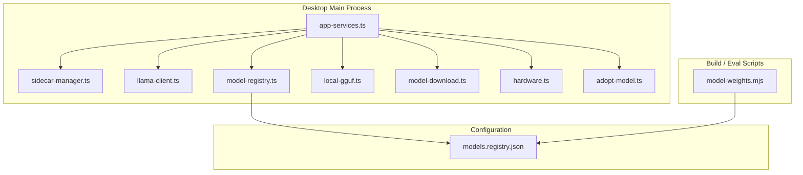
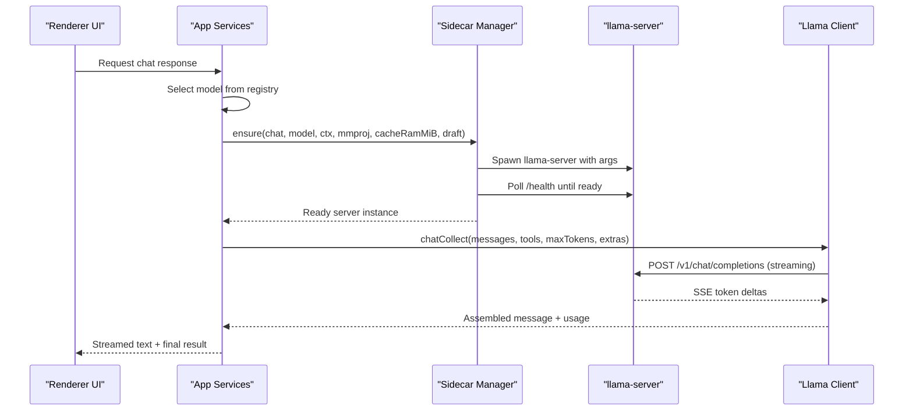
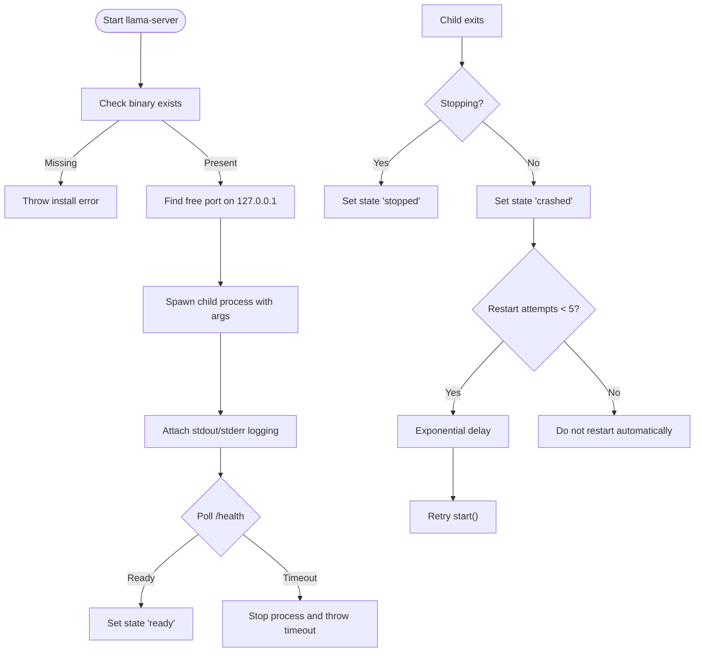
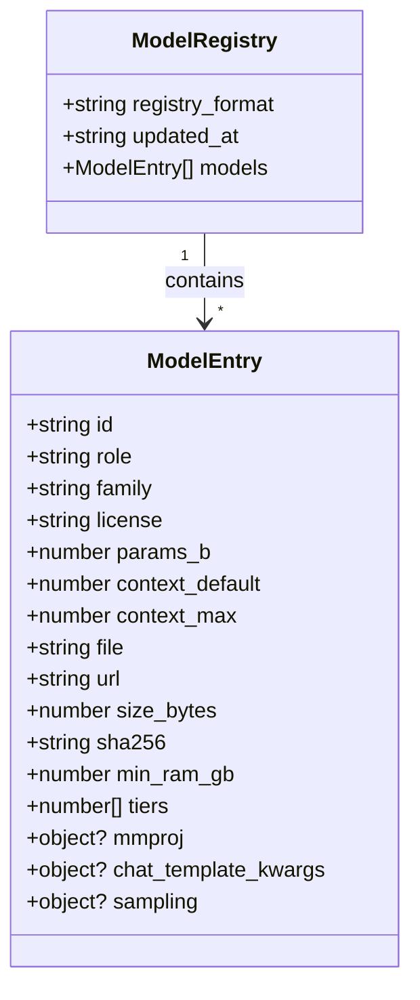
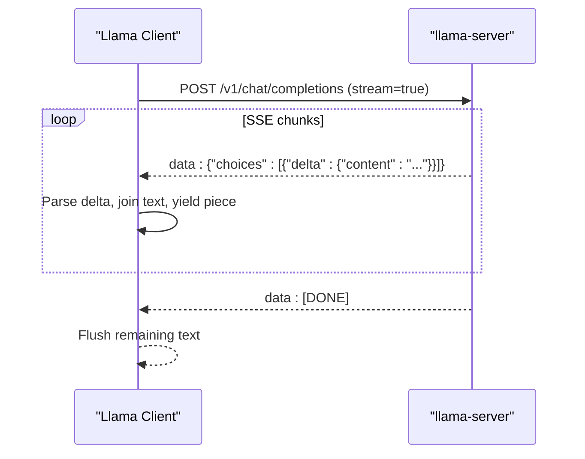
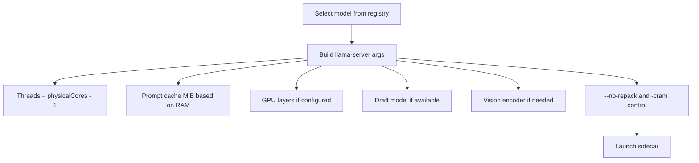
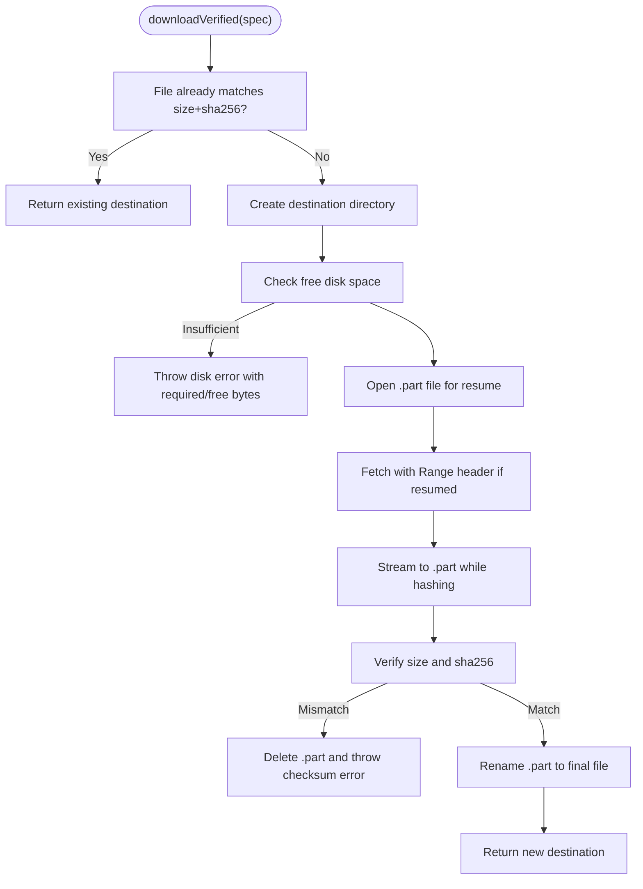
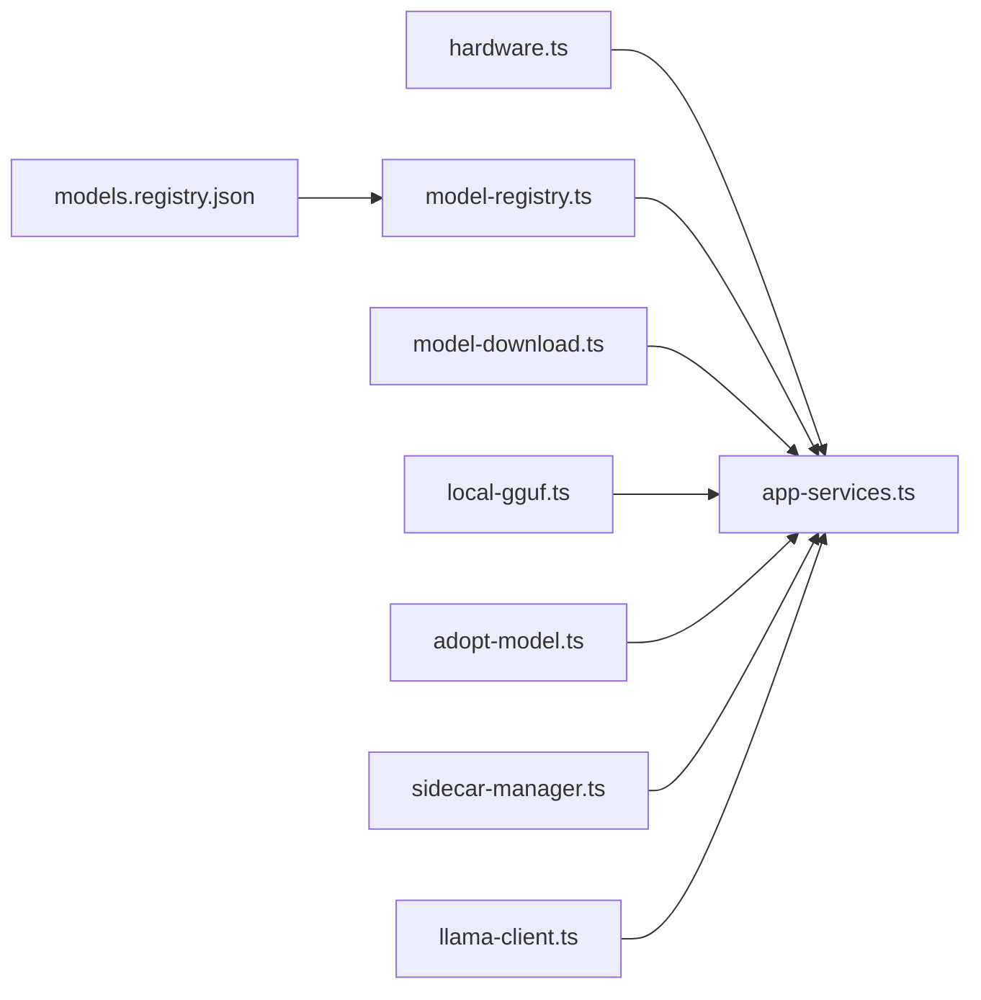

# AI Model Management

<cite>
**Referenced Files in This Document**
- [sidecar-manager.ts](file://apps/desktop/src/main/core/sidecar-manager.ts)
- [app-services.ts](file://apps/desktop/src/main/core/app-services.ts)
- [model-registry.ts](file://apps/desktop/src/main/core/model-registry.ts)
- [models.registry.json](file://apps/desktop/resources/models.registry.json)
- [llama-client.ts](file://apps/desktop/src/main/core/llama-client.ts)
- [local-gguf.ts](file://apps/desktop/src/main/core/local-gguf.ts)
- [model-download.ts](file://apps/desktop/src/main/core/model-download.ts)
- [hardware.ts](file://apps/desktop/src/main/core/hardware.ts)
- [adopt-model.ts](file://apps/desktop/src/main/core/adopt-model.ts)
- [model-weights.mjs](file://apps/desktop/scripts/model-weights.mjs)
</cite>

## Table of Contents
1. [Introduction](#introduction)
2. [Project Structure](#project-structure)
3. [Core Components](#core-components)
4. [Architecture Overview](#architecture-overview)
5. [Detailed Component Analysis](#detailed-component-analysis)
6. [Dependency Analysis](#dependency-analysis)
7. [Performance Considerations](#performance-considerations)
8. [Troubleshooting Guide](#troubleshooting-guide)
9. [Conclusion](#conclusion)

## Introduction
This document explains how the Surf.ai desktop application manages local AI models. It focuses on:
- The sidecar pattern used to run external llama.cpp processes safely and reliably.
- The model registry that discovers, validates, and versions GGUF files.
- The llama.cpp client integration for local inference, streaming responses, and tool calling.
- Model loading strategies, memory management, GPU acceleration options, and speculative decoding.
- Model download, verification, adoption, and storage optimization.
- Configuration options for different model types, quantization levels, and hardware requirements.
- Troubleshooting guidance and security considerations around model integrity and execution permissions.

The implementation is primarily in the Electron main process. The renderer never talks directly to llama-server; all inference goes through a secure local HTTP interface protected by a random API key.

## Project Structure
The relevant code lives under `apps/desktop/src/main/core`, with supporting configuration and scripts nearby:

**Diagram sources**
- [app-services.ts:600-799](file://apps/desktop/src/main/core/app-services.ts#L600-L799)
- [sidecar-manager.ts:1-196](file://apps/desktop/src/main/core/sidecar-manager.ts#L1-L196)
- [llama-client.ts:1-311](file://apps/desktop/src/main/core/llama-client.ts#L1-L311)
- [model-registry.ts:1-109](file://apps/desktop/src/main/core/model-registry.ts#L1-L109)
- [local-gguf.ts:1-49](file://apps/desktop/src/main/core/local-gguf.ts#L1-L49)
- [model-download.ts:1-218](file://apps/desktop/src/main/core/model-download.ts#L1-L218)
- [hardware.ts:32-61](file://apps/desktop/src/main/core/hardware.ts#L32-L61)
- [adopt-model.ts:27-68](file://apps/desktop/src/main/core/adopt-model.ts#L27-L68)
- [models.registry.json:1-237](file://apps/desktop/resources/models.registry.json#L1-L237)
- [model-weights.mjs:1-95](file://apps/desktop/scripts/model-weights.mjs#L1-L95)

**Section sources**
- [app-services.ts:600-799](file://apps/desktop/src/main/core/app-services.ts#L600-L799)
- [sidecar-manager.ts:1-196](file://apps/desktop/src/main/core/sidecar-manager.ts#L1-L196)
- [model-registry.ts:1-109](file://apps/desktop/src/main/core/model-registry.ts#L1-L109)
- [models.registry.json:1-237](file://apps/desktop/resources/models.registry.json#L1-L237)

## Core Components
- Sidecar manager: Starts, monitors, and stops the external llama-server process. It binds only to localhost, uses a random port and API key, and handles startup health checks and crash recovery.
- App services: Orchestrates model selection, sidecar lifecycle, downloads, imports, removal, and event emission to the UI.
- Model registry: Defines allowed model entries, licensing rules, hardware tiers, context sizes, sampling presets, and helper functions for picking or downgrading models.
- Llama client: Implements an OpenAI-compatible HTTP client for chat, embeddings, streaming, and tool-calling loops.
- Local GGUF handling: Recognizes user-provided `.gguf` files and maps them to registry roles when possible.
- Model download: Resumable, verified transfer with disk-space checks and atomic file finalization.
- Hardware detection: Computes CPU threads, VRAM, platform hints, and a machine tier.
- Adoption utilities: Hashes and moves trusted local files into the managed models directory.

**Section sources**
- [sidecar-manager.ts:1-196](file://apps/desktop/src/main/core/sidecar-manager.ts#L1-L196)
- [app-services.ts:600-799](file://apps/desktop/src/main/core/app-services.ts#L600-L799)
- [model-registry.ts:1-109](file://apps/desktop/src/main/core/model-registry.ts#L1-L109)
- [llama-client.ts:1-311](file://apps/desktop/src/main/core/llama-client.ts#L1-L311)
- [local-gguf.ts:1-49](file://apps/desktop/src/main/core/local-gguf.ts#L1-L49)
- [model-download.ts:1-218](file://apps/desktop/src/main/core/model-download.ts#L1-L218)
- [hardware.ts:32-61](file://apps/desktop/src/main/core/hardware.ts#L32-L61)
- [adopt-model.ts:27-68](file://apps/desktop/src/main/core/adopt-model.ts#L27-L68)

## Architecture Overview
At runtime, the app runs a single llama-server sidecar per role (chat or embedding). The app builds command-line arguments based on the selected model, hardware, and optional features like vision encoders and draft models. Inference requests go over a local HTTP API using bearer authentication. Streaming responses are parsed incrementally so the UI can render tokens as they arrive.

**Diagram sources**
- [app-services.ts:615-668](file://apps/desktop/src/main/core/app-services.ts#L615-L668)
- [sidecar-manager.ts:67-148](file://apps/desktop/src/main/core/sidecar-manager.ts#L67-L148)
- [llama-client.ts:111-247](file://apps/desktop/src/main/core/llama-client.ts#L111-L247)

## Detailed Component Analysis

### Sidecar Pattern and External Process Lifecycle
The sidecar manager launches llama-server as a child process, binds it to `127.0.0.1`, assigns a random free port, and generates a random API key. It constructs llama.cpp arguments including:
- Model path, host, port, API key.
- Context size, thread count, GPU layers.
- Embedding mode vs chat mode.
- Vision encoder (`mmproj`) when needed.
- Memory optimizations such as disabling repacking and controlling prompt cache RAM.
- Optional draft model for speculative decoding.

Startup includes:
- Binary existence check.
- Environment setup (e.g., `LD_LIBRARY_PATH` on Linux).
- Logging and tail buffer capture.
- Health polling against `/health`.
- Graceful stop with SIGTERM followed by SIGKILL after a grace period.
- Crash detection with exponential backoff restarts up to five attempts.

**Diagram sources**
- [sidecar-manager.ts:17-27](file://apps/desktop/src/main/core/sidecar-manager.ts#L17-L27)
- [sidecar-manager.ts:67-83](file://apps/desktop/src/main/core/sidecar-manager.ts#L67-L83)
- [sidecar-manager.ts:85-148](file://apps/desktop/src/main/core/sidecar-manager.ts#L85-L148)
- [sidecar-manager.ts:150-182](file://apps/desktop/src/main/core/sidecar-manager.ts#L150-L182)

**Section sources**
- [sidecar-manager.ts:1-196](file://apps/desktop/src/main/core/sidecar-manager.ts#L1-L196)

### Model Registry System
The registry defines metadata for each supported model file:
- Identity, role, family, license, parameters, context defaults and maximums.
- File name, URL, exact size, and SHA-256.
- Hardware tier constraints and minimum RAM.
- Optional vision encoder reference, pooling strategy, native dimension, query prefix, doc template, and compatibility keys.
- Sampling and chat template kwargs.
- Agent scoping and default selections.

Parsing enforces schema validation and allows only whitelisted licenses. Helper functions pick the largest fitting model for a given role and tier, find defaults for agents, and suggest smaller fallback models when loading fails.

**Diagram sources**
- [model-registry.ts:9-56](file://apps/desktop/src/main/core/model-registry.ts#L9-L56)
- [models.registry.json:1-237](file://apps/desktop/resources/models.registry.json#L1-L237)

**Section sources**
- [model-registry.ts:1-109](file://apps/desktop/src/main/core/model-registry.ts#L1-L109)
- [models.registry.json:1-237](file://apps/desktop/resources/models.registry.json#L1-L237)

### Llama.cpp Client Integration
The client communicates with llama-server via its OpenAI-compatible endpoints:
- `/v1/chat/completions` for chat and tool calls.
- `/v1/embeddings` for vector generation.
- `/completion` for completion-style prompts used by code completion.

Streaming is implemented by reading the HTTP body chunk-by-chunk, parsing Server-Sent Events, joining partial UTF-8 text, and yielding content deltas. Tool-call deltas are collected and reconstructed into structured function calls. The client also supports:
- Sampling presets and chat template kwargs.
- Optional thinking toggle.
- KV cache reuse for repeated prompt prefixes.
- Usage reporting when enabled.

**Diagram sources**
- [llama-client.ts:111-161](file://apps/desktop/src/main/core/llama-client.ts#L111-L161)
- [llama-client.ts:167-247](file://apps/desktop/src/main/core/llama-client.ts#L167-L247)

**Section sources**
- [llama-client.ts:1-311](file://apps/desktop/src/main/core/llama-client.ts#L1-L311)

### Model Loading Strategies, Memory Management, and GPU Acceleration
App services construct sidecar options based on:
- Role: chat vs embedding.
- Context size derived from registry defaults or caller preference.
- Thread count computed from physical cores minus one core reserved for the UI.
- Optional GPU layers passed to llama.cpp.
- Prompt cache RAM controlled by `cacheRamMiB`; zero disables the cache.
- Draft model path for speculative decoding when available and memory permits.
- Vision encoder path when image support is required.

Memory optimization flags include:
- Disabling weight repacking.
- Turning off prompt cache unless explicitly configured.
- Using embedding-specific micro-batch sizing for bidirectional attention.

Hardware detection provides total RAM, free RAM, CPU model, physical cores, GPU list with VRAM, Apple Silicon detection, and a computed tier. These values influence model selection and thread allocation.

**Diagram sources**
- [app-services.ts:615-628](file://apps/desktop/src/main/core/app-services.ts#L615-L628)
- [sidecar-manager.ts:67-83](file://apps/desktop/src/main/core/sidecar-manager.ts#L67-L83)
- [hardware.ts:32-61](file://apps/desktop/src/main/core/hardware.ts#L32-L61)

**Section sources**
- [app-services.ts:615-668](file://apps/desktop/src/main/core/app-services.ts#L615-L668)
- [sidecar-manager.ts:67-83](file://apps/desktop/src/main/core/sidecar-manager.ts#L67-L83)
- [hardware.ts:32-61](file://apps/desktop/src/main/core/hardware.ts#L32-L61)

### Model Download Mechanisms, Verification, and Storage Optimization
Model downloads are:
- Resumable using HTTP Range headers.
- Verified by comparing both file size and SHA-256 digest.
- Atomic: writes to a `.part` file and renames only after successful verification.
- Disk-space aware: checks available space before starting and reports required vs free bytes on failure.
- Abort-safe: propagates abort signals and cleans up partial files where appropriate.

The system also supports copying bundled installer files with the same verification guarantees.

**Diagram sources**
- [model-download.ts:120-171](file://apps/desktop/src/main/core/model-download.ts#L120-L171)
- [model-download.ts:180-217](file://apps/desktop/src/main/core/model-download.ts#L180-L217)

**Section sources**
- [model-download.ts:1-218](file://apps/desktop/src/main/core/model-download.ts#L1-L218)

### Local GGUF Discovery and Import
Users can import a local `.gguf` file. The system:
- Validates the extension and non-empty file.
- Plans a pointer mapping the file to a registry role when byte size matches a known chat model.
- Otherwise treats it as a generic local model with a placeholder model ID.
- Persists the pointer securely and updates settings to use the imported model.

Adoption utilities can hash a downloaded file and move it into the managed models folder when it matches a registry row by name or hash.

**Section sources**
- [local-gguf.ts:1-49](file://apps/desktop/src/main/core/local-gguf.ts#L1-L49)
- [app-services.ts:767-787](file://apps/desktop/src/main/core/app-services.ts#L767-L787)
- [adopt-model.ts:27-68](file://apps/desktop/src/main/core/adopt-model.ts#L27-L68)

### Configuration Options for Model Types, Quantization, and Hardware Requirements
The registry documents:
- Chat models across families and quantizations (for example, Qwen3.5 Q4_K_M and Q6_K variants, Gemma 4 QAT Q4_0 variants).
- Embedding models with pooling and dimension details.
- Speech recognition and voice activity detection models.
- Minimum RAM and measured peak RAM where available.
- Sampling and chat template kwargs tailored per model.
- Agent scoping and default choices.

These fields guide automatic model selection, fallback behavior, and request construction.

**Section sources**
- [models.registry.json:1-237](file://apps/desktop/resources/models.registry.json#L1-L237)
- [model-registry.ts:16-48](file://apps/desktop/src/main/core/model-registry.ts#L16-L48)

### Security Considerations
- Sidecar binding: llama-server listens only on `127.0.0.1` with a random port and random API key.
- Renderer isolation: The renderer cannot call llama-server directly; all requests originate from the main process.
- License policy: Only Apache 2.0 and MIT licenses are auto-approved for download.
- Integrity checks: Downloads verify size and SHA-256; partial files are deleted on mismatch.
- File permissions: Imported local pointers are written with restrictive permissions.
- Execution safety: Missing binaries and non-executable files produce clear errors without uncaught exceptions.

**Section sources**
- [sidecar-manager.ts:1-8](file://apps/desktop/src/main/core/sidecar-manager.ts#L1-L8)
- [sidecar-manager.ts:85-110](file://apps/desktop/src/main/core/sidecar-manager.ts#L85-L110)
- [model-registry.ts:58-67](file://apps/desktop/src/main/core/model-registry.ts#L58-L67)
- [model-download.ts:101-118](file://apps/desktop/src/main/core/model-download.ts#L101-L118)
- [app-services.ts:782-783](file://apps/desktop/src/main/core/app-services.ts#L782-L783)

## Dependency Analysis
The following diagram shows how the main components depend on each other during model management:

**Diagram sources**
- [hardware.ts:32-61](file://apps/desktop/src/main/core/hardware.ts#L32-L61)
- [model-registry.ts:1-109](file://apps/desktop/src/main/core/model-registry.ts#L1-L109)
- [models.registry.json:1-237](file://apps/desktop/resources/models.registry.json#L1-L237)
- [model-download.ts:1-218](file://apps/desktop/src/main/core/model-download.ts#L1-L218)
- [local-gguf.ts:1-49](file://apps/desktop/src/main/core/local-gguf.ts#L1-L49)
- [adopt-model.ts:27-68](file://apps/desktop/src/main/core/adopt-model.ts#L27-L68)
- [sidecar-manager.ts:1-196](file://apps/desktop/src/main/core/sidecar-manager.ts#L1-L196)
- [llama-client.ts:1-311](file://apps/desktop/src/main/core/llama-client.ts#L1-L311)
- [app-services.ts:600-799](file://apps/desktop/src/main/core/app-services.ts#L600-L799)

**Section sources**
- [app-services.ts:600-799](file://apps/desktop/src/main/core/app-services.ts#L600-L799)

## Performance Considerations
- Context size: Larger context increases memory usage and may reduce throughput. Choose context defaults from the registry or tune based on workload.
- Prompt cache: Enabling prompt cache improves repeated-prefix performance but consumes RAM. Set `cacheRamMiB` appropriately; zero disables it.
- Threads: The app sets threads to physical cores minus one to leave capacity for the UI.
- GPU layers: If GPU acceleration is available, set `-ngl` to offload layers to VRAM. The current sidecar options expose `gpuLayers`; adjust according to VRAM availability.
- Speculative decoding: A small draft model can improve throughput when RAM allows. The app conditionally passes draft model path and max draft length.
- Embedding mode: Embedding servers use bidirectional attention and require the full input to fit in one micro-batch; batch and update buffers are tied to context size.
- Memory footprint: Flags like `--no-repack` and `-cram 0` reduce peak RAM close to model file size for some models.

[No sources needed since this section provides general guidance]

## Troubleshooting Guide

### llama-server Fails to Start
Symptoms:
- Error indicating the binary is missing or not executable.
- Startup timeout due to health endpoint not responding.
- Immediate exit during initialization.

Actions:
- Verify the sidecar binary path resolves correctly for packaged or development environments.
- On Linux, ensure shared libraries are discoverable via `LD_LIBRARY_PATH`.
- Check logs captured in the sidecar’s tail buffer.
- Confirm the model file exists and is readable.

**Section sources**
- [sidecar-manager.ts:85-110](file://apps/desktop/src/main/core/sidecar-manager.ts#L85-L110)
- [sidecar-manager.ts:133-148](file://apps/desktop/src/main/core/sidecar-manager.ts#L133-L148)

### Model Load Errors and Automatic Downgrade
Symptoms:
- Chat load failures with a suggestion for a smaller model.
- Repeated crashes leading to reduced capability.

Actions:
- Inspect the error returned by `ensure` and the suggested smaller model.
- Reduce context size or disable vision/draft features.
- Allow the app to retry with fewer resources; it will fall back to a smaller model when available.

**Section sources**
- [app-services.ts:630-675](file://apps/desktop/src/main/core/app-services.ts#L630-L675)
- [model-registry.ts:94-108](file://apps/desktop/src/main/core/model-registry.ts#L94-L108)

### Download Failures and Disk Space Issues
Symptoms:
- Network errors or HTTP status failures.
- Disk full errors with required and free byte counts.
- Checksum mismatches causing retries.

Actions:
- Check network connectivity and proxy settings.
- Free disk space to meet the required threshold.
- Retry the download; partial files are reused when possible.
- Investigate checksum mismatches by re-downloading or verifying source integrity.

**Section sources**
- [model-download.ts:69-79](file://apps/desktop/src/main/core/model-download.ts#L69-L79)
- [model-download.ts:120-171](file://apps/desktop/src/main/core/model-download.ts#L120-L171)

### Streaming Response Problems
Symptoms:
- Missing or garbled tokens.
- Tool calls not reconstructed properly.

Actions:
- Ensure the client is using streaming mode and the server returns SSE chunks.
- Validate that tool-call deltas are present and indexed consistently.
- Check for early connection termination or abort signals.

**Section sources**
- [llama-client.ts:111-161](file://apps/desktop/src/main/core/llama-client.ts#L111-L161)
- [llama-client.ts:167-247](file://apps/desktop/src/main/core/llama-client.ts#L167-L247)

### Local GGUF Import Issues
Symptoms:
- Invalid file path or empty file.
- Unknown model identity.

Actions:
- Confirm the file ends with `.gguf` and has non-zero size.
- If the file matches a registry entry by size, it will be mapped to that model ID.
- Otherwise, it is treated as a generic local model.

**Section sources**
- [local-gguf.ts:20-32](file://apps/desktop/src/main/core/local-gguf.ts#L20-L32)
- [app-services.ts:767-787](file://apps/desktop/src/main/core/app-services.ts#L767-L787)

### Hardware Compatibility and Resource Limits
Symptoms:
- Models not offered on low-RAM machines.
- Poor performance due to insufficient VRAM or CPU threads.

Actions:
- Review detected hardware and tier.
- Choose models within the recommended RAM tier.
- Adjust GPU layers and context size based on VRAM and CPU capacity.

**Section sources**
- [hardware.ts:32-61](file://apps/desktop/src/main/core/hardware.ts#L32-L61)
- [model-registry.ts:16-48](file://apps/desktop/src/main/core/model-registry.ts#L16-L48)

## Conclusion
Surf.ai’s AI model management combines a secure sidecar architecture, a robust registry-driven model catalog, and a streaming OpenAI-compatible client. The system emphasizes safety, integrity, and resource awareness:
- External processes are isolated, authenticated, and monitored.
- Models are validated by size and SHA-256, with resumable downloads and atomic writes.
- Hardware detection guides model selection, threading, and optional GPU acceleration.
- Streaming and tool-calling provide responsive local inference.
- Configuration in the registry enables flexible model families, quantization levels, and agent-specific defaults.

For best results, select models appropriate for your hardware, enable prompt caching judiciously, consider GPU acceleration when available, and rely on the registry’s licensing and integrity guarantees.

[No sources needed since this section summarizes without analyzing specific files]