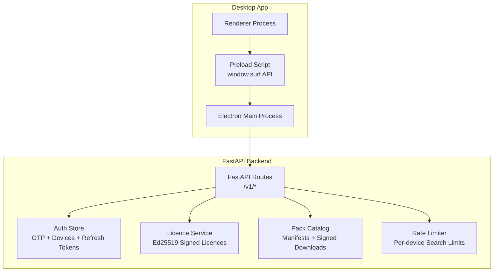
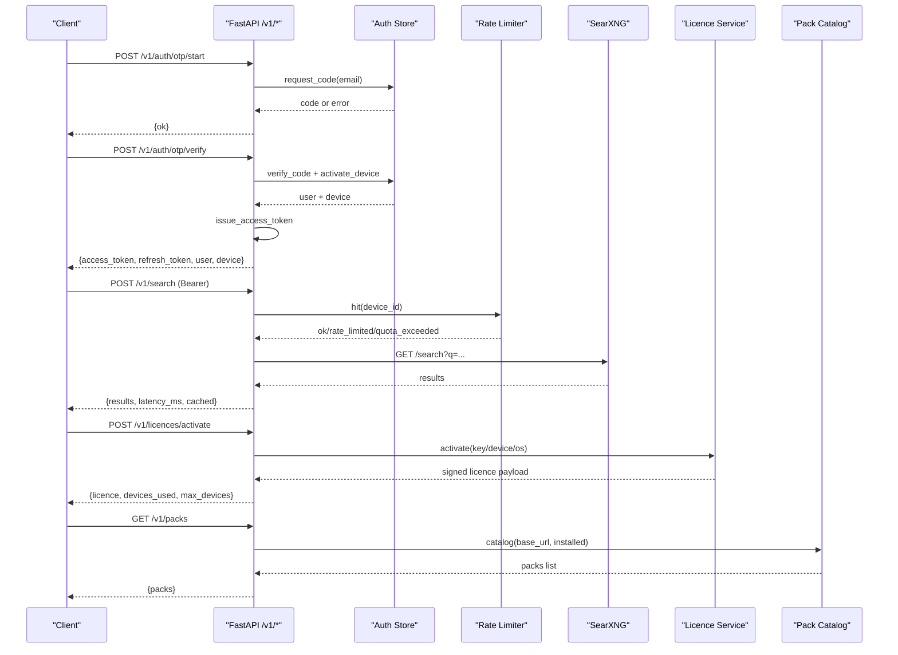
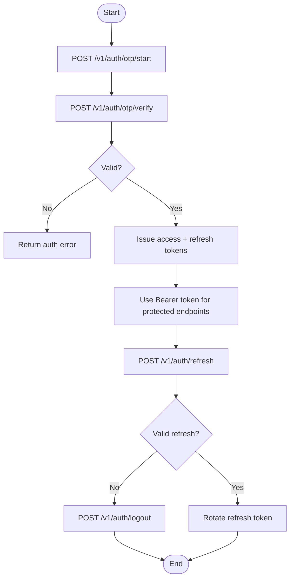
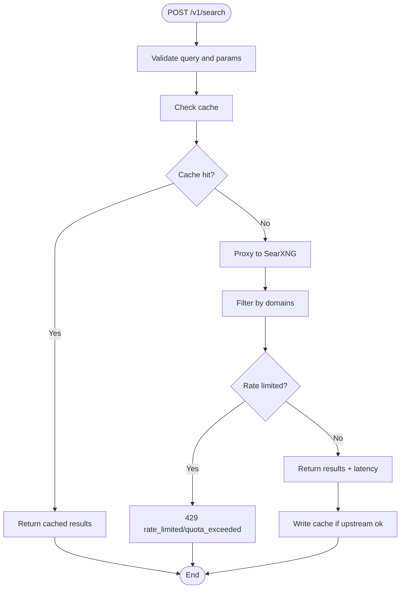
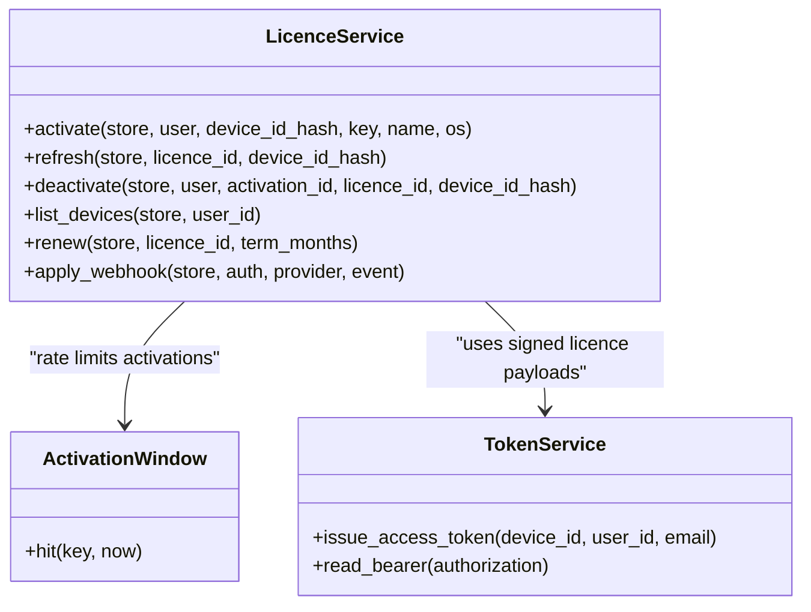
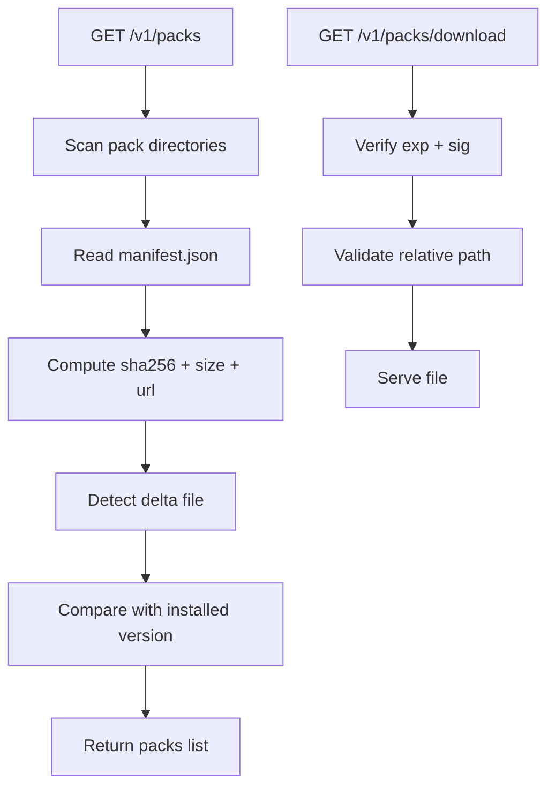
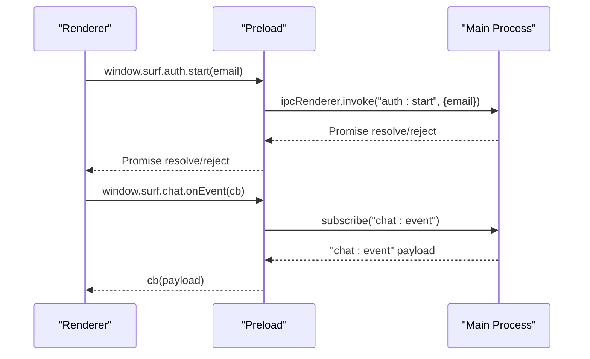
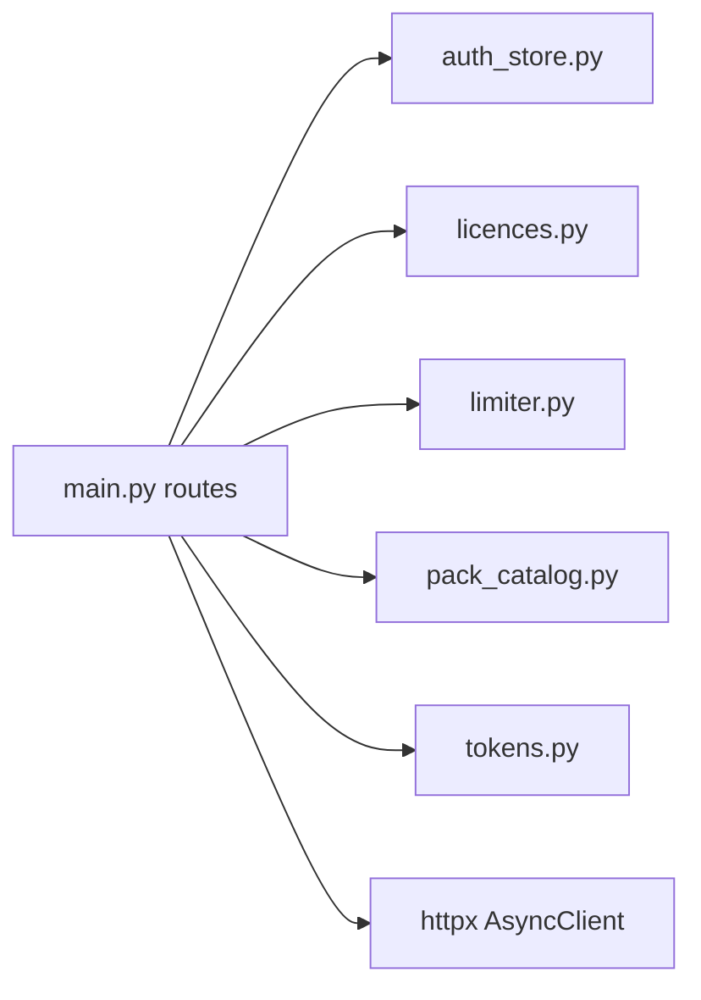

# API Reference

<cite>
**Referenced Files in This Document**   
- [services/api/app/main.py](file://services/api/app/main.py)
- [services/api/app/auth_store.py](file://services/api/app/auth_store.py)
- [services/api/app/tokens.py](file://services/api/app/tokens.py)
- [services/api/app/limiter.py](file://services/api/app/limiter.py)
- [services/api/app/licences.py](file://services/api/app/licences.py)
- [services/api/app/pack_catalog.py](file://services/api/app/pack_catalog.py)
- [apps/desktop/src/preload/index.ts](file://apps/desktop/src/preload/index.ts)
- [apps/desktop/src/shared/ipc-contract.ts](file://apps/desktop/src/shared/ipc-contract.ts)
- [apps/desktop/src/main/core/web-client.ts](file://apps/desktop/src/main/core/web-client.ts)
</cite>

## Table of Contents
1. [Introduction](#introduction)
2. [Project Structure](#project-structure)
3. [Core Components](#core-components)
4. [Architecture Overview](#architecture-overview)
5. [Detailed Component Analysis](#detailed-component-analysis)
6. [Dependency Analysis](#dependency-analysis)
7. [Performance Considerations](#performance-considerations)
8. [Troubleshooting Guide](#troubleshooting-guide)
9. [Conclusion](#conclusion)
10. [Appendices](#appendices)

## Introduction
This document describes Surf.ai’s public REST APIs and the Electron IPC/Pipe contracts used by the desktop application. It covers:

- FastAPI backend services under `services/api/app`.
- Authentication endpoints under `/v1/auth/*`.
- Search endpoint `/v1/search` with rate limiting and caching.
- License management endpoints under `/v1/licences/*`.
- Pack catalog endpoints under `/v1/packs/*`.
- Error response format, authentication requirements, and rate limits.
- IPC event names, typed request/response shapes, and preload security model.
- Client integration patterns for web clients and Electron renderer processes.
- Versioning, deprecation, and compatibility guidance based on current implementation.

The documentation is derived from the repository’s FastAPI routes, Pydantic models, token handling, limiter logic, license service, pack catalog logic, and the shared IPC contract exposed through the preload script.

## Project Structure
Surf.ai exposes two primary integration surfaces:

- **REST API**: A FastAPI application that handles authentication, search, billing webhooks, license operations, pack catalog, and page fetching.
- **IPC Contract**: A TypeScript contract shared between the Electron main process and renderer, bridged securely through a preload script.

**Diagram sources**
- [services/api/app/main.py:149-678](file://services/api/app/main.py#L149-L678)
- [services/api/app/auth_store.py:41-216](file://services/api/app/auth_store.py#L41-L216)
- [services/api/app/licences.py:30-536](file://services/api/app/licences.py#L30-L536)
- [services/api/app/pack_catalog.py:18-161](file://services/api/app/pack_catalog.py#L18-L161)
- [services/api/app/limiter.py:15-46](file://services/api/app/limiter.py#L15-L46)
- [apps/desktop/src/preload/index.ts:1-159](file://apps/desktop/src/preload/index.ts#L1-L159)

**Section sources**
- [services/api/app/main.py:1-84](file://services/api/app/main.py#L1-L84)
- [apps/desktop/src/shared/ipc-contract.ts:1-108](file://apps/desktop/src/shared/ipc-contract.ts#L1-L108)

## Core Components
This section summarizes the core components that implement the documented interfaces.

- **Authentication**: OTP-based login, device activation, refresh token rotation, bearer access tokens, and device revocation.
- **Search**: Query proxy to SearXNG with domain filtering, result caching, per-device rate limiting, and privacy-preserving audit logging.
- **License Management**: Ed25519-signed licence payloads, activation/refresh/deactivation, device limits, Stripe/Razorpay webhook processing, and admin revoke/renew.
- **Pack Catalog**: Manifest discovery, signed file URLs, delta updates, and short-lived download links.
- **IPC Bridge**: Typed channel constants and request/response types exposed via `window.surf`, with secure sandboxed access.

**Section sources**
- [services/api/app/main.py:238-347](file://services/api/app/main.py#L238-L347)
- [services/api/app/main.py:380-420](file://services/api/app/main.py#L380-L420)
- [services/api/app/main.py:513-582](file://services/api/app/main.py#L513-L582)
- [services/api/app/main.py:600-639](file://services/api/app/main.py#L600-L639)
- [services/api/app/auth_store.py:55-216](file://services/api/app/auth_store.py#L55-L216)
- [services/api/app/tokens.py:17-41](file://services/api/app/tokens.py#L17-L41)
- [services/api/app/licences.py:87-127](file://services/api/app/licences.py#L87-L127)
- [services/api/app/pack_catalog.py:61-161](file://services/api/app/pack_catalog.py#L61-L161)
- [apps/desktop/src/preload/index.ts:13-156](file://apps/desktop/src/preload/index.ts#L13-L156)

## Architecture Overview
The FastAPI application defines the public REST surface. Authentication uses email OTP, device registration at login, and JWT bearer tokens. Search is rate-limited per device and cached. Licences are signed and tied to devices; billing providers update licences via webhooks. Packs are discovered and downloaded using signed manifests and short-lived URLs. The Electron app communicates with its own main process through IPC channels defined in the shared contract.

**Diagram sources**
- [services/api/app/main.py:238-277](file://services/api/app/main.py#L238-L277)
- [services/api/app/main.py:380-420](file://services/api/app/main.py#L380-L420)
- [services/api/app/main.py:513-533](file://services/api/app/main.py#L513-L533)
- [services/api/app/main.py:313-317](file://services/api/app/main.py#L313-L317)
- [services/api/app/auth_store.py:55-216](file://services/api/app/auth_store.py#L55-L216)
- [services/api/app/limiter.py:15-46](file://services/api/app/limiter.py#L15-L46)
- [services/api/app/licences.py:299-318](file://services/api/app/licences.py#L299-L318)
- [services/api/app/pack_catalog.py:61-97](file://services/api/app/pack_catalog.py#L61-L97)

## Detailed Component Analysis

### Authentication Endpoints (`/v1/auth/*`)
These endpoints implement OTP-based sign-in, session refresh, logout, account info, device listing, and device revocation.

- **POST `/v1/auth/otp/start`**
  - Request body: `{ email }`
  - Response: `{ ok }`; may include `dev_code` when not using SMTP mail mode.
  - Errors: invalid email, resend cooldown, too many attempts.

- **POST `/v1/auth/otp/verify`**
  - Request body: `{ email, code, device }`
  - Device fields: optional `device_uid`, optional `name`, `os`, `arch`, `app_version`.
  - Response: `{ access_token, token_type, expires_in, refresh_token, user, device }`.
  - Errors: invalid code, expired code, too many attempts, invalid device OS.

- **POST `/v1/auth/refresh`**
  - Request body: `{ refresh_token }`
  - Response: same session shape as OTP verify.
  - Errors: invalid refresh token, reused refresh token, revoked device.

- **POST `/v1/auth/logout`**
  - Request body: `{ refresh_token }`
  - Response: `{ ok }`.

- **GET `/v1/account`**
  - Requires Bearer access token.
  - Response: `{ id, email }`.

- **GET `/v1/devices`**
  - Requires Bearer access token.
  - Response: `{ devices }`.

- **POST `/v1/devices/{device_id}/revoke`**
  - Requires Bearer access token.
  - Response: `{ ok }`.

- **POST `/v1/devices/register`**
  - Returns 410 gone; registration now happens at login.

Authentication flow:
- OTP codes are time-bounded and attempt-limited.
- Device activation enforces allowed OS values and plan/device limits.
- Access tokens are HS256 JWTs with `sub=device_id`, `uid=user_id`, `aud=authenticated`.
- Refresh tokens rotate once and revoke the previous token family.

**Diagram sources**
- [services/api/app/main.py:238-283](file://services/api/app/main.py#L238-L283)
- [services/api/app/auth_store.py:55-216](file://services/api/app/auth_store.py#L55-L216)
- [services/api/app/tokens.py:17-41](file://services/api/app/tokens.py#L17-L41)

**Section sources**
- [services/api/app/main.py:238-310](file://services/api/app/main.py#L238-L310)
- [services/api/app/auth_store.py:55-216](file://services/api/app/auth_store.py#L55-L216)
- [services/api/app/tokens.py:17-41](file://services/api/app/tokens.py#L17-L41)

### Search API (`/v1/search`)
Search proxies queries to SearXNG, filters domains, caches results, and tracks usage without storing query text.

- **POST `/v1/search`**
  - Requires Bearer access token unless development bypass is enabled.
  - Request body:
    - `query` or `q`: search string (max 300).
    - `k`: number of results (1–8).
    - `niche`: optional niche filter.
    - `domains`: up to 8 domain suffixes.
    - `lang`: language code (default `en`).
    - `time_range`: `day`, `month`, or `year`.
    - `agent_id`: optional agent identifier.
  - Response:
    - `results`: array of `{ title, url, snippet, published }`.
    - `latency_ms`: total latency.
    - `cached`: boolean indicating cache hit.
  - Errors:
    - Empty query returns validation error.
    - Upstream failure returns 502 with retry-after.
    - Rate limit returns 429 with retry-after.

Rate limiting:
- Per-minute and per-day counters keyed by device ID (`sub`).
- In-memory limiter for lite mode; Redis limiter for production.
- Headers include `Retry-After` on rate-limit responses.

Caching:
- Cache key includes normalized query, result count, domains, language, time range, and niche.
- TTL controlled by environment variable.

**Diagram sources**
- [services/api/app/main.py:350-420](file://services/api/app/main.py#L350-L420)
- [services/api/app/limiter.py:15-46](file://services/api/app/limiter.py#L15-L46)

**Section sources**
- [services/api/app/main.py:350-420](file://services/api/app/main.py#L350-L420)
- [services/api/app/limiter.py:15-46](file://services/api/app/limiter.py#L15-L46)

### License Management (`/v1/licences/*`)
License endpoints manage device activations, refresh, deactivation, device listing, admin revoke/renew, and billing webhooks.

- **POST `/v1/licences/activate`**
  - Optional authenticated user; otherwise requires licence key.
  - Request body:
    - `device_id_hash`: 64-character hex.
    - `key`: optional licence key.
    - `name`: optional device name.
    - `os`: `macos`, `windows`, or `linux`.
  - Response: `{ licence, devices_used, max_devices }`.
  - Errors: invalid key, unauthenticated, no licence, device limit reached, invalid device.

- **POST `/v1/licences/refresh`**
  - Request body: `{ licence_id, device_id_hash }`.
  - Response: `{ licence }`.
  - Errors: not found, inactive licence, device not active.

- **POST `/v1/licences/deactivate`**
  - Optional authenticated user; otherwise requires licence ID and device hash.
  - Request body: optional `activation_id`, `licence_id`, `device_id_hash`.
  - Response: `{ ok, device_id_hash, licence_id }`.

- **GET `/v1/licences/devices`**
  - Requires Bearer access token.
  - Response: plan, max devices, status, licence ID, term months, subscription end, devices list.

- **POST `/v1/licences/revoke`**
  - Admin-only via `X-Licence-Admin` header matching configured secret.
  - Request body: `{ licence_id, reason }`.
  - Response: `{ ok, licence_id, status }`.

- **POST `/v1/licences/renew`**
  - Admin-only via `X-Licence-Admin` header.
  - Request body: `{ licence_id, term_months }`.
  - Response: `{ ok, licence_id, term_months, subscription_ends_at }`.

Billing webhooks:
- **POST `/v1/billing/stripe`**
  - Verifies Stripe signature header.
  - Processes payment/refund events and creates or renews licences.
- **POST `/v1/billing/razorpay`**
  - Verifies Razorpay signature header.
  - Same lifecycle as Stripe.

Licence signing:
- Payloads are canonical JSON and signed with Ed25519.
- Clients verify signatures using the server-provided public key.

**Diagram sources**
- [services/api/app/licences.py:243-318](file://services/api/app/licences.py#L243-L318)
- [services/api/app/licences.py:464-536](file://services/api/app/licences.py#L464-L536)
- [services/api/app/tokens.py:17-41](file://services/api/app/tokens.py#L17-L41)

**Section sources**
- [services/api/app/main.py:513-582](file://services/api/app/main.py#L513-L582)
- [services/api/app/main.py:600-639](file://services/api/app/main.py#L600-L639)
- [services/api/app/licences.py:87-127](file://services/api/app/licences.py#L87-L127)
- [services/api/app/licences.py:243-318](file://services/api/app/licences.py#L243-L318)
- [services/api/app/licences.py:464-536](file://services/api/app/licences.py#L464-L536)

### Pack Catalog (`/v1/packs/*`)
Pack endpoints expose manifest listings, update checks, and signed downloads.

- **GET `/v1/packs`**
  - Requires Bearer access token.
  - Query parameter: `installed` comma-separated `pack_id@version`.
  - Response: `{ packs }` with latest version, files, deltas, and change detection.

- **GET `/v1/packs/manifest`**
  - Requires Bearer access token.
  - Returns published pack versions with signatures and key IDs.

- **GET `/v1/packs/updates`**
  - Requires Bearer access token.
  - Query parameters: `installed`, `device_id_hash`.
  - Response includes sealed content key when licence is active on the device.

- **GET `/v1/packs/download`**
  - Query parameters: `path`, `exp`, `sig`.
  - Validates short-lived HMAC signature and path safety.
  - Returns file contents.

Pack catalog behavior:
- Discovers packs by scanning directories for `manifest.json`.
- Computes SHA256 hashes and sizes for each file.
- Generates signed URLs or presigned S3/R2 URLs depending on configuration.
- Detects changed files between installed and latest versions.

**Diagram sources**
- [services/api/app/main.py:186-197](file://services/api/app/main.py#L186-L197)
- [services/api/app/main.py:313-347](file://services/api/app/main.py#L313-L347)
- [services/api/app/pack_catalog.py:61-161](file://services/api/app/pack_catalog.py#L61-L161)

**Section sources**
- [services/api/app/main.py:186-197](file://services/api/app/main.py#L186-L197)
- [services/api/app/main.py:313-347](file://services/api/app/main.py#L313-L347)
- [services/api/app/pack_catalog.py:18-161](file://services/api/app/pack_catalog.py#L18-L161)

### Additional Endpoints
- **GET `/v1/health`**: Reports Postgres, Valkey, and SearXNG status.
- **GET `/v1/version`**: Returns minimum app version and announcements.
- **GET `/v1/models/registry`**: Returns model registry JSON.
- **POST `/v1/fetch`**: Fetches and sanitizes web pages; requires Bearer token in search-gated mode.

**Section sources**
- [services/api/app/main.py:149-183](file://services/api/app/main.py#L149-L183)
- [services/api/app/main.py:642-678](file://services/api/app/main.py#L642-L678)

### IPC/Pipe Communication
The Electron app exposes a secure `window.surf` API to the renderer process. The bridge uses typed channel names and request/response shapes defined in the shared contract.

Key aspects:
- Preload script subscribes to IPC channels and exposes methods like `chat.send`, `models.status`, `auth.start`, `licence.activate`, etc.
- All IPC calls go through `ipcRenderer.invoke` with channel constants from `IPC`.
- Events are subscribed via `onEvent` callbacks for streaming progress and state changes.
- Security: preload never exposes `ipcRenderer` directly; only whitelisted methods are available.

Common IPC groups:
- Chat: send, cancel, event stream.
- Models: status, download, remove, benchmark, event stream.
- Setup: state, start, choose, use-file, repair, pause, resume, retry, event stream.
- Packs: list, sync, remove, import-from-file.
- Auth: status, start, verify, sign-out, devices, revoke.
- Licence: status, activate, deactivate, devices.
- Settings: get, set.
- Updates: check, apply, install-offline.
- Conversations: list, open, remove.
- Web cache: status, clear.
- Usage: get, reset, csv.
- Storage: report, clear, open.
- Library: add, pick, list, retry, cancel, remove, preview, event stream.
- Code agent: root, pick, decide, revise, undo, mode, set-mode.
- Documents: pick, convert, plan, export, cancel, event stream.
- Code: pick, status, storage, event stream.
- Code completion: suggest, files, read, save.
- Code vision: capture, save.
- Dev web: run.
- Files: list, suggest, pick, grant, decide, revoke, open, settings, limits, set-limits, pause, resume, event stream.
- Speech: speak, stop, prepare, transcribe.

**Diagram sources**
- [apps/desktop/src/preload/index.ts:7-11](file://apps/desktop/src/preload/index.ts#L7-L11)
- [apps/desktop/src/preload/index.ts:13-156](file://apps/desktop/src/preload/index.ts#L13-L156)
- [apps/desktop/src/shared/ipc-contract.ts:8-108](file://apps/desktop/src/shared/ipc-contract.ts#L8-L108)

**Section sources**
- [apps/desktop/src/preload/index.ts:1-159](file://apps/desktop/src/preload/index.ts#L1-L159)
- [apps/desktop/src/shared/ipc-contract.ts:1-108](file://apps/desktop/src/shared/ipc-contract.ts#L1-L108)
- [apps/desktop/src/shared/ipc-contract.ts:775-918](file://apps/desktop/src/shared/ipc-contract.ts#L775-L918)

### WebSocket Connections
There is no public WebSocket API in the FastAPI backend. Real-time communication within the desktop app uses IPC events rather than WebSockets. External real-time features may be handled by other services (for example, LiveKit URL configuration exists in host config), but they are not part of the documented `/v1/*` REST surface.

**Section sources**
- [apps/host/config.py:72](file://apps/host/config.py#L72)
- [apps/host/livekit_probe.py:10](file://apps/host/livekit_probe.py#L10)

## Dependency Analysis
The FastAPI application composes several modules:

- Routes depend on auth store, licence service, limiter, pack catalog, tokens, and external HTTP client.
- Auth store provides OTP challenges, device management, and refresh token rotation.
- Licence service manages signed licence payloads and billing webhook processing.
- Pack catalog generates signed download URLs and detects pack updates.
- Limiter enforces per-device search quotas.

**Diagram sources**
- [services/api/app/main.py:23-34](file://services/api/app/main.py#L23-L34)
- [services/api/app/auth_store.py:41-216](file://services/api/app/auth_store.py#L41-L216)
- [services/api/app/licences.py:30-536](file://services/api/app/licences.py#L30-L536)
- [services/api/app/limiter.py:15-46](file://services/api/app/limiter.py#L15-L46)
- [services/api/app/pack_catalog.py:18-161](file://services/api/app/pack_catalog.py#L18-L161)
- [services/api/app/tokens.py:17-41](file://services/api/app/tokens.py#L17-L41)

**Section sources**
- [services/api/app/main.py:23-34](file://services/api/app/main.py#L23-L34)

## Performance Considerations
- Search caching reduces upstream load and latency; TTL is configurable.
- Rate limiting protects against abuse and ensures fair usage per device.
- Pack catalog computes hashes and compares installed vs latest to minimize unnecessary downloads.
- Signed download URLs are short-lived to reduce exposure.
- Lite mode uses in-memory stores for tests and local development; production uses Postgres and Redis.

[No sources needed since this section provides general guidance]

## Troubleshooting Guide
Common errors and their meanings:

- **401 unauthenticated**: Missing or invalid bearer token.
- **401 invalid_token**: Invalid token or inactive device.
- **400 invalid_email**: Malformed email during OTP flows.
- **400 invalid_code**: Wrong or expired OTP code.
- **429 too_many_attempts**: OTP brute-force protection.
- **429 rate_limited**: Too many searches this minute.
- **429 quota_exceeded**: Daily search quota exceeded.
- **403 forbidden**: Invalid download link or licence-related permission error.
- **404 not_found**: Licence or device not found.
- **502 search_unavailable**: Upstream search service failed.
- **503 unconfigured**: Required environment variables missing (e.g., Stripe/Razorpay secrets, licence admin token).

Client error handling strategies:
- Retry after `Retry-After` on rate-limit responses.
- Rotate refresh tokens on reuse errors.
- Re-authenticate on invalid token errors.
- Validate licence status before accessing pro features.
- Handle pack download signature failures gracefully.

**Section sources**
- [services/api/app/main.py:87-116](file://services/api/app/main.py#L87-L116)
- [services/api/app/main.py:238-283](file://services/api/app/main.py#L238-L283)
- [services/api/app/main.py:380-420](file://services/api/app/main.py#L380-L420)
- [services/api/app/main.py:513-582](file://services/api/app/main.py#L513-L582)
- [services/api/app/main.py:600-639](file://services/api/app/main.py#L600-L639)

## Conclusion
Surf.ai’s API surface combines OTP-based authentication, per-device search with rate limiting and caching, signed licence management with billing integrations, and a secure pack catalog system. The Electron IPC contract provides a typed, sandboxed interface for renderer processes. Clients should handle authentication flows, respect rate limits, validate licence signatures, and use signed pack URLs. There is no public WebSocket API in the FastAPI backend; real-time UI updates use IPC events.

[No sources needed since this section summarizes without analyzing specific files]

## Appendices

### API Versioning and Compatibility
- The FastAPI app declares version `0.1.0`.
- The `/v1/version` endpoint returns `min_app_version` and announcements.
- No explicit deprecation headers or version negotiation are implemented beyond the `/v1` prefix.
- Backwards compatibility is implied by stable route paths and typed request/response schemas.

**Section sources**
- [services/api/app/main.py:84](file://services/api/app/main.py#L84)
- [services/api/app/main.py:176-178](file://services/api/app/main.py#L176-L178)

### SDK Examples and Integration Patterns

#### Web Client Pattern
A typical web client:
- Calls `/v1/auth/otp/start` and `/v1/auth/otp/verify` to obtain access and refresh tokens.
- Attaches `Authorization: Bearer <token>` to subsequent requests.
- Uses `/v1/search` with domain filters and time ranges.
- Handles rate-limit retries and upstream errors.
- Optionally calls `/v1/fetch` for page content retrieval.

Reference implementation pattern:
- Endpoint construction and header injection.
- Search request body mapping.
- Result normalization.

**Section sources**
- [apps/desktop/src/main/core/web-client.ts:52-85](file://apps/desktop/src/main/core/web-client.ts#L52-L85)

#### Electron Renderer Pattern
A typical renderer:
- Uses `window.surf.auth.start` and `window.surf.auth.verify` for sign-in.
- Subscribes to `window.surf.chat.onEvent` for streaming responses.
- Calls `window.surf.models.status` and `window.surf.packs.list` for local state.
- Handles licence status and device management via `window.surf.licence.*`.

**Section sources**
- [apps/desktop/src/preload/index.ts:13-156](file://apps/desktop/src/preload/index.ts#L13-L156)
- [apps/desktop/src/shared/ipc-contract.ts:775-918](file://apps/desktop/src/shared/ipc-contract.ts#L775-L918)