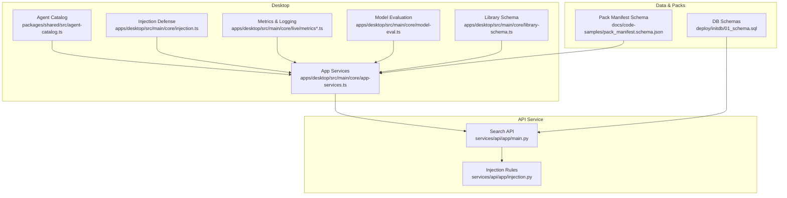
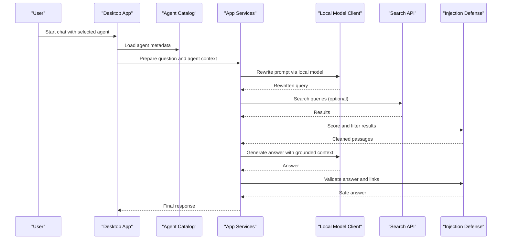
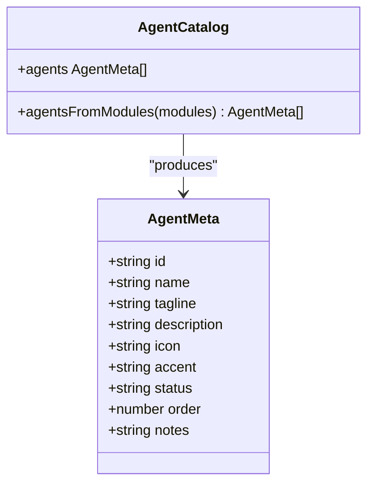
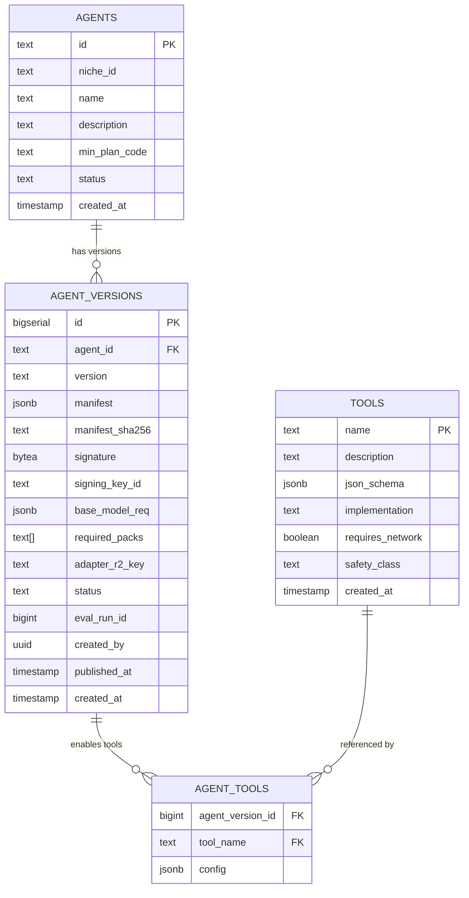
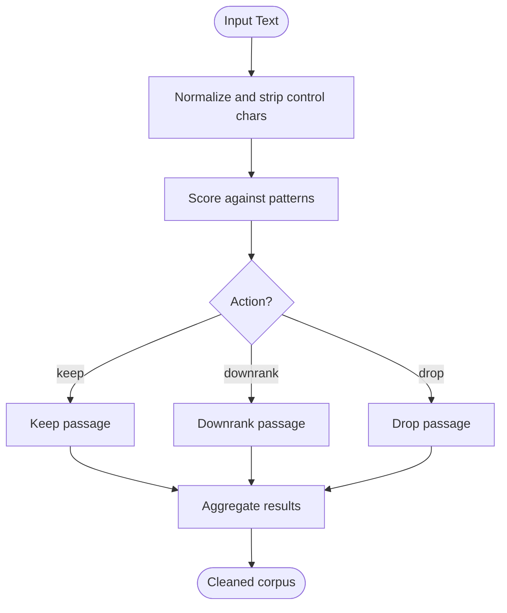
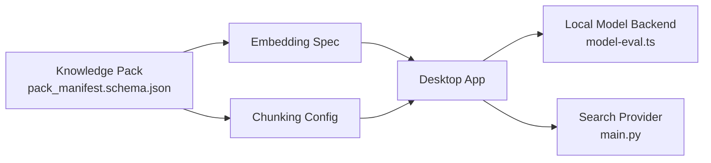
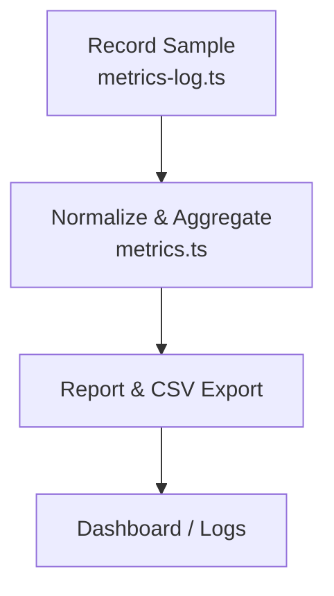
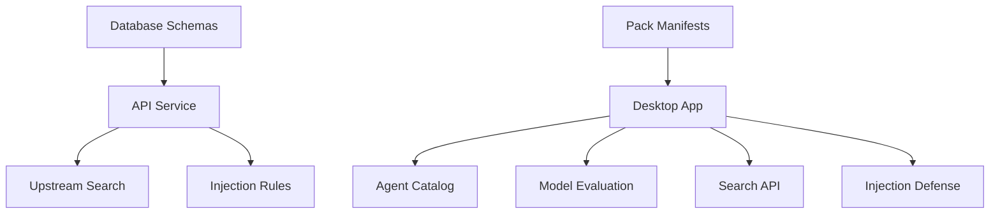

# Advanced Topics

<cite>
**Referenced Files in This Document**
- [LOW-RAM-GUIDE.md](file://LOW-RAM-GUIDE.md)
- [AGENTS.md](file://docs/AGENTS.md)
- [agent.json (assistant)](file://agents/assistant/agent.json)
- [agent.json (code)](file://agents/code/agent.json)
- [agent-catalog.ts](file://packages/shared/src/agent-catalog.ts)
- [01_schema.sql](file://deploy/initdb/01_schema.sql)
- [production_postgres.sql](file://docs/code-samples/production_postgres.sql)
- [injection.ts](file://apps/desktop/src/main/core/injection.ts)
- [injection.py](file://services/api/app/injection.py)
- [test_sanitize.py](file://services/api/tests/test_sanitize.py)
- [app-services.ts](file://apps/desktop/src/main/core/app-services.ts)
- [metrics.ts](file://apps/desktop/src/main/core/live/metrics.ts)
- [metrics-log.ts](file://apps/desktop/src/main/core/live/metrics-log.ts)
- [model-eval.ts](file://apps/desktop/src/main/core/model-eval.ts)
- [library-schema.ts](file://apps/desktop/src/main/core/library-schema.ts)
- [main.py](file://services/api/app/main.py)
- [pack_manifest.schema.json](file://docs/code-samples/pack_manifest.schema.json)
- [sign.ts](file://scripts/code-pack-src/sign.ts)
- [SECURITY.md](file://SECURITY.md)
- [CONTRIBUTING.md](file://CONTRIBUTING.md)
</cite>

## Table of Contents
1. [Introduction](#introduction)
2. [Project Structure](#project-structure)
3. [Core Components](#core-components)
4. [Architecture Overview](#architecture-overview)
5. [Detailed Component Analysis](#detailed-component-analysis)
6. [Dependency Analysis](#dependency-analysis)
7. [Performance Considerations](#performance-considerations)
8. [Troubleshooting Guide](#troubleshooting-guide)
9. [Conclusion](#conclusion)
10. [Appendices](#appendices)

## Introduction
This document provides expert-level guidance for advanced Surf.ai customization and optimization. It focuses on:
- The agent system, including the agent JSON schema, tool registration, and safety guidelines for custom agents.
- Performance optimization techniques such as memory management strategies, model quantization options, and resource allocation tuning.
- A low-RAM optimization guide for constrained hardware environments.
- The plugin architecture enabling custom parsers, model backends, and search providers.
- Debugging tools and profiling utilities for performance analysis and troubleshooting.
- Advanced configuration options, custom build processes, and distribution strategies.
- Security considerations for custom extensions, code injection prevention, and privilege escalation protection.
- Expert guidance for contributing to the core system and implementing new features.

## Project Structure
Surf.ai is a multi-app repository with desktop, web, services, and shared packages. Key areas relevant to advanced topics include:
- Agent metadata and catalog loading under agents and packages/shared.
- Database schemas for agents, tools, and agent versions under deploy and docs/code-samples.
- Injection defense logic in both desktop and API layers.
- Model evaluation and RAM-aware selection logic.
- Metrics logging and usage reporting.
- Knowledge pack manifests and signing utilities.

**Diagram sources**
- [agent-catalog.ts:1-14](file://packages/shared/src/agent-catalog.ts#L1-L14)
- [app-services.ts:859-886](file://apps/desktop/src/main/core/app-services.ts#L859-L886)
- [injection.ts:1-139](file://apps/desktop/src/main/core/injection.ts#L1-L139)
- [metrics.ts:249-282](file://apps/desktop/src/main/core/live/metrics.ts#L249-L282)
- [metrics-log.ts:1-47](file://apps/desktop/src/main/core/live/metrics-log.ts#L1-L47)
- [model-eval.ts:257-282](file://apps/desktop/src/main/core/model-eval.ts#L257-L282)
- [library-schema.ts:1-85](file://apps/desktop/src/main/core/library-schema.ts#L1-L85)
- [main.py:36-451](file://services/api/app/main.py#L36-L451)
- [injection.py:1-42](file://services/api/app/injection.py#L1-L42)
- [01_schema.sql:391-439](file://deploy/initdb/01_schema.sql#L391-L439)
- [pack_manifest.schema.json:1-69](file://docs/code-samples/pack_manifest.schema.json#L1-L69)

**Section sources**
- [agent-catalog.ts:1-14](file://packages/shared/src/agent-catalog.ts#L1-L14)
- [01_schema.sql:391-439](file://deploy/initdb/01_schema.sql#L391-L439)

## Core Components
- Agent metadata and catalog:
  - Each agent has an agent.json with fields like name, tagline, description, icon, accent, status, order, and notes.
  - The shared catalog loads all agent.json files and filters which agents are available in the desktop app.
- Tool registry and agent versions:
  - The database defines tables for agents, tools, agent_versions, and agent_tools, establishing a contract for tool registration and per-agent configuration.
- Injection defense:
  - Desktop and API share rules to score and filter untrusted text, drop suspicious instructions, and sanitize responses.
- Model evaluation and RAM-aware selection:
  - Utilities evaluate thresholds, compute context token sizing based on RAM, and check whether available memory allows a given model or multimodal projector.
- Library schema:
  - Defines local storage structures for attachments, documents, chunks, vector embeddings, and full-text search.
- Search service:
  - Provides a search endpoint with caching, domain filtering, and rate limiting.

**Section sources**
- [AGENTS.md:1-38](file://docs/AGENTS.md#L1-L38)
- [agent.json (assistant):1-11](file://agents/assistant/agent.json#L1-L11)
- [agent.json (code):1-11](file://agents/code/agent.json#L1-L11)
- [agent-catalog.ts:1-14](file://packages/shared/src/agent-catalog.ts#L1-L14)
- [01_schema.sql:391-439](file://deploy/initdb/01_schema.sql#L391-L439)
- [injection.ts:1-139](file://apps/desktop/src/main/core/injection.ts#L1-L139)
- [injection.py:1-42](file://services/api/app/injection.py#L1-L42)
- [model-eval.ts:257-282](file://apps/desktop/src/main/core/model-eval.ts#L257-L282)
- [library-schema.ts:1-85](file://apps/desktop/src/main/core/library-schema.ts#L1-L85)
- [main.py:36-451](file://services/api/app/main.py#L36-L451)

## Architecture Overview
The agent-driven workflow integrates user input, retrieval, model inference, and response sanitization.

**Diagram sources**
- [agent-catalog.ts:1-14](file://packages/shared/src/agent-catalog.ts#L1-L14)
- [app-services.ts:859-886](file://apps/desktop/src/main/core/app-services.ts#L859-L886)
- [main.py:380-420](file://services/api/app/main.py#L380-L420)
- [injection.ts:42-124](file://apps/desktop/src/main/core/injection.ts#L42-L124)

## Detailed Component Analysis

### Agent System and JSON Schema
- Agent metadata:
  - Fields include name, tagline, description, icon, accent, status, order, and notes.
  - Status values control visibility and availability across website and desktop.
- Catalog loading:
  - The catalog dynamically imports agent.json files from the agents directory and sorts them by order.
  - The desktop currently exposes only specific agents (e.g., general and code).

**Diagram sources**
- [agent-catalog.ts:1-14](file://packages/shared/src/agent-catalog.ts#L1-L14)
- [agent.json (assistant):1-11](file://agents/assistant/agent.json#L1-L11)
- [agent.json (code):1-11](file://agents/code/agent.json#L1-L11)
- [AGENTS.md:1-38](file://docs/AGENTS.md#L1-L38)

**Section sources**
- [AGENTS.md:1-38](file://docs/AGENTS.md#L1-L38)
- [agent.json (assistant):1-11](file://agents/assistant/agent.json#L1-L11)
- [agent.json (code):1-11](file://agents/code/agent.json#L1-L11)
- [agent-catalog.ts:1-14](file://packages/shared/src/agent-catalog.ts#L1-L14)

### Tool Registration and Safety
- Tools are registered in the database with:
  - name, description, json_schema (OpenAI-style function parameters), implementation identifier, requires_network flag, and safety_class.
- Agents enable tools via agent_tools with per-tool config.
- Safety classes constrain behavior; sensitive tools may require additional approval or isolation.

**Diagram sources**
- [01_schema.sql:391-439](file://deploy/initdb/01_schema.sql#L391-L439)
- [production_postgres.sql:343-391](file://docs/code-samples/production_postgres.sql#L343-L391)

**Section sources**
- [01_schema.sql:391-439](file://deploy/initdb/01_schema.sql#L391-L439)
- [production_postgres.sql:343-391](file://docs/code-samples/production_postgres.sql#L343-L391)

### Injection Defense and Safety Guidelines
- Shared rules define patterns that detect instruction-like content, hidden text, template tokens, and Unicode control characters.
- Scoring thresholds determine keep/downrank/drop actions.
- Responses are validated to remove unknown URLs and detect echoing of injected instructions.
- Calculator and unit conversion tools restrict arguments to numbers present in the user’s original message.

**Diagram sources**
- [injection.ts:31-82](file://apps/desktop/src/main/core/injection.ts#L31-L82)
- [injection.py:18-42](file://services/api/app/injection.py#L18-L42)

**Section sources**
- [injection.ts:1-139](file://apps/desktop/src/main/core/injection.ts#L1-L139)
- [injection.py:1-42](file://services/api/app/injection.py#L1-L42)
- [test_sanitize.py:1-63](file://services/api/tests/test_sanitize.py#L1-L63)

### Low-RAM Optimization Guide
- Recommended models by RAM capacity:
  - 4GB: small models (e.g., Phi-3 Mini 3B Q4_K_M, Gemma 2 2B Q4_K_M, Qwen 2.5 3B Q4_K_M).
  - 8GB: mid-size models (e.g., Llama 3.1 8B Q4_K_M, Qwen 2.5 7B Q4_K_M, Mistral 7B Q4_K_M).
  - 16GB+: larger models (e.g., Llama 3.1 8B Q5_K_M, Qwen 2.5 14B Q4_K_M, CodeLlama 13B Q4_K_M).
- Optimization strategies:
  - Disable embedding/vector search, web cache, and document ingestion when needed.
  - Reduce context window and streaming batch size for smoother performance.
  - Use appropriate quantization levels (Q3/Q4/Q5) balancing speed and quality.
  - Close other applications and consider enabling swap on Linux/macOS.
- Troubleshooting:
  - Startup crashes, slow inference, and out-of-memory errors can be mitigated by selecting smaller models, disabling features, and increasing system swap.

**Section sources**
- [LOW-RAM-GUIDE.md:1-310](file://LOW-RAM-GUIDE.md#L1-L310)

### Plugin Architecture: Parsers, Backends, and Providers
- Custom parsers and chunking:
  - Pack manifests define embedding specs and chunking parameters, ensuring compatibility between app and packs.
- Model backends:
  - Local model client integration via LlamaClient; model registry and evaluation utilities select models based on role, tier, and RAM constraints.
- Search providers:
  - The API routes search requests to a configured upstream (e.g., SearXNG) with caching and domain filtering.

**Diagram sources**
- [pack_manifest.schema.json:1-69](file://docs/code-samples/pack_manifest.schema.json#L1-L69)
- [model-eval.ts:257-282](file://apps/desktop/src/main/core/model-eval.ts#L257-L282)
- [main.py:380-420](file://services/api/app/main.py#L380-L420)

**Section sources**
- [pack_manifest.schema.json:1-69](file://docs/code-samples/pack_manifest.schema.json#L1-L69)
- [model-eval.ts:257-282](file://apps/desktop/src/main/core/model-eval.ts#L257-L282)
- [main.py:380-420](file://services/api/app/main.py#L380-L420)

### Debugging Tools and Profiling Utilities
- Metrics logging:
  - Usage samples capture tasks, steps, tokens, latency, RAM usage, CPU percent, and agent ID.
  - CSV export and aggregation support performance analysis.
- Memory and model checks:
  - Utilities compute context token sizing based on RAM and validate whether a model fits available memory.
- Injection testing:
  - Tests ensure hidden text and injection attempts are removed and scored consistently across desktop and API.

**Diagram sources**
- [metrics-log.ts:1-47](file://apps/desktop/src/main/core/live/metrics-log.ts#L1-L47)
- [metrics.ts:249-282](file://apps/desktop/src/main/core/live/metrics.ts#L249-L282)

**Section sources**
- [metrics-log.ts:1-47](file://apps/desktop/src/main/core/live/metrics-log.ts#L1-L47)
- [metrics.ts:249-282](file://apps/desktop/src/main/core/live/metrics.ts#L249-L282)
- [model-eval.ts:257-282](file://apps/desktop/src/main/core/model-eval.ts#L257-L282)
- [test_sanitize.py:1-63](file://services/api/tests/test_sanitize.py#L1-L63)

### Advanced Configuration Options
- Model selection and tiers:
  - Model registry parsing enforces allowed licenses and selects the largest model fitting the requested tier.
- Update channels and release assets:
  - Version comparison and asset picking support beta/release channels and platform-specific builds.
- Signing and distribution:
  - Code pack signing utilities load seeds from environment or dev files and sign manifests securely.

**Section sources**
- [model-registry.ts:49-62](file://docs/code-samples/ts/model-registry.ts#L49-L62)
- [update-plan.ts:45-80](file://apps/desktop/src/main/core/update-plan.ts#L45-L80)
- [sign.ts:27-50](file://scripts/code-pack-src/sign.ts#L27-L50)

### Security Considerations
- Data protection:
  - Local database uses encryption; connector tokens stored in OS keychain where available.
  - Writes/deletes go through approval gates; delete operations require double confirmation.
- Content safety:
  - Retrieved text treated as untrusted; sanitizer drops embedded instructions.
  - Knowledge packs signed and verified before install.
- Network isolation:
  - Code preview and script sandbox operate without network access.
- Telemetry and privacy:
  - Telemetry off by default; logs remain local.

**Section sources**
- [SECURITY.md:1-17](file://SECURITY.md#L1-L17)

### Contributing and Extending the System
- Contribution process:
  - Use the website contribute form or submit pull requests.
  - Avoid adding paid signing certificates or changing telemetry defaults.
- Adding agent cards:
  - Add agent.json under agents/<id>; layout remains unchanged.

**Section sources**
- [CONTRIBUTING.md:1-22](file://CONTRIBUTING.md#L1-L22)
- [AGENTS.md:1-38](file://docs/AGENTS.md#L1-L38)

## Dependency Analysis
Key dependencies and relationships:
- Desktop app depends on agent catalog, local model client, search API, and injection defense.
- API service depends on upstream search provider and shared injection rules.
- Database schemas define contracts for agents, tools, and agent versions.
- Pack manifests define embedding and chunking compatibility.

**Diagram sources**
- [agent-catalog.ts:1-14](file://packages/shared/src/agent-catalog.ts#L1-L14)
- [model-eval.ts:257-282](file://apps/desktop/src/main/core/model-eval.ts#L257-L282)
- [main.py:380-420](file://services/api/app/main.py#L380-L420)
- [injection.ts:1-139](file://apps/desktop/src/main/core/injection.ts#L1-L139)
- [injection.py:1-42](file://services/api/app/injection.py#L1-L42)
- [01_schema.sql:391-439](file://deploy/initdb/01_schema.sql#L391-L439)
- [pack_manifest.schema.json:1-69](file://docs/code-samples/pack_manifest.schema.json#L1-L69)

**Section sources**
- [agent-catalog.ts:1-14](file://packages/shared/src/agent-catalog.ts#L1-L14)
- [model-eval.ts:257-282](file://apps/desktop/src/main/core/model-eval.ts#L257-L282)
- [main.py:380-420](file://services/api/app/main.py#L380-L420)
- [injection.ts:1-139](file://apps/desktop/src/main/core/injection.ts#L1-L139)
- [injection.py:1-42](file://services/api/app/injection.py#L1-L42)
- [01_schema.sql:391-439](file://deploy/initdb/01_schema.sql#L391-L439)
- [pack_manifest.schema.json:1-69](file://docs/code-samples/pack_manifest.schema.json#L1-L69)

## Performance Considerations
- Memory management:
  - Disable optional features (embeddings, web cache, document ingestion) to reduce RAM footprint.
  - Tune context window and streaming batch size for smoother inference on constrained systems.
- Model quantization:
  - Choose Q3/Q4/Q5 quantizations based on available RAM and desired quality/speed trade-offs.
- Resource allocation:
  - Use RAM-aware model selection and context sizing utilities to prevent overallocation.
- Monitoring:
  - Track metrics (RAM, CPU, latency, tokens) to identify bottlenecks and validate optimizations.

[No sources needed since this section provides general guidance]

## Troubleshooting Guide
- Low-RAM issues:
  - Symptoms include startup crashes, slow inference, and out-of-memory errors.
  - Solutions involve selecting smaller models, disabling features, reducing context windows, and enabling swap.
- Injection-related failures:
  - Ensure injection rules are synchronized between desktop and API.
  - Validate that hidden text and template tokens are stripped and suspicious passages are dropped.
- Search service errors:
  - Check upstream connectivity and caching configuration; verify domain filtering and rate limits.

**Section sources**
- [LOW-RAM-GUIDE.md:210-310](file://LOW-RAM-GUIDE.md#L210-L310)
- [injection.ts:42-124](file://apps/desktop/src/main/core/injection.ts#L42-L124)
- [injection.py:18-42](file://services/api/app/injection.py#L18-L42)
- [main.py:380-420](file://services/api/app/main.py#L380-L420)

## Conclusion
Surf.ai’s advanced customization and optimization capabilities center around a robust agent system, strict safety controls, and flexible plugin architecture. By leveraging model quantization, memory-aware selection, and targeted feature toggles, users can run efficient workflows even on low-RAM hardware. The shared injection defense ensures safe handling of untrusted data, while metrics and evaluation utilities provide actionable insights for performance tuning. For contributors, the repository offers clear pathways to extend functionality through packs, tools, and search providers, with strong emphasis on security and reproducibility.

[No sources needed since this section summarizes without analyzing specific files]

## Appendices
- Agent card creation:
  - Follow the documented structure and fields to add new agents without modifying layout.
- Distribution and signing:
  - Use provided signing utilities to secure knowledge packs and ensure integrity during installation.

**Section sources**
- [AGENTS.md:1-38](file://docs/AGENTS.md#L1-L38)
- [sign.ts:27-50](file://scripts/code-pack-src/sign.ts#L27-L50)