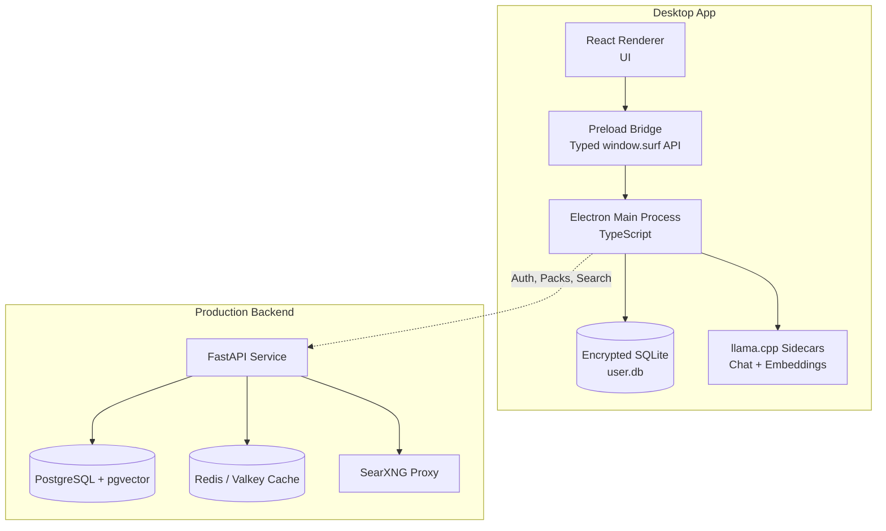
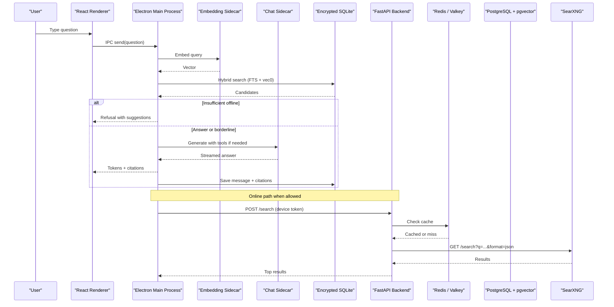
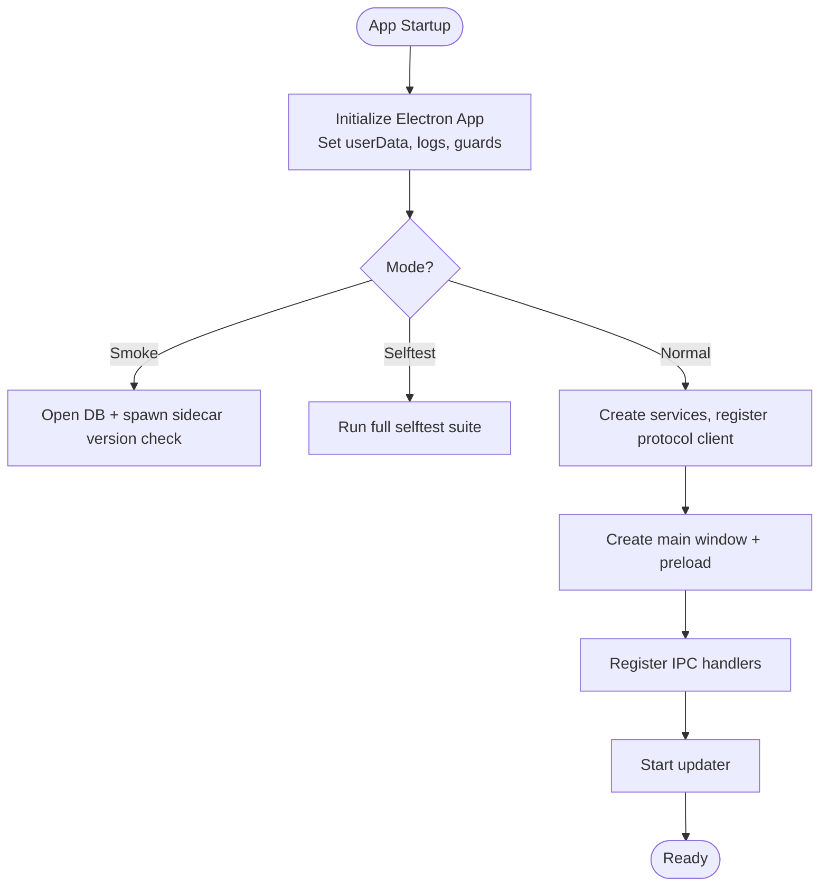
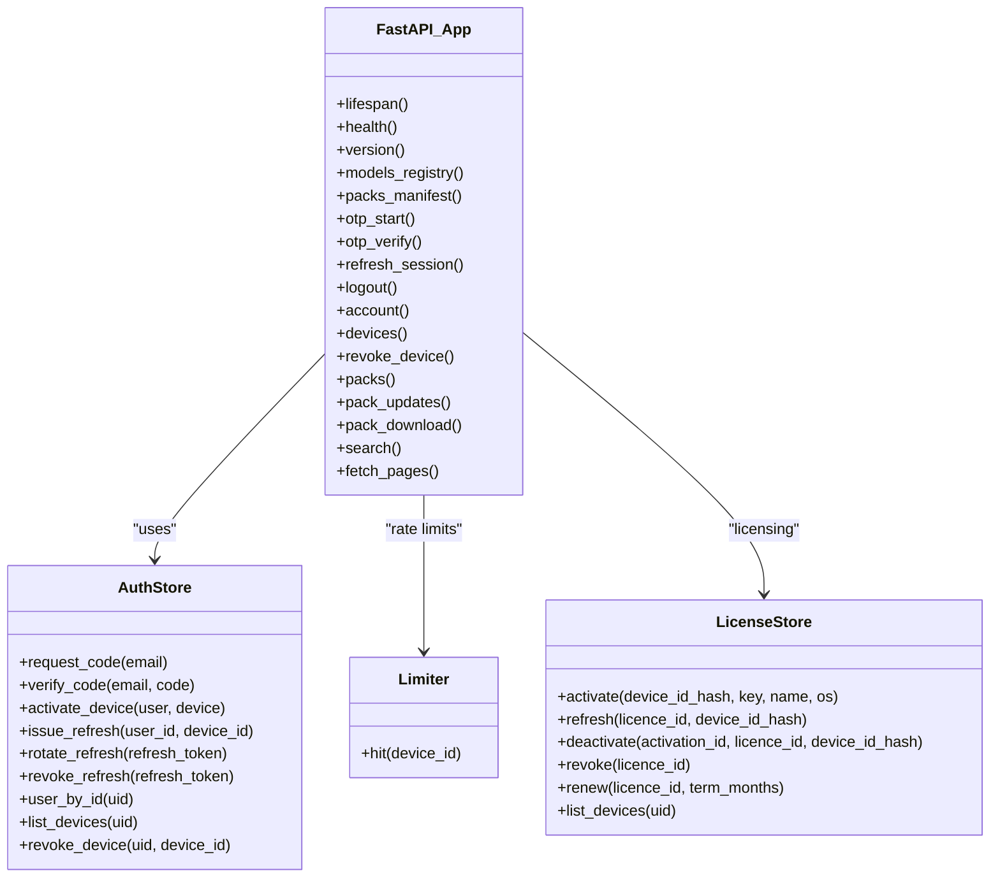
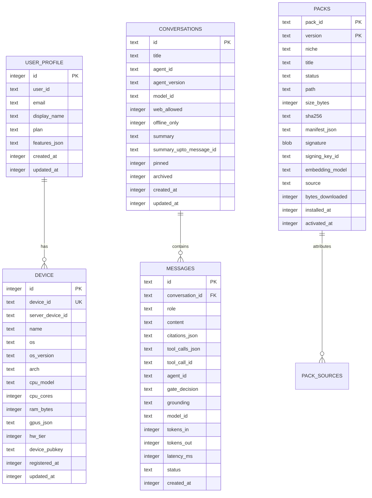
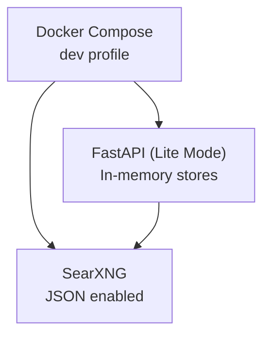
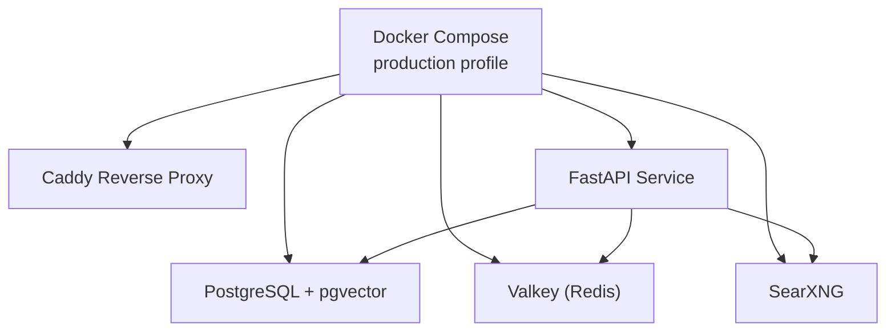
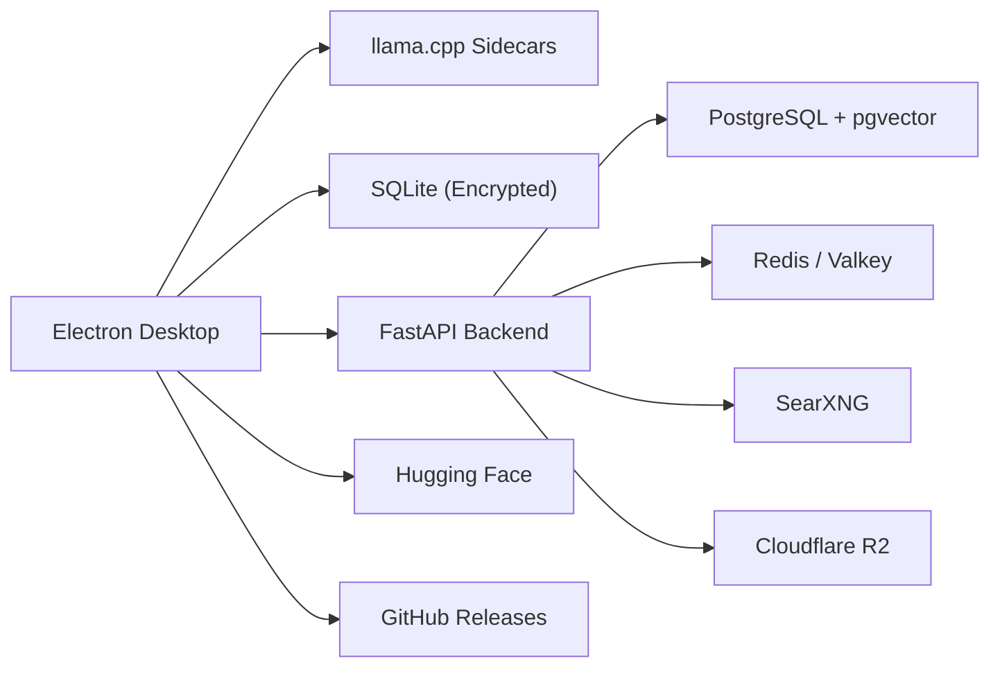

# Architecture Overview

<cite>
**Referenced Files in This Document**   
- [README.md](file://README.md)
- [ARCHITECTURE-FULL.md](file://docs/ARCHITECTURE-FULL.md)
- [main.ts](file://apps/desktop/src/main/index.ts)
- [docker-compose.yml](file://deploy/docker-compose.yml)
- [docker-compose.dev.yml](file://deploy/docker-compose.dev.yml)
- [main.py](file://services/api/app/main.py)
</cite>

## Table of Contents
1. [Introduction](#introduction)
2. [Project Structure](#project-structure)
3. [Core Components](#core-components)
4. [Architecture Overview](#architecture-overview)
5. [Detailed Component Analysis](#detailed-component-analysis)
6. [Dependency Analysis](#dependency-analysis)
7. [Performance Considerations](#performance-considerations)
8. [Troubleshooting Guide](#troubleshooting-guide)
9. [Conclusion](#conclusion)

## Introduction
Surf.ai is a local-first desktop assistant built with Electron, TypeScript, React, Python FastAPI, SQLite, PostgreSQL with pgvector, Redis (Valkey), and llama.cpp. The core design principle is to keep AI processing and chat data on the user’s device while enabling optional online synchronization when connectivity is available. Offline chat, document ingestion, vector search, and model inference run entirely locally; online features such as authentication, web search, pack updates, and license management are additive and never required for basic use.

The system consists of:
- An Electron desktop app that owns the UI, orchestrates retrieval and generation, manages sidecar processes, and persists private data in an encrypted SQLite database.
- A FastAPI backend that provides authentication helpers, pack catalog endpoints, rate-limited web search through SearXNG, and optional licensing/billing integration.
- A production Postgres database with pgvector for metadata, embeddings, and search analytics.
- A Redis (Valkey) caching layer for short-lived search result caching and distributed rate limiting.
- A local SearXNG proxy used during development for privacy-preserving web search.

This document explains the high-level architecture, component relationships, security model, technology stack decisions, and deployment topology for both development and production environments.

**Section sources**
- [README.md:1-10](file://README.md#L1-L10)
- [ARCHITECTURE-FULL.md:84-106](file://docs/ARCHITECTURE-FULL.md#L84-L106)

## Project Structure
The repository organizes the product into clear layers:
- `apps/desktop`: Electron main process, preload bridge, and React renderer. It implements local orchestration, sidecar management, SQLite persistence, and IPC contracts.
- `services/api`: FastAPI application providing authentication, device/session handling, pack catalog, search proxying, and optional billing/licensing flows.
- `deploy`: Docker Compose files for production and development backends.
- `docs`: Architecture documentation, diagrams, and implementation notes.
- Other directories include marketing site code, evaluation harness, shared packages, and scripts.

**Diagram sources**
- [main.ts:1-36](file://apps/desktop/src/main/index.ts#L1-L36)
- [main.py:1-40](file://services/api/app/main.py#L1-L40)
- [docker-compose.yml:1-48](file://deploy/docker-compose.yml#L1-L48)

**Section sources**
- [README.md:156-169](file://README.md#L156-L169)
- [ARCHITECTURE-FULL.md:114-146](file://docs/ARCHITECTURE-FULL.md#L114-L146)

## Core Components
The system is composed of five primary components:

1. **Electron Desktop App**
   - Main process orchestrates chat, retrieval, token budgeting, tool execution, citations, and background jobs.
   - Preload exposes a typed IPC API to the sandboxed React renderer.
   - Manages sidecar processes for llama.cpp chat and embedding models.
   - Persists private data in an encrypted SQLite database using SQLCipher-compatible mode.

2. **FastAPI Backend Services**
   - Provides `/v1/auth/*` endpoints for email OTP login and device registration.
   - Exposes `/v1/search` as a rate-limited proxy to SearXNG.
   - Offers pack catalog and download endpoints for knowledge packs.
   - Supports optional billing and licensing workflows.

3. **PostgreSQL with pgvector**
   - Stores account/device metadata, pack versions, search request counters, and production ingestion artifacts.
   - Enables vector similarity search via pgvector for curated content.

4. **Redis (Valkey) Caching Layer**
   - Caches search results for short TTLs.
   - Supports distributed rate limiting across API instances.

5. **SearXNG Search Proxy**
   - Development-only or private network meta-search engine returning JSON results.
   - Used by the API to aggregate search results without exposing raw queries to third-party services directly from the desktop.

**Section sources**
- [ARCHITECTURE-FULL.md:120-146](file://docs/ARCHITECTURE-FULL.md#L120-L146)
- [main.py:1-40](file://services/api/app/main.py#L1-L40)

## Architecture Overview
The Surf.ai architecture follows a local-first pattern: all user data and AI computation remain on-device unless explicitly enabled for online features. The desktop app communicates with local models via HTTP APIs exposed by llama.cpp sidecars, interacts with backend services for authentication and web search, and manages persistent data through SQLite.

**Diagram sources**
- [main.ts:75-230](file://apps/desktop/src/main/index.ts#L75-L230)
- [main.py:380-420](file://services/api/app/main.py#L380-L420)

**Section sources**
- [ARCHITECTURE-FULL.md:203-283](file://docs/ARCHITECTURE-FULL.md#L203-L283)

## Detailed Component Analysis

### Electron Desktop Application
The Electron app is the central orchestrator. It initializes the application environment, sets up logging, handles single-instance locking, creates the main window, registers IPC handlers, and starts update services. It also runs self-tests and smoke checks for database, sidecars, and renderer isolation.

Key responsibilities:
- Initialize Electron app lifecycle and error guards.
- Configure user data directory and logging.
- Run self-test scenarios including SQLite encryption, safeStorage usage, calculator worker, embedding sidecar, RAG ingestion, chat sidecar, and pack verification.
- Create and manage the main browser window with preload and HTML entry points.
- Register IPC handlers for chat, settings, auth status, packs, and library operations.
- Start updater and handle screenshot capture for testing.

**Diagram sources**
- [main.ts:38-65](file://apps/desktop/src/main/index.ts#L38-L65)
- [main.ts:537-595](file://apps/desktop/src/main/index.ts#L537-L595)

**Section sources**
- [main.ts:1-595](file://apps/desktop/src/main/index.ts#L1-L595)

### FastAPI Backend Services
The FastAPI service provides authentication, device management, pack catalog, search proxying, and optional billing endpoints. It supports two modes:
- Lite mode: In-memory stores for development without Postgres.
- Production mode: Postgres-backed authentication, licensing, and search analytics with Redis caching.

Core endpoints:
- `/v1/health`: Health check for Postgres, Valkey, and SearXNG.
- `/v1/auth/otp/start`, `/v1/auth/otp/verify`: Email OTP login flow.
- `/v1/devices`: Device listing and revocation.
- `/v1/packs/manifest`, `/v1/packs/download`: Pack catalog and signed downloads.
- `/v1/search`: Rate-limited search proxy to SearXNG with domain filtering and caching.
- `/v1/fetch`: Optional page fetching with SSRF protection.

**Diagram sources**
- [main.py:43-84](file://services/api/app/main.py#L43-L84)
- [main.py:238-305](file://services/api/app/main.py#L238-L305)
- [main.py:380-420](file://services/api/app/main.py#L380-L420)

**Section sources**
- [main.py:1-678](file://services/api/app/main.py#L1-L678)

### Database and Persistence
The desktop app uses an encrypted SQLite database (`user.db`) for all private data, including conversations, messages, attachments, documents, chunks, vectors, and web cache. The database is opened in SQLCipher-compatible mode using `better-sqlite3-multiple-ciphers`. The encryption key is stored securely using Electron’s `safeStorage`, which leverages macOS Keychain or Windows DPAPI.

Production backend uses PostgreSQL with pgvector for:
- Account and device metadata.
- Pack versions and manifests.
- Search request counters and analytics.
- Ingestion pipeline artifacts.

**Diagram sources**
- [ARCHITECTURE-FULL.md:517-586](file://docs/ARCHITECTURE-FULL.md#L517-L586)
- [ARCHITECTURE-FULL.md:856-888](file://docs/ARCHITECTURE-FULL.md#L856-L888)

**Section sources**
- [ARCHITECTURE-FULL.md:469-490](file://docs/ARCHITECTURE-FULL.md#L469-L490)
- [ARCHITECTURE-FULL.md:517-586](file://docs/ARCHITECTURE-FULL.md#L517-L586)

### Security Model
Security is foundational to Surf.ai’s design:
- **Local Data Processing**: Chats, documents, and embeddings remain on the user’s device. Only minimal metadata (login, device registration, pack updates, search queries) may be sent to the backend.
- **Encrypted SQLite**: The user database is encrypted using SQLCipher v4 format via `better-sqlite3-multiple-ciphers`. The encryption key is stored in OS-specific secure storage (Keychain/DPAPI).
- **JWT-Based Authentication**: Access tokens are issued after email OTP verification. Tokens are validated per request and tied to active devices.
- **Signed Content**: Knowledge packs, manifests, and model registry entries are signed with Ed25519 and verified before use.
- **Renderer Isolation**: The React renderer runs in a sandboxed Chromium context with no direct Node.js access. Communication occurs only through the typed preload API.
- **SSRF Protection**: The `/v1/fetch` endpoint validates URLs and blocks internal/private hosts.

**Section sources**
- [ARCHITECTURE-FULL.md:94-106](file://docs/ARCHITECTURE-FULL.md#L94-L106)
- [main.py:98-106](file://services/api/app/main.py#L98-L106)
- [main.py:646-677](file://services/api/app/main.py#L646-L677)

### Technology Stack Decisions
- **Frontend**: TypeScript/JavaScript with React, Vite, and Tailwind for a consistent, modern UI.
- **Backend**: Python FastAPI for async API development, Pydantic for validation, SQLAlchemy/Alembic for migrations.
- **Local Storage**: SQLite with sqlite-vec for vector search and FTS5 for keyword search. Encrypted via SQLCipher-compatible mode.
- **AI Execution**: llama.cpp sidecars for chat and embeddings, running GGUF models locally.
- **Search**: SearXNG for privacy-preserving web search aggregation.
- **Caching**: Redis (Valkey) for search result caching and distributed rate limiting.
- **Database**: PostgreSQL with pgvector for production embeddings and metadata.

**Section sources**
- [ARCHITECTURE-FULL.md:394-440](file://docs/ARCHITECTURE-FULL.md#L394-L440)

### Deployment Topology

#### Development Environment
Development uses Docker Compose to run the FastAPI service and SearXNG locally. The API runs in lite mode without Postgres, using in-memory stores for authentication and rate limiting. SearXNG is configured with JSON output enabled.

**Diagram sources**
- [docker-compose.dev.yml:1-30](file://deploy/docker-compose.dev.yml#L1-L30)

#### Production Environment
Production deploys Caddy as a reverse proxy, FastAPI service, PostgreSQL with pgvector, Valkey (Redis), and SearXNG on a GCP VM. All services are containerized and health-checked.

**Diagram sources**
- [docker-compose.yml:1-48](file://deploy/docker-compose.yml#L1-L48)

**Section sources**
- [docker-compose.dev.yml:1-30](file://deploy/docker-compose.dev.yml#L1-L30)
- [docker-compose.yml:1-48](file://deploy/docker-compose.yml#L1-L48)

## Dependency Analysis
The system exhibits clear separation between local and cloud components:
- The desktop app depends on local sidecars and SQLite for core functionality.
- The FastAPI service depends on Postgres, Redis, and SearXNG for production features.
- External dependencies include Hugging Face for model downloads, GitHub Releases for installers, and Cloudflare R2 for pack storage.

**Diagram sources**
- [ARCHITECTURE-FULL.md:147-201](file://docs/ARCHITECTURE-FULL.md#L147-L201)

**Section sources**
- [ARCHITECTURE-FULL.md:147-201](file://docs/ARCHITECTURE-FULL.md#L147-L201)

## Performance Considerations
- **Offline-First Design**: Core features work without network calls, reducing latency and dependency on external services.
- **Sidecar Isolation**: Heavy operations (LLM inference, OCR, transcription) run in separate processes to prevent UI blocking.
- **Token Budgeting**: The app allocates context windows carefully to avoid overflow and optimize response times.
- **Hybrid Search**: Combines FTS5 and vector search for accurate and fast retrieval.
- **Caching**: Short-lived search results are cached in Redis to reduce upstream load.
- **Model Quantization**: GGUF models are quantized (Q4_K_M, Q8_0) to balance quality and performance.

[No sources needed since this section provides general guidance]

## Troubleshooting Guide
Common issues and resolutions:
- **SQLite Encryption Errors**: Ensure the correct SQLCipher-compatible mode is used and the key is accessible via `safeStorage`.
- **Sidecar Crashes**: The main process monitors sidecar health and restarts them automatically.
- **Authentication Failures**: Verify JWT tokens are valid and devices are active.
- **Search Unavailable**: Check SearXNG connectivity and rate limits.
- **Pack Verification Failures**: Ensure signatures match and manifests are intact.

**Section sources**
- [main.ts:75-230](file://apps/desktop/src/main/index.ts#L75-L230)
- [main.py:149-173](file://services/api/app/main.py#L149-L173)

## Conclusion
Surf.ai’s architecture prioritizes privacy, reliability, and performance by keeping AI processing and data local while offering optional online capabilities. The Electron desktop app serves as the central orchestrator, leveraging llama.cpp for local inference and SQLite for persistent storage. The FastAPI backend provides essential services like authentication, search proxying, and pack management, backed by PostgreSQL and Redis. This design ensures users can work offline with full functionality while benefiting from online features when available.

[No sources needed since this section summarizes without analyzing specific files]