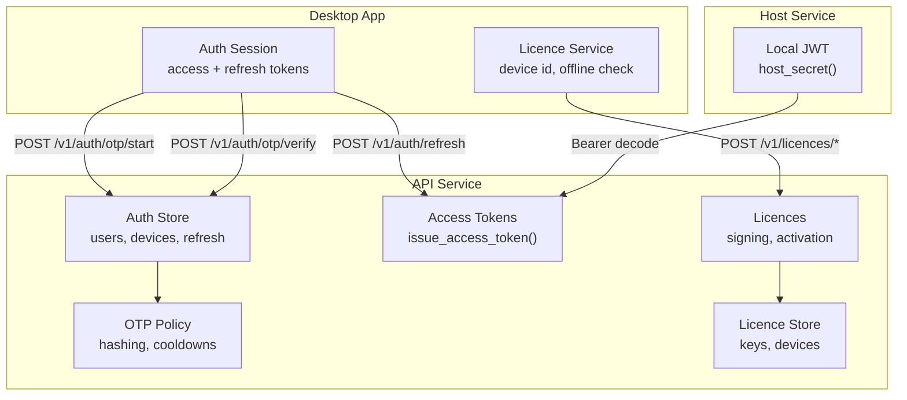
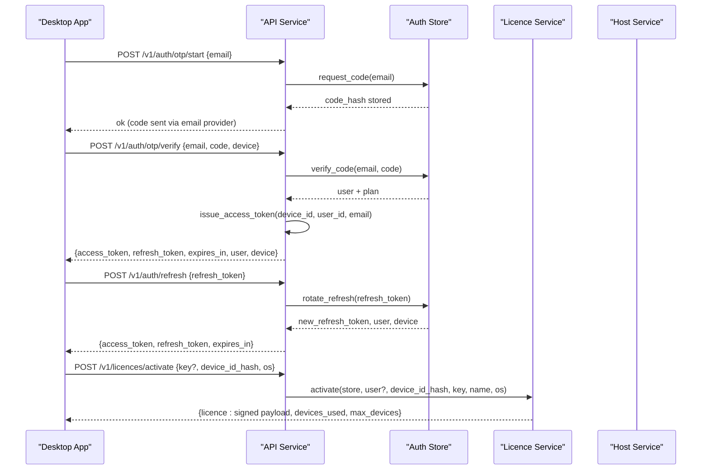
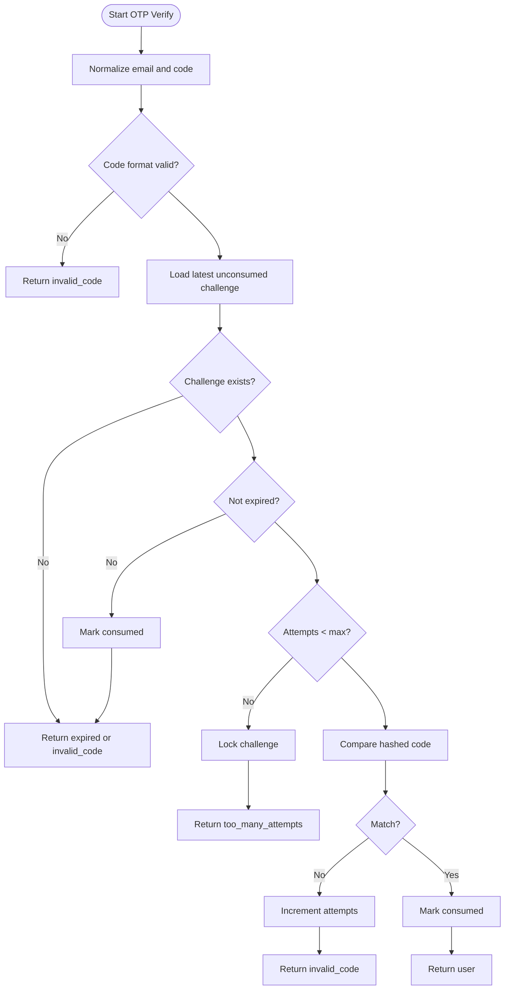
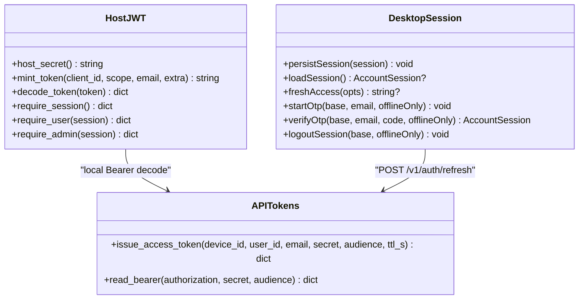
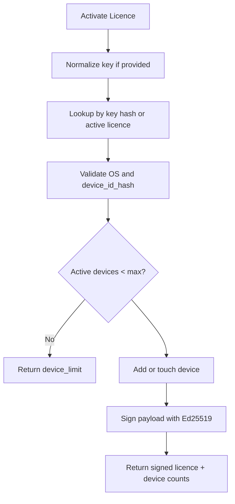
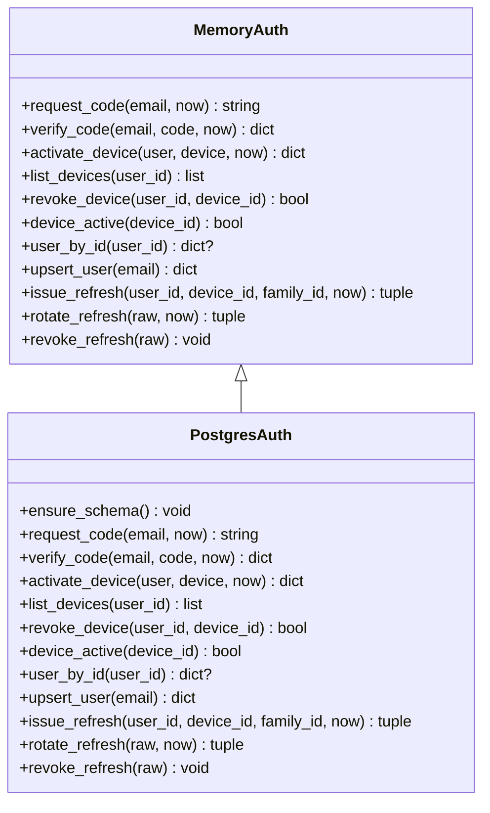
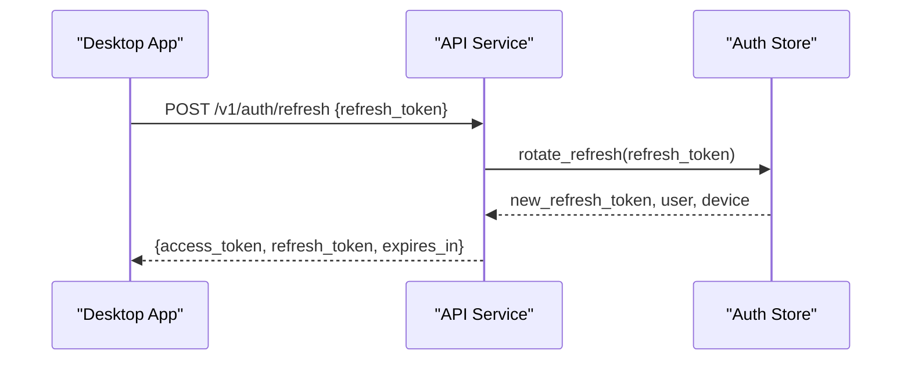
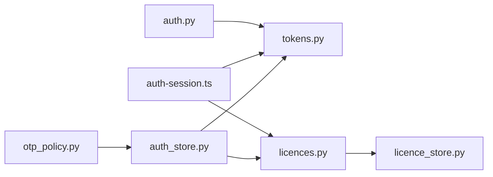

# Authentication & Authorization

<cite>
**Referenced Files in This Document**
- [auth.py](file://apps/host/auth.py)
- [tokens.py](file://services/api/app/tokens.py)
- [otp_policy.py](file://services/api/app/otp_policy.py)
- [auth_store.py](file://services/api/app/auth_store.py)
- [licences.py](file://services/api/app/licences.py)
- [licence_store.py](file://services/api/app/licence_store.py)
- [auth-session.ts](file://apps/desktop/src/main/core/auth-session.ts)
- [licence-service.ts](file://apps/desktop/src/main/core/licence-service.ts)
</cite>

## Table of Contents
1. [Introduction](#introduction)
2. [Project Structure](#project-structure)
3. [Core Components](#core-components)
4. [Architecture Overview](#architecture-overview)
5. [Detailed Component Analysis](#detailed-component-analysis)
6. [Dependency Analysis](#dependency-analysis)
7. [Performance Considerations](#performance-considerations)
8. [Troubleshooting Guide](#troubleshooting-guide)
9. [Conclusion](#conclusion)

## Introduction
This document explains the authentication, authorization, and licensing system used by Surf.ai across its desktop application and backend services. It covers:
- Email-based OTP login flow with secure code hashing and rate limiting
- JWT token management for access tokens, refresh tokens, and session lifecycle
- License management that validates subscription keys, gates premium features, and manages device registration
- Auth store implementation for users, devices, OTP challenges, and rotating refresh tokens
- Token refresh mechanism to maintain sessions without frequent re-authentication
- Security measures including password hashing, token signing, and CSRF considerations
- Configuration options for email providers, token expiration policies, and license validation rules
- Privacy considerations and compliance guidance
- Troubleshooting for authentication failures, token expiration issues, and license validation problems

## Project Structure
The authentication and authorization logic spans three main areas:
- Host service (FastAPI): local host authentication, bearer token handling, admin/user scope checks
- API service (Python): OTP policy, auth store, access token issuance, license management, and license storage
- Desktop app (Electron/TypeScript): session persistence, device profile, license verification, and network calls

**Diagram sources**
- [auth-session.ts:96-166](file://apps/desktop/src/main/core/auth-session.ts#L96-L166)
- [auth-session.ts:168-212](file://apps/desktop/src/main/core/auth-session.ts#L168-L212)
- [auth.py:59-133](file://apps/host/auth.py#L59-L133)
- [tokens.py:17-40](file://services/api/app/tokens.py#L17-L40)
- [otp_policy.py:23-72](file://services/api/app/otp_policy.py#L23-L72)
- [auth_store.py:55-209](file://services/api/app/auth_store.py#L55-L209)
- [licences.py:279-332](file://services/api/app/licences.py#L279-L332)
- [licence-store.py:11-49](file://services/api/app/licence_store.py#L11-L49)

**Section sources**
- [auth-session.ts:1-213](file://apps/desktop/src/main/core/auth-session.ts#L1-L213)
- [auth.py:1-134](file://apps/host/auth.py#L1-L134)
- [tokens.py:1-41](file://services/api/app/tokens.py#L1-L41)
- [otp_policy.py:1-73](file://services/api/app/otp_policy.py#L1-L73)
- [auth_store.py:1-454](file://services/api/app/auth_store.py#L1-L454)
- [licences.py:1-536](file://services/api/app/licences.py#L1-L536)
- [licence_store.py:1-353](file://services/api/app/licence_store.py#L1-L353)

## Core Components
- Email OTP authentication: normalizes emails, hashes codes, enforces cooldowns and attempt limits, consumes one-time codes, and returns user context on success.
- Access tokens: short-lived JWTs signed with HS256, audience-scoped, carrying device identity and user info.
- Refresh tokens: hashed and rotated; reuse invalidates the entire family; tied to active devices.
- License management: Ed25519-signed license payloads, key normalization, device activation, grace windows, and webhook-driven subscription updates.
- Auth store: in-memory and Postgres implementations for users, OTP challenges, devices, and refresh tokens.
- Desktop session manager: persists encrypted access and refresh tokens, auto-refreshes before expiry, and handles logout and device revocation.

**Section sources**
- [otp_policy.py:15-72](file://services/api/app/otp_policy.py#L15-L72)
- [auth_store.py:41-209](file://services/api/app/auth_store.py#L41-L209)
- [tokens.py:17-40](file://services/api/app/tokens.py#L17-L40)
- [auth.py:59-133](file://apps/host/auth.py#L59-L133)
- [licences.py:59-127](file://services/api/app/licences.py#L59-L127)
- [auth-session.ts:65-133](file://apps/desktop/src/main/core/auth-session.ts#L65-L133)

## Architecture Overview
The system uses a layered approach:
- The desktop app performs local checks and stores encrypted credentials.
- The API service provides OTP flows, token issuance, and license operations.
- The host service secures local endpoints with a per-installation secret.

**Diagram sources**
- [auth-session.ts:144-166](file://apps/desktop/src/main/core/auth-session.ts#L144-L166)
- [auth-store.py:55-109](file://services/api/app/auth_store.py#L55-L109)
- [tokens.py:17-29](file://services/api/app/tokens.py#L17-L29)
- [licences.py:299-318](file://services/api/app/licences.py#L299-L318)

## Detailed Component Analysis

### Email-Based OTP Authentication Flow
- Email normalization and validation ensure consistent inputs.
- Codes are hashed using Argon2 before storage; comparison is constant-time safe.
- Cooldown prevents rapid resends; attempts are limited; wrong guesses increment counters; reaching the limit locks the challenge.
- Successful verification marks the challenge consumed and returns the user record.

**Diagram sources**
- [otp_policy.py:35-72](file://services/api/app/otp_policy.py#L35-L72)
- [auth_store.py:86-109](file://services/api/app/auth_store.py#L86-L109)

**Section sources**
- [otp_policy.py:15-72](file://services/api/app/otp_policy.py#L15-L72)
- [auth_store.py:55-109](file://services/api/app/auth_store.py#L55-L109)

### JWT Token Management and Session Lifecycle
- Host service generates a per-installation secret and signs local JWTs with HS256.
- User and admin scopes are enforced through bearer token decoding and scope checks.
- API service issues short-lived access tokens with audience scoping and TTL.
- Desktop app persists encrypted access and refresh tokens, refreshing automatically before expiry.

**Diagram sources**
- [auth.py:28-133](file://apps/host/auth.py#L28-L133)
- [tokens.py:17-40](file://services/api/app/tokens.py#L17-L40)
- [auth-session.ts:65-133](file://apps/desktop/src/main/core/auth-session.ts#L65-L133)

**Section sources**
- [auth.py:28-133](file://apps/host/auth.py#L28-L133)
- [tokens.py:1-41](file://services/api/app/tokens.py#L1-L41)
- [auth-session.ts:65-133](file://apps/desktop/src/main/core/auth-session.ts#L65-L133)

### License Management System
- License keys are normalized and hashed; only allowed terms are accepted.
- Device activation checks OS validity, device ID hash format, active status, and device limits.
- Signed license payloads include account, device hash, feature set, timestamps, and subscription details.
- Webhooks from payment providers update subscriptions and handle refunds.

**Diagram sources**
- [licences.py:108-127](file://services/api/app/licences.py#L108-L127)
- [licences.py:279-296](file://services/api/app/licences.py#L279-L296)

**Section sources**
- [licences.py:59-127](file://services/api/app/licences.py#L59-L127)
- [licences.py:279-332](file://services/api/app/licences.py#L279-L332)
- [licence_store.py:11-49](file://services/api/app/licence_store.py#L11-L49)

### Auth Store Implementation
- In-memory and Postgres backends implement identical interfaces for OTP, devices, users, and refresh tokens.
- OTP challenges track hashed codes, expiration, attempts, and consumption.
- Devices track platform metadata and status; revoking a device invalidates related refresh tokens.
- Refresh tokens are hashed and rotated; reuse triggers family-wide revocation.

**Diagram sources**
- [auth_store.py:41-209](file://services/api/app/auth_store.py#L41-L209)
- [auth_store.py:217-454](file://services/api/app/auth_store.py#L217-L454)

**Section sources**
- [auth_store.py:41-209](file://services/api/app/auth_store.py#L41-L209)
- [auth_store.py:217-454](file://services/api/app/auth_store.py#L217-L454)

### Token Refresh Mechanism
- Desktop app checks access token expiry and calls refresh endpoint when near expiration.
- API rotates refresh tokens; reused tokens invalidate the entire family.
- Rotation requires an active device and valid user; otherwise, it fails securely.

**Diagram sources**
- [auth-session.ts:96-114](file://apps/desktop/src/main/core/auth-session.ts#L96-L114)
- [auth_store.py:188-209](file://services/api/app/auth_store.py#L188-L209)

**Section sources**
- [auth-session.ts:96-133](file://apps/desktop/src/main/core/auth-session.ts#L96-L133)
- [auth_store.py:172-209](file://services/api/app/auth_store.py#L172-L209)

### Security Measures
- Password hashing: Argon2 used for OTP code hashing and verification.
- Token signing: HS256 for local host JWTs and API access tokens; Ed25519 for license payloads.
- Secret management: per-installation secret file with restrictive permissions; environment variables for API secrets.
- CSRF protection: not explicitly implemented in the referenced files; consider adding CSRF middleware for browser-facing endpoints.

**Section sources**
- [otp_policy.py:12-32](file://services/api/app/otp_policy.py#L12-L32)
- [auth.py:28-46](file://apps/host/auth.py#L28-L46)
- [tokens.py:17-40](file://services/api/app/tokens.py#L17-L40)
- [licences.py:71-105](file://services/api/app/licences.py#L71-L105)

### Configuration Options
- Email providers: configure SMTP settings via environment variables in the mailer module (not included here).
- Token expiration policies:
  - Local host JWT TTL controlled by settings.jwt_ttl_hours.
  - API access token TTL configurable via ENV.JWT_AUDIENCE and default TTL in issue_access_token.
- License validation rules:
  - LICENCE_SIGNING_KEY_HEX for Ed25519 signing seed.
  - LICENCE_REFRESH_DAYS, LICENCE_GRACE_DAYS, LICENCE_MAX_DEVICES control license behavior.
  - LICENCE_KEY_ID identifies signing key version.

**Section sources**
- [auth.py:59-79](file://apps/host/auth.py#L59-L79)
- [tokens.py:17-29](file://services/api/app/tokens.py#L17-L29)
- [licences.py:43-56](file://services/api/app/licences.py#L43-L56)

### Privacy Considerations
- Device identifiers are hashed; no names or emails are included in device IDs.
- Sessions are encrypted at rest using Electron safeStorage where available.
- License payloads contain minimal data and rely on server-side validation.
- Ensure compliance with data protection regulations by minimizing collected data and securing storage.

**Section sources**
- [auth-session.ts:1-8](file://apps/desktop/src/main/core/auth-session.ts#L1-L8)
- [licence-service.ts:74-80](file://apps/desktop/src/main/core/licence-service.ts#L74-L80)

## Dependency Analysis

**Diagram sources**
- [otp_policy.py:1-73](file://services/api/app/otp_policy.py#L1-L73)
- [auth_store.py:1-454](file://services/api/app/auth_store.py#L1-L454)
- [tokens.py:1-41](file://services/api/app/tokens.py#L1-L41)
- [licences.py:1-536](file://services/api/app/licences.py#L1-L536)
- [licence_store.py:1-353](file://services/api/app/licence_store.py#L1-L353)
- [auth-session.ts:1-213](file://apps/desktop/src/main/core/auth-session.ts#L1-L213)
- [auth.py:1-134](file://apps/host/auth.py#L1-L134)

**Section sources**
- [otp_policy.py:1-73](file://services/api/app/otp_policy.py#L1-L73)
- [auth_store.py:1-454](file://services/api/app/auth_store.py#L1-L454)
- [tokens.py:1-41](file://services/api/app/tokens.py#L1-L41)
- [licences.py:1-536](file://services/api/app/licences.py#L1-L536)
- [licence_store.py:1-353](file://services/api/app/licence_store.py#L1-L353)
- [auth-session.ts:1-213](file://apps/desktop/src/main/core/auth-session.ts#L1-L213)
- [auth.py:1-134](file://apps/host/auth.py#L1-L134)

## Performance Considerations
- Use Postgres-backed stores in production to avoid memory constraints and improve concurrency.
- Keep OTP cooldowns and attempt limits low to prevent abuse while maintaining usability.
- Rotate refresh tokens frequently and revoke families upon reuse to minimize exposure.
- Cache device profiles locally to reduce repeated OS queries.

[No sources needed since this section provides general guidance]

## Troubleshooting Guide
- OTP failures:
  - Invalid code format: ensure six-digit numeric input.
  - Expired or locked: request a new code after cooldown; check attempt limits.
  - Resend cooldown: wait the specified seconds before requesting again.
- Token expiration:
  - Access token near expiry: automatic refresh should occur; if failed, clear session and sign in again.
  - Refresh token reused or revoked: sign in again; family revocation may have occurred.
- License validation:
  - Invalid key: verify key format and account association.
  - Device limit reached: deactivate another device or upgrade plan.
  - Revoked or refunded: license state changed; remove block file and re-activate.

**Section sources**
- [auth_store.py:86-109](file://services/api/app/auth_store.py#L86-L109)
- [auth_store.py:188-209](file://services/api/app/auth_store.py#L188-L209)
- [licences.py:299-332](file://services/api/app/licences.py#L299-L332)
- [auth-session.ts:96-133](file://apps/desktop/src/main/core/auth-session.ts#L96-L133)

## Conclusion
Surf.ai’s authentication and authorization system combines secure OTP login, robust JWT token management, and comprehensive license controls. The design emphasizes security through hashing, signed payloads, and strict validation, while providing flexible configuration for deployment environments. Proper troubleshooting and privacy practices ensure reliable operation and compliance with data protection standards.