# Backend Services

<cite>
**Referenced Files in This Document**   
- [services/api/app/main.py](file://services/api/app/main.py)
- [services/api/app/auth_store.py](file://services/api/app/auth_store.py)
- [services/api/app/limiter.py](file://services/api/app/limiter.py)
- [services/api/app/tokens.py](file://services/api/app/tokens.py)
- [services/api/app/pack_catalog.py](file://services/api/app/pack_catalog.py)
- [services/api/app/licences.py](file://services/api/app/licences.py)
- [services/api/Dockerfile](file://services/api/Dockerfile)
- [services/api/requirements.txt](file://services/api/requirements.txt)
- [deploy/docker-compose.yml](file://deploy/docker-compose.yml)
</cite>

## Table of Contents
1. [Introduction](#introduction)
2. [Project Structure](#project-structure)
3. [Core Components](#core-components)
4. [Architecture Overview](#architecture-overview)
5. [Detailed Component Analysis](#detailed-component-analysis)
6. [Dependency Analysis](#dependency-analysis)
7. [Performance Considerations](#performance-considerations)
8. [Troubleshooting Guide](#troubleshooting-guide)
9. [Conclusion](#conclusion)
10. [Appendices](#appendices)

## Introduction
This document explains the backend services architecture for Surf.ai’s FastAPI API. It covers authentication, web search, pack management, licensing, configuration, middleware behavior, containerization, deployment, and operational concerns such as health checks, rate limiting, and scaling. The service exposes a REST API that authenticates users through email-based one-time passwords, proxies web search to SearXNG, serves signed knowledge packs, and manages device-bound licences.

## Project Structure
The backend lives under `services/api`. The FastAPI application is defined in `app/main.py`, with supporting modules for authentication, token handling, rate limiting, pack cataloging, licence logic, and external integrations. Dependencies are declared in `requirements.txt`, and the service is containerized with a minimal Python image running Uvicorn.

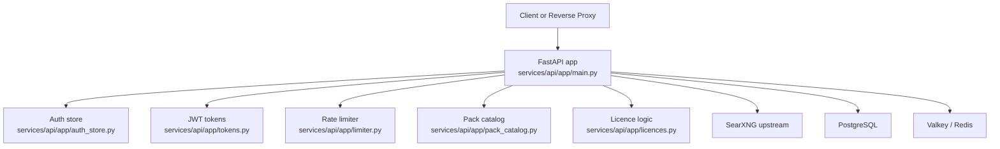

**Diagram sources**
- [services/api/app/main.py:43-84](file://services/api/app/main.py#L43-L84)
- [services/api/app/auth_store.py:41-217](file://services/api/app/auth_store.py#L41-L217)
- [services/api/app/tokens.py:17-40](file://services/api/app/tokens.py#L17-L40)
- [services/api/app/limiter.py:15-45](file://services/api/app/limiter.py#L15-L45)
- [services/api/app/pack_catalog.py:61-97](file://services/api/app/pack_catalog.py#L61-L97)
- [services/api/app/licences.py:279-332](file://services/api/app/licences.py#L279-L332)

**Section sources**
- [services/api/app/main.py:1-84](file://services/api/app/main.py#L1-L84)
- [services/api/requirements.txt:1-13](file://services/api/requirements.txt#L1-L13)
- [services/api/Dockerfile:1-10](file://services/api/Dockerfile#L1-L10)

## Core Components
- Application lifecycle and state: The FastAPI lifespan initializes database pools, cache clients, rate limiters, mailer, HTTP client, and auth/licence stores. It switches between lite mode (in-memory) and production mode (PostgreSQL + Valkey).
- Authentication: Email OTP flow creates users, issues refresh tokens, activates devices, and validates access tokens. Lite and Postgres-backed implementations share the same interface.
- Token system: HS256 JWTs carry device identity (`sub`), user identity (`uid`), and audience. Access tokens are short-lived; refresh tokens rotate securely.
- Rate limiting: Per-device minute and day counters protect search endpoints. In-memory buckets are used in lite mode; Valkey pipelines are used in production.
- Pack catalog: Discovers local pack directories, computes file hashes, generates signed download URLs, and optionally returns presigned cloud storage URLs.
- Licence management: Ed25519-signed device licences, activation limits, subscription renewal, webhook processing for Stripe and Razorpay, and admin revocation.

**Section sources**
- [services/api/app/main.py:43-84](file://services/api/app/main.py#L43-L84)
- [services/api/app/auth_store.py:41-217](file://services/api/app/auth_store.py#L41-L217)
- [services/api/app/tokens.py:17-40](file://services/api/app/tokens.py#L17-L40)
- [services/api/app/limiter.py:15-45](file://services/api/app/limiter.py#L15-L45)
- [services/api/app/pack_catalog.py:61-97](file://services/api/app/pack_catalog.py#L61-L97)
- [services/api/app/licences.py:279-332](file://services/api/app/licences.py#L279-L332)

## Architecture Overview
The API follows a layered design:
- Request layer: FastAPI routes validate inputs using Pydantic models and enforce authentication via dependencies.
- Policy layer: Centralized exception handler converts domain errors into consistent JSON error responses.
- Service layer: Business logic for auth, licences, packs, and search orchestration.
- Storage layer: PostgreSQL for persistent data, Valkey for distributed rate limiting and caching, filesystem/cloud storage for pack content.

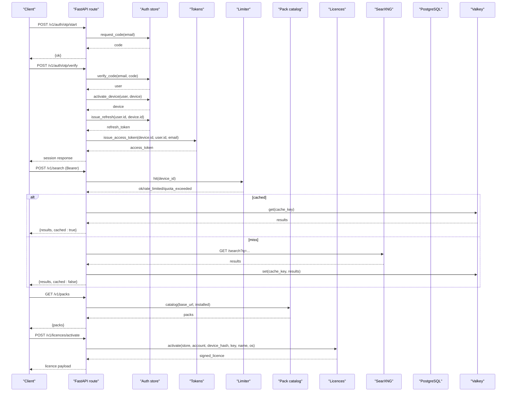

**Diagram sources**
- [services/api/app/main.py:238-277](file://services/api/app/main.py#L238-L277)
- [services/api/app/main.py:380-420](file://services/api/app/main.py#L380-L420)
- [services/api/app/main.py:313-347](file://services/api/app/main.py#L313-L347)
- [services/api/app/main.py:513-524](file://services/api/app/main.py#L513-L524)
- [services/api/app/auth_store.py:55-109](file://services/api/app/auth_store.py#L55-L109)
- [services/api/app/tokens.py:17-29](file://services/api/app/tokens.py#L17-L29)
- [services/api/app/limiter.py:21-27](file://services/api/app/limiter.py#L21-L27)
- [services/api/app/pack_catalog.py:61-97](file://services/api/app/pack_catalog.py#L61-L97)
- [services/api/app/licences.py:299-318](file://services/api/app/licences.py#L299-L318)

## Detailed Component Analysis

### Authentication and Session Management
The authentication flow uses email OTP verification, device activation, refresh token rotation, and short-lived access tokens.

- OTP start: Creates or reuses a user, enforces resend cooldown, stores hashed code, and sends an email.
- OTP verify: Validates code format, attempts, expiration, and consumes the challenge. Activates the device and issues a rotating refresh token.
- Refresh: Rotates refresh tokens within the same family, invalidating reused tokens and revoked devices.
- Access token: Encodes device ID as subject, user ID, email, and audience; validated by `current_user`.

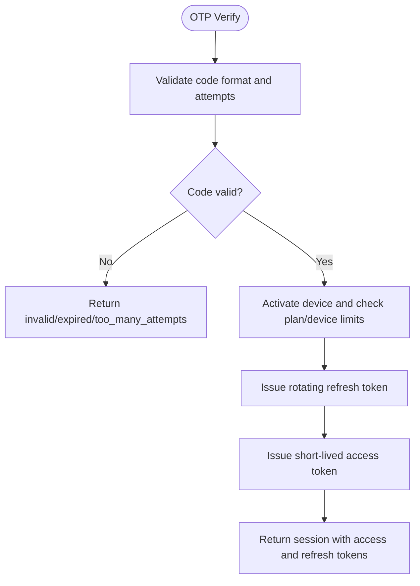

**Diagram sources**
- [services/api/app/auth_store.py:86-109](file://services/api/app/auth_store.py#L86-L109)
- [services/api/app/auth_store.py:111-140](file://services/api/app/auth_store.py#L111-L140)
- [services/api/app/auth_store.py:188-209](file://services/api/app/auth_store.py#L188-L209)
- [services/api/app/tokens.py:17-29](file://services/api/app/tokens.py#L17-L29)

**Section sources**
- [services/api/app/main.py:238-277](file://services/api/app/main.py#L238-L277)
- [services/api/app/auth_store.py:41-217](file://services/api/app/auth_store.py#L41-L217)
- [services/api/app/tokens.py:17-40](file://services/api/app/tokens.py#L17-L40)

### Web Search Proxy and Caching
Search requests are authenticated, rate-limited per device, proxied to SearXNG, filtered by domains, and cached.

- Input validation: Pydantic model enforces query length, result count, language, time range, and niche.
- Cache key: Normalizes query text, result count, domains, language, time range, and niche.
- Upstream fallback: If SearXNG fails, returns empty results with an error status and logs usage.
- Privacy: Query text is not persisted; only anonymized metrics are recorded.

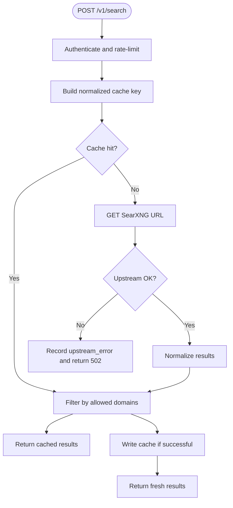

**Diagram sources**
- [services/api/app/main.py:350-364](file://services/api/app/main.py#L350-L364)
- [services/api/app/main.py:367-372](file://services/api/app/main.py#L367-L372)
- [services/api/app/main.py:380-420](file://services/api/app/main.py#L380-L420)
- [services/api/app/main.py:435-451](file://services/api/app/main.py#L435-L451)

**Section sources**
- [services/api/app/main.py:350-420](file://services/api/app/main.py#L350-L420)
- [services/api/app/limiter.py:15-45](file://services/api/app/limiter.py#L15-L45)

### Pack Catalog and Signed Downloads
The pack catalog discovers packs from a configured root directory, computes file hashes, and provides signed download URLs. When configured, it can return presigned cloud storage URLs instead.

- Discovery: Scans directories for manifests and builds versioned file lists.
- Signing: HMAC signs relative paths with expiration timestamps.
- Verification: Rejects absolute paths, traversal, expired signatures, and missing files.
- Cloud backend: Optional S3/R2 presigned URLs when bucket credentials are provided.

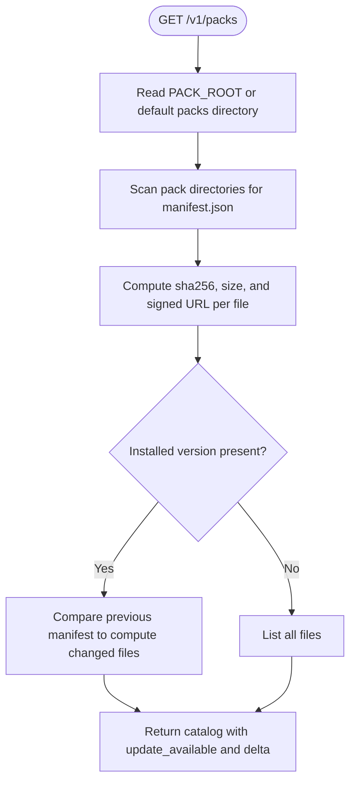

**Diagram sources**
- [services/api/app/pack_catalog.py:61-97](file://services/api/app/pack_catalog.py#L61-L97)
- [services/api/app/pack_catalog.py:23-47](file://services/api/app/pack_catalog.py#L23-L47)
- [services/api/app/pack_catalog.py:136-160](file://services/api/app/pack_catalog.py#L136-L160)

**Section sources**
- [services/api/app/main.py:313-347](file://services/api/app/main.py#L313-L347)
- [services/api/app/pack_catalog.py:18-47](file://services/api/app/pack_catalog.py#L18-L47)
- [services/api/app/pack_catalog.py:61-97](file://services/api/app/pack_catalog.py#L61-L97)
- [services/api/app/pack_catalog.py:136-160](file://services/api/app/pack_catalog.py#L136-L160)

### Licence Management and Billing Webhooks
Licences are Ed25519-signed payloads bound to devices, with activation limits, grace periods, and subscription terms. Billing webhooks from Stripe and Razorpay create or extend subscriptions and deliver keys.

- Activation: Validates OS, device hash, active status, and device limits; returns a signed licence payload.
- Refresh: Touches device activity and returns a refreshed signed licence.
- Renewal: Extends subscription end date based on allowed terms.
- Webhooks: Verifies provider signatures, extracts email and term, upserts users, and grants or refunds licences.

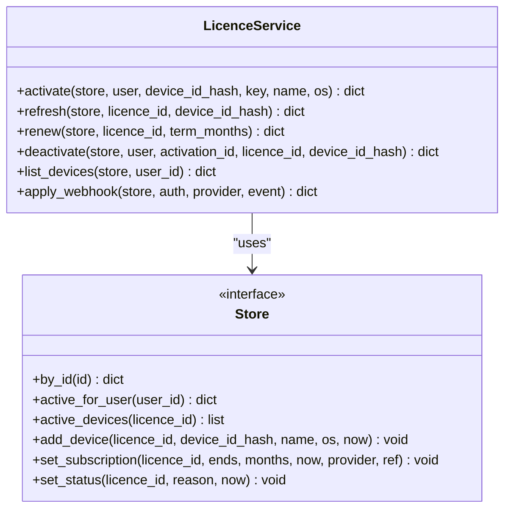

**Diagram sources**
- [services/api/app/licences.py:279-332](file://services/api/app/licences.py#L279-L332)
- [services/api/app/licences.py:335-349](file://services/api/app/licences.py#L335-L349)
- [services/api/app/licences.py:352-378](file://services/api/app/licences.py#L352-L378)
- [services/api/app/licences.py:464-535](file://services/api/app/licences.py#L464-L535)

**Section sources**
- [services/api/app/main.py:513-582](file://services/api/app/main.py#L513-L582)
- [services/api/app/main.py:600-639](file://services/api/app/main.py#L600-L639)
- [services/api/app/licences.py:279-332](file://services/api/app/licences.py#L279-L332)
- [services/api/app/licences.py:464-535](file://services/api/app/licences.py#L464-L535)

### Middleware Stack, Validation, Errors, and Logging
- Exception handling: A custom `Problem` exception maps to structured JSON errors with optional `Retry-After`. Domain-specific exceptions from auth and licences are converted consistently.
- Request validation: Pydantic models enforce input constraints for OTP, search, fetch, and licence operations.
- CORS: Not added inside this API module; cross-origin handling is expected at the reverse proxy or host application layer.
- Logging: Uses a named logger for the API. Audit records are appended in memory during lite mode; production writes anonymized search metrics to PostgreSQL.

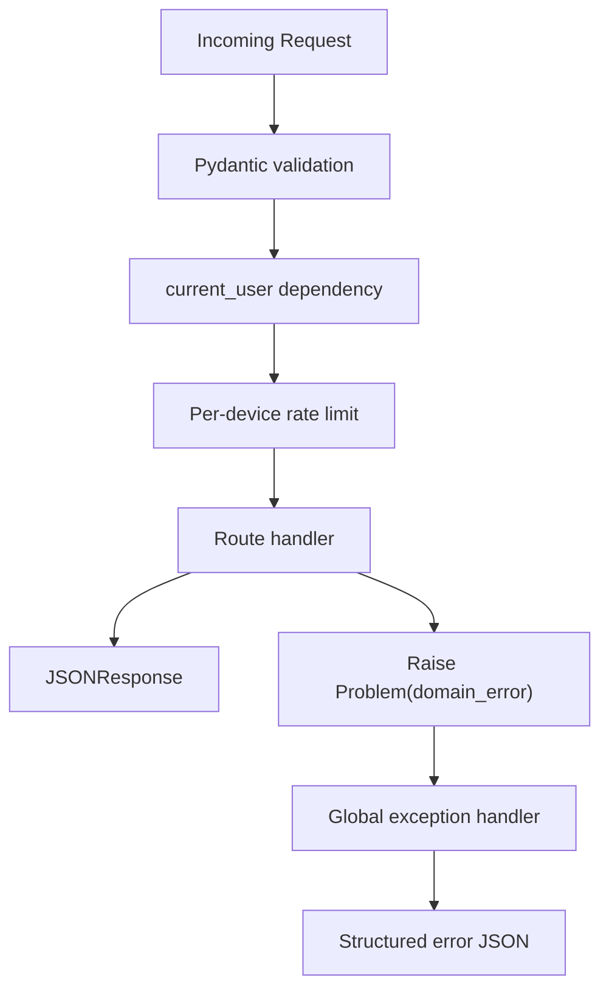

**Diagram sources**
- [services/api/app/main.py:87-96](file://services/api/app/main.py#L87-L96)
- [services/api/app/main.py:98-116](file://services/api/app/main.py#L98-L116)
- [services/api/app/main.py:200-219](file://services/api/app/main.py#L200-L219)
- [services/api/app/main.py:350-364](file://services/api/app/main.py#L350-L364)

**Section sources**
- [services/api/app/main.py:87-96](file://services/api/app/main.py#L87-L96)
- [services/api/app/main.py:98-116](file://services/api/app/main.py#L98-L116)
- [services/api/app/main.py:200-219](file://services/api/app/main.py#L200-L219)
- [services/api/app/main.py:350-364](file://services/api/app/main.py#L350-L364)

### Dependency Injection and Service Composition
FastAPI dependencies are used for:
- `current_user`: Parses and validates bearer tokens, checks device activity.
- `rate_limit`: Enforces per-device search quotas and attaches user context to the request.
- `search_gate`: Allows development bypass while preserving production security.
- Optional user helpers for licence endpoints that accept both authenticated and anonymous callers.

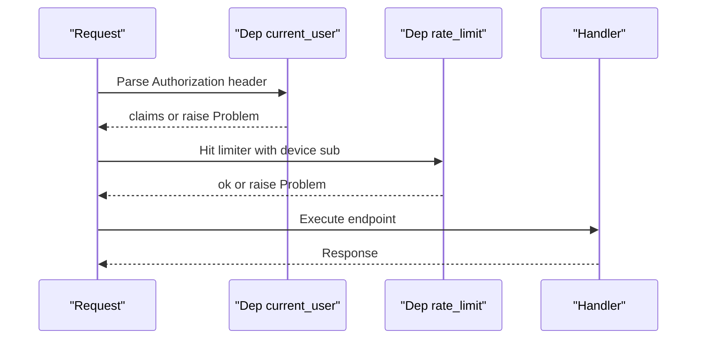

**Diagram sources**
- [services/api/app/main.py:98-116](file://services/api/app/main.py#L98-L116)
- [services/api/app/main.py:136-142](file://services/api/app/main.py#L136-L142)

**Section sources**
- [services/api/app/main.py:98-116](file://services/api/app/main.py#L98-L116)
- [services/api/app/main.py:136-142](file://services/api/app/main.py#L136-L142)

### Configuration Management and Secrets
Configuration is environment-driven:
- Database and cache: `DATABASE_URL`, `VALKEY_URL`.
- External services: `SEARXNG_URL`, `PUBLIC_BASE_URL`.
- Security: `JWT_SECRET`, `JWT_AUDIENCE`, `LICENCE_SIGNING_KEY_HEX`, `LICENCE_ADMIN_TOKEN`, payment webhook secrets.
- Feature toggles: `SURF_API_LITE`, `SURF_DEV_OPEN`, `PACK_BACKEND`, `PACK_ROOT`, `R2_BUCKET`/`S3_BUCKET`, and related AWS/R2 credentials.
- Limits: `SEARCH_PER_MIN`, `SEARCH_PER_DAY`, `ACTIVATION_LIMIT`, `ACTIVATION_WINDOW`, `MAX_DEVICES`.

Secrets should be injected at runtime via environment variables or a secrets manager. Avoid committing secrets to source control.

**Section sources**
- [services/api/app/main.py:37-40](file://services/api/app/main.py#L37-L40)
- [services/api/app/main.py:43-84](file://services/api/app/main.py#L43-L84)
- [services/api/app/tokens.py:14-29](file://services/api/app/tokens.py#L14-L29)
- [services/api/app/pack_catalog.py:15-20](file://services/api/app/pack_catalog.py#L15-L20)
- [services/api/app/pack_catalog.py:144-160](file://services/api/app/pack_catalog.py#L144-L160)
- [services/api/app/licences.py:71-79](file://services/api/app/licences.py#L71-L79)

### Monitoring, Observability, and Health Checks
- Health endpoint: `/v1/health` reports Postgres extension status, Valkey ping, and SearXNG reachability. Returns 200 when healthy, 503 when degraded.
- Version endpoint: `/v1/version` returns minimum app version and announcements.
- Metrics: No built-in Prometheus metrics exporter is present. Audit records are collected in memory in lite mode; production writes anonymized search metrics to PostgreSQL.
- Structured logging: Uses a dedicated logger for the API.

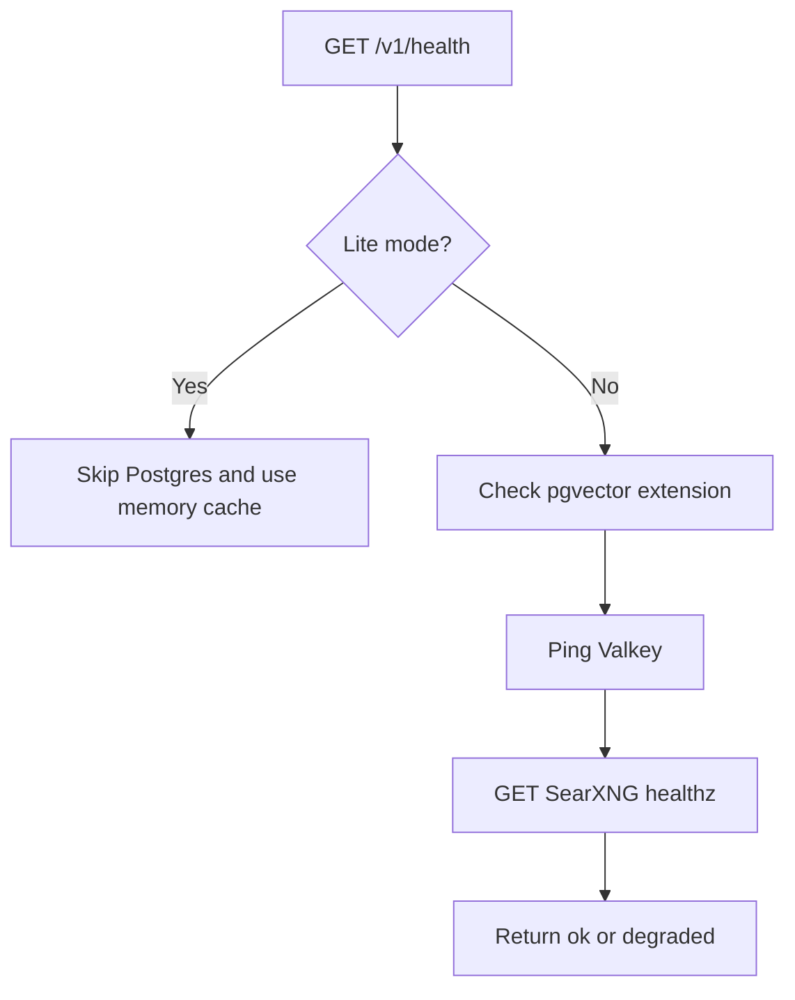

**Diagram sources**
- [services/api/app/main.py:149-173](file://services/api/app/main.py#L149-L173)

**Section sources**
- [services/api/app/main.py:149-178](file://services/api/app/main.py#L149-L178)
- [services/api/app/main.py:454-464](file://services/api/app/main.py#L454-L464)

### Containerization and Deployment
The Dockerfile installs dependencies, copies the application, runs as a non-root user, and starts Uvicorn with two workers behind a reverse proxy.

- Base image: Minimal Python 3.12 slim image.
- Entrypoint: `uvicorn app.main:app` with `--workers 2` and `--proxy-headers`.
- Port: Exposes 8000.

For production deployments:
- Use a reverse proxy (e.g., Nginx) for TLS termination, static asset serving, and connection buffering.
- Configure SSL certificates and secure headers at the proxy layer.
- Allocate CPU and memory according to worker count and workload; consider horizontal scaling with multiple containers behind a load balancer.
- Use environment variables for all secrets and configuration.

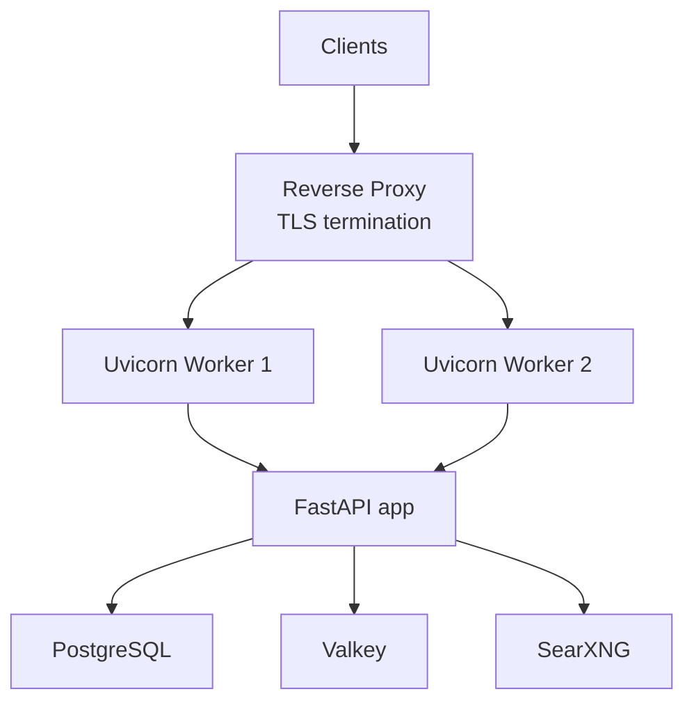

**Diagram sources**
- [services/api/Dockerfile:1-10](file://services/api/Dockerfile#L1-L10)

**Section sources**
- [services/api/Dockerfile:1-10](file://services/api/Dockerfile#L1-L10)

## Dependency Analysis
The API depends on:
- FastAPI and Uvicorn for routing and ASGI server.
- Pydantic for request/response validation.
- httpx for outbound HTTP calls to SearXNG and pack downloads.
- psycopg and psycopg-pool for async PostgreSQL connections.
- redis for distributed rate limiting and caching.
- pyjwt for HS256 access tokens.
- trafilatura for page extraction.
- argon2-cffi for password hashing where applicable.
- alembic for migrations.
- pynacl for Ed25519 licence signing.

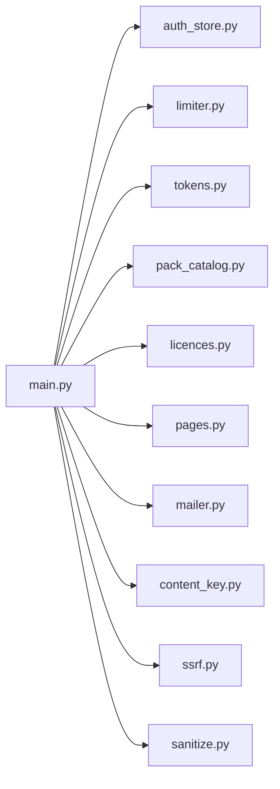

**Diagram sources**
- [services/api/app/main.py:23-34](file://services/api/app/main.py#L23-L34)

**Section sources**
- [services/api/requirements.txt:1-13](file://services/api/requirements.txt#L1-L13)
- [services/api/app/main.py:23-34](file://services/api/app/main.py#L23-L34)

## Performance Considerations
- Rate limiting: Prefer Redis-backed limiter in production to avoid per-process counters. Tune `SEARCH_PER_MIN` and `SEARCH_PER_DAY` based on capacity.
- Caching: Adjust `SEARCH_CACHE_TTL` to balance freshness and upstream load.
- Database pool: Ensure `psycopg_pool` settings match concurrency needs; monitor connection usage.
- Workers: Increase Uvicorn workers for CPU-bound tasks, but watch memory usage.
- Search upstream: Handle SearXNG failures gracefully and expose degradation via health checks.
- Pack downloads: Use presigned cloud URLs to offload bandwidth from the API server.

[No sources needed since this section provides general guidance]

## Troubleshooting Guide
Common issues and resolutions:
- Unauthenticated or invalid token: Ensure `Authorization: Bearer <token>` is present and the token has not expired. Check `JWT_SECRET` and `JWT_AUDIENCE`.
- Rate limited: Reduce search frequency or increase limits. Verify device identity is stable.
- Search unavailable: Check SearXNG connectivity and `SEARXNG_URL`. Inspect health endpoint for upstream status.
- Licence unconfigured: Set `LICENCE_SIGNING_KEY_HEX` and ensure it is exactly 32 bytes hex-encoded.
- Admin token mismatch: Verify `LICENCE_ADMIN_TOKEN` and the `X-Licence-Admin` header value.
- Webhook signature failure: Confirm provider secrets and timestamp tolerance.

**Section sources**
- [services/api/app/main.py:98-106](file://services/api/app/main.py#L98-L106)
- [services/api/app/main.py:109-116](file://services/api/app/main.py#L109-L116)
- [services/api/app/main.py:149-173](file://services/api/app/main.py#L149-L173)
- [services/api/app/licences.py:71-79](file://services/api/app/licences.py#L71-L79)
- [services/api/app/main.py:555-565](file://services/api/app/main.py#L555-L565)
- [services/api/app/main.py:600-639](file://services/api/app/main.py#L600-L639)

## Conclusion
Surf.ai’s backend API is a focused FastAPI service that secures access through email OTP and device-bound JWTs, proxies web search with rate limiting and caching, serves signed knowledge packs, and manages Ed25519 device licences integrated with billing providers. It is designed for lightweight deployment with clear separation between lite and production modes, strong input validation, structured error responses, and environment-driven configuration. Production readiness relies on a reverse proxy for TLS, proper secret management, and monitoring through health checks and log aggregation.

[No sources needed since this section summarizes without analyzing specific files]

## Appendices

### API Endpoints Summary
- Authentication
  - `POST /v1/auth/otp/start`
  - `POST /v1/auth/otp/verify`
  - `POST /v1/auth/refresh`
  - `POST /v1/auth/logout`
  - `GET /v1/account`
  - `GET /v1/devices`
  - `POST /v1/devices/{device_id}/revoke`
- Search
  - `POST /v1/search`
  - `POST /v1/fetch`
- Packs
  - `GET /v1/packs`
  - `GET /v1/packs/manifest`
  - `GET /v1/packs/updates`
  - `GET /v1/packs/download`
- Licences and Billing
  - `POST /v1/licences/activate`
  - `POST /v1/licences/refresh`
  - `POST /v1/licences/deactivate`
  - `GET /v1/licences/devices`
  - `POST /v1/licences/revoke`
  - `POST /v1/licences/renew`
  - `POST /v1/billing/stripe`
  - `POST /v1/billing/razorpay`
- System
  - `GET /v1/health`
  - `GET /v1/version`
  - `GET /v1/models/registry`

**Section sources**
- [services/api/app/main.py:149-183](file://services/api/app/main.py#L149-L183)
- [services/api/app/main.py:238-347](file://services/api/app/main.py#L238-L347)
- [services/api/app/main.py:380-420](file://services/api/app/main.py#L380-L420)
- [services/api/app/main.py:513-639](file://services/api/app/main.py#L513-L639)