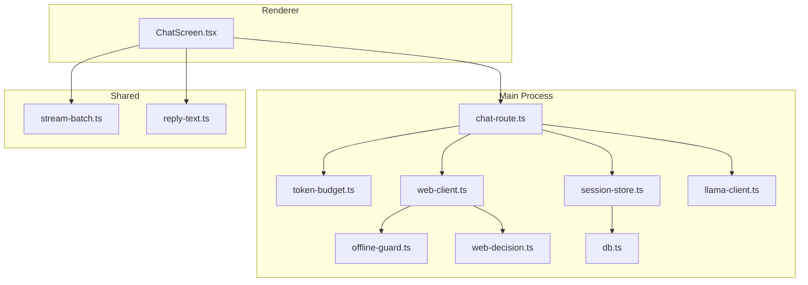
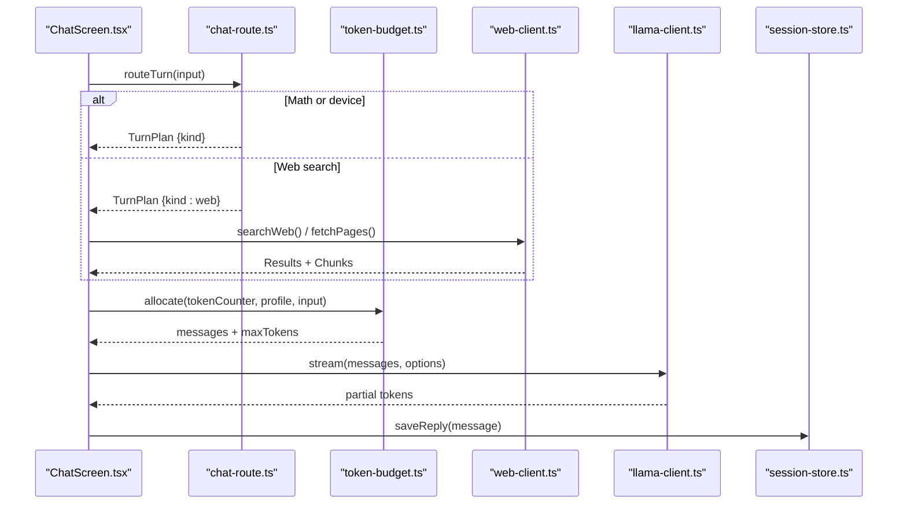
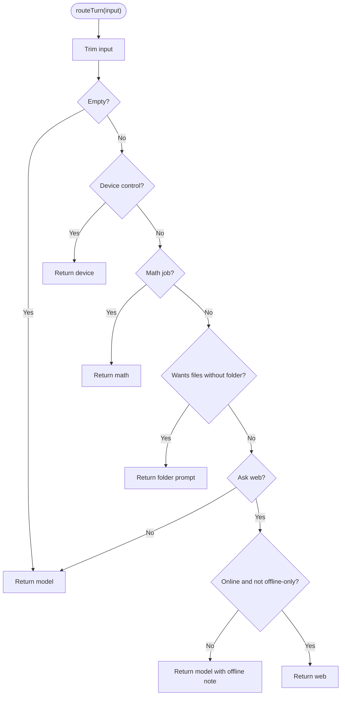
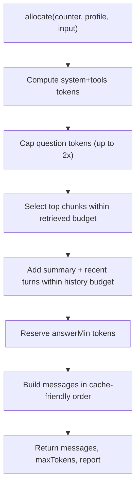
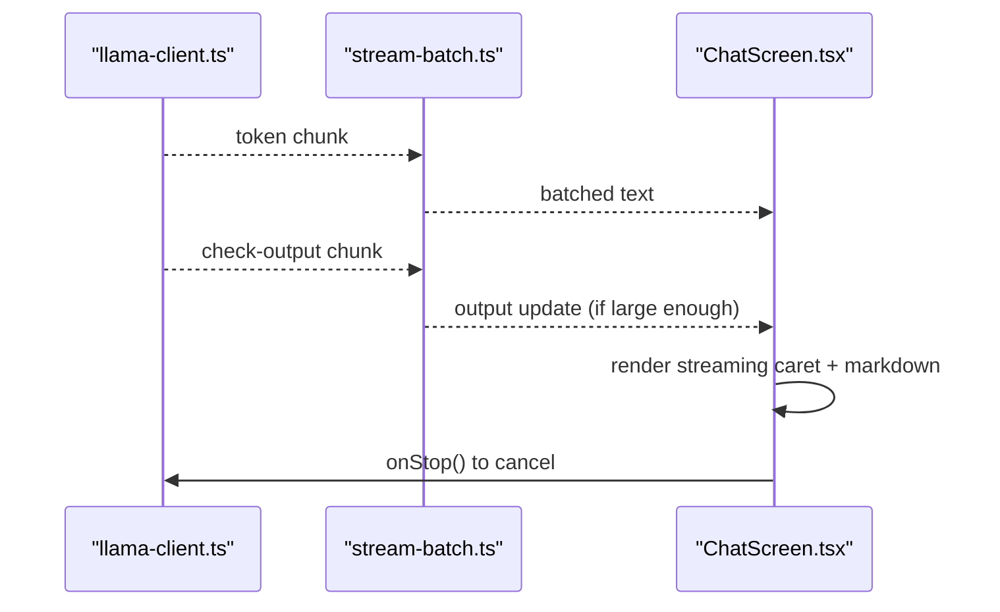
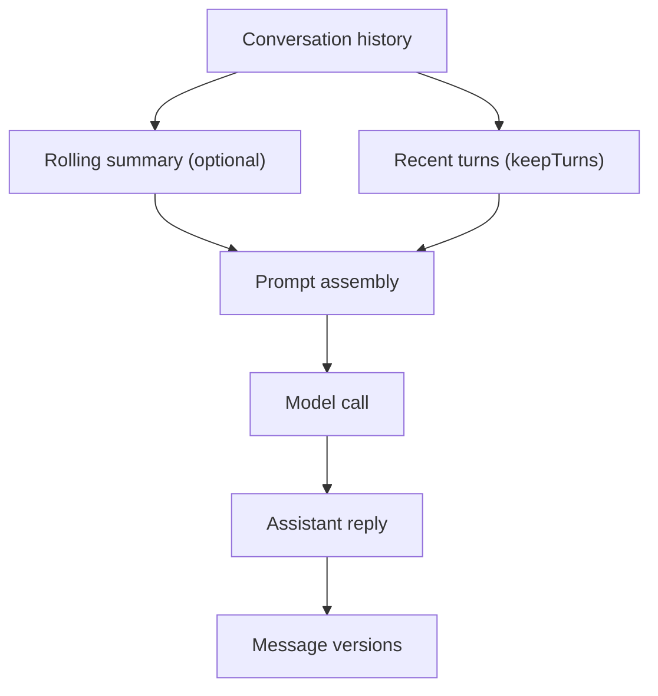
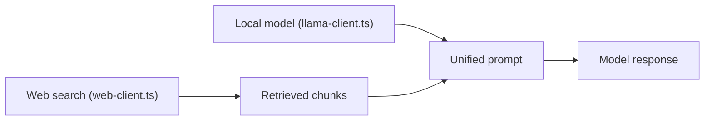
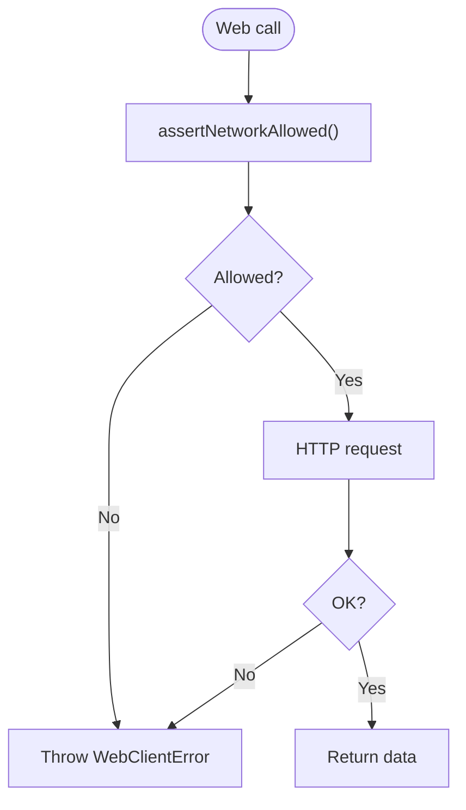
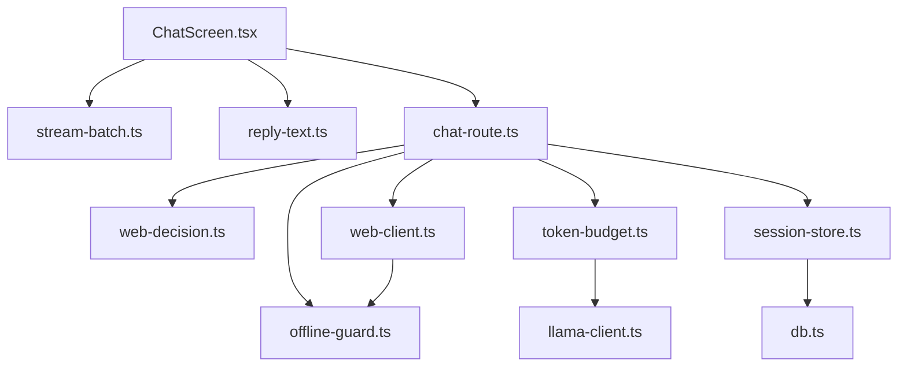

# Chat System

<cite>
**Referenced Files in This Document**
- [chat-route.ts](file://apps/desktop/src/main/core/chat-route.ts)
- [token-budget.ts](file://apps/desktop/src/main/core/token-budget.ts)
- [session-store.ts](file://apps/desktop/src/main/core/session-store.ts)
- [ChatScreen.tsx](file://apps/desktop/src/renderer/src/screens/ChatScreen.tsx)
- [stream-batch.ts](file://apps/desktop/src/shared/stream-batch.ts)
- [web-client.ts](file://apps/desktop/src/main/core/web-client.ts)
- [llama-client.ts](file://apps/desktop/src/main/core/llama-client.ts)
- [reply-text.ts](file://apps/desktop/src/shared/reply-text.ts)
- [offline-guard.ts](file://apps/desktop/src/main/core/offline-guard.ts)
- [web-decision.ts](file://apps/desktop/src/main/core/web-decision.ts)
- [db.ts](file://apps/desktop/src/main/core/db.ts)
- [ipc-contract.ts](file://apps/desktop/src/main/core/ipc-contract.ts)
</cite>

## Table of Contents
1. [Introduction](#introduction)
2. [Project Structure](#project-structure)
3. [Core Components](#core-components)
4. [Architecture Overview](#architecture-overview)
5. [Detailed Component Analysis](#detailed-component-analysis)
6. [Dependency Analysis](#dependency-analysis)
7. [Performance Considerations](#performance-considerations)
8. [Troubleshooting Guide](#troubleshooting-guide)
9. [Conclusion](#conclusion)

## Introduction
This document explains the chat system implementation in Surf.ai, focusing on how user messages are routed, how context is managed within token budgets, how conversation history is persisted, and how streaming responses are rendered in the UI. It also covers multi-turn handling, offline behavior, integration with local models and web search, and error handling strategies.

## Project Structure
The chat system spans main-process orchestration, shared utilities, and renderer UI components:
- Main process routing and budgeting: chat routing, token budget allocation, web client calls, and session persistence.
- Shared utilities: streaming batching and reply text helpers.
- Renderer UI: chat screen rendering, streaming display, and user interactions.



**Diagram sources**
- [chat-route.ts:1-161](file://apps/desktop/src/main/core/chat-route.ts#L1-L161)
- [token-budget.ts:1-172](file://apps/desktop/src/main/core/token-budget.ts#L1-L172)
- [web-client.ts:1-123](file://apps/desktop/src/main/core/web-client.ts#L1-L123)
- [session-store.ts:1-277](file://apps/desktop/src/main/core/session-store.ts#L1-L277)
- [llama-client.ts](file://apps/desktop/src/main/core/llama-client.ts)
- [offline-guard.ts](file://apps/desktop/src/main/core/offline-guard.ts)
- [web-decision.ts](file://apps/desktop/src/main/core/web-decision.ts)
- [db.ts](file://apps/desktop/src/main/core/db.ts)
- [stream-batch.ts:1-79](file://apps/desktop/src/shared/stream-batch.ts#L1-L79)
- [reply-text.ts](file://apps/desktop/src/shared/reply-text.ts)
- [ChatScreen.tsx:1-800](file://apps/desktop/src/renderer/src/screens/ChatScreen.tsx#L1-L800)

**Section sources**
- [chat-route.ts:1-161](file://apps/desktop/src/main/core/chat-route.ts#L1-L161)
- [token-budget.ts:1-172](file://apps/desktop/src/main/core/token-budget.ts#L1-L172)
- [session-store.ts:1-277](file://apps/desktop/src/main/core/session-store.ts#L1-L277)
- [ChatScreen.tsx:1-800](file://apps/desktop/src/renderer/src/screens/ChatScreen.tsx#L1-L800)
- [stream-batch.ts:1-79](file://apps/desktop/src/shared/stream-batch.ts#L1-L79)
- [web-client.ts:1-123](file://apps/desktop/src/main/core/web-client.ts#L1-L123)

## Core Components
- Conversation routing: Determines whether a turn should be handled by device control, math computation, project file access, web search, or direct model response.
- Token budget allocator: Builds prompts that fit per-request budgets using an exact tokenizer (local server or Hugging Face), truncates long inputs, and selects recent turns plus optional summary.
- Session store: Persists conversations and messages to an encrypted database when available; falls back to in-memory storage otherwise. Supports message versions and metadata.
- Streaming batching: Coalesces streamed tokens into small batches for efficient UI updates and supports frame-based batching for tool outputs.
- Web client: Calls the search service with network policy enforcement, returns structured results, and fetches page content safely.
- Chat UI: Renders user and assistant messages, shows streaming caret, supports stop/cancel, citations, and version navigation.

**Section sources**
- [chat-route.ts:21-161](file://apps/desktop/src/main/core/chat-route.ts#L21-L161)
- [token-budget.ts:20-172](file://apps/desktop/src/main/core/token-budget.ts#L20-L172)
- [session-store.ts:40-277](file://apps/desktop/src/main/core/session-store.ts#L40-L277)
- [stream-batch.ts:6-79](file://apps/desktop/src/shared/stream-batch.ts#L6-L79)
- [web-client.ts:9-123](file://apps/desktop/src/main/core/web-client.ts#L9-L123)
- [ChatScreen.tsx:176-358](file://apps/desktop/src/renderer/src/screens/ChatScreen.tsx#L176-L358)

## Architecture Overview
The chat flow starts in the renderer, which sends a user message to the main process. The router decides the turn kind. If web search is needed, the web client queries the search service and fetches pages. The token budget allocator composes the final prompt from system instructions, tools, retrieved chunks, summarized older history, recent turns, and the question. The model client streams partial responses back to the UI, which renders them incrementally. All messages are persisted via the session store.



**Diagram sources**
- [chat-route.ts:120-161](file://apps/desktop/src/main/core/chat-route.ts#L120-L161)
- [web-client.ts:73-113](file://apps/desktop/src/main/core/web-client.ts#L73-L113)
- [token-budget.ts:101-166](file://apps/desktop/src/main/core/token-budget.ts#L101-L166)
- [llama-client.ts](file://apps/desktop/src/main/core/llama-client.ts)
- [session-store.ts:155-179](file://apps/desktop/src/main/core/session-store.ts#L155-L179)
- [ChatScreen.tsx:176-358](file://apps/desktop/src/renderer/src/screens/ChatScreen.tsx#L176-L358)

## Detailed Component Analysis

### Conversation Routing
The router classifies each turn before any model call or web request:
- Device control requests are rejected with a note.
- Math expressions and word problems are computed locally.
- Project file operations require an open folder; otherwise, a prompt is returned.
- Fresh information requests or explicit web usage trigger web search if online.
- Otherwise, the turn goes directly to the model.



**Diagram sources**
- [chat-route.ts:120-137](file://apps/desktop/src/main/core/chat-route.ts#L120-L137)

**Section sources**
- [chat-route.ts:6-26](file://apps/desktop/src/main/core/chat-route.ts#L6-L26)
- [chat-route.ts:93-118](file://apps/desktop/src/main/core/chat-route.ts#L93-L118)
- [chat-route.ts:120-161](file://apps/desktop/src/main/core/chat-route.ts#L120-L161)

### Token Budget System
The token budget allocator ensures every request fits within a fixed budget:
- Uses an exact tokenizer via llama-server endpoints or Hugging Face tokenizer.
- Allocates fixed portions for system/tools, retrieved chunks, history summary, recent turns, and question.
- Truncates long questions and selected chunks to fit budgets.
- Keeps only the most recent N turns and optionally summarizes older turns.
- Reserves a minimum number of tokens for the answer and throws on overflow.



**Diagram sources**
- [token-budget.ts:20-57](file://apps/desktop/src/main/core/token-budget.ts#L20-L57)
- [token-budget.ts:62-73](file://apps/desktop/src/main/core/token-budget.ts#L62-L73)
- [token-budget.ts:90-99](file://apps/desktop/src/main/core/token-budget.ts#L90-L99)
- [token-budget.ts:101-166](file://apps/desktop/src/main/core/token-budget.ts#L101-L166)

**Section sources**
- [token-budget.ts:1-172](file://apps/desktop/src/main/core/token-budget.ts#L1-L172)

### Session Store
The session store persists chat history and metadata:
- Uses an encrypted SQLite database when available; otherwise, uses in-memory storage for the current session.
- Stores conversations and messages with roles, content, sources, gate metadata, and message versions.
- Provides list, open, append, saveReply, renameIfPlaceholder, remove, clearHistory, and size metrics.
- Ensures schema compatibility by adding missing columns at runtime.

```mermaid
classDiagram
class SessionStore {
-mem Map
+constructor(db)
+list() ConversationSummary[]
+open(id) {id, messages}
+readMessage(id) StoredMessage?
+agentOf(id) string?
+ensure(id, firstText, agentId) string
+append(conversationId, message) void
+saveReply(conversationId, message) void
+renameIfPlaceholder(id, firstText) void
+remove(id) void
+historyBytes() number
+clearHistory() void
}
```

**Diagram sources**
- [session-store.ts:40-277](file://apps/desktop/src/main/core/session-store.ts#L40-L277)

**Section sources**
- [session-store.ts:1-277](file://apps/desktop/src/main/core/session-store.ts#L1-L277)

### Streaming Response Mechanism
Streaming is optimized for smooth UI updates:
- Text batching coalesces tokens until a threshold or newline, then emits a batch.
- Frame batching schedules UI updates efficiently and supports immediate flush for critical items.
- The chat screen displays a streaming caret, supports stopping generation, and renders markdown progressively.



**Diagram sources**
- [stream-batch.ts:6-79](file://apps/desktop/src/shared/stream-batch.ts#L6-L79)
- [ChatScreen.tsx:176-358](file://apps/desktop/src/renderer/src/screens/ChatScreen.tsx#L176-L358)
- [llama-client.ts](file://apps/desktop/src/main/core/llama-client.ts)

**Section sources**
- [stream-batch.ts:1-79](file://apps/desktop/src/shared/stream-batch.ts#L1-L79)
- [ChatScreen.tsx:176-358](file://apps/desktop/src/renderer/src/screens/ChatScreen.tsx#L176-L358)

### Multi-Turn Conversations and Context Preservation
- Recent turns are included in the prompt up to a configured limit.
- Older turns can be represented by a rolling summary to preserve context while staying within budget.
- Message versions allow regeneration and viewing previous replies.
- The session store tracks conversation metadata such as title, agent ID, and timestamps.



**Diagram sources**
- [token-budget.ts:129-147](file://apps/desktop/src/main/core/token-budget.ts#L129-L147)
- [session-store.ts:155-179](file://apps/desktop/src/main/core/session-store.ts#L155-L179)

**Section sources**
- [token-budget.ts:101-166](file://apps/desktop/src/main/core/token-budget.ts#L101-L166)
- [session-store.ts:155-179](file://apps/desktop/src/main/core/session-store.ts#L155-L179)

### Integration with AI Backends
- Local models: llama-client integrates with a local inference server; token budgeting can use the server’s tokenizer endpoints for exact counts.
- Web search: web-client calls the search service and fetches page content, returning structured chunks and sanitized reports.
- Unified interface: chat routing and budgeting unify local and web-derived context into a single prompt consumed by the model.



**Diagram sources**
- [llama-client.ts](file://apps/desktop/src/main/core/llama-client.ts)
- [web-client.ts:73-113](file://apps/desktop/src/main/core/web-client.ts#L73-L113)
- [token-budget.ts:118-127](file://apps/desktop/src/main/core/token-budget.ts#L118-L127)

**Section sources**
- [web-client.ts:1-123](file://apps/desktop/src/main/core/web-client.ts#L1-L123)
- [token-budget.ts:20-57](file://apps/desktop/src/main/core/token-budget.ts#L20-L57)

### Offline Capability and Network Policy
- Offline guard enforces network policy before any web request.
- Router includes notes when web search is skipped due to offline mode.
- Health probe checks service availability with timeouts.



**Diagram sources**
- [web-client.ts:56-63](file://apps/desktop/src/main/core/web-client.ts#L56-L63)
- [offline-guard.ts](file://apps/desktop/src/main/core/offline-guard.ts)
- [web-client.ts:115-123](file://apps/desktop/src/main/core/web-client.ts#L115-L123)

**Section sources**
- [web-client.ts:56-63](file://apps/desktop/src/main/core/web-client.ts#L56-L63)
- [web-client.ts:115-123](file://apps/desktop/src/main/core/web-client.ts#L115-L123)

## Dependency Analysis
Key dependencies and relationships:
- ChatScreen depends on shared streaming and reply text utilities and invokes main-process routing through IPC.
- Router depends on offline guard and web decision logic to determine web usage.
- Token budget depends on tokenizer implementations and chat message types.
- Session store depends on db abstraction and shared reply text helpers for previews.
- Web client depends on offline guard and web decision to build safe search payloads.



**Diagram sources**
- [ChatScreen.tsx:1-800](file://apps/desktop/src/renderer/src/screens/ChatScreen.tsx#L1-L800)
- [stream-batch.ts:1-79](file://apps/desktop/src/shared/stream-batch.ts#L1-L79)
- [reply-text.ts](file://apps/desktop/src/shared/reply-text.ts)
- [chat-route.ts:1-161](file://apps/desktop/src/main/core/chat-route.ts#L1-L161)
- [offline-guard.ts](file://apps/desktop/src/main/core/offline-guard.ts)
- [web-decision.ts](file://apps/desktop/src/main/core/web-decision.ts)
- [token-budget.ts:1-172](file://apps/desktop/src/main/core/token-budget.ts#L1-L172)
- [web-client.ts:1-123](file://apps/desktop/src/main/core/web-client.ts#L1-L123)
- [session-store.ts:1-277](file://apps/desktop/src/main/core/session-store.ts#L1-L277)
- [llama-client.ts](file://apps/desktop/src/main/core/llama-client.ts)
- [db.ts](file://apps/desktop/src/main/core/db.ts)

**Section sources**
- [ChatScreen.tsx:1-800](file://apps/desktop/src/renderer/src/screens/ChatScreen.tsx#L1-L800)
- [chat-route.ts:1-161](file://apps/desktop/src/main/core/chat-route.ts#L1-L161)
- [token-budget.ts:1-172](file://apps/desktop/src/main/core/token-budget.ts#L1-L172)
- [session-store.ts:1-277](file://apps/desktop/src/main/core/session-store.ts#L1-L277)
- [web-client.ts:1-123](file://apps/desktop/src/main/core/web-client.ts#L1-L123)

## Performance Considerations
- Token counting uses exact tokenizers where possible to avoid over-allocating context windows.
- Binary search truncation minimizes prompt size while preserving meaning.
- Chunk selection respects both count and relevance thresholds to reduce noise.
- Streaming batching reduces repaint frequency and improves responsiveness.
- Session store prefers encrypted databases to keep sensitive data secure and performant.
- Cache-friendly message ordering helps reuse KV caches on the inference server.

[No sources needed since this section provides general guidance]

## Troubleshooting Guide
Common issues and resolutions:
- Failed web requests: WebClientError indicates HTTP failures; verify service health and network policy.
- Offline mode: Router adds notes when web search is skipped; ensure online connectivity or adjust expectations.
- Budget overflow: Token budget throws when insufficient tokens remain for answers; shorten system/tools or reduce retrieved chunks.
- Model unavailability: UI prompts to download a model; ensure a chat-capable model is installed.
- Database migration: Session store adds missing columns automatically; verify schema integrity if errors occur.

**Section sources**
- [web-client.ts:9-14](file://apps/desktop/src/main/core/web-client.ts#L9-L14)
- [web-client.ts:65-77](file://apps/desktop/src/main/core/web-client.ts#L65-L77)
- [chat-route.ts:12-20](file://apps/desktop/src/main/core/chat-route.ts#L12-L20)
- [token-budget.ts:109-153](file://apps/desktop/src/main/core/token-budget.ts#L109-L153)
- [ChatScreen.tsx:232-256](file://apps/desktop/src/renderer/src/screens/ChatScreen.tsx#L232-L256)
- [session-store.ts:271-276](file://apps/desktop/src/main/core/session-store.ts#L271-L276)

## Conclusion
Surf.ai’s chat system combines precise token budgeting, robust conversation routing, persistent session storage, and efficient streaming to deliver responsive, context-aware AI interactions. It integrates local models and web search seamlessly, handles offline scenarios gracefully, and provides strong error handling and performance optimizations suitable for long conversations and resource-constrained environments.