# Code Assistance

<cite>
**Referenced Files in This Document**
- [languages.ts](file://apps/desktop/src/main/core/code/languages.ts)
- [parse.ts](file://apps/desktop/src/main/core/code/parse.ts)
- [scan.ts](file://apps/desktop/src/main/core/code/scan.ts)
- [project.ts](file://apps/desktop/src/main/core/code/project.ts)
- [search.ts](file://apps/desktop/src/main/core/code/search.ts)
- [chunks.ts](file://apps/desktop/src/main/core/code/chunks.ts)
- [context.ts](file://apps/desktop/src/main/core/code/context.ts)
- [store.ts](file://apps/desktop/src/main/core/code/store.ts)
- [embed.ts](file://apps/desktop/src/main/core/code/embed.ts)
- [lsp.ts](file://apps/desktop/src/main/core/code/lsp.ts)
- [watch.ts](file://apps/desktop/src/main/core/code/watch.ts)
- [limits.ts](file://apps/desktop/src/main/core/code/limits.ts)
- [fetch-tree-sitter.mjs](file://apps/desktop/scripts/fetch-tree-sitter.mjs)
</cite>

## Table of Contents
1. [Introduction](#introduction)
2. [Project Structure](#project-structure)
3. [Core Components](#core-components)
4. [Architecture Overview](#architecture-overview)
5. [Detailed Component Analysis](#detailed-component-analysis)
6. [Dependency Analysis](#dependency-analysis)
7. [Performance Considerations](#performance-considerations)
8. [Troubleshooting Guide](#troubleshooting-guide)
9. [Conclusion](#conclusion)

## Introduction
This document explains the code assistance features in Surf.ai, focusing on the syntax parsing system built on tree-sitter, the project scanning and indexing pipeline, hybrid search combining full-text and semantic understanding, context-aware completion hints, and integration with development workflows through file watching and incremental updates. It also documents supported languages, configuration options, and known limitations for binary files, generated code, and non-standard formats.

## Project Structure
The code assistance subsystem lives under the desktop application’s main process core:

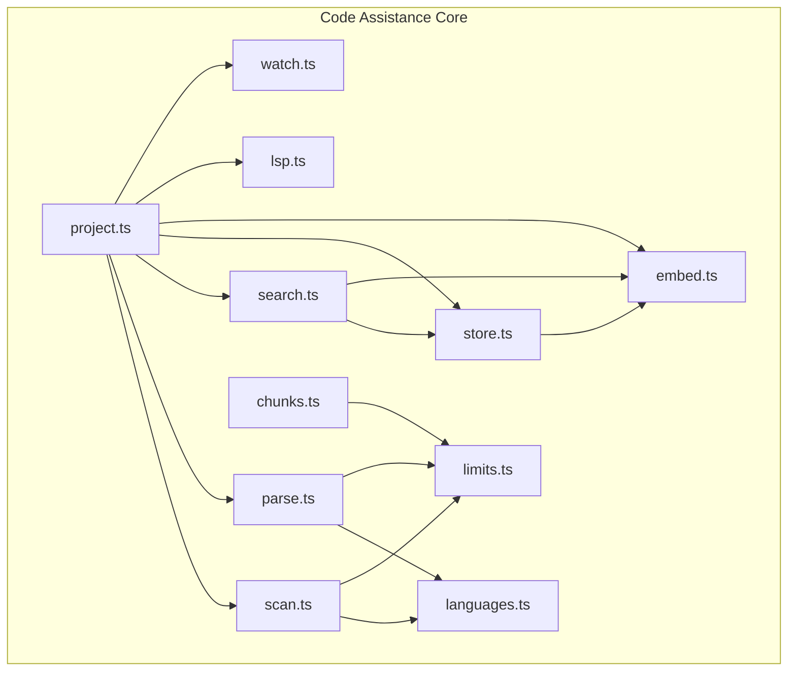

**Diagram sources**
- [project.ts:56-216](file://apps/desktop/src/main/core/code/project.ts#L56-L216)
- [parse.ts:1-528](file://apps/desktop/src/main/core/code/parse.ts#L1-L528)
- [scan.ts:1-161](file://apps/desktop/src/main/core/code/scan.ts#L1-L161)
- [search.ts:1-85](file://apps/desktop/src/main/core/code/search.ts#L1-L85)
- [chunks.ts:1-94](file://apps/desktop/src/main/core/code/chunks.ts#L1-L94)
- [store.ts:1-392](file://apps/desktop/src/main/core/code/store.ts#L1-L392)
- [embed.ts:1-53](file://apps/desktop/src/main/core/code/embed.ts#L1-L53)
- [lsp.ts:1-168](file://apps/desktop/src/main/core/code/lsp.ts#L1-L168)
- [watch.ts:1-35](file://apps/desktop/src/main/core/code/watch.ts#L1-L35)
- [languages.ts:1-59](file://apps/desktop/src/main/core/code/languages.ts#L1-L59)
- [limits.ts:1-62](file://apps/desktop/src/main/core/code/limits.ts#L1-L62)

**Section sources**
- [project.ts:56-216](file://apps/desktop/src/main/core/code/project.ts#L56-L216)
- [parse.ts:1-528](file://apps/desktop/src/main/core/code/parse.ts#L1-L528)
- [scan.ts:1-161](file://apps/desktop/src/main/core/code/scan.ts#L1-L161)
- [search.ts:1-85](file://apps/desktop/src/main/core/code/search.ts#L1-L85)
- [chunks.ts:1-94](file://apps/desktop/src/main/core/code/chunks.ts#L1-L94)
- [store.ts:1-392](file://apps/desktop/src/main/core/code/store.ts#L1-L392)
- [embed.ts:1-53](file://apps/desktop/src/main/core/code/embed.ts#L1-L53)
- [lsp.ts:1-168](file://apps/desktop/src/main/core/code/lsp.ts#L1-L168)
- [watch.ts:1-35](file://apps/desktop/src/main/core/code/watch.ts#L1-L35)
- [languages.ts:1-59](file://apps/desktop/src/main/core/code/languages.ts#L1-L59)
- [limits.ts:1-62](file://apps/desktop/src/main/core/code/limits.ts#L1-L62)

## Core Components
- Language detection and grammar mapping: maps file extensions to language identifiers and provides grammar filenames for tree-sitter.
- Syntax parsing: uses web-tree-sitter to extract symbols, imports, calls, and references per language.
- Project scanning: walks directories, respects .gitignore, skips binaries and oversized files, and classifies each file.
- Indexing and storage: persists files, symbols, edges, chunks, and vectors into a local SQLite database.
- Hybrid search: merges BM25 keyword results with vector similarity using reciprocal rank fusion.
- Context building: selects snippets within token budgets for model prompts.
- Completion hints: returns imported and nearby definitions for inline suggestions.
- Optional LSP integration: attempts exact references via pyright or typescript-language-server when available.
- File watching: coalesces events and triggers incremental re-indexing.

**Section sources**
- [languages.ts:1-59](file://apps/desktop/src/main/core/code/languages.ts#L1-L59)
- [parse.ts:1-528](file://apps/desktop/src/main/core/code/parse.ts#L1-L528)
- [scan.ts:1-161](file://apps/desktop/src/main/core/code/scan.ts#L1-L161)
- [store.ts:1-392](file://apps/desktop/src/main/core/code/store.ts#L1-L392)
- [search.ts:1-85](file://apps/desktop/src/main/core/code/search.ts#L1-L85)
- [context.ts:1-120](file://apps/desktop/src/main/core/code/context.ts#L1-L120)
- [project.ts:158-216](file://apps/desktop/src/main/core/code/project.ts#L158-L216)
- [lsp.ts:1-168](file://apps/desktop/src/main/core/code/lsp.ts#L1-L168)
- [watch.ts:1-35](file://apps/desktop/src/main/core/code/watch.ts#L1-L35)

## Architecture Overview
The system follows a pipeline: scan → parse → index → embed → search → context → completion hints. A background watcher triggers incremental updates.

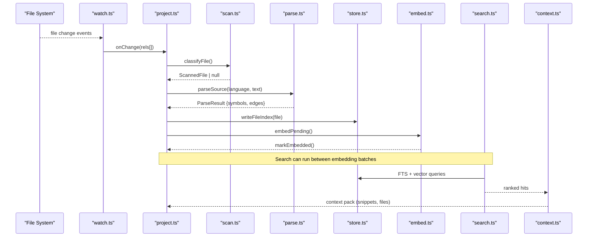

**Diagram sources**
- [watch.ts:1-35](file://apps/desktop/src/main/core/code/watch.ts#L1-L35)
- [project.ts:132-140](file://apps/desktop/src/main/core/code/project.ts#L132-L140)
- [project.ts:280-319](file://apps/desktop/src/main/core/code/project.ts#L280-L319)
- [project.ts:321-347](file://apps/desktop/src/main/core/code/project.ts#L321-L347)
- [search.ts:63-84](file://apps/desktop/src/main/core/code/search.ts#L63-L84)
- [context.ts:65-119](file://apps/desktop/src/main/core/code/context.ts#L65-L119)

## Detailed Component Analysis

### Syntax Parsing System (tree-sitter)
The parser initializes web-tree-sitter once, loads WASM grammars on demand, and extracts:
- Symbols: functions, classes, methods, types, variables, sections
- Imports: per-language import patterns
- Calls: call sites and constructors
- References: identifier usages excluding definitions and import statements

It falls back to plain-text sectioning when a language is unsupported or parsing fails.

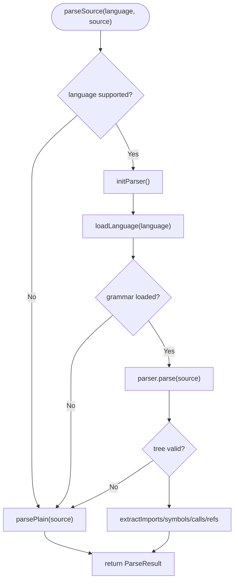

**Diagram sources**
- [parse.ts:138-160](file://apps/desktop/src/main/core/code/parse.ts#L138-L160)
- [parse.ts:502-528](file://apps/desktop/src/main/core/code/parse.ts#L502-L528)
- [parse.ts:466-499](file://apps/desktop/src/main/core/code/parse.ts#L466-L499)

Key implementation highlights:
- Grammar loading is cached per language; parser instance reused.
- Language-specific specs define symbol nodes, class nodes, and call node fields.
- Import extraction handles Python, JavaScript/TypeScript/TSX, Java, Go, Rust, C/C++.
- Call and reference extraction are capped per file to limit memory and CPU.

**Section sources**
- [parse.ts:1-528](file://apps/desktop/src/main/core/code/parse.ts#L1-L528)
- [languages.ts:48-59](file://apps/desktop/src/main/core/code/languages.ts#L48-L59)
- [fetch-tree-sitter.mjs:1-30](file://apps/desktop/scripts/fetch-tree-sitter.mjs#L1-L30)

### Language Support Matrix
Supported programming languages and mappings:
- Python: .py, .pyi
- JavaScript: .js, .jsx, .mjs, .cjs
- TypeScript: .ts
- TSX: .tsx
- Java: .java
- Go: .go
- Rust: .rs
- C: .c, .h
- C++: .cc, .cpp, .cxx, .hpp, .hh, .hxx

Plaintext fallback applies to prose and config-like files such as markdown, JSON, YAML, TOML, CSS, HTML, shell scripts, SQL, XML, Ruby, Swift, Kotlin, Scala, Lua, Vim script, Emacs Lisp, and special base names like Dockerfile, Makefile, Gemfile, etc.

Grammar WASM files are pinned versions fetched by a build script and loaded at runtime.

**Section sources**
- [languages.ts:3-46](file://apps/desktop/src/main/core/code/languages.ts#L3-L46)
- [languages.ts:48-59](file://apps/desktop/src/main/core/code/languages.ts#L48-L59)
- [fetch-tree-sitter.mjs:1-30](file://apps/desktop/scripts/fetch-tree-sitter.mjs#L1-L30)

### Project Scanning and Indexing
Scanning:
- Walks the project root recursively.
- Respects nested .gitignore rules.
- Skips dependency/build directories, secrets, lockfiles, and binary extensions.
- Detects binary content by sampling bytes and line length heuristics.
- Enforces limits on file size, total bytes, and number of files.

Indexing:
- Reads each file, computes SHA-256, parses it, splits symbols into chunks, and writes file metadata, symbols, edges, and chunks to SQLite.
- Links import and call edges to concrete symbols and paths post-parse.
- Batches embeddings for pending chunks and marks them embedded.

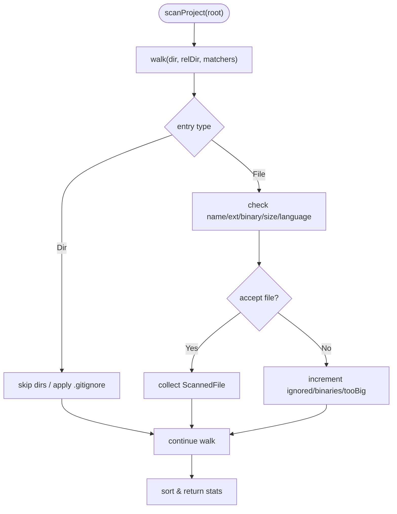

**Diagram sources**
- [scan.ts:71-123](file://apps/desktop/src/main/core/code/scan.ts#L71-L123)

Indexing flow:
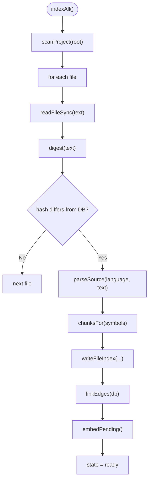

**Diagram sources**
- [project.ts:245-319](file://apps/desktop/src/main/core/code/project.ts#L245-L319)
- [project.ts:321-347](file://apps/desktop/src/main/core/code/project.ts#L321-L347)

**Section sources**
- [scan.ts:1-161](file://apps/desktop/src/main/core/code/scan.ts#L1-L161)
- [project.ts:245-319](file://apps/desktop/src/main/core/code/project.ts#L245-L319)
- [project.ts:321-347](file://apps/desktop/src/main/core/code/project.ts#L321-L347)
- [store.ts:73-105](file://apps/desktop/src/main/core/code/store.ts#L73-L105)
- [store.ts:231-326](file://apps/desktop/src/main/core/code/store.ts#L231-L326)
- [limits.ts:1-62](file://apps/desktop/src/main/core/code/limits.ts#L1-L62)

### Code Search: Full-Text + Semantic
Search combines:
- BM25 keyword search over chunk text via SQLite FTS.
- Vector similarity search over chunk embeddings.
- Reciprocal Rank Fusion (RRF) to merge ranks.
- Name boosting for identifiers matching query tokens and higher weight for function/method/class/type kinds.

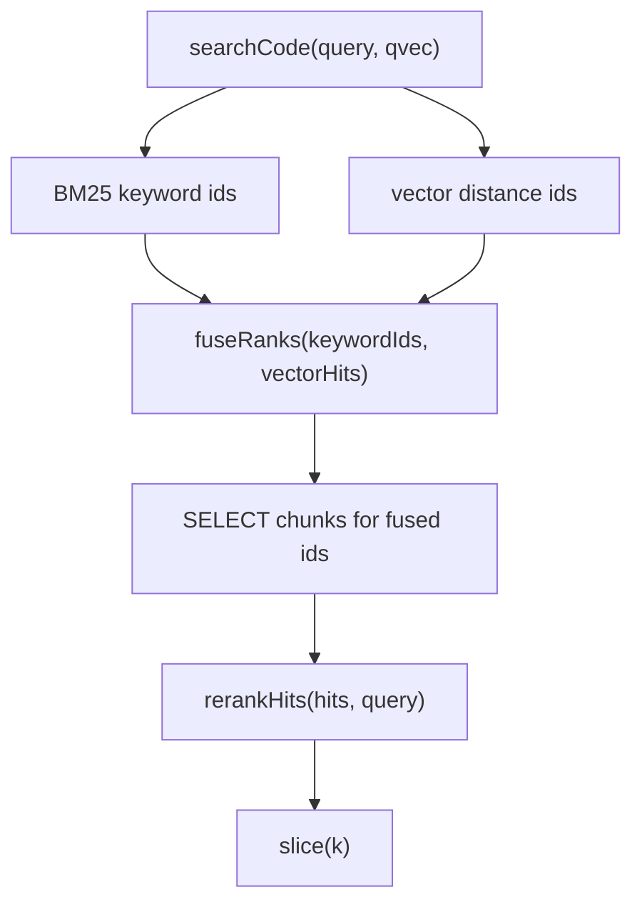

**Diagram sources**
- [search.ts:28-60](file://apps/desktop/src/main/core/code/search.ts#L28-L60)
- [search.ts:63-84](file://apps/desktop/src/main/core/code/search.ts#L63-L84)

**Section sources**
- [search.ts:1-85](file://apps/desktop/src/main/core/code/search.ts#L1-L85)

### Context Building for Model Prompts
Context builder:
- Embeds the task if an embedder is provided.
- Runs hybrid search to collect candidate snippets.
- Adds exact definitions for identifiers found in the task.
- Augments with related files and their top symbols.
- Applies token budgeting and truncation to fit constraints.

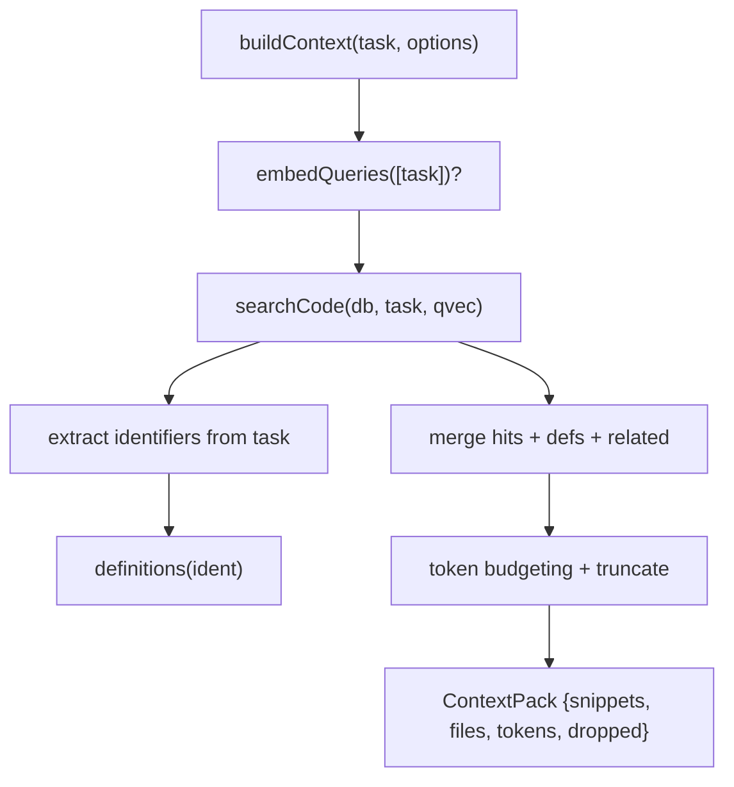

**Diagram sources**
- [context.ts:65-119](file://apps/desktop/src/main/core/code/context.ts#L65-L119)

**Section sources**
- [context.ts:1-120](file://apps/desktop/src/main/core/code/context.ts#L1-L120)

### Code Completion Hints
Completion hints provide:
- Imported symbols resolved to definitions.
- Nearby definitions above the cursor line.
These are used by the editor-facing completion service to populate context-aware suggestions.

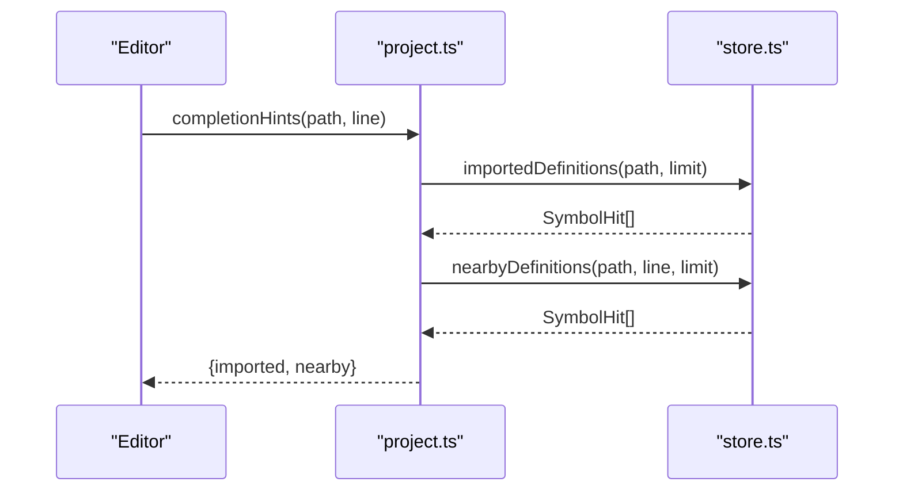

**Diagram sources**
- [project.ts:205-211](file://apps/desktop/src/main/core/code/project.ts#L205-L211)
- [store.ts:150-182](file://apps/desktop/src/main/core/code/store.ts#L150-L182)

**Section sources**
- [project.ts:205-211](file://apps/desktop/src/main/core/code/project.ts#L205-L211)
- [store.ts:150-182](file://apps/desktop/src/main/core/code/store.ts#L150-L182)

### Optional LSP Integration
When pyright-langserver or typescript-language-server is available on PATH:
- The system spawns the server, initializes it, opens the target file, and requests references.
- On success, returns precise locations; otherwise, falls back to the tree-sitter graph.

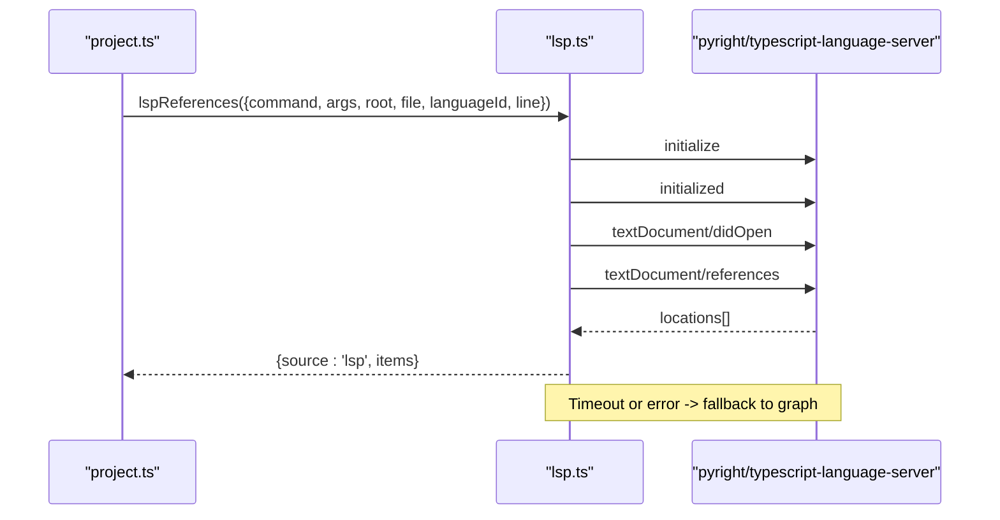

**Diagram sources**
- [lsp.ts:69-157](file://apps/desktop/src/main/core/code/lsp.ts#L69-L157)
- [project.ts:179-199](file://apps/desktop/src/main/core/code/project.ts#L179-L199)

**Section sources**
- [lsp.ts:1-168](file://apps/desktop/src/main/core/code/lsp.ts#L1-L168)
- [project.ts:179-199](file://apps/desktop/src/main/core/code/project.ts#L179-L199)

### File Watching and Incremental Updates
The watcher:
- Uses recursive fs.watch.
- Coalesces rapid events with a debounce timer.
- Normalizes paths and ignores .git directories.
- Batches changed relative paths to trigger incremental indexing.

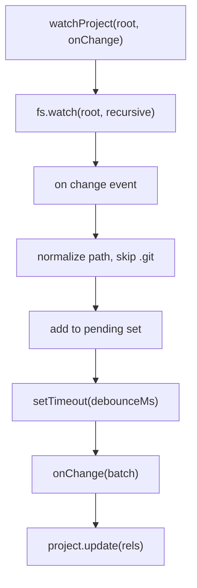

**Diagram sources**
- [watch.ts:5-34](file://apps/desktop/src/main/core/code/watch.ts#L5-L34)
- [project.ts:137-140](file://apps/desktop/src/main/core/code/project.ts#L137-L140)
- [project.ts:280-303](file://apps/desktop/src/main/core/code/project.ts#L280-L303)

**Section sources**
- [watch.ts:1-35](file://apps/desktop/src/main/core/code/watch.ts#L1-L35)
- [project.ts:137-140](file://apps/desktop/src/main/core/code/project.ts#L137-L140)
- [project.ts:280-303](file://apps/desktop/src/main/core/code/project.ts#L280-L303)

## Dependency Analysis
High-level dependencies among components:

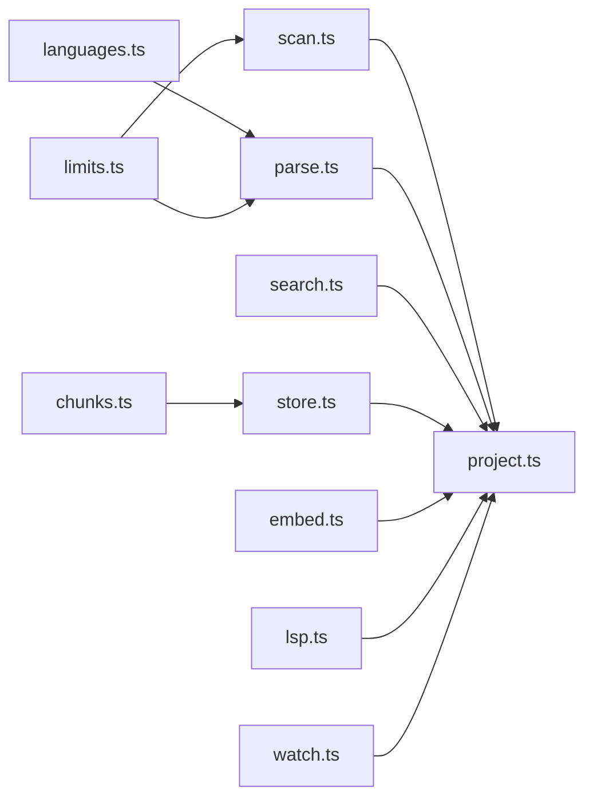

**Diagram sources**
- [languages.ts:1-59](file://apps/desktop/src/main/core/code/languages.ts#L1-L59)
- [parse.ts:1-528](file://apps/desktop/src/main/core/code/parse.ts#L1-L528)
- [scan.ts:1-161](file://apps/desktop/src/main/core/code/scan.ts#L1-L161)
- [project.ts:1-349](file://apps/desktop/src/main/core/code/project.ts#L1-L349)
- [search.ts:1-85](file://apps/desktop/src/main/core/code/search.ts#L1-L85)
- [store.ts:1-392](file://apps/desktop/src/main/core/code/store.ts#L1-L392)
- [embed.ts:1-53](file://apps/desktop/src/main/core/code/embed.ts#L1-L53)
- [lsp.ts:1-168](file://apps/desktop/src/main/core/code/lsp.ts#L1-L168)
- [watch.ts:1-35](file://apps/desktop/src/main/core/code/watch.ts#L1-L35)
- [chunks.ts:1-94](file://apps/desktop/src/main/core/code/chunks.ts#L1-L94)
- [limits.ts:1-62](file://apps/desktop/src/main/core/code/limits.ts#L1-L62)

**Section sources**
- [project.ts:1-349](file://apps/desktop/src/main/core/code/project.ts#L1-L349)

## Performance Considerations
- Parser initialization is lazy and cached; WASM grammars are loaded on demand.
- Symbol and reference extraction are capped per file to prevent excessive memory usage.
- Chunking splits large symbols by word count with overlap to preserve context across slices.
- Embedding runs in small batches between search operations to keep latency low.
- Database uses WAL mode and foreign keys; vector extension is loaded for ANN search.
- Scanning enforces hard caps on file count, total bytes, and max file size.
- Watcher debounces events to avoid repeated indexing on save storms.

[No sources needed since this section provides general guidance]

## Troubleshooting Guide
Common issues and resolutions:
- Grammar not found: ensure tree-sitter WASM grammars are present in the grammar directory; rebuild resources via the fetch script.
- Binary or minified files skipped: check limits for maxLineChars and BINARY_EXT; adjust CODE_LIMITS if necessary.
- Missing LSP references: verify pyright-langserver or typescript-language-server is installed and on PATH; the system will fall back to graph-based references.
- Stale index after edits: confirm watcher is active and debounce is configured; inspect project status for errors.
- Embedding failures: validate embedding dimension and batch sizes; check embedder availability and error messages.

**Section sources**
- [fetch-tree-sitter.mjs:1-30](file://apps/desktop/scripts/fetch-tree-sitter.mjs#L1-L30)
- [limits.ts:1-62](file://apps/desktop/src/main/core/code/limits.ts#L1-L62)
- [lsp.ts:1-168](file://apps/desktop/src/main/core/code/lsp.ts#L1-L168)
- [project.ts:105-123](file://apps/desktop/src/main/core/code/project.ts#L105-L123)
- [project.ts:321-347](file://apps/desktop/src/main/core/code/project.ts#L321-L347)

## Conclusion
Surf.ai’s code assistance layer combines robust tree-sitter parsing, efficient project scanning, hybrid search, and optional LSP precision to deliver accurate, fast, and scalable code intelligence. It supports multiple languages, integrates smoothly with developer workflows through file watching and incremental updates, and provides practical configuration points for performance tuning and scope control. Limitations around binary files, generated code, and non-standard formats are handled explicitly, ensuring predictable behavior across diverse codebases.