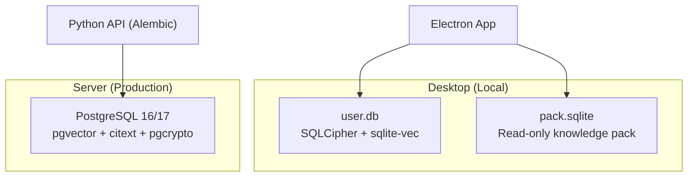
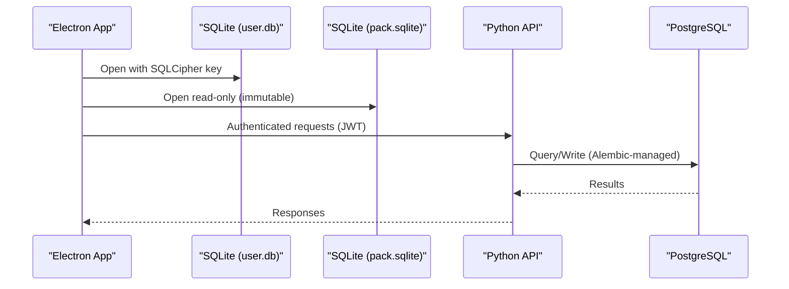
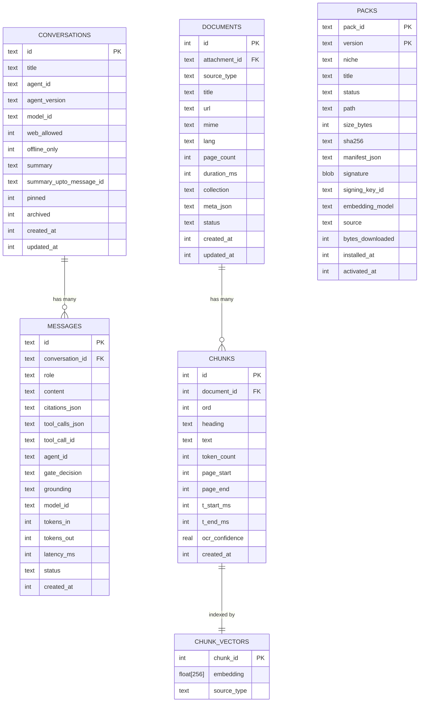
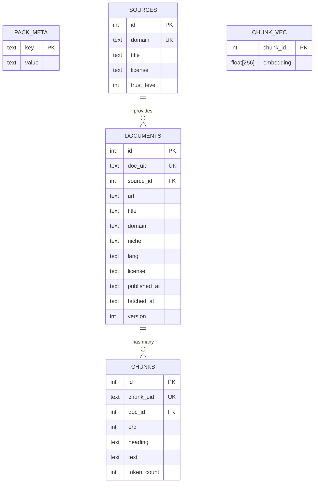
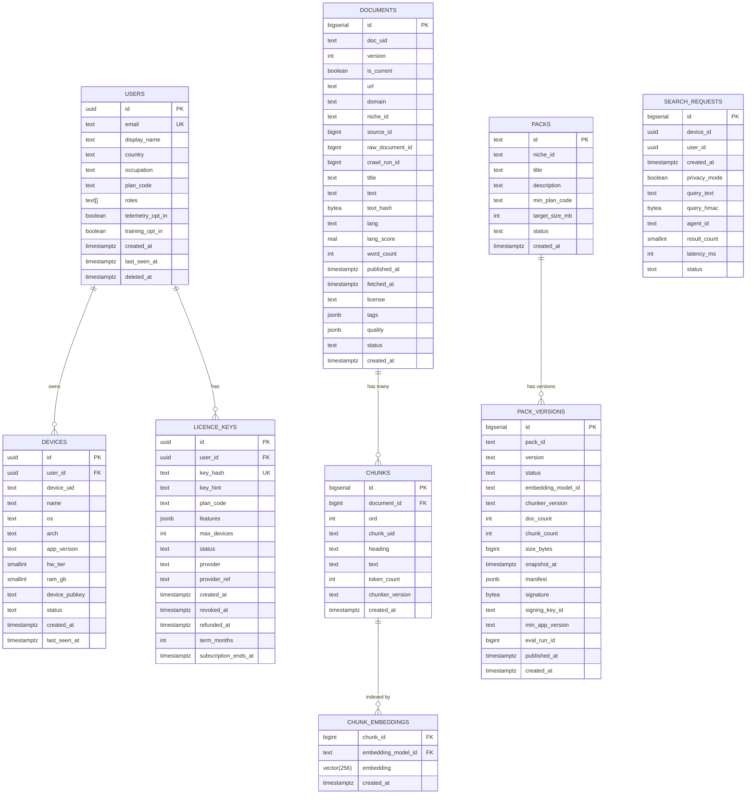
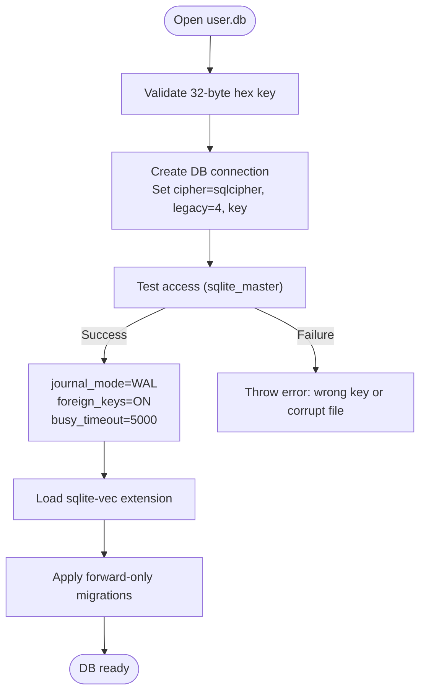
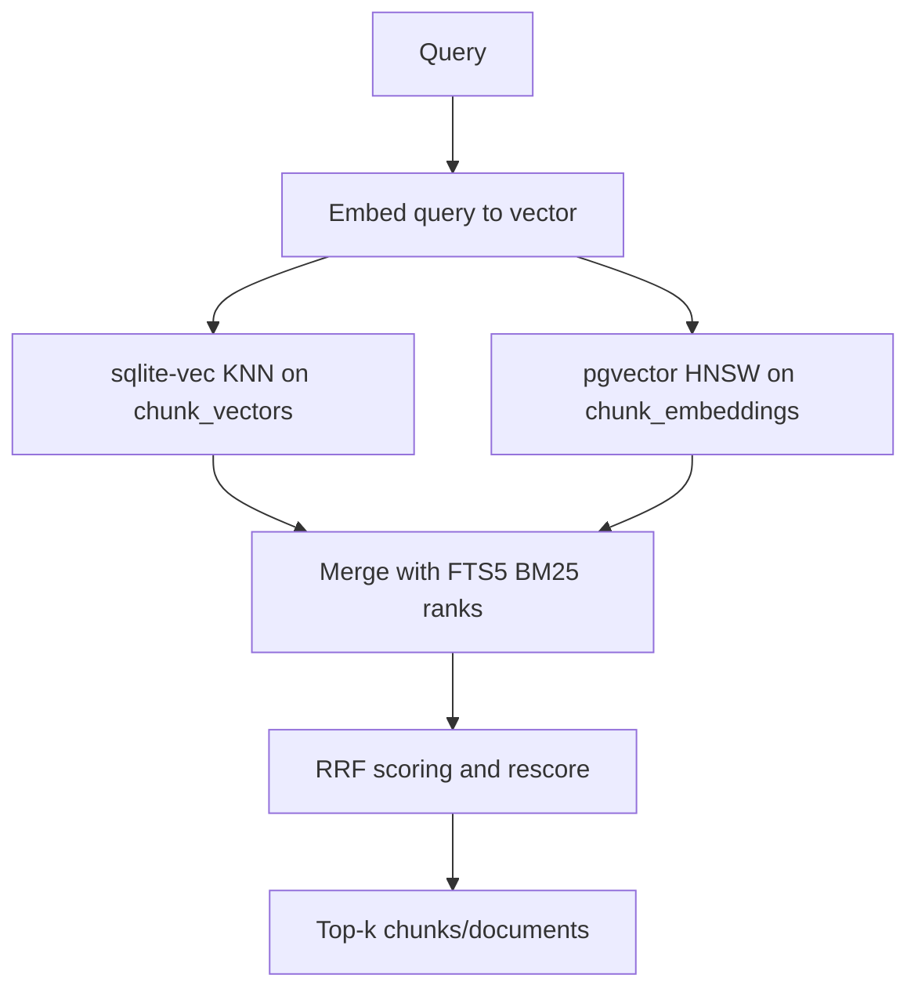
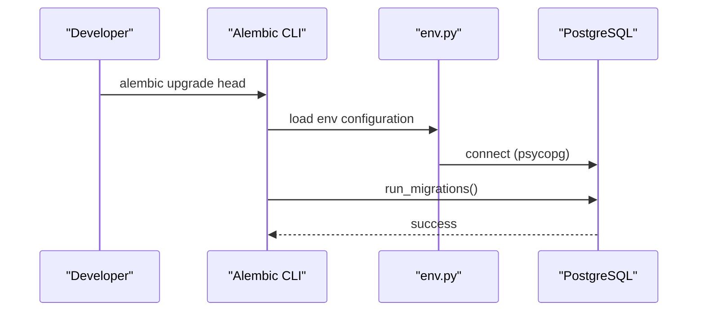
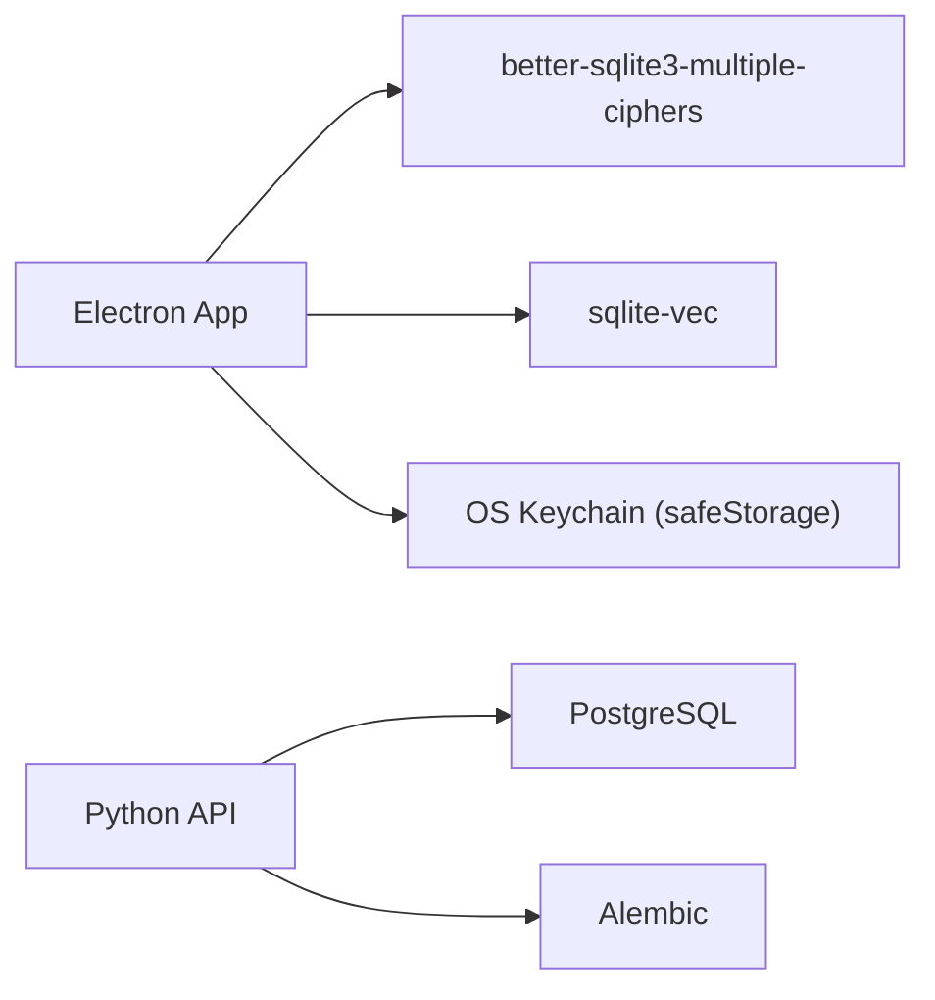

# Database Design

<cite>
**Referenced Files in This Document**
- [db.ts](file://apps/desktop/src/main/core/db.ts)
- [local_user_db.sql](file://docs/code-samples/local_user_db.sql)
- [pack_db.sql](file://docs/code-samples/pack_db.sql)
- [01_schema.sql](file://deploy/initdb/01_schema.sql)
- [production_postgres.sql](file://docs/code-samples/production_postgres.sql)
- [env.py](file://services/api/alembic/env.py)
- [0002_otp_challenges.py](file://services/api/alembic/versions/0002_otp_challenges.py)
- [0003_licences.py](file://services/api/alembic/versions/0003_licences.py)
- [0004_subscription_terms.py](file://services/api/alembic/versions/0004_subscription_terms.py)
- [store.py](file://apps/host/store.py)
</cite>

## Table of Contents
1. Introduction
2. Project Structure
3. Core Components
4. Architecture Overview
5. Detailed Component Analysis
6. Dependency Analysis
7. Performance Considerations
8. Troubleshooting Guide
9. Conclusion

## Introduction
This document describes Surf.ai’s dual-database architecture:
- Local storage: SQLite with SQLCipher for encrypted user data and read-only knowledge packs.
- Server-side storage: PostgreSQL with pgvector for production data, including semantic search over embeddings.

It covers schemas, encryption at rest, vector search integration, relationships, indexing, migrations, backup/recovery, retention policies, and performance tuning for both environments.

## Project Structure
The database design spans four primary areas:
- Desktop local databases (SQLite):
  - Encrypted user database schema and runtime configuration.
  - Read-only knowledge pack schema.
- Production server database (PostgreSQL):
  - Full schema for users, devices, licenses, ingestion pipeline, packs, agents, evaluation, and audit.
- Migrations:
  - Alembic for PostgreSQL service migrations.
  - Manual forward-only migrations for SQLite via PRAGMA user_version.
- Host-side lightweight SQLite store used by the host process.

**Diagram sources**
- [db.ts:1-78](file://apps/desktop/src/main/core/db.ts#L1-L78)
- [local_user_db.sql:1-331](file://docs/code-samples/local_user_db.sql#L1-L331)
- [pack_db.sql:1-23](file://docs/code-samples/pack_db.sql#L1-L23)
- [01_schema.sql:1-511](file://deploy/initdb/01_schema.sql#L1-L511)
- [production_postgres.sql:1-463](file://docs/code-samples/production_postgres.sql#L1-L463)

**Section sources**
- [db.ts:1-78](file://apps/desktop/src/main/core/db.ts#L1-L78)
- [local_user_db.sql:1-331](file://docs/code-samples/local_user_db.sql#L1-L331)
- [pack_db.sql:1-23](file://docs/code-samples/pack_db.sql#L1-L23)
- [01_schema.sql:1-511](file://deploy/initdb/01_schema.sql#L1-L511)
- [production_postgres.sql:1-463](file://docs/code-samples/production_postgres.sql#L1-L463)

## Core Components
- Local SQLite (user.db):
  - Encrypted at rest using SQLCipher v4 format.
  - Stores conversations, messages, documents/chunks, attachments, models, agents, packs, sync state, web cache, feedback, and device metadata.
  - Uses FTS5 for keyword search and sqlite-vec for vector similarity search.
- Knowledge Pack (pack.sqlite):
  - Public, signed, read-only dataset with documents, chunks, FTS, and vector index.
- Production PostgreSQL:
  - Users, devices, licenses, sessions, curation (niches/sources), ingestion (crawl_runs, raw_documents, documents, chunks), embeddings (pgvector), packs, agent/tool registry, evaluation datasets/runs/results, training examples, and audit/search request logs.

**Section sources**
- [local_user_db.sql:1-331](file://docs/code-samples/local_user_db.sql#L1-L331)
- [pack_db.sql:1-23](file://docs/code-samples/pack_db.sql#L1-L23)
- [01_schema.sql:1-511](file://deploy/initdb/01_schema.sql#L1-L511)
- [production_postgres.sql:1-463](file://docs/code-samples/production_postgres.sql#L1-L463)

## Architecture Overview
Surf.ai uses a local-first model:
- The desktop app opens an encrypted SQLite database for private user data and reads public knowledge packs as immutable files.
- The server runs PostgreSQL to manage accounts, licensing, content ingestion, and evaluation pipelines. Vector search is performed via pgvector on the server side.

**Diagram sources**
- [db.ts:34-70](file://apps/desktop/src/main/core/db.ts#L34-L70)
- [01_schema.sql:1-20](file://deploy/initdb/01_schema.sql#L1-L20)
- [production_postgres.sql:1-20](file://docs/code-samples/production_postgres.sql#L1-L20)

## Detailed Component Analysis

### Local SQLite Schema (user.db)
Key tables and responsibilities:
- Identity and settings:
  - app_settings: Key-value application preferences.
  - user_profile: Single-row profile linked to Supabase auth identity; includes plan and feature flags.
  - session_cache: License and token expiry metadata (secrets stored elsewhere).
  - device: Machine identity and hardware capabilities.
- Conversations and messages:
  - conversations: Chat threads with agent/model context and toggles.
  - agent_conversations: Routing history per conversation segment.
  - messages: Role-based messages with citations, tool calls, grounding, and metrics.
  - agent_memory: User-curated facts per agent.
  - tool_runs: Tool execution results tied to messages.
- Documents and search:
  - attachments: Content-addressed file storage references.
  - attachment_jobs: Background processing queue (OCR, transcription, embedding).
  - documents: Index for attachments/web pages/notes.
  - chunks: Text segments with page/time ranges and OCR confidence.
  - chunks_fts: FTS5 virtual table for BM25 keyword search.
  - chunk_vectors: sqlite-vec virtual table for cosine similarity.
- Packs:
  - packs: Installed knowledge packs with manifest/signature metadata.
  - pack_sources: Attribution and trust info per pack version.
- Sync and cache:
  - sync_state: ETag and last-success timestamps for manifests.
  - web_cache: Cached web responses with TTL and optional save-to-library flag.
- Feedback:
  - feedback: Per-message ratings and opt-in sharing flags.

Indexes and constraints:
- Conversation/message indexes for efficient listing and timeline queries.
- Unique constraints on device identifiers and active agent selection.
- Foreign keys cascade deletes for message-related entities.

**Diagram sources**
- [local_user_db.sql:16-331](file://docs/code-samples/local_user_db.sql#L16-L331)

**Section sources**
- [local_user_db.sql:10-331](file://docs/code-samples/local_user_db.sql#L10-L331)

### Knowledge Pack Schema (pack.sqlite)
- pack_meta: Metadata key-value pairs (e.g., pack_id, niche, version, embedding model/dimensions).
- sources: Source domains and licensing/trust metadata.
- documents: Versioned documents with stable IDs and provenance fields.
- chunks: Segmented text with ordering and token counts.
- chunks_fts: FTS5 virtual table for keyword search.
- chunk_vec: sqlite-vec virtual table for cosine similarity.

**Diagram sources**
- [pack_db.sql:5-23](file://docs/code-samples/pack_db.sql#L5-L23)

**Section sources**
- [pack_db.sql:1-23](file://docs/code-samples/pack_db.sql#L1-L23)

### Production PostgreSQL Schema
Core domains:
- Billing and subscriptions: plans, subscriptions.
- People and devices: users, devices, device_licenses, licence_keys, licence_devices, auth_refresh_tokens.
- Curation: niches, sources, source_suggestions.
- Ingestion: crawl_runs, raw_documents, documents, chunks, embedding_models, chunk_embeddings.
- Packs: packs, pack_versions, pack_files, pack_deltas, device_pack_installs.
- Web search proxy: search_requests, search_quota_daily.
- Agents and tools: agents, tools, agent_versions, agent_tools.
- Evaluation: eval_sets, eval_items, eval_runs, eval_results.
- Training examples: training_examples.

Indexing highlights:
- Partial indexes for active devices and published pack versions.
- GIN index on JSONB tags for fast filtering.
- HNSW index on vector embeddings for cosine similarity.

**Diagram sources**
- [01_schema.sql:12-511](file://deploy/initdb/01_schema.sql#L12-L511)
- [production_postgres.sql:12-463](file://docs/code-samples/production_postgres.sql#L12-L463)

**Section sources**
- [01_schema.sql:1-511](file://deploy/initdb/01_schema.sql#L1-L511)
- [production_postgres.sql:1-463](file://docs/code-samples/production_postgres.sql#L1-L463)

### Encryption Implementation (Local Data at Rest)
- The Electron main process opens user.db with better-sqlite3-multiple-ciphers using SQLCipher v4 mode.
- A random 32-byte raw key is provided in hex form; it is managed securely by the OS keychain via Electron safeStorage.
- The database is opened with WAL journaling, foreign keys enabled, and busy timeouts configured.
- sqlite-vec is loaded as an extension for vector search.
- Re-keying is supported to rotate the underlying key without rebuilding the database.

**Diagram sources**
- [db.ts:34-77](file://apps/desktop/src/main/core/db.ts#L34-L77)

**Section sources**
- [db.ts:1-78](file://apps/desktop/src/main/core/db.ts#L1-L78)

### Vector Search Integration
- Local (sqlite-vec):
  - Virtual table chunk_vectors stores float[256] vectors with cosine distance metric.
  - Combined with FTS5 (chunks_fts) for hybrid search (BM25 + vector).
- Server (pgvector):
  - Extension vector enabled; chunk_embeddings stores vector(256) with HNSW index using cosine operations.
  - Used for server-side similarity search, evaluation, deduplication, and admin search.

**Diagram sources**
- [local_user_db.sql:240-262](file://docs/code-samples/local_user_db.sql#L240-L262)
- [01_schema.sql:283-291](file://deploy/initdb/01_schema.sql#L283-L291)
- [production_postgres.sql:235-243](file://docs/code-samples/production_postgres.sql#L235-L243)

**Section sources**
- [local_user_db.sql:240-262](file://docs/code-samples/local_user_db.sql#L240-L262)
- [01_schema.sql:283-291](file://deploy/initdb/01_schema.sql#L283-L291)
- [production_postgres.sql:235-243](file://docs/code-samples/production_postgres.sql#L235-L243)

### Data Relationships and Constraints
- Users and Devices:
  - devices.user_id references users.id with CASCADE delete.
  - Unique constraint on (user_id, device_uid).
- Licenses:
  - licence_keys.user_id references users.id; licence_devices.licence_id references licence_keys.id.
  - Unique composite on (licence_id, device_id_hash).
- Documents and Chunks:
  - chunks.document_id references documents.id with CASCADE delete.
  - Unique composite on (document_id, ord).
- Embeddings:
  - chunk_embeddings.chunk_id references chunks.id; embedding_model_id references embedding_models.id.
  - Composite primary key on (chunk_id, embedding_model_id).
- Packs:
  - pack_versions.pack_id references packs.id; pack_files.pack_version_id references pack_versions.id.
  - device_pack_installs links devices to pack versions.

**Section sources**
- [01_schema.sql:65-129](file://deploy/initdb/01_schema.sql#L65-L129)
- [01_schema.sql:226-291](file://deploy/initdb/01_schema.sql#L226-L291)
- [01_schema.sql:296-363](file://deploy/initdb/01_schema.sql#L296-L363)
- [production_postgres.sql:53-129](file://docs/code-samples/production_postgres.sql#L53-L129)
- [production_postgres.sql:178-243](file://docs/code-samples/production_postgres.sql#L178-L243)
- [production_postgres.sql:248-315](file://docs/code-samples/production_postgres.sql#L248-L315)

### Migration Management
- PostgreSQL (Alembic):
  - Environment config reads DATABASE_URL and sets psycopg driver.
  - Online/offline migration modes are supported.
  - Migrations include OTP challenges, license keys/devices, and subscription terms.
- SQLite (Manual):
  - Forward-only migrations applied via PRAGMA user_version.
  - Each migration is executed inside a transaction and increments the version.

**Diagram sources**
- [env.py:17-43](file://services/api/alembic/env.py#L17-L43)
- [0002_otp_challenges.py:15-33](file://services/api/alembic/versions/0002_otp_challenges.py#L15-L33)
- [0003_licences.py:15-60](file://services/api/alembic/versions/0003_licences.py#L15-L60)
- [0004_subscription_terms.py:15-43](file://services/api/alembic/versions/0004_subscription_terms.py#L15-L43)

**Section sources**
- [env.py:1-44](file://services/api/alembic/env.py#L1-L44)
- [0002_otp_challenges.py:1-34](file://services/api/alembic/versions/0002_otp_challenges.py#L1-L34)
- [0003_licences.py:1-61](file://services/api/alembic/versions/0003_licences.py#L1-L61)
- [0004_subscription_terms.py:1-44](file://services/api/alembic/versions/0004_subscription_terms.py#L1-L44)
- [db.ts:54-63](file://apps/desktop/src/main/core/db.ts#L54-L63)

### Backup and Recovery Procedures
- Local SQLite (user.db):
  - Back up the encrypted file directly; ensure the corresponding OS keychain entry is preserved.
  - Use WAL mode for consistent backups; consider checkpointing before copy if needed.
  - Re-keying is supported to rotate the encryption key without data loss.
- Knowledge Pack (pack.sqlite):
  - Immutable and signed; back up alongside its manifest and signature.
- PostgreSQL:
  - Use logical dumps (pg_dump) or physical backups depending on environment.
  - Ensure extensions (vector, citext, pgcrypto) are present during restore.

Data export formats:
- Local summaries exported to Markdown files with an index.json manifest.
- Host-side exports provide human-readable summaries and traces (encrypted on disk).

**Section sources**
- [db.ts:73-77](file://apps/desktop/src/main/core/db.ts#L73-L77)
- [store.py:272-299](file://apps/host/store.py#L272-L299)
- [store.py:321-328](file://apps/host/store.py#L321-L328)

### Migration Paths Between Versions
- PostgreSQL:
  - Alembic migrations define ordered changes; downgrades drop objects where defined.
- SQLite:
  - Forward-only migrations tracked by user_version; new migrations appended in order.

**Section sources**
- [0002_otp_challenges.py:32-33](file://services/api/alembic/versions/0002_otp_challenges.py#L32-L33)
- [0003_licences.py:58-60](file://services/api/alembic/versions/0003_licences.py#L58-L60)
- [0004_subscription_terms.py:40-43](file://services/api/alembic/versions/0004_subscription_terms.py#L40-L43)
- [db.ts:54-63](file://apps/desktop/src/main/core/db.ts#L54-L63)

### Data Retention Policies and Cleanup Strategies
- Host-side pruning:
  - Limits number of conversations and messages per conversation.
  - Caps feedback entries and trace files.
  - Purges stale user summaries based on age threshold.
- Local SQLite:
  - Web cache has TTL and can be pruned by application logic.
  - Attachment jobs track lifecycle states; failed/cancelled entries should be cleaned periodically.

**Section sources**
- [store.py:153-193](file://apps/host/store.py#L153-L193)
- [store.py:302-318](file://apps/host/store.py#L302-L318)
- [local_user_db.sql:308-319](file://docs/code-samples/local_user_db.sql#L308-L319)

### Storage Optimization Techniques
- PostgreSQL:
  - TOAST compression for large text columns (documents.text).
  - Partial indexes to reduce index size (active devices, published pack versions).
  - GIN index on JSONB tags for fast filtering.
  - HNSW index for vector similarity to optimize ANN queries.
- SQLite:
  - FTS5 virtual table avoids duplicating text storage.
  - sqlite-vec virtual table provides efficient vector search without extra storage overhead.
  - WAL mode improves concurrency and reduces lock contention.

**Section sources**
- [01_schema.sql:226-255](file://deploy/initdb/01_schema.sql#L226-L255)
- [01_schema.sql:283-291](file://deploy/initdb/01_schema.sql#L283-L291)
- [01_schema.sql:328-328](file://deploy/initdb/01_schema.sql#L328-L328)
- [local_user_db.sql:240-262](file://docs/code-samples/local_user_db.sql#L240-L262)
- [db.ts:46-49](file://apps/desktop/src/main/core/db.ts#L46-L49)

## Dependency Analysis
- Desktop app depends on:
  - SQLite libraries (better-sqlite3-multiple-ciphers, sqlite-vec).
  - OS keychain via Electron safeStorage for key management.
- Server API depends on:
  - PostgreSQL with extensions (vector, citext, pgcrypto).
  - Alembic for migrations.

**Diagram sources**
- [db.ts:9-10](file://apps/desktop/src/main/core/db.ts#L9-L10)
- [env.py:17-21](file://services/api/alembic/env.py#L17-L21)

**Section sources**
- [db.ts:1-10](file://apps/desktop/src/main/core/db.ts#L1-L10)
- [env.py:1-44](file://services/api/alembic/env.py#L1-L44)

## Performance Considerations
- Local SQLite:
  - Keep WAL enabled and tune busy_timeout for concurrent writes.
  - Use FTS5 and sqlite-vec together; rebuild FTS after bulk inserts.
  - Avoid frequent re-keying; batch updates to minimize overhead.
- PostgreSQL:
  - Maintain statistics and vacuum regularly.
  - Tune work_mem and maintenance_work_mem for large joins and sorts.
  - Use appropriate HNSW parameters (m, ef_construction, ef_search) for vector queries.
  - Partition large tables (e.g., search_requests, eval_results) if growth warrants it.

[No sources needed since this section provides general guidance]

## Troubleshooting Guide
- Cannot open user.db:
  - Verify the 32-byte hex key matches the one stored in safeStorage.
  - Check for corruption; attempt recovery from backup.
- Wrong key errors:
  - Ensure the key format is exactly 64 hex characters.
- Vector search not returning results:
  - Confirm sqlite-vec extension is loaded and chunk_vectors populated.
  - For pgvector, verify HNSW index exists and embeddings match model dimension.
- Migration failures:
  - For PostgreSQL, check DATABASE_URL and extension availability.
  - For SQLite, ensure migrations are forward-only and versioned correctly.

**Section sources**
- [db.ts:34-51](file://apps/desktop/src/main/core/db.ts#L34-L51)
- [env.py:17-43](file://services/api/alembic/env.py#L17-L43)

## Conclusion
Surf.ai’s database design balances privacy and capability:
- Local SQLite with SQLCipher secures user data at rest while enabling powerful local search via FTS5 and sqlite-vec.
- PostgreSQL with pgvector supports scalable server-side analytics, ingestion, and semantic search.
- Migrations are robustly managed through Alembic for PostgreSQL and manual forward-only scripts for SQLite.
- Clear indexing strategies, constraints, and retention policies ensure performance and compliance.

[No sources needed since this section summarizes without analyzing specific files]