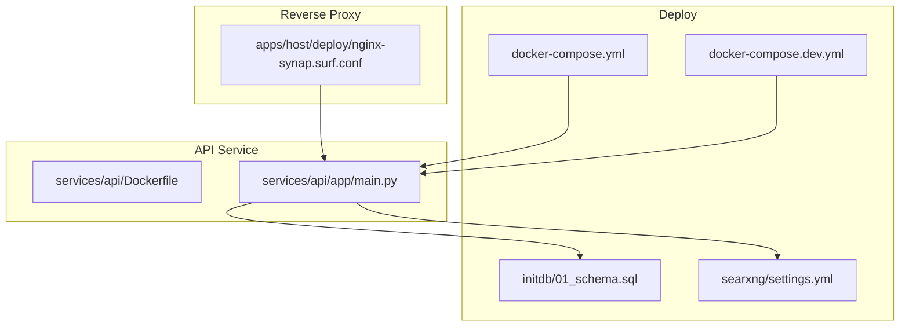
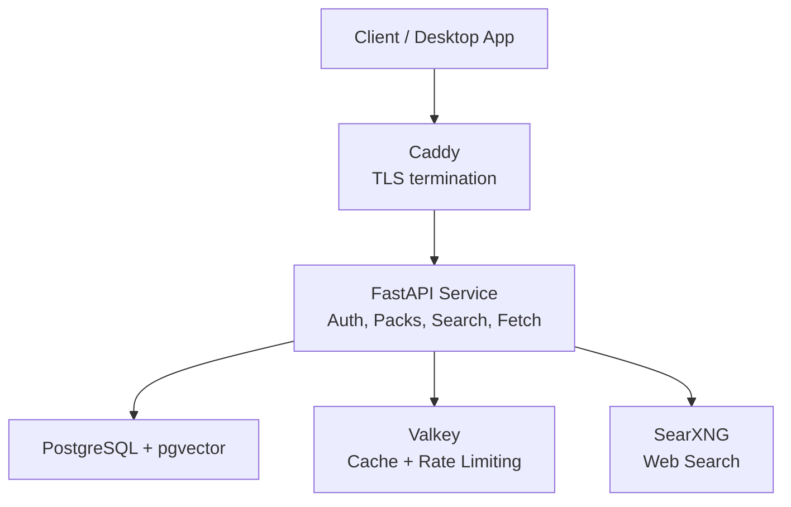
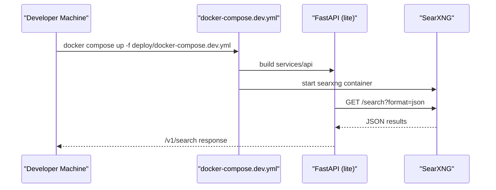
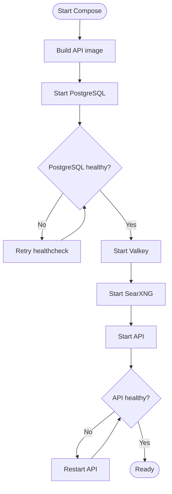
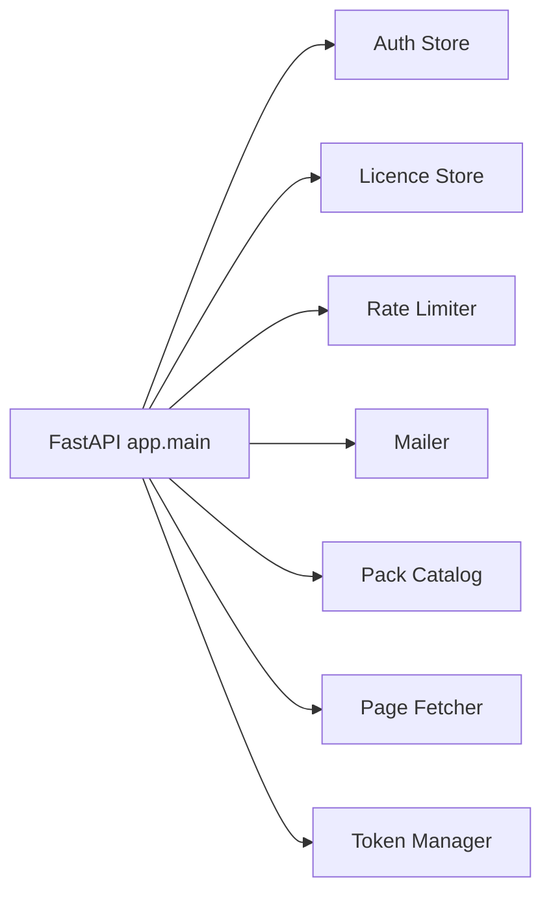

# Deployment & Operations

<cite>
**Referenced Files in This Document**
- [docker-compose.yml](file://deploy/docker-compose.yml)
- [docker-compose.dev.yml](file://deploy/docker-compose.dev.yml)
- [01_schema.sql](file://deploy/initdb/01_schema.sql)
- [settings.yml](file://deploy/searxng/settings.yml)
- [main.py](file://services/api/app/main.py)
- [Dockerfile](file://services/api/Dockerfile)
- [README.md](file://README.md)
- [nginx-synap.surf.conf](file://apps/host/deploy/nginx-synap.surf.conf)
- [ARCHITECTURE-FULL.md](file://docs/ARCHITECTURE-FULL.md)
- [HLD-LLD.md](file://docs/HLD-LLD.md)
</cite>

## Table of Contents
1. [Introduction](#introduction)
2. [Project Structure](#project-structure)
3. [Core Components](#core-components)
4. [Architecture Overview](#architecture-overview)
5. [Detailed Component Analysis](#detailed-component-analysis)
6. [Dependency Analysis](#dependency-analysis)
7. [Performance Considerations](#performance-considerations)
8. [Troubleshooting Guide](#troubleshooting-guide)
9. [Conclusion](#conclusion)
10. [Appendices](#appendices)

## Introduction
This document explains how to deploy and operate Surf.ai across development and production environments. It covers Docker Compose orchestration, service dependencies, configuration management, monitoring, backup and disaster recovery, scaling, security hardening, and operational runbooks. The guidance is grounded in the repository’s deployment files, API implementation, database schema, and architecture notes.

## Project Structure
The deployment surface relevant to operations lives under `deploy`, with supporting runtime code in `services/api` and example reverse proxy configuration in `apps/host/deploy`.

**Diagram sources**
- [docker-compose.yml:1-48](file://deploy/docker-compose.yml#L1-L48)
- [docker-compose.dev.yml:1-30](file://deploy/docker-compose.dev.yml#L1-L30)
- [01_schema.sql:1-511](file://deploy/initdb/01_schema.sql#L1-L511)
- [settings.yml:1-11](file://deploy/searxng/settings.yml#L1-L11)
- [Dockerfile:1-10](file://services/api/Dockerfile#L1-L10)
- [main.py:1-678](file://services/api/app/main.py#L1-L678)
- [nginx-synap.surf.conf:1-54](file://apps/host/deploy/nginx-synap.surf.conf#L1-L54)

**Section sources**
- [README.md:156-169](file://README.md#L156-L169)

## Core Components
- Caddy reverse proxy: terminates TLS, forwards to the API, persists its own data volume.
- API service: FastAPI application providing authentication, pack catalog, web search proxy, and page fetching.
- PostgreSQL with pgvector: relational store plus vector index for embeddings.
- Valkey (Redis-compatible): caching and rate limiting in production.
- SearXNG: private web search backend used by the API.

Key behaviors:
- Health endpoints expose dependency status.
- Search results are cached in Valkey or in-memory depending on mode.
- Rate limits and quotas are enforced per device.
- Database schema includes extensions and tables for users, devices, packs, embeddings, and audit logs.

**Section sources**
- [docker-compose.yml:5-47](file://deploy/docker-compose.yml#L5-L47)
- [main.py:43-84](file://services/api/app/main.py#L43-L84)
- [main.py:149-173](file://services/api/app/main.py#L149-L173)
- [main.py:380-420](file://services/api/app/main.py#L380-L420)
- [01_schema.sql:1-10](file://deploy/initdb/01_schema.sql#L1-L10)

## Architecture Overview
The production stack runs behind Caddy, which exposes HTTP/HTTPS and proxies to the API. The API depends on PostgreSQL/pgvector, Valkey, and SearXNG. In development, a separate compose file starts only the API and SearXNG on localhost.

**Diagram sources**
- [docker-compose.yml:5-47](file://deploy/docker-compose.yml#L5-L47)
- [main.py:43-84](file://services/api/app/main.py#L43-L84)

## Detailed Component Analysis

### Development Stack (Localhost)
- Starts the API and SearXNG only.
- API runs in lite mode without Postgres; uses an in-memory quota store.
- Exposes ports on loopback only.
- SearXNG settings enable JSON format required by the API.

Operational notes:
- Use the dev compose file for local search development.
- Do not publish this environment publicly.
- Ensure SearXNG has JSON enabled; otherwise search returns 403.

**Diagram sources**
- [docker-compose.dev.yml:1-30](file://deploy/docker-compose.dev.yml#L1-L30)
- [settings.yml:6-8](file://deploy/searxng/settings.yml#L6-L8)
- [main.py:380-420](file://services/api/app/main.py#L380-L420)

**Section sources**
- [docker-compose.dev.yml:1-30](file://deploy/docker-compose.dev.yml#L1-L30)
- [settings.yml:1-11](file://deploy/searxng/settings.yml#L1-L11)
- [README.md:26-115](file://README.md#L26-L115)

### Production Stack (Containerized VM)
- Caddy listens on ports 80 and 443 and proxies to the API.
- API builds from the service Dockerfile and runs two workers.
- PostgreSQL stores all relational data and vector indexes; health-checked before API starts.
- Valkey provides cache and distributed rate limiting.
- SearXNG is internal-only; never published externally.

**Diagram sources**
- [docker-compose.yml:11-24](file://deploy/docker-compose.yml#L11-L24)
- [docker-compose.yml:36-46](file://deploy/docker-compose.yml#L36-L46)
- [Dockerfile:1-10](file://services/api/Dockerfile#L1-L10)

**Section sources**
- [docker-compose.yml:1-48](file://deploy/docker-compose.yml#L1-L48)
- [Dockerfile:1-10](file://services/api/Dockerfile#L1-L10)

### Service Dependencies

#### PostgreSQL with pgvector
- Extension initialization creates `vector`, `citext`, and `pgcrypto`.
- Schema defines users, devices, licenses, packs, embeddings, agents, evaluation, and search audit tables.
- Vector index uses HNSW over cosine similarity.

Operational considerations:
- Initial schema is mounted into `/docker-entrypoint-initdb.d`.
- Health checks ensure readiness before API starts.
- Connection pool size is configured at API startup.

**Section sources**
- [01_schema.sql:1-10](file://deploy/initdb/01_schema.sql#L1-L10)
- [01_schema.sql:283-292](file://deploy/initdb/01_schema.sql#L283-L292)
- [docker-compose.yml:36-46](file://deploy/docker-compose.yml#L36-L46)
- [main.py:54-70](file://services/api/app/main.py#L54-L70)

#### Redis-like Cache (Valkey)
- Used for search result caching and rate limiting counters.
- Memory policy set to evict all keys using LRU when memory limit reached.

Operational considerations:
- Not exposed outside the Compose network.
- TTL for search cache is configurable via environment.

**Section sources**
- [docker-compose.yml:31-35](file://deploy/docker-compose.yml#L31-L35)
- [main.py:435-451](file://services/api/app/main.py#L435-L451)

#### SearXNG Web Search
- Private instance behind the API.
- JSON output must be enabled; otherwise search requests fail.
- Limiter disabled because the API enforces rate limits.

Operational considerations:
- Secret is passed via environment.
- Only the API can reach it internally.

**Section sources**
- [settings.yml:1-11](file://deploy/searxng/settings.yml#L1-L11)
- [docker-compose.yml:25-30](file://deploy/docker-compose.yml#L25-L30)
- [main.py:390-420](file://services/api/app/main.py#L390-L420)

### Configuration Management
Environment-driven configuration controls runtime behavior:

- Lite mode: disables Postgres and uses in-memory stores for auth, licenses, and rate limiting.
- Development open mode: bypasses authentication and quotas on localhost only.
- Search cache TTL, per-minute/per-day limits, activation windows, and admin tokens are environment variables.
- External secrets include JWT secret, audience, Stripe/Razorpay webhook secrets, and license admin token.

Recommended practices:
- Keep secrets out of version control; use `.env` files or a secrets manager.
- Validate that `SURF_DEV_OPEN` is never set on public hosts.
- Pin image digests and keep them updated through CI.

**Section sources**
- [main.py:39-75](file://services/api/app/main.py#L39-L75)
- [main.py:119-133](file://services/api/app/main.py#L119-L133)
- [main.py:554-573](file://services/api/app/main.py#L554-L573)
- [docker-compose.yml:11-24](file://deploy/docker-compose.yml#L11-L24)

### Monitoring and Logging
- Health endpoint reports status of Postgres/pgvector, Valkey, and SearXNG.
- Audit records for search requests include latency, result count, and status without storing query text.
- Lite mode keeps audit entries in process memory; production writes to Postgres.

Operational guidance:
- Monitor `/v1/health` for degraded states.
- Track error rates from search audit table.
- For development, console mail mode prints OTP codes instead of sending email.

**Section sources**
- [main.py:149-173](file://services/api/app/main.py#L149-L173)
- [main.py:454-464](file://services/api/app/main.py#L454-L464)
- [main.py:238-255](file://services/api/app/main.py#L238-L255)

### Backup and Disaster Recovery

#### Local Database Backups
- PostgreSQL data is persisted in a named volume.
- Initial schema is applied via mounted SQL file.

Recommended procedures:
- Regularly back up the PostgreSQL volume.
- Test restore procedures against a staging environment.
- Keep migration scripts and initial schema under version control.

**Section sources**
- [docker-compose.yml:36-47](file://deploy/docker-compose.yml#L36-L47)
- [01_schema.sql:1-511](file://deploy/initdb/01_schema.sql#L1-L511)

#### Server-Side Data Persistence
- Postgres holds user accounts, devices, packs, embeddings, and audit logs.
- Valkey is ephemeral; do not rely on it for persistence.
- SearXNG state is minimal; configuration is mounted read-only.

Recovery steps:
- Restore Postgres from backups.
- Recreate Valkey and restart API so caches rebuild.
- Verify health endpoints after restore.

**Section sources**
- [docker-compose.yml:31-47](file://deploy/docker-compose.yml#L31-L47)
- [main.py:43-84](file://services/api/app/main.py#L43-L84)

### Scaling Considerations
Known bottlenecks and next steps:
- SearXNG upstream blocking: rotate engines or add a paid search API behind the same endpoint; cache popular queries longer.
- Single VM: run multiple API instances behind a load balancer; externalize SearXNG.
- Postgres contention: move to managed Postgres with read replicas for reads; pipeline writes to primary.
- Pack downloads: already CDN-friendly; add cache rules and more delta versions.
- Ingestion throughput: introduce ingestion queues and spot/preemptible workers with GPUs for embedding.
- Local vector search: split packs by topic; consider int8 vectors for first pass and IVF later.
- Laptop RAM: stop embedding sidecar when idle; suggest tier-down based on measured performance.

**Section sources**
- [HLD-LLD.md:122-132](file://docs/HLD-LLD.md#L122-L132)
- [ARCHITECTURE-FULL.md:974-995](file://docs/ARCHITECTURE-FULL.md#L974-L995)

### Security Hardening
Network isolation and access controls:
- Caddy exposes only HTTP/HTTPS; API is internal-only.
- SearXNG is not published externally.
- Reverse proxy sets security headers and restricts sensitive browser features.

SSRF protection:
- Outbound fetches validate hostnames and block private/metadata addresses.
- Redirects and robots.txt are considered during URL validation.

Secrets handling:
- Secrets are provided via environment variables.
- Admin endpoints require HMAC comparison against a configured token.
- License admin operations require a secure header.

Vulnerability scanning:
- Pin images by digest.
- Run automated scans in CI pipelines.

**Section sources**
- [docker-compose.yml:5-30](file://deploy/docker-compose.yml#L5-L30)
- [nginx-synap.surf.conf:1-54](file://apps/host/deploy/nginx-synap.surf.conf#L1-L54)
- [main.py:554-573](file://services/api/app/main.py#L554-L573)

### Operational Runbooks

#### Common Maintenance Tasks
- Rotate secrets: update environment variables and restart affected services.
- Update images: change pinned digests and rebuild containers.
- Apply schema changes: ensure migrations are applied before rolling out API changes.
- Clear caches: restart Valkey or invalidate search cache TTL if needed.

#### Troubleshooting Procedures
- API unhealthy:
  - Check Postgres extension availability and connection.
  - Verify Valkey connectivity.
  - Confirm SearXNG health endpoint responds.
- Search returns 403:
  - Ensure SearXNG settings include JSON format.
- Rate-limited responses:
  - Review per-minute and per-day limits.
  - Check activation attempt limits for license endpoints.
- Page fetch errors:
  - Inspect SSRF guard logs and allowed host list.

#### Performance Tuning Guidelines
- Tune Postgres shared buffers and max connections according to workload.
- Adjust search cache TTL based on query patterns.
- Scale API workers horizontally behind a load balancer.
- Monitor Valkey memory usage and eviction policy.

**Section sources**
- [main.py:149-173](file://services/api/app/main.py#L149-L173)
- [main.py:380-420](file://services/api/app/main.py#L380-L420)
- [main.py:499-504](file://services/api/app/main.py#L499-L504)
- [docker-compose.yml:36-46](file://deploy/docker-compose.yml#L36-L46)

## Dependency Analysis
The API orchestrates several external dependencies at runtime.

**Diagram sources**
- [main.py:23-34](file://services/api/app/main.py#L23-L34)
- [main.py:43-84](file://services/api/app/main.py#L43-L84)

**Section sources**
- [main.py:23-34](file://services/api/app/main.py#L23-L34)
- [main.py:43-84](file://services/api/app/main.py#L43-L84)

## Performance Considerations
- Use Valkey for distributed caching and rate limiting in production.
- Set appropriate cache TTLs to balance freshness and load.
- Monitor Postgres connection pool utilization and tune pool sizes.
- Profile SearXNG upstream latency and consider engine rotation or alternative providers.
- Keep API worker count aligned with CPU capacity and request patterns.

[No sources needed since this section provides general guidance]

## Troubleshooting Guide
- Health diagnostics:
  - Call `/v1/health` to inspect Postgres, Valkey, and SearXNG status.
- Search failures:
  - Validate SearXNG JSON support.
  - Check upstream HTTP errors and retry-after hints.
- Authentication issues:
  - Verify bearer token validity and device activation.
  - Confirm development open mode is not enabled unintentionally.
- SSRF blocks:
  - Review allowed hosts and outbound URL validation.

**Section sources**
- [main.py:149-173](file://services/api/app/main.py#L149-L173)
- [main.py:380-420](file://services/api/app/main.py#L380-L420)
- [main.py:98-116](file://services/api/app/main.py#L98-L116)

## Conclusion
Surf.ai’s deployment model centers on a small, secure, and observable stack: Caddy, FastAPI, PostgreSQL with pgvector, Valkey, and SearXNG. The development environment isolates search functionality on localhost, while production emphasizes privacy-preserving search, robust health checks, and clear scaling paths. By following the configuration, security, and operational guidance here, operators can deploy confidently, maintain reliability, and scale effectively.

[No sources needed since this section summarizes without analyzing specific files]

## Appendices

### Environment Variables Summary
- SURF_API_LITE: Enable lite mode without Postgres.
- SURF_DEV_OPEN: Bypass auth and quotas on localhost only.
- SEARXNG_URL: Internal SearXNG search endpoint.
- DATABASE_URL: Postgres connection string.
- VALKEY_URL: Valkey connection string.
- SEARCH_CACHE_TTL: Search result cache lifetime.
- SEARCH_PER_MIN / SEARCH_PER_DAY: Rate limits.
- ACTIVATION_LIMIT / ACTIVATION_WINDOW: License activation throttling.
- JWT_SECRET / JWT_AUDIENCE: Token signing and audience.
- STRIPE_WEBHOOK_SECRET / RAZORPAY_WEBHOOK_SECRET: Payment provider verification.
- LICENCE_ADMIN_TOKEN: Admin token for license operations.

**Section sources**
- [main.py:39-75](file://services/api/app/main.py#L39-L75)
- [main.py:554-573](file://services/api/app/main.py#L554-L573)
- [docker-compose.yml:11-24](file://deploy/docker-compose.yml#L11-L24)