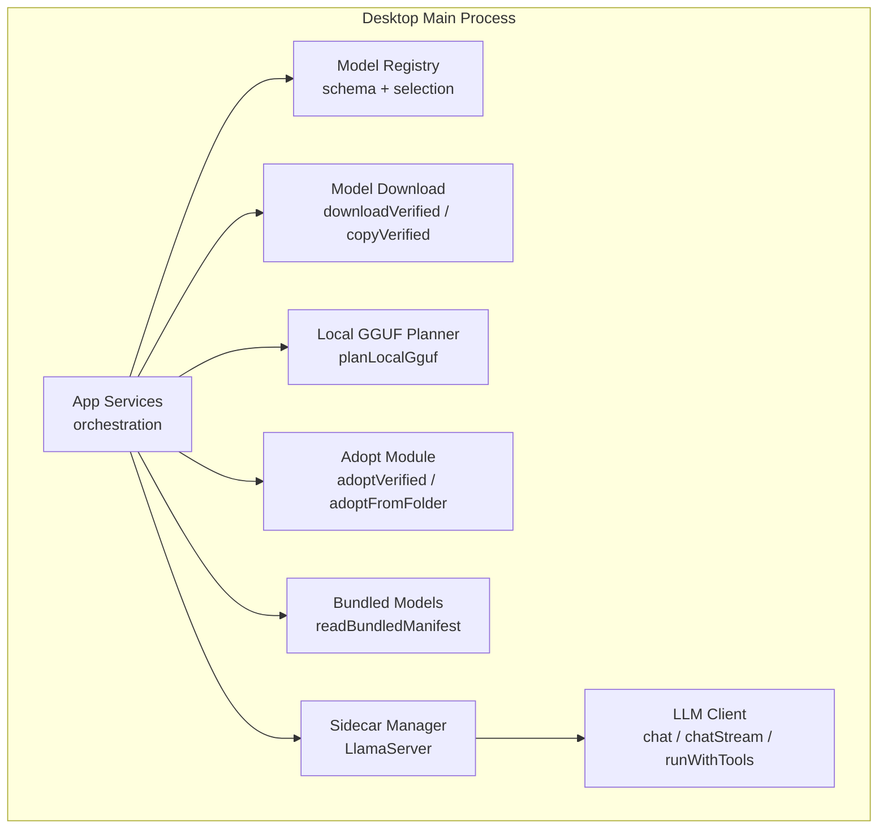
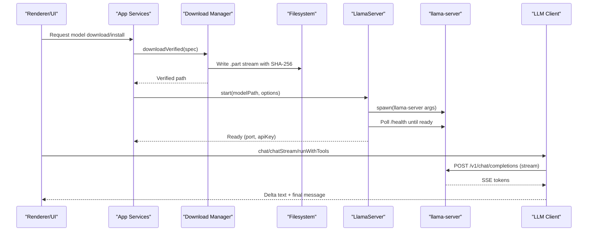
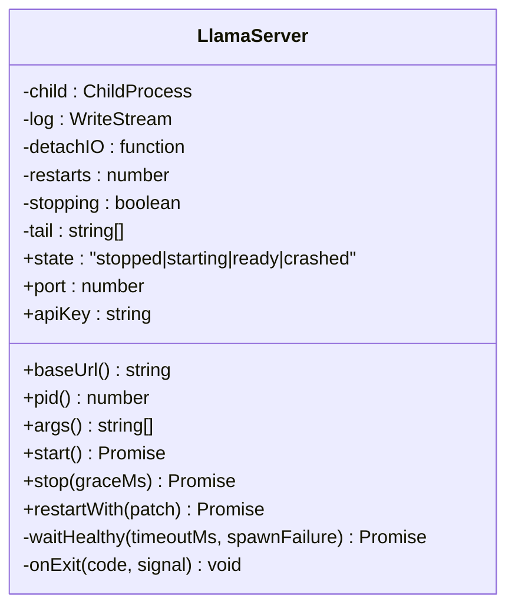
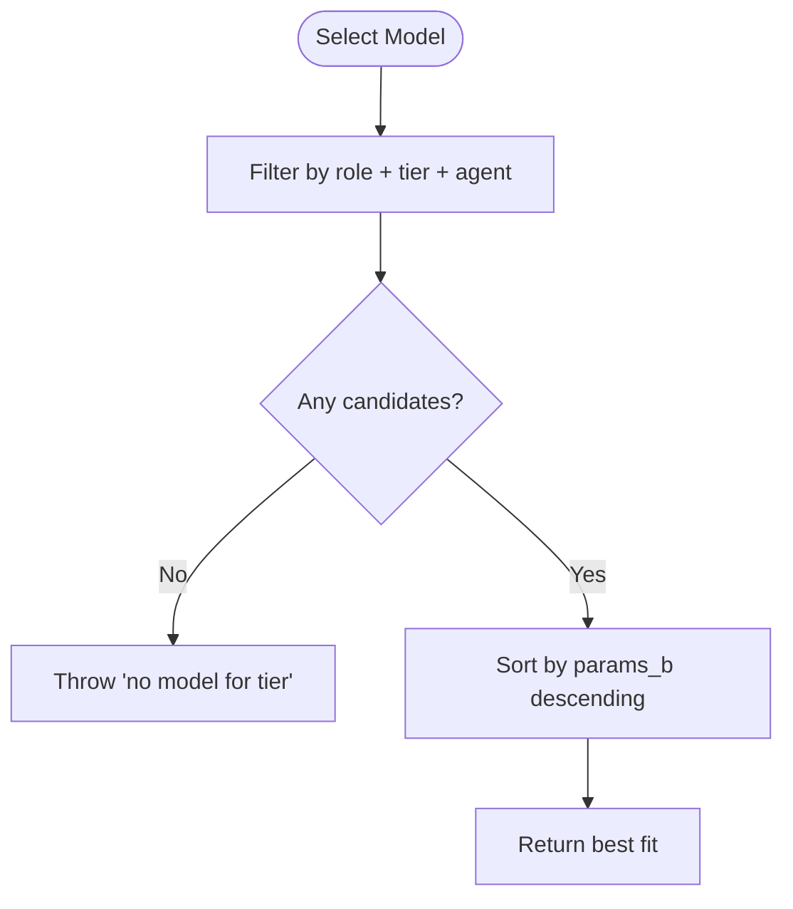
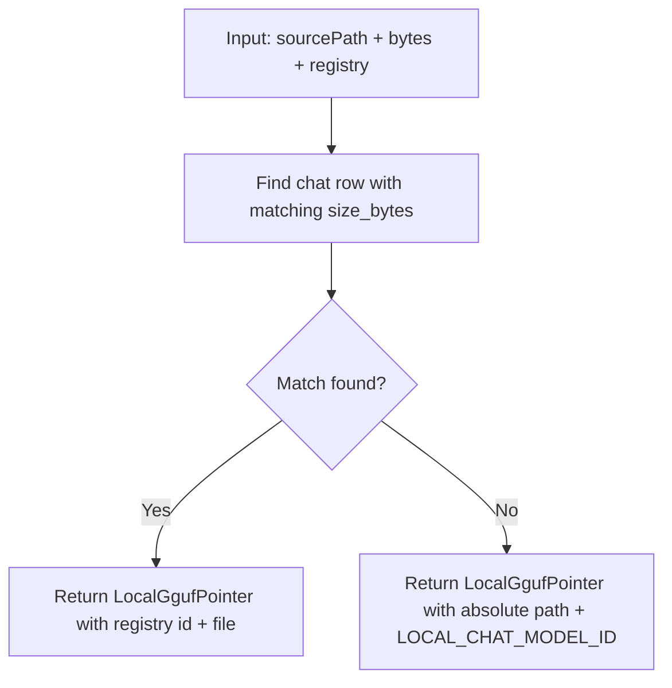
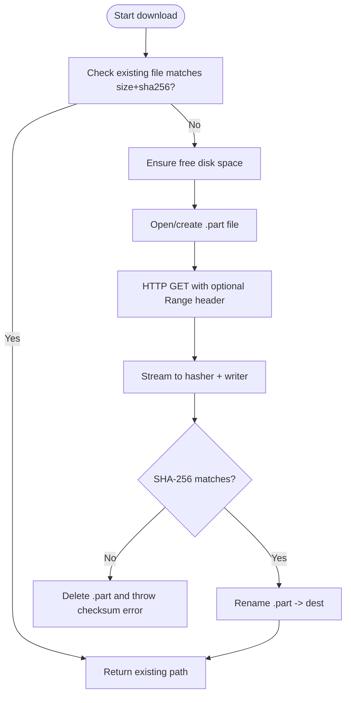
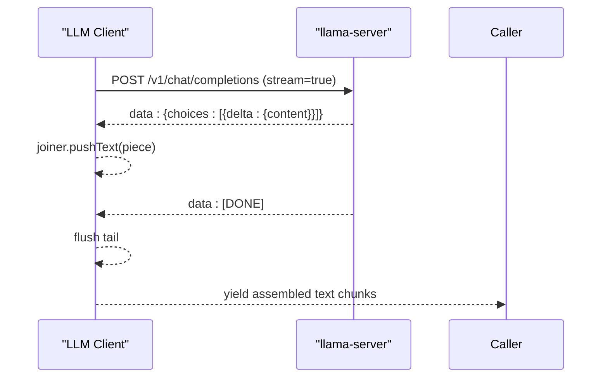
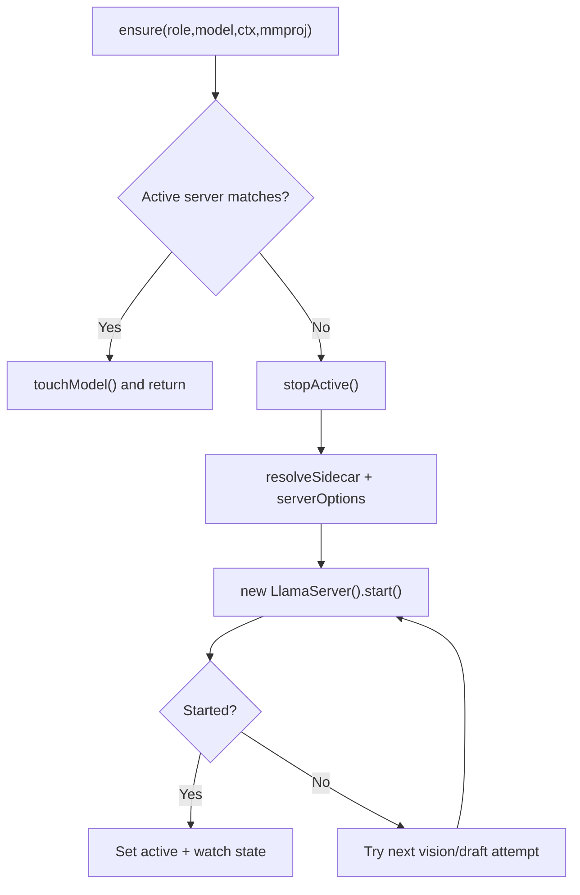
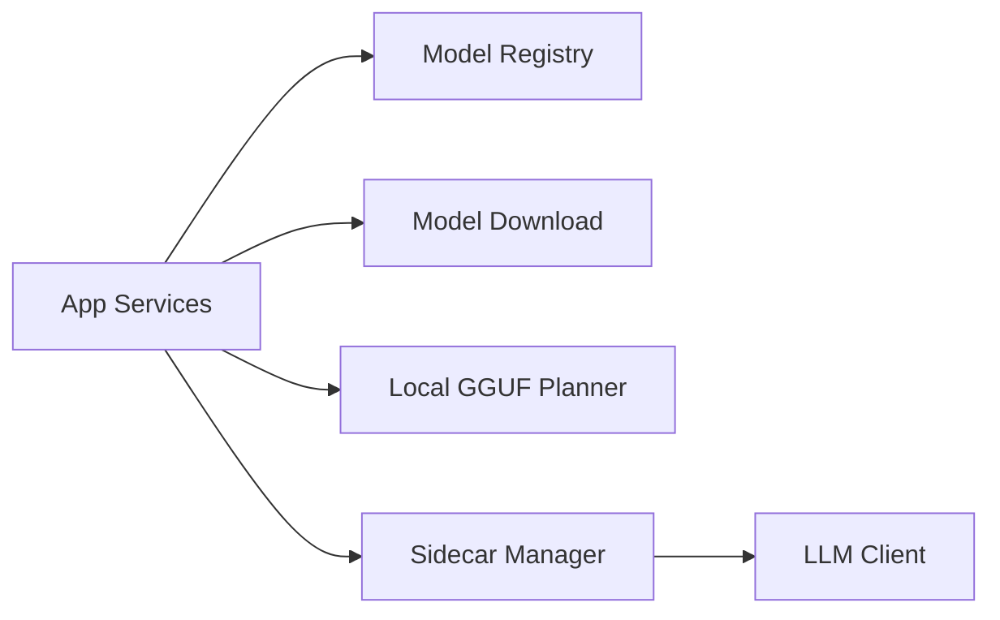

# AI Model Management

<cite>
**Referenced Files in This Document**
- [sidecar-manager.ts](file://apps/desktop/src/main/core/sidecar-manager.ts)
- [model-registry.ts](file://apps/desktop/src/main/core/model-registry.ts)
- [llama-client.ts](file://apps/desktop/src/main/core/llama-client.ts)
- [local-gguf.ts](file://apps/desktop/src/main/core/local-gguf.ts)
- [model-download.ts](file://apps/desktop/src/main/core/model-download.ts)
- [bundled-models.ts](file://apps/desktop/src/main/core/bundled-models.ts)
- [adopt-model.ts](file://apps/desktop/src/main/core/adopt-model.ts)
- [app-services.ts](file://apps/desktop/src/main/core/app-services.ts)
</cite>

## Table of Contents
1. [Introduction](#introduction)
2. [Project Structure](#project-structure)
3. [Core Components](#core-components)
4. [Architecture Overview](#architecture-overview)
5. [Detailed Component Analysis](#detailed-component-analysis)
6. [Dependency Analysis](#dependency-analysis)
7. [Performance Considerations](#performance-considerations)
8. [Troubleshooting Guide](#troubleshooting-guide)
9. [Conclusion](#conclusion)

## Introduction
This document explains the AI model management subsystem that runs inside the desktop application’s main process. It covers:
- The sidecar pattern for managing llama.cpp processes (llama-server), including lifecycle, resource allocation, and health monitoring.
- The model registry system for discovering, loading, and switching between GGUF models.
- The HTTP client interface for communicating with local inference servers, including request/response handling, streaming responses, and error recovery.
- Model download mechanisms, caching strategies, and performance optimization techniques.
- Configuration options for model parameters, memory management, and GPU acceleration where available.
- Troubleshooting guidance for common issues with model loading, memory constraints, and inference performance.

## Project Structure
The relevant implementation lives under the desktop app’s main process core modules:
- Sidecar manager: spawns and monitors llama-server.
- Model registry: schema, selection, and compatibility metadata.
- Local GGUF planner: maps user-provided files to registry entries.
- Download manager: resumable, verified downloads and bundled file copying.
- Adopt module: safe adoption of external GGUF files into the managed store.
- App services: orchestration layer that wires registry, downloads, sidecars, and UI events.

**Diagram sources**
- [app-services.ts:620-750](file://apps/desktop/src/main/core/app-services.ts#L620-L750)
- [model-registry.ts:1-109](file://apps/desktop/src/main/core/model-registry.ts#L1-L109)
- [local-gguf.ts:1-49](file://apps/desktop/src/main/core/local-gguf.ts#L1-L49)
- [model-download.ts:1-218](file://apps/desktop/src/main/core/model-download.ts#L1-L218)
- [adopt-model.ts:1-103](file://apps/desktop/src/main/core/adopt-model.ts#L1-L103)
- [bundled-models.ts:1-29](file://apps/desktop/src/main/core/bundled-models.ts#L1-L29)
- [sidecar-manager.ts:1-196](file://apps/desktop/src/main/core/sidecar-manager.ts#L1-L196)
- [llama-client.ts:1-311](file://apps/desktop/src/main/core/llama-client.ts#L1-L311)

**Section sources**
- [app-services.ts:620-819](file://apps/desktop/src/main/core/app-services.ts#L620-L819)
- [model-registry.ts:1-109](file://apps/desktop/src/main/core/model-registry.ts#L1-L109)
- [local-gguf.ts:1-49](file://apps/desktop/src/main/core/local-gguf.ts#L1-L49)
- [model-download.ts:1-218](file://apps/desktop/src/main/core/model-download.ts#L1-L218)
- [adopt-model.ts:1-103](file://apps/desktop/src/main/core/adopt-model.ts#L1-L103)
- [bundled-models.ts:1-29](file://apps/desktop/src/main/core/bundled-models.ts#L1-L29)
- [sidecar-manager.ts:1-196](file://apps/desktop/src/main/core/sidecar-manager.ts#L1-L196)
- [llama-client.ts:1-311](file://apps/desktop/src/main/core/llama-client.ts#L1-L311)

## Core Components
- LlamaServer (sidecar): Spawns llama-server on a random localhost port with a random API key, sets CPU/GPU/threading/context options, streams logs, polls /health, and auto-restarts with backoff.
- Model Registry: Defines typed model entries, enforces allowed licenses, selects models by role/tier/agent, and supports defaults and fallbacks.
- Local GGUF Planner: Maps an arbitrary .gguf path to a registry entry when sizes match; otherwise treats it as a local model pointer.
- Model Download: Resumable, SHA-256 verified downloads with atomic rename, disk space checks, progress callbacks, and abort support. Also supports copying from bundled assets.
- Adopt Module: Safely hashes and moves known GGUF files into the managed models directory, or scans a folder for matching filenames.
- Bundled Models: Reads an optional offline manifest to locate bundled setup models.
- LLM Client: OpenAI-compatible HTTP client for embeddings, chat, streaming deltas, tool-calling loops, and usage tracking.
- App Services: Orchestrates registry lookups, model downloads, sidecar lifecycle, vision/mmproj handling, and UI IPC events.

**Section sources**
- [sidecar-manager.ts:1-196](file://apps/desktop/src/main/core/sidecar-manager.ts#L1-L196)
- [model-registry.ts:1-109](file://apps/desktop/src/main/core/model-registry.ts#L1-L109)
- [local-gguf.ts:1-49](file://apps/desktop/src/main/core/local-gguf.ts#L1-L49)
- [model-download.ts:1-218](file://apps/desktop/src/main/core/model-download.ts#L1-L218)
- [adopt-model.ts:1-103](file://apps/desktop/src/main/core/adopt-model.ts#L1-L103)
- [bundled-models.ts:1-29](file://apps/desktop/src/main/core/bundled-models.ts#L1-L29)
- [llama-client.ts:1-311](file://apps/desktop/src/main/core/llama-client.ts#L1-L311)
- [app-services.ts:620-819](file://apps/desktop/src/main/core/app-services.ts#L620-L819)

## Architecture Overview
The system uses a sidecar pattern: the main process manages a native llama-server binary via child_process.spawn. Communication is strictly over HTTP to 127.0.0.1 with a per-process API key. The model registry drives which GGUF is loaded, while downloads and adoption ensure integrity and availability.

**Diagram sources**
- [app-services.ts:677-738](file://apps/desktop/src/main/core/app-services.ts#L677-L738)
- [model-download.ts:120-171](file://apps/desktop/src/main/core/model-download.ts#L120-L171)
- [sidecar-manager.ts:85-148](file://apps/desktop/src/main/core/sidecar-manager.ts#L85-L148)
- [llama-client.ts:111-161](file://apps/desktop/src/main/core/llama-client.ts#L111-L161)

## Detailed Component Analysis

### Sidecar Pattern: LlamaServer Lifecycle, Resources, and Health
- Process lifecycle:
  - start(): validates binary existence, allocates a free localhost port, spawns llama-server with computed arguments, attaches stdout/stderr logging, and waits for /health readiness.
  - waitHealthy(): polls /health with short timeouts until success or timeout; cleans up on failure.
  - onExit(): transitions state to crashed, emits diagnostics, and attempts restart with exponential backoff unless explicitly stopping.
  - stop(): graceful SIGTERM then SIGKILL after grace period.
  - restartWith(): swaps model options by stopping and starting again.
- Resource allocation:
  - Context window (-c), threads (-t), GPU layers (-ngl), embedding mode (--embeddings), pooling strategy, mmproj for vision, prompt cache RAM (-cram), draft model for speculative decoding (-md).
  - Always sets --no-repack and -cram 0 by default to reduce extra buffers; can enable small prompt cache via cacheRamMiB.
- Security:
  - Binds to 127.0.0.1 only, uses a random per-process API key, and never exposes the server directly to the renderer.

**Diagram sources**
- [sidecar-manager.ts:50-182](file://apps/desktop/src/main/core/sidecar-manager.ts#L50-L182)

**Section sources**
- [sidecar-manager.ts:17-83](file://apps/desktop/src/main/core/sidecar-manager.ts#L17-L83)
- [sidecar-manager.ts:85-182](file://apps/desktop/src/main/core/sidecar-manager.ts#L85-L182)
- [sidecar-args.test.ts:8-57](file://apps/desktop/src/main/core/sidecar-args.test.ts#L8-L57)

### Model Registry: Discovery, Selection, and Switching
- Schema and validation:
  - FileRef defines url, size_bytes, sha256.
  - ModelEntry extends FileRef with role, family, license, parameter counts, context limits, embedding dimensions/pooling, hardware tiers, agent restrictions, defaults, labels, sampling overrides, and minimum llama.cpp build requirements.
  - parseRegistry enforces allowed licenses and returns a validated registry.
- Selection helpers:
  - pick(reg, role, tier, agentId) filters by role, tier, and agent eligibility, returning the largest fitting model.
  - defaultForAgent(reg, agentId) finds the smallest default model for an agent.
  - smallerChatModel(models, currentId) provides a fallback chain within the same family or across Qwen variants.
  - servesAgent(model, agentId) controls visibility for code vs general assistants.

**Diagram sources**
- [model-registry.ts:80-85](file://apps/desktop/src/main/core/model-registry.ts#L80-L85)

**Section sources**
- [model-registry.ts:1-109](file://apps/desktop/src/main/core/model-registry.ts#L1-L109)

### Local GGUF Planning and Adoption
- planLocalGguf(input):
  - Matches a user-provided .gguf by byte size against registry chat entries; if matched, associates a registry id and canonical filename; otherwise stores the absolute path as a local model pointer.
- adoptVerified(source, destDir, rows, match, seen):
  - Validates source file, computes SHA-256, matches against registry rows by name or hash, and atomically moves/copies into the managed models directory.
- adoptFromFolder(folder, destDir, rows, seen):
  - Scans a folder for registry-named GGUF files and adopts them without hashing non-matching files.

**Diagram sources**
- [local-gguf.ts:24-32](file://apps/desktop/src/main/core/local-gguf.ts#L24-L32)

**Section sources**
- [local-gguf.ts:1-49](file://apps/desktop/src/main/core/local-gguf.ts#L1-L49)
- [adopt-model.ts:18-103](file://apps/desktop/src/main/core/adopt-model.ts#L18-L103)

### Model Downloads and Caching Strategy
- downloadVerified(spec, onProgress, signal, fetchImpl, options):
  - Skips if destination already matches expected size and SHA-256.
  - Ensures sufficient disk space using statfs-based free bytes check.
  - Writes to a .part file, resuming via Range headers when possible.
  - Streams data through a hasher and progress meter; deletes .part on checksum mismatch.
  - Atomically renames .part to final path upon success.
- copyVerified(source, spec, ...):
  - Copies bundled installer files with the same verification pipeline.
- Error taxonomy:
  - Disk errors include required/free bytes.
  - Checksum/network/http errors carry status codes and messages.
  - AbortError propagation for cancellations.

**Diagram sources**
- [model-download.ts:120-171](file://apps/desktop/src/main/core/model-download.ts#L120-L171)
- [model-download.ts:180-217](file://apps/desktop/src/main/core/model-download.ts#L180-L217)

**Section sources**
- [model-download.ts:1-218](file://apps/desktop/src/main/core/model-download.ts#L1-L218)
- [bundled-models.ts:1-29](file://apps/desktop/src/main/core/bundled-models.ts#L1-L29)

### HTTP Client Interface for Local Inference Servers
- Embeddings:
  - embed(texts) calls /v1/embeddings and returns normalized vectors.
- Chat:
  - chat(messages, tools, signal, maxTokens, extras) performs a non-streaming completion.
  - chatStream(...) yields incremental content deltas from SSE.
  - chatCollect(...) aggregates deltas into a full assistant message, collects tool_calls, and returns usage stats.
- Tool-calling loop:
  - runWithTools(...) iteratively sends tool results until the model stops calling tools, bounded by maxSteps.
- Headers and auth:
  - All requests set Authorization: Bearer <apiKey> and Content-Type: application/json.
- Streaming details:
  - Parses SSE lines, handles partial JSON safely, flushes buffered text, and supports AbortSignal cancellation.

**Diagram sources**
- [llama-client.ts:111-161](file://apps/desktop/src/main/core/llama-client.ts#L111-L161)
- [llama-client.ts:167-247](file://apps/desktop/src/main/core/llama-client.ts#L167-L247)

**Section sources**
- [llama-client.ts:1-311](file://apps/desktop/src/main/core/llama-client.ts#L1-L311)

### Orchestration: App Services Integration
- ensure(role, model, ctx, mmproj, agentId):
  - Computes prompt cache RAM and draft model path.
  - Reuses an active sidecar if configuration matches; otherwise stops previous and starts a new LlamaServer with resolved binary path.
  - Watches sidecar state and retries with reduced features (e.g., disabling draft or mmproj) when necessary.
  - Wraps failures with load errors that suggest a smaller model based on registry logic.
- download(modelId, win):
  - Validates network policy, resolves whether downloading base model or mmproj add-on, shows vision offer when applicable, and invokes downloadVerified with progress reporting.
  - Triggers search index updates for embeddings or chat models post-download.
- importLocal(source, win):
  - Prompts for a .gguf, validates, plans a LocalGgufPointer, persists it, and updates settings to use the imported model.

**Diagram sources**
- [app-services.ts:620-668](file://apps/desktop/src/main/core/app-services.ts#L620-L668)

**Section sources**
- [app-services.ts:620-819](file://apps/desktop/src/main/core/app-services.ts#L620-L819)

## Dependency Analysis
- App Services depends on:
  - Model Registry for selection and fallback logic.
  - Download Manager for verified model acquisition.
  - Local GGUF Planner for mapping user files.
  - Sidecar Manager for spawning and monitoring llama-server.
  - LLM Client for inference requests.
- Sidecar Manager depends on Node APIs (child_process, fs, net, crypto) and llama-server’s HTTP endpoints.
- Model Download depends on filesystem operations and optional network fetch.
- LLM Client depends on llama-server’s OpenAI-compatible endpoints.

**Diagram sources**
- [app-services.ts:620-750](file://apps/desktop/src/main/core/app-services.ts#L620-L750)
- [sidecar-manager.ts:1-196](file://apps/desktop/src/main/core/sidecar-manager.ts#L1-L196)
- [llama-client.ts:1-311](file://apps/desktop/src/main/core/llama-client.ts#L1-L311)

**Section sources**
- [app-services.ts:620-819](file://apps/desktop/src/main/core/app-services.ts#L620-L819)
- [sidecar-manager.ts:1-196](file://apps/desktop/src/main/core/sidecar-manager.ts#L1-L196)
- [llama-client.ts:1-311](file://apps/desktop/src/main/core/llama-client.ts#L1-L311)

## Performance Considerations
- Prompt cache:
  - Enabled for chat via cacheRamMiB; disabled for embeddings. Adjust based on total RAM to reuse stable prefixes.
- Speculative decoding:
  - Optional draft model path reduces token generation time when supported by runtime and RAM.
- Memory footprint:
  - --no-repack and -cram 0 minimize extra buffers; tune -c (context) and threads (-t) appropriately.
- GPU acceleration:
  - gpuLayers (-ngl) can be set to a number or auto to offload layers to GPU when available.
- Streaming:
  - Use chatStream or chatCollect to render tokens incrementally and reduce perceived latency.
- Tool-calling loop:
  - Bound maxSteps to avoid infinite loops; accumulate usage tokens for monitoring.

[No sources needed since this section provides general guidance]

## Troubleshooting Guide
- llama-server not installed or cannot execute:
  - start() throws when binPath is missing; tests verify no uncaught exceptions are raised.
  - If the binary exists but fails to run, waitHealthy detects early exit and reports diagnostics.
- Model slow or OOM:
  - Sidecar crashes trigger backoff restarts; app services wrap errors and suggest a smaller model via smallerChatModel.
  - Reduce context (-c), disable prompt cache (-cram 0), lower gpuLayers, or switch to a smaller model tier.
- Download failures:
  - ENOSPC triggers a disk error with required/free bytes; checksum mismatches delete .part and retry; network errors surface as DownloadError with httpStatus when available.
  - Use AbortController to cancel downloads; AbortError is propagated cleanly.
- Vision/mmproj issues:
  - When mmproj fails to load, app services try a fallback without mmproj; if still failing, surface a clear error and guide users to choose a different model.
- Streaming errors:
  - Non-OK HTTP responses or missing body raise descriptive errors; partial SSE lines are handled gracefully.

**Section sources**
- [sidecar-manager.ts:85-148](file://apps/desktop/src/main/core/sidecar-manager.ts#L85-L148)
- [sidecar-args.test.ts:8-57](file://apps/desktop/src/main/core/sidecar-args.test.ts#L8-L57)
- [app-services.ts:670-675](file://apps/desktop/src/main/core/app-services.ts#L670-L675)
- [model-download.ts:69-118](file://apps/desktop/src/main/core/model-download.ts#L69-L118)
- [model-download.ts:120-171](file://apps/desktop/src/main/core/model-download.ts#L120-L171)
- [llama-client.ts:62-71](file://apps/desktop/src/main/core/llama-client.ts#L62-L71)
- [llama-client.ts:111-161](file://apps/desktop/src/main/core/llama-client.ts#L111-L161)

## Conclusion
The AI model management subsystem combines a secure sidecar pattern, a robust model registry, verified downloads, and a streaming-capable HTTP client to deliver reliable local inference. It balances performance and safety by tuning memory usage, enabling optional GPU acceleration, and providing clear fallback paths when resources are constrained. The design ensures that model loading, switching, and inference are resilient, observable, and user-friendly.

[No sources needed since this section summarizes without analyzing specific files]