# Inference Client Communication

<cite>
**Referenced Files in This Document**
- [llama-client.ts](file://apps/desktop/src/main/core/llama-client.ts)
- [llama-client.ts (sample)](file://docs/code-samples/ts/llama-client.ts)
- [llama-complete.ts](file://apps/desktop/src/main/core/code-agent/completion/llama-complete.ts)
- [app-services.ts](file://apps/desktop/src/main/core/app-services.ts)
- [http-api.ts](file://apps/desktop/src/main/core/code-agent/completion/http-api.ts)
- [sidecar-manager.ts](file://docs/code-samples/ts/sidecar-manager.ts)
</cite>

## Table of Contents
1. [Introduction](#introduction)
2. [Project Structure](#project-structure)
3. [Core Components](#core-components)
4. [Architecture Overview](#architecture-overview)
5. [Detailed Component Analysis](#detailed-component-analysis)
6. [Dependency Analysis](#dependency-analysis)
7. [Performance Considerations](#performance-considerations)
8. [Troubleshooting Guide](#troubleshooting-guide)
9. [Conclusion](#conclusion)

## Introduction
This document explains the inference client that communicates with local llama.cpp servers. It covers how HTTP requests are built and sent for chat completions, embeddings, and legacy completion endpoints; how streaming responses are parsed and turned into real-time UI updates; and how authentication, request construction, error handling, and performance features such as prompt caching and token batching are implemented.

The primary implementation is a TypeScript client used by the desktop application’s main process to call a locally running llama-server instance over HTTP. A smaller sample client exists in the documentation folder for reference.

## Project Structure
The inference client lives under the desktop application’s main process code:

- `apps/desktop/src/main/core/llama-client.ts`: Main OpenAI-compatible client for `/v1/chat/completions` and `/v1/embeddings`, plus tool-calling orchestration.
- `apps/desktop/src/main/core/code-agent/completion/llama-complete.ts`: Legacy `/completion` and `/tokenize` helpers for code-completion workflows.
- `apps/desktop/src/main/core/app-services.ts`: Orchestrates model calls, streaming batching, prompt cache reuse, usage tracking, and UI event emission.
- `apps/desktop/src/main/core/code-agent/completion/http-api.ts`: Local loopback HTTP server used by code-completion flows, including authorization and health checks.
- `docs/code-samples/ts/sidecar-manager.ts`: Shows how the local llama-server is launched with API key and embedding options.
- `docs/code-samples/ts/llama-client.ts`: Minimal sample client demonstrating the same interface shape.

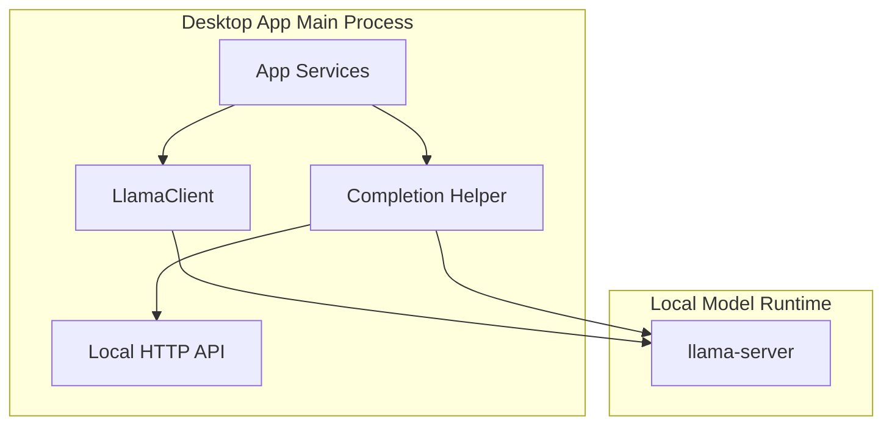

**Diagram sources**
- [app-services.ts:1049-1070](file://apps/desktop/src/main/core/app-services.ts#L1049-L1070)
- [llama-client.ts:59-109](file://apps/desktop/src/main/core/llama-client.ts#L59-L109)
- [llama-complete.ts:15-33](file://apps/desktop/src/main/core/code-agent/completion/llama-complete.ts#L15-L33)
- [http-api.ts:46-86](file://apps/desktop/src/main/core/code-agent/completion/http-api.ts#L46-L86)

**Section sources**
- [llama-client.ts:1-58](file://apps/desktop/src/main/core/llama-client.ts#L1-L58)
- [llama-complete.ts:1-13](file://apps/desktop/src/main/core/code-agent/completion/llama-complete.ts#L1-L13)
- [app-services.ts:1199-1225](file://apps/desktop/src/main/core/app-services.ts#L1199-L1225)
- [http-api.ts:46-86](file://apps/desktop/src/main/core/code-agent/completion/http-api.ts#L46-L86)
- [sidecar-manager.ts:54-69](file://docs/code-samples/ts/sidecar-manager.ts#L54-L69)

## Core Components
- `LlamaClient`: Encapsulates base URL, API key, sampling configuration, and request building for chat and embeddings. It provides synchronous chat, streaming chat, collected streaming chat, and a bounded tool-use loop.
- `chatRequestFields` and `chatBody`: Centralize sampling defaults, template kwargs, optional response format, grammar, prompt caching, and stream usage reporting.
- `llamaComplete` and `fimMarkerTokens`: Lightweight helpers for the legacy `/completion` and `/tokenize` endpoints used by code completion.
- `AppServices`: Coordinates model selection, prompt cache reuse, streaming batching, token events, tool execution, and resource accounting.
- `http-api.ts`: Local loopback server that validates authorization, enforces loopback-only access, parses JSON bodies safely, and aborts long-running operations when the client disconnects.

Key responsibilities:
- Authentication: Bearer tokens are attached to every outgoing request.
- Request serialization: Chat and embedding payloads are constructed from typed messages and options.
- Streaming: Server-Sent Events are decoded line-by-line, partial text is joined, and UI updates are emitted incrementally.
- Tool calling: The client collects tool-call deltas and orchestrates multiple turns until the model returns a final answer.

**Section sources**
- [llama-client.ts:35-58](file://apps/desktop/src/main/core/llama-client.ts#L35-L58)
- [llama-client.ts:59-109](file://apps/desktop/src/main/core/llama-client.ts#L59-L109)
- [llama-client.ts:111-161](file://apps/desktop/src/main/core/llama-client.ts#L111-L161)
- [llama-client.ts:167-298](file://apps/desktop/src/main/core/llama-client.ts#L167-L298)
- [llama-complete.ts:15-46](file://apps/desktop/src/main/core/code-agent/completion/llama-complete.ts#L15-L46)
- [http-api.ts:46-117](file://apps/desktop/src/main/core/code-agent/completion/http-api.ts#L46-L117)

## Architecture Overview
The client follows an OpenAI-compatible pattern against a local llama-server:

- Chat completions use `/v1/chat/completions`.
- Embeddings use `/v1/embeddings`.
- Legacy code completion uses `/completion`.
- Tokenization probes use `/tokenize`.
- Streaming responses use SSE with `data:` lines and `[DONE]` termination.
- Authentication uses `Authorization: Bearer <apiKey>`.

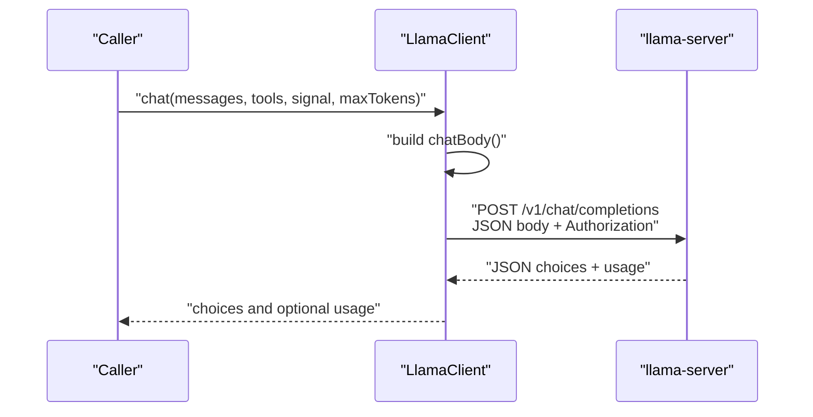

**Diagram sources**
- [llama-client.ts:80-109](file://apps/desktop/src/main/core/llama-client.ts#L80-L109)

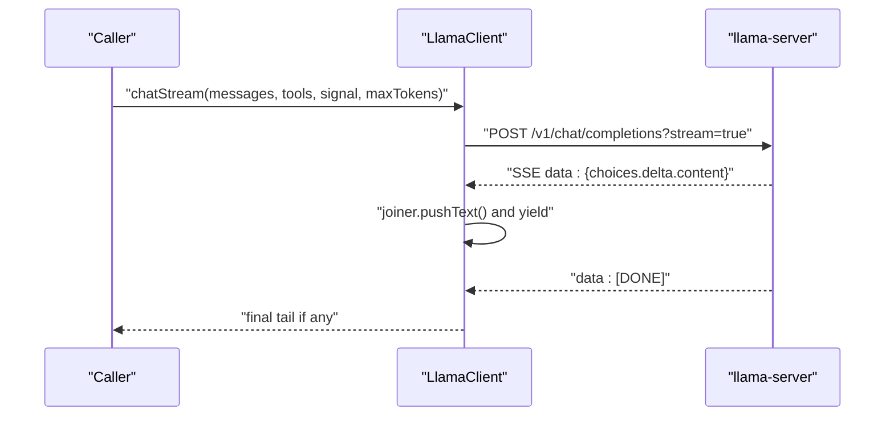

**Diagram sources**
- [llama-client.ts:111-161](file://apps/desktop/src/main/core/llama-client.ts#L111-L161)

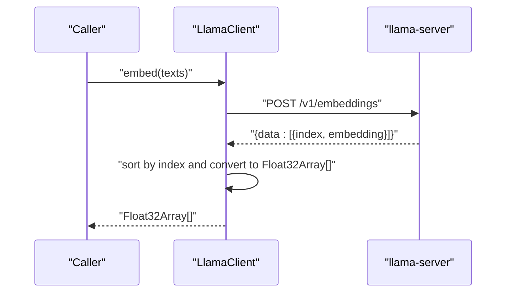

**Diagram sources**
- [llama-client.ts:73-78](file://apps/desktop/src/main/core/llama-client.ts#L73-L78)

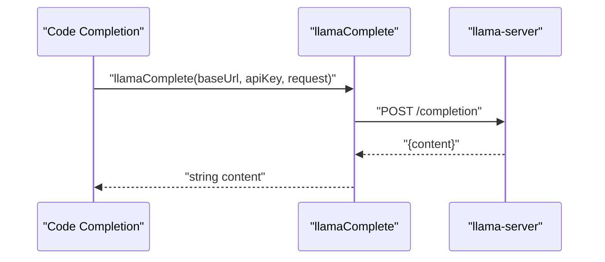

**Diagram sources**
- [llama-complete.ts:15-33](file://apps/desktop/src/main/core/code-agent/completion/llama-complete.ts#L15-L33)

## Detailed Component Analysis

### LlamaClient: HTTP Chat, Embeddings, and Streaming
`LlamaClient` centralizes all OpenAI-compatible interactions with the local server.

- Base request helper:
  - Builds POST requests to `${baseUrl}${path}`.
  - Sets `Content-Type: application/json` and `Authorization: Bearer ${apiKey}`.
  - Throws on non-OK responses after reading the response body for diagnostics.
- Chat payload builder:
  - Merges sampling defaults with registry overrides.
  - Adds `chat_template_kwargs`, optional `response_format`, `grammar`, and `cache_prompt`.
  - Enables `stream_options.include_usage` when streaming.
- Synchronous chat:
  - Calls `/v1/chat/completions` without streaming.
  - Returns choices and optional usage.
- Streaming chat generator:
  - Reads SSE chunks using `ReadableStreamDefaultReader`.
  - Decodes UTF-8 bytes and splits by newline.
  - Parses `data:` lines, skips malformed or keepalive lines, and yields incremental text via a joiner.
  - Stops at `[DONE]` and flushes any remaining joined text.
- Collected streaming chat:
  - Streams content deltas and forwards them through `onDelta`.
  - Collects tool-call deltas by index and reconstructs a complete assistant message.
  - Tracks `finish_reason` and aggregates `usage` when available.
- Tool-use loop:
  - Repeatedly calls collected streaming chat until the model stops producing tool calls.
  - Executes tool handlers, appends tool results, and bounds the number of steps.
  - Aggregates usage across turns when present.

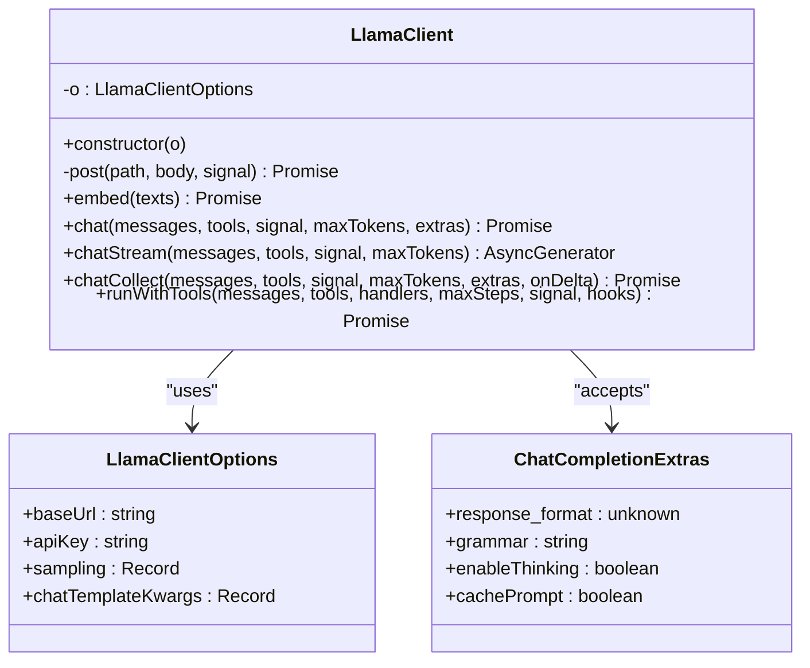

**Diagram sources**
- [llama-client.ts:43-58](file://apps/desktop/src/main/core/llama-client.ts#L43-L58)
- [llama-client.ts:59-109](file://apps/desktop/src/main/core/llama-client.ts#L59-L109)
- [llama-client.ts:111-161](file://apps/desktop/src/main/core/llama-client.ts#L111-L161)
- [llama-client.ts:167-298](file://apps/desktop/src/main/core/llama-client.ts#L167-L298)

**Section sources**
- [llama-client.ts:62-71](file://apps/desktop/src/main/core/llama-client.ts#L62-L71)
- [llama-client.ts:73-99](file://apps/desktop/src/main/core/llama-client.ts#L73-L99)
- [llama-client.ts:101-109](file://apps/desktop/src/main/core/llama-client.ts#L101-L109)
- [llama-client.ts:111-161](file://apps/desktop/src/main/core/llama-client.ts#L111-L161)
- [llama-client.ts:167-247](file://apps/desktop/src/main/core/llama-client.ts#L167-L247)
- [llama-client.ts:249-298](file://apps/desktop/src/main/core/llama-client.ts#L249-L298)

### Streaming Response Handling
Streaming is implemented in two ways:

- `chatStream`: An async generator yielding incremental text pieces. It uses a joiner to handle partial Unicode characters and emits only complete text segments.
- `chatCollect`: Consumes the same SSE stream but accumulates content and tool-call deltas, invokes `onDelta` for each piece, and returns a fully assembled assistant message along with finish reason and usage.

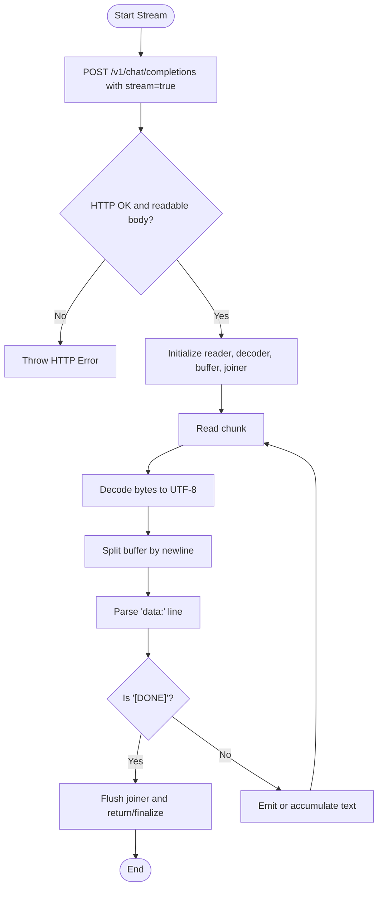

**Diagram sources**
- [llama-client.ts:111-161](file://apps/desktop/src/main/core/llama-client.ts#L111-L161)
- [llama-client.ts:167-247](file://apps/desktop/src/main/core/llama-client.ts#L167-L247)

**Section sources**
- [llama-client.ts:111-161](file://apps/desktop/src/main/core/llama-client.ts#L111-L161)
- [llama-client.ts:167-247](file://apps/desktop/src/main/core/llama-client.ts#L167-L247)

### Legacy Completion and Tokenization Helpers
For code completion, the project uses a simpler helper around `/completion`:

- Sends a non-streaming JSON request with deterministic sampling (`temperature: 0`, `top_k: 1`) and optional `cache_prompt`.
- Extracts the `content` field from the response.
- Provides a separate `/tokenize` probe to determine how many tokens the FIM marker occupies.

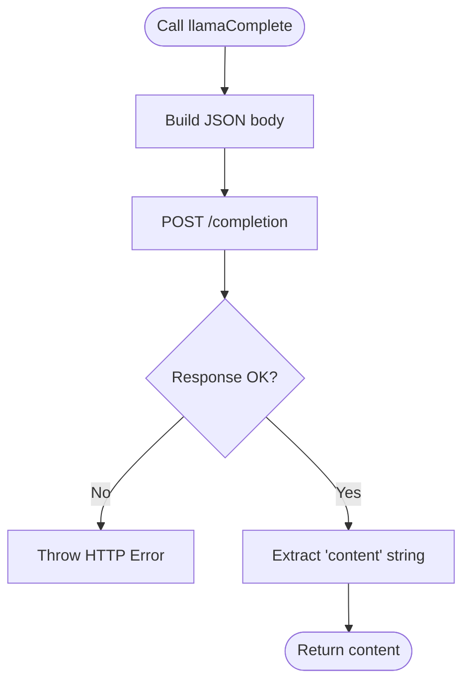

**Diagram sources**
- [llama-complete.ts:15-33](file://apps/desktop/src/main/core/code-agent/completion/llama-complete.ts#L15-L33)

**Section sources**
- [llama-complete.ts:1-13](file://apps/desktop/src/main/core/code-agent/completion/llama-complete.ts#L1-L13)
- [llama-complete.ts:15-33](file://apps/desktop/src/main/core/code-agent/completion/llama-complete.ts#L15-L33)
- [llama-complete.ts:35-46](file://apps/desktop/src/main/core/code-agent/completion/llama-complete.ts#L35-L46)

### Authentication and Local HTTP API
Authentication is enforced both on the client side and on the local HTTP API used by code-completion flows:

- Client-side: Every outgoing request includes `Authorization: Bearer ${apiKey}`.
- Local API: Validates that the request comes from loopback addresses and that the `Authorization` header matches the expected token. It also exposes a `/v1/health` endpoint and rejects invalid methods or paths.

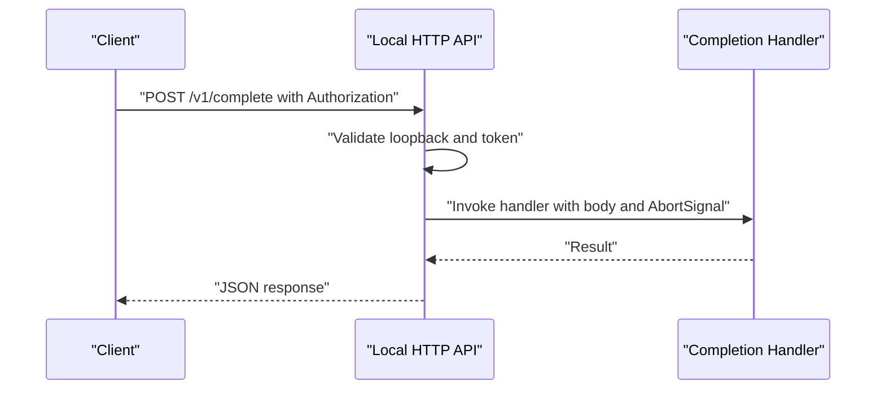

**Diagram sources**
- [http-api.ts:46-86](file://apps/desktop/src/main/core/code-agent/completion/http-api.ts#L46-L86)

**Section sources**
- [llama-client.ts:62-71](file://apps/desktop/src/main/core/llama-client.ts#L62-L71)
- [http-api.ts:46-86](file://apps/desktop/src/main/core/code-agent/completion/http-api.ts#L46-L86)

### Prompt Caching and KV Cache Behavior
The client supports prompt caching through `cache_prompt`:

- `ChatCompletionExtras.cachePrompt` adds `cache_prompt: true` to chat requests.
- The completion helper explicitly sends `cache_prompt` to `/completion`.
- Comments indicate that the chat sidecar may disable prompt cache by default to save RAM, while the flag is still sent so compatible builds can reuse it.

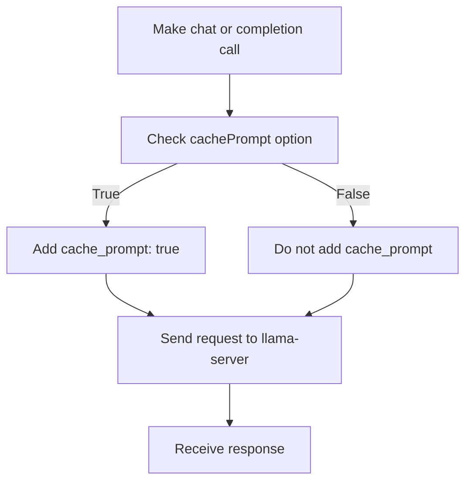

**Diagram sources**
- [llama-client.ts:80-99](file://apps/desktop/src/main/core/llama-client.ts#L80-L99)
- [llama-complete.ts:1-5](file://apps/desktop/src/main/core/code-agent/completion/llama-complete.ts#L1-L5)
- [llama-complete.ts:15-33](file://apps/desktop/src/main/core/code-agent/completion/llama-complete.ts#L15-L33)

**Section sources**
- [llama-client.ts:50-57](file://apps/desktop/src/main/core/llama-client.ts#L50-L57)
- [llama-client.ts:80-99](file://apps/desktop/src/main/core/llama-client.ts#L80-L99)
- [llama-complete.ts:1-5](file://apps/desktop/src/main/core/code-agent/completion/llama-complete.ts#L1-L5)

### Tool Calling Orchestration
The client implements a bounded multi-turn tool-use loop:

- Each turn streams content and collects tool-call deltas.
- Tool handlers are invoked with parsed arguments.
- Tool outputs are appended as `tool` messages.
- The loop stops when no tool calls remain or when the maximum step count is reached.
- Usage tokens are aggregated across turns when provided by the server.

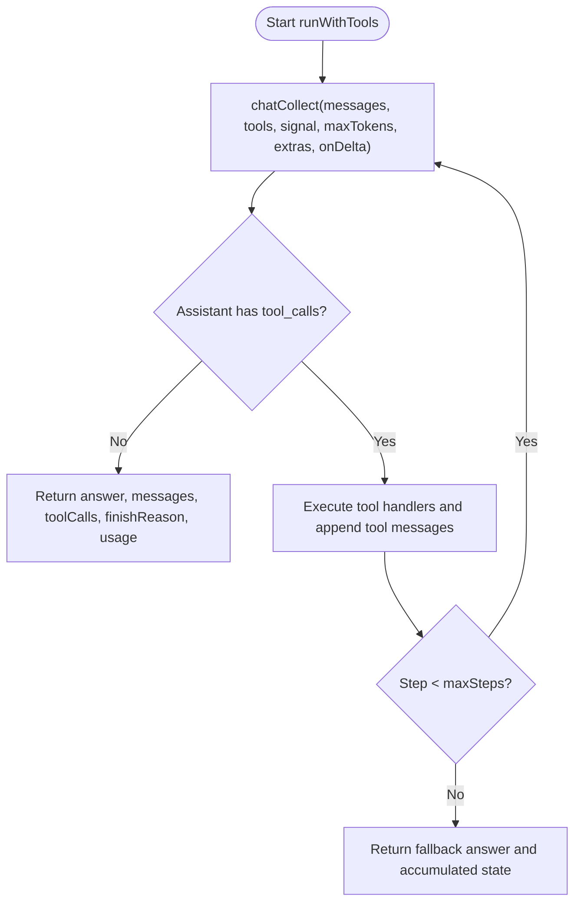

**Diagram sources**
- [llama-client.ts:167-247](file://apps/desktop/src/main/core/llama-client.ts#L167-L247)
- [llama-client.ts:249-298](file://apps/desktop/src/main/core/llama-client.ts#L249-L298)

**Section sources**
- [llama-client.ts:167-247](file://apps/desktop/src/main/core/llama-client.ts#L167-L247)
- [llama-client.ts:249-298](file://apps/desktop/src/main/core/llama-client.ts#L249-L298)

### Integration with App Services and UI Updates
`AppServices` integrates the client into the broader application flow:

- Selects the target model and computes prompt cache keys based on system text and root context.
- Uses a text batcher to emit live tokens to the UI at controlled intervals.
- Tracks first-token latency, total latency, memory sampling, and tool usage.
- Emits token events and tool events to the renderer process.
- Handles length-limited responses and replaces streamed text when necessary.

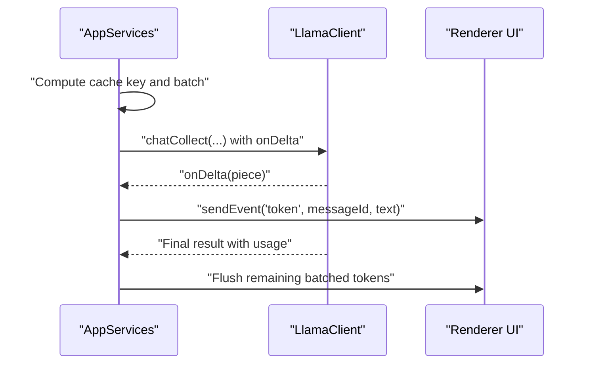

**Diagram sources**
- [app-services.ts:1199-1225](file://apps/desktop/src/main/core/app-services.ts#L1199-L1225)
- [app-services.ts:1891-1945](file://apps/desktop/src/main/core/app-services.ts#L1891-L1945)

**Section sources**
- [app-services.ts:1199-1225](file://apps/desktop/src/main/core/app-services.ts#L1199-L1225)
- [app-services.ts:1891-1945](file://apps/desktop/src/main/core/app-services.ts#L1891-L1945)

## Dependency Analysis
The inference client depends on:

- Node.js `fetch` for HTTP communication.
- `TextDecoder` and `ReadableStreamDefaultReader` for streaming.
- Shared utilities for reply text joining and model output parsing.
- Application services for lifecycle, batching, and telemetry.

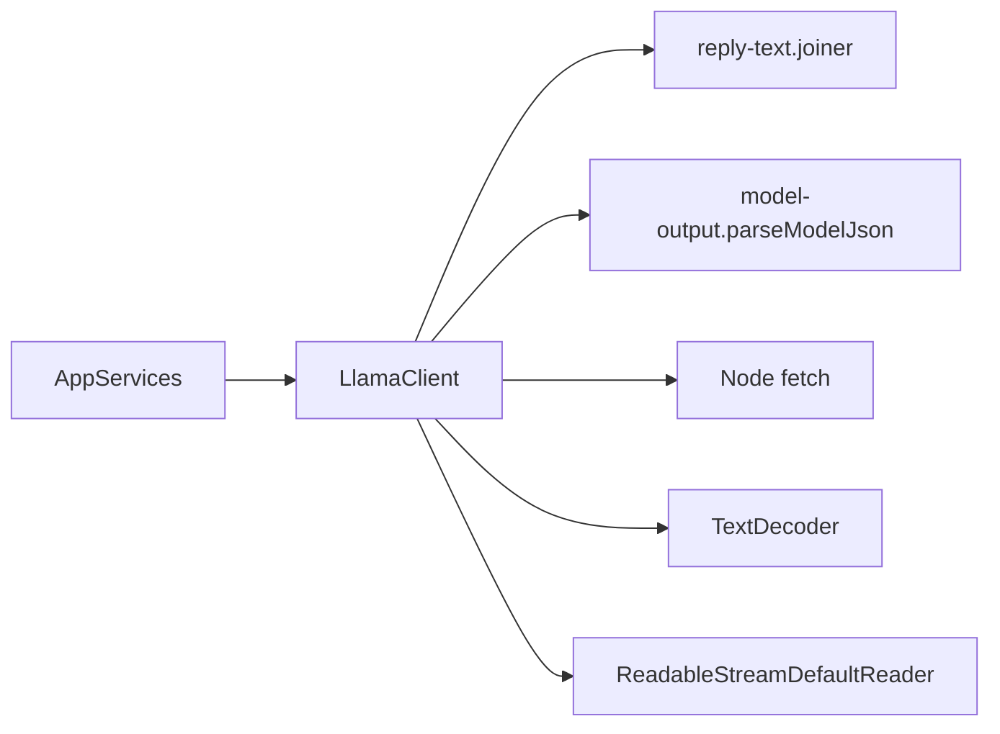

**Diagram sources**
- [llama-client.ts:6-7](file://apps/desktop/src/main/core/llama-client.ts#L6-L7)
- [llama-client.ts:111-161](file://apps/desktop/src/main/core/llama-client.ts#L111-L161)
- [llama-client.ts:249-298](file://apps/desktop/src/main/core/llama-client.ts#L249-L298)

**Section sources**
- [llama-client.ts:6-7](file://apps/desktop/src/main/core/llama-client.ts#L6-L7)
- [llama-client.ts:111-161](file://apps/desktop/src/main/core/llama-client.ts#L111-L161)
- [llama-client.ts:249-298](file://apps/desktop/src/main/core/llama-client.ts#L249-L298)

## Performance Considerations
The implementation includes several performance-oriented patterns:

- Connection reuse:
  - Requests use Node.js `fetch`, which reuses underlying connections where possible.
  - No explicit connection pool is configured in the client; reuse is delegated to the runtime.
- Prompt caching:
  - `cache_prompt` is sent for both chat and completion requests when enabled.
  - App services compute cache keys based on system text and root context to maximize reuse.
- Streaming efficiency:
  - Incremental text is processed as it arrives.
  - A joiner handles partial Unicode sequences to avoid corrupting text.
- UI batching:
  - App services batch token emissions to reduce renderer pressure.
- Deterministic evaluation:
  - Evaluation sampling is fixed to ensure reproducible behavior.
- Memory considerations:
  - Sidecar launch flags show that embedding models require bidirectional attention and micro-batch sizing aligned with context size.
  - Chat sidecar may disable prompt cache by default to save RAM.

Recommendations:
- Prefer streaming for long responses to reduce perceived latency and memory spikes.
- Enable prompt caching when prompts share common prefixes.
- Batch UI updates using the existing text batcher rather than emitting every token individually.
- Avoid sending excessively large images or prompts unless required by the model.

[No sources needed since this section provides general guidance]

## Troubleshooting Guide

Common issues and strategies:

- Network failures:
  - Non-OK HTTP responses throw errors that include the path and status code.
  - For streaming, missing or unreadable response bodies also throw errors.
- Model unavailability:
  - If the local server is not running or the port is wrong, requests will fail at the network layer.
  - Use the local API’s `/v1/health` endpoint to verify readiness when using the code-completion server.
- Authentication errors:
  - Missing or incorrect `Authorization: Bearer <apiKey>` headers cause 401 responses from the local API.
  - Ensure the API key passed to the client matches the one configured for the local server.
- Rate limiting:
  - The client does not implement retry logic or backoff.
  - Rate limiting is handled elsewhere in the platform stack; clients should surface errors and allow user-driven retries.
- Streaming parsing errors:
  - Malformed SSE lines are skipped gracefully.
  - Partial keepalive or incomplete JSON chunks do not break the stream.
- Aborted requests:
  - Callers can pass an `AbortSignal` to cancel long-running requests.
  - The local API disposes of handlers when the client disconnects.

Operational tips:
- Validate the base URL and API key before starting a session.
- Monitor first-token latency and total latency recorded by app services.
- Inspect tool-call arguments and outputs when debugging tool-use loops.
- Use the sample client to validate the server’s OpenAI-compatible contract.

**Section sources**
- [llama-client.ts:62-71](file://apps/desktop/src/main/core/llama-client.ts#L62-L71)
- [llama-client.ts:111-120](file://apps/desktop/src/main/core/llama-client.ts#L111-L120)
- [llama-client.ts:175-182](file://apps/desktop/src/main/core/llama-client.ts#L175-L182)
- [http-api.ts:46-86](file://apps/desktop/src/main/core/code-agent/completion/http-api.ts#L46-L86)
- [app-services.ts:1199-1225](file://apps/desktop/src/main/core/app-services.ts#L1199-L1225)

## Conclusion
The inference client provides a focused, OpenAI-compatible interface to a local llama-server. It supports synchronous chat, embeddings, streaming text generation, and bounded tool-use loops. Authentication is enforced via bearer tokens, request payloads are centrally constructed, and streaming responses are processed efficiently with incremental UI updates. While the client itself does not implement retry logic or explicit connection pooling, it leverages runtime-level connection reuse and integrates with application services for prompt caching, batching, and telemetry. For robust production usage, callers should add retry/backoff around network failures, respect rate-limit signals from higher layers, and continue using streaming and prompt caching to optimize performance.

[No sources needed since this section summarizes without analyzing specific files]