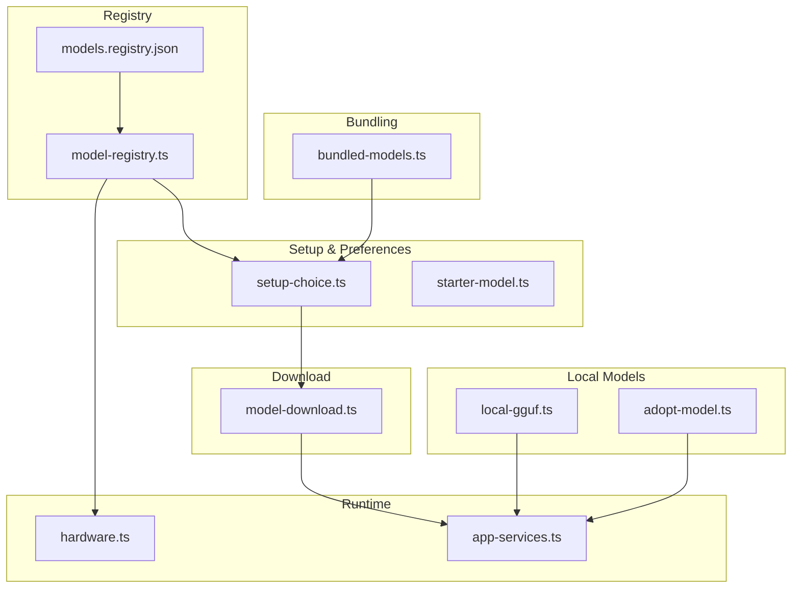
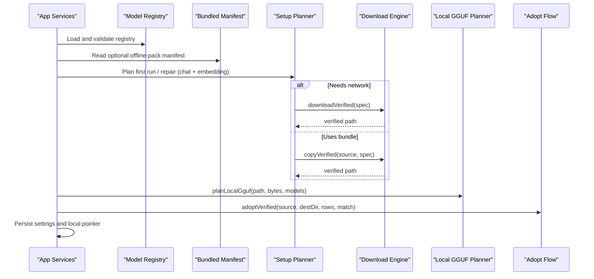
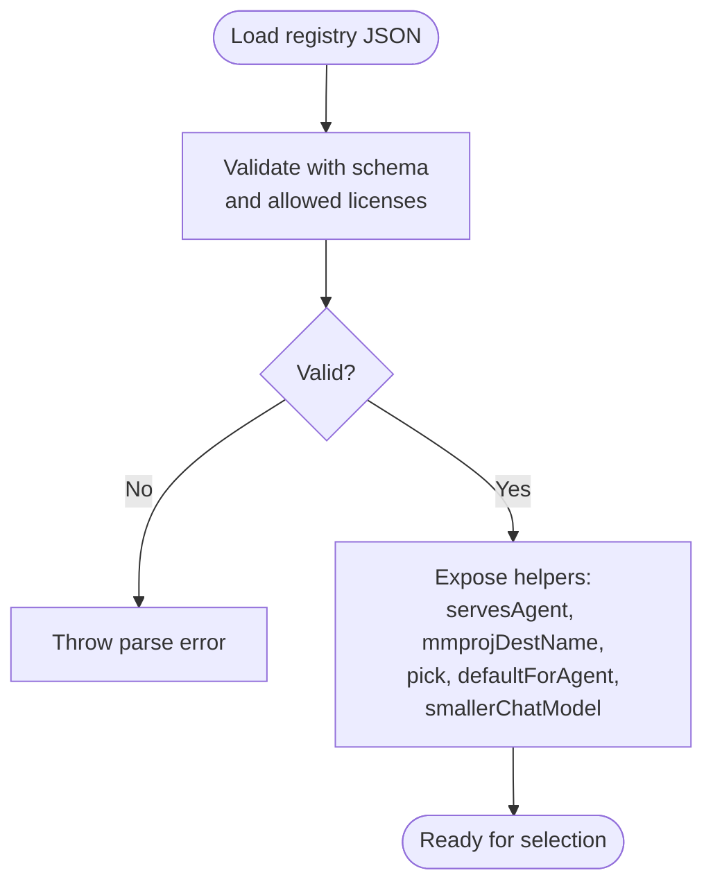
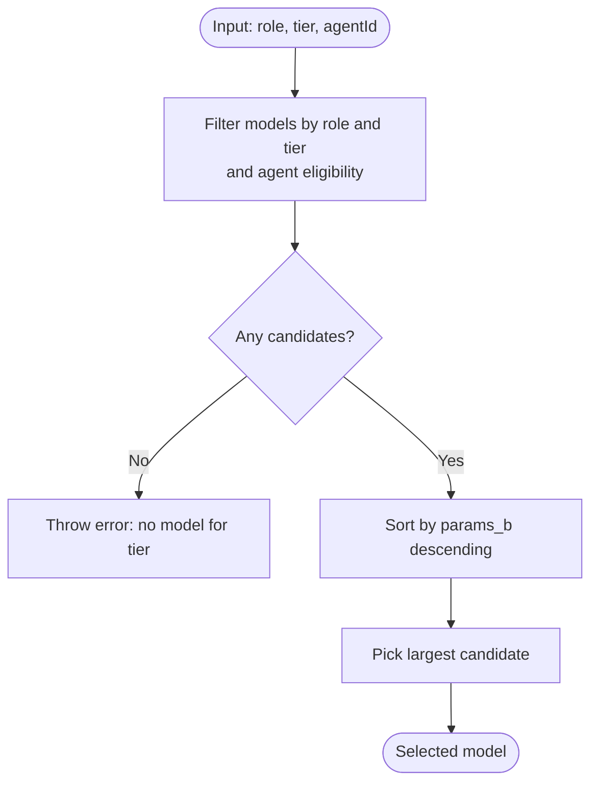
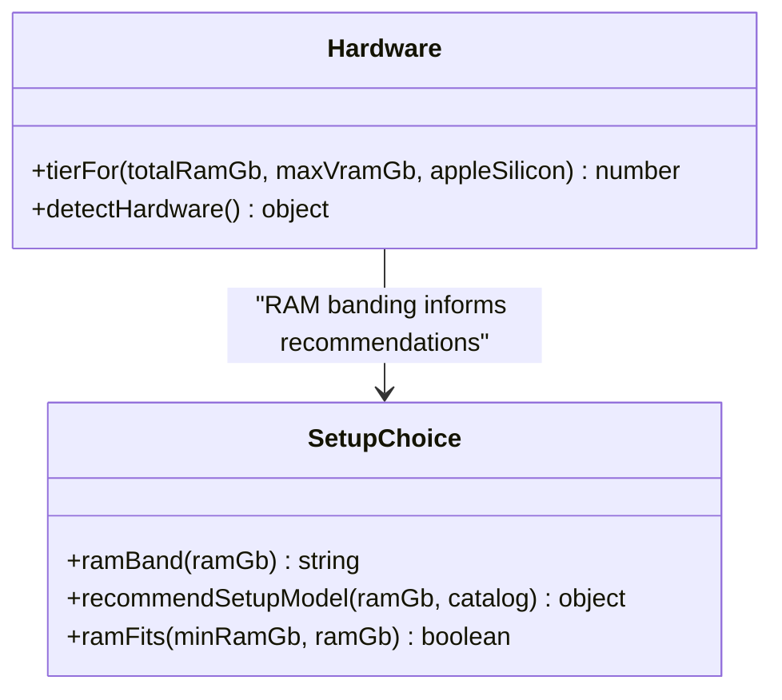
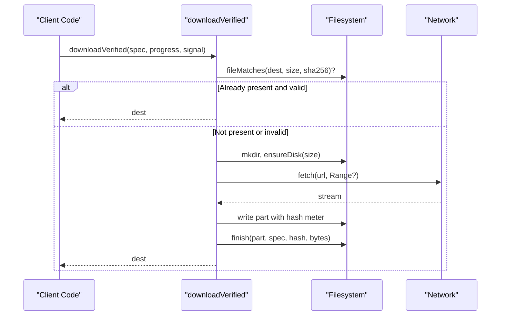
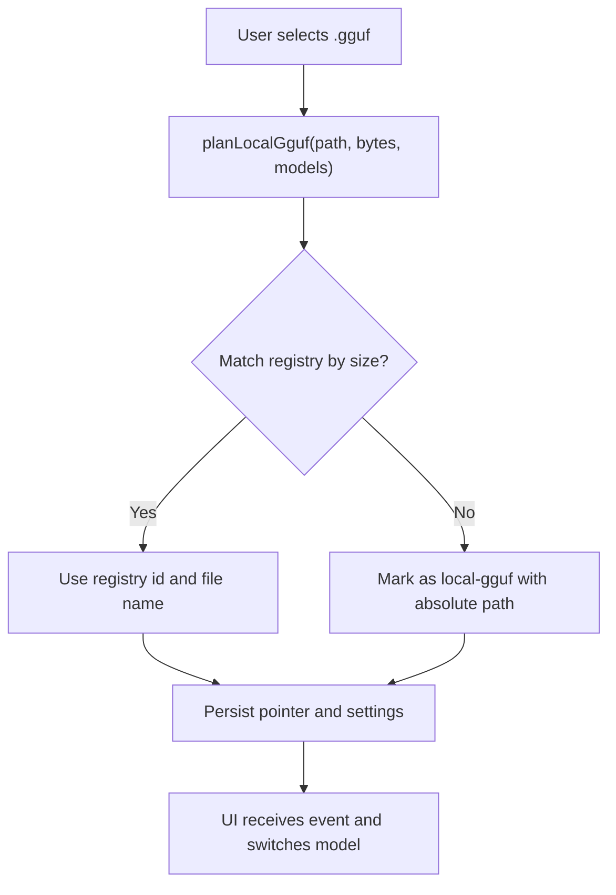
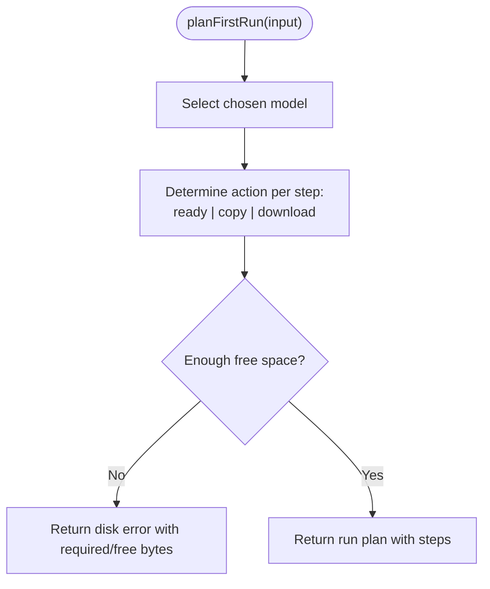
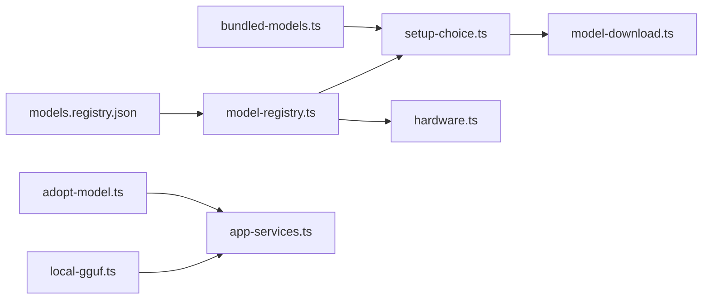

# Model Registry & Discovery

<cite>
**Referenced Files in This Document**
- [model-registry.ts](file://apps/desktop/src/main/core/model-registry.ts)
- [models.registry.json](file://apps/desktop/resources/models.registry.json)
- [bundled-models.ts](file://apps/desktop/src/main/core/bundled-models.ts)
- [model-download.ts](file://apps/desktop/src/main/core/model-download.ts)
- [local-gguf.ts](file://apps/desktop/src/main/core/local-gguf.ts)
- [adopt-model.ts](file://apps/desktop/src/main/core/adopt-model.ts)
- [setup-choice.ts](file://apps/desktop/src/shared/setup-choice.ts)
- [starter-model.ts](file://apps/desktop/src/shared/starter-model.ts)
- [hardware.ts](file://apps/desktop/src/main/core/hardware.ts)
- [app-services.ts](file://apps/desktop/src/main/core/app-services.ts)
</cite>

## Table of Contents
1. [Introduction](#introduction)
2. [Project Structure](#project-structure)
3. [Core Components](#core-components)
4. [Architecture Overview](#architecture-overview)
5. [Detailed Component Analysis](#detailed-component-analysis)
6. [Dependency Analysis](#dependency-analysis)
7. [Performance Considerations](#performance-considerations)
8. [Troubleshooting Guide](#troubleshooting-guide)
9. [Conclusion](#conclusion)

## Introduction
This document explains the model registry and discovery system that powers model selection, download, verification, and switching for GGUF files. It covers:
- How models are discovered from bundled resources and user downloads
- The model metadata schema and validation process
- The model selection algorithm considering hardware capabilities, memory, and performance characteristics
- Integration with the model download system for fetching and caching verified files
- The model switching mechanism that allows swapping between different GGUF files without restarting
- Examples for registering custom models, configuring preferences, and handling compatibility checks
- Performance considerations for large model libraries and optimization strategies for loading times

## Project Structure
The model system spans several modules:
- A JSON registry describing available models and their properties
- A TypeScript registry loader and validator using a strict schema
- Bundled manifest support for offline packaging
- A robust downloader with resume, size check, and SHA-256 verification
- Local GGUF adoption and pointer management for user-provided files
- First-run setup planning and UI helpers
- Hardware tier detection used by the selection algorithm

**Diagram sources**
- [models.registry.json:1-237](file://apps/desktop/resources/models.registry.json#L1-L237)
- [model-registry.ts:1-109](file://apps/desktop/src/main/core/model-registry.ts#L1-L109)
- [bundled-models.ts:1-29](file://apps/desktop/src/main/core/bundled-models.ts#L1-L29)
- [model-download.ts:1-218](file://apps/desktop/src/main/core/model-download.ts#L1-L218)
- [local-gguf.ts:1-49](file://apps/desktop/src/main/core/local-gguf.ts#L1-L49)
- [adopt-model.ts:1-103](file://apps/desktop/src/main/core/adopt-model.ts#L1-L103)
- [setup-choice.ts:1-427](file://apps/desktop/src/shared/setup-choice.ts#L1-L427)
- [starter-model.ts:1-13](file://apps/desktop/src/shared/starter-model.ts#L1-L13)
- [hardware.ts:24-56](file://apps/desktop/src/main/core/hardware.ts#L24-L56)
- [app-services.ts:767-792](file://apps/desktop/src/main/core/app-services.ts#L767-L792)

**Section sources**
- [model-registry.ts:1-109](file://apps/desktop/src/main/core/model-registry.ts#L1-L109)
- [models.registry.json:1-237](file://apps/desktop/resources/models.registry.json#L1-L237)
- [bundled-models.ts:1-29](file://apps/desktop/src/main/core/bundled-models.ts#L1-L29)
- [model-download.ts:1-218](file://apps/desktop/src/main/core/model-download.ts#L1-L218)
- [local-gguf.ts:1-49](file://apps/desktop/src/main/core/local-gguf.ts#L1-L49)
- [adopt-model.ts:1-103](file://apps/desktop/src/main/core/adopt-model.ts#L1-L103)
- [setup-choice.ts:1-427](file://apps/desktop/src/shared/setup-choice.ts#L1-L427)
- [starter-model.ts:1-13](file://apps/desktop/src/shared/starter-model.ts#L1-L13)
- [hardware.ts:24-56](file://apps/desktop/src/main/core/hardware.ts#L24-L56)
- [app-services.ts:767-792](file://apps/desktop/src/main/core/app-services.ts#L767-L792)

## Core Components
- Model registry schema and parser: validates structure, licenses, and provides helper functions for serving agents, naming mmproj files, picking models by role/tier/agent, defaulting per agent, and finding smaller alternatives.
- Bundled manifest reader: reads an optional offline-pack manifest to pre-seed setup choices and embedding info.
- Download engine: resumable, atomic file transfer with size and SHA-256 verification; supports copying from bundled sources.
- Local GGUF planner: maps a user-provided GGUF path to a registry identity when possible, otherwise marks it as local.
- Adopt flow: verifies and moves user-downloaded GGUFs into the app’s model directory based on registry rows.
- Setup planning: first-run and later repair flows for chat and embedding models, including disk space checks and progress formatting.
- Starter model constants: defines default and first-run model IDs.
- Hardware tiering: determines device tier used by selection logic.

**Section sources**
- [model-registry.ts:1-109](file://apps/desktop/src/main/core/model-registry.ts#L1-L109)
- [bundled-models.ts:1-29](file://apps/desktop/src/main/core/bundled-models.ts#L1-L29)
- [model-download.ts:1-218](file://apps/desktop/src/main/core/model-download.ts#L1-L218)
- [local-gguf.ts:1-49](file://apps/desktop/src/main/core/local-gguf.ts#L1-L49)
- [adopt-model.ts:1-103](file://apps/desktop/src/main/core/adopt-model.ts#L1-L103)
- [setup-choice.ts:1-427](file://apps/desktop/src/shared/setup-choice.ts#L1-L427)
- [starter-model.ts:1-13](file://apps/desktop/src/shared/starter-model.ts#L1-L13)
- [hardware.ts:24-56](file://apps/desktop/src/main/core/hardware.ts#L24-L56)

## Architecture Overview
The system composes registry data, bundling, downloading, and runtime selection into a cohesive pipeline:
- Registry JSON is loaded and validated at startup or when refreshed online.
- Bundled manifests can provide initial catalog entries for offline installs.
- User interactions drive first-run setup or later repairs, which plan downloads or copies.
- The selected model is switched at runtime by updating settings and persisting a local GGUF pointer if needed.

**Diagram sources**
- [model-registry.ts:61-85](file://apps/desktop/src/main/core/model-registry.ts#L61-L85)
- [bundled-models.ts:17-28](file://apps/desktop/src/main/core/bundled-models.ts#L17-L28)
- [setup-choice.ts:179-231](file://apps/desktop/src/shared/setup-choice.ts#L179-L231)
- [model-download.ts:120-171](file://apps/desktop/src/main/core/model-download.ts#L120-L171)
- [model-download.ts:180-217](file://apps/desktop/src/main/core/model-download.ts#L180-L217)
- [local-gguf.ts:24-32](file://apps/desktop/src/main/core/local-gguf.ts#L24-L32)
- [adopt-model.ts:32-82](file://apps/desktop/src/main/core/adopt-model.ts#L32-L82)

## Detailed Component Analysis

### Model Metadata Schema and Validation
- The registry uses a strict schema to enforce required fields such as id, role, family, license, min_ram_gb, tiers, and integrity fields like size_bytes and sha256. Optional fields include context defaults, embedding dimensions, sampling parameters, and agent scoping.
- Licenses are whitelisted for automatic downloads; non-whitelisted licenses cause validation errors.
- Helper functions determine whether a model serves a given agent, compute destination names for mmproj files, pick the best model for a role/tier/agent, find defaults per agent, and locate smaller alternatives.

**Diagram sources**
- [model-registry.ts:9-67](file://apps/desktop/src/main/core/model-registry.ts#L9-L67)
- [model-registry.ts:70-108](file://apps/desktop/src/main/core/model-registry.ts#L70-L108)

**Section sources**
- [model-registry.ts:9-67](file://apps/desktop/src/main/core/model-registry.ts#L9-L67)
- [model-registry.ts:70-108](file://apps/desktop/src/main/core/model-registry.ts#L70-L108)
- [models.registry.json:1-237](file://apps/desktop/resources/models.registry.json#L1-L237)

### Model Selection Algorithm
- Tier-based selection: models declare compatible hardware tiers; the algorithm filters candidates by role, tier, and agent eligibility, then selects the largest model by parameter count among candidates.
- Agent scoping: some models are restricted to specific agents; others remain available to general roles.
- Defaults: each agent can have a marked default model; the smallest default is chosen when unspecified.
- Fallbacks: when a user wants a smaller model, the algorithm prefers same-family smaller models, then falls back to a smaller Qwen family model.

**Diagram sources**
- [model-registry.ts:80-85](file://apps/desktop/src/main/core/model-registry.ts#L80-L85)
- [model-registry.ts:70-73](file://apps/desktop/src/main/core/model-registry.ts#L70-L73)
- [model-registry.ts:87-92](file://apps/desktop/src/main/core/model-registry.ts#L87-L92)
- [model-registry.ts:94-108](file://apps/desktop/src/main/core/model-registry.ts#L94-L108)

**Section sources**
- [model-registry.ts:80-108](file://apps/desktop/src/main/core/model-registry.ts#L80-L108)

### Hardware Capabilities and Memory Checks
- Device tier is computed from total RAM, VRAM, and platform specifics.
- Setup utilities map RAM to bands and recommend suitable models for first-run.
- Runtime checks ensure sufficient memory for both base models and multimodal add-ons (mmproj).

**Diagram sources**
- [hardware.ts:24-56](file://apps/desktop/src/main/core/hardware.ts#L24-L56)
- [setup-choice.ts:91-111](file://apps/desktop/src/shared/setup-choice.ts#L91-L111)

**Section sources**
- [hardware.ts:24-56](file://apps/desktop/src/main/core/hardware.ts#L24-L56)
- [setup-choice.ts:91-111](file://apps/desktop/src/shared/setup-choice.ts#L91-L111)

### Model Download System Integration
- Resumable downloads: resumes partial files using Range headers and continues streaming.
- Integrity checks: enforces expected size and SHA-256; deletes corrupted parts and throws typed errors.
- Disk safety: checks free space before writing; handles ENOSPC gracefully.
- Atomicity: writes to .part files and renames only after successful verification.
- Bundled copy: supports copying verified files from installer resources.

**Diagram sources**
- [model-download.ts:120-171](file://apps/desktop/src/main/core/model-download.ts#L120-L171)
- [model-download.ts:101-118](file://apps/desktop/src/main/core/model-download.ts#L101-L118)
- [model-download.ts:75-79](file://apps/desktop/src/main/core/model-download.ts#L75-L79)

**Section sources**
- [model-download.ts:17-178](file://apps/desktop/src/main/core/model-download.ts#L17-L178)
- [model-download.ts:180-217](file://apps/desktop/src/main/core/model-download.ts#L180-L217)

### Local GGUF Adoption and Switching Without Restart
- Local GGUF planner matches a user-provided file to a registry entry by byte size; otherwise marks it as a local model.
- Adopt flow verifies and moves user-downloaded GGUFs into the app’s model directory based on registry rows.
- App services import local GGUFs, persist a pointer, update settings, and emit events to the UI.

**Diagram sources**
- [local-gguf.ts:24-32](file://apps/desktop/src/main/core/local-gguf.ts#L24-L32)
- [app-services.ts:767-792](file://apps/desktop/src/main/core/app-services.ts#L767-L792)

**Section sources**
- [local-gguf.ts:1-49](file://apps/desktop/src/main/core/local-gguf.ts#L1-L49)
- [adopt-model.ts:32-82](file://apps/desktop/src/main/core/adopt-model.ts#L32-L82)
- [app-services.ts:767-792](file://apps/desktop/src/main/core/app-services.ts#L767-L792)

### Bundled Resources and Offline Packaging
- Bundled manifest reader validates and loads an offline-pack manifest to pre-seed setup catalog and embedding information.
- If the manifest is missing or tampered, the system falls back to interactive picker.

**Section sources**
- [bundled-models.ts:1-29](file://apps/desktop/src/main/core/bundled-models.ts#L1-L29)

### First-Run Setup and Repair Flows
- Catalog generation builds a simplified list of chat models for first-run, mapping registry rows to tokens and sizes.
- Planning computes actions (download/copy/ready), estimates required free space, and returns steps for UI.
- Later repair focuses on embedding model availability.

**Diagram sources**
- [setup-choice.ts:179-231](file://apps/desktop/src/shared/setup-choice.ts#L179-L231)

**Section sources**
- [setup-choice.ts:34-82](file://apps/desktop/src/shared/setup-choice.ts#L34-L82)
- [setup-choice.ts:179-231](file://apps/desktop/src/shared/setup-choice.ts#L179-L231)
- [setup-choice.ts:233-257](file://apps/desktop/src/shared/setup-choice.ts#L233-L257)

### Compatibility Checks and Performance Characteristics
- Context token sizing depends on RAM tier for evaluation runs.
- Memory allowance checks consider base model requirements and additional mmproj overhead.
- Release gate ensures measured models meet accuracy and fabrication thresholds.

**Section sources**
- [model-eval.ts:265-278](file://apps/desktop/src/main/core/model-eval.ts#L265-L278)
- [model-eval.ts:308-322](file://apps/desktop/src/main/core/model-eval.ts#L308-L322)

## Dependency Analysis
Key dependencies and relationships:
- Registry JSON is consumed by the registry loader and exposed via typed helpers.
- Bundled manifest integrates with setup planning to pre-seed offline installs.
- Setup planning orchestrates downloads or copies through the download engine.
- Local GGUF planning and adopt flow integrate with app services to switch models at runtime.
- Hardware tiering influences selection and recommendations.

**Diagram sources**
- [models.registry.json:1-237](file://apps/desktop/resources/models.registry.json#L1-L237)
- [model-registry.ts:1-109](file://apps/desktop/src/main/core/model-registry.ts#L1-L109)
- [bundled-models.ts:1-29](file://apps/desktop/src/main/core/bundled-models.ts#L1-L29)
- [setup-choice.ts:1-427](file://apps/desktop/src/shared/setup-choice.ts#L1-L427)
- [model-download.ts:1-218](file://apps/desktop/src/main/core/model-download.ts#L1-L218)
- [local-gguf.ts:1-49](file://apps/desktop/src/main/core/local-gguf.ts#L1-L49)
- [adopt-model.ts:1-103](file://apps/desktop/src/main/core/adopt-model.ts#L1-L103)
- [hardware.ts:24-56](file://apps/desktop/src/main/core/hardware.ts#L24-L56)
- [app-services.ts:767-792](file://apps/desktop/src/main/core/app-services.ts#L767-L792)

**Section sources**
- [model-registry.ts:1-109](file://apps/desktop/src/main/core/model-registry.ts#L1-L109)
- [setup-choice.ts:1-427](file://apps/desktop/src/shared/setup-choice.ts#L1-L427)
- [model-download.ts:1-218](file://apps/desktop/src/main/core/model-download.ts#L1-L218)
- [local-gguf.ts:1-49](file://apps/desktop/src/main/core/local-gguf.ts#L1-L49)
- [adopt-model.ts:1-103](file://apps/desktop/src/main/core/adopt-model.ts#L1-L103)
- [hardware.ts:24-56](file://apps/desktop/src/main/core/hardware.ts#L24-L56)
- [app-services.ts:767-792](file://apps/desktop/src/main/core/app-services.ts#L767-L792)

## Performance Considerations
- Large model libraries: prefer tier-based filtering to reduce candidate sets; leverage agent scoping to avoid irrelevant models.
- Loading times: use verified cached files to avoid re-downloads; rely on atomic .part files to prevent corruption during interruptions.
- Memory pressure: respect min_ram_gb and peak_ram_gb hints; apply mmproj memory allowances when multimodal features are enabled.
- Streaming and resuming: use range requests to minimize bandwidth and time on retries; keep progress updates lightweight.
- Evaluation metrics: track tokens-per-second and time-to-first-token to guide model choice and tuning.

[No sources needed since this section provides general guidance]

## Troubleshooting Guide
Common issues and resolutions:
- Not enough disk space: the downloader calculates required free bytes and reports exact needs; free up space and retry.
- Checksum mismatch: corrupted or incomplete files are deleted automatically; retry the download.
- Network errors: transient failures return typed errors; resume from the last saved part.
- HTTP errors: status codes are captured for diagnostics; verify URL and proxy settings.
- Local GGUF not recognized: ensure the file is a .gguf and its size matches a registry row; otherwise it will be treated as a local model.

**Section sources**
- [model-download.ts:20-34](file://apps/desktop/src/main/core/model-download.ts#L20-L34)
- [model-download.ts:69-79](file://apps/desktop/src/main/core/model-download.ts#L69-L79)
- [model-download.ts:101-118](file://apps/desktop/src/main/core/model-download.ts#L101-L118)
- [model-download.ts:154-166](file://apps/desktop/src/main/core/model-download.ts#L154-L166)
- [local-gguf.ts:20-32](file://apps/desktop/src/main/core/local-gguf.ts#L20-L32)

## Conclusion
The model registry and discovery system combines a strict metadata schema, robust download verification, flexible bundling, and intelligent selection to deliver a smooth experience across diverse hardware. By leveraging tiers, agent scoping, and memory-aware checks, the system ensures appropriate models are chosen and switched seamlessly. The design also supports offline packaging, user-provided GGUFs, and continuous improvement through evaluation metrics and release gates.

[No sources needed since this section summarizes without analyzing specific files]