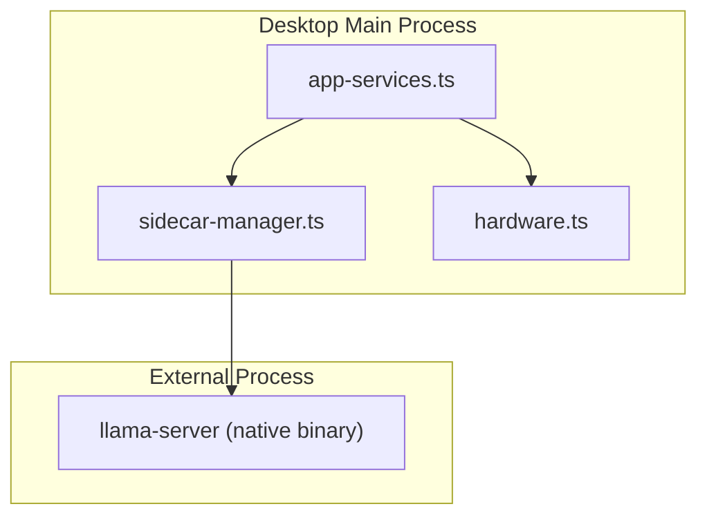
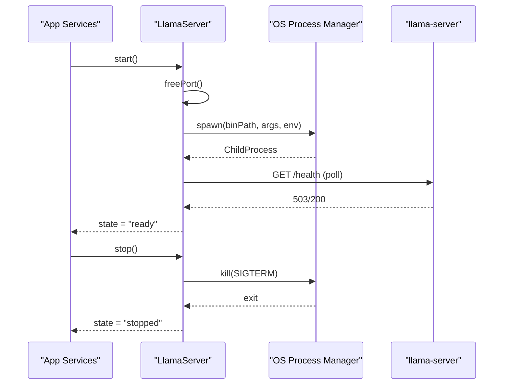
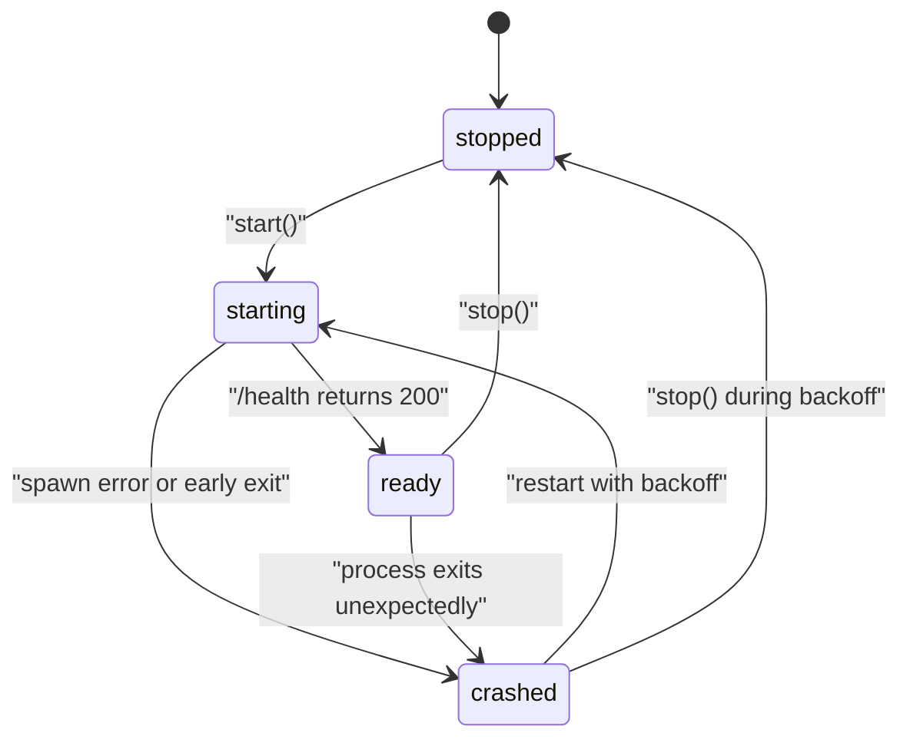
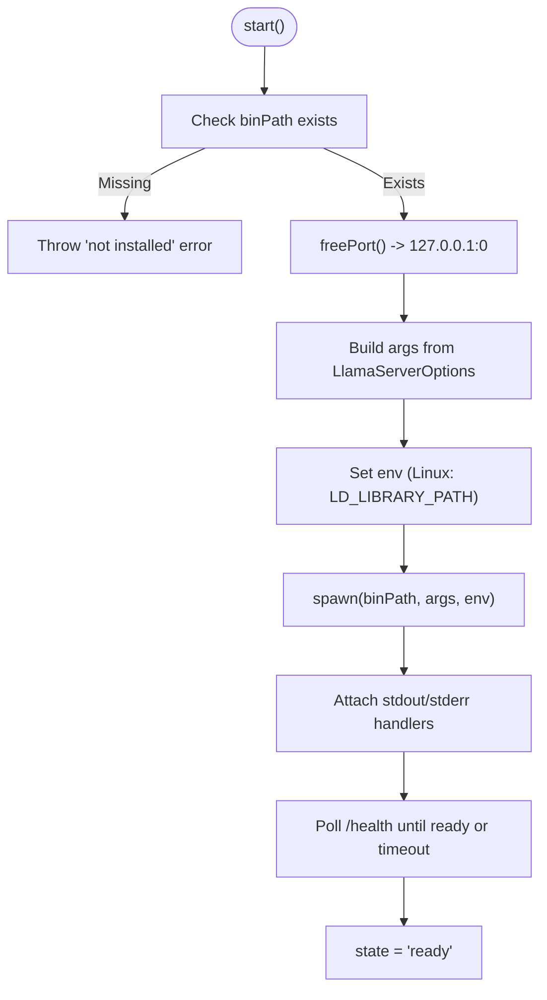
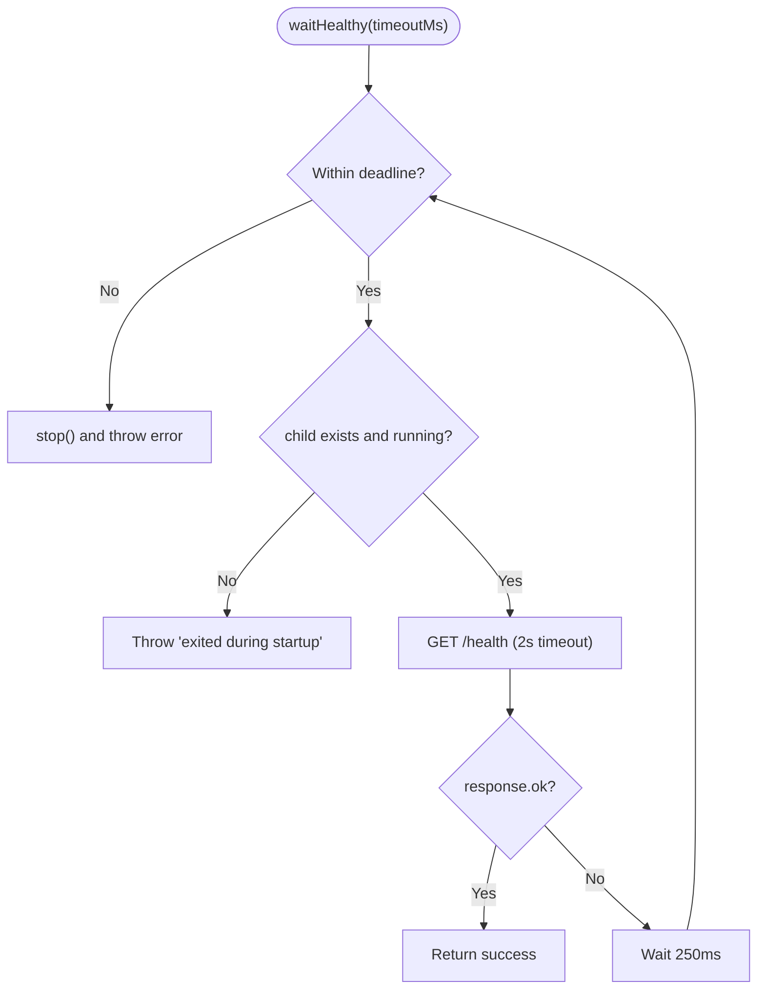
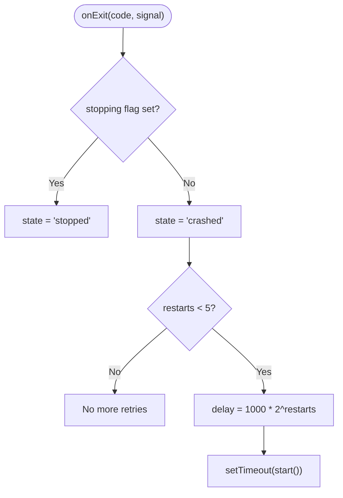
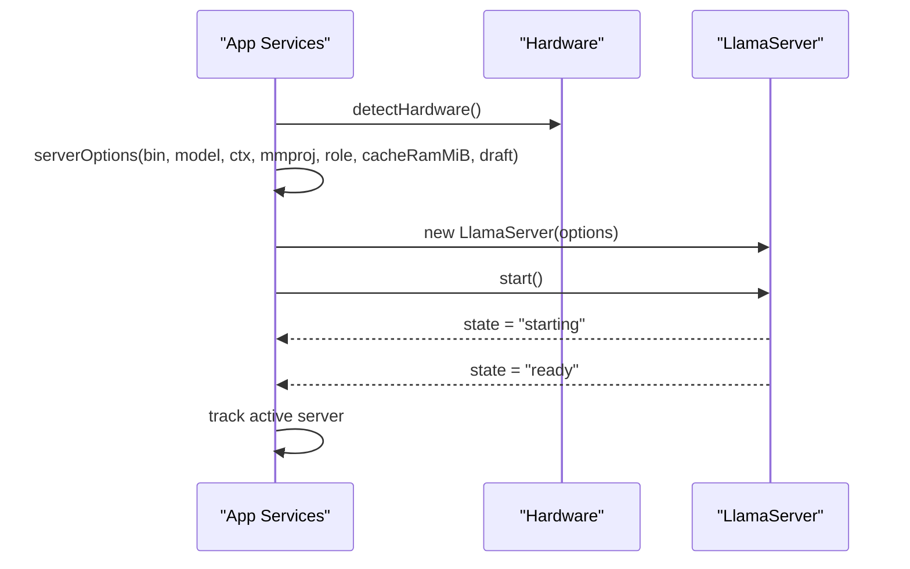
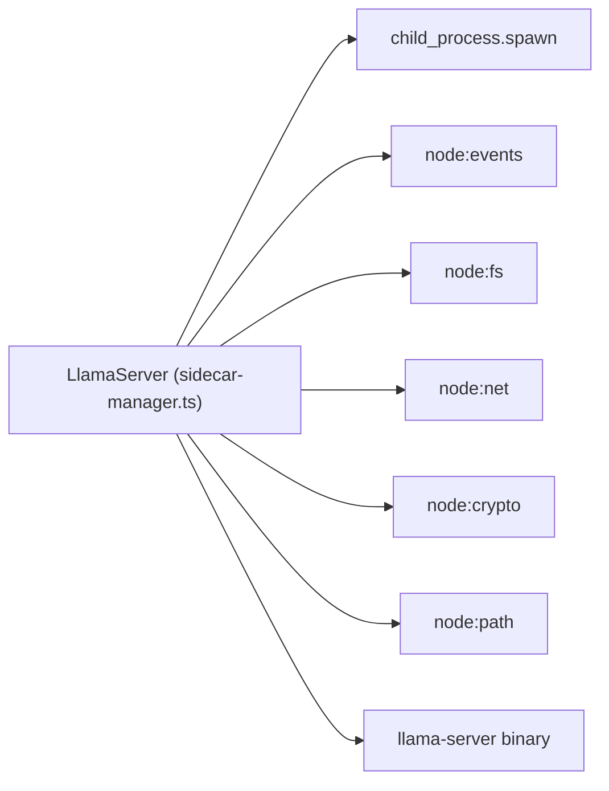

# Sidecar Process Management

<cite>
**Referenced Files in This Document**
- [sidecar-manager.ts](file://apps/desktop/src/main/core/sidecar-manager.ts)
- [app-services.ts](file://apps/desktop/src/main/core/app-services.ts)
- [hardware.ts](file://apps/desktop/src/main/core/hardware.ts)
- [sidecar-args.test.ts](file://apps/desktop/src/main/core/sidecar-args.test.ts)
</cite>

## Table of Contents
1. [Introduction](#introduction)
2. [Project Structure](#project-structure)
3. [Core Components](#core-components)
4. [Architecture Overview](#architecture-overview)
5. [Detailed Component Analysis](#detailed-component-analysis)
6. [Dependency Analysis](#dependency-analysis)
7. [Performance Considerations](#performance-considerations)
8. [Troubleshooting Guide](#troubleshooting-guide)
9. [Conclusion](#conclusion)

## Introduction
This document explains the sidecar process management system that runs external llama.cpp binaries (llama-server) as isolated helper processes. The LlamaServer class encapsulates the full lifecycle: spawning, health checking via HTTP endpoints, graceful shutdown, restart on crash with exponential backoff, and safe resource cleanup. It also documents the security model (localhost-only binding, random API keys), environment configuration per platform, and how server options such as context size, threads, GPU layers, and memory parameters are applied. Finally, it provides troubleshooting guidance for startup failures, port conflicts, and resource constraints.

## Project Structure
The sidecar implementation lives in the desktop main process and is orchestrated by application services:

- sidecar-manager.ts: Defines LlamaServer, argument construction, process spawning, health polling, exit handling, restart logic, and binary resolution helpers.
- app-services.ts: Builds LlamaServerOptions from hardware and model metadata, manages active instances, and coordinates fallbacks when vision or draft features are unavailable.
- hardware.ts: Detects CPU/GPU/RAM and computes thread counts and tiers used to configure the sidecar.
- sidecar-args.test.ts: Validates behavior for missing binaries, non-executable files, and default arguments like prompt cache settings.

**Diagram sources**
- [app-services.ts:615-667](file://apps/desktop/src/main/core/app-services.ts#L615-L667)
- [sidecar-manager.ts:17-195](file://apps/desktop/src/main/core/sidecar-manager.ts#L17-L195)
- [hardware.ts:32-61](file://apps/desktop/src/main/core/hardware.ts#L32-L61)

**Section sources**
- [sidecar-manager.ts:1-195](file://apps/desktop/src/main/core/sidecar-manager.ts#L1-L195)
- [app-services.ts:601-667](file://apps/desktop/src/main/core/app-services.ts#L601-L667)
- [hardware.ts:1-61](file://apps/desktop/src/main/core/hardware.ts#L1-L61)
- [sidecar-args.test.ts:1-58](file://apps/desktop/src/main/core/sidecar-args.test.ts#L1-L58)

## Core Components
- LlamaServer: Manages a single llama-server child process. Responsibilities include:
  - Generating a random API key and selecting a free localhost port.
  - Building command-line arguments based on LlamaServerOptions.
  - Spawning the process, capturing logs, and waiting for /health readiness.
  - Handling crashes with exponential backoff and emitting state events.
  - Graceful stop with SIGTERM followed by SIGKILL after a grace period.
  - Restarting with updated options via restartWith.
- resolveSidecar: Resolves the path to the bundled llama-server binary depending on packaging and platform.
- freePort: Finds an available TCP port bound to 127.0.0.1.
- Application services integration: Constructs options using hardware detection and model metadata, ensures only one active server per role, and handles fallbacks for optional features.

Key responsibilities and behaviors:
- Security: Binds to 127.0.0.1, uses a random API key, and avoids exposing the service externally.
- Health monitoring: Polls http://127.0.0.1:<port>/health until ready or timeout.
- Crash recovery: Retries up to five times with delays 1s, 2s, 4s, 8s, 16s before giving up.
- Resource cleanup: Detaches stdout/stderr listeners, closes log streams, and kills the process gracefully.

**Section sources**
- [sidecar-manager.ts:17-195](file://apps/desktop/src/main/core/sidecar-manager.ts#L17-L195)
- [app-services.ts:615-667](file://apps/desktop/src/main/core/app-services.ts#L615-L667)

## Architecture Overview
The sidecar pattern isolates the heavy native inference runtime from the Electron main process. The main process controls the lifecycle and communicates with the sidecar over a local HTTP interface protected by an API key.

**Diagram sources**
- [sidecar-manager.ts:85-131](file://apps/desktop/src/main/core/sidecar-manager.ts#L85-L131)
- [sidecar-manager.ts:133-148](file://apps/desktop/src/main/core/sidecar-manager.ts#L133-L148)
- [sidecar-manager.ts:164-175](file://apps/desktop/src/main/core/sidecar-manager.ts#L164-L175)

## Detailed Component Analysis

### LlamaServer Lifecycle and State Machine
States: stopped → starting → ready → crashed → (optional) starting again.

**Diagram sources**
- [sidecar-manager.ts:50-61](file://apps/desktop/src/main/core/sidecar-manager.ts#L50-L61)
- [sidecar-manager.ts:85-131](file://apps/desktop/src/main/core/sidecar-manager.ts#L85-L131)
- [sidecar-manager.ts:150-162](file://apps/desktop/src/main/core/sidecar-manager.ts#L150-L162)

**Section sources**
- [sidecar-manager.ts:50-182](file://apps/desktop/src/main/core/sidecar-manager.ts#L50-L182)

### Process Spawning and Environment Configuration
- Binary path resolution:
  - Uses resolveSidecar to locate llama-server under resources/bin/<platform>-<arch> in development or process.resourcesPath/bin in packaged apps.
- Port selection:
  - freePort binds a temporary server to 127.0.0.1:0 to obtain a free port, then closes it.
- Environment variables:
  - On Linux, sets LD_LIBRARY_PATH to include the directory containing the binary so shared libraries can be found.
- Process creation:
  - Spawns with stdio configured to pipe stdout/stderr while hiding the window on Windows.
  - Captures output into a rolling tail buffer for diagnostics.

**Diagram sources**
- [sidecar-manager.ts:17-27](file://apps/desktop/src/main/core/sidecar-manager.ts#L17-L27)
- [sidecar-manager.ts:67-83](file://apps/desktop/src/main/core/sidecar-manager.ts#L67-L83)
- [sidecar-manager.ts:85-131](file://apps/desktop/src/main/core/sidecar-manager.ts#L85-L131)

**Section sources**
- [sidecar-manager.ts:17-27](file://apps/desktop/src/main/core/sidecar-manager.ts#L17-L27)
- [sidecar-manager.ts:85-131](file://apps/desktop/src/main/core/sidecar-manager.ts#L85-L131)
- [sidecar-manager.ts:190-195](file://apps/desktop/src/main/core/sidecar-manager.ts#L190-L195)

### Command-Line Arguments and Options
Common flags set by LlamaServer.args():
- Model and networking:
  - -m <modelPath>, --host 127.0.0.1, --port <random-port>, --api-key <random-key>
- Context and concurrency:
  - -c <ctx>, -np 1 (one slot), optional -t <threads>
- GPU acceleration:
  - -ngl <gpuLayers> (number or 'auto')
- Embeddings mode:
  - --embeddings, --pooling <cls|mean|last>, -ub/-b set to ctx for embedding models
- Chat mode:
  - --jinja for chat template and tool calling
- Vision:
  - --mmproj <mmprojPath> (optional)
- Memory and performance:
  - --no-repack, -cram <cacheRamMiB> (0 disables prompt cache)
- Speculative decoding:
  - -md <draftModelPath>, --draft-max <draftMax> (optional)

Example configurations:
- Chat server with CPU threads and disabled prompt cache:
  - threads: derived from hardware, ctx: user-defined, cacheRamMiB: 0
- Embedding server:
  - embeddings: true, pooling: mean, ctx sized for micro-batch
- GPU offloading:
  - gpuLayers: number or 'auto' (e.g., auto on Apple Silicon)
- Speculative decoding:
  - draftModelPath and draftMax provided when RAM allows

**Section sources**
- [sidecar-manager.ts:67-83](file://apps/desktop/src/main/core/sidecar-manager.ts#L67-L83)
- [app-services.ts:615-627](file://apps/desktop/src/main/core/app-services.ts#L615-L627)
- [hardware.ts:61-61](file://apps/desktop/src/main/core/hardware.ts#L61-L61)

### Health Monitoring and Startup Timeout
- Health polling:
  - Repeatedly fetches http://127.0.0.1:<port>/health every 250ms with a 2-second request timeout.
  - Exits successfully when response status is ok; otherwise continues until startupTimeoutMs.
- Failure handling:
  - If the process exits during startup or fails to become healthy, stop() is called and an error is thrown.

**Diagram sources**
- [sidecar-manager.ts:133-148](file://apps/desktop/src/main/core/sidecar-manager.ts#L133-L148)

**Section sources**
- [sidecar-manager.ts:133-148](file://apps/desktop/src/main/core/sidecar-manager.ts#L133-L148)

### Automatic Crash Recovery with Exponential Backoff
- Exit handling:
  - Emits state 'crashed' with code, signal, and last lines of output.
  - Schedules restart attempts with delays 1s, 2s, 4s, 8s, 16s (up to 5 attempts).
- Cancellation:
  - If stop() was called, no restart occurs; state becomes 'stopped'.

**Diagram sources**
- [sidecar-manager.ts:150-162](file://apps/desktop/src/main/core/sidecar-manager.ts#L150-L162)

**Section sources**
- [sidecar-manager.ts:150-162](file://apps/desktop/src/main/core/sidecar-manager.ts#L150-L162)

### Security Model
- Localhost binding:
  - Always binds to 127.0.0.1 to prevent exposure beyond the host.
- Random API key:
  - Generates a base64url-encoded key per instance and passes it to llama-server.
- Renderer isolation:
  - The renderer does not communicate directly with the sidecar; all interactions go through the main process.

**Section sources**
- [sidecar-manager.ts:1-8](file://apps/desktop/src/main/core/sidecar-manager.ts#L1-L8)
- [sidecar-manager.ts:50-63](file://apps/desktop/src/main/core/sidecar-manager.ts#L50-L63)
- [sidecar-manager.ts:67-70](file://apps/desktop/src/main/core/sidecar-manager.ts#L67-L70)

### Resource Cleanup Strategies
- Log stream management:
  - Opens a write stream only when a logFile is provided; errors are swallowed.
- IO detachment:
  - Detaches stdout/stderr data and error listeners on stop or exit to avoid leaks.
- Process termination:
  - Sends SIGTERM first; if the process does not exit within graceMs, sends SIGKILL.
- Event emission:
  - Emits 'state' transitions and 'error' events for upstream handling.

**Section sources**
- [sidecar-manager.ts:93-96](file://apps/desktop/src/main/core/sidecar-manager.ts#L93-L96)
- [sidecar-manager.ts:110-125](file://apps/desktop/src/main/core/sidecar-manager.ts#L110-L125)
- [sidecar-manager.ts:164-175](file://apps/desktop/src/main/core/sidecar-manager.ts#L164-L175)

### Integration with Application Services
- Option construction:
  - serverOptions builds LlamaServerOptions including binPath, modelPath, mmprojPath, embeddings/pooling, ctx, threads, startupTimeoutMs, cacheRamMiB, and draftModelPath.
- Active instance management:
  - ensure(role, model, ctx, mmproj) reuses an existing ready server if options match; otherwise stops the current one and starts a new one.
- Fallback strategy:
  - If vision encoder or draft model fails, tries without those features and surfaces a load error with a suggestion for a smaller model.

**Diagram sources**
- [app-services.ts:615-667](file://apps/desktop/src/main/core/app-services.ts#L615-L667)
- [hardware.ts:32-61](file://apps/desktop/src/main/core/hardware.ts#L32-L61)

**Section sources**
- [app-services.ts:601-667](file://apps/desktop/src/main/core/app-services.ts#L601-L667)
- [hardware.ts:32-61](file://apps/desktop/src/main/core/hardware.ts#L32-L61)

## Dependency Analysis
- LlamaServer depends on Node.js modules:
  - child_process.spawn for process creation
  - node:events for event emission
  - node:fs for logging
  - node:net for freePort
  - node:crypto for random API key generation
  - node:path for resolving library paths
- External dependency:
  - llama-server binary must be present at the resolved path.

**Diagram sources**
- [sidecar-manager.ts:9-15](file://apps/desktop/src/main/core/sidecar-manager.ts#L9-L15)
- [sidecar-manager.ts:85-101](file://apps/desktop/src/main/core/sidecar-manager.ts#L85-L101)

**Section sources**
- [sidecar-manager.ts:9-15](file://apps/desktop/src/main/core/sidecar-manager.ts#L9-L15)
- [sidecar-manager.ts:85-101](file://apps/desktop/src/main/core/sidecar-manager.ts#L85-L101)

## Performance Considerations
- Context size (-c):
  - Controls token context window; larger values increase memory usage.
- Threads (-t):
  - Derived from physical cores minus one to leave headroom for the UI and main process.
- GPU layers (-ngl):
  - Offload layers to GPU; use 'auto' on supported platforms or set explicitly.
- Prompt cache (-cram):
  - Disabling cache (--no-repack and -cram 0) reduces peak RAM usage; enabling a small cache can reuse prefixes.
- Embeddings mode:
  - Requires whole input in one micro-batch; tune ctx accordingly.
- Speculative decoding:
  - Optional draft model can improve throughput if RAM permits.

[No sources needed since this section provides general guidance]

## Troubleshooting Guide
Common issues and resolutions:

- Missing llama-server binary:
  - Symptom: start() rejects with a message indicating the binary is not installed.
  - Resolution: Ensure the binary exists at the resolved path (development vs packaged).
  - Evidence: Test verifies rejection and no uncaught exceptions.

- Non-executable or invalid binary:
  - Symptom: start() rejects with failure during startup or immediate exit.
  - Resolution: Verify file permissions and integrity; rebuild or reinstall the sidecar binary.
  - Evidence: Test simulates a non-binary executable and asserts rejection without uncaught exceptions.

- Port conflicts:
  - Symptom: Service cannot bind to a port.
  - Resolution: freePort selects a random free port on 127.0.0.1; conflicts should not occur unless another process binds the same ephemeral port concurrently.

- Startup timeout:
  - Symptom: Health check does not return 200 within startupTimeoutMs.
  - Resolution: Increase startupTimeoutMs, reduce model size, or adjust ctx/gpuLayers/cacheRamMiB to fit available memory.

- High memory usage or OOM:
  - Symptoms: Crashes during model load or rapid restarts.
  - Resolution: Disable prompt cache (-cram 0), reduce ctx, lower gpuLayers, or choose a smaller model; consider speculative decoding only if RAM allows.

- Vision or draft feature failures:
  - Symptom: Initial attempt with mmproj or draft model fails.
  - Resolution: App services automatically retry without those features; if both fail, a load error suggests a smaller model.

- Logs and diagnostics:
  - Use the tail buffer emitted with 'state' events on crash to inspect recent stderr/stdout lines.
  - Optionally provide logFile to persist logs.

**Section sources**
- [sidecar-args.test.ts:8-26](file://apps/desktop/src/main/core/sidecar-args.test.ts#L8-L26)
- [sidecar-args.test.ts:28-46](file://apps/desktop/src/main/core/sidecar-args.test.ts#L28-L46)
- [sidecar-args.test.ts:48-57](file://apps/desktop/src/main/core/sidecar-args.test.ts#L48-L57)
- [sidecar-manager.ts:85-131](file://apps/desktop/src/main/core/sidecar-manager.ts#L85-L131)
- [sidecar-manager.ts:133-148](file://apps/desktop/src/main/core/sidecar-manager.ts#L133-L148)
- [sidecar-manager.ts:150-162](file://apps/desktop/src/main/core/sidecar-manager.ts#L150-L162)
- [app-services.ts:630-667](file://apps/desktop/src/main/core/app-services.ts#L630-L667)

## Conclusion
The sidecar process management system provides robust control over external llama.cpp processes. LlamaServer encapsulates lifecycle management, secure local communication, health monitoring, automatic crash recovery with exponential backoff, and careful resource cleanup. Application services integrate hardware-aware configuration and graceful fallbacks for optional features. By tuning context size, threads, GPU layers, and memory parameters, users can balance performance and stability across diverse hardware profiles. The included tests and diagnostic mechanisms help quickly identify and resolve common startup and resource issues.