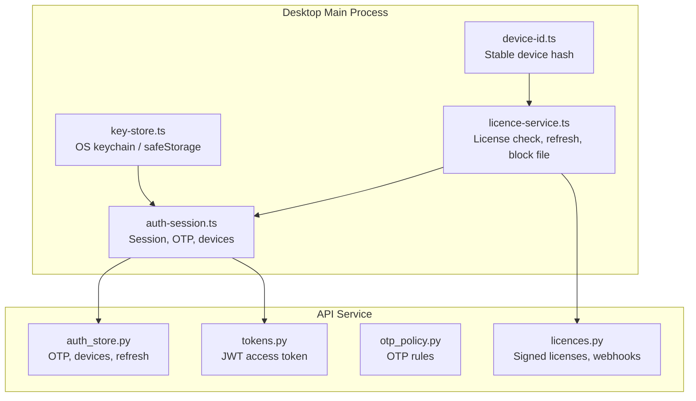
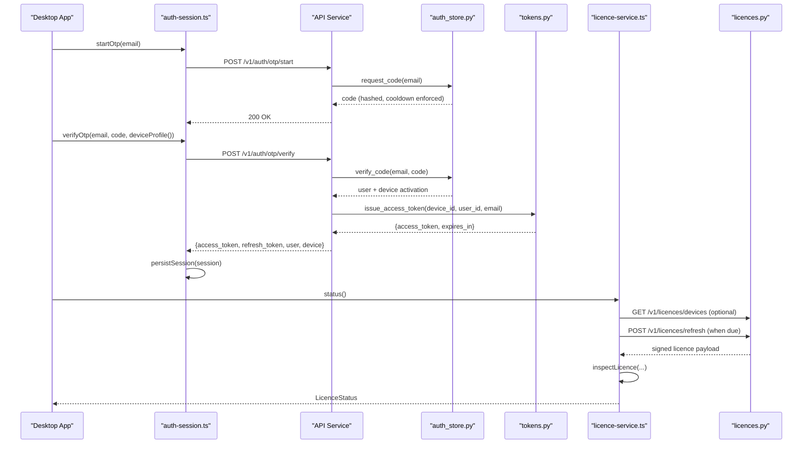
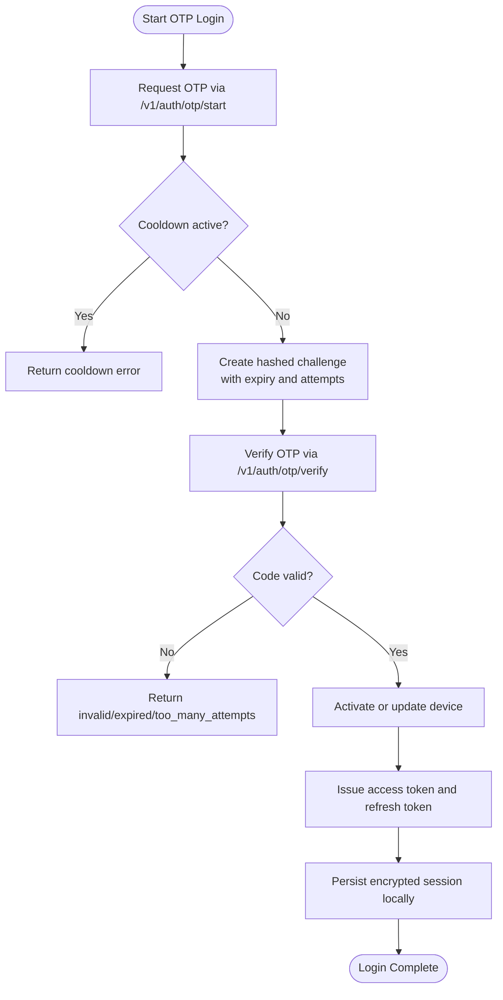
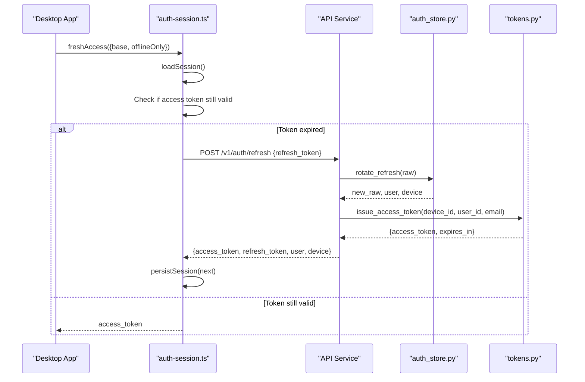
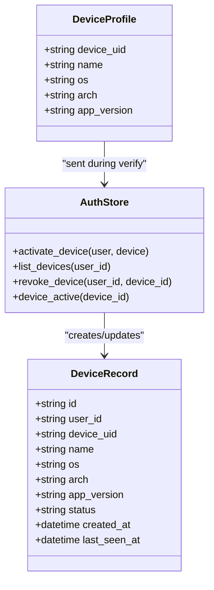
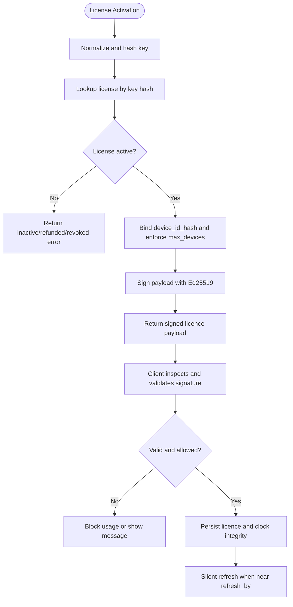
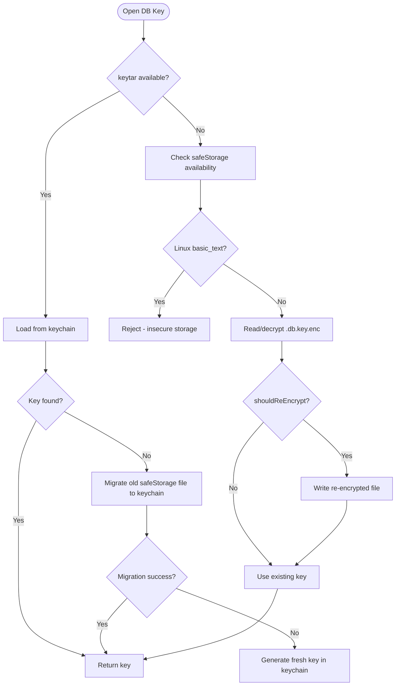
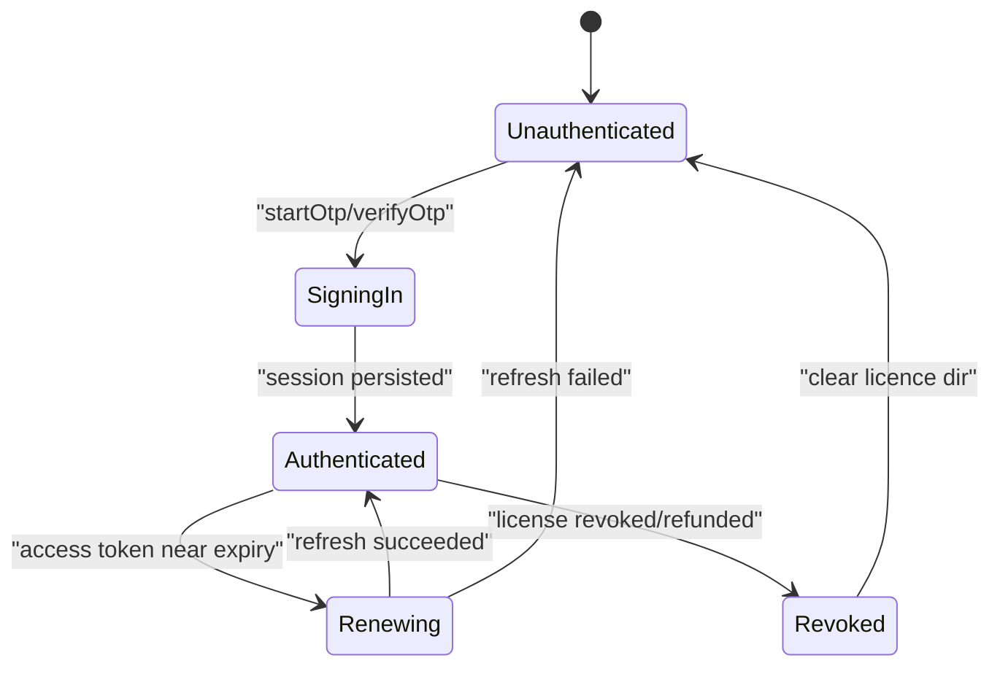
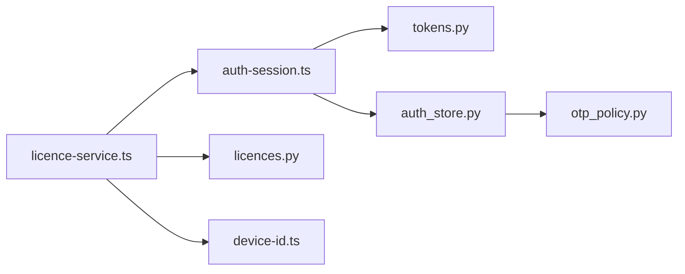

# Authentication & Authorization

<cite>
**Referenced Files in This Document**
- [auth-session.ts](file://apps/desktop/src/main/core/auth-session.ts)
- [key-store.ts](file://apps/desktop/src/main/core/key-store.ts)
- [licence-service.ts](file://apps/desktop/src/main/core/licence-service.ts)
- [device-id.ts](file://apps/desktop/src/main/core/device-id.ts)
- [auth_store.py](file://services/api/app/auth_store.py)
- [tokens.py](file://services/api/app/tokens.py)
- [otp_policy.py](file://services/api/app/otp_policy.py)
- [licences.py](file://services/api/app/licences.py)
</cite>

## Table of Contents
1. [Introduction](#introduction)
2. [Project Structure](#project-structure)
3. [Core Components](#core-components)
4. [Architecture Overview](#architecture-overview)
5. [Detailed Component Analysis](#detailed-component-analysis)
6. [Dependency Analysis](#dependency-analysis)
7. [Performance Considerations](#performance-considerations)
8. [Troubleshooting Guide](#troubleshooting-guide)
9. [Conclusion](#conclusion)

## Introduction
This document explains the authentication, authorization, device binding, and licensing system that secures user sessions and gates premium features. It covers:
- Email-based OTP login flow
- JWT access tokens and rotating refresh tokens
- Device registration and management
- License key validation and signed license payloads
- Secure local storage for sensitive keys
- Session persistence, automatic renewal, and graceful degradation when cloud services are unavailable
- Security best practices for credentials and error handling

## Project Structure
The authentication and authorization logic spans the desktop application and the API service:
- Desktop main process handles secure session storage, device identity, license verification, and network calls.
- API service implements OTP challenges, JWT issuance, refresh rotation, device management, and license signing/validation.

**Diagram sources**
- [auth-session.ts:1-213](file://apps/desktop/src/main/core/auth-session.ts#L1-L213)
- [key-store.ts:1-89](file://apps/desktop/src/main/core/key-store.ts#L1-L89)
- [licence-service.ts:1-326](file://apps/desktop/src/main/core/licence-service.ts#L1-L326)
- [device-id.ts:1-15](file://apps/desktop/src/main/core/device-id.ts#L1-L15)
- [auth_store.py:1-454](file://services/api/app/auth_store.py#L1-L454)
- [tokens.py:1-41](file://services/api/app/tokens.py#L1-L41)
- [otp_policy.py:1-73](file://services/api/app/otp_policy.py#L1-L73)
- [licences.py:1-536](file://services/api/app/licences.py#L1-L536)

**Section sources**
- [auth-session.ts:1-213](file://apps/desktop/src/main/core/auth-session.ts#L1-L213)
- [auth_store.py:1-454](file://services/api/app/auth_store.py#L1-L454)
- [tokens.py:1-41](file://services/api/app/tokens.py#L1-L41)
- [otp_policy.py:1-73](file://services/api/app/otp_policy.py#L1-L73)
- [licence-service.ts:1-326](file://apps/desktop/src/main/core/licence-service.ts#L1-L326)
- [licences.py:1-536](file://services/api/app/licences.py#L1-L536)
- [device-id.ts:1-15](file://apps/desktop/src/main/core/device-id.ts#L1-L15)
- [key-store.ts:1-89](file://apps/desktop/src/main/core/key-store.ts#L1-L89)

## Core Components
- Email OTP login: The desktop app requests a code, verifies it with the server, and receives a session containing an access token and a refresh token.
- JWT access tokens: Short-lived HS256 tokens bound to a device identifier; used to authorize protected endpoints.
- Refresh tokens: Long-lived, hashed, and rotated on use; family-based revocation prevents reuse.
- Device registration: Each machine is registered with a stable device hash and OS metadata; active device limits are enforced by plan/license.
- License validation: Signed Ed25519 license payloads include features, expiration, and subscription terms; client validates offline and refreshes online.
- Secure storage: Database encryption keys are stored in the OS keychain or Electron safeStorage; session tokens are encrypted at rest.

**Section sources**
- [auth-session.ts:16-24](file://apps/desktop/src/main/core/auth-session.ts#L16-L24)
- [tokens.py:17-29](file://services/api/app/tokens.py#L17-L29)
- [auth_store.py:172-209](file://services/api/app/auth_store.py#L172-L209)
- [auth_store.py:111-156](file://services/api/app/auth_store.py#L111-L156)
- [licences.py:87-105](file://services/api/app/licences.py#L87-L105)
- [licence-service.ts:144-168](file://apps/desktop/src/main/core/licence-service.ts#L144-L168)
- [key-store.ts:16-47](file://apps/desktop/src/main/core/key-store.ts#L16-L47)

## Architecture Overview
The system combines a stateless access token model with persistent refresh tokens and device-bound licenses.

**Diagram sources**
- [auth-session.ts:144-166](file://apps/desktop/src/main/core/auth-session.ts#L144-L166)
- [auth_store.py:55-109](file://services/api/app/auth_store.py#L55-L109)
- [tokens.py:17-29](file://services/api/app/tokens.py#L17-L29)
- [licence-service.ts:269-303](file://apps/desktop/src/main/core/licence-service.ts#L269-L303)
- [licences.py:321-332](file://services/api/app/licences.py#L321-L332)

## Detailed Component Analysis

### Email-Based OTP Login Flow
- The desktop app calls `startOtp` to request a six-digit code. The server enforces resend cooldowns and stores only a hashed code.
- On `verifyOtp`, the server checks format, expiry, attempts, and locks after too many failures. Successful verification activates or updates the device and returns a session.
- The desktop persists the session locally using platform encryption.

**Diagram sources**
- [auth-session.ts:144-166](file://apps/desktop/src/main/core/auth-session.ts#L144-L166)
- [auth_store.py:55-109](file://services/api/app/auth_store.py#L55-L109)
- [otp_policy.py:23-32](file://services/api/app/otp_policy.py#L23-L32)
- [otp_policy.py:59-72](file://services/api/app/otp_policy.py#L59-L72)

**Section sources**
- [auth-session.ts:144-166](file://apps/desktop/src/main/core/auth-session.ts#L144-L166)
- [auth_store.py:55-109](file://services/api/app/auth_store.py#L55-L109)
- [otp_policy.py:15-20](file://services/api/app/otp_policy.py#L15-L20)
- [otp_policy.py:53-72](file://services/api/app/otp_policy.py#L53-L72)

### JWT Token Management and Session Renewal
- Access tokens are short-lived HS256 JWTs with `sub=device_id`, `uid=user_id`, and audience `authenticated`.
- Refresh tokens are long-lived, hashed, and rotated on each use; reuse triggers family-wide revocation.
- The desktop automatically refreshes before expiry and clears the session on failure.

**Diagram sources**
- [auth-session.ts:96-133](file://apps/desktop/src/main/core/auth-session.ts#L96-L133)
- [auth_store.py:172-209](file://services/api/app/auth_store.py#L172-L209)
- [tokens.py:17-29](file://services/api/app/tokens.py#L17-L29)

**Section sources**
- [tokens.py:17-29](file://services/api/app/tokens.py#L17-L29)
- [auth_store.py:172-209](file://services/api/app/auth_store.py#L172-L209)
- [auth-session.ts:96-133](file://apps/desktop/src/main/core/auth-session.ts#L96-L133)

### Device Registration and Management
- The desktop generates a stable device profile including a hashed device ID, OS, architecture, and app version.
- The server activates the device, enforcing OS constraints and per-account active device limits.
- Clients can list and revoke devices remotely; revoking invalidates related refresh tokens.

**Diagram sources**
- [auth-session.ts:43-63](file://apps/desktop/src/main/core/auth-session.ts#L43-L63)
- [auth_store.py:111-156](file://services/api/app/auth_store.py#L111-L156)
- [auth_store.py:311-369](file://services/api/app/auth_store.py#L311-L369)

**Section sources**
- [auth-session.ts:43-63](file://apps/desktop/src/main/core/auth-session.ts#L43-L63)
- [auth_store.py:111-156](file://services/api/app/auth_store.py#L111-L156)
- [auth_store.py:311-369](file://services/api/app/auth_store.py#L311-L369)

### License Key Validation and Subscription Terms
- License keys are normalized and hashed; activation binds a device hash to a license and issues a signed payload.
- The signed payload includes features, plan, refresh window, expiration, and subscription end date.
- The desktop inspects and validates the signature, enforces time windows, and refreshes silently when needed.

**Diagram sources**
- [licences.py:108-127](file://services/api/app/licences.py#L108-L127)
- [licences.py:279-296](file://services/api/app/licences.py#L279-L296)
- [licences.py:87-105](file://services/api/app/licences.py#L87-L105)
- [licence-service.ts:144-168](file://apps/desktop/src/main/core/licence-service.ts#L144-L168)
- [licence-service.ts:269-303](file://apps/desktop/src/main/core/licence-service.ts#L269-L303)

**Section sources**
- [licences.py:87-105](file://services/api/app/licences.py#L87-L105)
- [licences.py:108-127](file://services/api/app/licences.py#L108-L127)
- [licences.py:279-296](file://services/api/app/licences.py#L279-L296)
- [licence-service.ts:144-168](file://apps/desktop/src/main/core/licence-service.ts#L144-L168)
- [licence-service.ts:269-303](file://apps/desktop/src/main/core/licence-service.ts#L269-L303)

### Secure Key Storage Mechanism
- Database encryption keys prefer the OS keychain via `keytar`; otherwise, they fall back to Electron `safeStorage` encryption. Linux without secret service is rejected for DB keys.
- Session tokens are also encrypted at rest using `safeStorage`, with memory caching for the current launch.

**Diagram sources**
- [key-store.ts:16-47](file://apps/desktop/src/main/core/key-store.ts#L16-L47)
- [key-store.ts:49-83](file://apps/desktop/src/main/core/key-store.ts#L49-L83)
- [auth-session.ts:65-89](file://apps/desktop/src/main/core/auth-session.ts#L65-L89)

**Section sources**
- [key-store.ts:16-47](file://apps/desktop/src/main/core/key-store.ts#L16-L47)
- [key-store.ts:49-83](file://apps/desktop/src/main/core/key-store.ts#L49-L83)
- [auth-session.ts:65-89](file://apps/desktop/src/main/core/auth-session.ts#L65-L89)

### Session Persistence, Automatic Renewal, and Graceful Degradation
- Sessions are persisted securely and loaded on startup; if unreadable, the app treats the user as not signed in.
- Access tokens are refreshed automatically before expiry; refresh failures clear the session.
- License refresh runs silently; if the license is revoked or refunded, the app clears the license and writes a block file to prevent further use.

**Diagram sources**
- [auth-session.ts:96-133](file://apps/desktop/src/main/core/auth-session.ts#L96-L133)
- [licence-service.ts:269-303](file://apps/desktop/src/main/core/licence-service.ts#L269-L303)

**Section sources**
- [auth-session.ts:96-133](file://apps/desktop/src/main/core/auth-session.ts#L96-L133)
- [licence-service.ts:269-303](file://apps/desktop/src/main/core/licence-service.ts#L269-L303)

## Dependency Analysis

**Diagram sources**
- [auth-session.ts:1-213](file://apps/desktop/src/main/core/auth-session.ts#L1-L213)
- [tokens.py:1-41](file://services/api/app/tokens.py#L1-L41)
- [auth_store.py:1-454](file://services/api/app/auth_store.py#L1-L454)
- [licence-service.ts:1-326](file://apps/desktop/src/main/core/licence-service.ts#L1-L326)
- [licences.py:1-536](file://services/api/app/licences.py#L1-L536)
- [device-id.ts:1-15](file://apps/desktop/src/main/core/device-id.ts#L1-L15)
- [otp_policy.py:1-73](file://services/api/app/otp_policy.py#L1-L73)

**Section sources**
- [auth-session.ts:1-213](file://apps/desktop/src/main/core/auth-session.ts#L1-L213)
- [tokens.py:1-41](file://services/api/app/tokens.py#L1-L41)
- [auth_store.py:1-454](file://services/api/app/auth_store.py#L1-L454)
- [licence-service.ts:1-326](file://apps/desktop/src/main/core/licence-service.ts#L1-L326)
- [licences.py:1-536](file://services/api/app/licences.py#L1-L536)
- [device-id.ts:1-15](file://apps/desktop/src/main/core/device-id.ts#L1-L15)
- [otp_policy.py:1-73](file://services/api/app/otp_policy.py#L1-L73)

## Performance Considerations
- OTP operations are lightweight and bounded by small constants (code length, attempt limit).
- Refresh token rotation uses hashed lookups and avoids repeated full scans.
- License inspection is local and fast; network calls occur only for activation, refresh, and device listing.
- Avoid unnecessary network calls by caching device hashes and checking local license validity first.

[No sources needed since this section provides general guidance]

## Troubleshooting Guide
Common errors and their meanings:
- OTP resend cooldown: Wait before requesting another code.
- Invalid or expired OTP: Request a new code; too many attempts lock the challenge.
- Invalid refresh token or reused refresh token: Sign in again; family revocation may have invalidated all tokens.
- Device revoked or device limit exceeded: Remove a device or upgrade plan.
- License invalid, revoked, refunded, or inactive: Clear local license data and reactivate; check payment provider webhooks.
- OS secure storage unavailable: On Linux without secret service, database key protection is rejected; consider macOS/Windows or install libsecret/kwallet.

Operational tips:
- If sign-in fails due to network, ensure the app is not in offline-only mode.
- After revoking a device remotely, the app clears its session if it was the current device.
- When license refresh fails due to revocation/refund, the app writes a block file to prevent continued use until resolved.

**Section sources**
- [auth_store.py:55-109](file://services/api/app/auth_store.py#L55-L109)
- [auth_store.py:172-209](file://services/api/app/auth_store.py#L172-L209)
- [auth_store.py:111-156](file://services/api/app/auth_store.py#L111-L156)
- [licences.py:266-277](file://services/api/app/licences.py#L266-L277)
- [licence-service.ts:269-303](file://apps/desktop/src/main/core/licence-service.ts#L269-L303)
- [key-store.ts:33-47](file://apps/desktop/src/main/core/key-store.ts#L33-L47)

## Conclusion
The system provides a robust, secure authentication and authorization experience:
- OTP login ensures secure, passwordless sign-in with rate limiting and hashing.
- JWT access tokens and rotating refresh tokens maintain secure sessions with automatic renewal.
- Device registration binds accounts to specific machines with plan-enforced limits.
- Signed license payloads gate premium features and enforce subscription terms, with offline validation and silent refresh.
- Platform-specific secure storage protects sensitive keys, while graceful degradation keeps the app usable when cloud services are unavailable.

[No sources needed since this section summarizes without analyzing specific files]