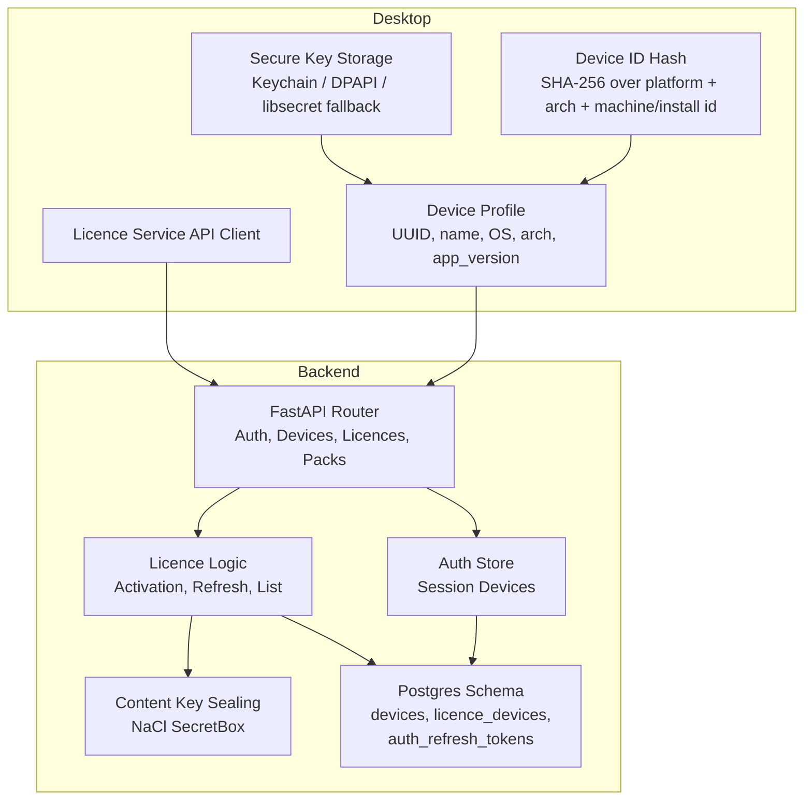
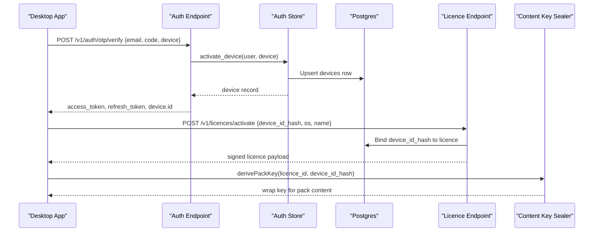
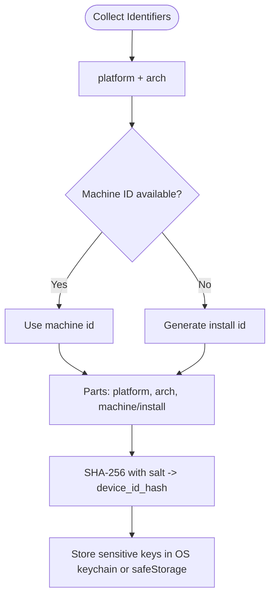
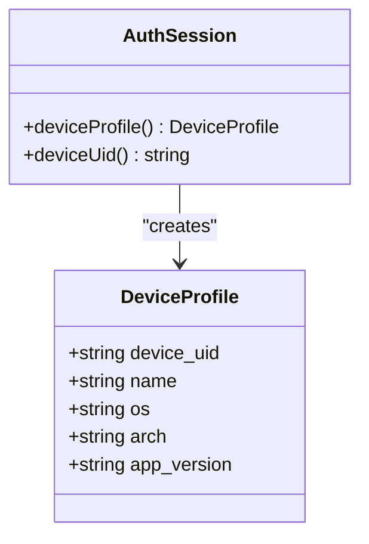
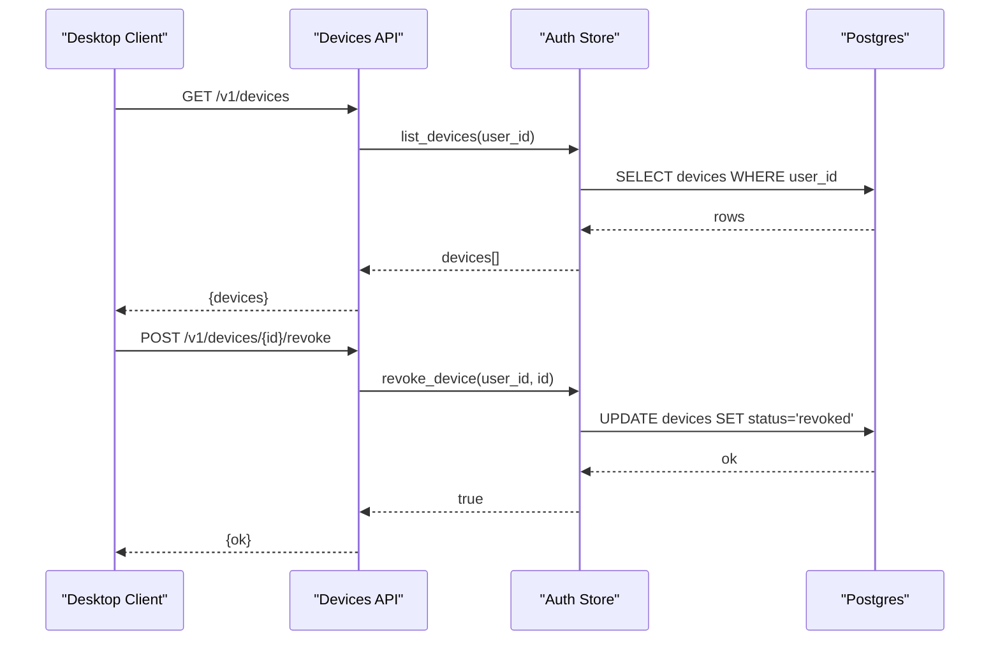
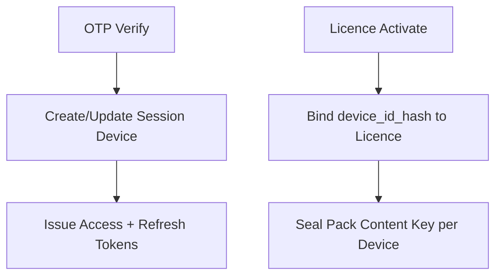
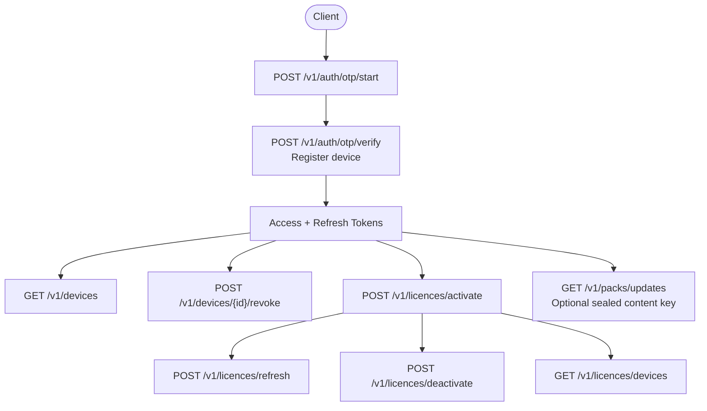
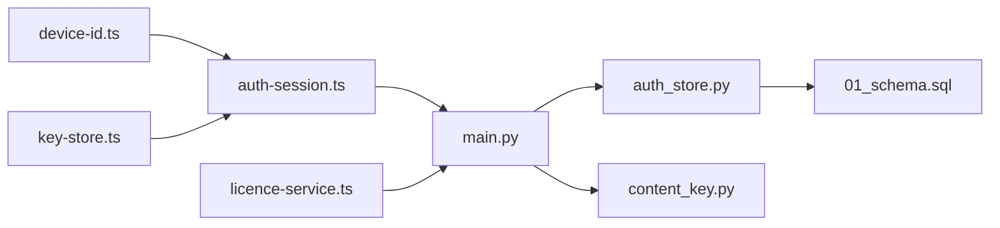

# Device Registration & Management

<cite>
**Referenced Files in This Document**
- [device-id.ts](file://apps/desktop/src/main/core/device-id.ts)
- [key-store.ts](file://apps/desktop/src/main/core/key-store.ts)
- [auth-session.ts](file://apps/desktop/src/main/core/auth-session.ts)
- [licence-service.ts](file://apps/desktop/src/main/core/licence-service.ts)
- [main.py](file://services/api/app/main.py)
- [auth_store.py](file://services/api/app/auth_store.py)
- [content_key.py](file://services/api/app/content_key.py)
- [01_schema.sql](file://deploy/initdb/01_schema.sql)
</cite>

## Table of Contents
1. [Introduction](#introduction)
2. [Project Structure](#project-structure)
3. [Core Components](#core-components)
4. [Architecture Overview](#architecture-overview)
5. [Detailed Component Analysis](#detailed-component-analysis)
6. [Dependency Analysis](#dependency-analysis)
7. [Performance Considerations](#performance-considerations)
8. [Troubleshooting Guide](#troubleshooting-guide)
9. [Conclusion](#conclusion)

## Introduction
This document explains the device registration and management system used by the desktop application and backend API. It covers how stable, platform-aware device identifiers are generated, how device profiles are created during login, how devices are listed and revoked, and how user accounts are bound to specific machines through both session-based device records and licence-bound device hashes. It also documents security considerations for platform-specific key storage and best practices for managing multiple devices per account.

## Project Structure
The device system spans two layers:

- Desktop layer (Electron main process):
  - Generates a persistent device UUID and a cryptographic device identifier hash from machine attributes.
  - Stores sensitive keys using OS secure storage.
  - Builds a device profile with OS, architecture, and app version.
  - Calls backend endpoints for authentication, device listing, revocation, and licence activation.

- Backend layer (FastAPI service):
  - Registers and manages session-bound devices during OTP verification.
  - Manages licence-bound devices via dedicated endpoints.
  - Seals content keys per device using a deterministic wrap key derived from licence and device identity.

**Diagram sources**
- [device-id.ts:1-14](file://apps/desktop/src/main/core/device-id.ts#L1-L14)
- [auth-session.ts:43-63](file://apps/desktop/src/main/core/auth-session.ts#L43-L63)
- [key-store.ts:1-47](file://apps/desktop/src/main/core/key-store.ts#L1-L47)
- [main.py:204-216](file://services/api/app/main.py#L204-L216)
- [auth_store.py:111-140](file://services/api/app/auth_store.py#L111-L140)
- [content_key.py:24-46](file://services/api/app/content_key.py#L24-L46)
- [01_schema.sql:65-81](file://deploy/initdb/01_schema.sql#L65-L81)

**Section sources**
- [device-id.ts:1-14](file://apps/desktop/src/main/core/device-id.ts#L1-L14)
- [auth-session.ts:43-63](file://apps/desktop/src/main/core/auth-session.ts#L43-L63)
- [key-store.ts:1-47](file://apps/desktop/src/main/core/key-store.ts#L1-L47)
- [main.py:204-216](file://services/api/app/main.py#L204-L216)
- [auth_store.py:111-140](file://services/api/app/auth_store.py#L111-L140)
- [content_key.py:24-46](file://services/api/app/content_key.py#L24-L46)
- [01_schema.sql:65-81](file://deploy/initdb/01_schema.sql#L65-L81)

## Core Components
- Stable device identifier hashing:
  - The desktop computes a SHA-256 hash from platform, architecture, and a stable machine or install identifier. Raw identifiers are never stored in licence files.
- Secure local key storage:
  - Database encryption keys are preferredly stored in the OS keychain; otherwise, Electron safeStorage is used with strict checks on Linux.
- Device profile creation:
  - A profile includes a persistent device UUID, a friendly name, OS, architecture, and app version.
- Session device lifecycle:
  - During OTP verification, the backend activates or reuses a session device record, enforces plan limits, and issues rotating refresh tokens tied to the device.
- Licence device binding:
  - Licence activation binds a hashed device identifier to a licence, allowing per-device content sealing and revocation.
- Content key sealing:
  - Pack content keys are sealed per device using a deterministic wrap key derived from licence ID and device hash.

**Section sources**
- [device-id.ts:1-14](file://apps/desktop/src/main/core/device-id.ts#L1-L14)
- [key-store.ts:1-47](file://apps/desktop/src/main/core/key-store.ts#L1-L47)
- [auth-session.ts:54-63](file://apps/desktop/src/main/core/auth-session.ts#L54-L63)
- [main.py:258-268](file://services/api/app/main.py#L258-L268)
- [auth_store.py:111-140](file://services/api/app/auth_store.py#L111-L140)
- [licence-service.ts:74-80](file://apps/desktop/src/main/core/licence-service.ts#L74-L80)
- [content_key.py:24-46](file://services/api/app/content_key.py#L24-L46)

## Architecture Overview
The system separates two device concepts:

- Session devices:
  - Created at login via OTP verification.
  - Represent active machines associated with a user account.
  - Used for access token issuance and rate limiting.

- Licence devices:
  - Bound to a signed licence by hashed device identifier.
  - Used to seal content keys and enforce licence device limits.

**Diagram sources**
- [main.py:258-268](file://services/api/app/main.py#L258-L268)
- [auth_store.py:311-341](file://services/api/app/auth_store.py#L311-L341)
- [01_schema.sql:65-81](file://deploy/initdb/01_schema.sql#L65-L81)
- [licence-service.ts:208-223](file://apps/desktop/src/main/core/licence-service.ts#L208-L223)
- [content_key.py:24-46](file://services/api/app/content_key.py#L24-L46)

## Detailed Component Analysis

### Device Identifier Generation and Storage
- Hashing strategy:
  - Combine platform, architecture, and a stable machine identifier when available; otherwise use an install identifier.
  - Apply a salted SHA-256 to produce a stable hex identifier suitable for signing and server binding.
- Local secure storage:
  - Prefer OS keychain via keytar; migrate legacy encrypted file if present.
  - Fallback to Electron safeStorage with strong availability checks; reject weak Linux basic text storage for database keys.

**Diagram sources**
- [device-id.ts:10-14](file://apps/desktop/src/main/core/device-id.ts#L10-L14)
- [licence-service.ts:40-80](file://apps/desktop/src/main/core/licence-service.ts#L40-L80)
- [key-store.ts:16-47](file://apps/desktop/src/main/core/key-store.ts#L16-L47)

**Section sources**
- [device-id.ts:1-14](file://apps/desktop/src/main/core/device-id.ts#L1-L14)
- [licence-service.ts:40-80](file://apps/desktop/src/main/core/licence-service.ts#L40-L80)
- [key-store.ts:16-47](file://apps/desktop/src/main/core/key-store.ts#L16-L47)

### Device Profile Creation
- The desktop builds a device profile including:
  - device_uid: persistent UUID stored locally.
  - name: friendly name derived from hostname.
  - os: normalized OS string.
  - arch: CPU architecture.
  - app_version: current application version.
- This profile is sent during OTP verification to register or update the session device.

**Diagram sources**
- [auth-session.ts:43-63](file://apps/desktop/src/main/core/auth-session.ts#L43-L63)

**Section sources**
- [auth-session.ts:43-63](file://apps/desktop/src/main/core/auth-session.ts#L43-L63)

### Device Lifecycle: Registration, Listing, Revocation
- Registration:
  - Occurs at OTP verification. If the device UID exists and is active, last seen time and name are updated. Otherwise, a new device row is inserted subject to plan limits.
- Listing:
  - Returns all devices for the authenticated user, ordered by creation time.
- Revocation:
  - Marks a device as revoked and invalidates related refresh tokens.

**Diagram sources**
- [main.py:294-305](file://services/api/app/main.py#L294-L305)
- [auth_store.py:343-361](file://services/api/app/auth_store.py#L343-L361)
- [01_schema.sql:65-81](file://deploy/initdb/01_schema.sql#L65-L81)

**Section sources**
- [main.py:294-305](file://services/api/app/main.py#L294-L305)
- [auth_store.py:343-361](file://services/api/app/auth_store.py#L343-L361)

### Device Binding Mechanism: User Accounts to Machines
- Two binding mechanisms coexist:
  - Session binding:
    - Associates a user with a device record during login.
    - Enforces per-user active device limits.
  - Licence binding:
    - Associates a hashed device identifier with a signed licence.
    - Controls content key sealing and licence device limits.

**Diagram sources**
- [main.py:258-268](file://services/api/app/main.py#L258-L268)
- [auth_store.py:111-140](file://services/api/app/auth_store.py#L111-L140)
- [licence-service.ts:208-223](file://apps/desktop/src/main/core/licence-service.ts#L208-L223)
- [content_key.py:49-62](file://services/api/app/content_key.py#L49-L62)

**Section sources**
- [main.py:258-268](file://services/api/app/main.py#L258-L268)
- [auth_store.py:111-140](file://services/api/app/auth_store.py#L111-L140)
- [licence-service.ts:208-223](file://apps/desktop/src/main/core/licence-service.ts#L208-L223)
- [content_key.py:49-62](file://services/api/app/content_key.py#L49-L62)

### Device Management API Endpoints and Usage Patterns
- Authentication and device registration:
  - POST /v1/auth/otp/start: initiate email code flow.
  - POST /v1/auth/otp/verify: verify code and register/update device; returns tokens and device info.
  - POST /v1/auth/refresh: rotate refresh token and return new session.
  - POST /v1/auth/logout: revoke refresh token.
- Device management:
  - GET /v1/devices: list devices for the authenticated user.
  - POST /v1/devices/{device_id}/revoke: revoke a device.
  - POST /v1/devices/register: deprecated; redirects to login flow.
- Licence device management:
  - POST /v1/licences/activate: bind device_id_hash to a licence; returns signed licence.
  - POST /v1/licences/refresh: refresh licence validity for a device.
  - POST /v1/licences/deactivate: deactivate a licence or remove a device binding.
  - GET /v1/licences/devices: list licence-bound devices.
- Content delivery:
  - GET /v1/packs/updates: returns updates and optionally seals content key for the requesting device.

**Diagram sources**
- [main.py:238-268](file://services/api/app/main.py#L238-L268)
- [main.py:294-305](file://services/api/app/main.py#L294-L305)
- [main.py:308-310](file://services/api/app/main.py#L308-L310)
- [main.py:513-551](file://services/api/app/main.py#L513-L551)
- [main.py:319-338](file://services/api/app/main.py#L319-L338)

**Section sources**
- [main.py:238-268](file://services/api/app/main.py#L238-L268)
- [main.py:294-305](file://services/api/app/main.py#L294-L305)
- [main.py:308-310](file://services/api/app/main.py#L308-L310)
- [main.py:513-551](file://services/api/app/main.py#L513-L551)
- [main.py:319-338](file://services/api/app/main.py#L319-L338)

### Security Implications and Best Practices
- Device identifier privacy:
  - Only hashed identifiers are sent to the backend and included in licences; raw hardware IDs are not persisted in licence files.
- Secure local storage:
  - Prefer OS keychain; fall back to safeStorage only when securely available. Reject weak Linux basic text storage for database keys.
- Token rotation and revocation:
  - Refresh tokens are rotated and family-scoped; reuse is rejected. Revoking a device invalidates its refresh tokens.
- Plan and licence limits:
  - Enforce maximum active devices per user and per licence; require revocation before adding new devices.
- Content key sealing:
  - Seal pack content keys per device using a deterministic wrap key derived from licence ID and device hash; never transmit raw content keys.

**Section sources**
- [device-id.ts:1-14](file://apps/desktop/src/main/core/device-id.ts#L1-L14)
- [key-store.ts:16-47](file://apps/desktop/src/main/core/key-store.ts#L16-L47)
- [auth_store.py:111-140](file://services/api/app/auth_store.py#L111-L140)
- [auth_store.py:352-361](file://services/api/app/auth_store.py#L352-L361)
- [content_key.py:24-46](file://services/api/app/content_key.py#L24-L46)

## Dependency Analysis
The following diagram shows core dependencies between components involved in device registration and management.

**Diagram sources**
- [device-id.ts:1-14](file://apps/desktop/src/main/core/device-id.ts#L1-L14)
- [auth-session.ts:43-63](file://apps/desktop/src/main/core/auth-session.ts#L43-L63)
- [key-store.ts:1-47](file://apps/desktop/src/main/core/key-store.ts#L1-L47)
- [main.py:258-268](file://services/api/app/main.py#L258-L268)
- [auth_store.py:111-140](file://services/api/app/auth_store.py#L111-L140)
- [content_key.py:24-46](file://services/api/app/content_key.py#L24-L46)
- [01_schema.sql:65-81](file://deploy/initdb/01_schema.sql#L65-L81)
- [licence-service.ts:208-223](file://apps/desktop/src/main/core/licence-service.ts#L208-L223)

**Section sources**
- [device-id.ts:1-14](file://apps/desktop/src/main/core/device-id.ts#L1-L14)
- [auth-session.ts:43-63](file://apps/desktop/src/main/core/auth-session.ts#L43-L63)
- [key-store.ts:1-47](file://apps/desktop/src/main/core/key-store.ts#L1-L47)
- [main.py:258-268](file://services/api/app/main.py#L258-L268)
- [auth_store.py:111-140](file://services/api/app/auth_store.py#L111-L140)
- [content_key.py:24-46](file://services/api/app/content_key.py#L24-L46)
- [01_schema.sql:65-81](file://deploy/initdb/01_schema.sql#L65-L81)
- [licence-service.ts:208-223](file://apps/desktop/src/main/core/licence-service.ts#L208-L223)

## Performance Considerations
- Device lookup and activation:
  - Uses indexed queries on user_id and device_uid; active device counts are computed efficiently.
- Token rotation:
  - Rotating refresh tokens avoids repeated full logins while maintaining security.
- Content key sealing:
  - Deterministic wrap key derivation enables efficient per-device sealing without storing secrets.

[No sources needed since this section provides general guidance]

## Troubleshooting Guide
- Invalid OS value:
  - Ensure the device profile sends one of macos, windows, or linux.
- Device limit exceeded:
  - Revoke an existing device before registering a new one.
- Revoked device errors:
  - Remove the revoked device from the account or sign in from another machine.
- Secure storage unavailable:
  - On Linux, ensure libsecret is installed or that safeStorage encryption is available; otherwise, database key protection will fail.

**Section sources**
- [auth_store.py:111-140](file://services/api/app/auth_store.py#L111-L140)
- [auth_store.py:311-341](file://services/api/app/auth_store.py#L311-L341)
- [key-store.ts:33-47](file://apps/desktop/src/main/core/key-store.ts#L33-L47)

## Conclusion
The device registration and management system combines stable, privacy-preserving device identifiers with platform-specific secure storage to protect sensitive keys. Session devices enable login and access control, while licence devices bind machines to signed licences and enable per-device content sealing. The API endpoints provide clear workflows for registration, listing, revocation, and licence management, with robust error handling and limits to maintain security and usability across multiple devices per account.