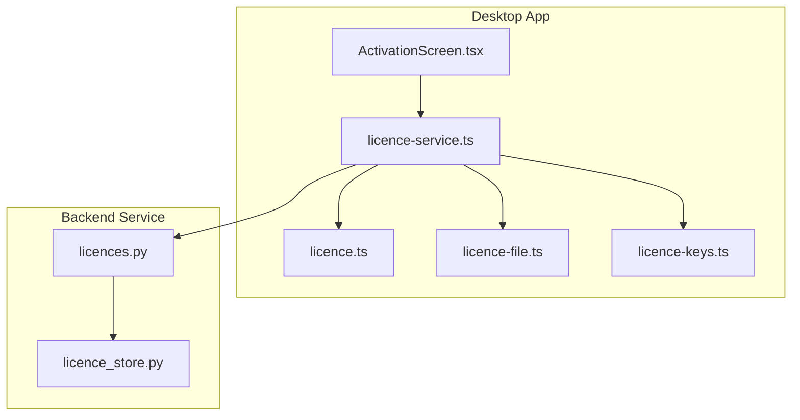
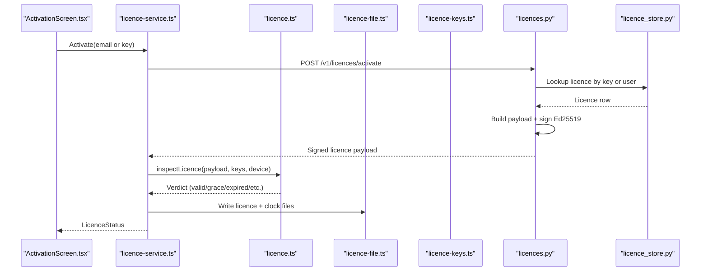
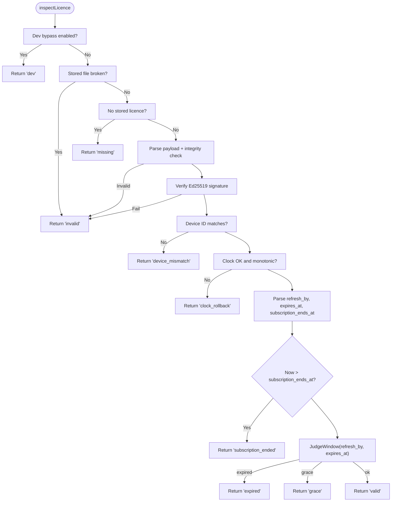
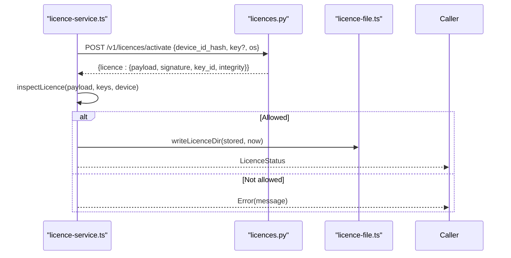
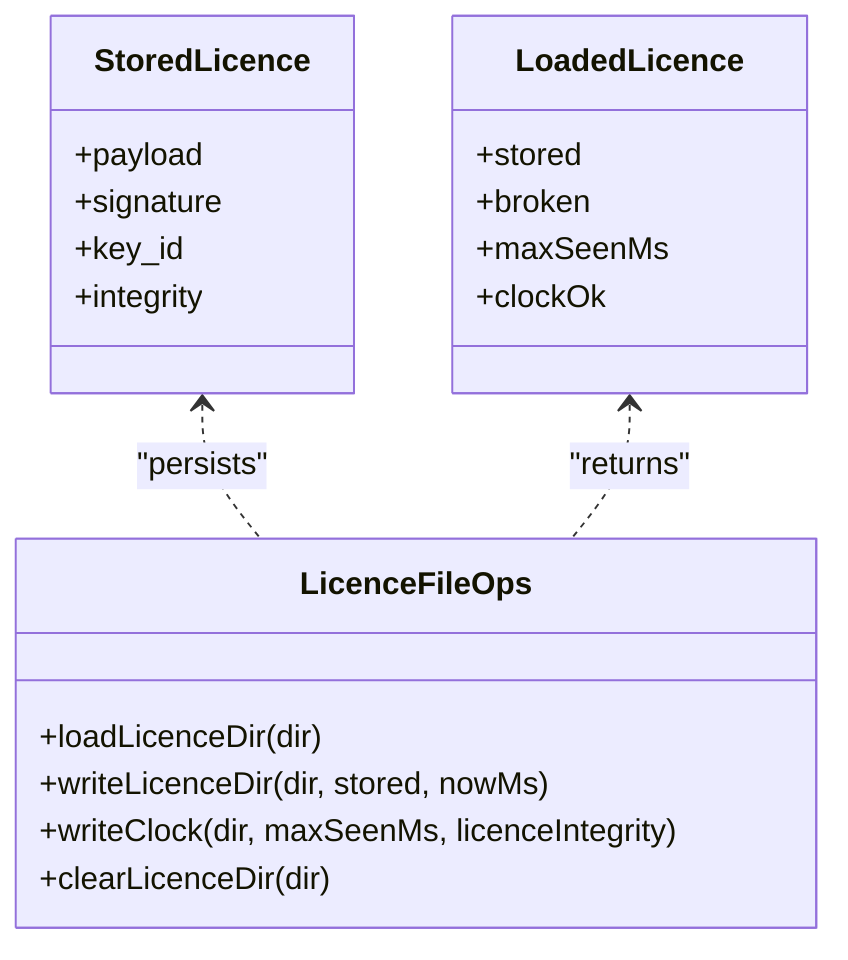
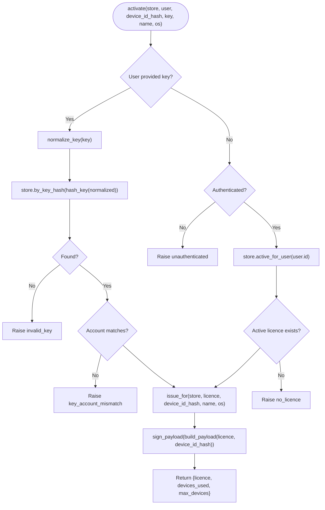
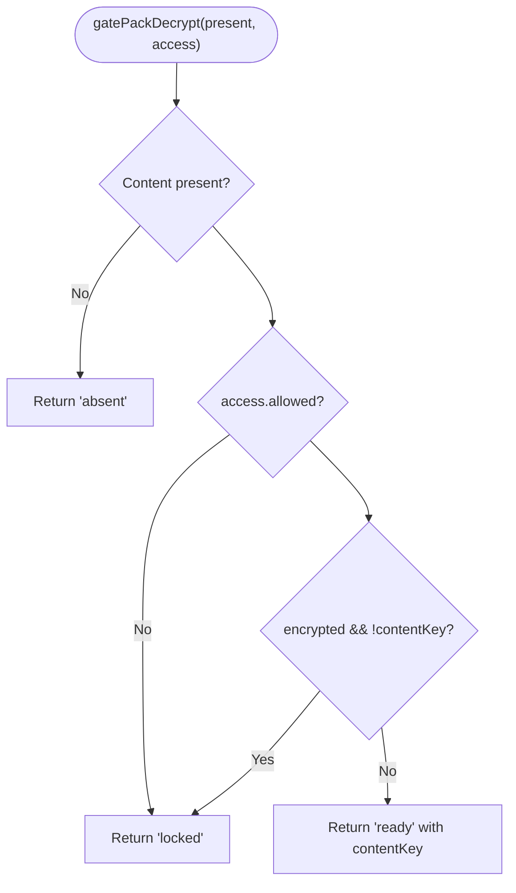
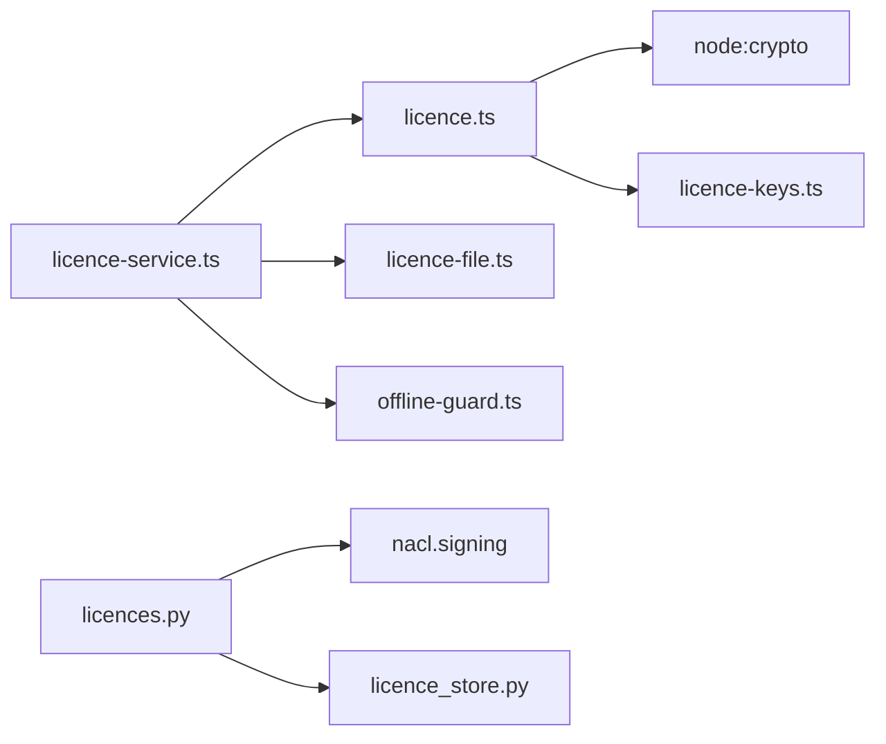

# License Management

<cite>
**Referenced Files in This Document**
- [licence.ts](file://apps/desktop/src/main/core/licence.ts)
- [licence-service.ts](file://apps/desktop/src/main/core/licence-service.ts)
- [licence-keys.ts](file://apps/desktop/src/main/core/licence-keys.ts)
- [licence-file.ts](file://apps/desktop/src/main/core/licence-file.ts)
- [licences.py](file://services/api/app/licences.py)
- [licence_store.py](file://services/api/app/licence_store.py)
- [ActivationScreen.tsx](file://apps/desktop/src/renderer/src/screens/ActivationScreen.tsx)
</cite>

## Table of Contents
1. [Introduction](#introduction)
2. [Project Structure](#project-structure)
3. [Core Components](#core-components)
4. [Architecture Overview](#architecture-overview)
5. [Detailed Component Analysis](#detailed-component-analysis)
6. [Dependency Analysis](#dependency-analysis)
7. [Performance Considerations](#performance-considerations)
8. [Troubleshooting Guide](#troubleshooting-guide)
9. [Conclusion](#conclusion)

## Introduction
This document explains the license management system that controls access to premium capabilities in the desktop application. It covers:
- License key validation and cryptographic signature verification using Ed25519.
- Subscription term enforcement, grace periods, and offline checks.
- Feature gating for premium capabilities based on license state.
- Secure local storage of signed license payloads and clock integrity protection.
- Activation, refresh, deactivation flows, and error handling.
- API endpoints used by the desktop app and their integration with the backend service.
- Offline validation, fallback behavior when servers are unavailable, and device binding.

## Project Structure
The license system spans the desktop main process, renderer UI, and backend service:
- Desktop main process:
  - Core logic for offline license inspection, device hashing, and secure file storage.
  - Service layer exposing activation, status, refresh, and content key operations.
  - Public key loading from packaged resources.
- Renderer UI:
  - Activation screen for sign-in code flow and manual license key entry.
- Backend service:
  - License key issuance, signing, subscription term management, device tracking, and webhooks.
  - Storage abstraction supporting memory and Postgres backends.

**Diagram sources**
- [ActivationScreen.tsx:1-125](file://apps/desktop/src/renderer/src/screens/ActivationScreen.tsx#L1-L125)
- [licence-service.ts:1-326](file://apps/desktop/src/main/core/licence-service.ts#L1-L326)
- [licence.ts:1-226](file://apps/desktop/src/main/core/licence.ts#L1-L226)
- [licence-file.ts:1-66](file://apps/desktop/src/main/core/licence-file.ts#L1-L66)
- [licence-keys.ts:1-18](file://apps/desktop/src/main/core/licence-keys.ts#L1-L18)
- [licences.py:1-536](file://services/api/app/licences.py#L1-L536)
- [licence_store.py:1-353](file://services/api/app/licence_store.py#L1-L353)

**Section sources**
- [licence-service.ts:1-326](file://apps/desktop/src/main/core/licence-service.ts#L1-L326)
- [licences.py:1-536](file://services/api/app/licences.py#L1-L536)

## Core Components
- Offline license inspection and verdict computation:
  - Canonical payload construction, integrity hashing, Ed25519 signature verification, device binding, clock skew detection, and window judgment (valid/grace/expired).
- License service:
  - Device ID collection, activation via backend, silent refresh, deactivation, device listing, feature gate helper, and content key derivation.
- Secure license storage:
  - Atomic writes for license and clock files, integrity-checked clock file to detect rollback or tampering.
- Trusted public keys:
  - Loading compiled public keys from packaged resources for offline verification.
- Backend license issuance and management:
  - Key normalization, Ed25519 signing, subscription term extension, device limits, activation/refresh/deactivate APIs, and webhook processing for payment providers.

**Section sources**
- [licence.ts:1-226](file://apps/desktop/src/main/core/licence.ts#L1-L226)
- [licence-service.ts:1-326](file://apps/desktop/src/main/core/licence-service.ts#L1-L326)
- [licence-file.ts:1-66](file://apps/desktop/src/main/core/licence-file.ts#L1-L66)
- [licence-keys.ts:1-18](file://apps/desktop/src/main/core/licence-keys.ts#L1-L18)
- [licences.py:1-536](file://services/api/app/licences.py#L1-L536)
- [licence_store.py:1-353](file://services/api/app/licence_store.py#L1-L353)

## Architecture Overview
The system uses a hybrid approach:
- The backend signs license payloads with an Ed25519 private key; the desktop verifies signatures using public keys bundled with the app.
- Local files store the signed payload and a separate clock integrity record to prevent time-based attacks.
- The desktop app can operate offline within a grace period after the refresh deadline, but subscription end dates lock the app strictly.

**Diagram sources**
- [ActivationScreen.tsx:1-125](file://apps/desktop/src/renderer/src/screens/ActivationScreen.tsx#L1-L125)
- [licence-service.ts:108-223](file://apps/desktop/src/main/core/licence-service.ts#L108-L223)
- [licence.ts:52-199](file://apps/desktop/src/main/core/licence.ts#L52-L199)
- [licence-file.ts:28-60](file://apps/desktop/src/main/core/licence-file.ts#L28-L60)
- [licence-keys.ts:7-17](file://apps/desktop/src/main/core/licence-keys.ts#L7-L17)
- [licences.py:279-318](file://services/api/app/licences.py#L279-L318)
- [licence_store.py:217-240](file://services/api/app/licence_store.py#L217-L240)

## Detailed Component Analysis

### Offline License Inspection and Signature Verification
- Canonicalization:
  - Payload fields are ordered and normalized before hashing to ensure deterministic canonical forms.
- Integrity and clock protection:
  - Integrity hash combines canonical payload and signature base64.
  - Clock integrity hash binds maxSeenMs timestamp to the license integrity to detect rollback or removal.
- Signature verification:
  - Uses Ed25519 verification against trusted public keys loaded from packaged resources.
- Device binding:
  - Device ID hash must match the stored value; mismatches result in device_mismatch state.
- Time windows:
  - Valid: before refresh_by.
  - Grace: between refresh_by and expires_at.
  - Expired: after expires_at.
- Subscription enforcement:
  - If current time exceeds subscription_ends_at, the app locks even offline; no extra grace beyond this date.
- Dev bypass:
  - Development builds may bypass licensing under specific flags; packaged builds ignore dev flags.

**Diagram sources**
- [licence.ts:52-199](file://apps/desktop/src/main/core/licence.ts#L52-L199)

**Section sources**
- [licence.ts:1-226](file://apps/desktop/src/main/core/licence.ts#L1-L226)

### License Service and Activation Flow
- Device ID collection:
  - Hashes platform, architecture, machine identifier, or install ID to produce a stable device fingerprint.
- Activation:
  - Calls backend to activate using either a license key or authenticated account.
  - Accepts server-signed payload, validates locally, and persists license and clock files.
- Silent refresh:
  - When online and in valid/grace/subscription_ended states, attempts to refresh license without user interaction.
  - Handles revocation/refund codes by clearing local license and writing a block message.
- Deactivation:
  - Removes device activation on backend and clears local license if applicable.
- Content key derivation:
  - Derives pack decryption key from license ID and device hash for gated content access.

**Diagram sources**
- [licence-service.ts:176-223](file://apps/desktop/src/main/core/licence-service.ts#L176-L223)
- [licences.py:299-318](file://services/api/app/licences.py#L299-L318)
- [licence-file.ts:50-60](file://apps/desktop/src/main/core/licence-file.ts#L50-L60)

**Section sources**
- [licence-service.ts:1-326](file://apps/desktop/src/main/core/licence-service.ts#L1-L326)

### Secure License Storage Implementation
- License file:
  - Stores signed payload, signature, key_id, and integrity hash.
- Clock file:
  - Stores maxSeenMs and integrity bound to license integrity to detect rollback or tampering.
- Atomic writes:
  - Writes to temporary files then renames to avoid partial writes.
- Clearing:
  - Removes both license and clock files during deactivation or revocation.

**Diagram sources**
- [licence-file.ts:1-66](file://apps/desktop/src/main/core/licence-file.ts#L1-L66)
- [licence.ts:30-35](file://apps/desktop/src/main/core/licence.ts#L30-L35)

**Section sources**
- [licence-file.ts:1-66](file://apps/desktop/src/main/core/licence-file.ts#L1-L66)

### Trusted Public Keys and Cryptographic Setup
- Public keys are loaded from packaged resources at runtime.
- The signing seed is never shipped; only public keys are embedded.
- Verification uses Ed25519 against these trusted keys.

**Section sources**
- [licence-keys.ts:1-18](file://apps/desktop/src/main/core/licence-keys.ts#L1-L18)
- [licence.ts:77-85](file://apps/desktop/src/main/core/licence.ts#L77-L85)

### Backend License Issuance and Term Enforcement
- Key normalization and hashing:
  - Normalizes user-entered keys and hashes them for lookup.
- Payload building:
  - Computes refresh_by and expires_at based on configured refresh and grace days.
  - Includes features list derived from plan configuration.
- Subscription term extension:
  - Extends subscription end date by term_months relative to later of now or current end.
- Device management:
  - Enforces maximum devices per license and tracks activations.
- Webhook processing:
  - Supports Stripe and Razorpay events to grant or refund licenses.

**Diagram sources**
- [licences.py:299-318](file://services/api/app/licences.py#L299-L318)
- [licences.py:279-296](file://services/api/app/licences.py#L279-L296)
- [licences.py:173-193](file://services/api/app/licences.py#L173-L193)

**Section sources**
- [licences.py:1-536](file://services/api/app/licences.py#L1-L536)

### Feature Gating Mechanism
- License state determines whether premium features are accessible.
- Pack decryption gate:
  - If license not allowed or content key missing for encrypted packs, returns locked status.
- Features array:
  - Derived from plan configuration and included in signed payload.

**Diagram sources**
- [licence.ts:216-225](file://apps/desktop/src/main/core/licence.ts#L216-L225)

**Section sources**
- [licence.ts:1-226](file://apps/desktop/src/main/core/licence.ts#L1-L226)

### License Activation Screen Integration
- The renderer provides two activation paths:
  - Sign-in flow: email input followed by six-digit code verification.
  - Manual license key entry.
- Displays license-related messages and renewal prompts when subscription has ended.
- Integrates with the main process via IPC contracts to trigger activation and display status.

**Section sources**
- [ActivationScreen.tsx:1-125](file://apps/desktop/src/renderer/src/screens/ActivationScreen.tsx#L1-L125)

## Dependency Analysis
- Desktop core depends on:
  - Crypto module for Ed25519 verification and hashing.
  - Filesystem for atomic license and clock file operations.
  - Electron app path resolution for packaged vs development resources.
- Backend depends on:
  - NaCl for Ed25519 signing and verification.
  - Database abstraction for license and device records.
  - Environment variables for signing key, refresh/grace days, and device limits.

**Diagram sources**
- [licence.ts:9-11](file://apps/desktop/src/main/core/licence.ts#L9-L11)
- [licence-service.ts:11-26](file://apps/desktop/src/main/core/licence-service.ts#L11-L26)
- [licences.py:20-21](file://services/api/app/licences.py#L20-L21)
- [licence_store.py:1-353](file://services/api/app/licence_store.py#L1-L353)

**Section sources**
- [licence.ts:1-226](file://apps/desktop/src/main/core/licence.ts#L1-L226)
- [licence-service.ts:1-326](file://apps/desktop/src/main/core/licence-service.ts#L1-L326)
- [licences.py:1-536](file://services/api/app/licences.py#L1-L536)

## Performance Considerations
- Offline checks are lightweight:
  - JSON parsing, SHA-256 hashing, and Ed25519 verification are fast operations.
- File I/O uses atomic writes to minimize corruption risk and reduce retries.
- Backend rate limiting and fixed-window counters protect against brute-force activation attempts.
- Subscription term calculations use simple arithmetic and timezone-aware datetime operations.

[No sources needed since this section provides general guidance]

## Troubleshooting Guide
Common license states and resolutions:
- Missing:
  - No license file found; activate via sign-in or enter a license key.
- Invalid:
  - Corrupted or tampered license file; re-activate or clear local data.
- Device mismatch:
  - License bound to another device; deactivate on other devices or contact support.
- Clock rollback:
  - System clock moved backwards or clock file removed; set correct time and restart.
- Expired:
  - Past grace period; connect to network to refresh or enter a new key.
- Subscription ended:
  - Strictly locked after subscription_ends_at; renew subscription.

Error handling patterns:
- Backend errors include structured codes such as invalid_key, licence_revoked, licence_refunded, device_limit, etc.
- Desktop handles revocation/refund by clearing local license and writing a block message.

**Section sources**
- [licence.ts:116-199](file://apps/desktop/src/main/core/licence.ts#L116-L199)
- [licence-service.ts:269-303](file://apps/desktop/src/main/core/licence-service.ts#L269-L303)
- [licences.py:30-33](file://services/api/app/licences.py#L30-L33)

## Conclusion
The license management system combines strong cryptographic verification with robust offline resilience. It enforces subscription terms strictly while allowing graceful operation during refresh windows. Secure local storage protects against tampering and clock manipulation. The backend manages license issuance, device limits, and subscription lifecycle through well-defined APIs and webhooks. Together, these components provide a reliable mechanism for controlling access to premium features across platforms.