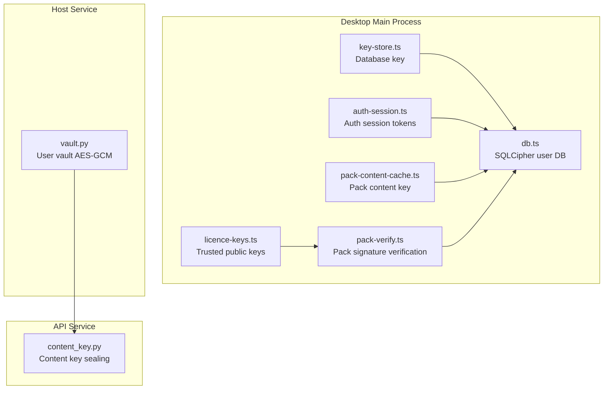
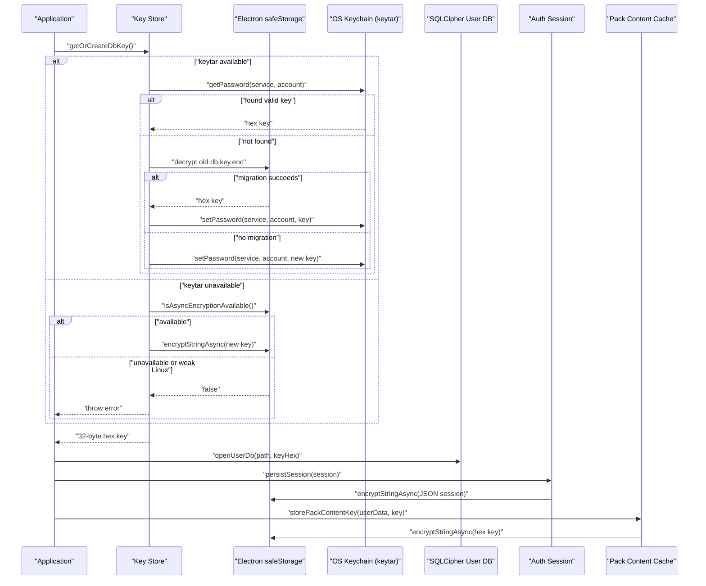
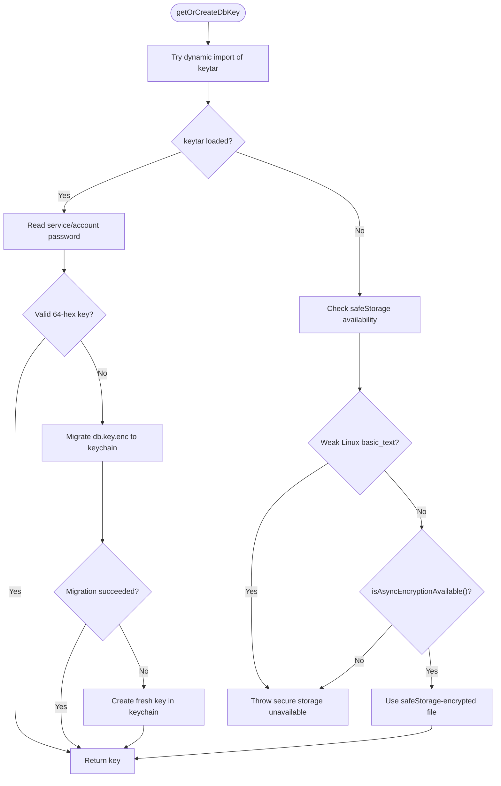
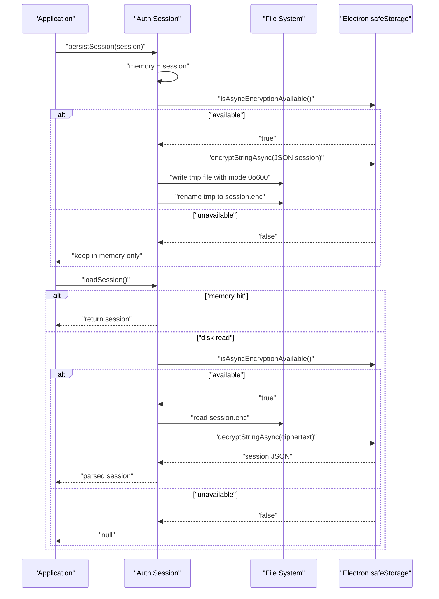
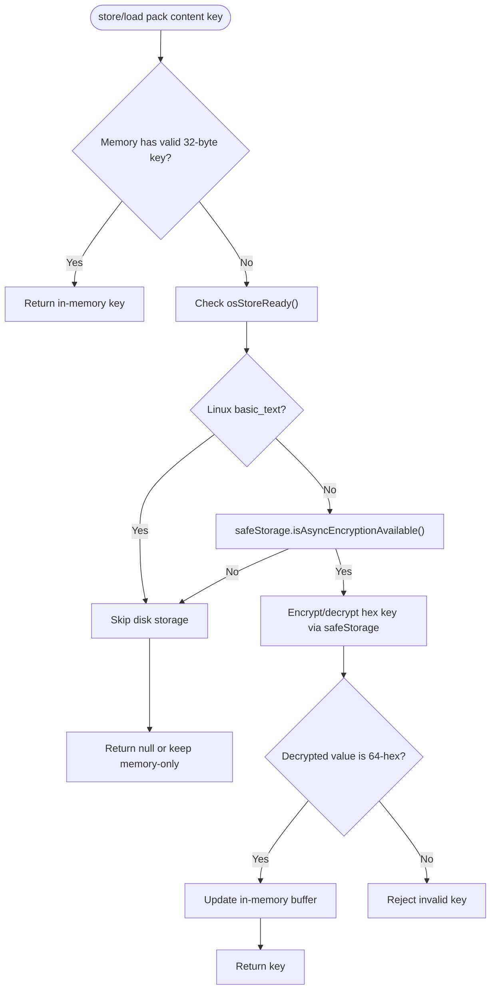
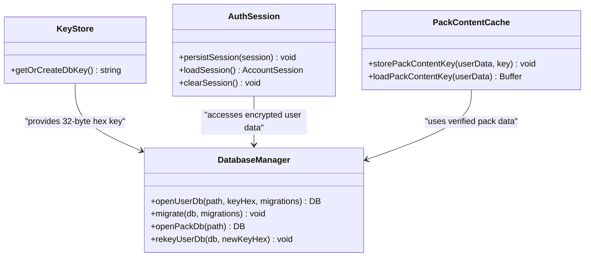
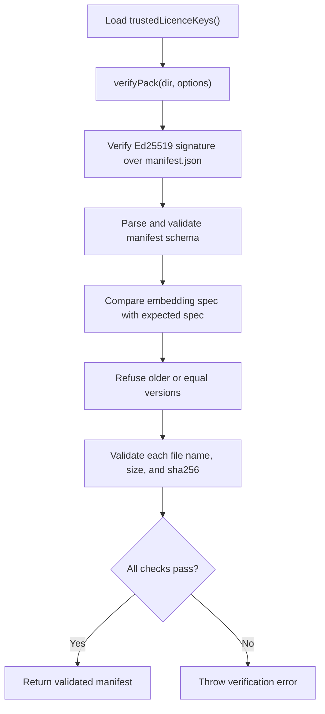
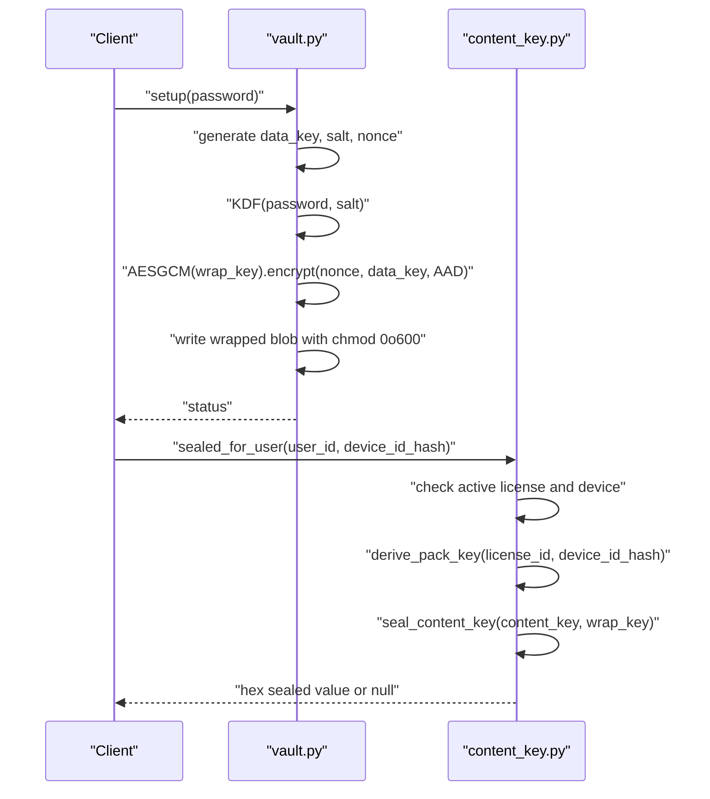
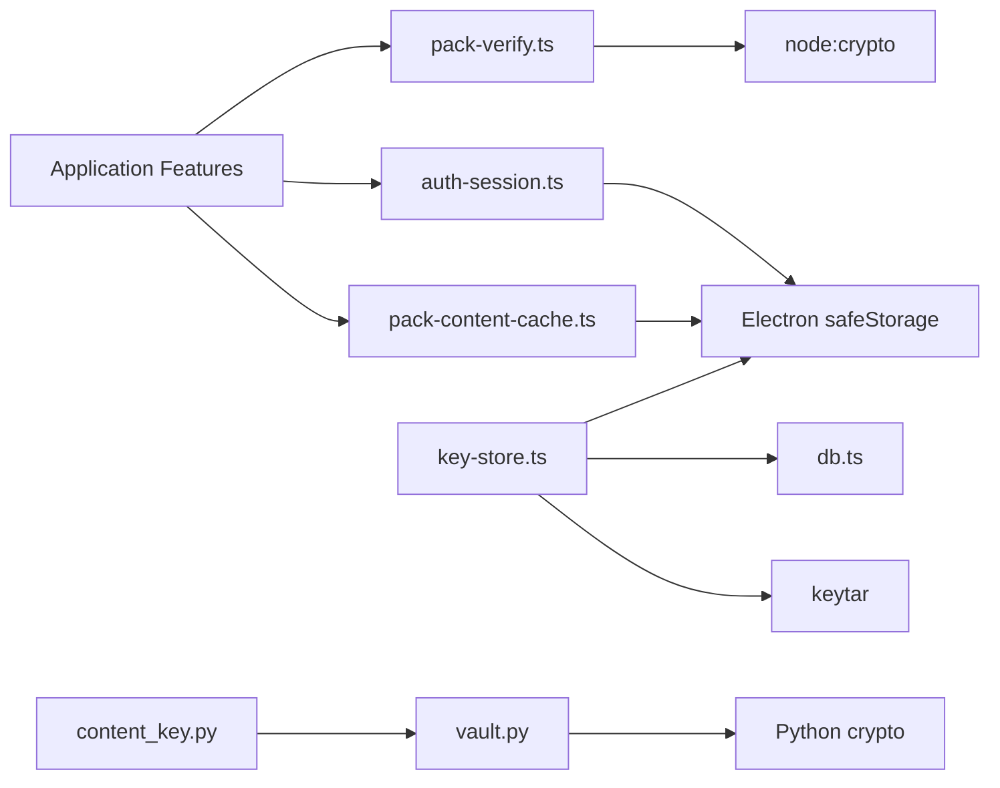

# Secure Storage & Key Management

<cite>
**Referenced Files in This Document**
- [key-store.ts](file://apps/desktop/src/main/core/key-store.ts)
- [auth-session.ts](file://apps/desktop/src/main/core/auth-session.ts)
- [pack-content-cache.ts](file://apps/desktop/src/main/core/pack-content-cache.ts)
- [db.ts](file://apps/desktop/src/main/core/db.ts)
- [licence-keys.ts](file://apps/desktop/src/main/core/licence-keys.ts)
- [pack-verify.ts](file://apps/desktop/src/main/core/pack-verify.ts)
- [vault.py](file://apps/host/vault.py)
- [content_key.py](file://services/api/app/content_key.py)
</cite>

## Table of Contents
1. [Introduction](#introduction)
2. [Project Structure](#project-structure)
3. [Core Components](#core-components)
4. [Architecture Overview](#architecture-overview)
5. [Detailed Component Analysis](#detailed-component-analysis)
6. [Dependency Analysis](#dependency-analysis)
7. [Performance Considerations](#performance-considerations)
8. [Troubleshooting Guide](#troubleshooting-guide)
9. [Conclusion](#conclusion)

## Introduction
This document explains the secure storage and key management system used by the desktop application and related services. It covers:

- Platform-specific encryption using Electron’s `safeStorage` API on macOS, Windows, and Linux.
- The key hierarchy for protecting authentication tokens, database keys, license verification data, and pack content keys.
- Fallback behavior when native OS secure storage is unavailable or weak.
- Secure file storage patterns, restrictive file permissions, and data protection strategies.
- Examples of safely storing and retrieving encrypted data.
- Security best practices for cryptographic keys and sensitive user information across deployment environments.

The goal is to make these mechanisms understandable for both developers and security reviewers while keeping implementation details traceable to the actual source files.

## Project Structure
The secure storage logic lives primarily in the Electron main process under `apps/desktop/src/main/core`. Related server-side vaulting and content-key sealing are implemented in Python under `apps/host` and `services/api`.

**Diagram sources**
- [key-store.ts:1-89](file://apps/desktop/src/main/core/key-store.ts#L1-L89)
- [auth-session.ts:1-213](file://apps/desktop/src/main/core/auth-session.ts#L1-L213)
- [pack-content-cache.ts:1-44](file://apps/desktop/src/main/core/pack-content-cache.ts#L1-L44)
- [db.ts:1-78](file://apps/desktop/src/main/core/db.ts#L1-L78)
- [licence-keys.ts:1-18](file://apps/desktop/src/main/core/licence-keys.ts#L1-L18)
- [pack-verify.ts:1-108](file://apps/desktop/src/main/core/pack-verify.ts#L1-L108)
- [vault.py:84-162](file://apps/host/vault.py#L84-L162)
- [content_key.py:49-61](file://services/api/app/content_key.py#L49-L61)

**Section sources**
- [key-store.ts:1-89](file://apps/desktop/src/main/core/key-store.ts#L1-L89)
- [auth-session.ts:1-213](file://apps/desktop/src/main/core/auth-session.ts#L1-L213)
- [pack-content-cache.ts:1-44](file://apps/desktop/src/main/core/pack-content-cache.ts#L1-L44)
- [db.ts:1-78](file://apps/desktop/src/main/core/db.ts#L1-L78)
- [licence-keys.ts:1-18](file://apps/desktop/src/main/core/licence-keys.ts#L1-L18)
- [pack-verify.ts:1-108](file://apps/desktop/src/main/core/pack-verify.ts#L1-L108)
- [vault.py:84-162](file://apps/host/vault.py#L84-L162)
- [content_key.py:49-61](file://services/api/app/content_key.py#L49-L61)

## Core Components
This section summarizes the core components responsible for secure storage and key management.

| Component | Responsibility | Primary Storage Mechanism | Platform Behavior |
|---|---|---|---|
| Database key manager | Creates, migrates, and retrieves the 32-byte database encryption key | OS keychain via `keytar`, fallback to Electron `safeStorage`-encrypted file | Prefer OS keychain; reject weak Linux `basic_text`; migrate old file if present |
| Auth session manager | Stores access/refresh tokens and device identity | Electron `safeStorage`-encrypted file with in-memory cache | Uses `safeStorage` when available; falls back to memory-only on weak platforms |
| Pack content key cache | Caches unwrapped pack content decryption key | Electron `safeStorage`-encrypted file with in-memory cache | Skips disk write on weak Linux; keeps key in memory only |
| User database wrapper | Opens and manages SQLCipher-encrypted SQLite database | SQLCipher v4 format via `better-sqlite3-multiple-ciphers` | Requires valid 32-byte hex key from key manager |
| License public key loader | Loads trusted Ed25519 public keys for pack verification | JSON file bundled with app resources | Reads packaged or development resource path |
| Pack verifier | Verifies pack manifest signature, schema, version, and file integrity | Node `crypto` Ed25519 + SHA-256 | Rejects unknown keys, mismatched specs, older versions, and tampered files |
| Host vault | Encrypts/decrypts secrets with a user-provided password | Argon2 KDF + AES-GCM with per-record nonce | Wraps a random data key; stores wrapped blob with restrictive permissions |
| Content key sealer | Seals pack content key for authorized devices | Derives per-device key and seals content key | Returns sealed value only for active licenses and non-deactivated devices |

**Section sources**
- [key-store.ts:1-89](file://apps/desktop/src/main/core/key-store.ts#L1-L89)
- [auth-session.ts:1-213](file://apps/desktop/src/main/core/auth-session.ts#L1-L213)
- [pack-content-cache.ts:1-44](file://apps/desktop/src/main/core/pack-content-cache.ts#L1-L44)
- [db.ts:1-78](file://apps/desktop/src/main/core/db.ts#L1-L78)
- [licence-keys.ts:1-18](file://apps/desktop/src/main/core/licence-keys.ts#L1-L18)
- [pack-verify.ts:1-108](file://apps/desktop/src/main/core/pack-verify.ts#L1-L108)
- [vault.py:84-162](file://apps/host/vault.py#L84-L162)
- [content_key.py:49-61](file://services/api/app/content_key.py#L49-L61)

## Architecture Overview
The secure storage architecture separates long-term master keys, transient session tokens, and package content keys. It also integrates platform-native secure storage where possible and uses strong local cryptography otherwise.

**Diagram sources**
- [key-store.ts:16-47](file://apps/desktop/src/main/core/key-store.ts#L16-L47)
- [key-store.ts:49-83](file://apps/desktop/src/main/core/key-store.ts#L49-L83)
- [auth-session.ts:65-72](file://apps/desktop/src/main/core/auth-session.ts#L65-L72)
- [pack-content-cache.ts:20-27](file://apps/desktop/src/main/core/pack-content-cache.ts#L20-L27)
- [db.ts:34-52](file://apps/desktop/src/main/core/db.ts#L34-L52)

## Detailed Component Analysis

### Database Key Manager
The database key manager is the root of the local key hierarchy. It prefers the OS keychain through `keytar`, supports migration from an older `safeStorage`-encrypted file, and enforces strict platform checks.

Key behaviors:
- Tries to load `keytar` dynamically so builds without it still run.
- If `keytar` is available, reads or creates a 64-character hex key stored under a service/account pair.
- Migrates an existing `db.key.enc` file into the OS keychain when possible.
- Falls back to `safeStorage`-encrypted file storage only when `isAsyncEncryptionAvailable()` returns true.
- Rejects weak Linux environments where `safeStorage.getSelectedStorageBackend()` is `basic_text`.
- Writes temporary files atomically with restrictive permissions before renaming them to final paths.

**Diagram sources**
- [key-store.ts:16-47](file://apps/desktop/src/main/core/key-store.ts#L16-L47)
- [key-store.ts:49-83](file://apps/desktop/src/main/core/key-store.ts#L49-L83)

**Section sources**
- [key-store.ts:1-89](file://apps/desktop/src/main/core/key-store.ts#L1-L89)

### Authentication Session Storage
Authentication sessions contain access tokens, refresh tokens, expiration time, email, user ID, and device ID. They are cached in memory and optionally persisted using Electron `safeStorage`.

Key behaviors:
- On persistence, encrypts the full session object with `safeStorage.encryptStringAsync`.
- Writes ciphertext to a `.tmp` file with mode `0o600`, then renames it atomically.
- On load, skips disk I/O if a valid session already exists in memory.
- Refuses to read from disk when `safeStorage.isAsyncEncryptionAvailable()` is false.
- Clears session from memory and deletes the file on logout.
- Handles token refresh and remote logout flows while preserving local cleanup even if network calls fail.

**Diagram sources**
- [auth-session.ts:65-89](file://apps/desktop/src/main/core/auth-session.ts#L65-L89)

**Section sources**
- [auth-session.ts:1-213](file://apps/desktop/src/main/core/auth-session.ts#L1-L213)

### Pack Content Key Cache
The pack content key cache protects the unwrapped key used to decrypt pack content. It avoids writing plaintext keys to disk when the OS store is weak.

Key behaviors:
- Keeps a 32-byte buffer in process memory.
- Checks whether the OS backend is weak (`basic_text` on Linux).
- Only writes to disk when `safeStorage.isAsyncEncryptionAvailable()` is true.
- Validates that decrypted values match a 64-character hex pattern.
- Re-encrypts the file when `shouldReEncrypt` indicates the OS key changed.

**Diagram sources**
- [pack-content-cache.ts:15-43](file://apps/desktop/src/main/core/pack-content-cache.ts#L15-L43)

**Section sources**
- [pack-content-cache.ts:1-44](file://apps/desktop/src/main/core/pack-content-cache.ts#L1-L44)

### User Database Encryption
The user database is a private, read-write SQLCipher database. The key comes from the database key manager and must be exactly 32 bytes represented as 64 hexadecimal characters.

Key behaviors:
- Sets SQLCipher cipher mode and legacy v4 parameters.
- Applies the raw key directly because the key is cryptographically random.
- Tests the key immediately by querying the database schema.
- Enables WAL journaling, foreign keys, and busy timeout.
- Loads vector search extension and runs migrations.
- Supports re-keying when the underlying secure storage key rotates.

**Diagram sources**
- [db.ts:34-77](file://apps/desktop/src/main/core/db.ts#L34-L77)
- [key-store.ts:16-47](file://apps/desktop/src/main/core/key-store.ts#L16-L47)
- [auth-session.ts:65-89](file://apps/desktop/src/main/core/auth-session.ts#L65-L89)
- [pack-content-cache.ts:20-43](file://apps/desktop/src/main/core/pack-content-cache.ts#L20-L43)

**Section sources**
- [db.ts:1-78](file://apps/desktop/src/main/core/db.ts#L1-L78)

### License Keys and Pack Verification
License verification relies on trusted public keys and cryptographic signature validation. The app loads public keys from a bundled JSON file and verifies downloaded packs before opening them.

Key behaviors:
- Trusted public keys are loaded from a packaged or development resource path.
- Pack verification validates the Ed25519 signature over the exact manifest bytes.
- Schema validation ensures embedding specs match the running app.
- Version checks prevent downgrades.
- File-level integrity checks enforce exact names, sizes, and SHA-256 digests.

**Diagram sources**
- [licence-keys.ts:7-17](file://apps/desktop/src/main/core/licence-keys.ts#L7-L17)
- [pack-verify.ts:44-107](file://apps/desktop/src/main/core/pack-verify.ts#L44-L107)

**Section sources**
- [licence-keys.ts:1-18](file://apps/desktop/src/main/core/licence-keys.ts#L1-L18)
- [pack-verify.ts:1-108](file://apps/desktop/src/main/core/pack-verify.ts#L1-L108)

### Host Vault and Content Key Sealing
The host service provides a vault that wraps a random data key with a user-supplied password using Argon2-derived keys and AES-GCM. The API service seals pack content keys for authorized devices.

Key behaviors:
- Vault setup generates a random data key, salt, and nonce.
- Password-based key derivation produces a wrap key.
- The data key is encrypted with AES-GCM and stored as a JSON blob.
- Wrapped blob file permissions are set to `0o600`.
- Unlock attempts multiple legacy AAD values for compatibility.
- Content key sealing derives a per-device key and returns a sealed representation only for active licenses and non-deactivated devices.

**Diagram sources**
- [vault.py:84-107](file://apps/host/vault.py#L84-L107)
- [vault.py:110-162](file://apps/host/vault.py#L110-L162)
- [content_key.py:49-61](file://services/api/app/content_key.py#L49-L61)

**Section sources**
- [vault.py:84-162](file://apps/host/vault.py#L84-L162)
- [content_key.py:49-61](file://services/api/app/content_key.py#L49-L61)

## Dependency Analysis
The secure storage system has clear separation between key management, session handling, database access, and pack verification. Dependencies flow from higher-level features down to platform APIs and cryptographic primitives.

**Diagram sources**
- [key-store.ts:1-89](file://apps/desktop/src/main/core/key-store.ts#L1-L89)
- [auth-session.ts:1-213](file://apps/desktop/src/main/core/auth-session.ts#L1-L213)
- [pack-content-cache.ts:1-44](file://apps/desktop/src/main/core/pack-content-cache.ts#L1-L44)
- [pack-verify.ts:1-108](file://apps/desktop/src/main/core/pack-verify.ts#L1-L108)
- [vault.py:84-162](file://apps/host/vault.py#L84-L162)
- [content_key.py:49-61](file://services/api/app/content_key.py#L49-L61)

**Section sources**
- [key-store.ts:1-89](file://apps/desktop/src/main/core/key-store.ts#L1-L89)
- [auth-session.ts:1-213](file://apps/desktop/src/main/core/auth-session.ts#L1-L213)
- [pack-content-cache.ts:1-44](file://apps/desktop/src/main/core/pack-content-cache.ts#L1-L44)
- [pack-verify.ts:1-108](file://apps/desktop/src/main/core/pack-verify.ts#L1-L108)
- [vault.py:84-162](file://apps/host/vault.py#L84-L162)
- [content_key.py:49-61](file://services/api/app/content_key.py#L49-L61)

## Performance Considerations
- Prefer OS keychain storage for long-lived keys to avoid repeated secure storage operations.
- Keep sensitive buffers in memory only when persistent storage is unavailable or weak.
- Use atomic file writes to reduce corruption risk during crashes.
- Avoid unnecessary disk I/O by caching decrypted values in memory for the lifetime of the process.
- Validate cryptographic inputs early to fail fast before expensive operations.
- Use SQLCipher WAL mode for concurrent read/write performance while maintaining encryption.

[No sources needed since this section provides general guidance]

## Troubleshooting Guide
Common issues and their likely causes:

| Symptom | Likely Cause | Recommended Action |
|---|---|---|
| Application refuses to start on Linux | `safeStorage` backend is `basic_text` and database key requires real OS secure storage | Install a secret service or use a supported platform; do not bypass the check |
| Database cannot open | Wrong or corrupted database key | Regenerate or migrate the database key; verify key format is 64 hex characters |
| Session not restored after restart | `safeStorage` unavailable or ciphertext unreadable | Check OS secure storage availability; clear corrupted session file |
| Pack verification fails | Unknown signing key, mismatched embedding spec, older version, or tampered file | Update app, ensure matching embedding spec, and verify pack source |
| Vault unlock fails | Incorrect password or incompatible legacy AAD | Confirm password meets minimum length and retry; check for legacy vault format |

**Section sources**
- [key-store.ts:33-47](file://apps/desktop/src/main/core/key-store.ts#L33-L47)
- [db.ts:34-52](file://apps/desktop/src/main/core/db.ts#L34-L52)
- [auth-session.ts:74-89](file://apps/desktop/src/main/core/auth-session.ts#L74-L89)
- [pack-verify.ts:75-107](file://apps/desktop/src/main/core/pack-verify.ts#L75-L107)
- [vault.py:110-130](file://apps/host/vault.py#L110-L130)

## Conclusion
The secure storage and key management system combines platform-native secure storage with strong local cryptography. It prioritizes OS keychain storage, falls back safely when necessary, and enforces strict validation for cryptographic inputs and pack integrity. Sensitive data is protected through layered mechanisms: database keys, session tokens, pack content keys, and host vault blobs. Restrictive file permissions, atomic writes, and memory-only caches further reduce exposure. For production deployments, prefer environments with reliable OS secure storage, keep trusted keys and signing seeds out of shipped artifacts, and treat any fallback path as reduced-security rather than equivalent protection.

[No sources needed since this section summarizes without analyzing specific files]