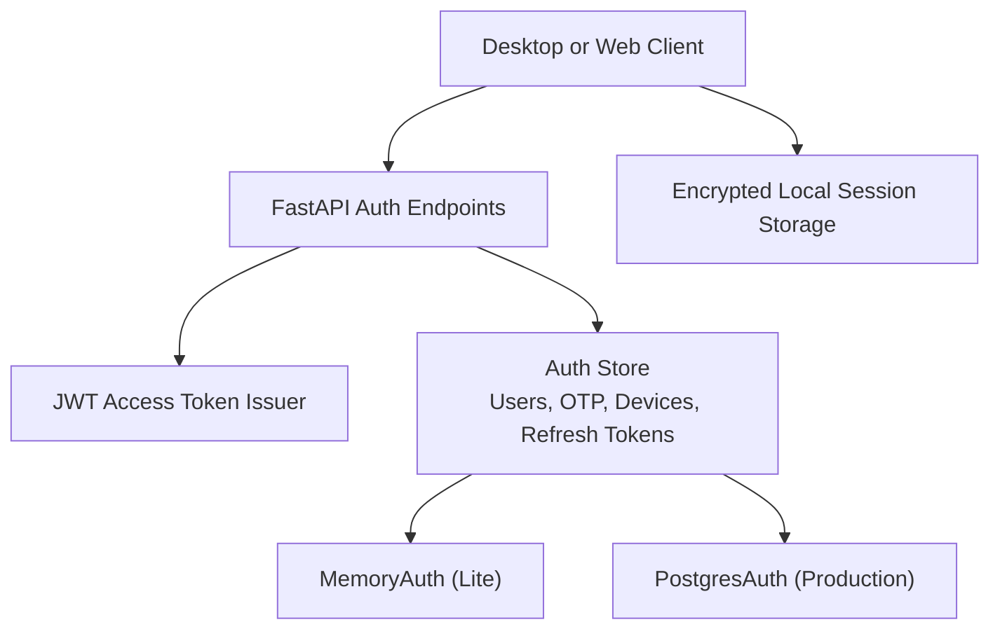
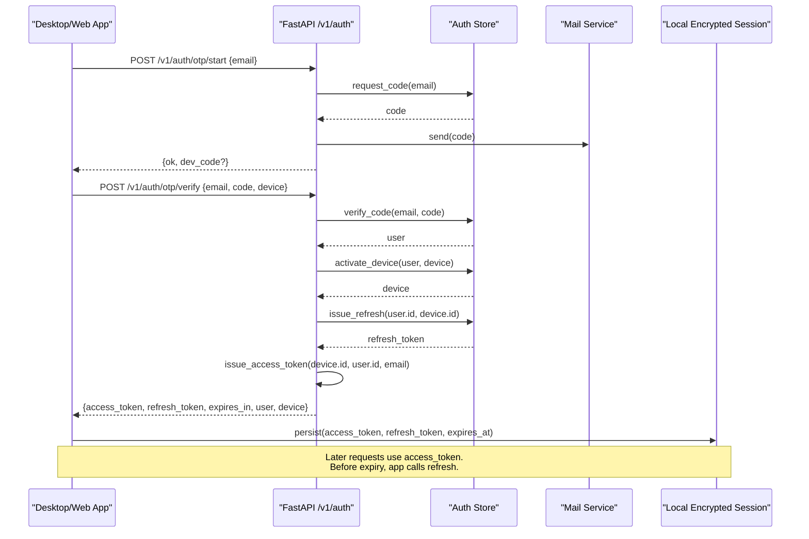
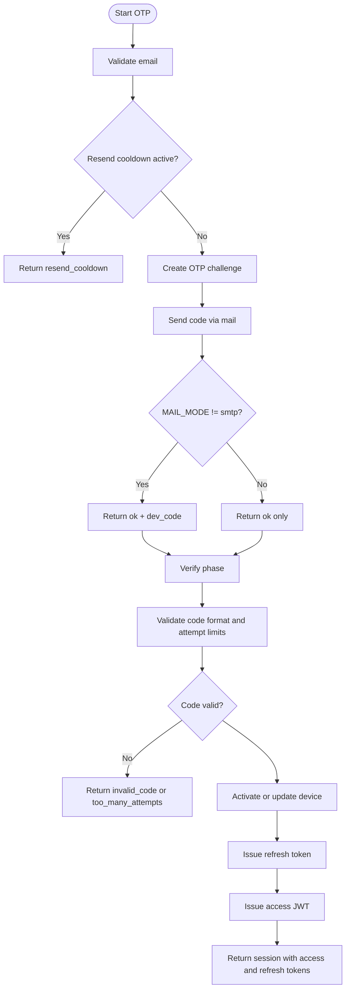
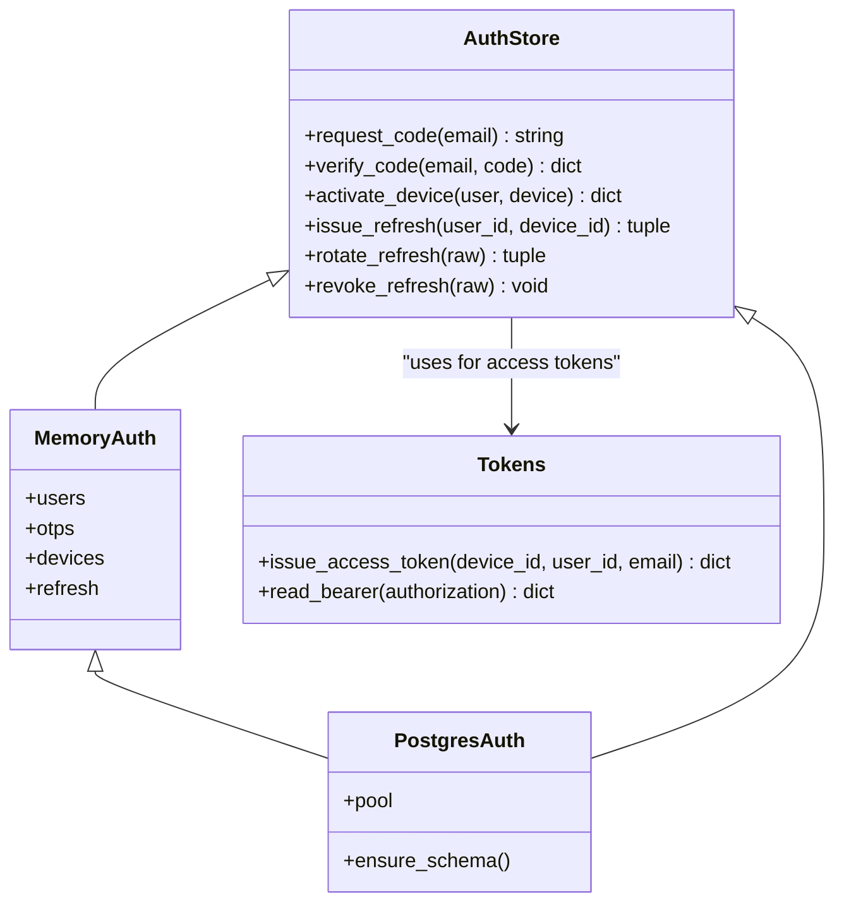
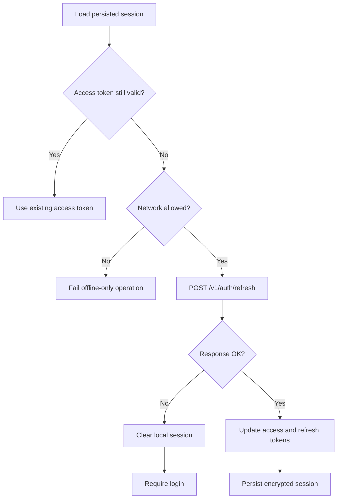
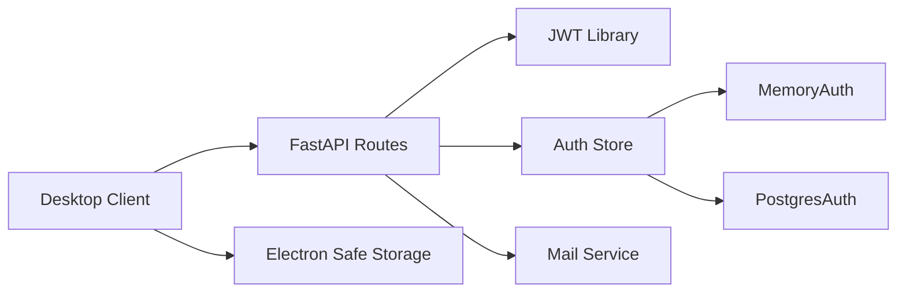

# User Authentication

<cite>
**Referenced Files in This Document**   
- [main.py](file://services/api/app/main.py)
- [tokens.py](file://services/api/app/tokens.py)
- [auth_store.py](file://services/api/app/auth_store.py)
- [auth-session.ts](file://apps/desktop/src/main/core/auth-session.ts)
- [test_auth.py](file://services/api/tests/test_auth.py)
</cite>

## Table of Contents
1. [Introduction](#introduction)
2. [Project Structure](#project-structure)
3. [Core Components](#core-components)
4. [Architecture Overview](#architecture-overview)
5. [Detailed Component Analysis](#detailed-component-analysis)
6. [Dependency Analysis](#dependency-analysis)
7. [Performance Considerations](#performance-considerations)
8. [Troubleshooting Guide](#troubleshooting-guide)
9. [Conclusion](#conclusion)

## Introduction
This document explains the user authentication system used by Surf AI. It covers:
- Email-based OTP login from initiation to verification.
- Secure token management, including access tokens, refresh tokens, and JWT handling.
- Session lifecycle, automatic token renewal, expiration handling, and graceful degradation when cloud services are unavailable.
- Authentication API endpoints `/v1/auth/otp/start`, `/v1/auth/otp/verify`, and `/v1/auth/logout`.
- Security considerations for storing credentials and handling authentication errors.
- Examples of implementing authentication flows in desktop and web contexts.

The backend is a FastAPI service that issues short-lived access tokens and rotating refresh tokens. The desktop client stores encrypted session data and automatically renews access tokens using the refresh token.

## Project Structure
Authentication spans three main areas:
- Backend API routes and session construction.
- Token issuance and bearer validation.
- Persistent or in-memory storage for users, OTP challenges, devices, and refresh tokens.
- Desktop client session persistence, network gating, and token renewal.

**Diagram sources**
- [main.py:238-283](file://services/api/app/main.py#L238-L283)
- [tokens.py:17-40](file://services/api/app/tokens.py#L17-L40)
- [auth_store.py:41-215](file://services/api/app/auth_store.py#L41-L215)
- [auth-store.ts:65-113](file://apps/desktop/src/main/core/auth-session.ts#L65-L113)

**Section sources**
- [main.py:1-84](file://services/api/app/main.py#L1-L84)
- [auth_store.py:1-26](file://services/api/app/auth_store.py#L1-L26)
- [auth-session.ts:1-34](file://apps/desktop/src/main/core/auth-session.ts#L1-L34)

## Core Components
- **OTP start endpoint**: Creates an email challenge, sends a six-digit code, and supports resend cooldowns.
- **OTP verify endpoint**: Validates the code, activates or updates a device, issues a refresh token, and returns an access token plus session metadata.
- **Refresh endpoint**: Rotates the refresh token and returns a new access token.
- **Logout endpoint**: Revokes the current refresh token.
- **JWT access tokens**: HS256-signed tokens with `typ=access`, audience `authenticated`, and `sub` set to the device identifier.
- **Refresh tokens**: Server-side hashed and rotated; reuse is rejected.
- **Desktop session manager**: Encrypts and persists access and refresh tokens, auto-renews before expiry, and clears local state on failure.

**Section sources**
- [main.py:238-283](file://services/api/app/main.py#L238-L283)
- [tokens.py:17-40](file://services/api/app/tokens.py#L17-L40)
- [auth_store.py:172-215](file://services/api/app/auth_store.py#L172-L215)
- [auth-session.ts:96-113](file://apps/desktop/src/main/core/auth-session.ts#L96-L113)

## Architecture Overview
The authentication flow uses email as the identity factor. After successful verification, the server binds the session to a device and issues short-lived access tokens. Long-lived refresh tokens enable automatic renewal without repeatedly asking for codes.

**Diagram sources**
- [main.py:238-268](file://services/api/app/main.py#L238-L268)
- [auth_store.py:55-109](file://services/api/app/auth_store.py#L55-L109)
- [auth_store.py:172-209](file://services/api/app/auth_store.py#L172-L209)
- [tokens.py:17-29](file://services/api/app/tokens.py#L17-L29)
- [auth-session.ts:144-165](file://apps/desktop/src/main/core/auth-session.ts#L144-L165)

## Detailed Component Analysis

### Email-Based OTP Login Flow
The OTP flow has two phases:
1. Start: The client sends an email address. The server creates or reuses a user record, generates a six-digit code, stores its hash, enforces resend cooldowns, and sends the code via mail. In development mode, the code may be returned in the response.
2. Verify: The client submits the email, code, and device profile. The server validates the code format, checks attempts and expiry, marks the challenge consumed, activates the device, issues a refresh token, and returns a session containing an access token.

**Diagram sources**
- [main.py:238-268](file://services/api/app/main.py#L238-L268)
- [auth_store.py:55-109](file://services/api/app/auth_store.py#L55-L109)
- [auth_store.py:111-140](file://services/api/app/auth_store.py#L111-L140)

**Section sources**
- [main.py:200-268](file://services/api/app/main.py#L200-L268)
- [auth_store.py:55-109](file://services/api/app/auth_store.py#L55-L109)

### Secure Token Management

#### Access Tokens
- Algorithm: HS256.
- Audience: `authenticated`.
- Type: `access`.
- Subject (`sub`): Device identifier, so rate limiting and search quotas remain per device.
- Claims include user ID and email.
- Expiration: Short-lived, typically 15 minutes.

Access tokens are created after successful OTP verification and refresh. They are validated by checking the bearer header, signature, audience, type, and device activity.

**Section sources**
- [tokens.py:17-40](file://services/api/app/tokens.py#L17-L40)
- [main.py:98-106](file://services/api/app/main.py#L98-L106)
- [main.py:226-235](file://services/api/app/main.py#L226-L235)

#### Refresh Tokens
- Generated as random URL-safe strings.
- Stored as SHA-256 hashes on the server.
- Rotated on each successful refresh.
- Reuse is rejected; all tokens in the same family are revoked when reuse is detected.
- Expired refresh tokens are marked revoked.
- Logout revokes the provided refresh token.

**Diagram sources**
- [auth_store.py:41-215](file://services/api/app/auth_store.py#L41-L215)
- [auth_store.py:217-447](file://services/api/app/auth_store.py#L217-L447)
- [tokens.py:17-40](file://services/api/app/tokens.py#L17-L40)

**Section sources**
- [auth_store.py:172-215](file://services/api/app/auth_store.py#L172-L215)
- [auth_store.py:393-447](file://services/api/app/auth_store.py#L393-L447)
- [tokens.py:17-40](file://services/api/app/tokens.py#L17-L40)

### Session Lifecycle and Automatic Renewal
The desktop client maintains an in-memory session and optionally persists it using Electron’s secure storage. Before making authenticated requests, it checks whether the access token is close to expiring and calls the refresh endpoint if needed. If refresh fails, the local session is cleared and the user must sign in again.

**Diagram sources**
- [auth-session.ts:65-113](file://apps/desktop/src/main/core/auth-session.ts#L65-L113)
- [auth-session.ts:144-165](file://apps/desktop/src/main/core/auth-session.ts#L144-L165)
- [auth-session.ts:168-182](file://apps/desktop/src/main/core/auth-session.ts#L168-L182)

**Section sources**
- [auth-session.ts:65-113](file://apps/desktop/src/main/core/auth-session.ts#L65-L113)
- [auth-session.ts:144-182](file://apps/desktop/src/main/core/auth-session.ts#L144-L182)

### Graceful Degradation When Cloud Services Are Unavailable
- The desktop client gates network operations with an offline guard. When offline-only mode is enabled, OTP and refresh calls are blocked locally.
- On refresh failure, the client clears the local session rather than retrying indefinitely.
- The backend health endpoint reports database, cache, and upstream service status, allowing clients or proxies to detect degraded conditions.

**Section sources**
- [auth-session.ts:144-151](file://apps/desktop/src/main/core/auth-session.ts#L144-L151)
- [auth-session.ts:96-113](file://apps/desktop/src/main/core/auth-session.ts#L96-L113)
- [main.py:149-173](file://services/api/app/main.py#L149-L173)

### Authentication API Endpoints

#### POST `/v1/auth/otp/start`
- Purpose: Initiate email-based OTP login.
- Request body:
  - `email`: String, up to 200 characters.
- Response:
  - Success: `{ ok: true }`. In development mode, also includes `dev_code`.
  - Errors:
    - `resend_cooldown`: Too soon to resend.
    - `invalid_email`: Invalid email format.
- Notes:
  - Creates or reuses a user account.
  - Sends a six-digit code via mail.
  - Enforces resend cooldowns.

**Section sources**
- [main.py:200-255](file://services/api/app/main.py#L200-L255)
- [auth_store.py:55-80](file://services/api/app/auth_store.py#L55-L80)

#### POST `/v1/auth/otp/verify`
- Purpose: Verify the OTP and create a signed-in session.
- Request body:
  - `email`: String, up to 200 characters.
  - `code`: Six-digit string.
  - `device`: Object with optional `device_uid`, optional `name`, `os`, `arch`, and `app_version`.
- Response:
  - Success: Session object containing `access_token`, `token_type`, `expires_in`, `refresh_token`, `user`, and `device`.
  - Errors:
    - `invalid_code`: Wrong or malformed code.
    - `expired`: Code expired.
    - `too_many_attempts`: Too many failed attempts.
    - `device_limit`: Active device limit reached.
    - `device_revoked`: Device was revoked.
- Notes:
  - Activates or updates the device.
  - Issues a rotating refresh token.
  - Returns an HS256 access token bound to the device.

**Section sources**
- [main.py:212-268](file://services/api/app/main.py#L212-L268)
- [auth_store.py:86-140](file://services/api/app/auth_store.py#L86-L140)
- [auth_store.py:172-209](file://services/api/app/auth_store.py#L172-L209)

#### POST `/v1/auth/refresh`
- Purpose: Rotate the refresh token and obtain a new access token.
- Request body:
  - `refresh_token`: String.
- Response:
  - Success: New session with updated access and refresh tokens.
  - Errors:
    - `invalid_refresh`: Unknown, expired, or otherwise invalid refresh token.
    - `refresh_reused`: Refresh token was already used; family revoked.
    - `device_revoked`: Device is no longer active.

**Section sources**
- [main.py:218-277](file://services/api/app/main.py#L218-L277)
- [auth_store.py:188-209](file://services/api/app/auth_store.py#L188-L209)
- [auth_store.py:405-441](file://services/api/app/auth_store.py#L405-L441)

#### POST `/v1/auth/logout`
- Purpose: Revoke the current refresh token.
- Request body:
  - `refresh_token`: String.
- Response:
  - Success: `{ ok: true }`.
- Notes:
  - The desktop client calls this before clearing local session data.
  - Failure to reach the server does not prevent local logout.

**Section sources**
- [main.py:280-283](file://services/api/app/main.py#L280-L283)
- [auth-session.ts:168-182](file://apps/desktop/src/main/core/auth-session.ts#L168-L182)

### Security Considerations

#### Storing Sensitive Credentials
- Desktop session tokens are stored in Electron’s secure storage when available.
- File permissions are restricted for temporary and persistent session files.
- Refresh tokens are never stored in plaintext on the server; only their hashes are persisted.
- Access tokens are short-lived and bound to a device identifier.

**Section sources**
- [auth-session.ts:1-8](file://apps/desktop/src/main/core/auth-session.ts#L1-L8)
- [auth-session.ts:65-89](file://apps/desktop/src/main/core/auth-session.ts#L65-L89)
- [auth_store.py:32-33](file://services/api/app/auth_store.py#L32-L33)
- [tokens.py:17-29](file://services/api/app/tokens.py#L17-L29)

#### Handling Authentication Errors
- The backend normalizes authentication errors into structured JSON responses with error codes and optional retry-after values.
- Clients should treat `unauthenticated`, `invalid_token`, `invalid_code`, `expired`, `too_many_attempts`, `refresh_reused`, and `device_revoked` as signals to clear local state or prompt re-authentication.
- Rate-limited or quota-exceeded responses include retry guidance.

**Section sources**
- [main.py:87-95](file://services/api/app/main.py#L87-L95)
- [main.py:98-116](file://services/api/app/main.py#L98-L116)
- [auth_store.py:36-39](file://services/api/app/auth_store.py#L36-L39)
- [test_auth.py:63-92](file://services/api/tests/test_auth.py#L63-L92)

### Implementing Authentication Flows

#### Desktop Context
- Start OTP by calling `/v1/auth/otp/start` with the user’s email.
- Verify OTP by calling `/v1/auth/otp/verify` with email, code, and device profile.
- Persist the returned access token, refresh token, and expiration time.
- Before authenticated requests, check token expiry and call `/v1/auth/refresh` if needed.
- On refresh failure, clear local session and require login.
- On logout, revoke the refresh token and clear local session.

**Section sources**
- [auth-session.ts:144-182](file://apps/desktop/src/main/core/auth-session.ts#L144-L182)
- [auth-session.ts:96-113](file://apps/desktop/src/main/core/auth-session.ts#L96-L113)

#### Web Context
- A web implementation can follow the same API contract:
  - Call `/v1/auth/otp/start` to initiate login.
  - Call `/v1/auth/otp/verify` to complete login and receive tokens.
  - Store tokens securely according to web best practices.
  - Use the access token in `Authorization: Bearer` headers.
  - Refresh tokens before access token expiry by calling `/v1/auth/refresh`.
  - Call `/v1/auth/logout` to revoke the refresh token during logout.

[No sources needed since this section provides general implementation guidance]

## Dependency Analysis
The authentication subsystem depends on:
- FastAPI routing and request/response models.
- JWT library for access token signing and verification.
- Optional Postgres and Redis for production auth store and rate limiting.
- Mail service for sending OTP codes.
- Desktop secure storage for local session persistence.

**Diagram sources**
- [main.py:18-34](file://services/api/app/main.py#L18-L34)
- [tokens.py:12-14](file://services/api/app/tokens.py#L12-L14)
- [auth_store.py:14-22](file://services/api/app/auth_store.py#L14-L22)
- [auth-session.ts:9-15](file://apps/desktop/src/main/core/auth-session.ts#L9-L15)

**Section sources**
- [main.py:18-34](file://services/api/app/main.py#L18-L34)
- [auth_store.py:14-22](file://services/api/app/auth_store.py#L14-L22)
- [auth-session.ts:9-15](file://apps/desktop/src/main/core/auth-session.ts#L9-L15)

## Performance Considerations
- Access tokens are short-lived to reduce exposure window.
- Refresh tokens rotate on use, preventing replay attacks.
- Lite mode uses in-memory stores for tests and local self-tests, avoiding database overhead.
- Production uses Postgres for durable auth state and Redis for rate limiting and caching where applicable.
- The desktop client avoids unnecessary network calls by caching access tokens until near expiry.

[No sources needed since this section provides general guidance]

## Troubleshooting Guide
Common issues and resolutions:
- Resend cooldown: Wait before requesting another OTP code.
- Invalid or expired code: Request a new code.
- Too many attempts: Reset by requesting a new code.
- Refresh reused: Sign in again; the server revokes the entire refresh family.
- Device revoked: Remove the device from the account or sign in from another device.
- Device limit reached: Revoke an existing device or upgrade plan limits.
- Missing bearer token: Ensure the Authorization header is present.
- Invalid token: Check token signature, audience, type, and device activity.

**Section sources**
- [auth_store.py:55-109](file://services/api/app/auth_store.py#L55-L109)
- [auth_store.py:188-209](file://services/api/app/auth_store.py#L188-L209)
- [main.py:98-116](file://services/api/app/main.py#L98-L116)
- [test_auth.py:63-92](file://services/api/tests/test_auth.py#L63-L92)

## Conclusion
Surf AI’s authentication system combines email-based OTP login with secure, rotating refresh tokens and short-lived access tokens. The desktop client manages session persistence and automatic renewal, while the backend enforces security policies such as code cooldowns, attempt limits, device activation, and refresh token rotation. This design balances usability with strong security, and it degrades gracefully when cloud services are unavailable by gating network operations and clearing local state on failures.