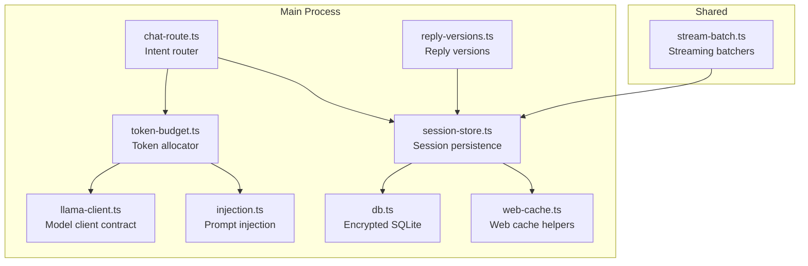
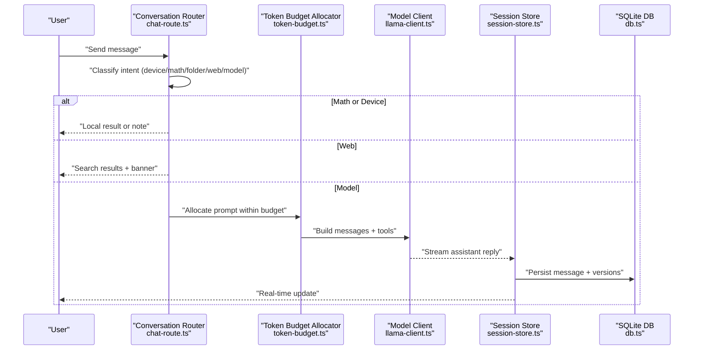
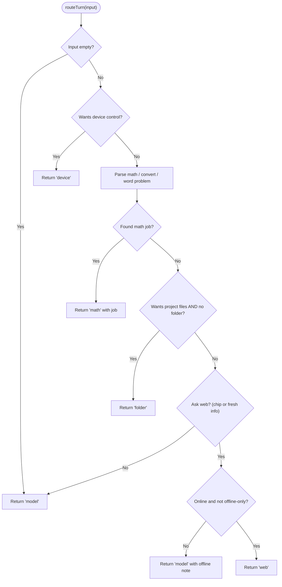
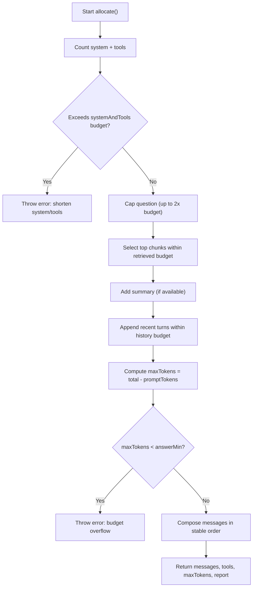
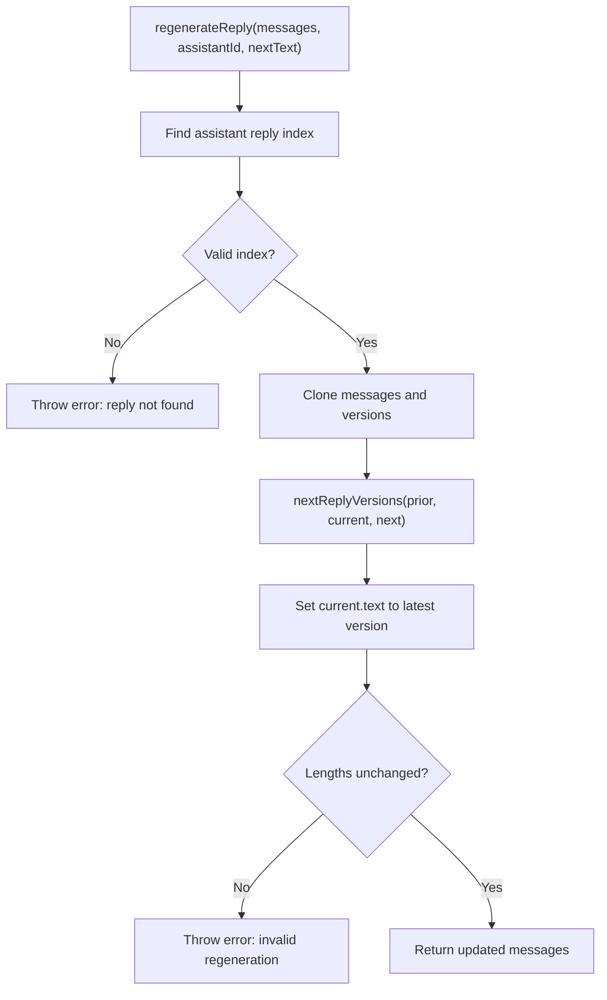
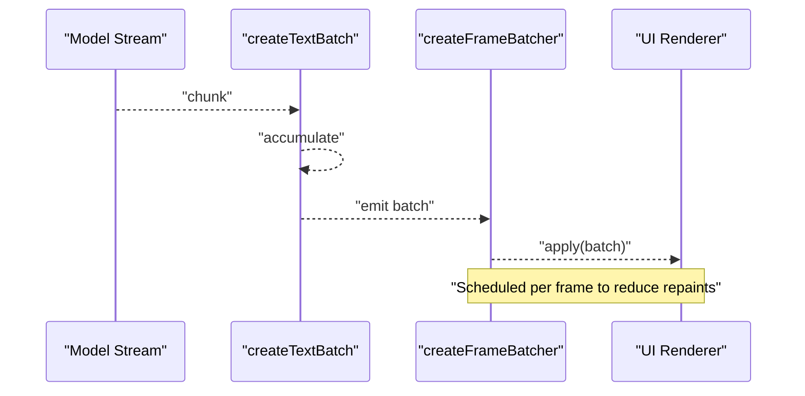
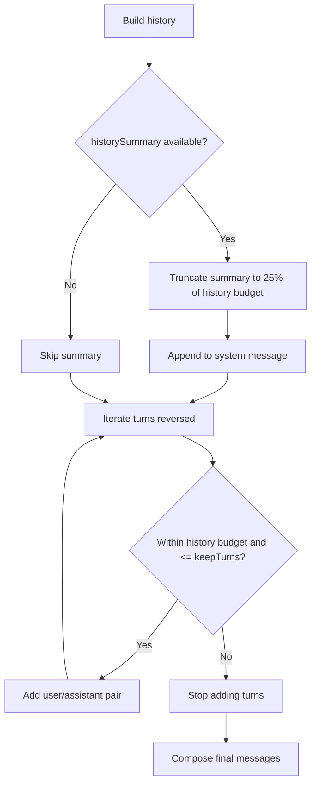
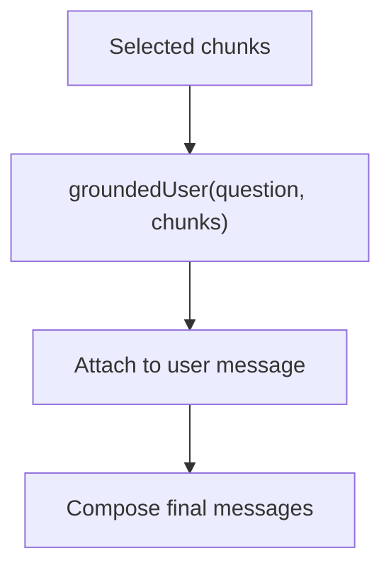
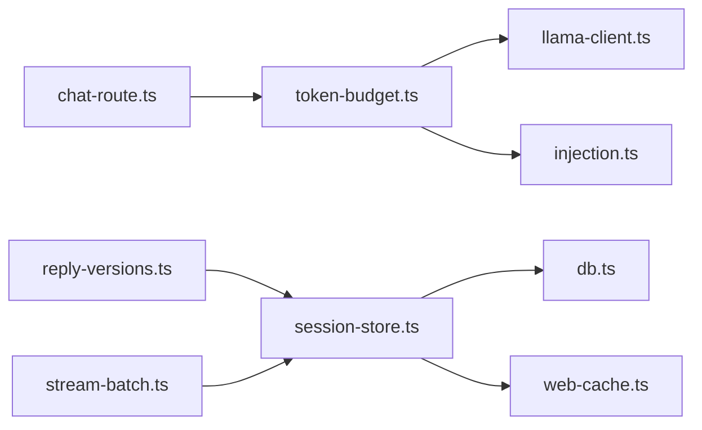

# Chat System

<cite>
**Referenced Files in This Document**
- [chat-route.ts](file://apps/desktop/src/main/core/chat-route.ts)
- [token-budget.ts](file://apps/desktop/src/main/core/token-budget.ts)
- [session-store.ts](file://apps/desktop/src/main/core/session-store.ts)
- [reply-versions.ts](file://apps/desktop/src/main/core/reply-versions.ts)
- [stream-batch.ts](file://apps/desktop/src/shared/stream-batch.ts)
- [db.ts](file://apps/desktop/src/main/core/db.ts)
- [llama-client.ts](file://apps/desktop/src/main/core/llama-client.ts)
- [web-cache.ts](file://apps/desktop/src/main/core/web-cache.ts)
- [injection.ts](file://apps/desktop/src/main/core/injection.ts)
</cite>

## Table of Contents
1. [Introduction](#introduction)
2. [Project Structure](#project-structure)
3. [Core Components](#core-components)
4. [Architecture Overview](#architecture-overview)
5. [Detailed Component Analysis](#detailed-component-analysis)
6. [Dependency Analysis](#dependency-analysis)
7. [Performance Considerations](#performance-considerations)
8. [Troubleshooting Guide](#troubleshooting-guide)
9. [Conclusion](#conclusion)

## Introduction
This document explains the chat system implementation with a focus on:
- Conversation routing logic that routes user messages to appropriate backends (calculator, project files, web search, or model).
- Token budget management that controls context window usage and prevents memory overflow.
- Session storage for persisting conversations and maintaining state across restarts.
- Reply versioning for managing different response formats and ensuring backward compatibility.
- Streaming response handling, real-time updates, and conversation history management.
- Conversation persistence, search capabilities, and export considerations.

## Project Structure
The chat system is implemented primarily in the desktop main process and shared utilities:
- Routing and intent detection: apps/desktop/src/main/core/chat-route.ts
- Token budget allocator and tokenizer adapters: apps/desktop/src/main/core/token-budget.ts
- Session persistence and message storage: apps/desktop/src/main/core/session-store.ts
- Reply versioning helpers: apps/desktop/src/main/core/reply-versions.ts
- Streaming batching utilities: apps/desktop/src/shared/stream-batch.ts
- Encrypted SQLite database access: apps/desktop/src/main/core/db.ts
- Model client contract used by budget allocation: apps/desktop/src/main/core/llama-client.ts
- Web cache integration for conversation cleanup: apps/desktop/src/main/core/web-cache.ts
- Prompt injection utilities used during retrieval-augmented prompting: apps/desktop/src/main/core/injection.ts



**Diagram sources**
- [chat-route.ts:120-137](file://apps/desktop/src/main/core/chat-route.ts#L120-L137)
- [token-budget.ts:101-165](file://apps/desktop/src/main/core/token-budget.ts#L101-L165)
- [session-store.ts:40-242](file://apps/desktop/src/main/core/session-store.ts#L40-L242)
- [reply-versions.ts:1-32](file://apps/desktop/src/main/core/reply-versions.ts#L1-L32)
- [stream-batch.ts:6-78](file://apps/desktop/src/shared/stream-batch.ts#L6-L78)
- [db.ts:34-51](file://apps/desktop/src/main/core/db.ts#L34-L51)
- [llama-client.ts:1-200](file://apps/desktop/src/main/core/llama-client.ts#L1-L200)
- [web-cache.ts:1-200](file://apps/desktop/src/main/core/web-cache.ts#L1-L200)
- [injection.ts:1-200](file://apps/desktop/src/main/core/injection.ts#L1-L200)

**Section sources**
- [chat-route.ts:1-161](file://apps/desktop/src/main/core/chat-route.ts#L1-L161)
- [token-budget.ts:1-172](file://apps/desktop/src/main/core/token-budget.ts#L1-L172)
- [session-store.ts:1-277](file://apps/desktop/src/main/core/session-store.ts#L1-L277)
- [reply-versions.ts:1-33](file://apps/desktop/src/main/core/reply-versions.ts#L1-L33)
- [stream-batch.ts:1-79](file://apps/desktop/src/shared/stream-batch.ts#L1-L79)
- [db.ts:1-78](file://apps/desktop/src/main/core/db.ts#L1-L78)

## Core Components
- Conversation Router: Determines whether a turn should be handled as device control, math calculation, project file analysis, web search, or direct model generation. It also provides helpers to format calculator results and web banners.
- Token Budget Allocator: Builds prompts within strict per-request budgets using an exact tokenizer (server-side or Hugging Face), reserving tokens for answers and trimming parts when necessary.
- Session Store: Persists conversations and messages in an encrypted SQLite database, with an in-memory fallback. Supports listing, opening, appending, saving replies, renaming placeholder titles, and clearing history.
- Reply Versioning: Tracks multiple versions of assistant replies and supports regeneration while preserving prior versions.
- Streaming Batchers: Coalesce streaming chunks into UI-friendly batches and schedule frame-based updates.
- Database Layer: Opens encrypted SQLite databases, loads vector extensions, applies migrations, and manages read-only pack databases.

**Section sources**
- [chat-route.ts:21-161](file://apps/desktop/src/main/core/chat-route.ts#L21-L161)
- [token-budget.ts:20-172](file://apps/desktop/src/main/core/token-budget.ts#L20-L172)
- [session-store.ts:13-277](file://apps/desktop/src/main/core/session-store.ts#L13-L277)
- [reply-versions.ts:1-33](file://apps/desktop/src/main/core/reply-versions.ts#L1-L33)
- [stream-batch.ts:6-78](file://apps/desktop/src/shared/stream-batch.ts#L6-L78)
- [db.ts:34-78](file://apps/desktop/src/main/core/db.ts#L34-L78)

## Architecture Overview
The chat flow begins with user input routed by the conversation router. Depending on intent, it may compute math locally, prompt for a project folder, perform web search, or call the model. Before calling the model, the token budget allocator composes a prompt that fits within a fixed budget, reserving tokens for the answer. The session store persists each turn and reply, including multiple versions. Streaming responses are batched for smooth UI updates.



**Diagram sources**
- [chat-route.ts:120-137](file://apps/desktop/src/main/core/chat-route.ts#L120-L137)
- [token-budget.ts:101-165](file://apps/desktop/src/main/core/token-budget.ts#L101-L165)
- [session-store.ts:140-179](file://apps/desktop/src/main/core/session-store.ts#L140-L179)
- [db.ts:34-51](file://apps/desktop/src/main/core/db.ts#L34-L51)

## Detailed Component Analysis

### Conversation Routing Logic
The router classifies incoming text into one of five kinds:
- Device control: Requests to control the computer are rejected with a friendly note.
- Math: Detects arithmetic expressions, unit conversions, and simple word problems; returns a structured job for local computation.
- Folder: If the user asks to work on files but no project folder is open, prompts to open one.
- Web: When fresh information is requested or the web chip is enabled, attempts web search if online; otherwise falls back to model-only with a note.
- Model: Default path for general questions without special handling.

It also provides helpers to:
- Format calculator results so the model’s phrasing is only shown when it repeats the computed number.
- Add or remove a “worldwide-sources” banner depending on whether web was used.



**Diagram sources**
- [chat-route.ts:120-137](file://apps/desktop/src/main/core/chat-route.ts#L120-L137)

**Section sources**
- [chat-route.ts:21-161](file://apps/desktop/src/main/core/chat-route.ts#L21-L161)

### Token Budget Management
The token budget allocator ensures every request fits within a fixed total budget, reserving tokens for the model’s answer. It supports three budget tiers based on hardware capacity and uses either:
- LlamaServerTokenizer: Exact token counts via server endpoints (/tokenize, /apply-template).
- HfTokenizer: Local tokenizer from Hugging Face for exact counts without a running server.
- Heuristic: Approximate char/3.2 fallback.

Allocation steps:
1. Reserve tokens for system prompt and optional tools.
2. Cap and optionally truncate the question.
3. Select top retrieved chunks up to a limit and budget.
4. Include recent turns and a rolling summary within history budget.
5. Reserve at least a minimum number of tokens for the answer.
6. Compose final messages in a cache-friendly order.



**Diagram sources**
- [token-budget.ts:101-165](file://apps/desktop/src/main/core/token-budget.ts#L101-L165)

Key behaviors:
- Truncation uses binary search with the exact tokenizer to preserve token accuracy.
- Chunk selection stops at maxChunks or the retrieved budget.
- History keeps newest turns first and summarizes older ones.
- Reports expose per-part token usage and dropped items for developer visibility.

**Section sources**
- [token-budget.ts:20-172](file://apps/desktop/src/main/core/token-budget.ts#L20-L172)

### Session Storage Mechanism
The session store persists conversations and messages in an encrypted SQLite database (SQLCipher v4) with an in-memory fallback when encryption is unavailable. It manages:
- Listing conversations with previews.
- Opening a conversation and reading all messages.
- Appending new messages and updating timestamps.
- Saving assistant replies, supporting regeneration by replacing the same row.
- Renaming placeholder titles when the first meaningful text arrives.
- Removing conversations and clearing all history.
- Tracking stored bytes for monitoring.

Database schema highlights:
- conversations: id, title, agent_id, created_at, updated_at.
- messages: id, conversation_id, role, content, sources_json, gate, created_at, versions_json.

```mermaid
classDiagram
class SessionStore {
+mode : "encrypted" | "session"
+list() : ConversationSummary[]
+open(id) : {id, messages}
+readMessage(id) : StoredMessage | null
+agentOf(id) : string | null
+ensure(id, firstText, agentId) : string
+append(conversationId, message) : void
+saveReply(conversationId, message) : void
+renameIfPlaceholder(id, firstText) : void
+remove(id) : void
+historyBytes() : number
+clearHistory() : void
}
class DB {
<<interface>>
}
SessionStore --> DB : "uses (optional)"
```

**Diagram sources**
- [session-store.ts:40-242](file://apps/desktop/src/main/core/session-store.ts#L40-L242)
- [db.ts:34-51](file://apps/desktop/src/main/core/db.ts#L34-L51)

Persistence details:
- Messages include sources and gate metadata, serialized as JSON.
- Versions are persisted as a JSON array and migrated automatically if missing.
- On removal, related web cache entries are cleared.

**Section sources**
- [session-store.ts:13-277](file://apps/desktop/src/main/core/session-store.ts#L13-L277)
- [db.ts:34-51](file://apps/desktop/src/main/core/db.ts#L34-L51)

### Reply Versioning System
Reply versioning tracks multiple texts for a single assistant reply:
- nextReplyVersions appends a new text only if it differs from the last stored version.
- regenerateReply replaces the current assistant reply text while preserving prior versions, ensuring the number of user turns remains unchanged.



**Diagram sources**
- [reply-versions.ts:1-32](file://apps/desktop/src/main/core/reply-versions.ts#L1-L32)

Backward compatibility:
- Existing messages without versions are treated as having a single entry.
- The last version is always the active text displayed to users.

**Section sources**
- [reply-versions.ts:1-33](file://apps/desktop/src/main/core/reply-versions.ts#L1-L33)

### Streaming Response Handling and Real-Time Updates
Streaming batching coalesces small chunks into larger UI updates:
- createTextBatch accumulates chunks until a size threshold or newline is reached, then emits a batch.
- takeOutputUpdate decides when a check-output chunk warrants repainting.
- createFrameBatcher schedules batch application on frames, allowing immediate flush for critical items.



**Diagram sources**
- [stream-batch.ts:6-78](file://apps/desktop/src/shared/stream-batch.ts#L6-L78)

Integration points:
- The session store receives streamed assistant replies and persists them incrementally.
- The UI consumes batches to render real-time updates smoothly.

**Section sources**
- [stream-batch.ts:1-79](file://apps/desktop/src/shared/stream-batch.ts#L1-L79)
- [session-store.ts:140-179](file://apps/desktop/src/main/core/session-store.ts#L140-L179)

### Conversation History Management
History management balances recency and context:
- Recent turns are included verbatim up to keepTurns.
- Older turns are summarized and appended to the system message to maintain cacheable prefixes.
- The allocator truncates summaries to a fraction of the history budget.



**Diagram sources**
- [token-budget.ts:129-147](file://apps/desktop/src/main/core/token-budget.ts#L129-L147)

**Section sources**
- [token-budget.ts:129-147](file://apps/desktop/src/main/core/token-budget.ts#L129-L147)

### Retrieval-Augmented Prompting and Injection
When retrieval is used, the user prompt is grounded with selected chunks via injection utilities. This helps the model cite and reason over provided sources.



**Diagram sources**
- [token-budget.ts:158-161](file://apps/desktop/src/main/core/token-budget.ts#L158-L161)
- [injection.ts:1-200](file://apps/desktop/src/main/core/injection.ts#L1-L200)

**Section sources**
- [token-budget.ts:158-161](file://apps/desktop/src/main/core/token-budget.ts#L158-L161)
- [injection.ts:1-200](file://apps/desktop/src/main/core/injection.ts#L1-L200)

## Dependency Analysis
The chat system exhibits clear separation of concerns:
- Router depends on pattern matching and helper functions for intent classification.
- Token budget allocator depends on tokenizer implementations and prompt injection.
- Session store depends on the database layer and web cache for cleanup.
- Reply versioning is independent and operates on message arrays.
- Streaming batchers are reusable utilities consumed by UI and persistence layers.



**Diagram sources**
- [chat-route.ts:120-137](file://apps/desktop/src/main/core/chat-route.ts#L120-L137)
- [token-budget.ts:101-165](file://apps/desktop/src/main/core/token-budget.ts#L101-L165)
- [session-store.ts:140-179](file://apps/desktop/src/main/core/session-store.ts#L140-L179)
- [db.ts:34-51](file://apps/desktop/src/main/core/db.ts#L34-L51)
- [web-cache.ts:1-200](file://apps/desktop/src/main/core/web-cache.ts#L1-L200)
- [injection.ts:1-200](file://apps/desktop/src/main/core/injection.ts#L1-L200)
- [stream-batch.ts:6-78](file://apps/desktop/src/shared/stream-batch.ts#L6-L78)

**Section sources**
- [chat-route.ts:120-137](file://apps/desktop/src/main/core/chat-route.ts#L120-L137)
- [token-budget.ts:101-165](file://apps/desktop/src/main/core/token-budget.ts#L101-L165)
- [session-store.ts:140-179](file://apps/desktop/src/main/core/session-store.ts#L140-L179)
- [db.ts:34-51](file://apps/desktop/src/main/core/db.ts#L34-L51)

## Performance Considerations
- Use exact tokenizers (LlamaServerTokenizer or HfTokenizer) to avoid overestimating context usage.
- Keep system prompt byte-identical across requests to leverage KV cache reuse.
- Limit retrieved chunks and recent turns to fit within allocated budgets.
- Prefer streaming batching to reduce UI repaints and improve responsiveness.
- Monitor dropped chunks and turns in budget reports to tune retrieval thresholds and history summarization.

[No sources needed since this section provides general guidance]

## Troubleshooting Guide
Common issues and resolutions:
- Budget overflow errors: Indicates insufficient tokens reserved for the answer. Reduce system/tools size, retrieved chunks, or history length.
- Question truncated warnings: Long pastes should go through retrieval rather than inline insertion.
- Wrong database key: Ensure the hex key matches the stored encryption key; rekey if rotating keys.
- Missing versions column: The store auto-migrates to add versions_json; verify migration runs on startup.
- Offline behavior: When offline-only or network unavailable, expect model-only responses with explanatory notes.

**Section sources**
- [token-budget.ts:109-153](file://apps/desktop/src/main/core/token-budget.ts#L109-L153)
- [db.ts:34-45](file://apps/desktop/src/main/core/db.ts#L34-L45)
- [session-store.ts:271-276](file://apps/desktop/src/main/core/session-store.ts#L271-L276)
- [chat-route.ts:15-19](file://apps/desktop/src/main/core/chat-route.ts#L15-L19)

## Conclusion
The chat system combines robust intent routing, precise token budgeting, secure session persistence, flexible reply versioning, and efficient streaming to deliver a responsive and reliable conversational experience. By adhering to the documented patterns and constraints, developers can extend functionality while maintaining performance and stability.

[No sources needed since this section summarizes without analyzing specific files]