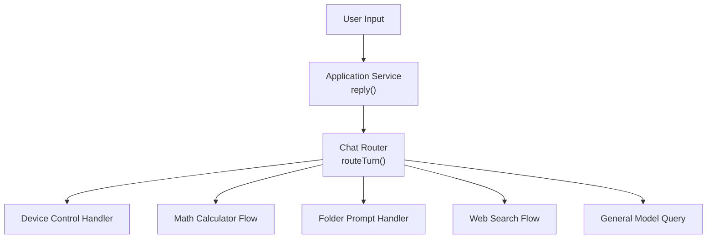
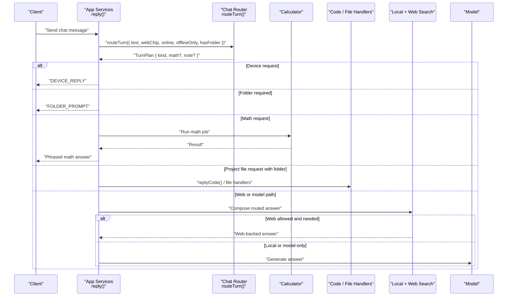
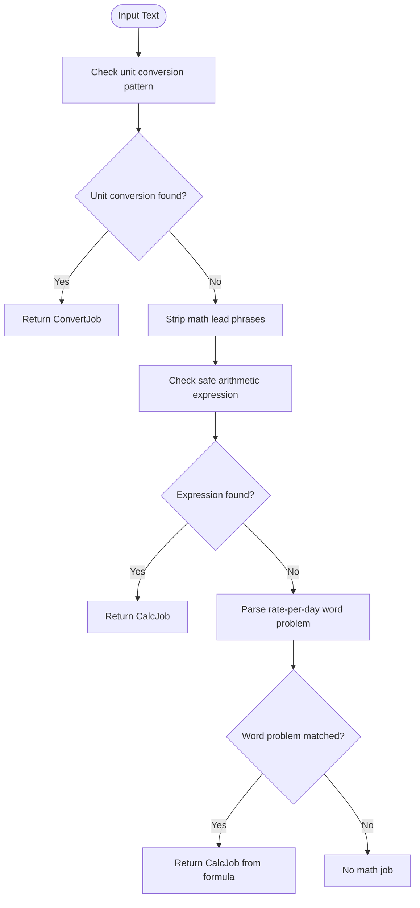
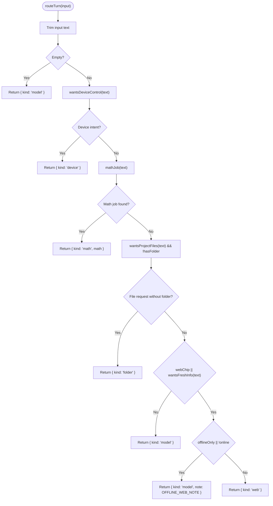
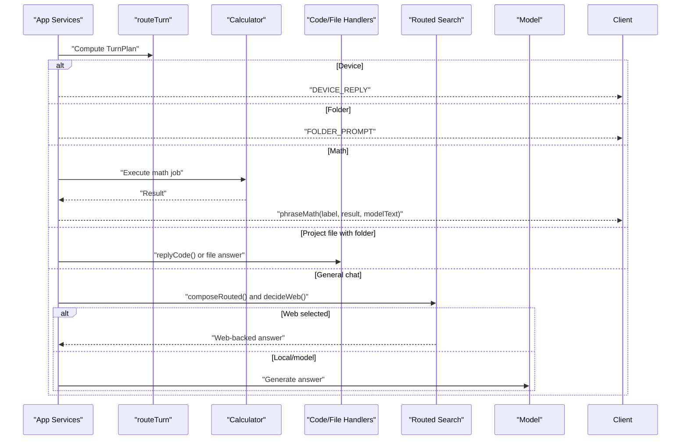
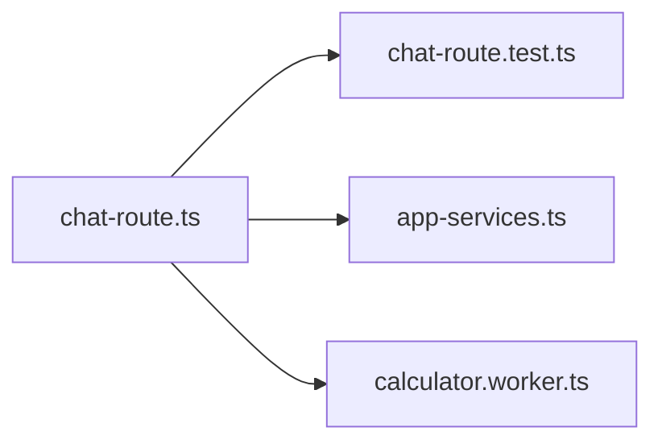

# Conversation Routing

<cite>
**Referenced Files in This Document**
- [chat-route.ts](file://apps/desktop/src/main/core/chat-route.ts)
- [chat-route.test.ts](file://apps/desktop/src/main/core/chat-route.test.ts)
- [app-services.ts](file://apps/desktop/src/main/core/app-services.ts)
</cite>

## Table of Contents
1. [Introduction](#introduction)
2. [Project Structure](#project-structure)
3. [Core Components](#core-components)
4. [Architecture Overview](#architecture-overview)
5. [Detailed Component Analysis](#detailed-component-analysis)
6. [Dependency Analysis](#dependency-analysis)
7. [Performance Considerations](#performance-considerations)
8. [Troubleshooting Guide](#troubleshooting-guide)
9. [Conclusion](#conclusion)

## Introduction
This document explains the conversation routing system that decides where each user message should go before any model call or web search. It covers how natural language input is analyzed, how intent is detected through pattern matching, and how the system routes to device control handling, mathematical calculation, project file operations, web search, or general model queries. It also documents the `TurnPlan` interface and the decision tree used by the router.

## Project Structure
The routing logic lives in the desktop application’s main process:

- The core routing module defines intent patterns, math parsing, and the `routeTurn` function.
- The test file validates routing decisions for device control, math, folder prompts, web behavior, and phrasing helpers.
- The application service layer calls `routeTurn`, interprets its result, and executes the appropriate handler.

**Diagram sources**
- [app-services.ts:1401-1435](file://apps/desktop/src/main/core/app-services.ts#L1401-L1435)
- [chat-route.ts:120-137](file://apps/desktop/src/main/core/chat-route.ts#L120-L137)

**Section sources**
- [chat-route.ts:1-50](file://apps/desktop/src/main/core/chat-route.ts#L1-L50)
- [app-services.ts:1401-1435](file://apps/desktop/src/main/core/app-services.ts#L1401-L1435)

## Core Components
The routing system centers on a small set of functions and types:

- `wantsDeviceControl(text)`: Detects requests to control the computer, mouse, keyboard, screen, or open system apps/files.
- `wantsProjectFiles(text)`: Detects requests to edit, analyze, inspect, review, explain, understand, scan, or open project files/folders.
- `wantsFreshInfo(text)`: Detects requests for current, breaking, news, weather, price, stock, or year-based information.
- `mathJob(text)`: Parses unit conversions, bare arithmetic expressions, and simple word problems into a calculable job.
- `routeTurn(input)`: Applies the routing decision tree and returns a `TurnPlan`.
- `phraseMath(label, result, modelText)` and `resultShown(text, result)`: Helpers for formatting calculator results with model text.
- `withWebBanner(answer, label, usedWeb)`: Adds or removes a “worldwide sources” banner depending on whether web search was used.

The key data structure is `TurnPlan`, which describes the chosen branch:

| Field | Meaning |
|---|---|
| `kind` | One of `device`, `folder`, `math`, `web`, or `model`. |
| `math` | Present when `kind` is `math`; contains either a calculation or a unit conversion job. |
| `note` | Optional note shown with a model answer when web search did not run. |

**Section sources**
- [chat-route.ts:21-50](file://apps/desktop/src/main/core/chat-route.ts#L21-L50)
- [chat-route.ts:93-152](file://apps/desktop/src/main/core/chat-route.ts#L93-L152)

## Architecture Overview
At runtime, the chat reply flow first computes routing context from settings and application state, then delegates to `routeTurn`. Based on the returned plan, the application service either responds immediately (device refusal, folder prompt), runs the calculator, forwards to code/project handlers, performs local retrieval and web routing, or falls back to a general model query.

**Diagram sources**
- [app-services.ts:1401-1750](file://apps/desktop/src/main/core/app-services.ts#L1401-L1750)
- [chat-route.ts:120-137](file://apps/desktop/src/main/core/chat-route.ts#L120-L137)

## Detailed Component Analysis

### Intent Detection Patterns
The router uses regular expressions to detect high-level intents before deeper processing.

| Pattern | Purpose | Example Triggers |
|---|---|---|
| `LEAD` | Recognizes math-introducing phrases like “what is”, “calculate”, “compute”, “how much is”. | “what is 2+2”, “calculate 5 * 3” |
| `EXPR` | Matches safe arithmetic tokens such as digits, spaces, dots, plus, minus, multiply, divide, percent, caret, and parentheses. | “2+2”, “(3*5)+10” |
| `DEVICE` | Detects device-control requests. | “control my laptop”, “click the button”, “open Finder”, “type this for me” |
| `FILES` | Detects project/file-related requests. | “edit the file in this project”, “analyse this local codebase”, “look at src/index.ts” |
| `FRESH` | Detects requests for current or time-sensitive information. | “latest release”, “today’s weather”, “stock prices”, “2025” |

These patterns are intentionally conservative: they avoid treating ordinary questions as math or device requests, and they prevent accidental matches inside longer sentences.

**Section sources**
- [chat-route.ts:21-25](file://apps/desktop/src/main/core/chat-route.ts#L21-L25)

### Math Parsing and Word Problems
The math pipeline supports three forms:

1. **Unit conversion**: Detects patterns like “100 USD to EUR” and produces a conversion job.
2. **Arithmetic expression**: Extracts a safe expression after stripping optional math-leading phrases.
3. **Word problem**: Converts a limited rate-per-day pattern into a single calculator expression.

The word-problem parser recognizes structures such as “thrice a day for 5 days” and “on two other days, twice the times”, optionally accounting for two named people referenced as “they”.

**Diagram sources**
- [chat-route.ts:69-106](file://apps/desktop/src/main/core/chat-route.ts#L69-L106)

**Section sources**
- [chat-route.ts:52-106](file://apps/desktop/src/main/core/chat-route.ts#L52-L106)

### TurnPlan Interface and Turn Types
`TurnPlan` is the contract between the router and the application service:

| `kind` | Behavior |
|---|---|
| `device` | The user asked for device control; the system replies with a refusal message. |
| `folder` | The user wants to work with project files but no folder is open; the system asks the user to open one. |
| `math` | The user asked for a calculation or unit conversion; the system computes it locally and formats the response. |
| `web` | The user explicitly requested web search via the UI chip, or the question implies fresh information; the system attempts web search if allowed and available. |
| `model` | The question is answered by the local model without forced web search. |

The optional `math` field carries either a `calc` or `convert` job. The optional `note` field is displayed alongside a model answer when web search was expected but skipped due to network or settings constraints.

**Section sources**
- [chat-route.ts:43-50](file://apps/desktop/src/main/core/chat-route.ts#L43-L50)
- [chat-route.ts:120-137](file://apps/desktop/src/main/core/chat-route.ts#L120-L137)

### Routing Decision Tree
The `routeTurn` function applies a fixed priority order:

1. Empty input → `model`.
2. Device control intent → `device`.
3. Math intent → `math`.
4. Project-file intent without an open folder → `folder`.
5. Decide whether web search is desired:
   - Desired if the user clicked the web chip or the question contains fresh-info keywords.
   - If not desired → `model`.
   - If desired but offline or network is unavailable → `model` with `OFFLINE_WEB_NOTE`.
   - Otherwise → `web`.

**Diagram sources**
- [chat-route.ts:120-137](file://apps/desktop/src/main/core/chat-route.ts#L120-L137)

**Section sources**
- [chat-route.ts:120-137](file://apps/desktop/src/main/core/chat-route.ts#L120-L137)

### Application Service Integration
The application service is responsible for turning `TurnPlan` into actual behavior:

- Device requests receive a fixed refusal message.
- Folder-required requests receive a prompt asking the user to open a project folder.
- Math requests are executed through the calculator and formatted using `phraseMath`.
- Project-file requests may be forwarded to code or file handlers.
- For general chat, the service composes a routed answer using local retrieval, region, freshness, and web availability, then decides whether to use web search or fall back to the model.

**Diagram sources**
- [app-services.ts:1401-1750](file://apps/desktop/src/main/core/app-services.ts#L1401-L1750)
- [chat-route.ts:147-160](file://apps/desktop/src/main/core/chat-route.ts#L147-L160)

**Section sources**
- [app-services.ts:1401-1435](file://apps/desktop/src/main/core/app-services.ts#L1401-L1435)
- [app-services.ts:1479-1750](file://apps/desktop/src/main/core/app-services.ts#L1479-L1750)

### Examples of Routing Decisions
The test suite demonstrates representative inputs and expected outcomes:

| Input Scenario | Expected Route | Reasoning |
|---|---|---|
| “what is 2+2” | `math` | Matches math lead phrase and arithmetic expression. |
| “Chase and Rider can ride their bikes thrice a day for 5 days...” | `math` | Word-problem parser builds a calculator expression. |
| “hello” | `model` unless web chip is active | No device, math, or file intent; web only if requested. |
| “What is the latest Electron release?” | `web` | Contains fresh-info keyword. |
| “control the laptop” | `device` | Matches device-control pattern. |
| “edit the file in this project” without folder | `folder` | File intent requires an open project folder. |
| “analyse this local codebase” without folder | `folder` | File-analysis intent requires an open project folder. |
| “edit the file in this project” with folder | `model` | File intent is satisfied; routing proceeds to normal chat flow. |
| “hello” with web chip enabled | `web` | Explicit web request overrides default model-only behavior. |
| “hello” with web chip enabled but offline/`offlineOnly` | `model` with offline note | Web is desired but unavailable. |

**Section sources**
- [chat-route.test.ts:23-88](file://apps/desktop/src/main/core/chat-route.test.ts#L23-L88)
- [chat-route.test.ts:95-122](file://apps/desktop/src/main/core/chat-route.test.ts#L95-L122)

## Dependency Analysis
The routing module is intentionally lightweight and mostly stateless. Its dependencies are:

- Regular expressions for intent detection.
- A calculator worker for arithmetic and unit conversion.
- The application service for executing the chosen route.
- Tests for validating routing behavior.

**Diagram sources**
- [chat-route.ts:1-161](file://apps/desktop/src/main/core/chat-route.ts#L1-L161)
- [chat-route.test.ts:1-123](file://apps/desktop/src/main/core/chat-route.test.ts#L1-L123)
- [app-services.ts:1401-1435](file://apps/desktop/src/main/core/app-services.ts#L1401-L1435)

**Section sources**
- [chat-route.ts:1-161](file://apps/desktop/src/main/core/chat-route.ts#L1-L161)
- [chat-route.test.ts:1-123](file://apps/desktop/src/main/core/chat-route.test.ts#L1-L123)
- [app-services.ts:1401-1435](file://apps/desktop/src/main/core/app-services.ts#L1401-L1435)

## Performance Considerations
- Pattern matching is fast and deterministic, avoiding expensive NLP or model calls during routing.
- Math computation is delegated to a dedicated calculator, keeping the main chat path responsive.
- Web search is only attempted when explicitly requested or when fresh information is clearly implied, reducing unnecessary network usage.
- The router avoids forcing web search for ordinary questions, preferring local model answers when possible.

[No sources needed since this section provides general guidance]

## Troubleshooting Guide
Common routing issues and their likely causes:

| Symptom | Likely Cause | Resolution |
|---|---|---|
| Device-control requests always return the same refusal | Device control is intentionally unsupported in this routing path | Use supported features such as answering questions, math, or code assistance. |
| File-edit requests ask to open a folder even when a project seems open | `hasFolder` was false when routing was computed | Ensure a project root is active before sending file-edit messages. |
| Math answers include unrelated model text | `phraseMath` could not find the calculator result in the model’s output | Provide clearer math prompts or rely on the built-in phrasing fallback. |
| Web search does not run for “latest” questions | Network is offline or `offlineOnly` is enabled | Enable network access or disable `offlineOnly` if web search is allowed. |
| Web search is disabled despite clicking the web chip | Settings or policy prevented web search | Check `webSearchAllowed` and sign-in requirements. |

**Section sources**
- [chat-route.ts:6-19](file://apps/desktop/src/main/core/chat-route.ts#L6-L19)
- [chat-route.ts:147-160](file://apps/desktop/src/main/core/chat-route.ts#L147-L160)
- [app-services.ts:1418-1435](file://apps/desktop/src/main/core/app-services.ts#L1418-L1435)
- [app-services.ts:1720-1750](file://apps/desktop/src/main/core/app-services.ts#L1720-L1750)

## Conclusion
The conversation routing system provides a clear, predictable entry point for every user message. It separates device control, math, project-file operations, web search, and general model queries using simple pattern matching and a strict decision tree. This design keeps the chat experience fast, transparent, and easy to reason about while allowing the broader application service to handle richer flows such as local retrieval, regional constraints, and web-backed answers.

[No sources needed since this section summarizes without analyzing specific files]