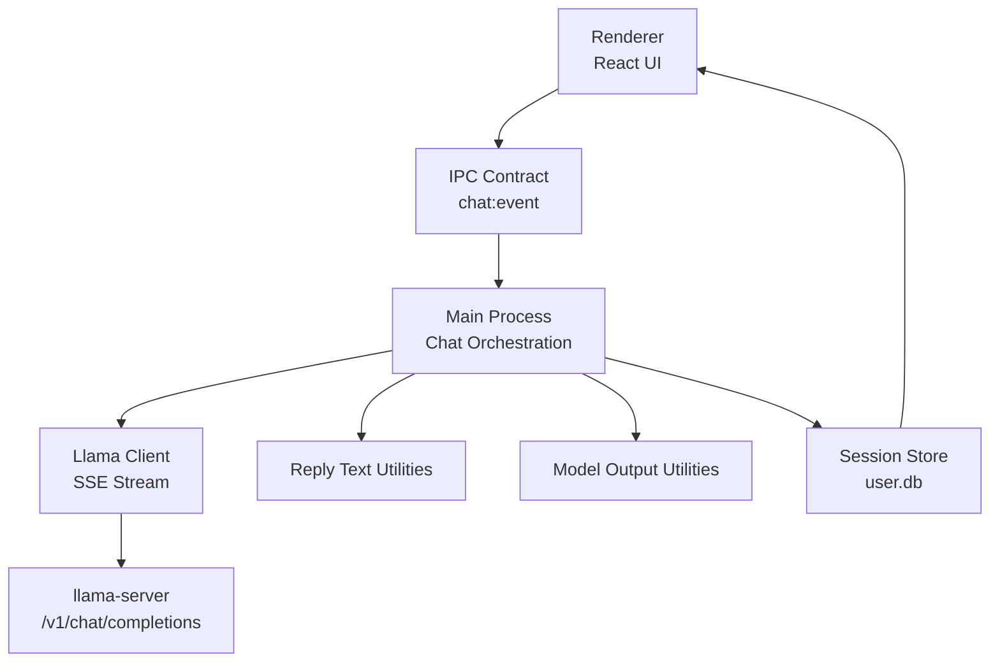
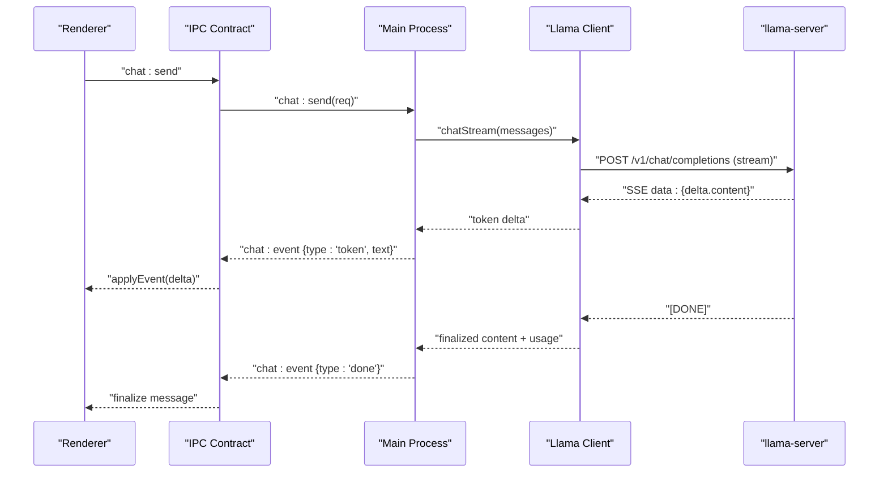
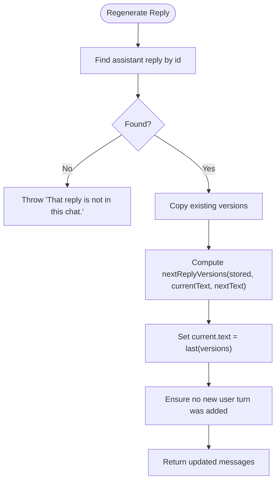
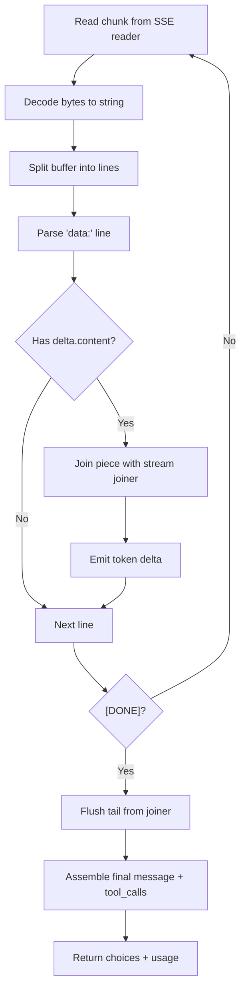
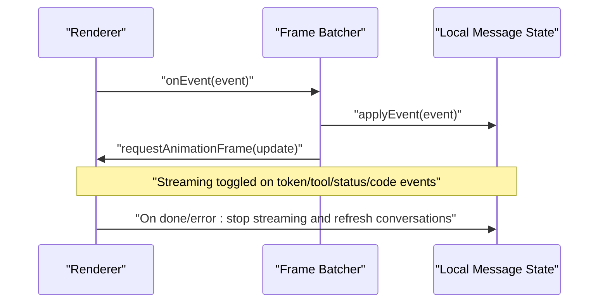
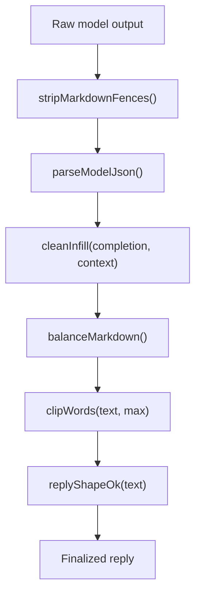
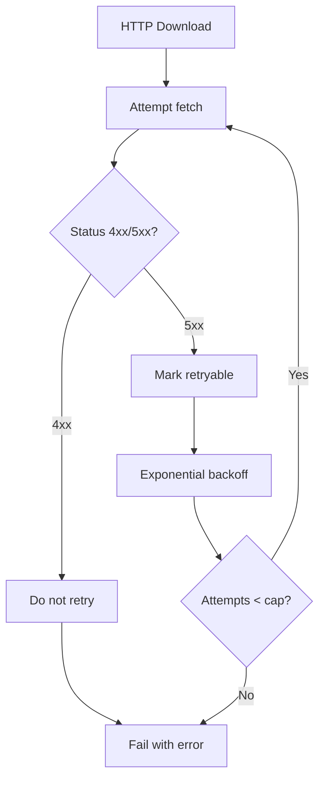
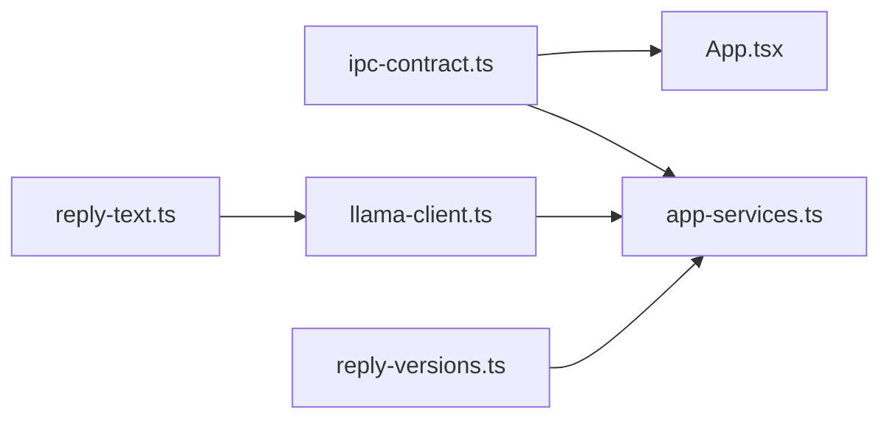

# Reply Processing

<cite>
**Referenced Files in This Document**
- [reply-versions.ts](file://apps/desktop/src/main/core/reply-versions.ts)
- [app-services.ts](file://apps/desktop/src/main/core/app-services.ts)
- [ipc-contract.ts](file://apps/desktop/src/shared/ipc-contract.ts)
- [model-output.ts](file://apps/desktop/src/shared/model-output.ts)
- [reply-text.ts](file://apps/desktop/src/shared/reply-text.ts)
- [llama-client.ts](file://apps/desktop/src/main/core/llama-client.ts)
- [App.tsx](file://apps/desktop/src/renderer/src/App.tsx)
- [http-download.mjs](file://apps/desktop/scripts/http-download.mjs)
- [http-download.test.mjs](file://apps/desktop/scripts/http-download.test.mjs)
</cite>

## Table of Contents
1. [Introduction](#introduction)
2. [Project Structure](#project-structure)
3. [Core Components](#core-components)
4. [Architecture Overview](#architecture-overview)
5. [Detailed Component Analysis](#detailed-component-analysis)
6. [Dependency Analysis](#dependency-analysis)
7. [Performance Considerations](#performance-considerations)
8. [Troubleshooting Guide](#troubleshooting-guide)
9. [Conclusion](#conclusion)

## Introduction
This document explains how replies are processed, versioned, streamed, and transformed across the application. It covers:
- How different response formats from models are detected and normalized.
- How backward compatibility is maintained when model outputs evolve.
- How streaming responses are handled with memory-efficient processing.
- How real-time updates flow from the main process to the renderer.
- The reply versioning strategy for regeneration without adding extra user turns.
- Error handling, malformed response recovery, retry strategies, and graceful degradation.

## Project Structure
The reply pipeline spans several layers:
- Renderer UI subscribes to IPC events and applies them to local message state.
- Main process orchestrates retrieval, model calls, tool execution, and event emission.
- Shared utilities normalize text, JSON, and Markdown before display or persistence.
- Model client streams tokens from llama-server and forwards deltas.

**Diagram sources**
- [ipc-contract.ts:8-108](file://apps/desktop/src/shared/ipc-contract.ts#L8-L108)
- [llama-client.ts:111-161](file://apps/desktop/src/main/core/llama-client.ts#L111-L161)
- [reply-text.ts:23-68](file://apps/desktop/src/shared/reply-text.ts#L23-L68)
- [model-output.ts:7-30](file://apps/desktop/src/shared/model-output.ts#L7-L30)

**Section sources**
- [ipc-contract.ts:8-108](file://apps/desktop/src/shared/ipc-contract.ts#L8-L108)
- [llama-client.ts:111-161](file://apps/desktop/src/main/core/llama-client.ts#L111-L161)
- [reply-text.ts:23-68](file://apps/desktop/src/shared/reply-text.ts#L23-L68)
- [model-output.ts:7-30](file://apps/desktop/src/shared/model-output.ts#L7-L30)

## Core Components
- Reply versioning: maintains sibling texts for a single assistant reply and supports regeneration without adding new user turns.
- Streaming joiner: safely joins UTF-8 chunks and token pieces without splitting characters or words.
- Markdown balancing: ensures fences and bold markers remain balanced during streaming and finalization.
- Model output normalization: strips fenced blocks, extracts JSON from prose, and cleans fill-in-the-middle artifacts.
- Event contract: defines chat events including token deltas, sources, tools, status, completion, and errors.
- Llama client: streams SSE tokens, collects content and tool calls, and returns assembled messages.

Key responsibilities:
- Versioning logic lives in a small utility module focused on reply history semantics.
- Text transformation utilities ensure stable rendering and storage.
- IPC types define the contract between renderer and main process.
- Llama client abstracts streaming protocol details and error propagation.

**Section sources**
- [reply-versions.ts:1-32](file://apps/desktop/src/main/core/reply-versions.ts#L1-L32)
- [reply-text.ts:23-191](file://apps/desktop/src/shared/reply-text.ts#L23-L191)
- [model-output.ts:7-108](file://apps/desktop/src/shared/model-output.ts#L7-L108)
- [ipc-contract.ts:242-261](file://apps/desktop/src/shared/ipc-contract.ts#L242-L261)
- [llama-client.ts:111-247](file://apps/desktop/src/main/core/llama-client.ts#L111-L247)

## Architecture Overview
End-to-end reply flow:
1. Renderer sends a chat request over IPC.
2. Main process validates the request, runs retrieval and gating, then calls the model.
3. Llama client streams tokens via SSE; deltas are forwarded as chat events.
4. Renderer batches events and updates messages in real time.
5. On completion, the main process persists the answer, citations, and budget metrics.
6. Regeneration updates the same assistant reply by appending a new version.

**Diagram sources**
- [ipc-contract.ts:8-108](file://apps/desktop/src/shared/ipc-contract.ts#L8-L108)
- [llama-client.ts:111-161](file://apps/desktop/src/main/core/llama-client.ts#L111-L161)
- [App.tsx:185-196](file://apps/desktop/src/renderer/src/App.tsx#L185-L196)

## Detailed Component Analysis

### Reply Versioning Strategy
- A saved assistant reply stores an array of versions where the last entry is the current text.
- Regeneration computes the next version list, deduplicates identical entries, and replaces the current text without adding a new user turn.
- Persistence keeps versions on the same row so reopening the chat shows the correct latest version while preserving history.

**Diagram sources**
- [reply-versions.ts:18-32](file://apps/desktop/src/main/core/reply-versions.ts#L18-L32)

**Section sources**
- [reply-versions.ts:1-32](file://apps/desktop/src/main/core/reply-versions.ts#L1-L32)
- [app-services.ts:106-106](file://apps/desktop/src/main/core/app-services.ts#L106-L106)

### Streaming Response Handling
- The Llama client reads SSE lines, decodes UTF-8, splits into lines, and parses JSON deltas.
- Token pieces are joined using a stream joiner that avoids splitting surrogate pairs and incomplete characters.
- Tool-call deltas are collected and reconstructed into complete tool_calls after the stream ends.
- Usage information is aggregated and returned alongside the final message.

**Diagram sources**
- [llama-client.ts:111-161](file://apps/desktop/src/main/core/llama-client.ts#L111-L161)
- [llama-client.ts:167-247](file://apps/desktop/src/main/core/llama-client.ts#L167-L247)
- [reply-text.ts:23-68](file://apps/desktop/src/shared/reply-text.ts#L23-L68)

**Section sources**
- [llama-client.ts:111-247](file://apps/desktop/src/main/core/llama-client.ts#L111-L247)
- [reply-text.ts:23-68](file://apps/desktop/src/shared/reply-text.ts#L23-L68)

### Real-Time Update Mechanisms
- The renderer uses a frame batcher to coalesce multiple chat events per animation frame.
- Events like token, tool, sources, status, code-step, and code-diff set streaming state.
- Completion or error events stop streaming and refresh conversation lists.

**Diagram sources**
- [App.tsx:185-196](file://apps/desktop/src/renderer/src/App.tsx#L185-L196)

**Section sources**
- [App.tsx:185-196](file://apps/desktop/src/renderer/src/App.tsx#L185-L196)

### Response Transformation Pipelines
- Markdown fences are stripped from raw model output before JSON parsing.
- JSON extraction tries fenced blocks first, then searches for embedded objects or arrays.
- Fill-in-the-middle completions have duplicated suffixes removed and extra closing braces trimmed based on brace depth analysis.
- Final reply text balances Markdown fences and bold markers, clips titles/previews on word boundaries, and validates shape.

**Diagram sources**
- [model-output.ts:7-30](file://apps/desktop/src/shared/model-output.ts#L7-L30)
- [model-output.ts:41-108](file://apps/desktop/src/shared/model-output.ts#L41-L108)
- [reply-text.ts:98-191](file://apps/desktop/src/shared/reply-text.ts#L98-L191)

**Section sources**
- [model-output.ts:7-108](file://apps/desktop/src/shared/model-output.ts#L7-L108)
- [reply-text.ts:98-191](file://apps/desktop/src/shared/reply-text.ts#L98-L191)

### Backward Compatibility and Format Detection
- parseModelJson handles both fenced and prose-wrapped JSON, falling back to substring search for objects or arrays.
- cleanInfill tolerates repeated suffixes and extra closers common in fill-in-the-middle models.
- replyShapeOk rejects malformed text containing replacement characters, lone surrogates, unbalanced Markdown, or trailing partial words.
- These transformations ensure older and newer model outputs render consistently.

**Section sources**
- [model-output.ts:16-30](file://apps/desktop/src/shared/model-output.ts#L16-L30)
- [model-output.ts:41-108](file://apps/desktop/src/shared/model-output.ts#L41-L108)
- [reply-text.ts:185-191](file://apps/desktop/src/shared/reply-text.ts#L185-L191)

### Graceful Degradation for Unknown Response Types
- When tool arguments are not valid JSON objects, the system wraps the error message and continues the loop rather than failing the entire request.
- If the model does not support tools or returns incompatible fields, nativeToolsRejected detects these conditions and allows fallback behavior.
- The runWithTools loop caps tool-call rounds to prevent infinite loops and returns a safe fallback answer if it cannot finish.

**Section sources**
- [llama-client.ts:249-298](file://apps/desktop/src/main/core/llama-client.ts#L249-L298)
- [code-agent/loop.ts:518-524](file://apps/desktop/src/main/core/code-agent/loop.ts#L518-L524)

### Error Handling, Retry Mechanisms, and Fallback Strategies
- HTTP download retries use exponential backoff for transient failures and skip retries for client errors.
- Attempt caps prevent indefinite retries; delays double each attempt until the cap.
- In chat orchestration, abort signals cancel inflight requests and cleanup occurs in finally blocks.
- Errors from model loading surface smaller model suggestions to the UI.

**Diagram sources**
- [http-download.mjs:19-43](file://apps/desktop/scripts/http-download.mjs#L19-L43)
- [http-download.test.mjs:41-63](file://apps/desktop/scripts/http-download.test.mjs#L41-L63)

**Section sources**
- [http-download.mjs:19-43](file://apps/desktop/scripts/http-download.mjs#L19-L43)
- [http-download.test.mjs:41-63](file://apps/desktop/scripts/http-download.test.mjs#L41-L63)
- [app-services.ts:2347-2368](file://apps/desktop/src/main/core/app-services.ts#L2347-L2368)

## Dependency Analysis
- ipc-contract.ts defines the IPC channels and ChatEvent union used throughout the app.
- llama-client.ts depends on shared reply-text utilities for safe streaming joins.
- app-services.ts imports reply-versions for regeneration and integrates with session store and web cache.
- App.tsx consumes IPC events and manages streaming state in the renderer.

**Diagram sources**
- [ipc-contract.ts:8-108](file://apps/desktop/src/shared/ipc-contract.ts#L8-L108)
- [llama-client.ts:6-7](file://apps/desktop/src/main/core/llama-client.ts#L6-L7)
- [reply-versions.ts:1-32](file://apps/desktop/src/main/core/reply-versions.ts#L1-L32)
- [app-services.ts:106-106](file://apps/desktop/src/main/core/app-services.ts#L106-L106)
- [App.tsx:185-196](file://apps/desktop/src/renderer/src/App.tsx#L185-L196)

**Section sources**
- [ipc-contract.ts:8-108](file://apps/desktop/src/shared/ipc-contract.ts#L8-L108)
- [llama-client.ts:6-7](file://apps/desktop/src/main/core/llama-client.ts#L6-L7)
- [reply-versions.ts:1-32](file://apps/desktop/src/main/core/reply-versions.ts#L1-L32)
- [app-services.ts:106-106](file://apps/desktop/src/main/core/app-services.ts#L106-L106)
- [App.tsx:185-196](file://apps/desktop/src/renderer/src/App.tsx#L185-L196)

## Performance Considerations
- Memory-efficient streaming:
  - createStreamJoiner processes UTF-8 bytes incrementally and flushes only complete characters.
  - joinTokenPieces and joinUtf8Chunks avoid building large intermediate strings.
- Rendering efficiency:
  - Frame batching reduces React re-renders by grouping events per animation frame.
- Large responses:
  - balanceMarkdown and streamingMarkdown keep UI stable by hiding open fences/bold markers.
  - clipWords trims previews and titles on word boundaries to reduce layout cost.
- Model call optimization:
  - chatRequestFields sets sampling and template kwargs once per request.
  - cachePrompt can reuse KV cache when prompts match previous requests.

**Section sources**
- [reply-text.ts:23-68](file://apps/desktop/src/shared/reply-text.ts#L23-L68)
- [reply-text.ts:98-191](file://apps/desktop/src/shared/reply-text.ts#L98-L191)
- [App.tsx:185-196](file://apps/desktop/src/renderer/src/App.tsx#L185-L196)
- [llama-client.ts:36-41](file://apps/desktop/src/main/core/llama-client.ts#L36-L41)
- [llama-client.ts:80-99](file://apps/desktop/src/main/core/llama-client.ts#L80-L99)

## Troubleshooting Guide
Common issues and resolutions:
- Malformed JSON from models:
  - Use parseModelJson to extract JSON from fenced blocks or prose; it falls back to substring search for objects/arrays.
- Incomplete UTF-8 sequences:
  - Use createStreamJoiner to safely decode bytes and flush partial characters at stream end.
- Unbalanced Markdown:
  - Apply balanceMarkdown to close open fences and bold markers; use streamingMarkdown during live updates.
- Tool-call failures:
  - Wrap invalid tool arguments in error messages; detect unsupported tool features and fall back gracefully.
- Network errors during downloads:
  - Respect retryable flags and exponential backoff; do not retry client errors; cap attempts.

Actionable checks:
- Verify replyShapeOk returns true for stored text.
- Confirm chat events include token deltas and a final done event.
- Inspect error payloads for codes like rate_limited or internal_error and apply appropriate user messaging.

**Section sources**
- [model-output.ts:16-30](file://apps/desktop/src/shared/model-output.ts#L16-L30)
- [reply-text.ts:185-191](file://apps/desktop/src/shared/reply-text.ts#L185-L191)
- [llama-client.ts:249-298](file://apps/desktop/src/main/core/llama-client.ts#L249-L298)
- [http-download.mjs:19-43](file://apps/desktop/scripts/http-download.mjs#L19-L43)

## Conclusion
The reply processing system combines robust streaming, careful text normalization, and explicit versioning to deliver reliable, real-time responses. It handles diverse model outputs, maintains backward compatibility, and degrades gracefully under errors. Performance is optimized through incremental decoding, frame batching, and prompt caching. Together, these components ensure a smooth user experience even with evolving model behaviors and large responses.