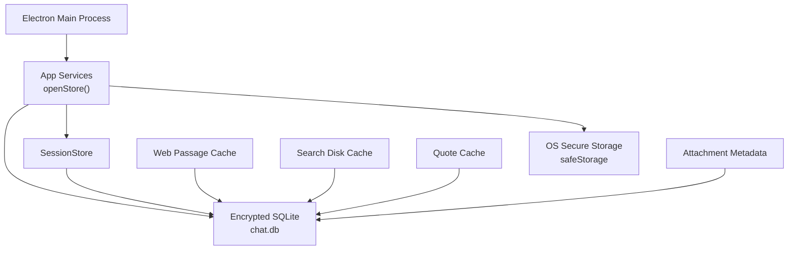
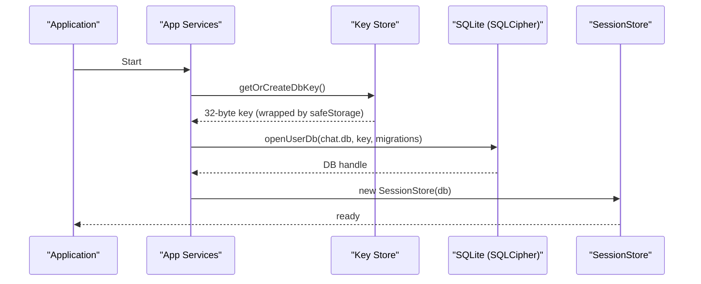
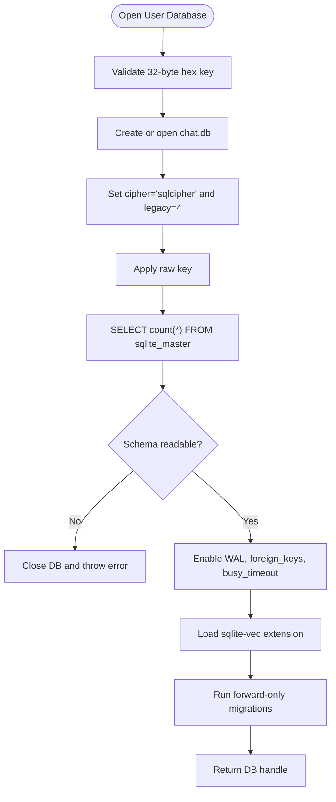
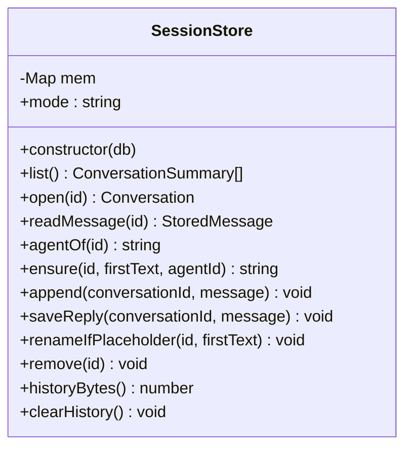
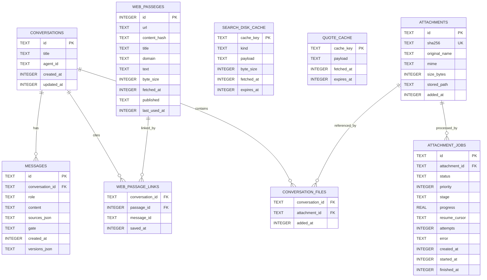
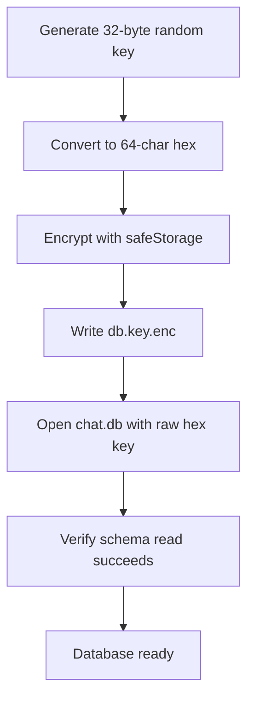
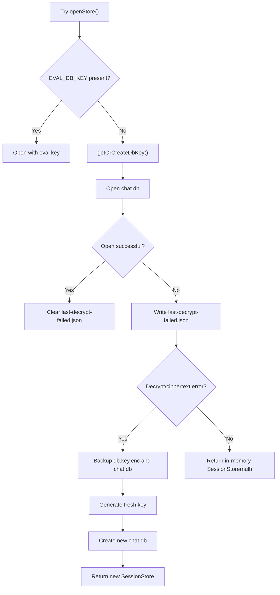
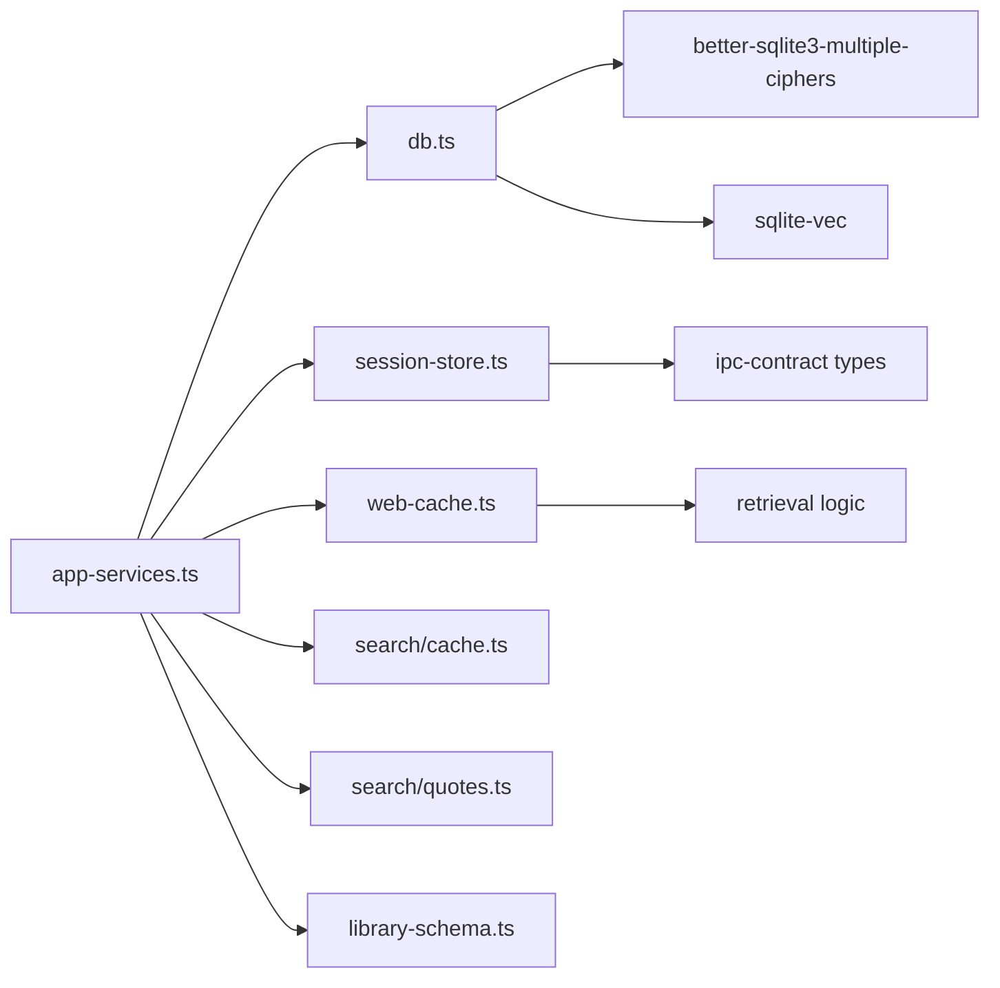

# Session Storage

<cite>
**Referenced Files in This Document**   
- [session-store.ts](file://apps/desktop/src/main/core/session-store.ts)
- [db.ts](file://apps/desktop/src/main/core/db.ts)
- [app-services.ts](file://apps/desktop/src/main/core/app-services.ts)
- [key-store.ts](file://docs/code-samples/ts/key-store.ts)
- [web-cache.ts](file://apps/desktop/src/main/core/web-cache.ts)
- [cache.ts](file://apps/desktop/src/main/core/search/cache.ts)
- [quotes.ts](file://apps/desktop/src/main/core/search/quotes.ts)
- [library-schema.ts](file://apps/desktop/src/main/core/library-schema.ts)
- [local_user_db.sql](file://docs/code-samples/local_user_db.sql)
</cite>

## Table of Contents
1. [Introduction](#introduction)
2. [Project Structure](#project-structure)
3. [Core Components](#core-components)
4. [Architecture Overview](#architecture-overview)
5. [Detailed Component Analysis](#detailed-component-analysis)
6. [Dependency Analysis](#dependency-analysis)
7. [Performance Considerations](#performance-considerations)
8. [Troubleshooting Guide](#troubleshooting-guide)
9. [Conclusion](#conclusion)
10. [Appendices](#appendices)

## Introduction
This document explains the local session storage mechanism used by the desktop application to persist conversations and related data. The system uses an encrypted SQLite database through `better-sqlite3-multiple-ciphers` in SQLCipher v4-compatible mode. Conversations, messages, cited web passages, search caches, quote snapshots, and attachment metadata are stored in a single user database file. When secure OS storage is unavailable, the store falls back to an in-memory session-only mode for that launch.

The documentation covers:
- Data models and schema evolution
- Encryption and key management
- Indexing and query patterns
- Session lifecycle and fallback behavior
- Automatic backup and restore on decryption failure
- Search capabilities using FTS5 and vector search
- Export formats and privacy considerations
- Data integrity, corruption recovery, and performance tuning

## Project Structure
Session storage is implemented in the Electron main process. The primary components are:

| Area | Responsibility | Key File |
|---|---|---|
| Database bootstrap | Opens the encrypted database, configures WAL, loads vector extension, runs migrations | [db.ts](file://apps/desktop/src/main/core/db.ts) |
| Session persistence | Conversation and message CRUD, preview generation, reply versioning | [session-store.ts](file://apps/desktop/src/main/core/session-store.ts) |
| Web citation cache | Stores cited web passages, vectors, FTS index, and conversation links | [web-cache.ts](file://apps/desktop/src/main/core/web-cache.ts) |
| Search disk cache | Expiring search results and page payloads | [cache.ts](file://apps/desktop/src/main/core/search/cache.ts) |
| Quote cache | Short-lived stock-quote snapshots | [quotes.ts](file://apps/desktop/src/main/core/search/quotes.ts) |
| Attachment metadata | Private document index and processing jobs | [library-schema.ts](file://apps/desktop/src/main/core/library-schema.ts) |
| Application wiring | Creates the database, selects migrations, handles decryption failures | [app-services.ts](file://apps/desktop/src/main/core/app-services.ts) |
| Key management | Generates and stores the random 32-byte database key via OS secure storage | [key-store.ts](file://docs/code-samples/ts/key-store.ts) |

**Diagram sources**
- [app-services.ts:3480-3531](file://apps/desktop/src/main/core/app-services.ts#L3480-L3531)
- [db.ts:34-51](file://apps/desktop/src/main/core/db.ts#L34-L51)
- [session-store.ts:40-49](file://apps/desktop/src/main/core/session-store.ts#L40-L49)
- [web-cache.ts:16-59](file://apps/desktop/src/main/core/web-cache.ts#L16-L59)
- [cache.ts:12-21](file://apps/desktop/src/main/core/search/cache.ts#L12-L21)
- [quotes.ts:24-31](file://apps/desktop/src/main/core/search/quotes.ts#L24-L31)
- [library-schema.ts:1-34](file://apps/desktop/src/main/core/library-schema.ts#L1-L34)

**Section sources**
- [db.ts:1-78](file://apps/desktop/src/main/core/db.ts#L1-L78)
- [session-store.ts:1-277](file://apps/desktop/src/main/core/session-store.ts#L1-L277)
- [app-services.ts:3480-3531](file://apps/desktop/src/main/core/app-services.ts#L3480-L3531)

## Core Components
The session storage layer is centered around three responsibilities:

1. **Encrypted database access**: A shared helper opens `chat.db`, enables WAL, enforces foreign keys, sets busy timeout, loads the sqlite-vec extension, and applies forward-only migrations.
2. **Conversation persistence**: `SessionStore` provides list, open, append, saveReply, rename, remove, and clear operations. It also supports an in-memory fallback when the database cannot be opened.
3. **Auxiliary caches**: Cited web passages, search results, quote snapshots, and attachment metadata live in the same encrypted database with their own migrations, TTLs, and eviction policies.

Key implementation characteristics:
- The database key is a random 32-byte value stored as hex and wrapped by Electron `safeStorage`.
- Migrations are applied sequentially using `PRAGMA user_version`.
- Queries use prepared statements and JSON columns for flexible metadata.
- Vector search is enabled through sqlite-vec for cited web passages.
- Full-text search is enabled through FTS5 for web passage titles and text.

**Section sources**
- [db.ts:29-63](file://apps/desktop/src/main/core/db.ts#L29-L63)
- [session-store.ts:13-30](file://apps/desktop/src/main/core/session-store.ts#L13-L30)
- [web-cache.ts:16-59](file://apps/desktop/src/main/core/web-cache.ts#L16-L59)
- [cache.ts:8-21](file://apps/desktop/src/main/core/search/cache.ts#L8-L21)
- [quotes.ts:22-31](file://apps/desktop/src/main/core/search/quotes.ts#L22-L31)

## Architecture Overview
The session storage architecture combines encryption, migration-driven schema evolution, and layered caching.

**Diagram sources**
- [app-services.ts:3480-3531](file://apps/desktop/src/main/core/app-services.ts#L3480-L3531)
- [key-store.ts:15-31](file://docs/code-samples/ts/key-store.ts#L15-L31)
- [db.ts:34-51](file://apps/desktop/src/main/core/db.ts#L34-L51)
- [session-store.ts:40-49](file://apps/desktop/src/main/core/session-store.ts#L40-L49)

## Detailed Component Analysis

### Encrypted Database Bootstrap
The database bootstrap function validates the key format, creates or opens the SQLite file, configures SQLCipher compatibility, verifies the key quickly, enables WAL journaling, turns on foreign keys, sets a busy timeout, loads the vector extension, and runs migrations. It also exposes rekeying support for rotating the underlying key.

Important behaviors:
- Wrong or corrupt databases throw a descriptive error during the initial schema check.
- WAL mode improves concurrency and crash safety.
- Foreign keys are enforced at runtime.
- The vector extension is loaded once per connection.
- Migrations are transactional and versioned.

**Diagram sources**
- [db.ts:34-63](file://apps/desktop/src/main/core/db.ts#L34-L63)

**Section sources**
- [db.ts:29-63](file://apps/desktop/src/main/core/db.ts#L29-L63)
- [db.ts:73-77](file://apps/desktop/src/main/core/db.ts#L73-L77)

### Session Lifecycle Management
`SessionStore` manages conversations and messages. It supports two modes:

| Mode | Behavior |
|---|---|
| Encrypted | Persists conversations and messages to `chat.db`. |
| Session | Keeps conversations in memory for the current launch only. |

Lifecycle operations include:
- Creating or ensuring a conversation with a generated ID and title.
- Appending user and assistant messages.
- Saving assistant replies, including regeneration versions.
- Listing recent conversations with a preview from the latest message.
- Opening a conversation and reading individual messages.
- Removing a conversation and its linked citations.
- Clearing all history.

**Diagram sources**
- [session-store.ts:40-242](file://apps/desktop/src/main/core/session-store.ts#L40-L242)

**Section sources**
- [session-store.ts:40-242](file://apps/desktop/src/main/core/session-store.ts#L40-L242)

### Data Models and Schema Evolution
The active session schema defines two core tables:

| Table | Purpose | Important Columns |
|---|---|---|
| `conversations` | Tracks each chat session | `id`, `title`, `agent_id`, `created_at`, `updated_at` |
| `messages` | Stores user and assistant turns | `id`, `conversation_id`, `role`, `content`, `sources_json`, `gate`, `created_at`, `versions_json` |

Additional related schemas live in the same database:

| Area | Tables / Virtual Tables | Purpose |
|---|---|---|
| Web citations | `web_passages`, `web_passage_links`, `web_fts`, `web_vec` | Stores cited web content, FTS index, and 256-dimensional cosine embeddings |
| Search cache | `search_disk_cache` | Expiring search results and page payloads |
| Quote cache | `quote_cache` | Short-lived stock-quote snapshots |
| Attachments | `attachments`, `conversation_files`, `attachment_jobs` | Private document index and processing queue |

Migration strategy:
- Each migration is a SQL string applied in order.
- `user_version` tracks progress.
- The session migration creates the base conversation tables.
- The library migration adds attachment-related tables.
- Web cache, search cache, and quote cache migrations add their respective tables.

Future schema direction:
- A sample extended schema exists in the code samples, showing additional fields such as model references, summaries, pinning, archiving, tool calls, grounding, token counts, latency, and status. This indicates planned evolution beyond the current minimal session schema.

**Diagram sources**
- [session-store.ts:13-30](file://apps/desktop/src/main/core/session-store.ts#L13-L30)
- [web-cache.ts:16-59](file://apps/desktop/src/main/core/web-cache.ts#L16-L59)
- [cache.ts:12-21](file://apps/desktop/src/main/core/search/cache.ts#L12-L21)
- [quotes.ts:24-31](file://apps/desktop/src/main/core/search/quotes.ts#L24-L31)
- [library-schema.ts:1-34](file://apps/desktop/src/main/core/library-schema.ts#L1-L34)
- [local_user_db.sql:101-150](file://docs/code-samples/local_user_db.sql#L101-L150)

**Section sources**
- [session-store.ts:13-30](file://apps/desktop/src/main/core/session-store.ts#L13-L30)
- [library-schema.ts:1-34](file://apps/desktop/src/main/core/library-schema.ts#L1-L34)
- [web-cache.ts:16-59](file://apps/desktop/src/main/core/web-cache.ts#L16-L59)
- [cache.ts:12-21](file://apps/desktop/src/main/core/search/cache.ts#L12-L21)
- [quotes.ts:24-31](file://apps/desktop/src/main/core/search/quotes.ts#L24-L31)
- [local_user_db.sql:101-150](file://docs/code-samples/local_user_db.sql#L101-L150)

### Encryption Implementation
Encryption is provided by `better-sqlite3-multiple-ciphers` configured for SQLCipher v4 compatibility. The database key is:
- Randomly generated as 32 bytes.
- Stored as a 64-character hexadecimal string.
- Encrypted by Electron `safeStorage`, which uses the OS keychain or platform equivalent.
- Applied directly without PBKDF2 because the key is already cryptographically random.

Key rotation is supported through a rekey operation that updates the database encryption without changing the logical schema.

**Diagram sources**
- [key-store.ts:15-31](file://docs/code-samples/ts/key-store.ts#L15-L31)
- [db.ts:34-51](file://apps/desktop/src/main/core/db.ts#L34-L51)
- [db.ts:73-77](file://apps/desktop/src/main/core/db.ts#L73-L77)

**Section sources**
- [key-store.ts:15-31](file://docs/code-samples/ts/key-store.ts#L15-L31)
- [db.ts:29-51](file://apps/desktop/src/main/core/db.ts#L29-L51)
- [db.ts:73-77](file://apps/desktop/src/main/core/db.ts#L73-L77)

### Automatic Backup and Restore on Decryption Failure
When opening the encrypted store fails, the application performs a controlled recovery flow:

1. If an evaluation key is provided, it opens the database directly.
2. Otherwise, it retrieves the key from secure storage and opens the database.
3. On success, it removes a repeat-failure marker file.
4. On failure, it writes a timestamped flag describing the error.
5. If the error looks like a secure-storage ciphertext problem, it backs up the old key and unreadable database files.
6. It generates a fresh key and creates a new empty database.
7. It logs that the chat store was reset and clears the repeat-failure marker.
8. If recovery still fails, it falls back to an in-memory session store so the app remains usable.

**Diagram sources**
- [app-services.ts:3480-3531](file://apps/desktop/src/main/core/app-services.ts#L3480-L3531)

**Section sources**
- [app-services.ts:3480-3531](file://apps/desktop/src/main/core/app-services.ts#L3480-L3531)

### Conversation Search Capabilities
Conversation listing is optimized for recent chats:
- The list query returns up to 200 conversations ordered by `updated_at DESC`.
- A correlated subquery fetches the latest message content as a preview.
- Preview text is clipped to a fixed word limit.

For broader search, the application uses auxiliary caches:
- Web passages use FTS5 for keyword matching and sqlite-vec for semantic similarity.
- Search results and page payloads are cached with expiration.
- Quote snapshots are cached briefly for repeated queries.

There is no dedicated full-text index over conversation message content in the current session schema. Conversation search therefore relies on:
- Recent-list ordering.
- Title-based display.
- External search features that may operate on exported data or other indexes.

**Section sources**
- [session-store.ts:51-69](file://apps/desktop/src/main/core/session-store.ts#L51-L69)
- [web-cache.ts:16-59](file://apps/desktop/src/main/core/web-cache.ts#L16-L59)
- [web-cache.ts:181-239](file://apps/desktop/src/main/core/web-cache.ts#L181-L239)
- [cache.ts:35-45](file://apps/desktop/src/main/core/search/cache.ts#L35-L45)
- [quotes.ts:177-190](file://apps/desktop/src/main/core/search/quotes.ts#L177-L190)

### Export Formats
The repository does not define a dedicated export API for conversations in the analyzed files. However, the following mechanisms are relevant:

| Mechanism | Format | Notes |
|---|---|---|
| Message content | Plain text stored in `messages.content` | Can be extracted from the encrypted database if the key is available. |
| Sources and versions | JSON strings | `sources_json` and `versions_json` store structured metadata. |
| Web citations | Structured citation objects | Include URL, title, domain, publication date, and excerpt. |
| Attachment metadata | Relational rows | Link attachments to conversations and track processing jobs. |
| Sample extended schema | SQL DDL | Shows richer future fields such as model IDs, summaries, tool calls, grounding, tokens, latency, and status. |

Recommended export approach:
- Use the database key to open `chat.db` with SQLCipher-compatible tools.
- Export `conversations` and `messages` as CSV or JSON.
- Decode JSON columns separately for readability.
- Preserve timestamps and IDs for reconstruction.

**Section sources**
- [session-store.ts:71-89](file://apps/desktop/src/main/core/session-store.ts#L71-L89)
- [session-store.ts:140-153](file://apps/desktop/src/main/core/session-store.ts#L140-L153)
- [local_user_db.sql:101-150](file://docs/code-samples/local_user_db.sql#L101-L150)

### Privacy Considerations
Privacy is addressed through several layers:

| Layer | Detail |
|---|---|
| Database encryption | SQLCipher v4-compatible AES-256 encryption via `better-sqlite3-multiple-ciphers`. |
| Key protection | Random database key stored in OS secure storage (`safeStorage`). |
| Local-first design | Conversations and citations are persisted locally. |
| Citation retention | Only cited web passages are stored, with hashing and eviction. |
| Cache expiration | Search and quote caches expire automatically. |
| Fallback safety | In-memory mode avoids writing sensitive data when encryption is unavailable. |
| Linux warning | Secure storage detection warns when the OS backend is weak. |

Important limitation:
- On Linux without a proper secret service backend, secure storage may fall back to a weak mode, and the code throws an error rather than silently providing false security.

**Section sources**
- [db.ts:1-10](file://apps/desktop/src/main/core/db.ts#L1-L10)
- [key-store.ts:15-31](file://docs/code-samples/ts/key-store.ts#L15-L31)
- [web-cache.ts:1-5](file://apps/desktop/src/main/core/web-cache.ts#L1-L5)
- [cache.ts:1-4](file://apps/desktop/src/main/core/search/cache.ts#L1-L4)
- [quotes.ts:1-4](file://apps/desktop/src/main/core/search/quotes.ts#L1-L4)

### Data Integrity and Corruption Recovery
Integrity measures include:
- Fast schema validation after applying the key.
- WAL journaling for crash-safe writes.
- Enforced foreign keys.
- Transactional migrations.
- Graceful fallback to in-memory mode when the database cannot be opened.
- Automatic backup of corrupted or unreadable files before resetting.

Recovery steps:
1. Check whether the error mentions secure storage decryption.
2. Inspect `last-decrypt-failed.json` for the first failure timestamp and message.
3. Look for backed-up files named with timestamps under the user data directory.
4. If recovery succeeded, verify that a fresh `chat.db` exists.
5. If recovery failed, expect an in-memory session store and loss of persistent history.

**Section sources**
- [db.ts:34-51](file://apps/desktop/src/main/core/db.ts#L34-L51)
- [app-services.ts:3492-3531](file://apps/desktop/src/main/core/app-services.ts#L3492-L3531)

### Performance Tuning for Large Conversation Histories
Current optimizations:
- WAL mode reduces write contention.
- Busy timeout prevents immediate lock failures.
- List query limits results to 200 conversations.
- Preview generation uses a correlated subquery instead of loading all messages.
- JSON metadata is stored compactly and parsed defensively.
- Auxiliary caches have explicit byte caps and TTLs.

Potential improvements for large histories:
- Add indexes on frequently filtered columns such as `updated_at`, `agent_id`, and `created_at`.
- Partition or archive very old conversations if needed.
- Avoid selecting entire message bodies when only previews are required.
- Monitor `historyBytes()` and warn users about large histories.
- Consider pagination for conversation lists beyond 200 items.

**Section sources**
- [db.ts:46-48](file://apps/desktop/src/main/core/db.ts#L46-L48)
- [session-store.ts:63-68](file://apps/desktop/src/main/core/session-store.ts#L63-L68)
- [session-store.ts:214-226](file://apps/desktop/src/main/core/session-store.ts#L214-L226)
- [web-cache.ts:110-113](file://apps/desktop/src/main/core/web-cache.ts#L110-L113)
- [cache.ts:40-45](file://apps/desktop/src/main/core/search/cache.ts#L40-L45)

## Dependency Analysis
The session storage components depend on each other and on external modules:

**Diagram sources**
- [app-services.ts:99-103](file://apps/desktop/src/main/core/app-services.ts#L99-L103)
- [app-services.ts:3480-3531](file://apps/desktop/src/main/core/app-services.ts#L3480-L3531)
- [db.ts:9-10](file://apps/desktop/src/main/core/db.ts#L9-L10)
- [session-store.ts:6-11](file://apps/desktop/src/main/core/session-store.ts#L6-L11)
- [web-cache.ts:6-10](file://apps/desktop/src/main/core/web-cache.ts#L6-L10)

**Section sources**
- [app-services.ts:99-103](file://apps/desktop/src/main/core/app-services.ts#L99-L103)
- [app-services.ts:3480-3531](file://apps/desktop/src/main/core/app-services.ts#L3480-L3531)
- [db.ts:9-10](file://apps/desktop/src/main/core/db.ts#L9-L10)

## Performance Considerations
- Prefer list and preview queries over loading full conversation histories.
- Use `historyBytes()` to monitor growth.
- Rely on existing TTLs for search and quote caches.
- Keep cited web passages bounded through the built-in eviction policy.
- Avoid unnecessary JSON parsing by validating expected structures.
- Use WAL mode benefits by batching related writes where possible.
- Be aware that vector search requires valid 256-dimensional embeddings for web passages.

[No sources needed since this section provides general guidance]

## Troubleshooting Guide
Common issues and resolutions:

| Symptom | Likely Cause | Resolution |
|---|---|---|
| Cannot open user.db | Wrong key or corrupt database | Check secure storage availability; inspect `last-decrypt-failed.json`; look for backed-up files. |
| Chat store unavailable | OS secure storage unavailable or ciphertext invalid | On Linux, ensure a proper secret service backend; otherwise expect in-memory mode. |
| History disappears after restart | Fallback to in-memory session store | Recover or recreate the database; persistent history is lost if recovery fails. |
| Slow conversation list | Too many conversations or missing indexes | Limit list size; consider adding indexes on `updated_at` and `agent_id`. |
| Missing cited passages | Eviction or stale cache | Re-run retrieval; check cache caps and TTLs. |
| Vector search fails | Invalid embedding length or missing extension | Ensure sqlite-vec is unpacked and loaded; validate embedding dimensions. |

Operational checks:
- Verify that `chat.db` exists and is readable.
- Verify that `db.key.enc` exists and can be decrypted.
- Confirm that WAL mode is enabled.
- Confirm that foreign keys are enabled.
- Confirm that migrations reached the expected `user_version`.

**Section sources**
- [db.ts:34-51](file://apps/desktop/src/main/core/db.ts#L34-L51)
- [app-services.ts:3492-3531](file://apps/desktop/src/main/core/app-services.ts#L3492-L3531)
- [session-store.ts:206-236](file://apps/desktop/src/main/core/session-store.ts#L206-L236)

## Conclusion
The session storage mechanism provides a secure, local-first foundation for conversation persistence. It uses SQLCipher-compatible encryption, robust fallback behavior, and migration-driven schema evolution. Conversations are stored efficiently with JSON metadata, while auxiliary caches provide search and retrieval support. For production environments with large histories, additional indexing, archival strategies, and export tooling should be considered. Privacy is prioritized through encryption, OS-backed key storage, and selective retention of cited web content.

[No sources needed since this section summarizes without analyzing specific files]

## Appendices

### Database Schema Reference
The active session schema is defined in the session migration. A more complete future schema is available in the code samples.

| Section | File | Lines |
|---|---|---|
| Active session tables | [session-store.ts](file://apps/desktop/src/main/core/session-store.ts) | 13-30 |
| Extended sample schema | [local_user_db.sql](file://docs/code-samples/local_user_db.sql) | 101-150 |
| Attachment metadata | [library-schema.ts](file://apps/desktop/src/main/core/library-schema.ts) | 1-34 |
| Web citation cache | [web-cache.ts](file://apps/desktop/src/main/core/web-cache.ts) | 16-59 |
| Search disk cache | [cache.ts](file://apps/desktop/src/main/core/search/cache.ts) | 12-21 |
| Quote cache | [quotes.ts](file://apps/desktop/src/main/core/search/quotes.ts) | 24-31 |

**Section sources**
- [session-store.ts:13-30](file://apps/desktop/src/main/core/session-store.ts#L13-L30)
- [local_user_db.sql:101-150](file://docs/code-samples/local_user_db.sql#L101-L150)
- [library-schema.ts:1-34](file://apps/desktop/src/main/core/library-schema.ts#L1-L34)
- [web-cache.ts:16-59](file://apps/desktop/src/main/core/web-cache.ts#L16-L59)
- [cache.ts:12-21](file://apps/desktop/src/main/core/search/cache.ts#L12-L21)
- [quotes.ts:24-31](file://apps/desktop/src/main/core/search/quotes.ts#L24-L31)