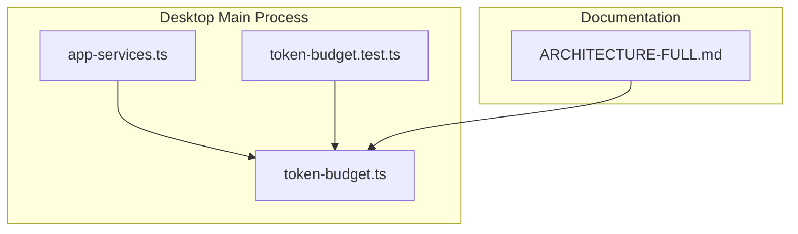
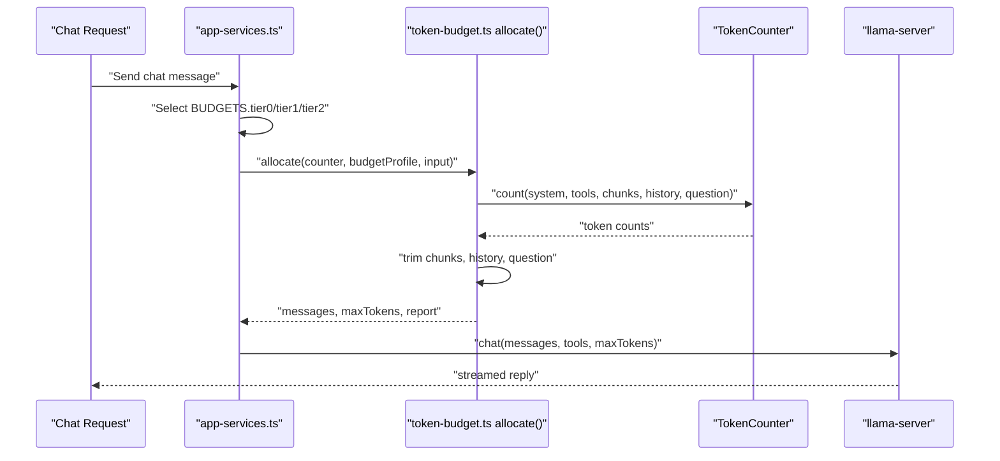
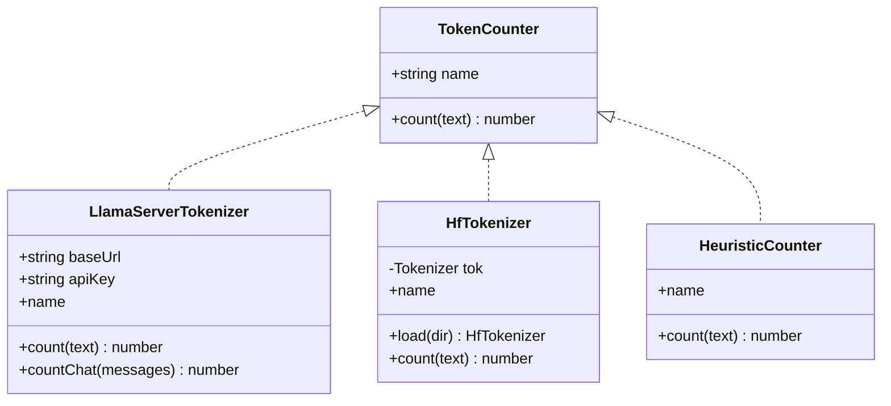
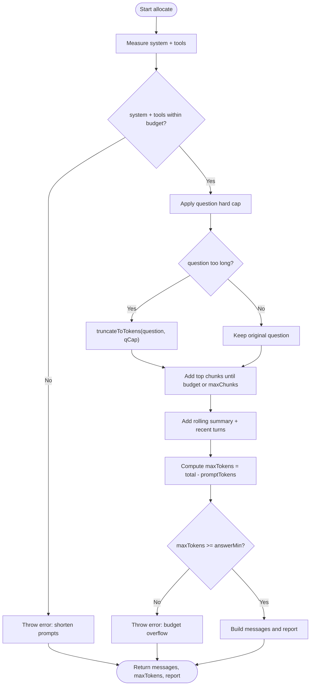
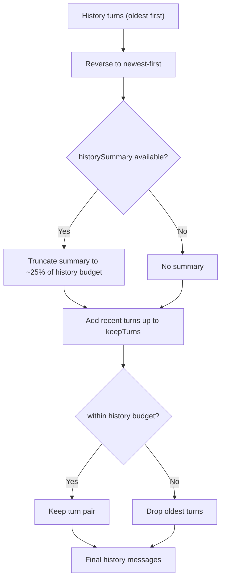
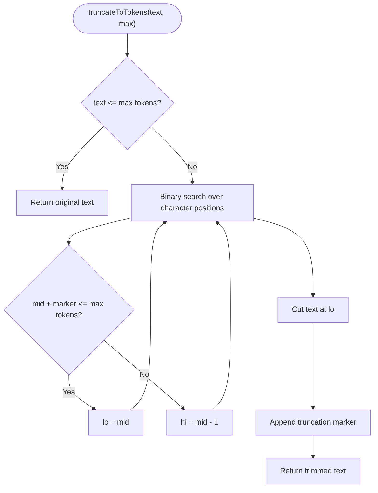
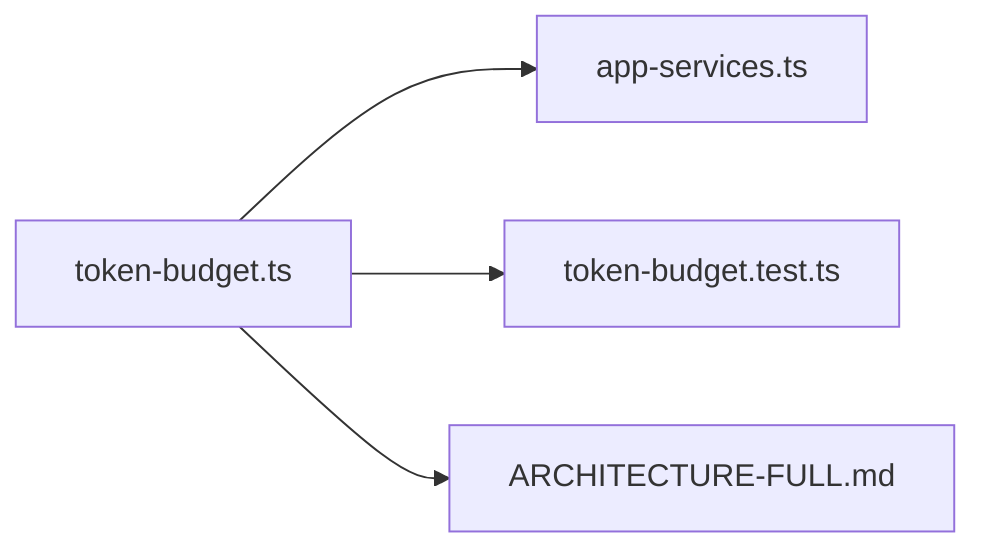

# Token Budget Management

<cite>
**Referenced Files in This Document**
- [token-budget.ts](file://apps/desktop/src/main/core/token-budget.ts)
- [token-budget.test.ts](file://apps/desktop/src/main/core/token-budget.test.ts)
- [app-services.ts](file://apps/desktop/src/main/core/app-services.ts)
- [ARCHITECTURE-FULL.md](file://docs/ARCHITECTURE-FULL.md)
</cite>

## Table of Contents
1. [Introduction](#introduction)
2. [Project Structure](#project-structure)
3. [Core Components](#core-components)
4. [Architecture Overview](#architecture-overview)
5. [Detailed Component Analysis](#detailed-component-analysis)
6. [Dependency Analysis](#dependency-analysis)
7. [Performance Considerations](#performance-considerations)
8. [Troubleshooting Guide](#troubleshooting-guide)
9. [Conclusion](#conclusion)

## Introduction
The token budget management system prevents context window overflow during conversations by building every model request to a fixed, measured budget. Instead of relying on string length or OpenAI-style tokenizers, it counts tokens with the model’s own tokenizer and trims only the least important parts of the prompt. The goal is to keep grounding rules, retrieved sources, recent conversation history, and the user question inside the model’s context window while reserving enough space for the answer.

The system separates two related limits:
- **Per-request budget**: the maximum number of tokens allowed for one prompt plus its response.
- **Server context window**: the larger llama-server context capacity used for multi-step tool loops and generation; this is configured separately from the per-request budget.

This document explains how the allocator tracks token usage, allocates budgets across prompt components, truncates oversized input, manages conversation history through a sliding window and rolling summary, and integrates with the application’s hardware tiering and server configuration.

## Project Structure
The token budget implementation lives in the desktop main process and is consumed by the chat orchestrator.

**Diagram sources**
- [app-services.ts:96-96](file://apps/desktop/src/main/core/app-services.ts#L96-L96)
- [token-budget.ts:1-172](file://apps/desktop/src/main/core/token-budget.ts#L1-L172)
- [token-budget.test.ts:1-25](file://apps/desktop/src/main/core/token-budget.test.ts#L1-L25)
- [ARCHITECTURE-FULL.md:2515-2563](file://docs/ARCHITECTURE-FULL.md#L2515-L2563)

**Section sources**
- [token-budget.ts:1-14](file://apps/desktop/src/main/core/token-budget.ts#L1-L14)
- [app-services.ts:96-96](file://apps/desktop/src/main/core/app-services.ts#L96-L96)
- [ARCHITECTURE-FULL.md:2515-2532](file://docs/ARCHITECTURE-FULL.md#L2515-L2532)

## Core Components
The token budget system is centered around three responsibilities:

| Responsibility | Implementation | Purpose |
|---|---|---|
| Token counting | `TokenCounter`, `LlamaServerTokenizer`, `HfTokenizer`, `heuristicCounter` | Measure tokens exactly using the running llama-server, a local Hugging Face tokenizer, or a fallback heuristic. |
| Budget allocation | `allocate()` | Build a prompt that fits a per-request budget, trimming only non-critical parts. |
| Configuration | `BudgetProfile`, `BUDGETS` | Define tiers for different hardware capacities and model sizes. |

Key design principles:
- The system prompt is kept byte-identical across requests so llama-server can reuse its prompt cache.
- Retrieved chunks are whole blocks and never cut in half.
- Conversation history uses a sliding window of recent turns plus a rolling summary of older turns.
- The question has a hard cap; long pastes must go through retrieval instead of being pasted directly into the prompt.
- If the remaining answer reserve falls below `answerMin`, the request fails early rather than sending an unsafe prompt.

**Section sources**
- [token-budget.ts:20-73](file://apps/desktop/src/main/core/token-budget.ts#L20-L73)
- [token-budget.ts:90-99](file://apps/desktop/src/main/core/token-budget.ts#L90-L99)
- [token-budget.ts:101-165](file://apps/desktop/src/main/core/token-budget.ts#L101-L165)
- [ARCHITECTURE-FULL.md:2515-2541](file://docs/ARCHITECTURE-FULL.md#L2515-L2541)

## Architecture Overview
At runtime, the chat service selects a budget profile based on hardware tier, builds a prompt through the token allocator, and sends it to the model server.

**Diagram sources**
- [app-services.ts:472-473](file://apps/desktop/src/main/core/app-services.ts#L472-L473)
- [app-services.ts:561-561](file://apps/desktop/src/main/core/app-services.ts#L561-L561)
- [token-budget.ts:101-165](file://apps/desktop/src/main/core/token-budget.ts#L101-L165)

The architecture distinguishes:
- **Request budget**: controlled by `BudgetProfile.total`.
- **Server context**: controlled by `BudgetProfile.serverCtx` and passed to llama-server.
- **Prompt composition order**: stable system prefix, optional rolling summary, recent history, and then sources plus the current question.

**Section sources**
- [ARCHITECTURE-FULL.md:2515-2532](file://docs/ARCHITECTURE-FULL.md#L2515-L2532)
- [app-services.ts:472-473](file://apps/desktop/src/main/core/app-services.ts#L472-L473)
- [app-services.ts:561-561](file://apps/desktop/src/main/core/app-services.ts#L561-L561)

## Detailed Component Analysis

### Token Counting Mechanisms
The system supports three token counters, selected by availability and performance needs.

| Counter | Behavior | Exactness | When to Use |
|---|---|---|---|
| `LlamaServerTokenizer` | Calls `/tokenize` and optionally `/apply-template` on the running llama-server. | Exact for text and full chat templates. | Preferred when the server is already running. |
| `HfTokenizer` | Loads Qwen3.5 tokenizer files and encodes locally. | Exact for plain text without special tokens. | Useful before the server starts or in offline scenarios. |
| `heuristicCounter` | Approximates tokens as character length divided by a constant. | Rough approximation. | Last resort; not suitable for precise budgeting. |

Important constants:
- `PER_MESSAGE_OVERHEAD`: accounts for chat template markers around each message.
- `ASSISTANT_PREFIX`: accounts for the assistant prefix tokens when thinking mode is off.

**Diagram sources**
- [token-budget.ts:20-57](file://apps/desktop/src/main/core/token-budget.ts#L20-L57)

**Section sources**
- [token-budget.ts:1-14](file://apps/desktop/src/main/core/token-budget.ts#L1-L14)
- [token-budget.ts:20-57](file://apps/desktop/src/main/core/token-budget.ts#L20-L57)
- [ARCHITECTURE-FULL.md:2543-2553](file://docs/ARCHITECTURE-FULL.md#L2543-L2553)

### Budget Allocation Strategy
The `allocate` function is the core of the budget system. It receives:
- A token counter.
- A budget profile.
- Input containing system instructions, optional tools, retrieved chunks, conversation history, an optional rolling summary, and the current question.

Allocation proceeds in priority order:

1. **System prompt and tools**: These are treated as fixed. The system prompt is not trimmed because changing it would break prompt cache hits. Tools are included only when needed.
2. **Question**: Enforced with a hard cap. Long questions are truncated with a marker.
3. **Retrieved chunks**: Added in ranked order, but only whole chunks. Lower-scoring chunks are dropped if they exceed the retrieved budget or the maximum chunk count.
4. **Conversation history**: Recent turns are kept verbatim up to `keepTurns`; older turns are represented by a rolling summary capped at roughly 25% of the history budget.
5. **Answer reserve**: Whatever remains after prompt construction becomes `maxTokens`. If it falls below `answerMin`, the allocation throws an error.

**Diagram sources**
- [token-budget.ts:101-165](file://apps/desktop/src/main/core/token-budget.ts#L101-L165)

**Section sources**
- [token-budget.ts:101-165](file://apps/desktop/src/main/core/token-budget.ts#L101-L165)
- [ARCHITECTURE-FULL.md:2534-2541](file://docs/ARCHITECTURE-FULL.md#L2534-L2541)

### Conversation History and Sliding Window
Conversation history is managed through two mechanisms:

| Mechanism | Behavior | Budget Impact |
|---|---|---|
| Rolling summary | Older turns are summarized by a background job and appended to the system message. | Capped at approximately 25% of the history budget. |
| Sliding window | The most recent turns are kept verbatim. | Limited by `keepTurns` and the remaining history budget. |

Because Qwen3.5 allows only one system message at the start, the rolling summary is appended to the system message. This preserves the stable system prefix for prompt caching while still providing context about earlier conversation turns.

**Diagram sources**
- [token-budget.ts:129-147](file://apps/desktop/src/main/core/token-budget.ts#L129-L147)

**Section sources**
- [token-budget.ts:129-147](file://apps/desktop/src/main/core/token-budget.ts#L129-L147)
- [ARCHITECTURE-FULL.md:2536-2539](file://docs/ARCHITECTURE-FULL.md#L2536-L2539)

### Automatic Truncation Policies
Automatic truncation applies to:
- **Questions**: Hard-capped at twice the configured question budget.
- **Rolling summaries**: Capped at roughly 25% of the history budget.
- **Retrieved chunks**: Never cut in half; lower-ranked chunks are dropped.
- **Code-agent contexts**: Other parts of the codebase also use `truncateToTokens` to fit smaller token budgets for code-related prompts.

The truncation algorithm performs binary search over character positions and measures token counts with the real tokenizer, ensuring accurate cuts.

**Diagram sources**
- [token-budget.ts:90-99](file://apps/desktop/src/main/core/token-budget.ts#L90-L99)

**Section sources**
- [token-budget.ts:90-99](file://apps/desktop/src/main/core/token-budget.ts#L90-L99)
- [token-budget.ts:111-116](file://apps/desktop/src/main/core/token-budget.ts#L111-L116)
- [token-budget.ts:132-133](file://apps/desktop/src/main/core/token-budget.ts#L132-L133)

### Configuration Options and Model Constraints
Budget profiles are defined per hardware tier:

| Tier | Typical Hardware | Per-Request Total | Retrieved Budget | History Budget | Question Budget | Minimum Answer Reserve | Max Chunks | Kept Turns | Server Context |
|---|---|---:|---:|---:|---:|---:|---:|---:|---:|
| `tier0` | Less than 8 GB RAM | 4,096 | 1,500 | 1,000 | 300 | 800 | 4 | 3 | 8,192 |
| `tier1` | Around 8 GB RAM | 4,096 | 1,500 | 1,000 | 300 | 800 | 4 | 3 | 8,192 |
| `tier2` | 16 GB+ RAM | 8,192 | 3,000 | 2,200 | 800 | 1,500 | 5 | 4 | 16,384 |

The application selects the profile based on detected hardware tier and passes both the per-request budget and the server context size to the model runner.

**Section sources**
- [token-budget.ts:62-73](file://apps/desktop/src/main/core/token-budget.ts#L62-L73)
- [app-services.ts:472-473](file://apps/desktop/src/main/core/app-services.ts#L472-L473)
- [app-services.ts:561-561](file://apps/desktop/src/main/core/app-services.ts#L561-L561)
- [ARCHITECTURE-FULL.md:2521-2532](file://docs/ARCHITECTURE-FULL.md#L2521-L2532)

### Memory Management Best Practices
The system avoids uncontrolled memory growth by:
- Keeping the system prompt stable for prompt cache reuse.
- Limiting retrieved chunks to a small, bounded set.
- Using a sliding window for conversation history.
- Replacing older history with a compact summary.
- Reserving a minimum answer budget to avoid sending malformed prompts.
- Starting llama-server with a context size appropriate for the hardware tier rather than using the model’s maximum native context.

These practices reduce KV cache pressure, limit per-request memory spikes, and prevent silent truncation of critical grounding instructions.

**Section sources**
- [ARCHITECTURE-FULL.md:2517-2519](file://docs/ARCHITECTURE-FULL.md#L2517-L2519)
- [token-budget.ts:106-109](file://apps/desktop/src/main/core/token-budget.ts#L106-L109)
- [token-budget.ts:118-127](file://apps/desktop/src/main/core/token-budget.ts#L118-L127)
- [token-budget.ts:129-147](file://apps/desktop/src/main/core/token-budget.ts#L129-L147)
- [token-budget.ts:149-153](file://apps/desktop/src/main/core/token-budget.ts#L149-L153)

## Dependency Analysis
The token budget module is imported by the main application services and tested independently.

**Diagram sources**
- [app-services.ts:96-96](file://apps/desktop/src/main/core/app-services.ts#L96-L96)
- [token-budget.test.ts:1-3](file://apps/desktop/src/main/core/token-budget.test.ts#L1-L3)
- [ARCHITECTURE-FULL.md:2515-2563](file://docs/ARCHITECTURE-FULL.md#L2515-L2563)

Coupling and cohesion observations:
- `token-budget.ts` is cohesive: it owns token counting, truncation, budget profiles, and prompt allocation.
- `app-services.ts` depends on `token-budget.ts` for budget selection and allocation but does not reimplement token accounting.
- Tests validate that retrieved chunks stay within budget and that important content is preserved.

**Section sources**
- [app-services.ts:96-96](file://apps/desktop/src/main/core/app-services.ts#L96-L96)
- [token-budget.test.ts:5-24](file://apps/desktop/src/main/core/token-budget.test.ts#L5-L24)

## Performance Considerations
- Prefer `LlamaServerTokenizer` when the server is running because it uses the exact model tokenizer without downloading extra files.
- Use `HfTokenizer` when the server is not yet available or when offline token counting is required.
- Avoid tiktoken-based estimators for Qwen models because they use different vocabularies and can miscount tokens.
- Keep the system prompt unchanged across requests to maximize prompt cache reuse.
- Do not paste large documents directly into the question field; route them through retrieval so chunks can be bounded and deduplicated.
- Monitor the developer budget log to see which part consumes tokens and whether chunks or turns are being dropped.

[No sources needed since this section provides general guidance]

## Troubleshooting Guide

### Common Issues and Resolutions

| Symptom | Likely Cause | Resolution |
|---|---|---|
| Prompt errors or missing grounding rules | The prompt exceeded the context window and llama-server silently dropped the beginning. | Ensure the allocator is used and check the budget report for dropped chunks or turns. |
| `system+tools ... tokens: shorten them` | System prompt or tool schemas grew beyond the allowed margin. | Reduce system instructions or remove unnecessary tool definitions. |
| `budget overflow: only X tokens left for the answer` | Fixed parts consumed too much of the budget. | Shorten system prompts, reduce tool schemas, or adjust retrieval/history/question budgets. |
| Retrieved chunks are missing key information | Too many low-relevance chunks were added before hitting the budget. | Improve retrieval ranking and relevance gating so higher-quality chunks are selected. |
| Conversation loses context over time | History was truncated and the rolling summary did not capture important facts. | Tune the rolling summary frequency and ensure important facts are preserved in the summary. |
| Token counts seem inaccurate | Using heuristic counting or tiktoken for Qwen models. | Switch to `LlamaServerTokenizer` or `HfTokenizer` with the correct Qwen tokenizer files. |

### Debugging Steps
1. Enable the developer view to inspect per-request budget logs.
2. Check `droppedChunks` and `droppedTurns` in the budget report.
3. Verify that the selected budget profile matches the hardware tier.
4. Confirm that the tokenizer method is exact rather than heuristic.
5. Validate that long inputs are routed through retrieval instead of inline pasting.

**Section sources**
- [token-budget.ts:106-109](file://apps/desktop/src/main/core/token-budget.ts#L106-L109)
- [token-budget.ts:149-153](file://apps/desktop/src/main/core/token-budget.ts#L149-L153)
- [token-budget.test.ts:5-24](file://apps/desktop/src/main/core/token-budget.test.ts#L5-L24)
- [ARCHITECTURE-FULL.md:2557-2563](file://docs/ARCHITECTURE-FULL.md#L2557-L2563)

## Conclusion
The token budget management system is a focused layer that protects conversations from context overflow by measuring tokens accurately, allocating budgets predictably, and truncating only safe, low-priority content. Its integration with hardware tiers, llama-server context configuration, retrieval, and conversation summarization makes it suitable for constrained environments where memory and latency matter. For reliable operation, always use the model’s tokenizer, keep the system prompt stable, route large inputs through retrieval, and monitor budget reports to detect growing prompt components before they cause failures.

[No sources needed since this section summarizes without analyzing specific files]