# Code Assistance

<cite>
**Referenced Files in This Document**
- [parse.ts](file://apps/desktop/src/main/core/code/parse.ts)
- [languages.ts](file://apps/desktop/src/main/core/code/languages.ts)
- [scan.ts](file://apps/desktop/src/main/core/code/scan.ts)
- [project.ts](file://apps/desktop/src/main/core/code/project.ts)
- [search.ts](file://apps/desktop/src/main/core/code/search.ts)
- [chunks.ts](file://apps/desktop/src/main/core/code/chunks.ts)
- [embed.ts](file://apps/desktop/src/main/core/code/embed.ts)
- [store.ts](file://apps/desktop/src/main/core/code/store.ts)
- [lsp.ts](file://apps/desktop/src/main/core/code/lsp.ts)
- [limits.ts](file://apps/desktop/src/main/core/code/limits.ts)
- [watch.ts](file://apps/desktop/src/main/core/code/watch.ts)
- [index-queue.ts](file://apps/desktop/src/main/core/live/index-queue.ts)
- [service.ts](file://apps/desktop/src/main/core/code-agent/completion/service.ts)
- [snippets.ts](file://apps/desktop/src/main/core/code-agent/completion/snippets.ts)
- [http-api.ts](file://apps/desktop/src/main/core/code-agent/completion/http-api.ts)
- [CodeEditor.tsx](file://apps/desktop/src/renderer/src/screens/CodeEditor.tsx)
- [fetch-tree-sitter.mjs](file://apps/desktop/scripts/fetch-tree-sitter.mjs)
</cite>

## Table of Contents
1. [Introduction](#introduction)
2. [Project Structure](#project-structure)
3. [Core Components](#core-components)
4. [Architecture Overview](#architecture-overview)
5. [Detailed Component Analysis](#detailed-component-analysis)
6. [Dependency Analysis](#dependency-analysis)
7. [Performance Considerations](#performance-considerations)
8. [Troubleshooting Guide](#troubleshooting-guide)
9. [Conclusion](#conclusion)

## Introduction
This document explains the code assistance system that powers syntax parsing, project scanning, indexing, search, completion, and IDE-like editing capabilities. It focuses on how tree-sitter is used to extract code structure and symbols, how files are scanned and indexed into a local database, how semantic and syntactic queries are fused for fast results, and how inline completion integrates with an editor. It also covers language support, adding new languages, incremental indexing, and performance tuning for large codebases.

## Project Structure
The code assistance features live primarily under the desktop application’s main process core code directory, with a small renderer-side editor integration:

- Parsing and language mapping: parse.ts, languages.ts
- Scanning and classification: scan.ts, limits.ts
- Index orchestration and background work: project.ts, watch.ts, index-queue.ts
- Storage and graph linking: store.ts
- Search and ranking: search.ts
- Chunking and embeddings: chunks.ts, embed.ts
- Optional LSP references: lsp.ts
- Completion service and snippets: service.ts, snippets.ts, http-api.ts
- Renderer editor UI: CodeEditor.tsx
- Grammar acquisition script: fetch-tree-sitter.mjs

```mermaid
graph TB
subgraph "Indexing"
Scan["scan.ts"]
Parse["parse.ts"]
Chunks["chunks.ts"]
Store["store.ts"]
Embed["embed.ts"]
end
subgraph "Search"
Search["search.ts"]
LSP["lsp.ts"]
end
subgraph "Orchestration"
Project["project.ts"]
Watch["watch.ts"]
Queue["index-queue.ts"]
end
subgraph "Completion"
CService["completion/service.ts"]
CSnippets["completion/snippets.ts"]
CHttp["completion/http-api.ts"]
end
subgraph "UI"
Editor["renderer/CodeEditor.tsx"]
end
Scan --> Parse --> Chunks --> Store
Project --> Scan
Project --> Parse
Project --> Store
Project --> Search
Project --> LSP
Project --> Embed
Watch --> Project
Queue --> Project
CService --> CSnippets
CService --> CHttp
Editor --> CService
```

**Diagram sources**
- [scan.ts:71-123](file://apps/desktop/src/main/core/code/scan.ts#L71-L123)
- [parse.ts:502-528](file://apps/desktop/src/main/core/code/parse.ts#L502-L528)
- [chunks.ts:75-93](file://apps/desktop/src/main/core/code/chunks.ts#L75-L93)
- [store.ts:73-105](file://apps/desktop/src/main/core/code/store.ts#L73-L105)
- [project.ts:245-319](file://apps/desktop/src/main/core/code/project.ts#L245-L319)
- [search.ts:63-84](file://apps/desktop/src/main/core/code/search.ts#L63-L84)
- [lsp.ts:69-167](file://apps/desktop/src/main/core/code/lsp.ts#L69-L167)
- [watch.ts:5-34](file://apps/desktop/src/main/core/code/watch.ts#L5-L34)
- [index-queue.ts:6-45](file://apps/desktop/src/main/core/live/index-queue.ts#L6-L45)
- [service.ts:49-111](file://apps/desktop/src/main/core/code-agent/completion/service.ts#L49-L111)
- [snippets.ts:14-47](file://apps/desktop/src/main/core/code-agent/completion/snippets.ts#L14-L47)
- [http-api.ts:23-44](file://apps/desktop/src/main/core/code-agent/completion/http-api.ts#L23-L44)
- [CodeEditor.tsx:46-100](file://apps/desktop/src/renderer/src/screens/CodeEditor.tsx#L46-L100)

**Section sources**
- [scan.ts:1-161](file://apps/desktop/src/main/core/code/scan.ts#L1-L161)
- [parse.ts:1-529](file://apps/desktop/src/main/core/code/parse.ts#L1-L529)
- [project.ts:56-349](file://apps/desktop/src/main/core/code/project.ts#L56-L349)
- [search.ts:1-85](file://apps/desktop/src/main/core/code/search.ts#L1-L85)
- [service.ts:49-111](file://apps/desktop/src/main/core/code-agent/completion/service.ts#L49-L111)
- [CodeEditor.tsx:46-100](file://apps/desktop/src/renderer/src/screens/CodeEditor.tsx#L46-L100)

## Core Components
- Language detection and grammar mapping: maps file extensions to language identifiers and provides grammar filenames.
- Tree-sitter parser: initializes web-tree-sitter, loads WASM grammars, extracts symbols, calls, and references per language.
- Project scanner: walks directories, respects .gitignore, skips binaries/secrets/too-large files, and classifies each file.
- Index orchestrator: scans once, parses files, builds chunks, persists to SQLite, links edges, and runs embeddings in batches.
- Search engine: fuses BM25 keyword search and vector similarity using reciprocal rank fusion, then reranks by name matches.
- Completion pipeline: debounces input, selects relevant snippets, builds prompts (FIM or prefix), and post-processes completions.
- Editor integration: provides syntax highlighting, language-specific support, ghost text suggestions, and keyboard acceptance.

**Section sources**
- [languages.ts:1-59](file://apps/desktop/src/main/core/code/languages.ts#L1-L59)
- [parse.ts:1-529](file://apps/desktop/src/main/core/code/parse.ts#L1-L529)
- [scan.ts:1-161](file://apps/desktop/src/main/core/code/scan.ts#L1-L161)
- [project.ts:56-349](file://apps/desktop/src/main/core/code/project.ts#L56-L349)
- [search.ts:1-85](file://apps/desktop/src/main/core/code/search.ts#L1-L85)
- [service.ts:49-111](file://apps/desktop/src/main/core/code-agent/completion/service.ts#L49-L111)
- [CodeEditor.tsx:46-100](file://apps/desktop/src/renderer/src/screens/CodeEditor.tsx#L46-L100)

## Architecture Overview
The system follows a layered architecture:

- Input layer: File watcher and user edits feed paths and content.
- Indexing layer: Scanner classifies files; parser extracts symbols and edges; chunker splits symbols; store persists everything; embedder computes vectors.
- Query layer: Search fuses keyword and vector results; LSP can provide exact references when available.
- Completion layer: Service composes context snippets and model prompts; HTTP API exposes a secure loopback endpoint.
- UI layer: Editor renders syntax-highlighted code and shows ghost-text suggestions.

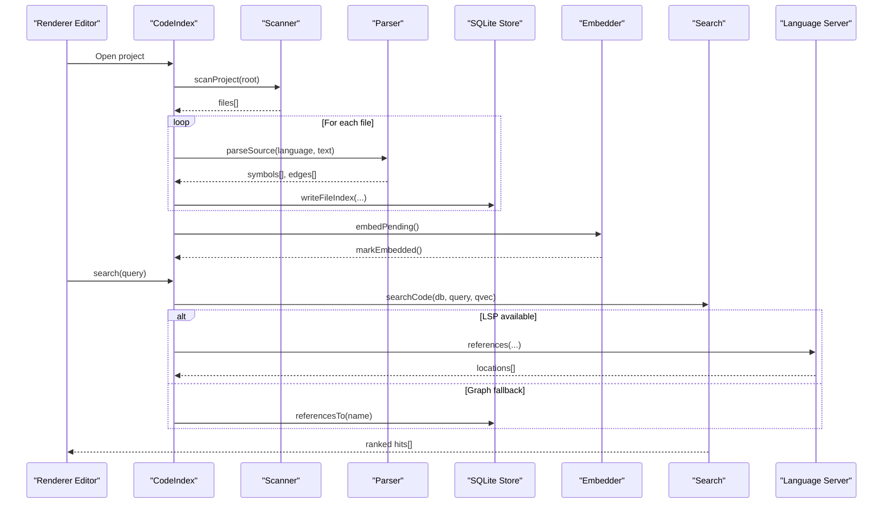

**Diagram sources**
- [project.ts:245-319](file://apps/desktop/src/main/core/code/project.ts#L245-L319)
- [scan.ts:71-123](file://apps/desktop/src/main/core/code/scan.ts#L71-L123)
- [parse.ts:502-528](file://apps/desktop/src/main/core/code/parse.ts#L502-L528)
- [store.ts:73-105](file://apps/desktop/src/main/core/code/store.ts#L73-L105)
- [search.ts:63-84](file://apps/desktop/src/main/core/code/search.ts#L63-L84)
- [lsp.ts:69-167](file://apps/desktop/src/main/core/code/lsp.ts#L69-L167)

## Detailed Component Analysis

### Syntax Parsing with Tree-Sitter
The parser initializes web-tree-sitter once, lazily loads WASM grammars per language, and extracts:

- Symbols: functions, classes, methods, types, variables, imports, sections.
- Edges: calls, imports, references with source and target names and line numbers.
- Fallback: unsupported languages or parse failures become plain-text sections.

Key behaviors:
- Language specs define symbol node types, class nodes, and call node fields per language.
- Import extraction is language-aware (Python, JS/TS/TSX, Java, Go, Rust, C/C++).
- Calls and references are limited per file to control memory and CPU usage.
- Plain text mode groups non-empty blocks into section symbols.

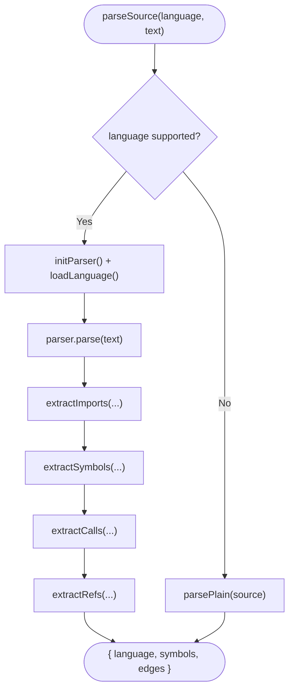

**Diagram sources**
- [parse.ts:502-528](file://apps/desktop/src/main/core/code/parse.ts#L502-L528)
- [parse.ts:304-393](file://apps/desktop/src/main/core/code/parse.ts#L304-L393)
- [parse.ts:395-464](file://apps/desktop/src/main/core/code/parse.ts#L395-L464)
- [parse.ts:466-500](file://apps/desktop/src/main/core/code/parse.ts#L466-L500)

**Section sources**
- [parse.ts:1-529](file://apps/desktop/src/main/core/code/parse.ts#L1-L529)

### Language Support Matrix and Adding New Languages
Supported languages are mapped from file extensions to language IDs and grammar files:

- Python (.py, .pyi)
- JavaScript (.js, .jsx, .mjs, .cjs)
- TypeScript (.ts, .tsx)
- Java (.java)
- Go (.go)
- Rust (.rs)
- C (.c, .h)
- C++ (.cc, .cpp, .cxx, .hpp, .hh, .hxx)

Text-like files (markdown, JSON, YAML, HTML, CSS, shell scripts, SQL, etc.) are treated as plaintext sections.

To add a new language:
1. Add extension mappings in the extension-to-language map.
2. Add the grammar filename mapping for the WASM grammar.
3. Provide a language spec in the parser defining symbol nodes, class nodes, and call nodes.
4. Optionally add import extraction rules if the language has unique import syntax.
5. Ensure the WASM grammar is fetched and placed in resources/tree-sitter via the build script.

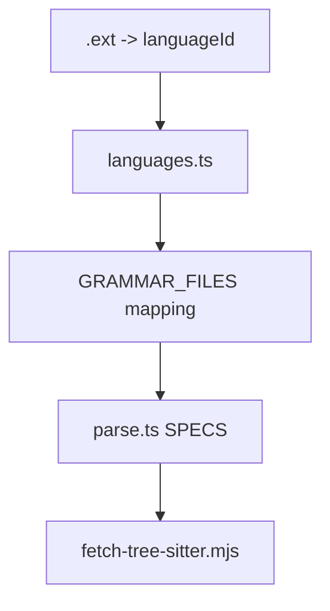

**Diagram sources**
- [languages.ts:3-58](file://apps/desktop/src/main/core/code/languages.ts#L3-L58)
- [parse.ts:53-132](file://apps/desktop/src/main/core/code/parse.ts#L53-L132)
- [fetch-tree-sitter.mjs:1-30](file://apps/desktop/scripts/fetch-tree-sitter.mjs#L1-L30)

**Section sources**
- [languages.ts:1-59](file://apps/desktop/src/main/core/code/languages.ts#L1-L59)
- [parse.ts:53-132](file://apps/desktop/src/main/core/code/parse.ts#L53-L132)
- [fetch-tree-sitter.mjs:1-30](file://apps/desktop/scripts/fetch-tree-sitter.mjs#L1-L30)

### Project Scanning and Classification
The scanner walks the project root while respecting .gitignore patterns, skipping symbolic links, binary files, secrets, oversized files, and dependency/build directories. It returns a list of classified files with absolute/relative paths, size, mtime, and detected language.

Highlights:
- Respects nested .gitignore files.
- Binary detection via null bytes and extremely long first lines.
- Caps total files and total bytes to prevent runaway indexing.
- Provides classifyFile for incremental updates based on watcher events.

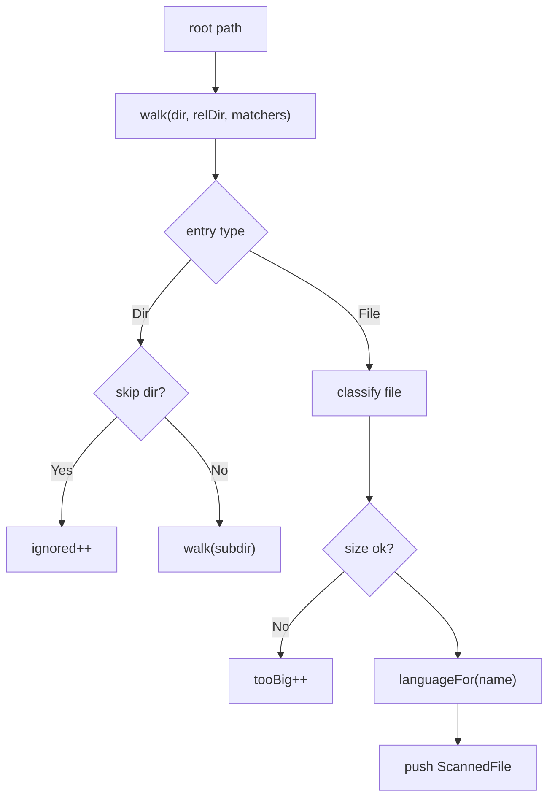

**Diagram sources**
- [scan.ts:71-123](file://apps/desktop/src/main/core/code/scan.ts#L71-L123)
- [scan.ts:126-160](file://apps/desktop/src/main/core/code/scan.ts#L126-L160)
- [limits.ts:23-42](file://apps/desktop/src/main/core/code/limits.ts#L23-L42)

**Section sources**
- [scan.ts:1-161](file://apps/desktop/src/main/core/code/scan.ts#L1-L161)
- [limits.ts:1-62](file://apps/desktop/src/main/core/code/limits.ts#L1-L62)

### Index Orchestration and Incremental Updates
CodeIndex coordinates scanning, parsing, chunking, storage, embedding, and background updates:

- Full run: scans all files, indexes changed files, links edges, marks state ready.
- Incremental update: watches project changes, enqueues paths, processes one at a time, and re-links edges.
- Background queue: prioritizes reads (search/graph) over queued indexing tasks.
- Embedding: batches pending chunks, validates dimensions, stores vectors, and marks them embedded.

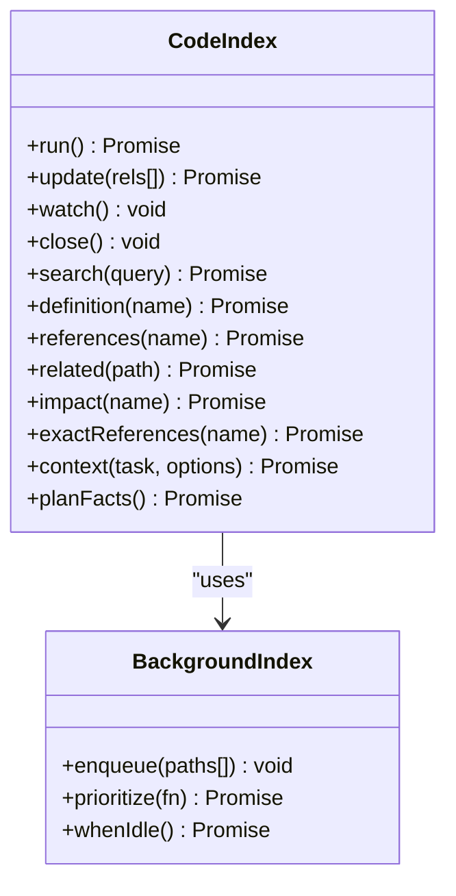

**Diagram sources**
- [project.ts:56-349](file://apps/desktop/src/main/core/code/project.ts#L56-L349)
- [index-queue.ts:6-45](file://apps/desktop/src/main/core/live/index-queue.ts#L6-L45)

**Section sources**
- [project.ts:56-349](file://apps/desktop/src/main/core/code/project.ts#L56-L349)
- [index-queue.ts:1-45](file://apps/desktop/src/main/core/live/index-queue.ts#L1-L45)

### Data Persistence and Graph Linking
The SQLite schema stores files, symbols, edges, chunks, and vectors. Writing a file index is transactional and includes:

- File metadata and SHA-256.
- Symbols with qualified names, kinds, signatures, parent names, and bodies.
- Edges for calls, imports, and references.
- Chunks derived from symbols, including an imports chunk.
- Optional vectors stored alongside chunks.

After indexing, linkEdges resolves module paths and symbol IDs for edges, cleans up unknown references, and prepares the graph for queries.

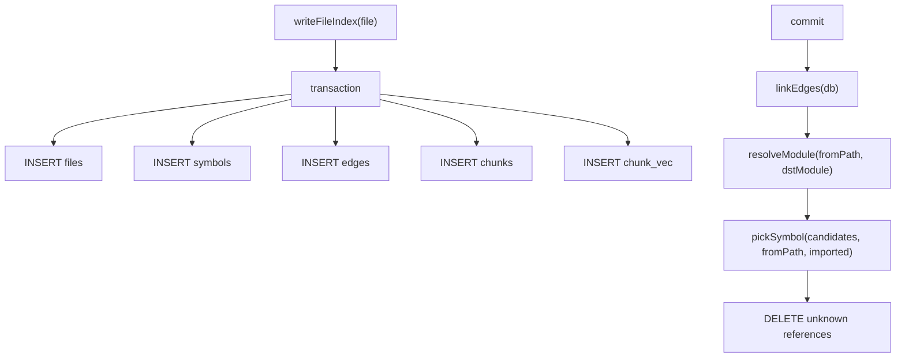

**Diagram sources**
- [store.ts:73-105](file://apps/desktop/src/main/core/code/store.ts#L73-L105)
- [store.ts:231-280](file://apps/desktop/src/main/core/code/store.ts#L231-L280)
- [store.ts:295-326](file://apps/desktop/src/main/core/code/store.ts#L295-L326)

**Section sources**
- [store.ts:1-392](file://apps/desktop/src/main/core/code/store.ts#L1-L392)

### Code Search: Keyword and Vector Fusion
Search combines BM25 keyword results and vector similarity using reciprocal rank fusion (RRF):

- Keyword search uses full-text search on chunks.
- Vector search uses precomputed embeddings with cosine distance.
- RRF merges ranks; missing lists contribute nothing.
- Final reranking boosts name matches and prefers function/class/type kinds.

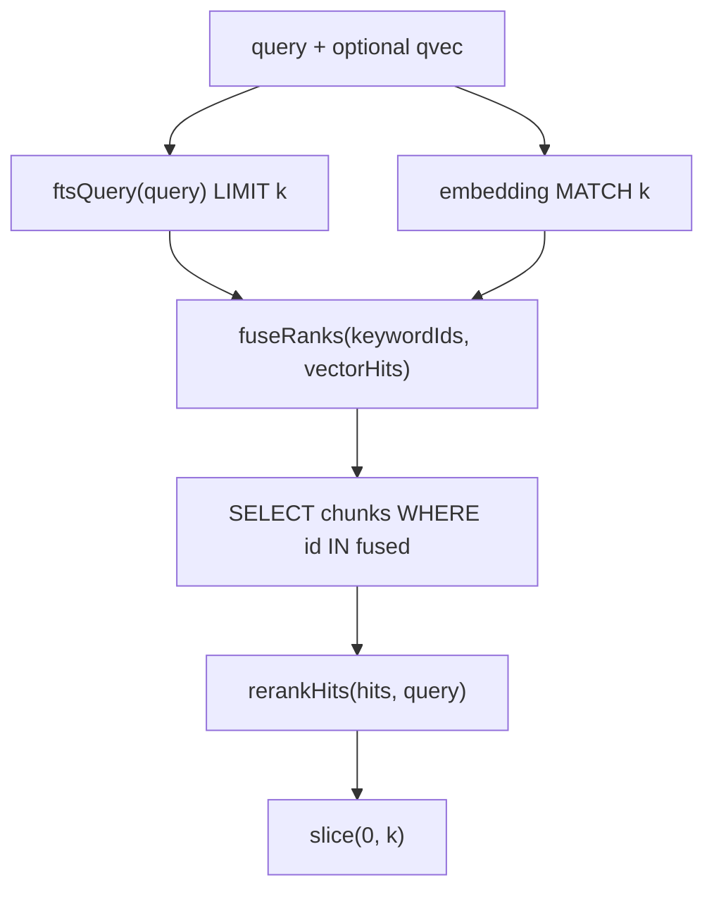

**Diagram sources**
- [search.ts:28-61](file://apps/desktop/src/main/core/code/search.ts#L28-L61)
- [search.ts:63-84](file://apps/desktop/src/main/core/code/search.ts#L63-L84)

**Section sources**
- [search.ts:1-85](file://apps/desktop/src/main/core/code/search.ts#L1-L85)

### Symbol Chunks and Embeddings
Symbols are split into searchable chunks:

- Small symbols remain intact.
- Large symbols are sliced by word count with overlap to preserve context across boundaries.
- Imports are grouped into a dedicated chunk.
- Embeddings are computed in batches and stored per chunk.

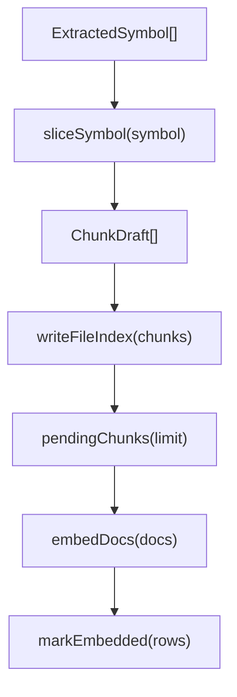

**Diagram sources**
- [chunks.ts:25-93](file://apps/desktop/src/main/core/code/chunks.ts#L25-L93)
- [embed.ts:15-48](file://apps/desktop/src/main/core/code/embed.ts#L15-L48)
- [store.ts:338-391](file://apps/desktop/src/main/core/code/store.ts#L338-L391)

**Section sources**
- [chunks.ts:1-94](file://apps/desktop/src/main/core/code/chunks.ts#L1-L94)
- [embed.ts:1-53](file://apps/desktop/src/main/core/code/embed.ts#L1-L53)
- [store.ts:328-391](file://apps/desktop/src/main/core/code/store.ts#L328-L391)

### Optional LSP References
When pyright-langserver or typescript-language-server is available on PATH, the system can obtain exact references for Python and TS/JS/TSX files:

- Detect servers on PATH.
- Spawn server, initialize, open document, request references, parse responses.
- On timeout or error, fall back to the tree-sitter graph.

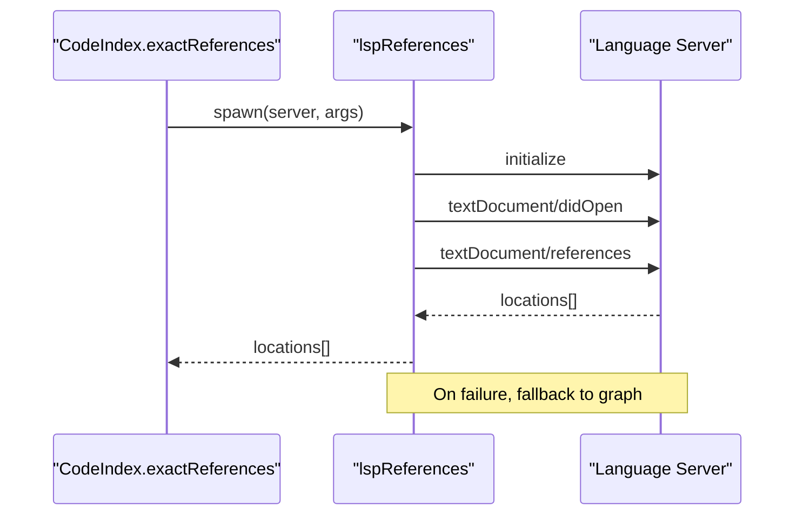

**Diagram sources**
- [lsp.ts:21-47](file://apps/desktop/src/main/core/code/lsp.ts#L21-L47)
- [lsp.ts:69-167](file://apps/desktop/src/main/core/code/lsp.ts#L69-L167)

**Section sources**
- [lsp.ts:1-168](file://apps/desktop/src/main/core/code/lsp.ts#L1-L168)

### Inline Code Completion
The completion service debounces requests, selects relevant snippets (imports and nearby definitions), probes the model for FIM markers, builds a prompt, predicts token budget, and post-processes output:

- Snippet selection respects a token budget and caps snippet count and length.
- Cache avoids recomputing identical prefix/suffix combinations.
- HTTP API exposes a secure loopback endpoint for future editor integrations.

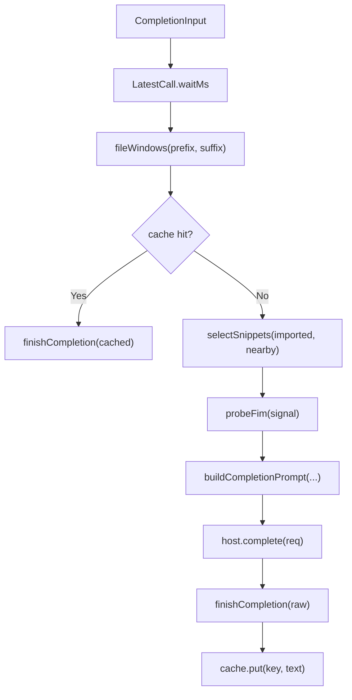

**Diagram sources**
- [service.ts:49-111](file://apps/desktop/src/main/core/code-agent/completion/service.ts#L49-L111)
- [snippets.ts:14-47](file://apps/desktop/src/main/core/code-agent/completion/snippets.ts#L14-L47)
- [http-api.ts:23-44](file://apps/desktop/src/main/core/code-agent/completion/http-api.ts#L23-L44)

**Section sources**
- [service.ts:1-117](file://apps/desktop/src/main/core/code-agent/completion/service.ts#L1-L117)
- [snippets.ts:1-48](file://apps/desktop/src/main/core/code-agent/completion/snippets.ts#L1-L48)
- [http-api.ts:1-44](file://apps/desktop/src/main/core/code-agent/completion/http-api.ts#L1-L44)

### IDE-like Editing Capabilities
The renderer editor integrates syntax highlighting, language support, ghost text suggestions, and keyboard shortcuts:

- Uses default highlight style with fallback.
- Adds language-specific support for Python and JS/TS/TSX.
- Shows ghost text for completions and supports Tab accept, Esc dismiss, and word-level accept.

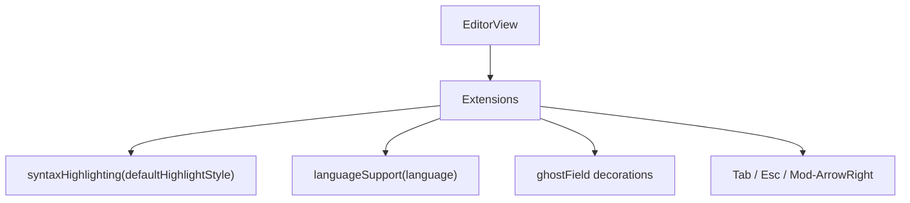

**Diagram sources**
- [CodeEditor.tsx:46-100](file://apps/desktop/src/renderer/src/screens/CodeEditor.tsx#L46-L100)

**Section sources**
- [CodeEditor.tsx:30-100](file://apps/desktop/src/renderer/src/screens/CodeEditor.tsx#L30-L100)

## Dependency Analysis
High-level dependencies between modules:

- project.ts depends on scan.ts, parse.ts, chunks.ts, store.ts, search.ts, lsp.ts, embed.ts, watch.ts, and index-queue.ts.
- parse.ts depends on languages.ts and limits.ts.
- search.ts depends on retrieval utilities and embed.ts.
- store.ts depends on embed.ts and db utilities.
- completion/service.ts depends on snippets.ts and host interface.

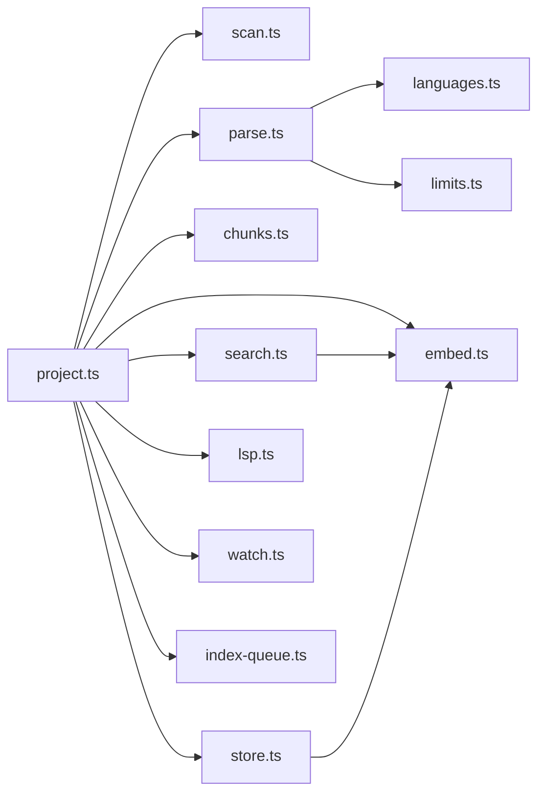

**Diagram sources**
- [project.ts:1-27](file://apps/desktop/src/main/core/code/project.ts#L1-L27)
- [parse.ts:1-10](file://apps/desktop/src/main/core/code/parse.ts#L1-L10)
- [search.ts:1-4](file://apps/desktop/src/main/core/code/search.ts#L1-L4)
- [store.ts:1-8](file://apps/desktop/src/main/core/code/store.ts#L1-L8)

**Section sources**
- [project.ts:1-349](file://apps/desktop/src/main/core/code/project.ts#L1-L349)
- [parse.ts:1-529](file://apps/desktop/src/main/core/code/parse.ts#L1-L529)
- [search.ts:1-85](file://apps/desktop/src/main/core/code/search.ts#L1-L85)
- [store.ts:1-392](file://apps/desktop/src/main/core/code/store.ts#L1-L392)

## Performance Considerations
- File scanning caps: maxFiles, maxTotalBytes, maxFileBytes, and maxLineChars prevent excessive I/O and memory use.
- Symbol body cap: maxSymbolChars ensures large symbols are chunked rather than fully stored.
- Reference/call limits: maxRefsPerFile and maxCallsPerFile bound graph construction cost.
- Embedding batching: embedBatch controls batch size to balance throughput and memory.
- Background queue: prioritizes reads so search remains responsive during indexing.
- Watch coalescing: debounceMs reduces redundant indexing after rapid saves.
- Grammar loading: lazy load and cache per language to avoid repeated WASM initialization.

Recommendations for large codebases:
- Tune CODE_LIMITS according to machine RAM and expected project sizes.
- Keep embedBatch moderate to avoid OOM spikes.
- Use incremental updates via watchProject and BackgroundIndex.
- Avoid indexing generated/minified artifacts by relying on SKIP_DIR_NAMES and binary detection.

**Section sources**
- [limits.ts:1-21](file://apps/desktop/src/main/core/code/limits.ts#L1-L21)
- [project.ts:321-347](file://apps/desktop/src/main/core/code/project.ts#L321-L347)
- [watch.ts:5-34](file://apps/desktop/src/main/core/code/watch.ts#L5-L34)
- [index-queue.ts:6-45](file://apps/desktop/src/main/core/live/index-queue.ts#L6-L45)

## Troubleshooting Guide
Common issues and resolutions:

- Unsupported language or parse errors:
  - The parser falls back to plain-text sections. Verify language mapping and grammar availability.
  - Ensure the correct grammar WASM is present and referenced in GRAMMAR_FILES.

- Missing LSP references:
  - Confirm pyright-langserver or typescript-language-server is installed and on PATH.
  - Check timeouts and protocol errors; the system will fall back to the graph.

- Slow or incomplete indexing:
  - Review limits (maxFiles, maxTotalBytes, maxFileBytes).
  - Inspect watch debounce behavior and ensure not too many files trigger frequent updates.

- Memory pressure during embedding:
  - Reduce embedBatch size.
  - Validate embedding dimension consistency and batch lengths.

- Stale search results:
  - Ensure linkEdges ran after indexing or updates.
  - Re-run indexing or force update for affected paths.

**Section sources**
- [parse.ts:502-528](file://apps/desktop/src/main/core/code/parse.ts#L502-L528)
- [languages.ts:48-58](file://apps/desktop/src/main/core/code/languages.ts#L48-L58)
- [lsp.ts:69-167](file://apps/desktop/src/main/core/code/lsp.ts#L69-L167)
- [project.ts:321-347](file://apps/desktop/src/main/core/code/project.ts#L321-L347)

## Conclusion
The code assistance system combines robust tree-sitter parsing, careful project scanning, efficient indexing, hybrid search, and editor-integrated completion. It is designed to scale to large projects through incremental updates, batching, and strict resource limits. Adding new languages requires extending language mappings, grammar files, and parser specs. The optional LSP integration enhances accuracy where available, while the fallback graph ensures reliability. With these components, developers get IDE-like capabilities including syntax highlighting, semantic search, and intelligent inline completions.