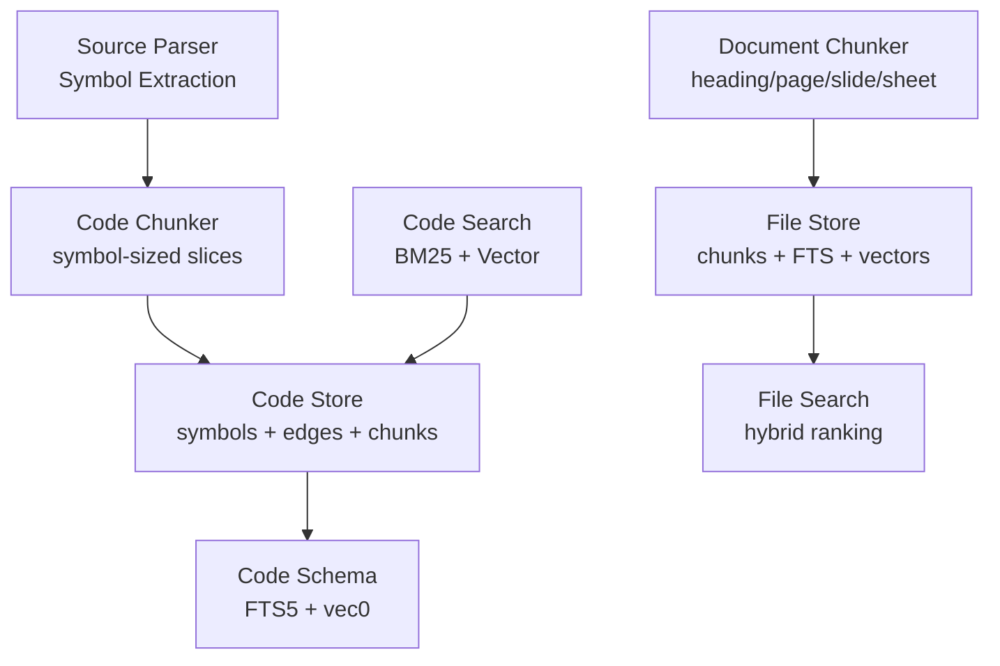
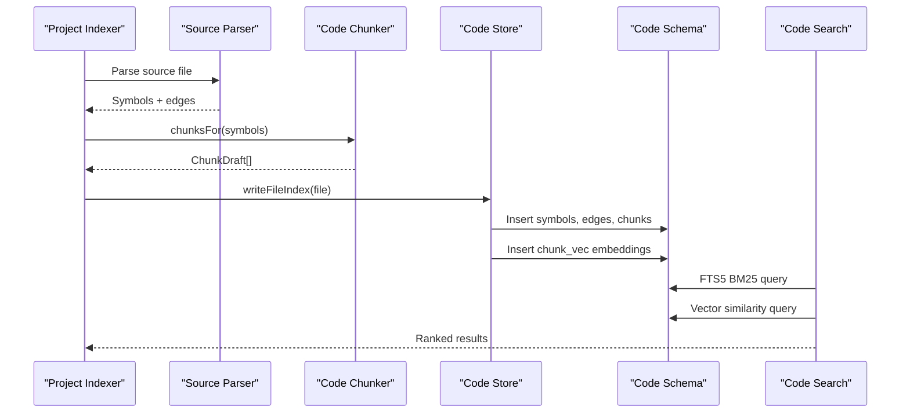
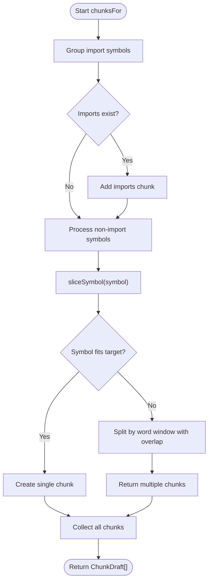
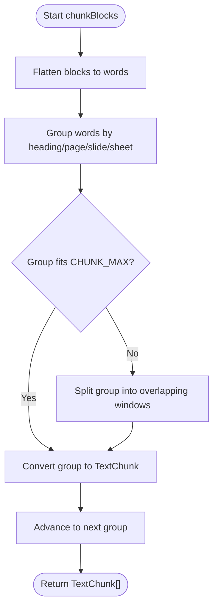
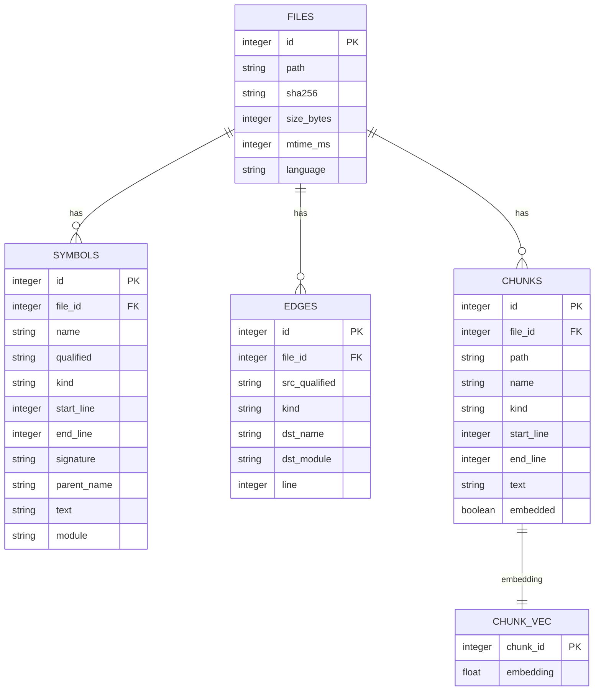
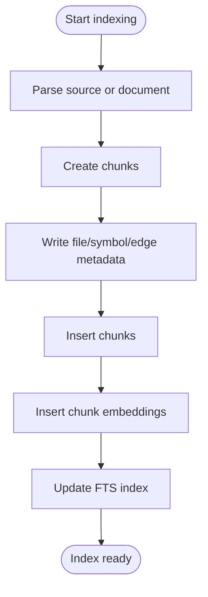
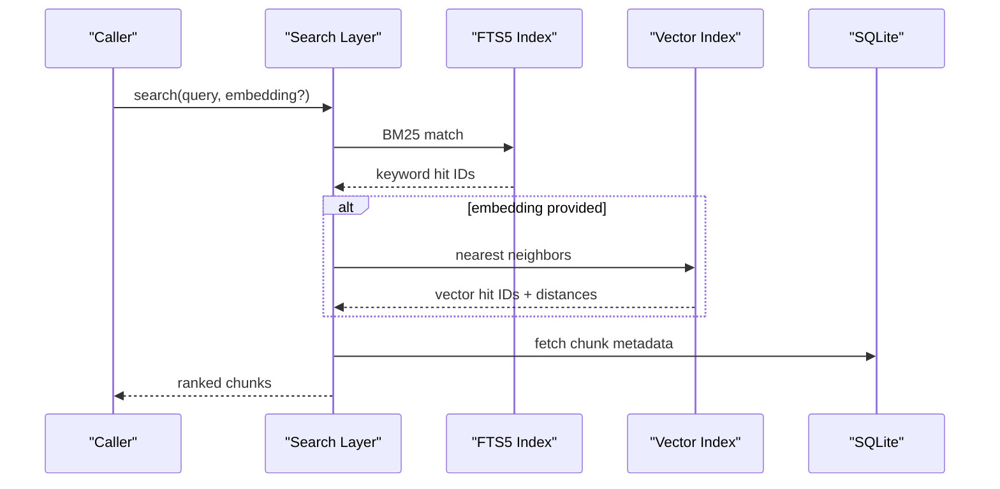

# Chunk Management

<cite>
**Referenced Files in This Document**   
- [apps/desktop/src/main/core/code/chunks.ts](file://apps/desktop/src/main/core/code/chunks.ts)
- [apps/desktop/src/main/core/code/limits.ts](file://apps/desktop/src/main/core/code/limits.ts)
- [apps/desktop/src/main/core/code/project.ts](file://apps/desktop/src/main/core/code/project.ts)
- [apps/desktop/src/main/core/code/store.ts](file://apps/desktop/src/main/core/code/store.ts)
- [apps/desktop/src/main/core/code/schema.ts](file://apps/desktop/src/main/core/code/schema.ts)
- [apps/desktop/src/main/core/code/search.ts](file://apps/desktop/src/main/core/code/search.ts)
- [apps/desktop/src/main/core/chunker.ts](file://apps/desktop/src/main/core/chunker.ts)
- [apps/desktop/src/main/core/files/store.ts](file://apps/desktop/src/main/core/files/store.ts)
</cite>

## Table of Contents
1. [Introduction](#introduction)
2. [Project Structure](#project-structure)
3. [Core Components](#core-components)
4. [Architecture Overview](#architecture-overview)
5. [Detailed Component Analysis](#detailed-component-analysis)
6. [Dependency Analysis](#dependency-analysis)
7. [Performance Considerations](#performance-considerations)
8. [Troubleshooting Guide](#troubleshooting-guide)
9. [Conclusion](#conclusion)

## Introduction
This document explains the code chunking system that breaks large files into searchable segments while preserving code structure. It covers two related chunking paths:

- **Code chunks**: Symbol-aware slicing for source files, designed to keep functions, classes, and modules coherent so search results remain meaningful.
- **Document chunks**: Structure-aware slicing for user documents, using headings, pages, slides, or sheets as boundaries.

The system stores chunks with file context, parent symbol relationships, and locators. It indexes chunks with keyword search and vector similarity, then retrieves ranked results through a hybrid scoring strategy. The design balances chunk size optimization against search accuracy by using word-based windows, controlled overlap, and symbol boundaries.

## Project Structure
The chunking system is implemented in the desktop main process under `apps/desktop/src/main/core`. The relevant pieces are:

| Area | Responsibility | Key Files |
|---|---|---|
| Code chunking | Splits parsed symbols into search-friendly chunks | `code/chunks.ts`, `code/limits.ts` |
| Code indexing pipeline | Parses files, builds symbols, writes chunks and vectors | `code/project.ts`, `code/store.ts`, `code/schema.ts` |
| Code search | Keyword and vector retrieval over code chunks | `code/search.ts` |
| Document chunking | Splits structured text blocks into document chunks | `chunker.ts` |
| File storage and search | Stores file chunks, FTS index, and vector index; performs hybrid ranking | `files/store.ts` |

**Diagram sources**
- [apps/desktop/src/main/core/code/chunks.ts:1-94](file://apps/desktop/src/main/core/code/chunks.ts#L1-L94)
- [apps/desktop/src/main/core/code/store.ts:73-97](file://apps/desktop/src/main/core/code/store.ts#L73-L97)
- [apps/desktop/src/main/core/code/schema.ts:55-70](file://apps/desktop/src/main/core/code/schema.ts#L55-L70)
- [apps/desktop/src/main/core/code/search.ts:65-68](file://apps/desktop/src/main/core/code/search.ts#L65-L68)
- [apps/desktop/src/main/core/chunker.ts:45-70](file://apps/desktop/src/main/core/chunker.ts#L45-L70)
- [apps/desktop/src/main/core/files/store.ts:37-67](file://apps/desktop/src/main/core/files/store.ts#L37-L67)

**Section sources**
- [apps/desktop/src/main/core/code/chunks.ts:1-94](file://apps/desktop/src/main/core/code/chunks.ts#L1-L94)
- [apps/desktop/src/main/core/chunker.ts:1-119](file://apps/desktop/src/main/core/chunker.ts#L1-L119)
- [apps/desktop/src/main/core/code/store.ts:73-97](file://apps/desktop/src/main/core/code/store.ts#L73-L97)
- [apps/desktop/src/main/core/files/store.ts:37-67](file://apps/desktop/src/main/core/files/store.ts#L37-L67)

## Core Components
The chunking system has two primary components:

### Code Chunker
- Breaks parsed symbols into chunks based on word count limits and overlap.
- Preserves symbol identity through qualified names, kinds, line ranges, and optional parent information.
- Groups import statements separately from implementation symbols.

Key behaviors:
- Small symbols stay intact.
- Large symbols are sliced into multiple chunks with controlled overlap.
- Each chunk includes a human-readable label derived from the symbol’s qualified name.

### Document Chunker
- Flattens structured blocks into words while tracking heading, page, slide, and sheet metadata.
- Keeps chunks within the same structural location when possible.
- Produces locator strings for citations and navigation.

Key behaviors:
- Target chunk size around 250 words.
- Maximum chunk size around 300 words.
- Overlap of about 40 words to preserve continuity across chunk boundaries.

**Section sources**
- [apps/desktop/src/main/core/code/chunks.ts:5-94](file://apps/desktop/src/main/core/code/chunks.ts#L5-L94)
- [apps/desktop/src/main/core/chunker.ts:7-43](file://apps/desktop/src/main/core/chunker.ts#L7-L43)
- [apps/desktop/src/main/core/chunker.ts:45-119](file://apps/desktop/src/main/core/chunker.ts#L45-L119)

## Architecture Overview
The end-to-end flow for code goes from parsing to chunking, storage, embedding, and search. For documents, the flow goes from structured blocks to chunking, storage, embedding, and search.

**Diagram sources**
- [apps/desktop/src/main/core/code/project.ts:305-319](file://apps/desktop/src/main/core/code/project.ts#L305-L319)
- [apps/desktop/src/main/core/code/chunks.ts:75-94](file://apps/desktop/src/main/core/code/chunks.ts#L75-L94)
- [apps/desktop/src/main/core/code/store.ts:73-97](file://apps/desktop/src/main/core/code/store.ts#L73-L97)
- [apps/desktop/src/main/core/code/schema.ts:55-70](file://apps/desktop/src/main/core/code/schema.ts#L55-L70)
- [apps/desktop/src/main/core/code/search.ts:65-68](file://apps/desktop/src/main/core/code/search.ts#L65-L68)

## Detailed Component Analysis

### Code Chunking Algorithm
The code chunker operates on parsed symbols rather than raw text. This preserves semantic boundaries such as function definitions, class declarations, and module-level constructs.

#### Data Model
- `ChunkDraft` represents a candidate chunk with symbol key, name, kind, line range, and text.
- `ExtractedSymbol` provides qualified name, kind, start/end lines, signature, parent name, and body text.

#### Chunk Creation Logic
- If a symbol fits within the configured word limit plus a small tolerance, it becomes one chunk.
- Otherwise, the symbol body is split into multiple chunks using a sliding window approach:
  - Each window targets a fixed number of words.
  - A controlled overlap reuses recent words to maintain context.
  - Line ranges are adjusted per slice so each chunk points back to its original location.
- Import symbols are grouped into a single import chunk before processing other symbols.

**Diagram sources**
- [apps/desktop/src/main/core/code/chunks.ts:25-73](file://apps/desktop/src/main/core/code/chunks.ts#L25-L73)
- [apps/desktop/src/main/core/code/chunks.ts:75-94](file://apps/desktop/src/main/core/code/chunks.ts#L75-L94)

**Section sources**
- [apps/desktop/src/main/core/code/chunks.ts:5-94](file://apps/desktop/src/main/core/code/chunks.ts#L5-L94)

### Document Chunking Algorithm
The document chunker works with structured blocks that may include headings, page numbers, slide numbers, or sheet names. It flattens these blocks into words while preserving locator metadata.

#### Data Model
- `Block` represents a text segment with optional heading and locator metadata.
- `TextChunk` represents the output chunk with text, heading, word count, page range, and locator kind/label.
- `Word` is an internal representation carrying the token and its associated metadata.

#### Chunk Creation Logic
- Blocks are flattened into a sequence of words with attached metadata.
- Words sharing the same heading, page, slide, and sheet are grouped together.
- If a group fits within the maximum chunk size, it becomes one chunk.
- If a group exceeds the maximum, it is split into overlapping windows targeting the configured chunk size.
- Locator strings are generated from the most specific available metadata: slide, sheet, or page.

**Diagram sources**
- [apps/desktop/src/main/core/chunker.ts:45-70](file://apps/desktop/src/main/core/chunker.ts#L45-L70)
- [apps/desktop/src/main/core/chunker.ts:72-119](file://apps/desktop/src/main/core/chunker.ts#L72-L119)

**Section sources**
- [apps/desktop/src/main/core/chunker.ts:7-43](file://apps/desktop/src/main/core/chunker.ts#L7-L43)
- [apps/desktop/src/main/core/chunker.ts:45-119](file://apps/desktop/src/main/core/chunker.ts#L45-L119)

### Chunk Storage Format
Both code and file chunking systems store chunks in SQLite with full-text search and vector search support.

#### Code Index Schema
- `files`: Source file metadata including path, hash, size, modification time, and language.
- `symbols`: Parsed symbol entries with name, qualified name, kind, line range, signature, parent name, body text, and module.
- `edges`: Reference relationships between symbols.
- `chunks`: Code chunks with file reference, path, name, kind, line range, text, and embedded flag.
- `chunks_fts`: FTS5 virtual table for keyword search over chunk fields.
- `chunk_vec`: sqlite-vec virtual table for vector similarity search.

#### File Index Schema
- `grants`: Access-scoped project grants with status and indexing counters.
- `files`: Indexed files scoped by grant.
- `chunks`: File chunks with path, name, heading, locator, and text.
- `chunks_fts`: FTS5 virtual table for keyword search.
- `chunk_vec`: sqlite-vec virtual table for vector similarity search.
- `embed_stage`: Staging area for embeddings during batch processing.

**Diagram sources**
- [apps/desktop/src/main/core/code/schema.ts:55-70](file://apps/desktop/src/main/core/code/schema.ts#L55-L70)
- [apps/desktop/src/main/core/code/store.ts:73-97](file://apps/desktop/src/main/core/code/store.ts#L73-L97)
- [apps/desktop/src/main/core/files/store.ts:37-67](file://apps/desktop/src/main/core/files/store.ts#L37-L67)

**Section sources**
- [apps/desktop/src/main/core/code/schema.ts:55-70](file://apps/desktop/src/main/core/code/schema.ts#L55-L70)
- [apps/desktop/src/main/core/code/store.ts:73-97](file://apps/desktop/src/main/core/code/store.ts#L73-L97)
- [apps/desktop/src/main/core/files/store.ts:37-67](file://apps/desktop/src/main/core/files/store.ts#L37-L67)

### Indexing Strategy
The indexing strategy combines keyword indexing and vector indexing:

- **Keyword indexing**: Uses FTS5 with tokenization tuned for Unicode text. Triggers keep the FTS index synchronized with chunk inserts, updates, and deletes.
- **Vector indexing**: Uses sqlite-vec (`vec0`) to store normalized embeddings for each chunk. Embeddings are inserted alongside chunk rows.
- **Batching**: Embedding operations use configurable batch sizes to balance throughput and memory usage.
- **Deduplication and refresh**: When rewriting file indices, old chunks and vectors are deleted before inserting new ones.

**Diagram sources**
- [apps/desktop/src/main/core/code/store.ts:73-97](file://apps/desktop/src/main/core/code/store.ts#L73-L97)
- [apps/desktop/src/main/core/files/store.ts:54-67](file://apps/desktop/src/main/core/files/store.ts#L54-L67)

**Section sources**
- [apps/desktop/src/main/core/code/store.ts:73-97](file://apps/desktop/src/main/core/code/store.ts#L73-L97)
- [apps/desktop/src/main/core/files/store.ts:54-67](file://apps/desktop/src/main/core/files/store.ts#L54-L67)

### Retrieval Mechanisms
Retrieval uses hybrid search combining BM25 keyword scores and vector similarity scores.

#### Code Search Flow
1. Run FTS5 query over `chunks_fts` to get keyword hits.
2. Run vector similarity query over `chunk_vec` if an embedding is available.
3. Combine results using reciprocal rank fusion or similar ranking logic.
4. Return top-ranked chunks with metadata.

#### File Search Flow
1. Run FTS5 query over file chunks filtered by grant scope.
2. Run vector similarity query over file chunk embeddings.
3. Merge hits, compute cosine similarity, and apply reciprocal rank fusion.
4. Sort by combined score and return top results.

**Diagram sources**
- [apps/desktop/src/main/core/code/search.ts:65-68](file://apps/desktop/src/main/core/code/search.ts#L65-L68)
- [apps/desktop/src/main/core/files/store.ts:271-312](file://apps/desktop/src/main/core/files/store.ts#L271-L312)

**Section sources**
- [apps/desktop/src/main/core/code/search.ts:65-68](file://apps/desktop/src/main/core/code/search.ts#L65-L68)
- [apps/desktop/src/main/core/files/store.ts:271-312](file://apps/desktop/src/main/core/files/store.ts#L271-L312)

### Relationship Preservation
Chunks maintain relationships to parent symbols and file context through explicit metadata:

- **Parent symbol relationship**: Code chunks carry `symbolKey`, `name`, `kind`, and line ranges. The symbol table also records `parent_name`, enabling hierarchical navigation.
- **File context**: Chunks include `path`, `name`, and sometimes `heading` or `locator` to identify where they came from.
- **Locator metadata**: Document chunks include `locatorKind` and `locatorLabel`, producing readable locator strings like page, slide, or sheet references.
- **Edge relationships**: Code edges record cross-symbol references, allowing downstream tools to reconstruct call graphs or dependency maps.

**Section sources**
- [apps/desktop/src/main/core/code/chunks.ts:5-12](file://apps/desktop/src/main/core/code/chunks.ts#L5-L12)
- [apps/desktop/src/main/core/code/store.ts:80-86](file://apps/desktop/src/main/core/code/store.ts#L80-L86)
- [apps/desktop/src/main/core/chunker.ts:19-27](file://apps/desktop/src/main/core/chunker.ts#L19-L27)
- [apps/desktop/src/main/core/chunker.ts:37-43](file://apps/desktop/src/main/core/chunker.ts#L37-L43)

### Examples of Chunking Different Structures
- **Functions**: A function symbol is treated as a unit. If small, it becomes one chunk. If large, it is sliced into overlapping windows while keeping the function header context.
- **Classes**: Class symbols can be sliced similarly, preserving method boundaries through line ranges and symbol hierarchy.
- **Modules**: Module-level symbols and import groups are handled distinctly. Imports are grouped into a dedicated chunk to improve import-related searches.
- **Documents**: Paragraphs or sections bounded by headings, pages, slides, or sheets become chunks. Long sections are split with overlap to avoid losing context at boundaries.

These examples follow the configured limits:
- Code chunk word target: approximately 250 words.
- Code chunk overlap: approximately 40 words.
- Document chunk target: approximately 250 words.
- Document chunk maximum: approximately 300 words.
- Document chunk overlap: approximately 40 words.

**Section sources**
- [apps/desktop/src/main/core/code/chunks.ts:25-73](file://apps/desktop/src/main/core/code/chunks.ts#L25-L73)
- [apps/desktop/src/main/core/code/chunks.ts:75-94](file://apps/desktop/src/main/core/code/chunks.ts#L75-L94)
- [apps/desktop/src/main/core/chunker.ts:45-70](file://apps/desktop/src/main/core/chunker.ts#L45-L70)
- [apps/desktop/src/main/core/code/limits.ts:3-21](file://apps/desktop/src/main/core/code/limits.ts#L3-L21)

## Dependency Analysis
The chunking system depends on several layers:

- **Parsing layer**: Extracts symbols and edges from source files.
- **Chunking layer**: Converts symbols or document blocks into chunks.
- **Storage layer**: Persists metadata, chunks, and embeddings.
- **Indexing layer**: Maintains FTS5 and vector indexes.
- **Search layer**: Combines keyword and vector results.

**Diagram sources**
- [apps/desktop/src/main/core/code/project.ts:305-319](file://apps/desktop/src/main/core/code/project.ts#L305-L319)
- [apps/desktop/src/main/core/code/chunks.ts:75-94](file://apps/desktop/src/main/core/code/chunks.ts#L75-L94)
- [apps/desktop/src/main/core/code/store.ts:73-97](file://apps/desktop/src/main/core/code/store.ts#L73-L97)
- [apps/desktop/src/main/core/code/search.ts:65-68](file://apps/desktop/src/main/core/code/search.ts#L65-L68)

**Section sources**
- [apps/desktop/src/main/core/code/project.ts:305-319](file://apps/desktop/src/main/core/code/project.ts#L305-L319)
- [apps/desktop/src/main/core/code/chunks.ts:75-94](file://apps/desktop/src/main/core/code/chunks.ts#L75-L94)
- [apps/desktop/src/main/core/code/store.ts:73-97](file://apps/desktop/src/main/core/code/store.ts#L73-L97)
- [apps/desktop/src/main/core/code/search.ts:65-68](file://apps/desktop/src/main/core/code/search.ts#L65-L68)

## Performance Considerations
- **Chunk size tuning**: Word-based windows reduce fragmentation compared to fixed character windows. Overlap improves recall at the cost of some redundancy.
- **Symbol boundaries**: Keeping chunks aligned with symbols reduces semantic loss and improves relevance for code queries.
- **Embedding batching**: Batching embeddings reduces overhead and stabilizes memory usage.
- **Index synchronization**: FTS triggers ensure consistency without manual maintenance.
- **Grant scoping**: File search filters by grant ID to limit query scope and improve performance.
- **Limits and guards**: File size, total bytes, symbol size, and line length limits prevent indexing pathological inputs such as minified bundles or binary-like files.

[No sources needed since this section provides general guidance]

## Troubleshooting Guide
Common issues and how to address them:

- **Missing search results after update**: Ensure FTS triggers are active and chunks are being inserted. Verify that the FTS index is updated on insert, update, and delete.
- **Poor vector search quality**: Confirm that embeddings are stored in `chunk_vec` and that query embeddings have the expected dimensionality.
- **Slow search queries**: Limit search scope by grant ID, reduce top-N results, and verify that FTS queries are not overly broad.
- **Large files not indexed**: Check file size and line length limits. Minified or generated files may be skipped intentionally.
- **Incorrect locator references**: Verify that document chunks preserve heading, page, slide, and sheet metadata and that locator generation follows the intended priority.

**Section sources**
- [apps/desktop/src/main/core/files/store.ts:54-67](file://apps/desktop/src/main/core/files/store.ts#L54-L67)
- [apps/desktop/src/main/core/files/store.ts:271-312](file://apps/desktop/src/main/core/files/store.ts#L271-L312)
- [apps/desktop/src/main/core/code/limits.ts:3-21](file://apps/desktop/src/main/core/code/limits.ts#L3-L21)

## Conclusion
The chunk management system provides a robust foundation for searching large codebases and documents. By aligning chunks with code symbols and document structure, it preserves context while enabling efficient keyword and vector search. The hybrid indexing strategy balances precision and recall, and the storage schema supports scalable retrieval. Tuning chunk size, overlap, and embedding batch size allows the system to adapt to different workloads while maintaining search accuracy.

[No sources needed since this section summarizes without analyzing specific files]