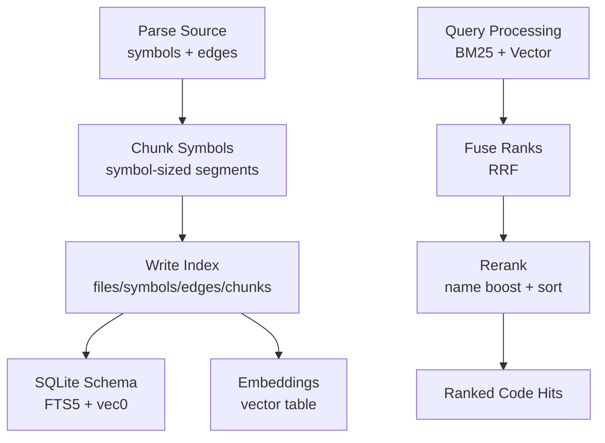
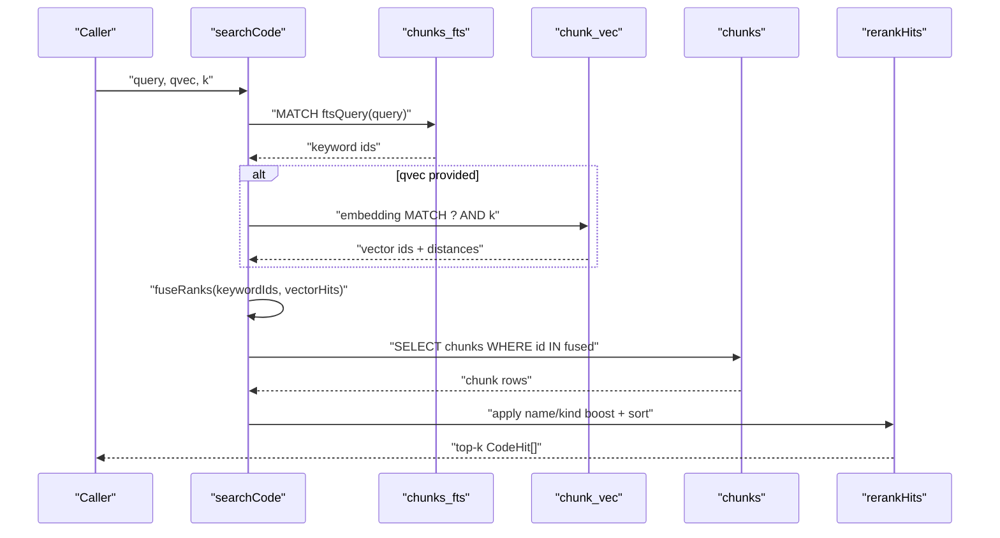
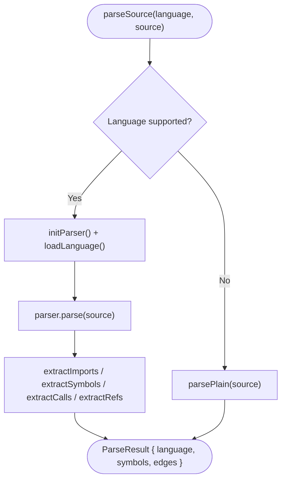
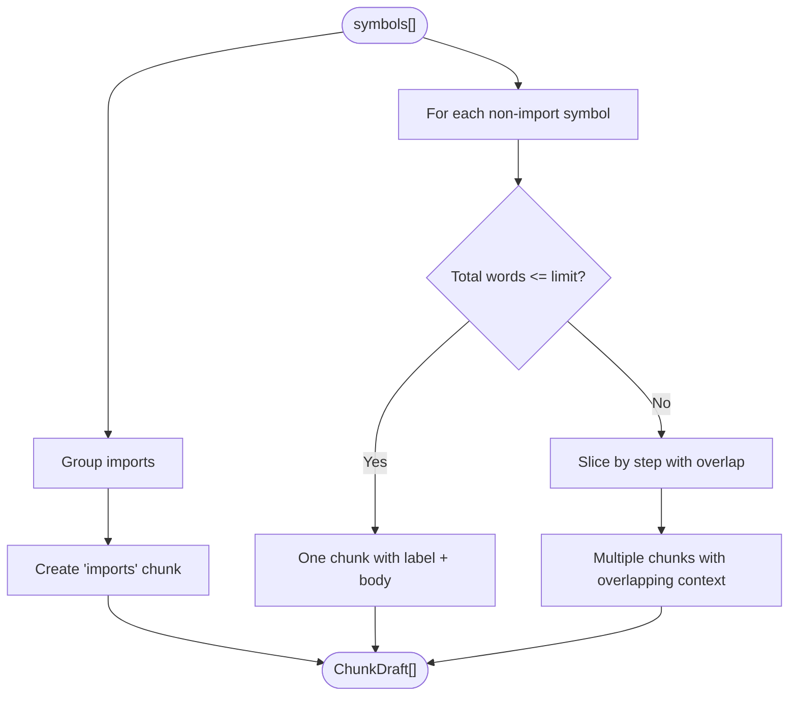
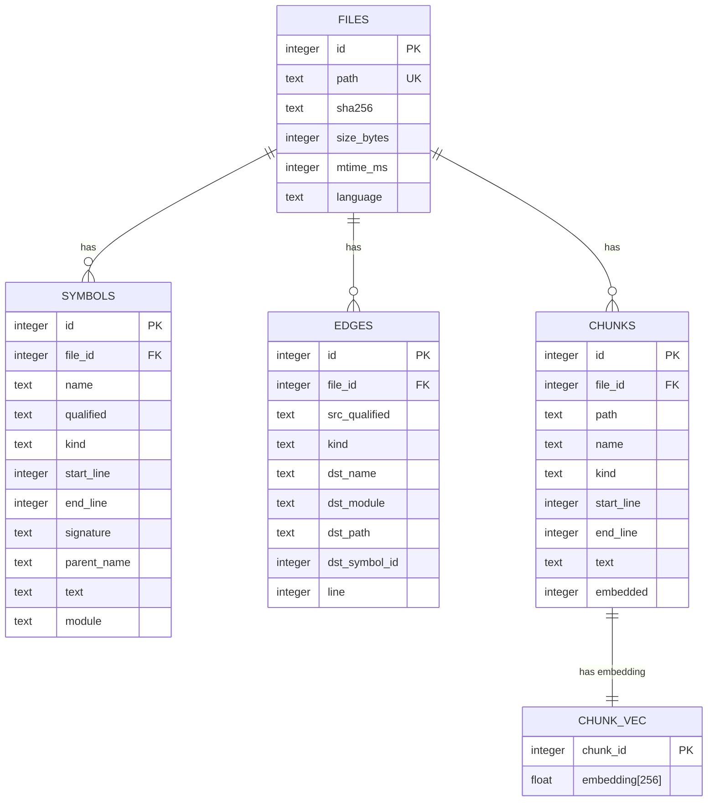
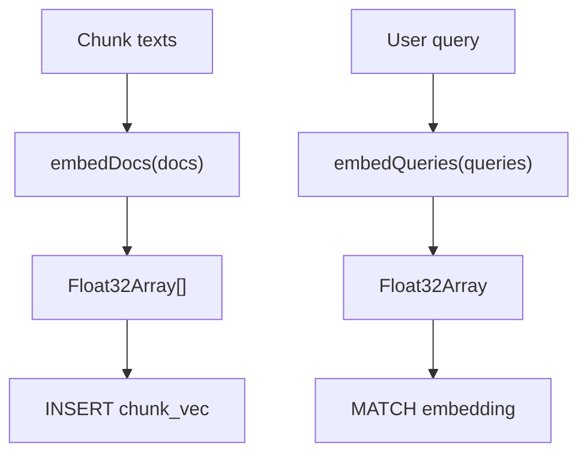
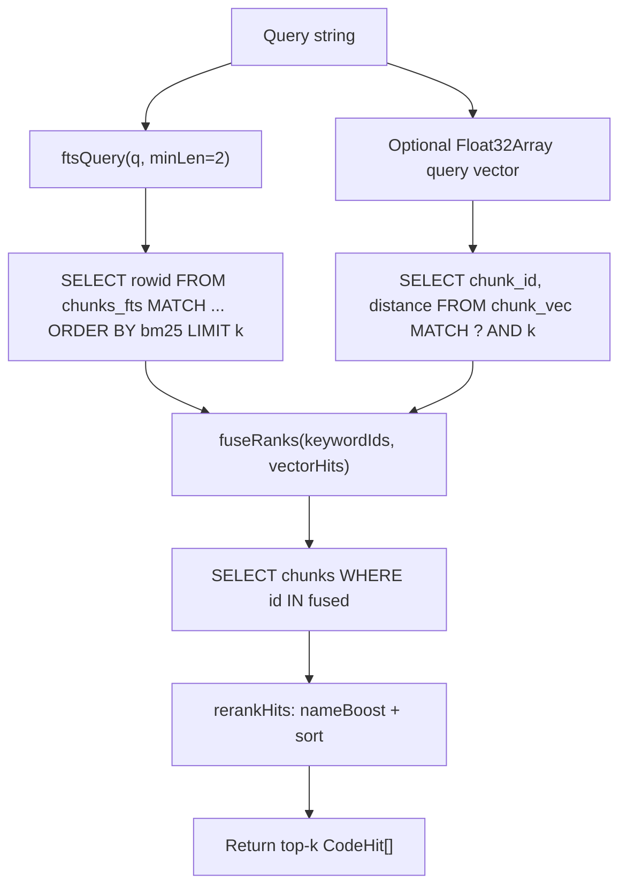
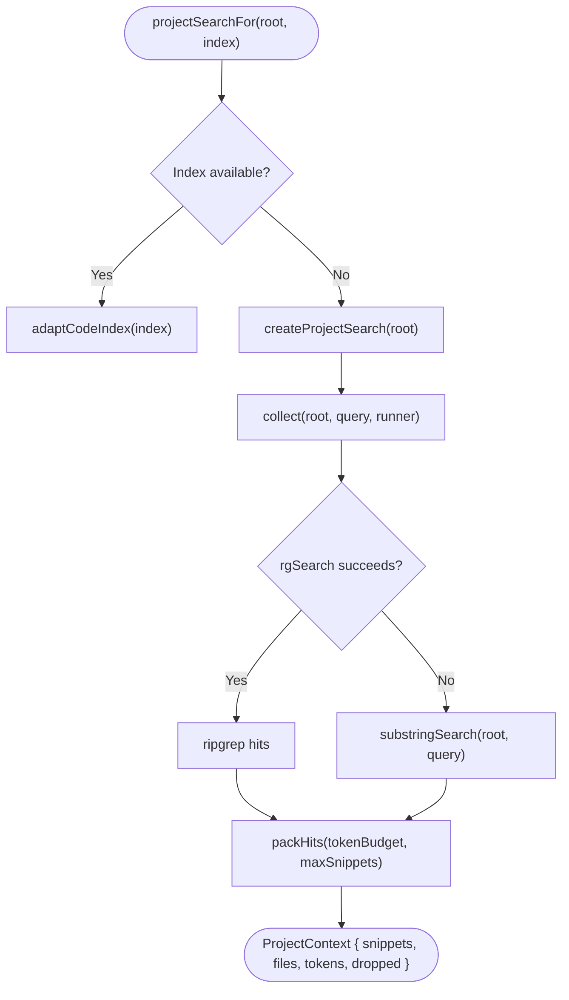
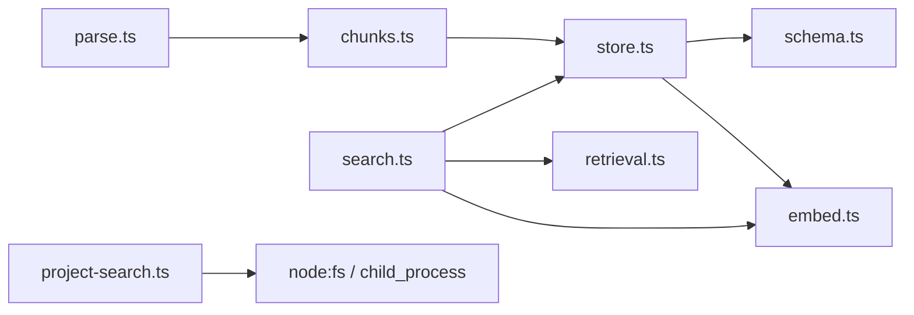

# Code Search

<cite>
**Referenced Files in This Document**
- [search.ts](file://apps/desktop/src/main/core/code/search.ts)
- [chunks.ts](file://apps/desktop/src/main/core/code/chunks.ts)
- [store.ts](file://apps/desktop/src/main/core/code/store.ts)
- [schema.ts](file://apps/desktop/src/main/core/code/schema.ts)
- [parse.ts](file://apps/desktop/src/main/core/code/parse.ts)
- [embed.ts](file://apps/desktop/src/main/core/code/embed.ts)
- [retrieval.ts](file://apps/desktop/src/main/core/retrieval.ts)
- [project-search.ts](file://apps/desktop/src/main/core/code-agent/project-search.ts)
</cite>

## Table of Contents
1. [Introduction](#introduction)
2. [Project Structure](#project-structure)
3. [Core Components](#core-components)
4. [Architecture Overview](#architecture-overview)
5. [Detailed Component Analysis](#detailed-component-analysis)
6. [Dependency Analysis](#dependency-analysis)
7. [Performance Considerations](#performance-considerations)
8. [Troubleshooting Guide](#troubleshooting-guide)
9. [Conclusion](#conclusion)

## Introduction
This document explains the code search system that enables both syntactic and semantic queries across code projects. It covers how source files are parsed into symbols, how large files are chunked while preserving code structure, how a hybrid index combines keyword (FTS5), vector (sqlite-vec), and symbol/relationship data, and how queries are processed through pattern matching, fuzzy search, and context-aware reranking. It also includes query examples, ranking behavior, and performance guidance for real-time search in large codebases.

## Project Structure
The code search capability is implemented in the desktop main process under the core code module. The key pieces are:
- Parsing and symbol extraction from source files
- Chunking logic that respects symbol boundaries
- SQLite schema with FTS5 and vector tables
- Embedding pipeline for vectors
- Hybrid search combining BM25 and cosine similarity via Reciprocal Rank Fusion
- Optional fallback project search using ripgrep or substring scanning

**Diagram sources**
- [parse.ts:502-528](file://apps/desktop/src/main/core/code/parse.ts#L502-L528)
- [chunks.ts:75-93](file://apps/desktop/src/main/core/code/chunks.ts#L75-L93)
- [store.ts:73-105](file://apps/desktop/src/main/core/code/store.ts#L73-L105)
- [schema.ts:3-74](file://apps/desktop/src/main/core/code/schema.ts#L3-L74)
- [embed.ts:42-48](file://apps/desktop/src/main/core/code/embed.ts#L42-L48)
- [search.ts:63-84](file://apps/desktop/src/main/core/code/search.ts#L63-L84)

**Section sources**
- [parse.ts:502-528](file://apps/desktop/src/main/core/code/parse.ts#L502-L528)
- [chunks.ts:75-93](file://apps/desktop/src/main/core/code/chunks.ts#L75-L93)
- [store.ts:73-105](file://apps/desktop/src/main/core/code/store.ts#L73-L105)
- [schema.ts:3-74](file://apps/desktop/src/main/core/code/schema.ts#L3-L74)
- [embed.ts:42-48](file://apps/desktop/src/main/core/code/embed.ts#L42-L48)
- [search.ts:63-84](file://apps/desktop/src/main/core/code/search.ts#L63-L84)

## Core Components
- Parser and symbol extractor: Converts source files into structured symbols and relationship edges.
- Chunker: Breaks symbols into searchable chunks while maintaining line ranges and context.
- Store and schema: Persists files, symbols, edges, chunks, FTS5 index, and vector embeddings.
- Embedder: Produces vector embeddings for chunks and queries.
- Search engine: Executes hybrid search (BM25 + vector), fuses ranks, and reranks results.
- Project search stub: Provides a fallback when no index exists.

**Section sources**
- [parse.ts:14-41](file://apps/desktop/src/main/core/code/parse.ts#L14-L41)
- [chunks.ts:5-12](file://apps/desktop/src/main/core/code/chunks.ts#L5-L12)
- [store.ts:10-22](file://apps/desktop/src/main/core/code/store.ts#L10-L22)
- [schema.ts:3-74](file://apps/desktop/src/main/core/code/schema.ts#L3-L74)
- [embed.ts:9-13](file://apps/desktop/src/main/core/code/embed.ts#L9-L13)
- [search.ts:5-18](file://apps/desktop/src/main/core/code/search.ts#L5-L18)
- [project-search.ts:14-42](file://apps/desktop/src/main/core/code-agent/project-search.ts#L14-L42)

## Architecture Overview
The system implements a hybrid retrieval pipeline:
1. Keyword search via FTS5 on chunk name/path/text.
2. Semantic search via sqlite-vec cosine distance on chunk embeddings.
3. Rank fusion using Reciprocal Rank Fusion (RRF).
4. Context-aware reranking with name and kind boosts.
5. Final top-k results returned to callers.

**Diagram sources**
- [search.ts:63-84](file://apps/desktop/src/main/core/code/search.ts#L63-L84)
- [retrieval.ts:22-25](file://apps/desktop/src/main/core/retrieval.ts#L22-L25)
- [schema.ts:55-73](file://apps/desktop/src/main/core/code/schema.ts#L55-L73)

## Detailed Component Analysis

### Parser and Symbol Extraction
The parser uses tree-sitter grammars per language to extract:
- Symbols: functions, classes, methods, types, imports, variables, sections.
- Edges: calls, references, imports with source/target metadata.
- Plain text fallback for unsupported languages or parse failures.

Key behaviors:
- Language-specific rules define symbol nodes, class nodes, and call patterns.
- Import extraction produces import symbols and edges linking modules.
- Call and reference extraction records usage sites with qualified names.
- For plaintext, it splits by blank lines and headings into sections.

**Diagram sources**
- [parse.ts:502-528](file://apps/desktop/src/main/core/code/parse.ts#L502-L528)
- [parse.ts:304-393](file://apps/desktop/src/main/core/code/parse.ts#L304-L393)
- [parse.ts:395-464](file://apps/desktop/src/main/core/code/parse.ts#L395-L464)
- [parse.ts:466-500](file://apps/desktop/src/main/core/code/parse.ts#L466-L500)

**Section sources**
- [parse.ts:14-41](file://apps/desktop/src/main/core/code/parse.ts#L14-L41)
- [parse.ts:53-132](file://apps/desktop/src/main/core/code/parse.ts#L53-L132)
- [parse.ts:304-393](file://apps/desktop/src/main/core/code/parse.ts#L304-L393)
- [parse.ts:395-464](file://apps/desktop/src/main/core/code/parse.ts#L395-L464)
- [parse.ts:466-500](file://apps/desktop/src/main/core/code/parse.ts#L466-L500)
- [parse.ts:502-528](file://apps/desktop/src/main/core/code/parse.ts#L502-L528)

### Chunking System
Chunks are built around symbols to preserve code structure:
- Each symbol becomes one or more chunks.
- Small symbols fit within a single chunk; large symbols are sliced by word count with overlap.
- Imports are grouped into a dedicated chunk.
- Each chunk carries path, name, kind, start/end lines, and text.

**Diagram sources**
- [chunks.ts:25-73](file://apps/desktop/src/main/core/code/chunks.ts#L25-L73)
- [chunks.ts:75-93](file://apps/desktop/src/main/core/code/chunks.ts#L75-L93)

**Section sources**
- [chunks.ts:5-12](file://apps/desktop/src/main/core/code/chunks.ts#L5-L12)
- [chunks.ts:14-23](file://apps/desktop/src/main/core/code/chunks.ts#L14-L23)
- [chunks.ts:25-73](file://apps/desktop/src/main/core/code/chunks.ts#L25-L73)
- [chunks.ts:75-93](file://apps/desktop/src/main/core/code/chunks.ts#L75-L93)

### Index Storage and Schema
The SQLite database stores:
- files: file metadata (path, sha256, size, mtime, language).
- symbols: extracted symbols with line ranges and signatures.
- edges: relationships (calls, references, imports) with resolved paths where possible.
- chunks: searchable segments with embedded flag.
- chunks_fts: FTS5 virtual table for BM25 keyword search.
- chunk_vec: sqlite-vec table for 256-d embeddings.

Triggers keep chunks_fts synchronized with chunks. Vectors are stored alongside chunks and marked when embedded.

**Diagram sources**
- [schema.ts:3-74](file://apps/desktop/src/main/core/code/schema.ts#L3-L74)

**Section sources**
- [schema.ts:3-74](file://apps/desktop/src/main/core/code/schema.ts#L3-L74)
- [store.ts:73-105](file://apps/desktop/src/main/core/code/store.ts#L73-L105)
- [store.ts:328-342](file://apps/desktop/src/main/core/code/store.ts#L328-L342)
- [store.ts:380-391](file://apps/desktop/src/main/core/code/store.ts#L380-L391)

### Embedding Pipeline
Embeddings are produced for chunks and queries:
- Production uses an EmbeddingGemma client adapter.
- Tests use a deterministic hash-based embedder for stable ranking without model calls.
- Vectors are normalized and stored in chunk_vec.

**Diagram sources**
- [embed.ts:9-13](file://apps/desktop/src/main/core/code/embed.ts#L9-L13)
- [embed.ts:33-48](file://apps/desktop/src/main/core/code/embed.ts#L33-L48)
- [embed.ts:50-52](file://apps/desktop/src/main/core/code/embed.ts#L50-L52)

**Section sources**
- [embed.ts:9-13](file://apps/desktop/src/main/core/code/embed.ts#L9-L13)
- [embed.ts:15-31](file://apps/desktop/src/main/core/code/embed.ts#L15-L31)
- [embed.ts:33-48](file://apps/desktop/src/main/core/code/embed.ts#L33-L48)
- [embed.ts:50-52](file://apps/desktop/src/main/core/code/embed.ts#L50-L52)

### Query Processing Pipeline
The search pipeline executes:
- BM25 keyword search over chunks_fts using a safe FTS5 query builder.
- Cosine vector search over chunk_vec using sqlite-vec.
- Rank fusion via Reciprocal Rank Fusion (RRF) with configurable k.
- Name and kind boosting to prioritize exact identifier matches and important kinds.
- Sorting by fused score, then BM25 rank, cosine similarity, and path.

**Diagram sources**
- [search.ts:63-84](file://apps/desktop/src/main/core/code/search.ts#L63-L84)
- [retrieval.ts:43-47](file://apps/desktop/src/main/core/retrieval.ts#L43-L47)
- [retrieval.ts:22-25](file://apps/desktop/src/main/core/retrieval.ts#L22-L25)

**Section sources**
- [search.ts:27-45](file://apps/desktop/src/main/core/code/search.ts#L27-L45)
- [search.ts:48-61](file://apps/desktop/src/main/core/code/search.ts#L48-L61)
- [search.ts:63-84](file://apps/desktop/src/main/core/code/search.ts#L63-L84)
- [retrieval.ts:22-25](file://apps/desktop/src/main/core/retrieval.ts#L22-L25)
- [retrieval.ts:43-47](file://apps/desktop/src/main/core/retrieval.ts#L43-L47)

### Fallback Project Search
When no indexed project is available, a fallback search provides snippets:
- Attempts ripgrep first; falls back to substring scanning if unavailable.
- Skips binary and large files, limits file count and snippet size.
- Packs hits respecting token budget and max snippets.

**Diagram sources**
- [project-search.ts:54-82](file://apps/desktop/src/main/core/code-agent/project-search.ts#L54-L82)
- [project-search.ts:93-99](file://apps/desktop/src/main/core/code-agent/project-search.ts#L93-L99)
- [project-search.ts:130-169](file://apps/desktop/src/main/core/code-agent/project-search.ts#L130-L169)
- [project-search.ts:171-193](file://apps/desktop/src/main/core/code-agent/project-search.ts#L171-L193)
- [project-search.ts:221-238](file://apps/desktop/src/main/core/code-agent/project-search.ts#L221-L238)

**Section sources**
- [project-search.ts:54-82](file://apps/desktop/src/main/core/code-agent/project-search.ts#L54-L82)
- [project-search.ts:93-99](file://apps/desktop/src/main/core/code-agent/project-search.ts#L93-L99)
- [project-search.ts:101-128](file://apps/desktop/src/main/core/code-agent/project-search.ts#L101-L128)
- [project-search.ts:130-169](file://apps/desktop/src/main/core/code-agent/project-search.ts#L130-L169)
- [project-search.ts:171-193](file://apps/desktop/src/main/core/code-agent/project-search.ts#L171-L193)
- [project-search.ts:221-238](file://apps/desktop/src/main/core/code-agent/project-search.ts#L221-L238)

## Dependency Analysis
The following diagram shows how components depend on each other during indexing and search.

**Diagram sources**
- [parse.ts:502-528](file://apps/desktop/src/main/core/code/parse.ts#L502-L528)
- [chunks.ts:75-93](file://apps/desktop/src/main/core/code/chunks.ts#L75-L93)
- [store.ts:73-105](file://apps/desktop/src/main/core/code/store.ts#L73-L105)
- [schema.ts:3-74](file://apps/desktop/src/main/core/code/schema.ts#L3-L74)
- [embed.ts:42-48](file://apps/desktop/src/main/core/code/embed.ts#L42-L48)
- [search.ts:63-84](file://apps/desktop/src/main/core/code/search.ts#L63-L84)
- [retrieval.ts:43-47](file://apps/desktop/src/main/core/retrieval.ts#L43-L47)
- [project-search.ts:93-99](file://apps/desktop/src/main/core/code-agent/project-search.ts#L93-L99)

**Section sources**
- [parse.ts:502-528](file://apps/desktop/src/main/core/code/parse.ts#L502-L528)
- [chunks.ts:75-93](file://apps/desktop/src/main/core/code/chunks.ts#L75-L93)
- [store.ts:73-105](file://apps/desktop/src/main/core/code/store.ts#L73-L105)
- [schema.ts:3-74](file://apps/desktop/src/main/core/code/schema.ts#L3-L74)
- [embed.ts:42-48](file://apps/desktop/src/main/core/code/embed.ts#L42-L48)
- [search.ts:63-84](file://apps/desktop/src/main/core/code/search.ts#L63-L84)
- [retrieval.ts:43-47](file://apps/desktop/src/main/core/retrieval.ts#L43-L47)
- [project-search.ts:93-99](file://apps/desktop/src/main/core/code-agent/project-search.ts#L93-L99)

## Performance Considerations
- Hybrid retrieval reduces latency by limiting candidate sets:
  - BM25 quickly narrows candidates via FTS5.
  - Vector search adds semantic recall without scanning all chunks.
- RRF fusion balances keyword and vector contributions with a tunable constant k.
- Name and kind boosting improves precision for identifier-focused queries.
- Chunking preserves symbol boundaries and uses overlap to reduce boundary loss.
- Embedding dimensionality is fixed at 256, balancing accuracy and storage.
- Fallback project search caps file counts, file sizes, and snippet windows to avoid heavy I/O.

Recommendations:
- Keep k moderate (e.g., 60) to balance recall and speed.
- Prefer indexed projects for large codebases; fall back to ripgrep when available.
- Ensure embeddings are computed incrementally to avoid blocking UI.
- Limit top-k results early to minimize downstream processing.

[No sources needed since this section provides general guidance]

## Troubleshooting Guide
Common issues and resolutions:
- No results returned:
  - Verify chunks exist and are embedded; check pending chunks and embedded flags.
  - Confirm FTS5 triggers are active and chunks_fts is populated.
  - Ensure vector table has entries for chunks and embeddings are valid.
- Poor relevance:
  - Adjust name/kind boosting thresholds in reranking.
  - Tune RRF k parameter to emphasize BM25 or vector results.
  - Validate query preprocessing (min term length, tokenization).
- Slow search:
  - Reduce top-k and ensure indexes exist on relevant columns.
  - Avoid unnecessary full-table scans by leveraging FTS5 and vec0.
- Fallback search not finding hits:
  - Check ripgrep availability and glob exclusions.
  - Inspect file size and extension filters in substring search.

Operational checks:
- Count files, symbols, chunks, and embedded chunks to validate indexing progress.
- Review pending chunks to ensure embeddings are being processed.
- Validate schema integrity and trigger definitions.

**Section sources**
- [store.ts:328-342](file://apps/desktop/src/main/core/code/store.ts#L328-L342)
- [schema.ts:55-73](file://apps/desktop/src/main/core/code/schema.ts#L55-L73)
- [search.ts:48-61](file://apps/desktop/src/main/core/code/search.ts#L48-L61)
- [project-search.ts:130-169](file://apps/desktop/src/main/core/code-agent/project-search.ts#L130-L169)

## Conclusion
The code search system combines robust parsing, symbol-aware chunking, and a hybrid retrieval pipeline to deliver fast and accurate results across large codebases. By integrating BM25 keyword search, vector similarity, and context-aware reranking, it supports both precise identifier queries and broader semantic searches. The SQLite-backed index with FTS5 and sqlite-vec ensures scalability, while the fallback project search guarantees usability even without an index. With careful tuning of fusion parameters and chunking strategies, the system achieves responsive real-time search suitable for interactive development workflows.

[No sources needed since this section summarizes without analyzing specific files]