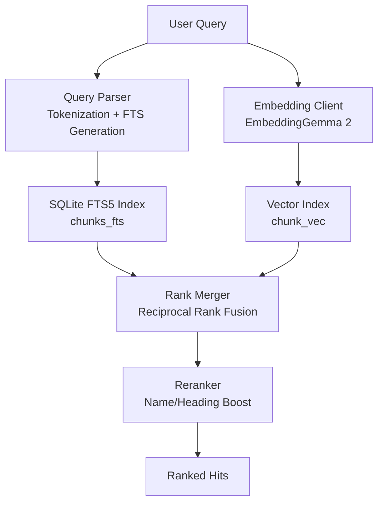
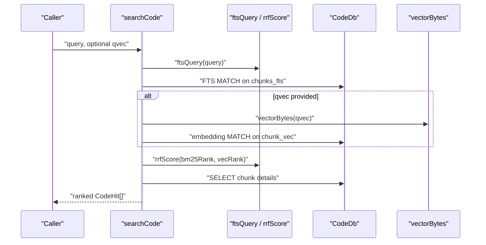
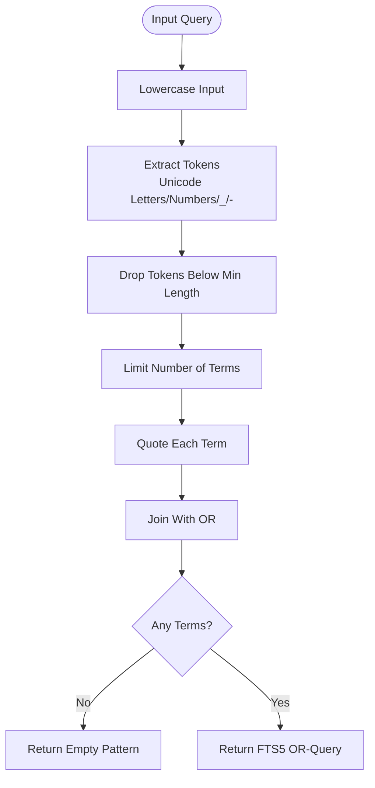
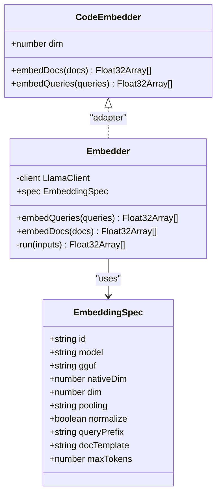
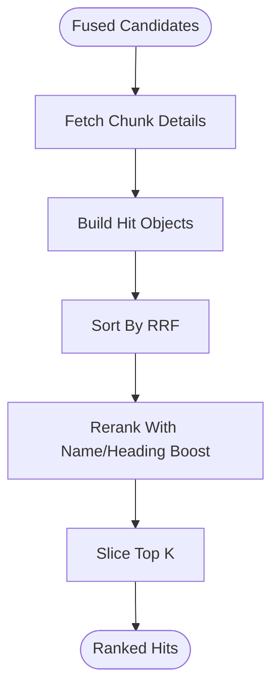
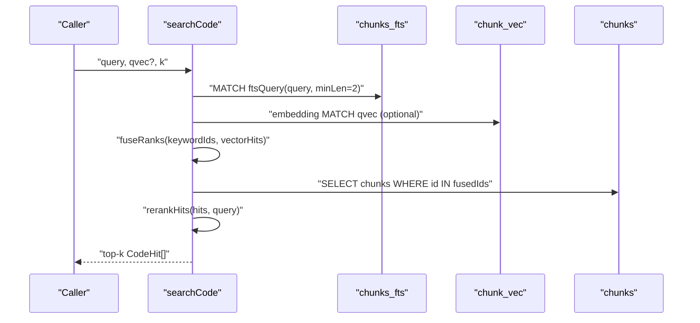
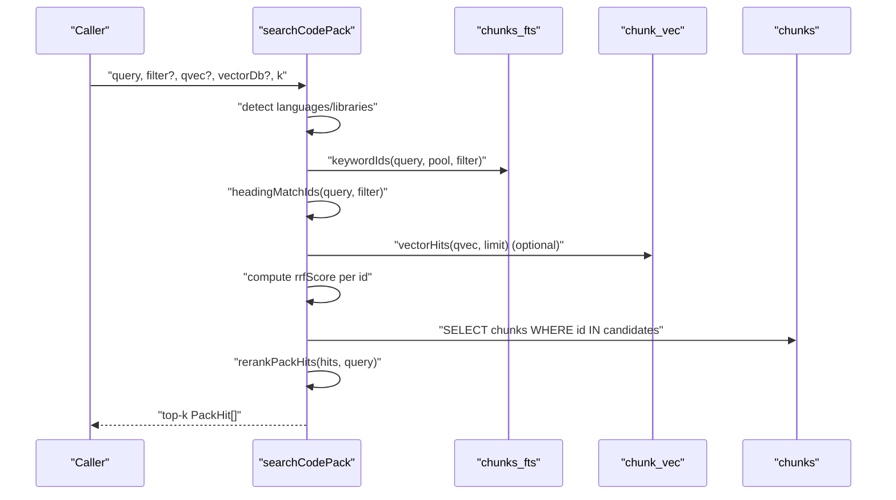
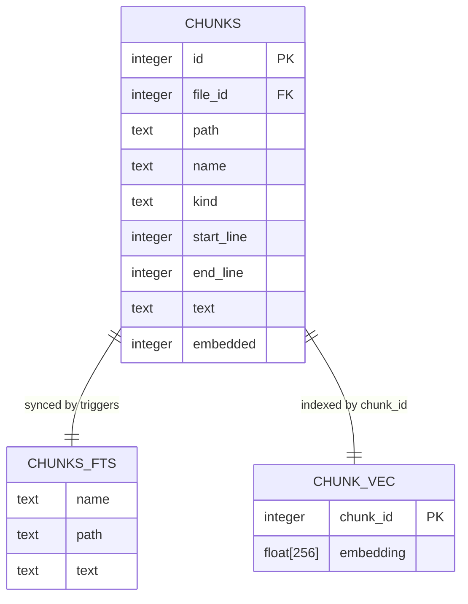
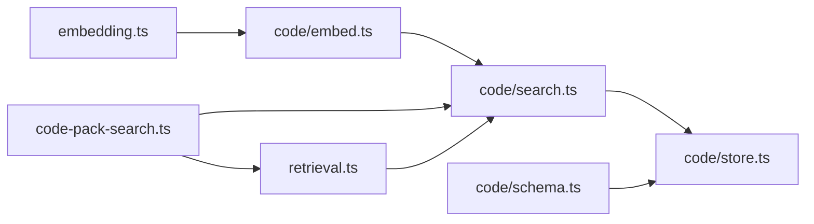

# Query Processing

<cite>
**Referenced Files in This Document**
- [search.ts](file://apps/desktop/src/main/core/code/search.ts)
- [retrieval.ts](file://apps/desktop/src/main/core/retrieval.ts)
- [embed.ts](file://apps/desktop/src/main/core/code/embed.ts)
- [embedding.ts](file://apps/desktop/src/main/core/embedding.ts)
- [schema.ts](file://apps/desktop/src/main/core/code/schema.ts)
- [store.ts](file://apps/desktop/src/main/core/code/store.ts)
- [code-pack-search.ts](file://apps/desktop/src/main/core/code-pack-search.ts)
</cite>

## Table of Contents
1. [Introduction](#introduction)
2. [Project Structure](#project-structure)
3. [Core Components](#core-components)
4. [Architecture Overview](#architecture-overview)
5. [Detailed Component Analysis](#detailed-component-analysis)
6. [Dependency Analysis](#dependency-analysis)
7. [Performance Considerations](#performance-considerations)
8. [Troubleshooting Guide](#troubleshooting-guide)
9. [Conclusion](#conclusion)

## Introduction
This document explains how user queries are processed into searchable results across two search surfaces:
- Project code search over indexed code chunks.
- Code pack search over documentation-style chunks with language and library metadata.

The system converts natural language input into:
- A safe SQLite FTS5 keyword query.
- A semantic vector embedding for similarity search.
It then merges keyword and vector results using Reciprocal Rank Fusion, applies lightweight reranking heuristics, and returns ranked hits.

## Project Structure
The query processing pipeline spans several modules:
- Query parsing and FTS generation live in the retrieval module.
- Vector embedding conversion lives in the embedding and code embedding modules.
- Code search orchestration lives in the code search module.
- Database schema and indexing live in the code schema and store modules.
- Code pack search adds metadata-aware filtering and heading boosting.

**Diagram sources**
- [retrieval.ts:41-47](file://apps/desktop/src/main/core/retrieval.ts#L41-L47)
- [schema.ts:55-73](file://apps/desktop/src/main/core/code/schema.ts#L55-L73)
- [search.ts:63-84](file://apps/desktop/src/main/core/code/search.ts#L63-L84)
- [code-pack-search.ts:74-118](file://apps/desktop/src/main/core/code-pack-search.ts#L74-L118)

**Section sources**
- [retrieval.ts:1-47](file://apps/desktop/src/main/core/retrieval.ts#L1-L47)
- [schema.ts:1-75](file://apps/desktop/src/main/core/code/schema.ts#L1-L75)
- [search.ts:1-85](file://apps/desktop/src/main/core/code/search.ts#L1-L85)
- [code-pack-search.ts:1-118](file://apps/desktop/src/main/core/code-pack-search.ts#L1-L118)

## Core Components
- Query parser and FTS generator: tokenizes user input into a safe FTS5 OR-query.
- Embedding client: formats queries according to the embedding spec and produces normalized vectors.
- Code search engine: runs FTS and vector searches, fuses ranks, and reranks by name/heading matches.
- Code pack search engine: adds language/library filters, heading matching, and license-aware boosting.
- Database schema: defines FTS5 virtual table and sqlite-vec vector table for code chunks.

Key responsibilities:
- Safe query construction prevents FTS syntax errors and injection.
- Hybrid retrieval combines BM25 ranking and cosine similarity via RRF.
- Lightweight reranking boosts symbol names and headings that match identifiers from the query.

**Section sources**
- [retrieval.ts:41-47](file://apps/desktop/src/main/core/retrieval.ts#L41-L47)
- [embedding.ts:31-51](file://apps/desktop/src/main/core/embedding.ts#L31-L51)
- [search.ts:27-84](file://apps/desktop/src/main/core/code/search.ts#L27-L84)
- [code-pack-search.ts:74-131](file://apps/desktop/src/main/core/code-pack-search.ts#L74-L131)
- [schema.ts:55-73](file://apps/desktop/src/main/core/code/schema.ts#L55-L73)

## Architecture Overview
The end-to-end flow for project code search is:

**Diagram sources**
- [search.ts:63-84](file://apps/desktop/src/main/core/code/search.ts#L63-L84)
- [retrieval.ts:22-25](file://apps/desktop/src/main/core/retrieval.ts#L22-L25)
- [retrieval.ts:41-47](file://apps/desktop/src/main/core/retrieval.ts#L41-L47)
- [embed.ts:50-52](file://apps/desktop/src/main/core/code/embed.ts#L50-L52)

## Detailed Component Analysis

### Query Parsing and FTS Generation
The query parser extracts tokens from the user’s text and builds a safe FTS5 OR-query:
- Tokens are Unicode letters, numbers, underscores, and hyphens.
- Short tokens below a minimum length are dropped.
- The first N tokens are quoted and joined with OR.
- If no tokens remain, an empty FTS pattern is returned.

This approach avoids FTS syntax errors and protects against malformed or malicious input.

**Diagram sources**
- [retrieval.ts:41-47](file://apps/desktop/src/main/core/retrieval.ts#L41-L47)

**Section sources**
- [retrieval.ts:41-47](file://apps/desktop/src/main/core/retrieval.ts#L41-L47)

### Vector Embedding Conversion
Queries are converted into semantic vectors using the EmbeddingGemma 2 specification:
- Queries receive a model-specific prefix.
- Documents receive a template with title and text placeholders.
- Vectors are truncated to the configured dimension and L2-normalized.
- Invalid vectors (NaN, zero norm, wrong dimension) are rejected early.

For tests and deterministic behavior, a hash-based bag-of-tokens embedder is available.

**Diagram sources**
- [embedding.ts:17-51](file://apps/desktop/src/main/core/embedding.ts#L17-L51)
- [embedding.ts:66-83](file://apps/desktop/src/main/core/embedding.ts#L66-L83)
- [embed.ts:9-13](file://apps/desktop/src/main/core/code/embed.ts#L9-L13)

**Section sources**
- [embedding.ts:31-51](file://apps/desktop/src/main/core/embedding.ts#L31-L51)
- [embedding.ts:66-83](file://apps/desktop/src/main/core/embedding.ts#L66-L83)
- [embed.ts:15-38](file://apps/desktop/src/main/core/code/embed.ts#L15-L38)

### Hybrid Retrieval and Ranking
Hybrid retrieval combines:
- Keyword search via FTS5 BM25.
- Vector search via sqlite-vec cosine distance.

Ranks are fused using Reciprocal Rank Fusion:
- Each list contributes a rank; missing lists contribute nothing.
- The fusion score is the sum of reciprocal ranks across lists.

After fusion, results are fetched and optionally reranked by name/heading matches.

**Diagram sources**
- [search.ts:27-45](file://apps/desktop/src/main/core/code/search.ts#L27-L45)
- [search.ts:57-84](file://apps/desktop/src/main/core/code/search.ts#L57-L84)

**Section sources**
- [search.ts:27-84](file://apps/desktop/src/main/core/code/search.ts#L27-L84)
- [retrieval.ts:22-25](file://apps/desktop/src/main/core/retrieval.ts#L22-L25)

### Code Search Pipeline
The code search function:
1. Builds an FTS query with a short minimum token length.
2. Runs FTS over chunks_fts.
3. Optionally runs vector search over chunk_vec if a query vector is present.
4. Fuses BM25 and vector ranks.
5. Retrieves chunk rows for fused IDs.
6. Applies name/heading boost and sorts final results.

**Diagram sources**
- [search.ts:63-84](file://apps/desktop/src/main/core/code/search.ts#L63-L84)

**Section sources**
- [search.ts:63-84](file://apps/desktop/src/main/core/code/search.ts#L63-L84)

### Code Pack Search Pipeline
The code pack search adds:
- Language and library detection from the query.
- Optional prefiltering by allowed IDs.
- Heading matching to include relevant documentation sections.
- License-aware boosting for open content.

**Diagram sources**
- [code-pack-search.ts:74-118](file://apps/desktop/src/main/core/code-pack-search.ts#L74-L118)
- [code-pack-search.ts:121-131](file://apps/desktop/src/main/core/code-pack-search.ts#L121-L131)
- [code-pack-search.ts:134-168](file://apps/desktop/src/main/core/code-pack-search.ts#L134-L168)
- [code-pack-search.ts:170-201](file://apps/desktop/src/main/core/code-pack-search.ts#L170-L201)
- [code-pack-search.ts:204-213](file://apps/desktop/src/main/core/code-pack-search.ts#L204-L213)

**Section sources**
- [code-pack-search.ts:74-131](file://apps/desktop/src/main/core/code-pack-search.ts#L74-L131)
- [code-pack-search.ts:134-213](file://apps/desktop/src/main/core/code-pack-search.ts#L134-L213)

### Database Schema and Indexing
The code index uses:
- An FTS5 virtual table for keyword search over name, path, and text.
- A sqlite-vec vector table for 256-dimensional embeddings.
- Triggers to keep FTS synchronized with chunk changes.

**Diagram sources**
- [schema.ts:42-73](file://apps/desktop/src/main/core/code/schema.ts#L42-L73)

**Section sources**
- [schema.ts:42-73](file://apps/desktop/src/main/core/code/schema.ts#L42-L73)

## Dependency Analysis
The main dependencies between components are:
- Code search depends on retrieval utilities and vector byte conversion.
- Code pack search depends on code search reranking helpers and retrieval utilities.
- Embedding conversion depends on the embedding spec and llama client wrapper.
- Store operations depend on schema definitions and vector byte conversion.

**Diagram sources**
- [search.ts:1-3](file://apps/desktop/src/main/core/code/search.ts#L1-L3)
- [code-pack-search.ts:8-11](file://apps/desktop/src/main/core/code-pack-search.ts#L8-L11)
- [embed.ts:6-7](file://apps/desktop/src/main/core/code/embed.ts#L6-L7)
- [embedding.ts:15-16](file://apps/desktop/src/main/core/embedding.ts#L15-L16)
- [schema.ts:1-2](file://apps/desktop/src/main/core/code/schema.ts#L1-L2)
- [store.ts:4-8](file://apps/desktop/src/main/core/code/store.ts#L4-L8)

**Section sources**
- [search.ts:1-3](file://apps/desktop/src/main/core/code/search.ts#L1-L3)
- [code-pack-search.ts:8-11](file://apps/desktop/src/main/core/code-pack-search.ts#L8-L11)
- [embed.ts:6-7](file://apps/desktop/src/main/core/code/embed.ts#L6-L7)
- [embedding.ts:15-16](file://apps/desktop/src/main/core/embedding.ts#L15-L16)
- [schema.ts:1-2](file://apps/desktop/src/main/core/code/schema.ts#L1-L2)
- [store.ts:4-8](file://apps/desktop/src/main/core/code/store.ts#L4-L8)

## Performance Considerations
- FTS query limits the number of terms to reduce query size and avoid excessive OR clauses.
- Minimum token length reduces noise from very short tokens.
- Hybrid search pools more candidates before reranking to improve recall while keeping final output small.
- Vector search uses sqlite-vec with a fixed dimensionality and cosine distance.
- Reranking is lightweight and operates on a small candidate set.
- Batched embedding operations reduce overhead when indexing documents.

[No sources needed since this section provides general guidance]

## Troubleshooting Guide
Common issues and diagnostics:
- Empty FTS results: ensure the query contains enough meaningful tokens above the minimum length.
- Missing vector results: verify that a query vector was generated and passed to the search function.
- Dimension mismatch: embedding truncation enforces the configured dimension; invalid dimensions cause errors.
- NaN or zero vectors: the embedding normalizer rejects invalid vectors produced by incompatible models or quantization.
- No hits after filtering: language/library filters may exclude all candidates; check detected languages and allowed IDs.

Relevant checks:
- FTS query construction and term limits.
- Vector normalization and dimension validation.
- Filter detection and allowed ID computation.

**Section sources**
- [retrieval.ts:41-47](file://apps/desktop/src/main/core/retrieval.ts#L41-L47)
- [embedding.ts:54-63](file://apps/desktop/src/main/core/embedding.ts#L54-L63)
- [code-pack-search.ts:41-48](file://apps/desktop/src/main/core/code-pack-search.ts#L41-L48)
- [code-pack-search.ts:215-231](file://apps/desktop/src/main/core/code-pack-search.ts#L215-L231)

## Conclusion
The query processing system transforms natural language into both keyword and semantic representations, then merges them through Reciprocal Rank Fusion. It applies targeted reranking heuristics to prioritize symbol names and headings. The design separates concerns across retrieval utilities, embedding conversion, search orchestration, and database schema management, enabling consistent hybrid search across project code and code packs.

[No sources needed since this section summarizes without analyzing specific files]