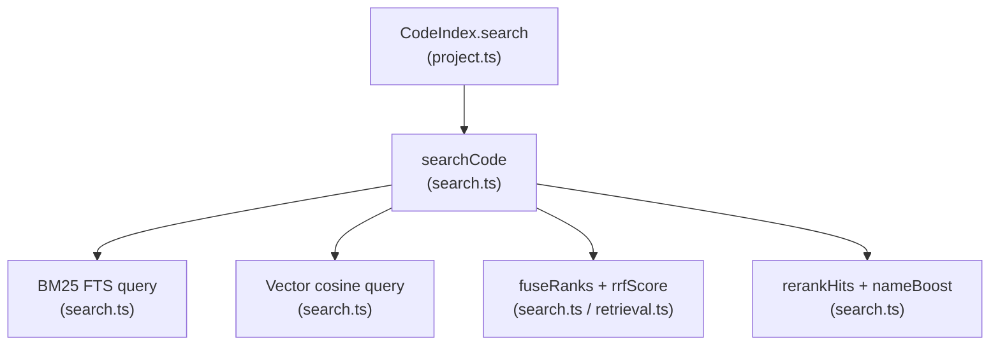
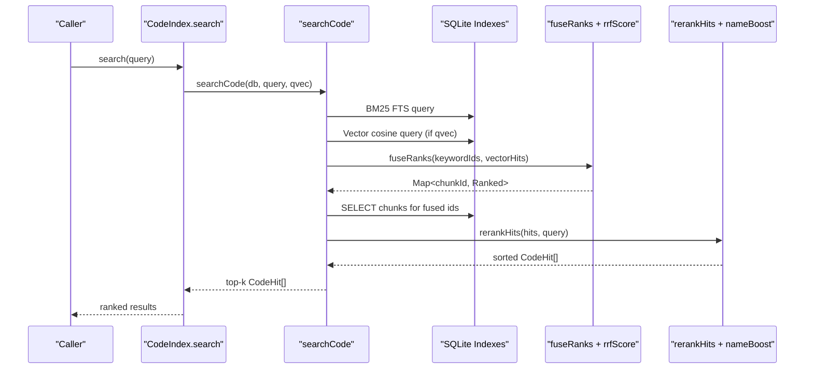
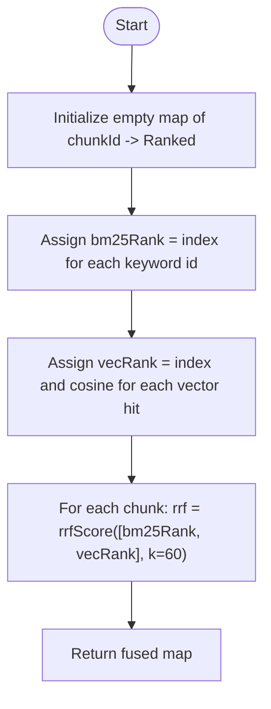
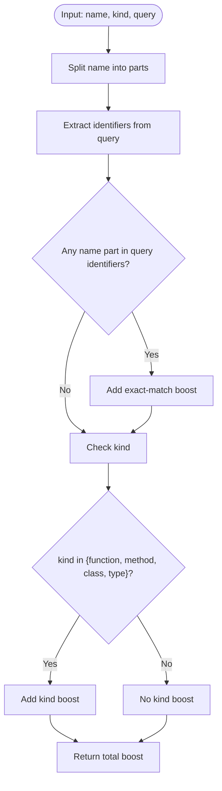
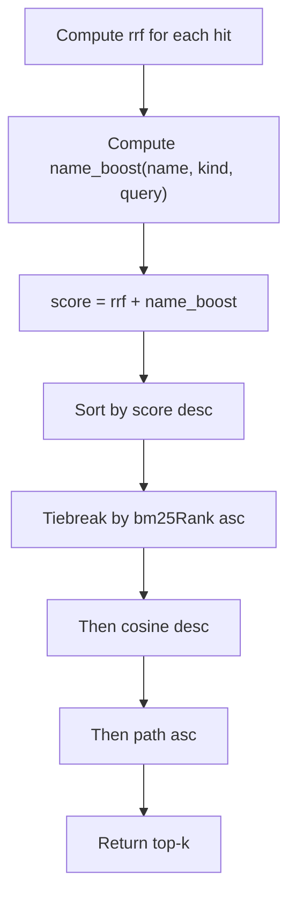
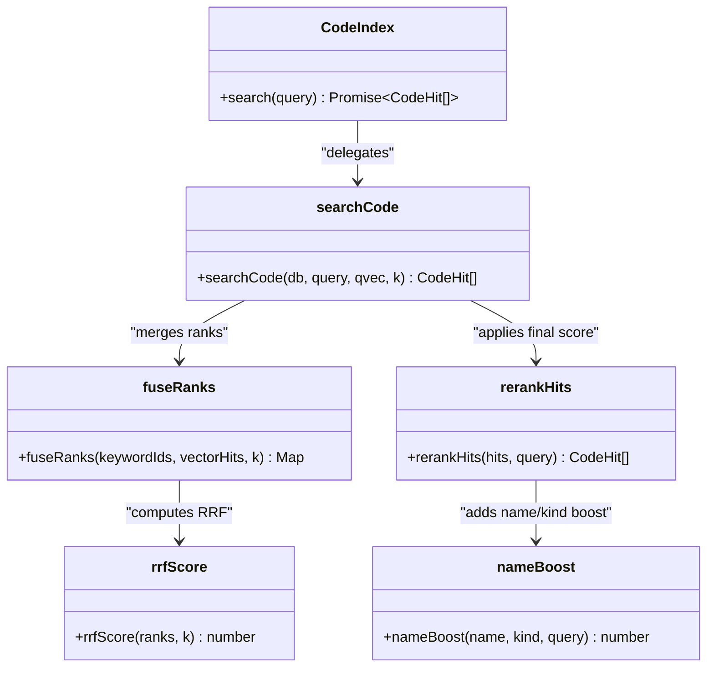

# Ranking & Scoring

<cite>
**Referenced Files in This Document**
- [search.ts](file://apps/desktop/src/main/core/code/search.ts)
- [retrieval.ts](file://apps/desktop/src/main/core/retrieval.ts)
- [project.ts](file://apps/desktop/src/main/core/code/project.ts)
- [code-search.test.ts](file://apps/desktop/src/main/core/code-search.test.ts)
</cite>

## Table of Contents
1. [Introduction](#introduction)
2. [Project Structure](#project-structure)
3. [Core Components](#core-components)
4. [Architecture Overview](#architecture-overview)
5. [Detailed Component Analysis](#detailed-component-analysis)
6. [Dependency Analysis](#dependency-analysis)
7. [Performance Considerations](#performance-considerations)
8. [Troubleshooting Guide](#troubleshooting-guide)
9. [Conclusion](#conclusion)

## Introduction
This document explains the multi-criteria ranking and scoring system used for code search results. It covers how keyword-based BM25 retrieval is combined with vector similarity through Reciprocal Rank Fusion, how name boosting prioritizes exact symbol matches and specific code element types, and how the final score balances relevance, precision, and contextual importance. It also provides performance guidance for real-time ranking in large codebases and tuning parameters for different search scenarios.

## Project Structure
The ranking and scoring logic lives in the desktop application’s main process under the core code module:

- `apps/desktop/src/main/core/code/search.ts` implements hybrid code search, RRF fusion, name boosting, and final reranking.
- `apps/desktop/src/main/core/retrieval.ts` defines shared constants and the canonical RRF implementation used across retrieval components.
- `apps/desktop/src/main/core/code/project.ts` exposes the public `CodeIndex.search` API that triggers the full pipeline.
- `apps/desktop/src/main/core/code-search.test.ts` validates fusion behavior and end-to-end ranking expectations.

**Diagram sources**
- [project.ts:151-156](file://apps/desktop/src/main/core/code/project.ts#L151-L156)
- [search.ts:63-84](file://apps/desktop/src/main/core/code/search.ts#L63-L84)
- [retrieval.ts:22-25](file://apps/desktop/src/main/core/retrieval.ts#L22-L25)

**Section sources**
- [project.ts:151-156](file://apps/desktop/src/main/core/code/project.ts#L151-L156)
- [search.ts:1-84](file://apps/desktop/src/main/core/code/search.ts#L1-L84)
- [retrieval.ts:1-25](file://apps/desktop/src/main/core/retrieval.ts#L1-L25)

## Core Components
- Hybrid retrieval: Keyword BM25 and vector cosine are executed in parallel against SQLite-backed indexes.
- Reciprocal Rank Fusion: Ranks from both lists are merged into a single RRF score per chunk.
- Name boosting: Exact identifier matches and preferred code element kinds add a small additive boost to the final score.
- Final reranking: The final score combines RRF with name boosting, then applies deterministic tiebreakers.

Key data structures:
- `CodeHit`: Represents a ranked code chunk with fields for path, name, kind, line range, text, intermediate ranks (`bm25Rank`, `vecRank`), cosine similarity, RRF, and final `score`.
- `Ranked`: Internal fused representation holding per-chunk ranks and cosine before materializing `CodeHit`.

**Section sources**
- [search.ts:5-18](file://apps/desktop/src/main/core/code/search.ts#L5-L18)
- [search.ts:20-25](file://apps/desktop/src/main/core/code/search.ts#L20-L25)

## Architecture Overview
The code search pipeline executes the following steps:

1. Build a safe BM25 keyword query using tokenized terms.
2. Retrieve top keyword IDs ordered by BM25.
3. If available, retrieve top vector neighbors and convert distance to cosine similarity.
4. Fuse keyword and vector ranks using RRF.
5. Load matching chunks and attach fused scores.
6. Apply name boosting and compute the final score.
7. Sort by final score with deterministic tiebreakers and return the top-k hits.

**Diagram sources**
- [project.ts:151-156](file://apps/desktop/src/main/core/code/project.ts#L151-L156)
- [search.ts:63-84](file://apps/desktop/src/main/core/code/search.ts#L63-L84)
- [retrieval.ts:22-25](file://apps/desktop/src/main/core/retrieval.ts#L22-L25)

## Detailed Component Analysis

### Reciprocal Rank Fusion (RRF)
RRF merges two independent ranked lists:
- Keyword list: BM25-ranked chunk IDs.
- Vector list: Cosine-similarity-ranked chunk IDs.

Implementation details:
- Each list contributes a 0-based rank; if a chunk does not appear in a list, its rank for that list is null.
- The RRF score sums contributions from each non-null rank: sum over i of 1/(k + rank_i + 1).
- The default k is 60, balancing early-rank emphasis without overly penalizing lower positions.

**Diagram sources**
- [search.ts:27-46](file://apps/desktop/src/main/core/code/search.ts#L27-L46)
- [retrieval.ts:22-25](file://apps/desktop/src/main/core/retrieval.ts#L22-L25)

Behavioral guarantees validated by tests:
- A chunk present only in the vector list remains in the fused result.
- A chunk present only in the keyword list remains in the fused result.
- A chunk appearing at the top of both lists receives a higher RRF than either single-list entry.

**Section sources**
- [search.ts:27-46](file://apps/desktop/src/main/core/code/search.ts#L27-L46)
- [retrieval.ts:22-25](file://apps/desktop/src/main/core/retrieval.ts#L22-L25)
- [code-search.test.ts:32-40](file://apps/desktop/src/main/core/code-search.test.ts#L32-L40)

### Name Boosting Mechanism
Name boosting adds an additive term to the final score to prioritize exact symbol matches and important code element types.

Rules:
- Tokenize the symbol name into parts separated by dots or whitespace.
- Extract identifiers from the query.
- If any name part matches a query identifier, add a fixed boost.
- If the code element kind is function, method, class, or type, add a smaller additional boost.

Purpose:
- Exact symbol matches receive a meaningful lift, improving precision for developer queries like “ferryDeparture”.
- Preferred kinds such as functions, methods, classes, and types get a small positive bias to favor executable or structural symbols.

**Diagram sources**
- [search.ts:48-55](file://apps/desktop/src/main/core/code/search.ts#L48-L55)

**Section sources**
- [search.ts:48-55](file://apps/desktop/src/main/core/code/search.ts#L48-L55)

### Final Scoring Formula
The final score for each hit is computed as:

final_score = rrf + name_boost

Where:
- rrf is the reciprocal rank fusion score combining BM25 and vector similarity.
- name_boost is the additive boost from exact identifier matches and preferred code element kinds.

Sorting order:
1. Primary: descending final score.
2. Tiebreaker 1: ascending BM25 rank (lower is better).
3. Tiebreaker 2: descending cosine similarity.
4. Tiebreaker 3: lexicographic file path.

This formula balances:
- Relevance: captured by RRF, which rewards agreement between keyword and vector rankings.
- Precision: boosted by exact identifier matches and preferred kinds.
- Contextual importance: preserved via cosine similarity and BM25 rank as tiebreakers.

**Diagram sources**
- [search.ts:57-61](file://apps/desktop/src/main/core/code/search.ts#L57-L61)

Validation:
- Tests assert that hybrid search ranks the symbol over a keyword dump and that the final score ordering is monotonic.

**Section sources**
- [search.ts:57-61](file://apps/desktop/src/main/core/code/search.ts#L57-L61)
- [code-search.test.ts:42-61](file://apps/desktop/src/main/core/code-search.test.ts#L42-L61)

### End-to-End Search Flow
The public search API integrates embedding generation, hybrid retrieval, fusion, and reranking:

- `CodeIndex.search` computes a query vector when available and delegates to `searchCode`.
- `searchCode` runs BM25 and vector queries, fuses ranks, loads chunk metadata, and reranks.
- The returned array contains enriched `CodeHit` objects with all intermediate signals plus the final score.

**Diagram sources**
- [project.ts:151-156](file://apps/desktop/src/main/core/code/project.ts#L151-L156)
- [search.ts:27-84](file://apps/desktop/src/main/core/code/search.ts#L27-L84)
- [retrieval.ts:22-25](file://apps/desktop/src/main/core/retrieval.ts#L22-L25)

**Section sources**
- [project.ts:151-156](file://apps/desktop/src/main/core/code/project.ts#L151-L156)
- [search.ts:63-84](file://apps/desktop/src/main/core/code/search.ts#L63-L84)

## Dependency Analysis
- `search.ts` depends on:
  - `retrieval.ts` for `ftsQuery` and `rrfScore`.
  - `embed.js` for converting query vectors to bytes.
  - `store.js` for database access patterns.
- `project.ts` composes the user-facing `CodeIndex.search` API and calls `searchCode`.

Coupling and cohesion:
- High cohesion within `search.ts` around code-specific ranking and boosting.
- Shared retrieval utilities in `retrieval.ts` promote reuse across knowledge pack retrieval and code retrieval.
- Minimal coupling to storage via typed database operations.

Potential circular dependencies:
- None observed; imports flow from project layer down to search and retrieval layers.

External integration points:
- SQLite FTS5 for BM25 keyword search.
- sqlite-vec for approximate nearest neighbor vector search.

**Section sources**
- [search.ts:1-3](file://apps/desktop/src/main/core/code/search.ts#L1-L3)
- [project.ts:151-156](file://apps/desktop/src/main/core/code/project.ts#L151-L156)

## Performance Considerations
Real-time ranking in large codebases benefits from the following design choices:

- Two-stage retrieval:
  - BM25 and vector searches are limited to top-k candidates before fusion, reducing downstream work.
- Efficient fusion:
  - RRF computation is linear in the union of candidate sets.
  - Using a map keyed by chunk ID avoids duplicate processing.
- Deterministic sorting:
  - Stable tiebreakers prevent nondeterministic reordering and reduce UI churn.
- Embedding gating:
  - Vector search is skipped when no query vector is available, avoiding unnecessary cost.

Tuning parameters:
- `k` in RRF: Default is 60. Larger k softens the penalty for lower ranks; smaller k emphasizes top positions more strongly.
- Name boost weights:
  - Exact identifier match boost and kind boost are additive and relatively small compared to RRF, preserving overall ranking stability while nudging precision.
- Top-k limits:
  - BM25 and vector queries use separate top-k caps; adjust based on expected recall needs and latency budgets.

Operational recommendations:
- Keep BM25 and vector top-k modest (e.g., 20–50) to balance recall and latency.
- Cache query vectors where possible to avoid repeated embedding calls.
- Monitor cosine distribution and BM25 rank distributions to calibrate thresholds if you extend the system beyond code search.

[No sources needed since this section provides general guidance]

## Troubleshooting Guide
Common issues and diagnostics:

- Unexpectedly low RRF scores:
  - Check whether both keyword and vector lists include the target chunk. Missing entries produce null ranks for that list, lowering RRF.
- Symbol not ranking first:
  - Verify that the symbol name tokens match query identifiers exactly. Partial matches do not trigger the exact-match boost.
- Kinds not boosting:
  - Ensure the code element kind is one of function, method, class, or type. Other kinds do not receive the kind boost.
- Non-deterministic ordering:
  - Confirm that tiebreakers are applied consistently: BM25 rank, cosine, then path.

Useful test references:
- Fusion correctness and preservation of single-list hits.
- End-to-end assertion that symbol names outrank keyword dumps and that final scores are monotonically decreasing.

**Section sources**
- [code-search.test.ts:32-61](file://apps/desktop/src/main/core/code-search.test.ts#L32-L61)

## Conclusion
The code search ranking system combines BM25 keyword retrieval and vector similarity through Reciprocal Rank Fusion, then applies a lightweight name boosting mechanism to prioritize exact symbol matches and preferred code element kinds. The final score is a simple additive combination of RRF and name boost, followed by deterministic tiebreakers that preserve precision and contextual relevance. This design delivers strong real-time performance on large codebases while remaining tunable for different search scenarios.

[No sources needed since this section summarizes without analyzing specific files]