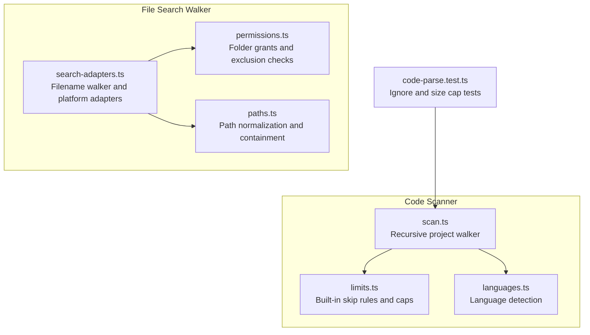
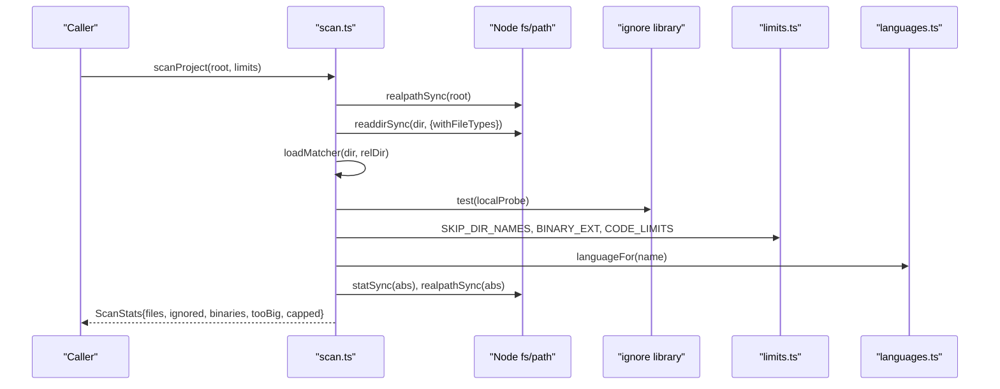
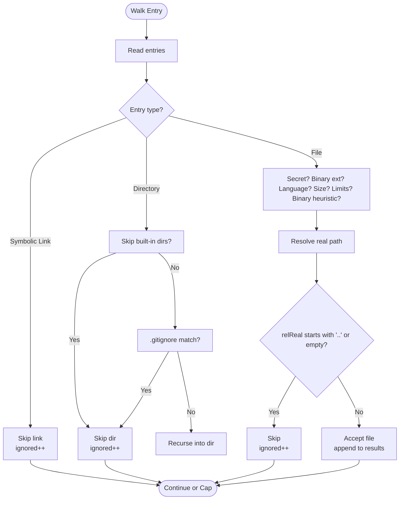
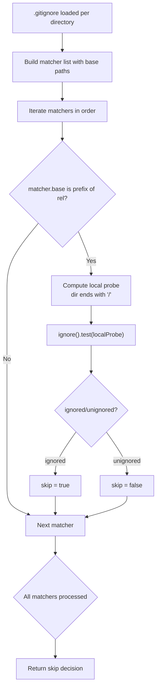
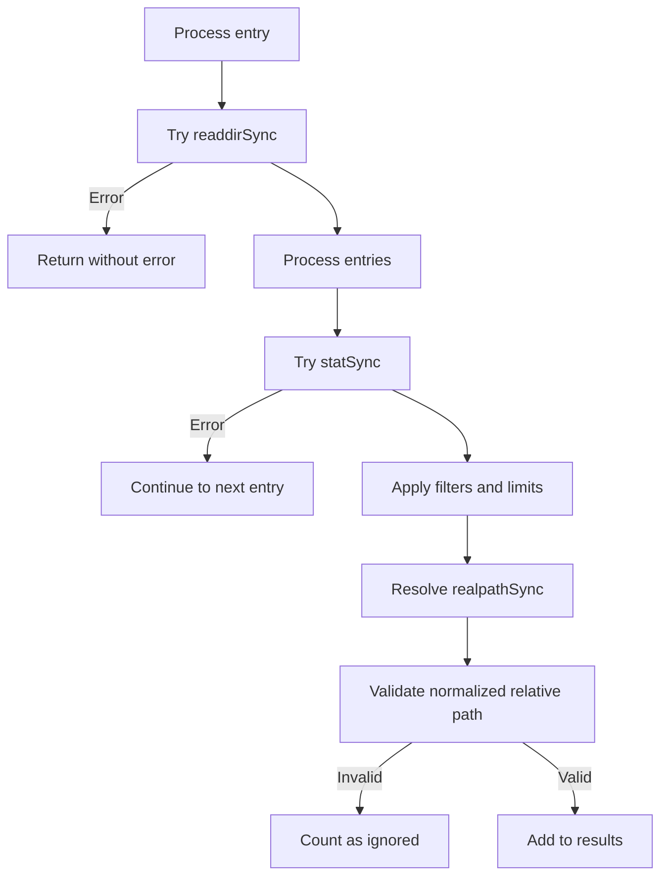
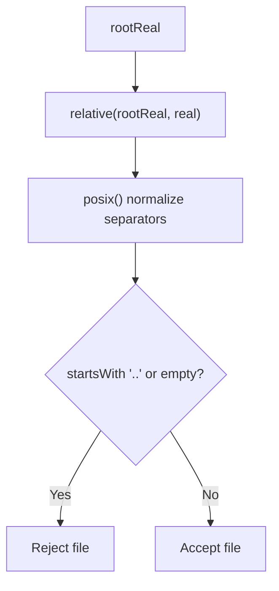
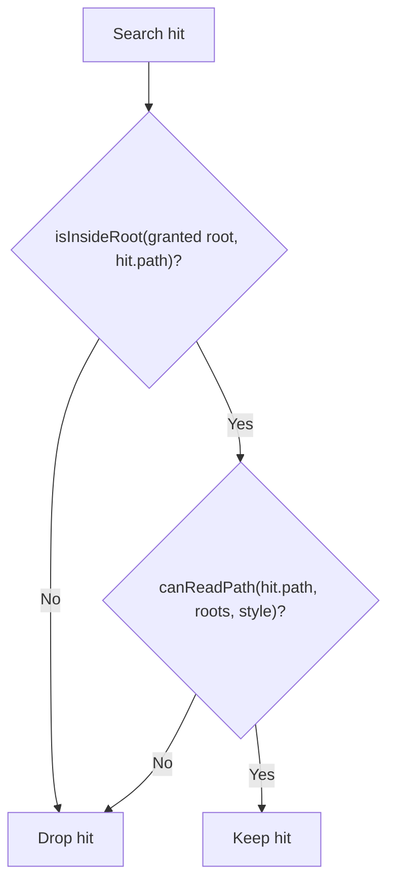
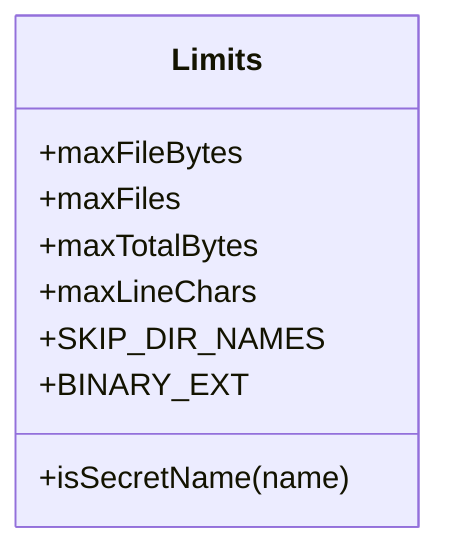
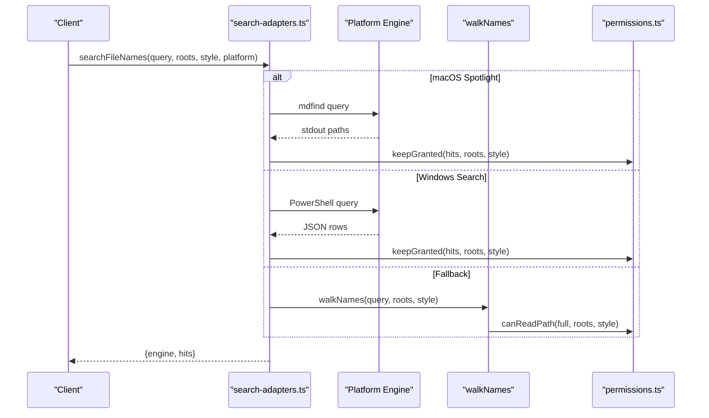
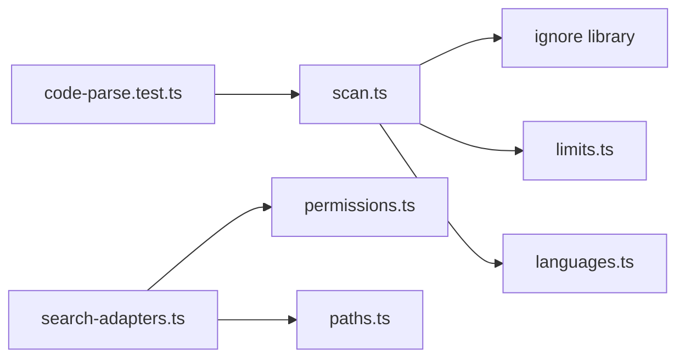

# Directory Traversal

<cite>
**Referenced Files in This Document**   
- [scan.ts](file://apps/desktop/src/main/core/code/scan.ts)
- [limits.ts](file://apps/desktop/src/main/core/code/limits.ts)
- [languages.ts](file://apps/desktop/src/main/core/code/languages.ts)
- [search-adapters.ts](file://apps/desktop/src/main/core/files/search-adapters.ts)
- [permissions.ts](file://apps/desktop/src/main/core/files/permissions.ts)
- [paths.ts](file://apps/desktop/src/main/core/files/paths.ts)
- [code-parse.test.ts](file://apps/desktop/src/main/core/code-parse.test.ts)
</cite>

## Table of Contents
1. [Introduction](#introduction)
2. [Project Structure](#project-structure)
3. [Core Components](#core-components)
4. [Architecture Overview](#architecture-overview)
5. [Detailed Component Analysis](#detailed-component-analysis)
6. [Dependency Analysis](#dependency-analysis)
7. [Performance Considerations](#performance-considerations)
8. [Troubleshooting Guide](#troubleshooting-guide)
9. [Conclusion](#conclusion)

## Introduction
This document explains the directory traversal system used by the desktop application to scan project code and related files. It focuses on:
- The recursive walk that navigates directories while respecting `.gitignore` patterns, including nested `.gitignore` files.
- Built-in skip rules for dependency folders, binaries, secrets, oversized files, and symbolic links.
- Path normalization, relative path calculation, and security checks that prevent directory escape attacks.
- Error handling for permission errors and edge cases during traversal.
- A secondary filename walker used by search adapters with its own safety constraints.

## Project Structure
The traversal logic is implemented in TypeScript under the desktop main process. The primary scanner lives in `apps/desktop/src/main/core/code/scan.ts`, supported by configuration and helpers in `limits.ts` and `languages.ts`. A separate filename walker exists in `apps/desktop/src/main/core/files/search-adapters.ts`, which uses shared path and permission utilities from `paths.ts` and `permissions.ts`. Tests validating ignore behavior and scanning outcomes are in `code-parse.test.ts`.

**Diagram sources**
- [scan.ts:1-160](file://apps/desktop/src/main/core/code/scan.ts#L1-L160)
- [limits.ts:1-62](file://apps/desktop/src/main/core/code/limits.ts#L1-L62)
- [languages.ts:1-59](file://apps/desktop/src/main/core/code/languages.ts#L1-L59)
- [search-adapters.ts:1-179](file://apps/desktop/src/main/core/files/search-adapters.ts#L1-L179)
- [permissions.ts:1-229](file://apps/desktop/src/main/core/files/permissions.ts#L1-L229)
- [paths.ts:1-78](file://apps/desktop/src/main/core/files/paths.ts#L1-L78)
- [code-parse.test.ts:91-119](file://apps/desktop/src/main/core/code-parse.test.ts#L91-L119)

**Section sources**
- [scan.ts:1-160](file://apps/desktop/src/main/core/code/scan.ts#L1-L160)
- [limits.ts:1-62](file://apps/desktop/src/main/core/code/limits.ts#L1-L62)
- [languages.ts:1-59](file://apps/desktop/src/main/core/code/languages.ts#L1-L59)
- [search-adapters.ts:1-179](file://apps/desktop/src/main/core/files/search-adapters.ts#L1-L179)
- [permissions.ts:1-229](file://apps/desktop/src/main/core/files/permissions.ts#L1-L229)
- [paths.ts:1-78](file://apps/desktop/src/main/core/files/paths.ts#L1-L78)
- [code-parse.test.ts:91-119](file://apps/desktop/src/main/core/code-parse.test.ts#L91-L119)

## Core Components
- Recursive project scanner (`scanProject`) walks a root directory, applies `.gitignore` rules (including nested scopes), skips built-in directories and binary-like files, enforces file count and byte limits, and resolves real paths to prevent escapes.
- File classifier (`classifyFile`) applies the same filtering rules to a single path reported by the file watcher.
- Matcher system loads `.gitignore` per directory and evaluates ignore/unignore semantics correctly across nested scopes.
- Filename walker (`walkNames`) provides a safe, bounded traversal for name-based search, constrained by depth and maximum hits.
- Path and permission utilities normalize paths, check containment within allowed roots, and enforce exclusions.

**Section sources**
- [scan.ts:34-61](file://apps/desktop/src/main/core/code/scan.ts#L34-L61)
- [scan.ts:71-123](file://apps/desktop/src/main/core/code/scan.ts#L71-L123)
- [scan.ts:125-160](file://apps/desktop/src/main/core/code/scan.ts#L125-L160)
- [search-adapters.ts:101-137](file://apps/desktop/src/main/core/files/search-adapters.ts#L101-L137)
- [permissions.ts:92-95](file://apps/desktop/src/main/core/files/permissions.ts#L92-L95)
- [paths.ts:13-38](file://apps/desktop/src/main/core/files/paths.ts#L13-L38)

## Architecture Overview
The traversal architecture separates concerns:
- Code scanner handles full project indexing with rich filtering.
- Filename walker supports fast name searches with strict bounds.
- Shared utilities ensure consistent path handling and access control.

**Diagram sources**
- [scan.ts:71-123](file://apps/desktop/src/main/core/code/scan.ts#L71-L123)
- [limits.ts:23-42](file://apps/desktop/src/main/core/code/limits.ts#L23-L42)
- [languages.ts:36-46](file://apps/desktop/src/main/core/code/languages.ts#L36-L46)

## Detailed Component Analysis

### Recursive Walk and Filtering
The recursive walk performs these steps:
- Resolves the root to a real path.
- Loads the root-level `.gitignore` matcher if present.
- For each entry:
  - Skips symbolic links.
  - For directories:
    - Skips built-in dependency/build directories.
    - Applies `.gitignore` scope-aware matching; if ignored, counts it and does not recurse.
    - Otherwise recurses into the directory.
  - For files:
    - Skips secret names and `.gitignore` matches.
    - Skips known binary extensions.
    - Detects language; unknown extension treated as binary.
    - Reads metadata; skips zero-size or oversized files.
    - Enforces global file count and total bytes limits; sets a cap flag to stop further processing.
    - Performs a binary heuristic based on content sampling and long first lines.
    - Resolves the real path and validates that the normalized relative path does not escape the root.
    - Adds accepted files to the result list and accumulates total bytes.

**Diagram sources**
- [scan.ts:79-118](file://apps/desktop/src/main/core/code/scan.ts#L79-L118)

**Section sources**
- [scan.ts:71-123](file://apps/desktop/src/main/core/code/scan.ts#L71-L123)

### Matcher System for Nested .gitignore
The matcher system:
- Loads `.gitignore` text per directory and constructs an `ignore` instance.
- Tracks a base path for each matcher to evaluate patterns relative to that directory.
- Evaluates ignore/unignore rules in order across all applicable scopes:
  - Only matchers whose base is a prefix of the current relative path are considered.
  - For directories, patterns are tested against a trailing slash variant.
  - Later unignore rules can override earlier ignores.

**Diagram sources**
- [scan.ts:40-61](file://apps/desktop/src/main/core/code/scan.ts#L40-L61)

**Section sources**
- [scan.ts:40-61](file://apps/desktop/src/main/core/code/scan.ts#L40-L61)

### Handling Symbolic Links, Permission Errors, and Edge Cases
- Symbolic links are skipped immediately and counted as ignored.
- Directory reads are wrapped in try/catch; permission errors cause the function to return without erroring out the entire scan.
- File stats are wrapped in try/catch; failures are silently skipped.
- Zero-size files and oversized files are skipped.
- Global caps (`maxFiles`, `maxTotalBytes`) stop further traversal once reached.
- After resolving real paths, the scanner rejects any path where the normalized relative path starts with `..` or is empty, preventing directory escape via symlinks.

**Diagram sources**
- [scan.ts:82-118](file://apps/desktop/src/main/core/code/scan.ts#L82-L118)

**Section sources**
- [scan.ts:82-118](file://apps/desktop/src/main/core/code/scan.ts#L82-L118)

### Path Normalization and Relative Path Calculation
- Paths are normalized using forward slashes consistently.
- The scanner computes relative paths from the resolved root to the resolved real file path.
- The normalized relative path must not start with `..` and must be non-empty; otherwise, the file is rejected.
- The filename walker relies on shared path utilities to normalize and check containment within allowed roots.

**Diagram sources**
- [scan.ts:112-115](file://apps/desktop/src/main/core/code/scan.ts#L112-L115)
- [paths.ts:13-38](file://apps/desktop/src/main/core/files/paths.ts#L13-L38)

**Section sources**
- [scan.ts:112-115](file://apps/desktop/src/main/core/code/scan.ts#L112-L115)
- [paths.ts:13-38](file://apps/desktop/src/main/core/files/paths.ts#L13-L38)

### Security Considerations
- Directory escape prevention:
  - Symlinks are skipped during traversal.
  - Real paths are resolved and validated against the root; escaped paths are rejected.
- Access control:
  - Filename search uses `canReadPath` to ensure hits are inside granted roots and not excluded.
  - Exclusions include system paths, hidden files, dependency folders, bundle outputs, and secret-like names.
- Query sanitization:
  - Filename search queries are sanitized to remove dangerous characters and limit length.

**Diagram sources**
- [search-adapters.ts:135-137](file://apps/desktop/src/main/core/files/search-adapters.ts#L135-L137)
- [permissions.ts:92-95](file://apps/desktop/src/main/core/files/permissions.ts#L92-L95)
- [paths.ts:33-38](file://apps/desktop/src/main/core/files/paths.ts#L33-L38)

**Section sources**
- [search-adapters.ts:135-137](file://apps/desktop/src/main/core/files/search-adapters.ts#L135-L137)
- [permissions.ts:92-95](file://apps/desktop/src/main/core/files/permissions.ts#L92-L95)
- [paths.ts:33-38](file://apps/desktop/src/main/core/files/paths.ts#L33-L38)

### Built-in Skip Rules and Limits
- Built-in directory basenames like `.git`, `node_modules`, `dist`, `build`, `__pycache__`, etc., are always skipped.
- Binary extensions such as images, archives, compiled artifacts, media, fonts, and lock files are skipped.
- Secret-like filenames (e.g., `.env`, `.pem`, `.key`) are skipped.
- Size limits:
  - Maximum file size threshold.
  - Maximum number of source files.
  - Maximum total bytes accepted.
  - Maximum line length heuristic to detect minified or generated files.

**Diagram sources**
- [limits.ts:1-62](file://apps/desktop/src/main/core/code/limits.ts#L1-L62)

**Section sources**
- [limits.ts:1-62](file://apps/desktop/src/main/core/code/limits.ts#L1-L62)

### Filename Walker for Search
The filename walker:
- Supports platform-specific engines (Spotlight on macOS, Windows Search on Windows) but falls back to a Node-based walker.
- Constrains recursion depth and maximum number of hits.
- Uses `canReadPath` to filter hits against granted roots and exclusions.
- Provides helper functions to sanitize queries and parse engine outputs.

**Diagram sources**
- [search-adapters.ts:139-178](file://apps/desktop/src/main/core/files/search-adapters.ts#L139-L178)
- [search-adapters.ts:106-133](file://apps/desktop/src/main/core/files/search-adapters.ts#L106-L133)
- [permissions.ts:92-95](file://apps/desktop/src/main/core/files/permissions.ts#L92-L95)

**Section sources**
- [search-adapters.ts:106-137](file://apps/desktop/src/main/core/files/search-adapters.ts#L106-L137)
- [search-adapters.ts:139-178](file://apps/desktop/src/main/core/files/search-adapters.ts#L139-L178)
- [permissions.ts:92-95](file://apps/desktop/src/main/core/files/permissions.ts#L92-L95)

## Dependency Analysis
The components interact as follows:
- `scan.ts` depends on:
  - Node filesystem and path modules.
  - `ignore` library for `.gitignore` parsing.
  - `limits.ts` for built-in skip rules and caps.
  - `languages.ts` for language detection.
- `search-adapters.ts` depends on:
  - Node filesystem and path modules.
  - `permissions.ts` for access control.
  - `paths.ts` for path normalization and containment checks.
- Tests validate ignore behavior and scanning outcomes.

**Diagram sources**
- [scan.ts:5-9](file://apps/desktop/src/main/core/code/scan.ts#L5-L9)
- [search-adapters.ts:8-11](file://apps/desktop/src/main/core/files/search-adapters.ts#L8-L11)
- [code-parse.test.ts:8-8](file://apps/desktop/src/main/core/code-parse.test.ts#L8-L8)

**Section sources**
- [scan.ts:5-9](file://apps/desktop/src/main/core/code/scan.ts#L5-L9)
- [search-adapters.ts:8-11](file://apps/desktop/src/main/core/files/search-adapters.ts#L8-L11)
- [code-parse.test.ts:8-8](file://apps/desktop/src/main/core/code-parse.test.ts#L8-L8)

## Performance Considerations
- Early exits:
  - Symbolic links are skipped without reading metadata.
  - Built-in directories are skipped before `.gitignore` evaluation.
- Bounded traversal:
  - Depth limit in filename walker prevents deep recursion.
  - Maximum file count and total bytes cap stop large scans early.
- Efficient matching:
  - `.gitignore` matchers are created per directory and reused for children.
  - Directory probes append a trailing slash to match folder patterns efficiently.
- Binary detection:
  - Heuristic sampling avoids reading entire large files.
  - Long first-line detection helps skip minified or generated files quickly.

[No sources needed since this section provides general guidance]

## Troubleshooting Guide
Common issues and resolutions:
- Permission errors during traversal:
  - The scanner catches read and stat errors and continues; verify OS permissions for target directories.
- Unexpectedly ignored files:
  - Check `.gitignore` at the root and nested directories; remember later unignore rules can override earlier ignores.
- Escaped paths rejected:
  - Ensure files are within the project root; symlinks pointing outside are rejected.
- Large projects stopping early:
  - Adjust `maxFiles` and `maxTotalBytes` in scan limits if necessary.
- Binary classification:
  - Files with unknown extensions or detected binary content are skipped; adjust language mapping or content thresholds if needed.

**Section sources**
- [scan.ts:82-118](file://apps/desktop/src/main/core/code/scan.ts#L82-L118)
- [scan.ts:40-61](file://apps/desktop/src/main/core/code/scan.ts#L40-L61)
- [limits.ts:1-62](file://apps/desktop/src/main/core/code/limits.ts#L1-L62)

## Conclusion
The directory traversal system combines robust filtering, secure path handling, and efficient matching to safely index project code. It respects `.gitignore` semantics across nested scopes, enforces built-in skip rules and resource limits, and prevents directory escape attacks through real path resolution and validation. The filename walker complements this with platform-aware search capabilities while maintaining strict access controls and performance bounds.

[No sources needed since this section summarizes without analyzing specific files]