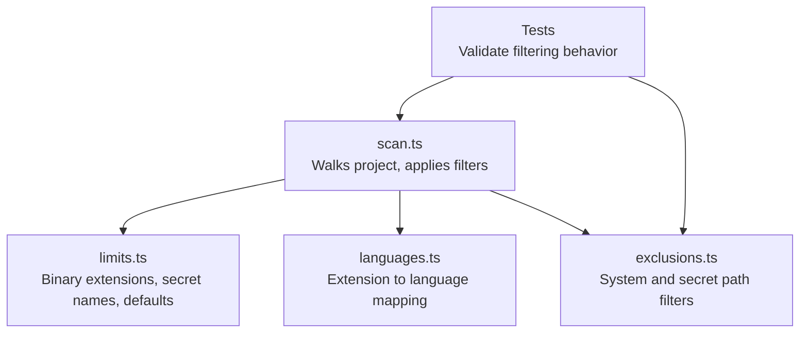
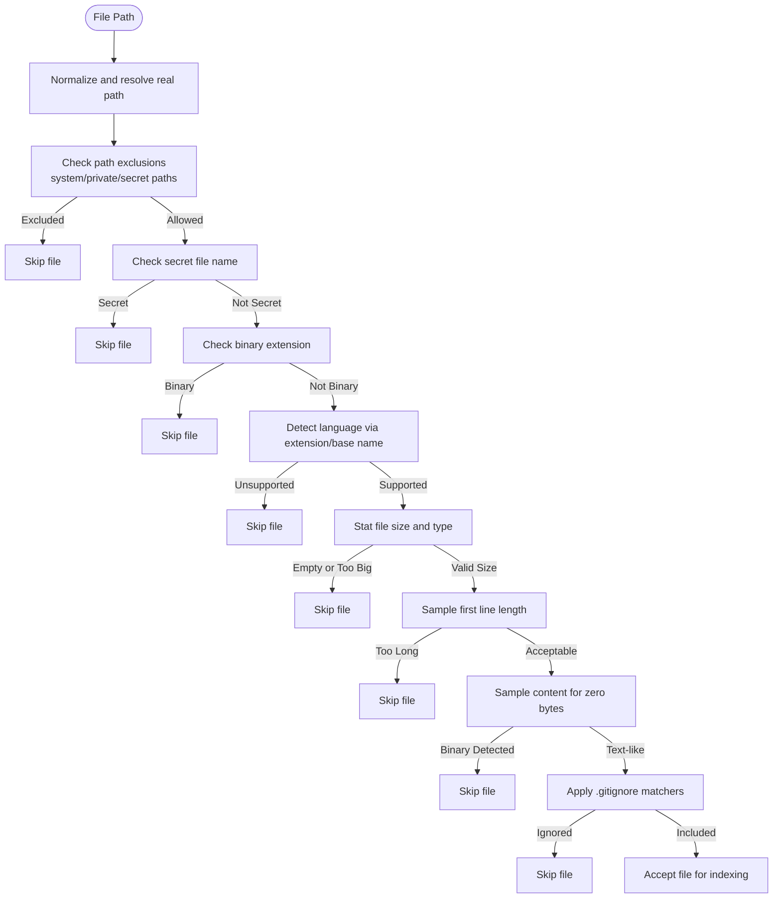
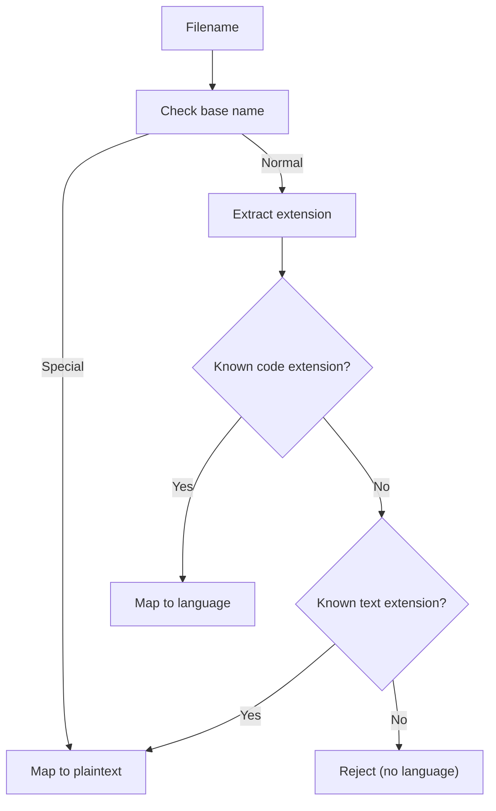
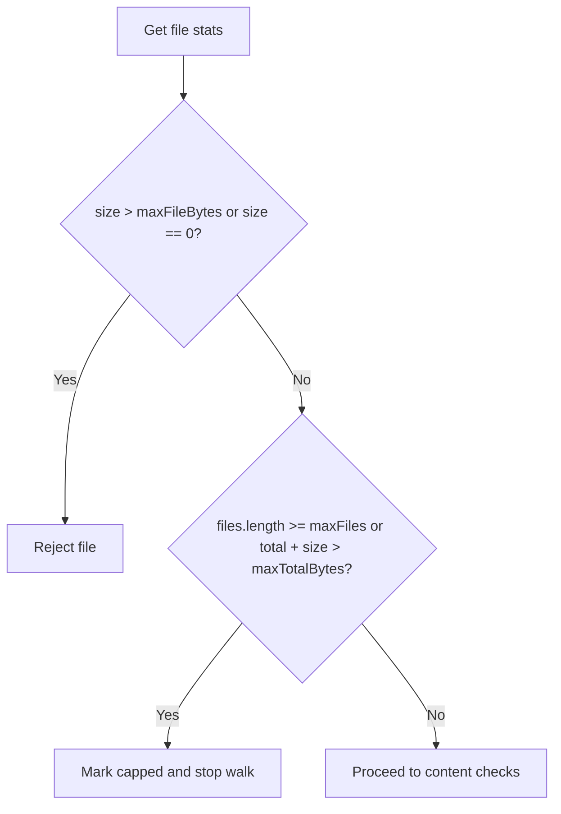
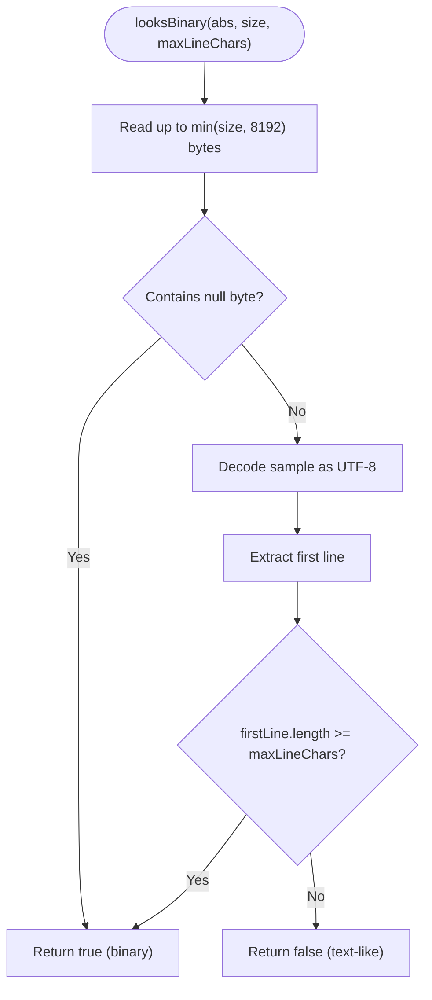
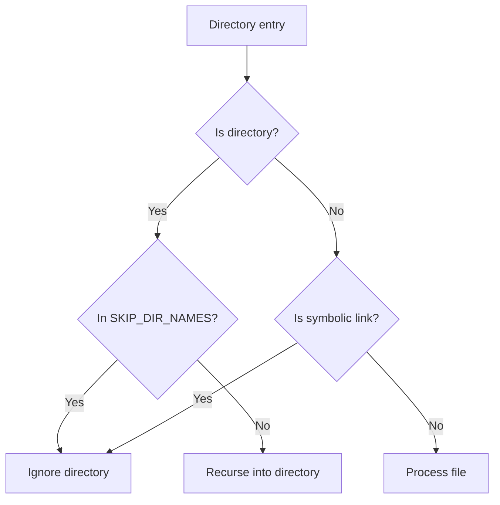
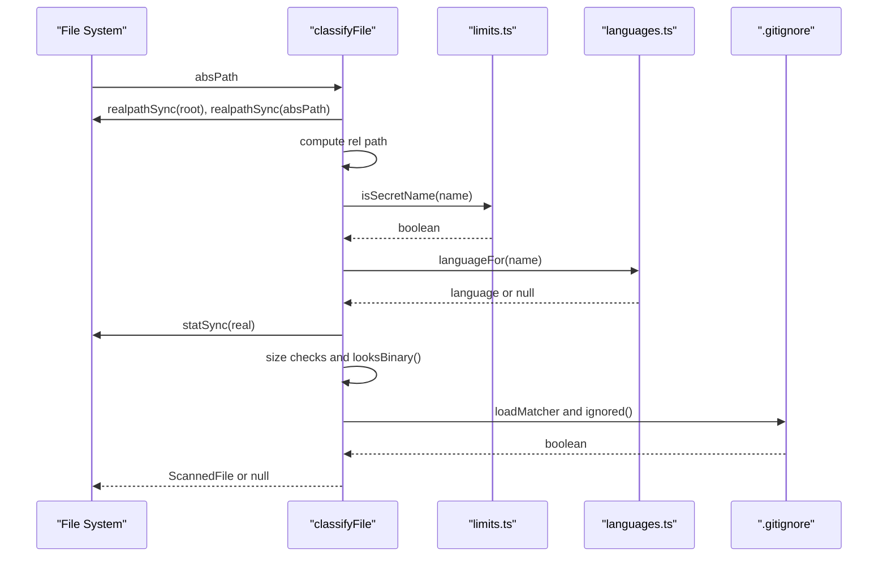
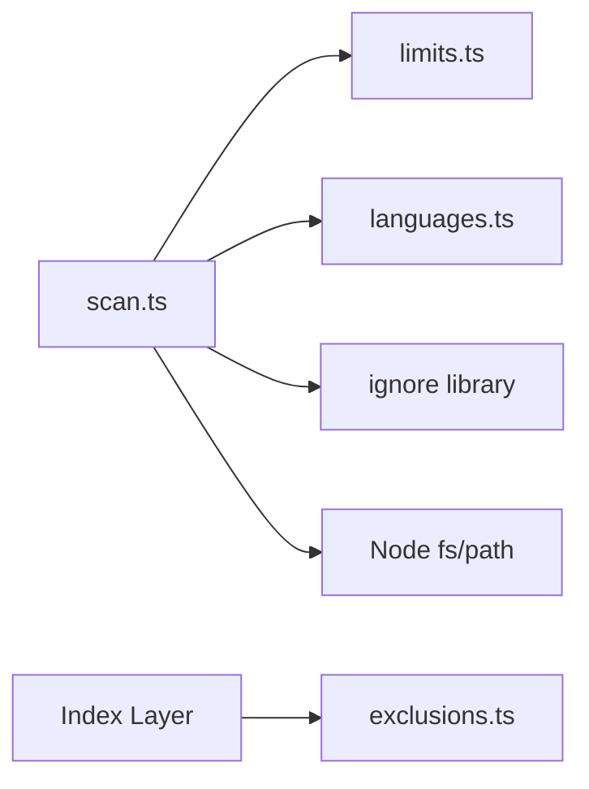

# File Filtering

<cite>
**Referenced Files in This Document**
- [scan.ts](file://apps/desktop/src/main/core/code/scan.ts)
- [languages.ts](file://apps/desktop/src/main/core/code/languages.ts)
- [limits.ts](file://apps/desktop/src/main/core/code/limits.ts)
- [exclusions.ts](file://apps/desktop/src/main/core/files/exclusions.ts)
- [files.test.ts](file://apps/desktop/src/main/core/files/files.test.ts)
- [code-parse.test.ts](file://apps/desktop/src/main/core/code-parse.test.ts)
</cite>

## Table of Contents
1. [Introduction](#introduction)
2. [Project Structure](#project-structure)
3. [Core Components](#core-components)
4. [Architecture Overview](#architecture-overview)
5. [Detailed Component Analysis](#detailed-component-analysis)
6. [Dependency Analysis](#dependency-analysis)
7. [Performance Considerations](#performance-considerations)
8. [Troubleshooting Guide](#troubleshooting-guide)
9. [Conclusion](#conclusion)

## Introduction
This document explains the file filtering mechanisms used to decide which project files are safe and useful for indexing and processing. The system evaluates files through multiple stages:

- Extension validation against known binary formats
- Secret or sensitive file identification by name and extension
- Language detection to ensure only supported programming languages and text formats are processed
- Size limits, including maximum file size, total bytes, and line length thresholds
- Binary detection by sampling file content to identify non-text files
- Gitignore-based exclusion rules applied recursively across nested directories

The goal is to avoid processing large generated artifacts, binary assets, secrets, unsupported formats, and minified or unusual encodings while still supporting common code and configuration files.

## Project Structure
The filtering logic lives primarily under the desktop application’s main process code for code scanning and indexing. Key modules include:

- `apps/desktop/src/main/core/code/scan.ts`: Core walking and classification pipeline
- `apps/desktop/src/main/core/code/languages.ts`: Extension-to-language mapping and grammar metadata
- `apps/desktop/src/main/core/code/limits.ts`: Defaults for size caps, binary extensions, secret names, and skip directories
- `apps/desktop/src/main/core/files/exclusions.ts`: Broader path-level exclusions for system paths, user-private stores, and secret files
- Test files that validate behavior for ignored files, binaries, secrets, and size caps

**Diagram sources**
- [scan.ts:1-161](file://apps/desktop/src/main/core/code/scan.ts#L1-L161)
- [limits.ts:1-62](file://apps/desktop/src/main/core/code/limits.ts#L1-L62)
- [languages.ts:1-59](file://apps/desktop/src/main/core/code/languages.ts#L1-L59)
- [exclusions.ts:1-94](file://apps/desktop/src/main/core/files/exclusions.ts#L1-L94)

**Section sources**
- [scan.ts:1-161](file://apps/desktop/src/main/core/code/scan.ts#L1-L161)
- [limits.ts:1-62](file://apps/desktop/src/main/core/code/limits.ts#L1-L62)
- [languages.ts:1-59](file://apps/desktop/src/main/core/code/languages.ts#L1-L59)
- [exclusions.ts:1-94](file://apps/desktop/src/main/core/files/exclusions.ts#L1-L94)

## Core Components
The core filtering components are:

- **Scan Pipeline**: Walks directories, applies gitignore, skips symbolic links, dependency directories, secret names, binary extensions, unsupported languages, empty files, oversized files, and minified lines. It also enforces global caps on number of files and total bytes.
- **Language Detection**: Maps file extensions and special base names to a language identifier. Unsupported extensions return null and are treated as binary or skipped.
- **Limits and Defaults**: Defines binary extensions, secret file names, skip directories, and default size/line caps.
- **Exclusions Module**: Provides broader path-level filtering for system directories, user-private stores, and secret file patterns.

Key responsibilities:

- Extension validation prevents binary assets from being indexed
- Secret identification protects credentials and lock files
- Language detection ensures only supported code/text formats are processed
- Binary detection samples file content to catch disguised or unusual encodings
- Size and line-length checks prevent minified bundles and huge files from consuming resources

**Section sources**
- [scan.ts:1-161](file://apps/desktop/src/main/core/code/scan.ts#L1-L161)
- [languages.ts:1-59](file://apps/desktop/src/main/core/code/languages.ts#L1-L59)
- [limits.ts:1-62](file://apps/desktop/src/main/core/code/limits.ts#L1-L62)
- [exclusions.ts:1-94](file://apps/desktop/src/main/core/files/exclusions.ts#L1-L94)

## Architecture Overview
The filtering architecture combines static rules with dynamic checks:

**Diagram sources**
- [scan.ts:63-120](file://apps/desktop/src/main/core/code/scan.ts#L63-L120)
- [limits.ts:23-61](file://apps/desktop/src/main/core/code/limits.ts#L23-L61)
- [languages.ts:36-46](file://apps/desktop/src/main/core/code/languages.ts#L36-L46)
- [exclusions.ts:64-88](file://apps/desktop/src/main/core/files/exclusions.ts#L64-L88)

## Detailed Component Analysis

### Binary Extension Validation
Binary files are filtered early using a predefined set of extensions. This includes images, archives, compiled binaries, media, fonts, design files, and lock/database files. If a file’s extension matches this set, it is skipped without reading its content.

- Behavior: Fast rejection based on extension alone
- Rationale: Avoids unnecessary I/O and parsing for obvious non-source assets
- Configuration: Controlled by `BINARY_EXT` in limits

**Section sources**
- [limits.ts:34-42](file://apps/desktop/src/main/core/code/limits.ts#L34-L42)
- [scan.ts:99-100](file://apps/desktop/src/main/core/code/scan.ts#L99-L100)

### Secret File Identification
Secrets are identified by filename and extension patterns. The scanner uses `isSecretName`, while the broader index uses `isSecretFile`. Both protect environment variables, credential files, keychains, browser data, SSH keys, and lock files.

- Scanner-level check: `.env`, `.env.*`, `.pem`, `.key`, and specific lock/cache filenames
- Index-level check: Additional secret filenames and extensions like `.kdbx`, `.pfx`, `.p12`, `.keystore`, `.keychain-db`
- Behavior: Immediate skip if matched

**Section sources**
- [limits.ts:44-61](file://apps/desktop/src/main/core/code/limits.ts#L44-L61)
- [exclusions.ts:19-40](file://apps/desktop/src/main/core/files/exclusions.ts#L19-L40)
- [exclusions.ts:79-88](file://apps/desktop/src/main/core/files/exclusions.ts#L79-L88)

### Language Detection Integration
Only files whose extension maps to a supported language or plaintext are considered. The mapping includes common programming languages and text/config formats. Unsupported extensions are treated as binary and skipped.

- Supported languages: Python, JavaScript, TypeScript, TSX, Java, Go, Rust, C, C++
- Text fallback: Markdown, JSON, YAML, TOML, CSS, HTML, shell scripts, SQL, XML, CSV, Ruby, PHP, Swift, Kotlin, Scala, Lua, Vim, Emacs Lisp
- Special base names: Dockerfile, Makefile, Justfile, Gemfile, Rakefile, README map to plaintext

**Diagram sources**
- [languages.ts:3-46](file://apps/desktop/src/main/core/code/languages.ts#L3-L46)

**Section sources**
- [languages.ts:1-59](file://apps/desktop/src/main/core/code/languages.ts#L1-L59)
- [scan.ts:101-102](file://apps/desktop/src/main/core/code/scan.ts#L101-L102)

### Size Limits and Empty File Handling
Files are rejected if they are empty or exceed the configured maximum file size. Additionally, global caps limit the number of files and total bytes scanned.

- Per-file cap: `maxFileBytes`
- Global caps: `maxFiles`, `maxTotalBytes`
- Empty files: Explicitly skipped to avoid useless indexing

**Diagram sources**
- [scan.ts:103-110](file://apps/desktop/src/main/core/code/scan.ts#L103-L110)
- [limits.ts:3-21](file://apps/desktop/src/main/core/code/limits.ts#L3-L21)

**Section sources**
- [scan.ts:103-110](file://apps/desktop/src/main/core/code/scan.ts#L103-L110)
- [limits.ts:3-21](file://apps/desktop/src/main/core/code/limits.ts#L3-L21)

### Binary Detection via Sampling (`looksBinary`)
The `looksBinary` function samples up to 8 KiB of a file to detect non-text content:

- Zero-byte presence: Any null byte indicates binary content
- First-line length: If the first line reaches or exceeds `maxLineChars`, the file is treated as minified or unusual encoding and skipped

This provides a lightweight heuristic to catch disguised binaries, minified bundles, or files with extremely long lines.

**Diagram sources**
- [scan.ts:63-69](file://apps/desktop/src/main/core/code/scan.ts#L63-L69)
- [limits.ts:19-21](file://apps/desktop/src/main/core/code/limits.ts#L19-L21)

**Section sources**
- [scan.ts:63-69](file://apps/desktop/src/main/core/code/scan.ts#L63-L69)
- [limits.ts:19-21](file://apps/desktop/src/main/core/code/limits.ts#L19-L21)

### Gitignore and Directory Exclusions
The scanner loads `.gitignore` files at the root and in nested directories, applying them during traversal. It also hard-codes skip directories for dependencies and build outputs. Symbolic links are ignored.

- Gitignore support: Recursive loading and matching
- Hard-coded skip directories: Dependency folders, caches, IDE folders, build outputs
- Symbolic links: Skipped to avoid cycles and unintended paths

**Diagram sources**
- [scan.ts:40-61](file://apps/desktop/src/main/core/code/scan.ts#L40-L61)
- [scan.ts:86-95](file://apps/desktop/src/main/core/code/scan.ts#L86-L95)
- [limits.ts:23-32](file://apps/desktop/src/main/core/code/limits.ts#L23-L32)

**Section sources**
- [scan.ts:40-61](file://apps/desktop/src/main/core/code/scan.ts#L40-L61)
- [scan.ts:86-95](file://apps/desktop/src/main/core/code/scan.ts#L86-L95)
- [limits.ts:23-32](file://apps/desktop/src/main/core/code/limits.ts#L23-L32)

### Classification Flow for Watcher Events
For single-file events from the file watcher, `classifyFile` applies the same rules as the full scan:

- Resolve real paths and relative paths
- Skip excluded directories and secret names
- Validate extension and language
- Enforce size limits and binary detection
- Apply gitignore matchers

**Diagram sources**
- [scan.ts:125-160](file://apps/desktop/src/main/core/code/scan.ts#L125-L160)
- [limits.ts:55-61](file://apps/desktop/src/main/core/code/limits.ts#L55-L61)
- [languages.ts:36-46](file://apps/desktop/src/main/core/code/languages.ts#L36-L46)

**Section sources**
- [scan.ts:125-160](file://apps/desktop/src/main/core/code/scan.ts#L125-L160)

## Dependency Analysis
The filtering pipeline has clear dependencies:

- `scan.ts` depends on:
  - `limits.ts` for binary extensions, secret names, skip directories, and default limits
  - `languages.ts` for extension-to-language mapping
  - Node filesystem APIs for reading, stat, and path resolution
  - `ignore` library for gitignore matching
- `exclusions.ts` provides broader path-level filtering used by the index layer

**Diagram sources**
- [scan.ts:1-10](file://apps/desktop/src/main/core/code/scan.ts#L1-L10)
- [limits.ts:1-62](file://apps/desktop/src/main/core/code/limits.ts#L1-L62)
- [languages.ts:1-59](file://apps/desktop/src/main/core/code/languages.ts#L1-L59)
- [exclusions.ts:1-94](file://apps/desktop/src/main/core/files/exclusions.ts#L1-L94)

**Section sources**
- [scan.ts:1-10](file://apps/desktop/src/main/core/code/scan.ts#L1-L10)
- [limits.ts:1-62](file://apps/desktop/src/main/core/code/limits.ts#L1-L62)
- [languages.ts:1-59](file://apps/desktop/src/main/core/code/languages.ts#L1-L59)
- [exclusions.ts:1-94](file://apps/desktop/src/main/core/files/exclusions.ts#L1-L94)

## Performance Considerations
- Early rejections: Binary extensions and secret names are checked before reading file content
- Minimal sampling: `looksBinary` reads at most 8 KiB and avoids full-file decoding unless necessary
- Global caps: Prevents runaway memory usage by limiting file count and total bytes
- Gitignore efficiency: Matchers are loaded per directory scope and applied incrementally
- Avoiding heavy parsing: Unsupported languages are skipped without attempting tree-sitter parsing

Recommendations:
- Keep `maxLineChars` tuned to your project’s typical source style to reduce false positives on legitimate long lines
- Use `.gitignore` to exclude generated assets and large logs
- Monitor `stats.capped` to understand when global caps truncate scanning

[No sources needed since this section provides general guidance]

## Troubleshooting Guide
Common issues and how to address them:

- Files not indexed despite being valid code:
  - Check if the extension maps to a supported language; unsupported extensions are skipped
  - Verify the file is not empty or larger than `maxFileBytes`
  - Ensure the file is not flagged as binary by `looksBinary` due to long first lines or null bytes
- Secrets leaking into index:
  - Confirm secret names/extensions are covered by `isSecretName` or `isSecretFile`
  - Add appropriate `.gitignore` entries for sensitive files
- Large projects stopping early:
  - Review `maxFiles` and `maxTotalBytes`; adjust limits if necessary
  - Inspect `stats.capped` to confirm global caps were hit
- Unexpected exclusions:
  - Check system/private path exclusions in `exclusions.ts`
  - Validate hidden directories and `.app` bundles are intentionally excluded

Validation references:

- Tests confirm that gitignore, binaries, secrets, and size caps are respected
- Exclusion tests verify system, hidden, dependency, bundle, and secret paths are skipped

**Section sources**
- [code-parse.test.ts:91-119](file://apps/desktop/src/main/core/code-parse.test.ts#L91-L119)
- [files.test.ts:108-128](file://apps/desktop/src/main/core/files/files.test.ts#L108-L128)

## Conclusion
The file filtering system combines fast static checks with lightweight dynamic heuristics to safely and efficiently select relevant source files. By validating extensions, identifying secrets, detecting languages, enforcing size and line limits, and sampling content for binary detection, it balances thoroughness with performance. Configuration options in `limits.ts` allow customization for different environments, while gitignore integration ensures project-specific exclusions are honored.

[No sources needed since this section summarizes without analyzing specific files]