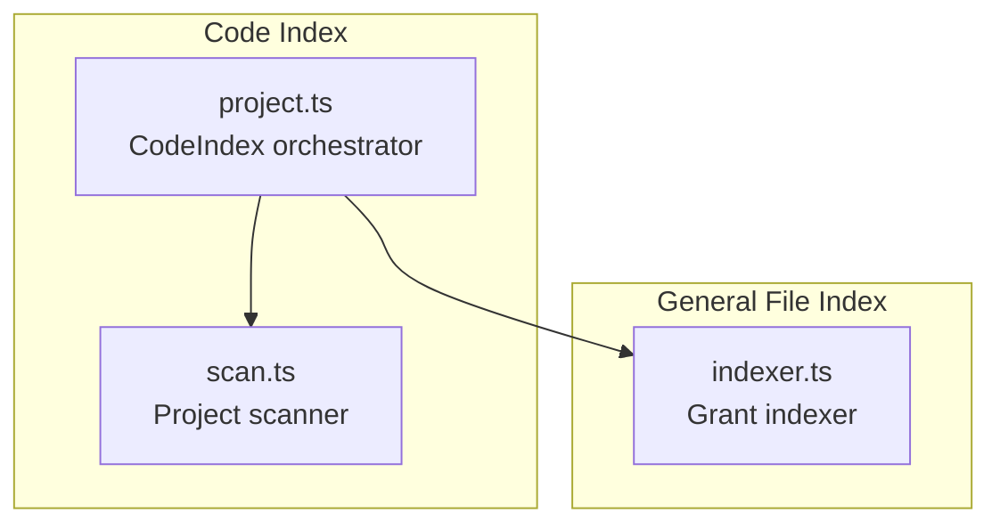
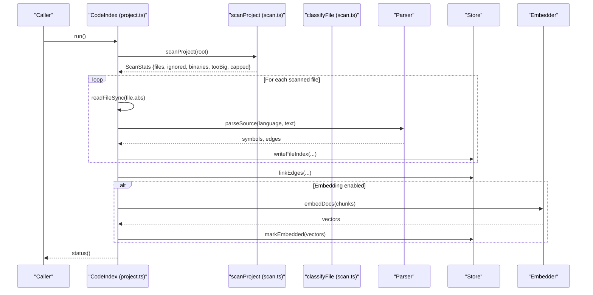
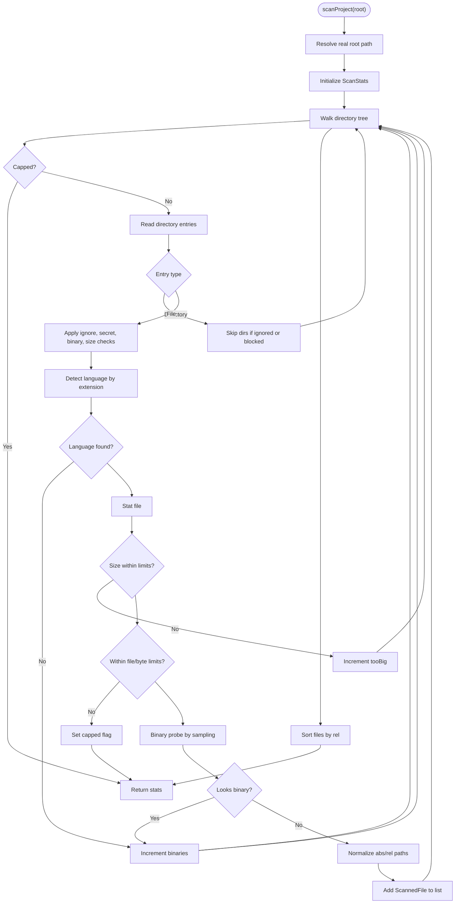
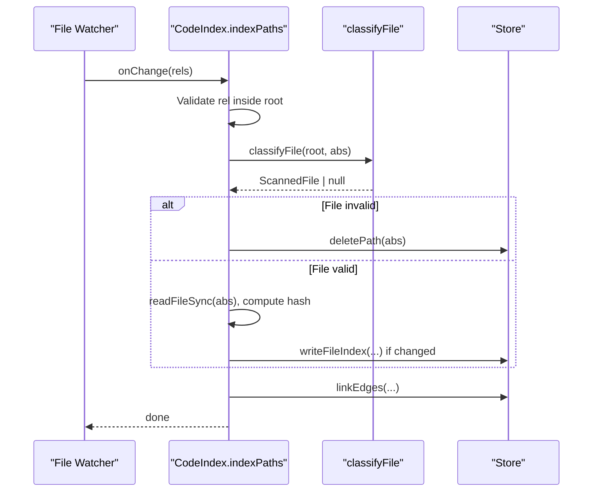
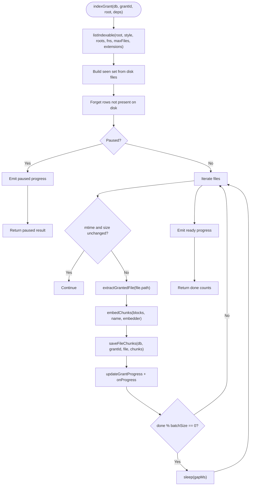
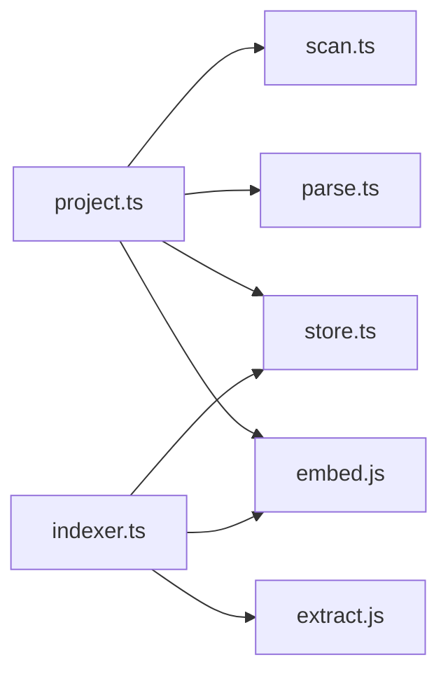

# Index Management

<cite>
**Referenced Files in This Document**
- [scan.ts](file://apps/desktop/src/main/core/code/scan.ts)
- [project.ts](file://apps/desktop/src/main/core/code/project.ts)
- [indexer.ts](file://apps/desktop/src/main/core/files/indexer.ts)
</cite>

## Table of Contents
1. [Introduction](#introduction)
2. [Project Structure](#project-structure)
3. [Core Components](#core-components)
4. [Architecture Overview](#architecture-overview)
5. [Detailed Component Analysis](#detailed-component-analysis)
6. [Dependency Analysis](#dependency-analysis)
7. [Performance Considerations](#performance-considerations)
8. [Troubleshooting Guide](#troubleshooting-guide)
9. [Conclusion](#conclusion)

## Introduction
This document explains the scanning index management system used to discover, validate, and store information about files in a project. It focuses on:
- How scanned files are represented with metadata such as absolute paths, relative paths, file sizes, modification times, and detected languages.
- The `ScanStats` structure that tracks scanning progress and statistics like ignored files, binary files, and size limits.
- The `classifyFile` function used for incremental updates when individual files change.
- Performance considerations for large codebases and memory management strategies.

The implementation is split into two related indexing layers:
- Code scanning and classification for source projects.
- General file indexing for granted folders, including chunking and embedding.

## Project Structure
The scanning index system lives under the desktop application’s main process core modules:
- `apps/desktop/src/main/core/code/scan.ts`: Scans a project directory, applies ignore rules, filters binaries and oversized files, detects languages, and produces normalized file records.
- `apps/desktop/src/main/core/code/project.ts`: Orchestrates full and incremental indexing of a code project, integrates parsing, graph building, and optional embedding.
- `apps/desktop/src/main/core/files/indexer.ts`: Provides an incremental indexer for granted folders, listing indexable files, batching work, debouncing filesystem watches, and persisting chunks.

**Diagram sources**
- [scan.ts:1-161](file://apps/desktop/src/main/core/code/scan.ts#L1-L161)
- [project.ts:1-349](file://apps/desktop/src/main/core/code/project.ts#L1-L349)
- [indexer.ts:1-229](file://apps/desktop/src/main/core/files/indexer.ts#L1-L229)

**Section sources**
- [scan.ts:1-161](file://apps/desktop/src/main/core/code/scan.ts#L1-L161)
- [project.ts:1-349](file://apps/desktop/src/main/core/code/project.ts#L1-L349)
- [indexer.ts:1-229](file://apps/desktop/src/main/core/files/indexer.ts#L1-L229)

## Core Components
- `ScannedFile`: Represents a single scanned file with absolute path, relative path, size, modification time, and detected language.
- `ScanStats`: Tracks scanning results, including the list of scanned files and counters for ignored files, binary files, too-large files, and whether scanning was capped by limits.
- `ScanLimits`: Controls maximum file size, maximum number of files, total byte budget, and maximum line length used to detect binary content.
- `classifyFile`: Classifies one file using the same rules as a full scan, returning a valid `ScannedFile` or null if it should be ignored.
- `CodeIndex`: Manages full and incremental indexing for a code project, integrating scanning, parsing, graph linking, and optional embedding.
- `indexGrant` and helpers: Provide incremental indexing for granted folders, including file listing, batching, debounced watching, and chunk persistence.

**Section sources**
- [scan.ts:11-32](file://apps/desktop/src/main/core/code/scan.ts#L11-L32)
- [scan.ts:71-123](file://apps/desktop/src/main/core/code/scan.ts#L71-L123)
- [scan.ts:126-160](file://apps/desktop/src/main/core/code/scan.ts#L126-L160)
- [project.ts:56-123](file://apps/desktop/src/main/core/code/project.ts#L56-L123)
- [indexer.ts:57-90](file://apps/desktop/src/main/core/files/indexer.ts#L57-L90)
- [indexer.ts:92-176](file://apps/desktop/src/main/core/files/indexer.ts#L92-L176)

## Architecture Overview
The system has two complementary flows:

1. **Code project scanning and indexing**:
   - `scanProject` walks the project root, applying `.gitignore`, skipping directories and secrets, filtering binary extensions, detecting languages, enforcing size limits, and normalizing paths.
   - `CodeIndex.run` uses `scanProject` to build a complete index, then parses symbols, builds edges, and optionally embeds chunks.
   - `CodeIndex.update` performs incremental updates by classifying changed files via `classifyFile`.

2. **Granted folder indexing**:
   - `listIndexable` enumerates files within granted roots, respecting extension allowlists and size caps.
   - `indexGrant` processes files in batches, skips unchanged files by mtime and size, extracts blocks, creates chunks, computes vectors, and persists them.
   - File watching is wrapped with debounce to avoid excessive re-indexing.

**Diagram sources**
- [project.ts:125-130](file://apps/desktop/src/main/core/code/project.ts#L125-L130)
- [project.ts:245-278](file://apps/desktop/src/main/core/code/project.ts#L245-L278)
- [project.ts:305-319](file://apps/desktop/src/main/core/code/project.ts#L305-L319)
- [project.ts:321-347](file://apps/desktop/src/main/core/code/project.ts#L321-L347)
- [scan.ts:71-123](file://apps/desktop/src/main/core/code/scan.ts#L71-L123)

## Detailed Component Analysis

### Scanning and Classification (`scan.ts`)
- `ScannedFile` stores:
  - Absolute path (`abs`)
  - Relative path (`rel`)
  - Size in bytes (`size`)
  - Modification time in milliseconds (`mtimeMs`)
  - Detected language (`language`)
- `ScanStats` tracks:
  - `files`: Array of `ScannedFile` entries
  - `ignored`: Count of ignored entries (symlinks, ignored paths, secret names, etc.)
  - `binaries`: Count of binary or non-text files
  - `tooBig`: Count of files exceeding size limits or empty files
  - `capped`: Flag indicating scanning stopped due to file count or total byte limit
- `ScanLimits` controls:
  - Maximum file size
  - Maximum number of files
  - Maximum total bytes
  - Maximum line character length used to detect binary content

Key behaviors:
- Respects `.gitignore` at the root and nested directories.
- Skips known dependency/build directories and secret-named files.
- Filters by binary extensions and runtime detection of binary content.
- Normalizes paths to POSIX style and resolves symlinks safely.
- Sorts scanned files by relative path for deterministic output.

**Diagram sources**
- [scan.ts:71-123](file://apps/desktop/src/main/core/code/scan.ts#L71-L123)

**Section sources**
- [scan.ts:11-32](file://apps/desktop/src/main/core/code/scan.ts#L11-L32)
- [scan.ts:49-69](file://apps/desktop/src/main/core/code/scan.ts#L49-L69)
- [scan.ts:71-123](file://apps/desktop/src/main/core/code/scan.ts#L71-L123)

### Incremental Update with `classifyFile`
`classifyFile` applies the same validation rules as a full scan but only for a single file reported by the watcher. It returns a valid `ScannedFile` or null if the file should be ignored.

Usage pattern:
- When a file changes, compute its absolute path inside the project root.
- Call `classifyFile(root, absPath)` to determine if it qualifies for indexing.
- If valid, read the file content, compute a hash, compare with existing index, and update only if changed.

**Diagram sources**
- [project.ts:280-303](file://apps/desktop/src/main/core/code/project.ts#L280-L303)
- [scan.ts:126-160](file://apps/desktop/src/main/core/code/scan.ts#L126-L160)

**Section sources**
- [scan.ts:126-160](file://apps/desktop/src/main/core/code/scan.ts#L126-L160)
- [project.ts:280-303](file://apps/desktop/src/main/core/code/project.ts#L280-L303)

### Granted Folder Indexing (`indexer.ts`)
The general indexer manages granted folders with:
- Extension allowlists and size caps.
- Batching and gap delays to keep the UI responsive.
- Debounced filesystem watching.
- Incremental processing based on mtime and size.
- Chunk extraction, embedding, and persistence.

Key elements:
- `INDEX_BATCH`, `INDEX_GAP_MS`, `WATCH_DEBOUNCE_MS`, `INDEX_MAX_FILES`, `INDEX_MAX_BYTES` define performance tuning parameters.
- `listIndexable` enumerates files within granted roots, respecting permissions and extension filters.
- `indexGrant` iterates files, skips unchanged ones, extracts blocks, creates chunks, computes vectors, and saves them.
- `fsWatch` and `createWatcher` provide debounced file watching.

**Diagram sources**
- [indexer.ts:120-176](file://apps/desktop/src/main/core/files/indexer.ts#L120-L176)
- [indexer.ts:92-118](file://apps/desktop/src/main/core/files/indexer.ts#L92-L118)
- [indexer.ts:178-188](file://apps/desktop/src/main/core/files/indexer.ts#L178-L188)

**Section sources**
- [indexer.ts:23-36](file://apps/desktop/src/main/core/files/indexer.ts#L23-L36)
- [indexer.ts:92-118](file://apps/desktop/src/main/core/files/indexer.ts#L92-L118)
- [indexer.ts:120-176](file://apps/desktop/src/main/core/files/indexer.ts#L120-L176)
- [indexer.ts:190-229](file://apps/desktop/src/main/core/files/indexer.ts#L190-L229)

## Dependency Analysis
- `project.ts` depends on:
  - `scan.ts` for scanning and classification.
  - Parsing and graph utilities for symbol extraction and edge creation.
  - Store functions for persistence.
  - Optional embedding pipeline.
- `scan.ts` depends on:
  - Node filesystem APIs for reading and stat.
  - Ignore library for `.gitignore` handling.
  - Language detection utilities.
- `indexer.ts` depends on:
  - Filesystem APIs and watch.
  - Extraction and embedding utilities.
  - Store functions for chunk persistence.

**Diagram sources**
- [project.ts:1-27](file://apps/desktop/src/main/core/code/project.ts#L1-L27)
- [scan.ts:1-10](file://apps/desktop/src/main/core/code/scan.ts#L1-L10)
- [indexer.ts:1-21](file://apps/desktop/src/main/core/files/indexer.ts#L1-L21)

**Section sources**
- [project.ts:1-27](file://apps/desktop/src/main/core/code/project.ts#L1-L27)
- [scan.ts:1-10](file://apps/desktop/src/main/core/code/scan.ts#L1-L10)
- [indexer.ts:1-21](file://apps/desktop/src/main/core/files/indexer.ts#L1-L21)

## Performance Considerations
- Large codebases:
  - Use `ScanLimits.maxFiles` and `ScanLimits.maxTotalBytes` to cap scanning scope and prevent memory spikes.
  - `scanProject` sets `capped` when limits are reached, allowing callers to handle partial scans gracefully.
  - `indexer.ts` enforces `INDEX_MAX_FILES` and `INDEX_MAX_BYTES` to constrain enumeration and storage.
- Memory management:
  - Avoid loading entire files into memory unnecessarily; scanning reads only necessary metadata and samples small portions for binary detection.
  - Embedding is batched (`CODE_LIMITS.embedBatch`) and processed incrementally to reduce peak memory usage.
  - Background indexing queues operations and prioritizes reads over writes.
- Responsiveness:
  - `indexer.ts` introduces `INDEX_GAP_MS` between batches and debounces file watchers with `WATCH_DEBOUNCE_MS`.
  - `CodeIndex` emits progress periodically and yields control via `setImmediate` to keep the event loop responsive.
- Incremental updates:
  - `classifyFile` ensures only relevant files are processed during changes.
  - `indexGrant` skips unchanged files by comparing mtime and size against stored records.

[No sources needed since this section provides general guidance]

## Troubleshooting Guide
Common issues and resolutions:
- Scanning stops early:
  - Check `ScanStats.capped`; limits may have been reached. Adjust `maxFiles` or `maxTotalBytes`.
- Files marked as binary unexpectedly:
  - Verify language detection and binary probing thresholds (`maxLineChars`). Ensure files are text-based and not misclassified.
- Ignored files:
  - Confirm `.gitignore` rules and secret-name filters. Ensure paths are within allowed roots and not symlinks.
- Indexing stalls:
  - Inspect `IndexProgress.status` and `error`. Check pause state and debouncing behavior.
- Permission errors:
  - Ensure granted roots include the target paths and that access checks pass.

**Section sources**
- [scan.ts:71-123](file://apps/desktop/src/main/core/code/scan.ts#L71-L123)
- [indexer.ts:120-176](file://apps/desktop/src/main/core/files/indexer.ts#L120-L176)

## Conclusion
The scanning index management system provides robust discovery and classification of files for both code projects and granted folders. It balances thoroughness with performance by enforcing size and count limits, using incremental updates, and batching expensive operations. The `ScannedFile` and `ScanStats` structures offer clear metadata and progress tracking, while `classifyFile` enables efficient per-file updates. Together, these components support scalable indexing for large repositories while maintaining responsiveness and memory efficiency.

[No sources needed since this section summarizes without analyzing specific files]