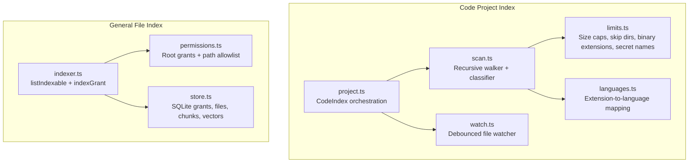
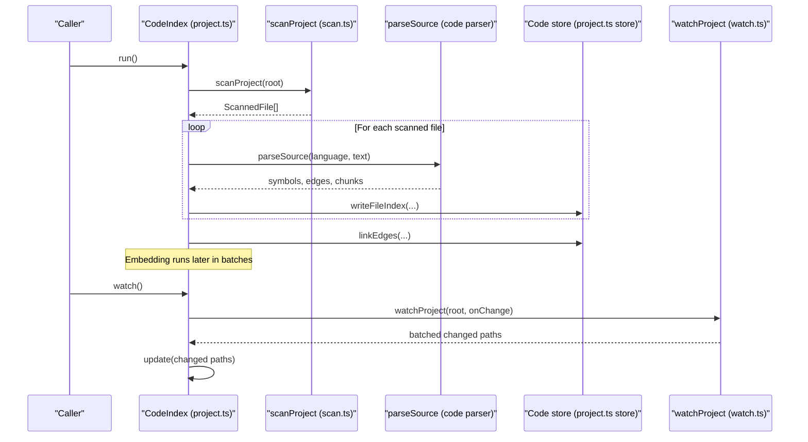
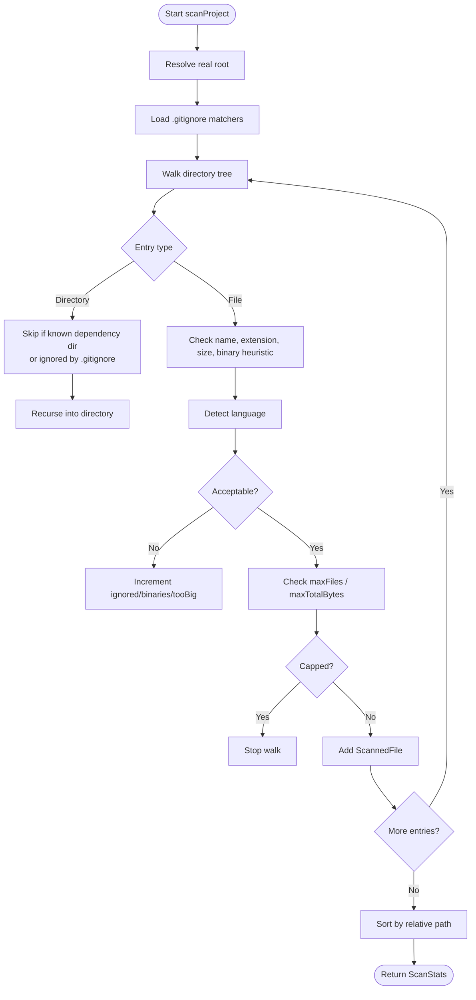
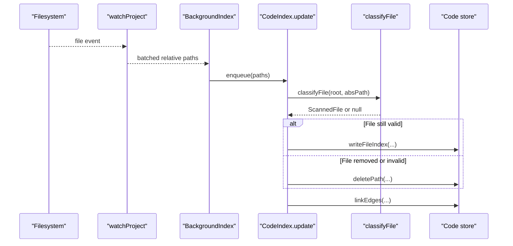
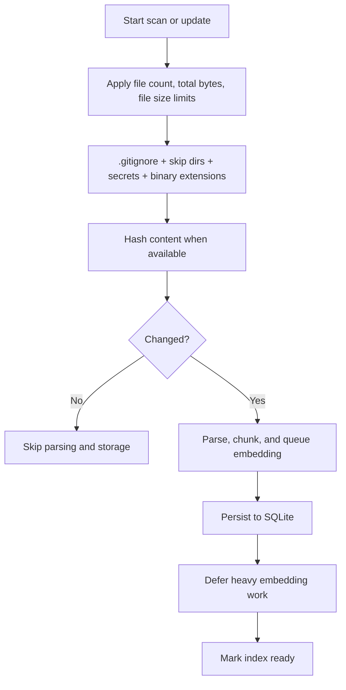
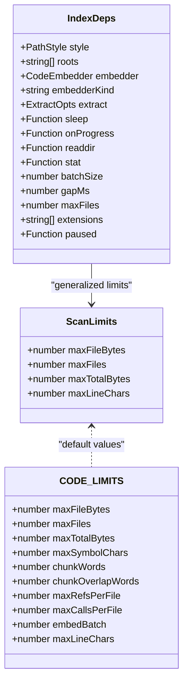
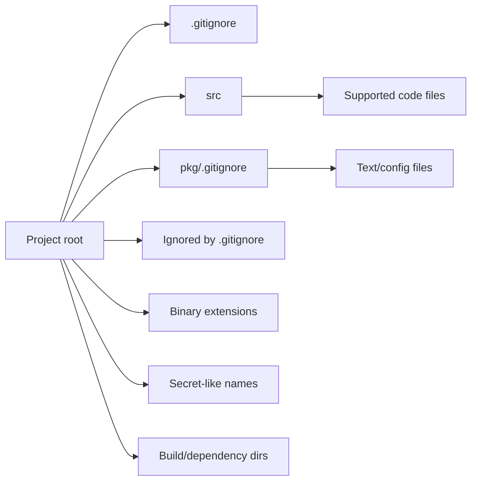
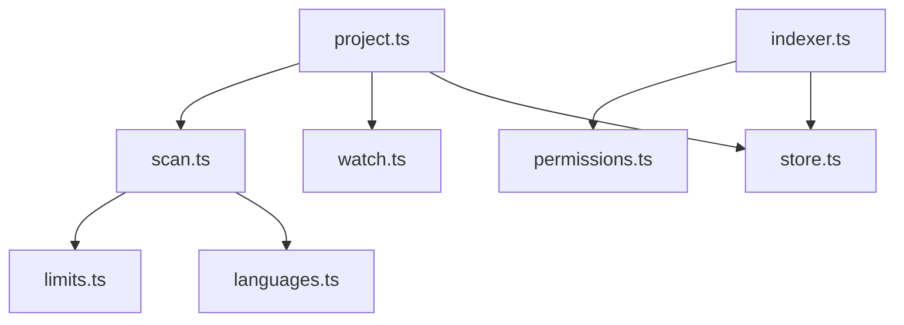

# Project Scanning

<cite>
**Referenced Files in This Document**
- [scan.ts](file://apps/desktop/src/main/core/code/scan.ts)
- [limits.ts](file://apps/desktop/src/main/core/code/limits.ts)
- [languages.ts](file://apps/desktop/src/main/core/code/languages.ts)
- [project.ts](file://apps/desktop/src/main/core/code/project.ts)
- [watch.ts](file://apps/desktop/src/main/core/code/watch.ts)
- [indexer.ts](file://apps/desktop/src/main/core/files/indexer.ts)
- [permissions.ts](file://apps/desktop/src/main/core/files/permissions.ts)
- [store.ts](file://apps/desktop/src/main/core/files/store.ts)
</cite>

## Table of Contents
1. [Introduction](#introduction)
2. [Project Structure](#project-structure)
3. [Core Components](#core-components)
4. [Architecture Overview](#architecture-overview)
5. [Detailed Component Analysis](#detailed-component-analysis)
6. [Dependency Analysis](#dependency-analysis)
7. [Performance Considerations](#performance-considerations)
8. [Troubleshooting Guide](#troubleshooting-guide)
9. [Conclusion](#conclusion)

## Introduction
This document explains the project scanning functionality used to index codebases for local search, symbol resolution, and embedding. The system supports two related scanning paths:

- **Code project scanning**: A strict, source-focused scanner that walks a project directory, applies `.gitignore` rules, skips binaries and secrets, enforces size limits, detects languages, and produces structured file metadata for parsing into symbols, edges, and chunks.
- **General file indexing**: A broader indexer for granted folders that scans documents, images, spreadsheets, and code files, extracts content blocks, computes embeddings, and stores them in a searchable SQLite database.

The design emphasizes safety, incremental updates, predictable performance on laptops, and clear configuration boundaries between code projects and general user folders.

## Project Structure
The scanning logic is split across two subsystems:

| Area | Responsibility | Key Files |
|---|---|---|
| Code project scanning | Recursive traversal, filtering, language detection, and classification for code parsing | `scan.ts`, `limits.ts`, `languages.ts`, `project.ts`, `watch.ts` |
| General folder indexing | Grant-based traversal, extension filtering, extraction, embedding, and persistence | `indexer.ts`, `permissions.ts`, `store.ts` |

**Diagram sources**
- [scan.ts:1-160](file://apps/desktop/src/main/core/code/scan.ts#L1-L160)
- [limits.ts:1-62](file://apps/desktop/src/main/core/code/limits.ts#L1-L62)
- [languages.ts:1-59](file://apps/desktop/src/main/core/code/languages.ts#L1-L59)
- [project.ts:56-140](file://apps/desktop/src/main/core/code/project.ts#L56-L140)
- [watch.ts:1-35](file://apps/desktop/src/main/core/code/watch.ts#L1-L35)
- [indexer.ts:1-229](file://apps/desktop/src/main/core/files/indexer.ts#L1-L229)
- [permissions.ts:1-229](file://apps/desktop/src/main/core/files/permissions.ts#L1-L229)
- [store.ts:1-333](file://apps/desktop/src/main/core/files/store.ts#L1-L333)

**Section sources**
- [scan.ts:1-160](file://apps/desktop/src/main/core/code/scan.ts#L1-L160)
- [indexer.ts:1-229](file://apps/desktop/src/main/core/files/indexer.ts#L1-L229)

## Core Components
- **Recursive scanner**: Traverses directories, respects `.gitignore`, skips dependency/build directories, filters by extension, size, and binary heuristics, and returns normalized relative paths with metadata.
- **File classifier**: Applies the same filtering rules to individual files reported by watchers or change events.
- **Language detector**: Maps filenames/extensions to grammar identifiers or plaintext.
- **Code project orchestrator**: Coordinates full scans, incremental updates, parsing, graph linking, embedding, and status reporting.
- **General indexer**: Lists indexable files under granted roots, batches processing, compares timestamps/sizes, extracts content, embeds chunks, and persists results.
- **Permission layer**: Ensures only allowed root folders are scanned and prevents access outside granted scopes.
- **Persistence layer**: Stores grants, file metadata, text chunks, full-text search indices, and vector embeddings.

**Section sources**
- [scan.ts:11-32](file://apps/desktop/src/main/core/code/scan.ts#L11-L32)
- [project.ts:56-140](file://apps/desktop/src/main/core/code/project.ts#L56-L140)
- [indexer.ts:23-90](file://apps/desktop/src/main/core/files/indexer.ts#L23-L90)
- [permissions.ts:92-95](file://apps/desktop/src/main/core/files/permissions.ts#L92-L95)
- [store.ts:14-68](file://apps/desktop/src/main/core/files/store.ts#L14-L68)

## Architecture Overview
The scanning architecture separates concerns between discovery, filtering, parsing, and storage.

**Diagram sources**
- [project.ts:125-140](file://apps/desktop/src/main/core/code/project.ts#L125-L140)
- [project.ts:245-319](file://apps/desktop/src/main/core/code/project.ts#L245-L319)
- [scan.ts:71-123](file://apps/desktop/src/main/core/code/scan.ts#L71-L123)
- [watch.ts:5-34](file://apps/desktop/src/main/core/code/watch.ts#L5-L34)

## Detailed Component Analysis

### Recursive Directory Traversal and Filtering
The code scanner performs a synchronous recursive walk with explicit guards:

- Resolves the real project root.
- Loads `.gitignore` from the root and nested directories.
- Skips symbolic links.
- Skips known dependency and build directories.
- Applies `.gitignore` rules per directory scope.
- Filters out secret-like filenames.
- Filters out binary extensions.
- Detects supported languages; unsupported extensions are treated as non-source.
- Rejects empty files and files exceeding configured byte limits.
- Performs a lightweight binary heuristic using a small sample and first-line length.
- Normalizes paths to POSIX-style relative paths.
- Enforces global file count and total accepted bytes limits.
- Sorts results by relative path.

**Diagram sources**
- [scan.ts:71-123](file://apps/desktop/src/main/core/code/scan.ts#L71-L123)
- [limits.ts:23-42](file://apps/desktop/src/main/core/code/limits.ts#L23-L42)
- [languages.ts:36-46](file://apps/desktop/src/main/core/code/languages.ts#L36-L46)

**Section sources**
- [scan.ts:71-123](file://apps/desktop/src/main/core/code/scan.ts#L71-L123)
- [limits.ts:1-62](file://apps/desktop/src/main/core/code/limits.ts#L1-L62)
- [languages.ts:1-59](file://apps/desktop/src/main/core/code/languages.ts#L1-L59)

### File Filtering Mechanisms
Filtering occurs at multiple layers:

| Filter | Purpose | Implementation Details |
|---|---|---|
| Known directories | Avoid scanning dependencies and generated output | `SKIP_DIR_NAMES` includes version control, package managers, build outputs, caches, IDE data, and common tool directories |
| `.gitignore` | Respect repository-level exclusion patterns | Nested `.gitignore` files are loaded and applied per directory scope |
| Secret names | Prevent indexing sensitive files | `.env`, lockfiles, key files, and other tool cache names are skipped |
| Binary extensions | Skip media, archives, compiled artifacts, fonts, and databases | `BINARY_EXT` covers image, archive, executable, library, bytecode, database, audio/video, font, design, and lock formats |
| Extension whitelist | Only parse supported code/text languages | `languageFor` maps extensions to grammar IDs or plaintext; unknown extensions are rejected |
| Size limits | Avoid large bundles, dumps, and oversized assets | Configured maximum file bytes and total accepted bytes cap the scan |
| Binary heuristic | Catch misnamed binaries | Reads a small sample, checks for null bytes, and rejects extremely long first lines |
| Path normalization | Ensure safe relative paths | Paths are normalized to POSIX style and validated against the root |

**Section sources**
- [limits.ts:23-62](file://apps/desktop/src/main/core/code/limits.ts#L23-L62)
- [scan.ts:40-69](file://apps/desktop/src/main/core/code/scan.ts#L40-L69)
- [languages.ts:36-46](file://apps/desktop/src/main/core/code/languages.ts#L36-L46)

### Incremental Scanning Approach
There are two incremental strategies:

1. **Code project incremental updates**:
   - The watcher coalesces file events into batches.
   - Changed relative paths are passed to an exclusive update routine.
   - Each path is classified using the same rules as a full scan.
   - If a file is no longer valid, its index entry is removed.
   - Content is hashed; unchanged hashes skip re-parsing.
   - After changes, graph edges are relinked and state becomes ready.

2. **General file index incremental updates**:
   - The indexer lists all indexable files under granted roots.
   - Existing rows not present in the current filesystem listing are forgotten.
   - Files with unchanged size and modification time are considered up to date.
   - Changed files are extracted, chunked, embedded, and saved.
   - Processing is paused/resumable and debounced.

**Diagram sources**
- [watch.ts:5-34](file://apps/desktop/src/main/core/code/watch.ts#L5-L34)
- [project.ts:132-140](file://apps/desktop/src/main/core/code/project.ts#L132-L140)
- [project.ts:280-303](file://apps/desktop/src/main/core/code/project.ts#L280-L303)
- [scan.ts:125-160](file://apps/desktop/src/main/core/code/scan.ts#L125-L160)

**Section sources**
- [project.ts:132-140](file://apps/desktop/src/main/core/code/project.ts#L132-L140)
- [project.ts:280-303](file://apps/desktop/src/main/core/code/project.ts#L280-L303)
- [indexer.ts:120-176](file://apps/desktop/src/main/core/files/indexer.ts#L120-L176)

### Performance Optimizations for Large Codebases
The system uses several optimizations designed for laptop environments:

- **Parallelism model**:
  - Code scanning itself is synchronous to keep traversal simple and deterministic.
  - Parsing and embedding are asynchronous and queued through an exclusive chain.
  - Background indexing prioritizes read operations like search while allowing indexing to proceed in small steps.
  - General indexing batches work and pauses between batches to keep the UI responsive.

- **Memory management**:
  - Global limits cap accepted files and total bytes during scanning.
  - Symbol bodies and chunks are bounded by configured sizes.
  - Embedding runs in configurable batches rather than loading everything at once.
  - Database writes use WAL mode and foreign keys for safer concurrent access.

- **Caching and deduplication**:
  - File content hashing avoids re-parsing unchanged files.
  - General indexing compares stored `mtimeMs` and `size` to skip unchanged files.
  - Vector embeddings are persisted alongside chunks and can be staged before commit.
  - Full-text search uses FTS5; vector search uses a dedicated vector table.

- **Traversal safeguards**:
  - Depth limit in the general indexer prevents runaway recursion.
  - Maximum file count and maximum file size prevent excessive memory usage.
  - Binary heuristics avoid reading large binary blobs.
  - `.gitignore` and built-in skip lists reduce unnecessary I/O.

**Diagram sources**
- [scan.ts:71-123](file://apps/desktop/src/main/core/code/scan.ts#L71-L123)
- [project.ts:245-319](file://apps/desktop/src/main/core/code/project.ts#L245-L319)
- [indexer.ts:92-176](file://apps/desktop/src/main/core/files/indexer.ts#L92-L176)
- [store.ts:121-129](file://apps/desktop/src/main/core/files/store.ts#L121-L129)

**Section sources**
- [project.ts:245-347](file://apps/desktop/src/main/core/code/project.ts#L245-L347)
- [indexer.ts:23-176](file://apps/desktop/src/main/core/files/indexer.ts#L23-L176)
- [store.ts:114-129](file://apps/desktop/src/main/core/files/store.ts#L114-L129)

### Configuration Options for Customizing Scan Behavior
Configuration is split between code-project scanning and general file indexing.

| Category | Option | Default or Range | Effect |
|---|---|---:|---|
| Code scanning | `maxFileBytes` | `512 * 1024` | Skips source files larger than this |
| Code scanning | `maxFiles` | `20_000` | Stops walking after this many source files |
| Code scanning | `maxTotalBytes` | `80 * 1024 * 1024` | Stops accepting more files after this total |
| Code scanning | `maxLineChars` | `8_000` | Treats very long first lines as minified/binary |
| Code scanning | `embedBatch` | `16` | Number of chunks embedded per embedding batch |
| General indexing | `extensions` | Default set including code, docs, media, and office formats | Controls which file extensions are indexed |
| General indexing | `maxFiles` | Clamped between `1` and `100_000` | Limits number of files listed for indexing |
| General indexing | `INDEX_MAX_BYTES` | `40 * 1024 * 1024` | Skips files larger than this |
| General indexing | `INDEX_BATCH` | `8` | Batches indexing work |
| General indexing | `INDEX_GAP_MS` | `200` | Pauses between batches |
| General indexing | `WATCH_DEBOUNCE_MS` | `1500` | Debounces filesystem watcher callbacks |
| Permission layer | `roots` | User-granted folder paths | Restricts scanning to allowed roots |
| Permission layer | `style` | Platform-specific path style | Handles Windows, Unix, and cross-platform paths |

**Diagram sources**
- [scan.ts:27-32](file://apps/desktop/src/main/core/code/scan.ts#L27-L32)
- [limits.ts:3-21](file://apps/desktop/src/main/core/code/limits.ts#L3-L21)
- [indexer.ts:75-90](file://apps/desktop/src/main/core/files/indexer.ts#L75-L90)

**Section sources**
- [scan.ts:27-32](file://apps/desktop/src/main/core/code/scan.ts#L27-L32)
- [limits.ts:1-21](file://apps/desktop/src/main/core/code/limits.ts#L1-L21)
- [indexer.ts:23-50](file://apps/desktop/src/main/core/files/indexer.ts#L23-L50)
- [indexer.ts:75-90](file://apps/desktop/src/main/core/files/indexer.ts#L75-L90)
- [permissions.ts:92-95](file://apps/desktop/src/main/core/files/permissions.ts#L92-L95)

### Handling Different Project Structures
The scanner adapts to different project layouts through:

- **Nested `.gitignore` support**: Each directory can contribute additional ignore rules.
- **Built-in skip directories**: Common dependency and build directories are excluded even if `.gitignore` is incomplete.
- **Language mapping**: Multiple extensions map to the same grammar, supporting JavaScript variants, TypeScript variants, C/C++ variants, and plaintext documentation/config formats.
- **Path style handling**: The general indexer and permission layer handle platform differences and normalize paths consistently.
- **Grant scoping**: General indexing restricts traversal to explicitly granted roots, making it safe for home directories, downloads, desktop, and arbitrary user folders.

**Diagram sources**
- [scan.ts:40-61](file://apps/desktop/src/main/core/code/scan.ts#L40-L61)
- [limits.ts:23-42](file://apps/desktop/src/main/core/code/limits.ts#L23-L42)
- [languages.ts:3-46](file://apps/desktop/src/main/core/code/languages.ts#L3-L46)
- [permissions.ts:92-95](file://apps/desktop/src/main/core/files/permissions.ts#L92-L95)

**Section sources**
- [scan.ts:40-61](file://apps/desktop/src/main/core/code/scan.ts#L40-L61)
- [languages.ts:1-59](file://apps/desktop/src/main/core/code/languages.ts#L1-L59)
- [permissions.ts:92-95](file://apps/desktop/src/main/core/files/permissions.ts#L92-L95)

## Dependency Analysis
The main dependency relationships are:

**Diagram sources**
- [project.ts:12-27](file://apps/desktop/src/main/core/code/project.ts#L12-L27)
- [scan.ts:5-9](file://apps/desktop/src/main/core/code/scan.ts#L5-L9)
- [indexer.ts:6-21](file://apps/desktop/src/main/core/files/indexer.ts#L6-L21)

**Section sources**
- [project.ts:12-27](file://apps/desktop/src/main/core/code/project.ts#L12-L27)
- [scan.ts:5-9](file://apps/desktop/src/main/core/code/scan.ts#L5-L9)
- [indexer.ts:6-21](file://apps/desktop/src/main/core/files/indexer.ts#L6-L21)

## Performance Considerations
- Prefer incremental updates over full rescans whenever possible.
- Keep `.gitignore` accurate to minimize traversal overhead.
- Avoid granting overly broad roots for general indexing; prefer specific folders.
- Tune `maxFiles`, `maxTotalBytes`, and `maxFileBytes` based on machine capabilities.
- Use batching and gaps for large indexes to keep the application responsive.
- Monitor embedding batches and ensure embedding dimensions match expected values.
- Revoke unused grants to reduce index maintenance overhead.

[No sources needed since this section provides general guidance]

## Troubleshooting Guide
Common issues and their likely causes:

| Symptom | Likely Cause | Recommended Action |
|---|---|---|
| Scan stops early | `maxFiles` or `maxTotalBytes` reached | Increase limits or narrow the project root |
| Large files are ignored | Exceeds `maxFileBytes` or fails binary heuristic | Verify file type, adjust limits, or exclude generated files |
| Secrets appear in index | Secret name filter bypassed or wrong root | Review `.gitignore`, secret name list, and granted roots |
| Changes are not reflected | Watcher debounce or missing path normalization | Check debounce timing and ensure relative paths are correct |
| Indexing feels slow | Too many files or too large a root | Reduce granted scope, increase batch gap, or exclude irrelevant extensions |
| Embedding fails | Dimension mismatch or batch length mismatch | Validate embedder configuration and embedding dimension constants |
| Old files remain indexed | Previous grant still contains stale rows | Revoke grant or rerun indexing so stale rows are forgotten |

**Section sources**
- [scan.ts:71-123](file://apps/desktop/src/main/core/code/scan.ts#L71-L123)
- [project.ts:321-347](file://apps/desktop/src/main/core/code/project.ts#L321-L347)
- [indexer.ts:120-176](file://apps/desktop/src/main/core/files/indexer.ts#L120-L176)
- [store.ts:189-225](file://apps/desktop/src/main/core/files/store.ts#L189-L225)

## Conclusion
The project scanning system combines a strict code-focused scanner with a flexible general-purpose file indexer. It prioritizes safety through `.gitignore`, secret filtering, binary detection, and root scoping. It prioritizes performance through size limits, batching, debouncing, hashing, and persistent caching. It prioritizes responsiveness through incremental updates, background queues, and graceful pause/resume behavior. For large codebases, the recommended approach is to configure appropriate limits, keep `.gitignore` accurate, use targeted grants, and rely on incremental updates rather than full rescans.

[No sources needed since this section summarizes without analyzing specific files]