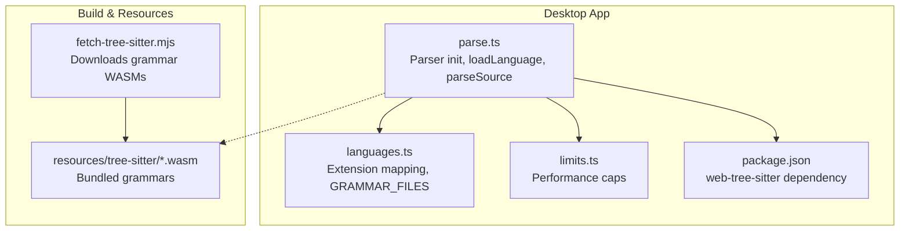
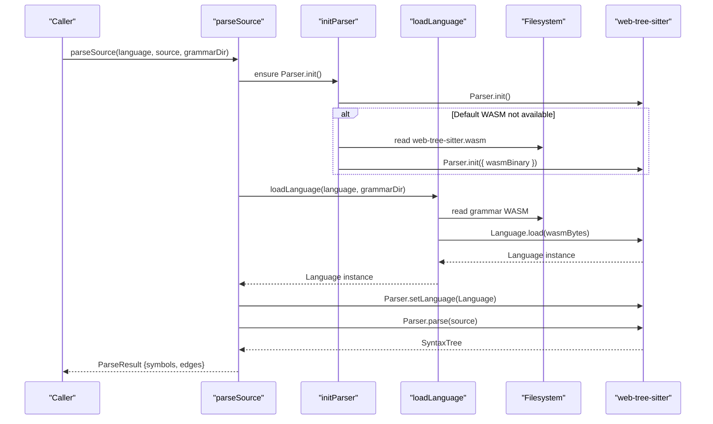
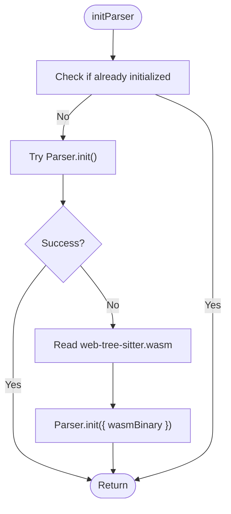
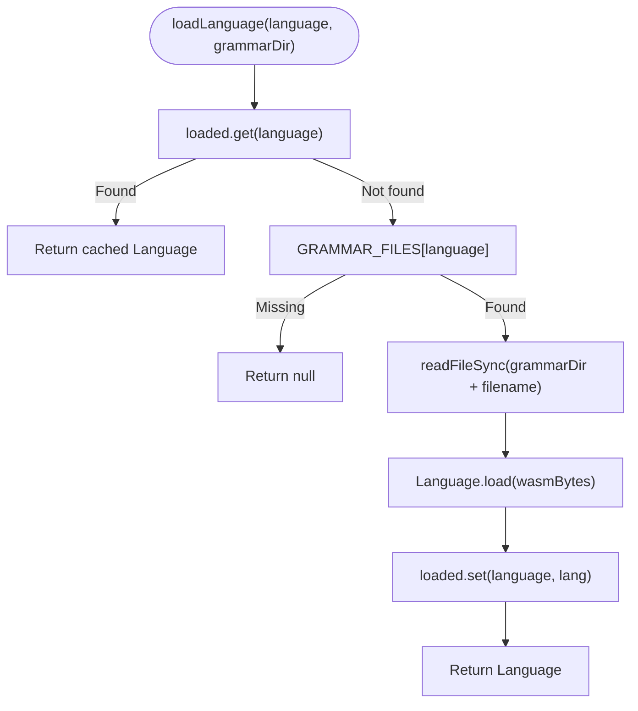
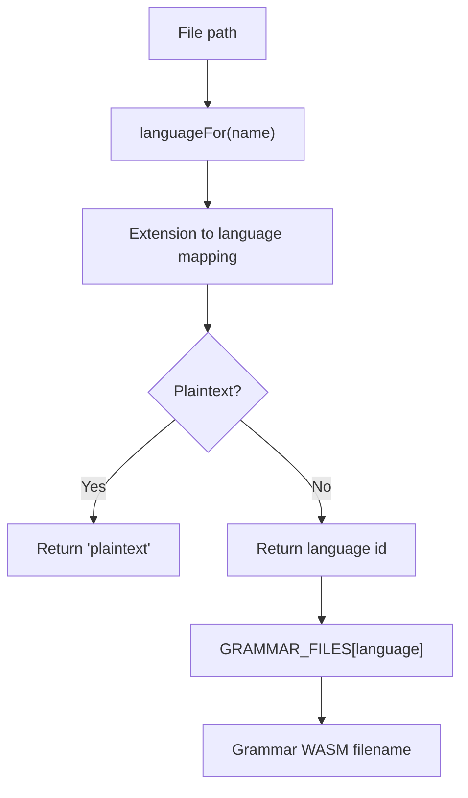
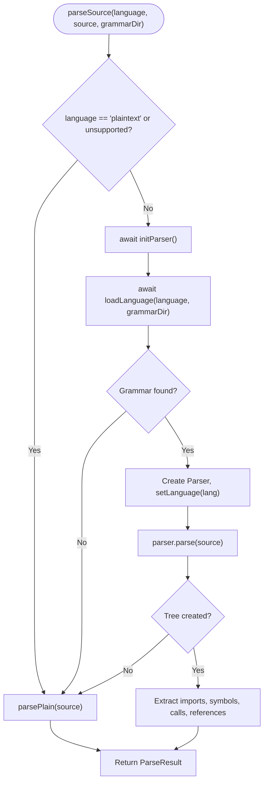
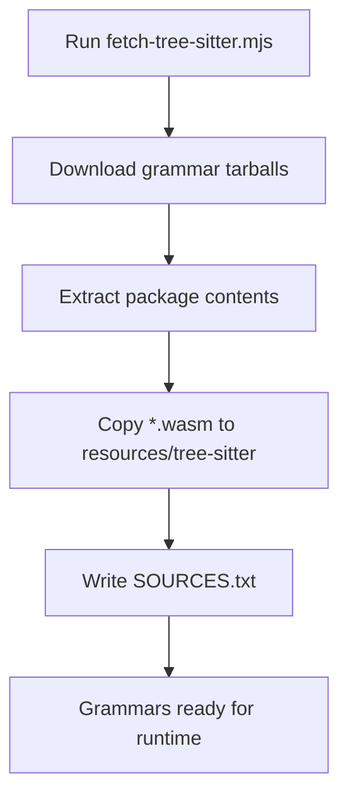
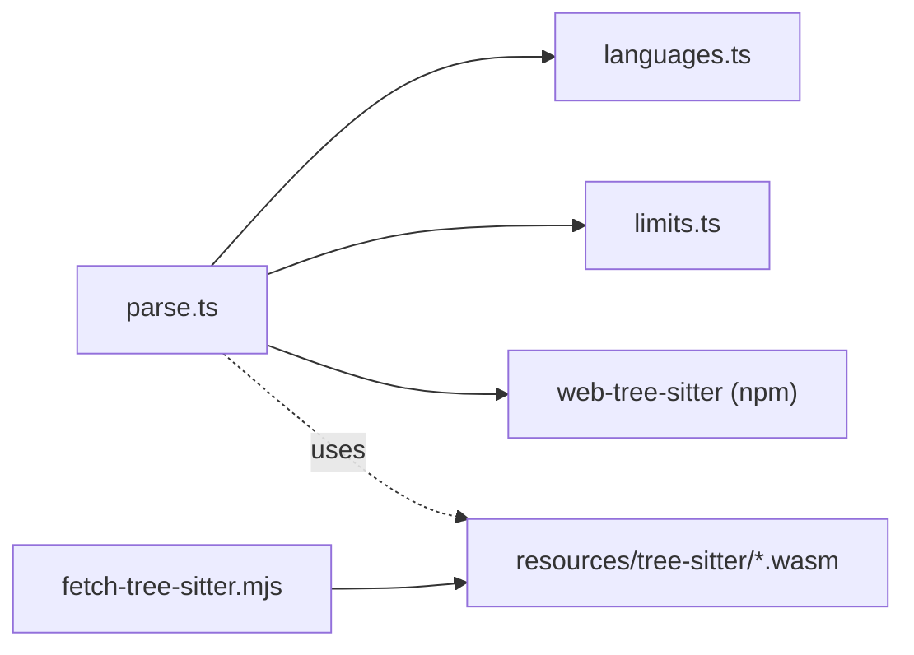

# Grammar Management System

<cite>
**Referenced Files in This Document**
- [parse.ts](file://apps/desktop/src/main/core/code/parse.ts)
- [languages.ts](file://apps/desktop/src/main/core/code/languages.ts)
- [fetch-tree-sitter.mjs](file://apps/desktop/scripts/fetch-tree-sitter.mjs)
- [limits.ts](file://apps/desktop/src/main/core/code/limits.ts)
- [package.json](file://apps/desktop/package.json)
</cite>

## Table of Contents
1. [Introduction](#introduction)
2. [Project Structure](#project-structure)
3. [Core Components](#core-components)
4. [Architecture Overview](#architecture-overview)
5. [Detailed Component Analysis](#detailed-component-analysis)
6. [Dependency Analysis](#dependency-analysis)
7. [Performance Considerations](#performance-considerations)
8. [Troubleshooting Guide](#troubleshooting-guide)
9. [Conclusion](#conclusion)

## Introduction
This document explains the grammar management system used to parse source code with web-tree-sitter in a WebAssembly (WASM) environment. It focuses on:
- Initializing the parser and WASM runtime
- Dynamically loading language-specific grammars from files
- Caching loaded grammars to avoid repeated loads
- Error handling and fallback to plain-text parsing
- Grammar file locations, supported languages, and how to add new grammars
- Performance considerations and memory management for large codebases

The implementation is designed for a desktop application using Node.js and Electron, where tree-sitter grammars are pre-bundled as WASM binaries and loaded at runtime.

## Project Structure
The grammar management system spans several modules:
- Parser initialization and WASM loading logic
- Language-to-grammar mapping and extension detection
- Script to fetch and bundle grammar WASM files
- Limits and configuration for performance and memory usage

**Diagram sources**
- [parse.ts:134-160](file://apps/desktop/src/main/core/code/parse.ts#L134-L160)
- [languages.ts:36-58](file://apps/desktop/src/main/core/code/languages.ts#L36-L58)
- [fetch-tree-sitter.mjs:20-51](file://apps/desktop/scripts/fetch-tree-sitter.mjs#L20-L51)
- [limits.ts:3-21](file://apps/desktop/src/main/core/code/limits.ts#L3-L21)
- [package.json:53](file://apps/desktop/package.json#L53)

**Section sources**
- [parse.ts:1-11](file://apps/desktop/src/main/core/code/parse.ts#L1-L11)
- [languages.ts:1-59](file://apps/desktop/src/main/core/code/languages.ts#L1-L59)
- [fetch-tree-sitter.mjs:1-53](file://apps/desktop/scripts/fetch-tree-sitter.mjs#L1-L53)
- [limits.ts:1-21](file://apps/desktop/src/main/core/code/limits.ts#L1-L21)
- [package.json:25-55](file://apps/desktop/package.json#L25-L55)

## Core Components
- Parser initialization and WASM loading: Ensures the web-tree-sitter runtime is initialized once and provides a fallback when the default WASM loader fails.
- Dynamic grammar loading: Loads a specific grammar by name from bundled WASM files and caches it in memory.
- Language detection and mapping: Maps file extensions to language identifiers and maps language identifiers to grammar filenames.
- Parsing pipeline: Parses source code into symbols and edges; falls back to plain-text parsing if no grammar is available or parsing fails.
- Performance limits: Caps file sizes, symbol sizes, reference counts, and other metrics to keep indexing efficient.

**Section sources**
- [parse.ts:134-160](file://apps/desktop/src/main/core/code/parse.ts#L134-L160)
- [parse.ts:502-528](file://apps/desktop/src/main/core/code/parse.ts#L502-L528)
- [languages.ts:36-58](file://apps/desktop/src/main/core/code/languages.ts#L36-L58)
- [limits.ts:3-21](file://apps/desktop/src/main/core/code/limits.ts#L3-L21)

## Architecture Overview
The system follows a layered approach:
- Entry point: parseSource orchestrates initialization, grammar loading, parsing, and extraction.
- Initialization: initParser sets up the web-tree-sitter Parser instance and handles WASM binary resolution.
- Grammar loading: loadLanguage reads a grammar WASM file from disk and caches the resulting Language object.
- Language mapping: languages.ts defines which extensions map to which languages and which grammar files to use.
- Resource provisioning: fetch-tree-sitter.mjs downloads and bundles grammar WASMs into resources/tree-sitter.

**Diagram sources**
- [parse.ts:138-160](file://apps/desktop/src/main/core/code/parse.ts#L138-L160)
- [parse.ts:502-528](file://apps/desktop/src/main/core/code/parse.ts#L502-L528)

## Detailed Component Analysis

### Parser Initialization (initParser)
Purpose:
- Initialize the web-tree-sitter Parser once per process.
- Provide a robust fallback path when the default WASM loader cannot resolve the runtime binary.

Key behaviors:
- Uses an internal promise guard to initialize only once.
- Attempts Parser.init() first.
- On failure, resolves the embedded web-tree-sitter.wasm via require.resolve and passes it as wasmBinary.

Error handling:
- If the default loader fails, the fallback ensures the app can still run with bundled WASM.

**Diagram sources**
- [parse.ts:138-150](file://apps/desktop/src/main/core/code/parse.ts#L138-L150)

**Section sources**
- [parse.ts:134-150](file://apps/desktop/src/main/core/code/parse.ts#L134-L150)

### Dynamic Grammar Loading (loadLanguage)
Purpose:
- Load a language-specific grammar from a WASM file and cache it for reuse.

Key behaviors:
- Checks an in-process Map to return a cached Language instance if already loaded.
- Looks up the grammar filename from GRAMMAR_FILES.
- Reads the WASM bytes from the provided grammar directory and calls Language.load.
- Stores the Language instance in the cache.

Caching mechanism:
- The loaded Map persists across parseSource calls within the same process, avoiding repeated disk I/O and WASM compilation.

**Diagram sources**
- [parse.ts:152-160](file://apps/desktop/src/main/core/code/parse.ts#L152-L160)
- [languages.ts:48-58](file://apps/desktop/src/main/core/code/languages.ts#L48-L58)

**Section sources**
- [parse.ts:134-160](file://apps/desktop/src/main/core/code/parse.ts#L134-L160)
- [languages.ts:48-58](file://apps/desktop/src/main/core/code/languages.ts#L48-L58)

### Language Detection and Mapping
Purpose:
- Determine the language identifier from a file path and map it to a grammar file.

Key behaviors:
- languageFor determines whether a file should be treated as plaintext or mapped to a known language based on extension and basename rules.
- GRAMMAR_FILES maps language identifiers to their corresponding WASM filenames.

Supported languages and mappings:
- Python (.py, .pyi) -> python
- JavaScript (.js, .jsx, .mjs, .cjs) -> javascript
- TypeScript (.ts) -> typescript
- TSX (.tsx) -> tsx
- Java (.java) -> java
- Go (.go) -> go
- Rust (.rs) -> rust
- C (.c, .h) -> c
- C++ (.cc, .cpp, .cxx, .hpp, .hh, .hxx) -> cpp
- Plaintext fallback for many text-like extensions and special basenames

**Diagram sources**
- [languages.ts:36-58](file://apps/desktop/src/main/core/code/languages.ts#L36-L58)

**Section sources**
- [languages.ts:1-59](file://apps/desktop/src/main/core/code/languages.ts#L1-L59)

### Parsing Pipeline and Fallback
Purpose:
- Parse source code into structured symbols and edges.
- Gracefully fall back to plain-text parsing when no grammar is available or parsing fails.

Key behaviors:
- parseSource checks if the language is plaintext or unsupported; if so, returns parsePlain results.
- Initializes the parser and loads the grammar.
- If no grammar is returned, falls back to parsePlain.
- Creates a Parser instance, sets the language, parses the source, and extracts symbols and edges.
- On any error during parsing, falls back to parsePlain.

**Diagram sources**
- [parse.ts:502-528](file://apps/desktop/src/main/core/code/parse.ts#L502-L528)

**Section sources**
- [parse.ts:502-528](file://apps/desktop/src/main/core/code/parse.ts#L502-L528)

### Grammar File Locations and Provisioning
Purpose:
- Provide a reproducible way to obtain and bundle grammar WASM files.

Key behaviors:
- fetch-tree-sitter.mjs downloads pinned versions of tree-sitter grammar packages and copies their WASM files into apps/desktop/resources/tree-sitter.
- It writes SOURCES.txt documenting the exact versions and files copied.
- The parser expects grammar WASMs to be present under the provided grammar directory.

Supported grammar versions (pinned):
- tree-sitter-python 0.25.0
- tree-sitter-javascript 0.25.0
- tree-sitter-typescript 0.23.2 (includes tsx)
- tree-sitter-java 0.23.5
- tree-sitter-go 0.25.0
- tree-sitter-rust 0.24.0
- tree-sitter-c 0.24.1
- tree-sitter-cpp 0.23.4

**Diagram sources**
- [fetch-tree-sitter.mjs:20-51](file://apps/desktop/scripts/fetch-tree-sitter.mjs#L20-L51)

**Section sources**
- [fetch-tree-sitter.mjs:1-53](file://apps/desktop/scripts/fetch-tree-sitter.mjs#L1-L53)

### Adding New Grammar Files
To add support for a new language:
1. Add the language identifier and its WASM filename to GRAMMAR_FILES in languages.ts.
2. Ensure the grammar WASM file exists in resources/tree-sitter (run fetch-tree-sitter.mjs or copy manually).
3. If needed, add extension mappings in CODE_EXT and/or TEXT_EXT in languages.ts.
4. Optionally define language-specific parsing rules in parse.ts SPECS if you want custom symbol extraction.

Notes:
- Keep grammar versions pinned and ABI-compatible with web-tree-sitter 0.27.1.
- Update SOURCES.txt by re-running the provisioning script.

**Section sources**
- [languages.ts:3-23](file://apps/desktop/src/main/core/code/languages.ts#L3-L23)
- [languages.ts:48-58](file://apps/desktop/src/main/core/code/languages.ts#L48-L58)
- [fetch-tree-sitter.mjs:21-30](file://apps/desktop/scripts/fetch-tree-sitter.mjs#L21-L30)

## Dependency Analysis
- parse.ts depends on:
  - web-tree-sitter for Parser and Language APIs
  - languages.ts for GRAMMAR_FILES and language detection
  - limits.ts for performance caps
- languages.ts is self-contained and provides extension-to-language and language-to-grammar mappings.
- fetch-tree-sitter.mjs is a build-time tool that provisions grammar WASMs.
- package.json declares web-tree-sitter as a runtime dependency.

**Diagram sources**
- [parse.ts:5-10](file://apps/desktop/src/main/core/code/parse.ts#L5-L10)
- [languages.ts:48-58](file://apps/desktop/src/main/core/code/languages.ts#L48-L58)
- [limits.ts:3-21](file://apps/desktop/src/main/core/code/limits.ts#L3-L21)
- [package.json:53](file://apps/desktop/package.json#L53)
- [fetch-tree-sitter.mjs:20-51](file://apps/desktop/scripts/fetch-tree-sitter.mjs#L20-L51)

**Section sources**
- [parse.ts:5-10](file://apps/desktop/src/main/core/code/parse.ts#L5-L10)
- [languages.ts:48-58](file://apps/desktop/src/main/core/code/languages.ts#L48-L58)
- [limits.ts:3-21](file://apps/desktop/src/main/core/code/limits.ts#L3-L21)
- [package.json:53](file://apps/desktop/package.json#L53)
- [fetch-tree-sitter.mjs:20-51](file://apps/desktop/scripts/fetch-tree-sitter.mjs#L20-L51)

## Performance Considerations
- Lazy initialization: Parser.init runs once and is guarded by a promise to prevent redundant work.
- Grammar caching: Loaded Language instances are cached in a Map keyed by language, avoiding repeated disk reads and WASM compilation.
- File size limits: Large files are skipped to avoid excessive memory and CPU usage.
- Symbol body limits: Symbol bodies are truncated to a maximum character count to control memory footprint.
- Reference and call limits: Per-file caps on identifier references and call edges prevent runaway graph growth.
- Chunking strategy: Symbols are chunked with overlap to balance search quality and memory usage.

Recommendations:
- Keep grammar WASMs minimal and only include necessary languages.
- Monitor memory usage when scanning very large repositories.
- Tune limits in limits.ts according to target hardware capabilities.

**Section sources**
- [parse.ts:134-160](file://apps/desktop/src/main/core/code/parse.ts#L134-L160)
- [limits.ts:3-21](file://apps/desktop/src/main/core/code/limits.ts#L3-L21)

## Troubleshooting Guide
Common issues and resolutions:
- Parser initialization fails:
  - The fallback path attempts to load web-tree-sitter.wasm directly. Ensure the dependency is installed and accessible.
  - Verify the runtime environment supports the required WASM features.
- Grammar not found:
  - Confirm the grammar WASM exists in the grammar directory passed to parseSource.
  - Ensure GRAMMAR_FILES includes the language identifier and correct filename.
- Unsupported language:
  - If languageFor returns null or plaintext, the system will fall back to plain-text parsing.
  - Add extension mappings in languages.ts to enable code parsing for new extensions.
- High memory usage:
  - Review limits in limits.ts and reduce maxSymbolChars, maxRefsPerFile, or maxCallsPerFile if needed.
  - Avoid indexing minified or generated files by relying on existing skip lists.

Operational checks:
- Run fetch-tree-sitter.mjs to regenerate grammar WASMs and SOURCES.txt.
- Validate that resources/tree-sitter contains all expected *.wasm files.
- Confirm package.json includes web-tree-sitter as a dependency.

**Section sources**
- [parse.ts:138-160](file://apps/desktop/src/main/core/code/parse.ts#L138-L160)
- [parse.ts:502-528](file://apps/desktop/src/main/core/code/parse.ts#L502-L528)
- [languages.ts:36-58](file://apps/desktop/src/main/core/code/languages.ts#L36-L58)
- [fetch-tree-sitter.mjs:20-51](file://apps/desktop/scripts/fetch-tree-sitter.mjs#L20-L51)
- [limits.ts:3-21](file://apps/desktop/src/main/core/code/limits.ts#L3-L21)
- [package.json:53](file://apps/desktop/package.json#L53)

## Conclusion
The grammar management system provides a robust, lazy-initialized, and cached approach to parsing code with web-tree-sitter in a WASM context. It dynamically loads language-specific grammars from bundled files, gracefully falls back to plain-text parsing when necessary, and enforces performance limits suitable for desktop environments. By following the guidance here, you can extend supported languages, troubleshoot common issues, and optimize performance for large codebases.