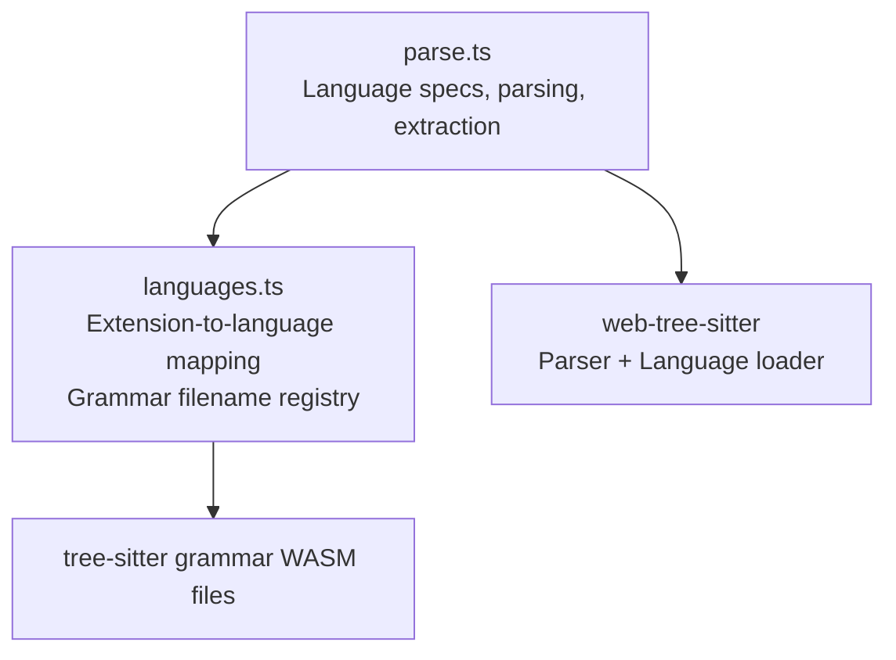
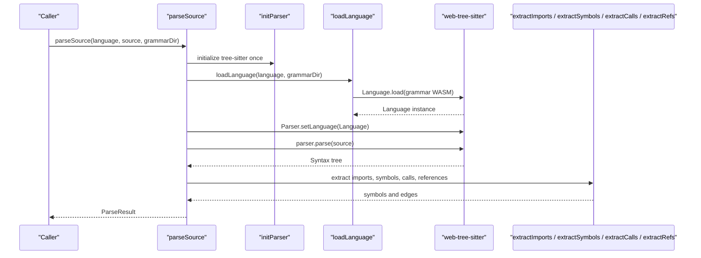
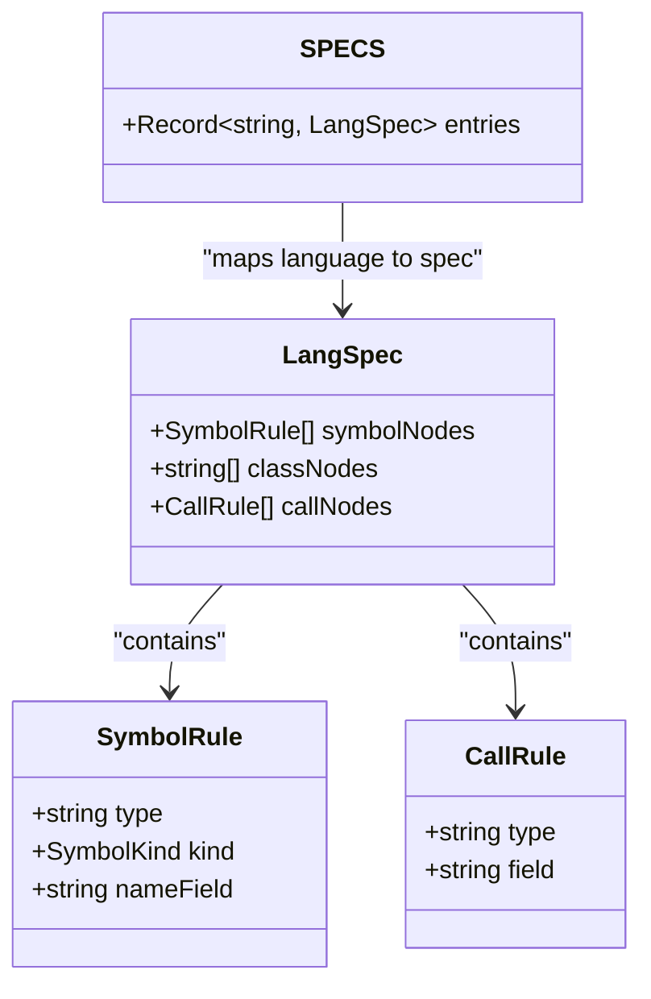
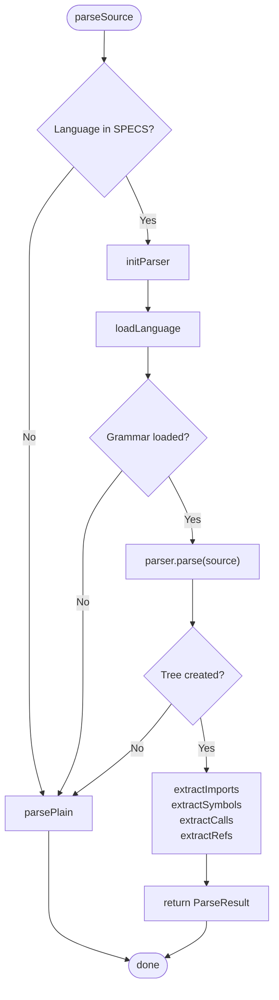
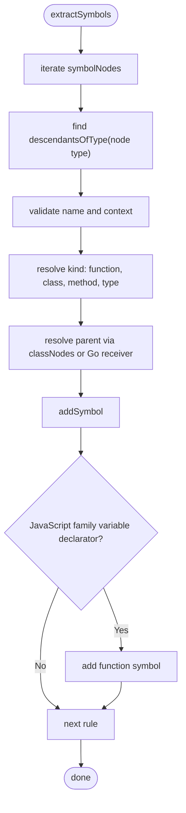
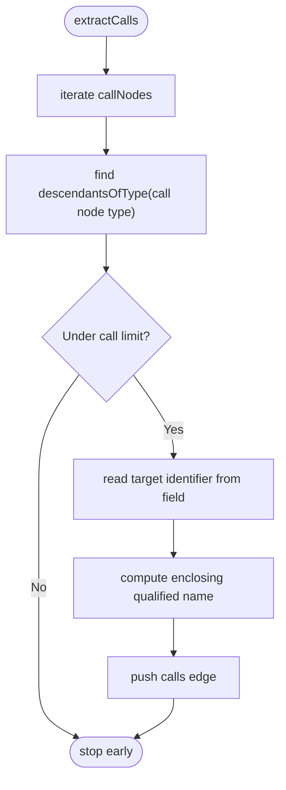
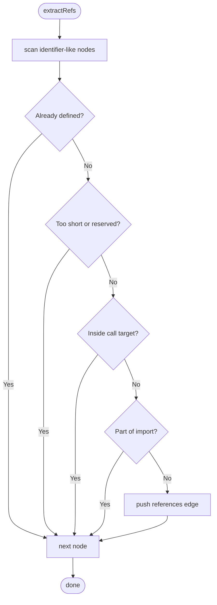
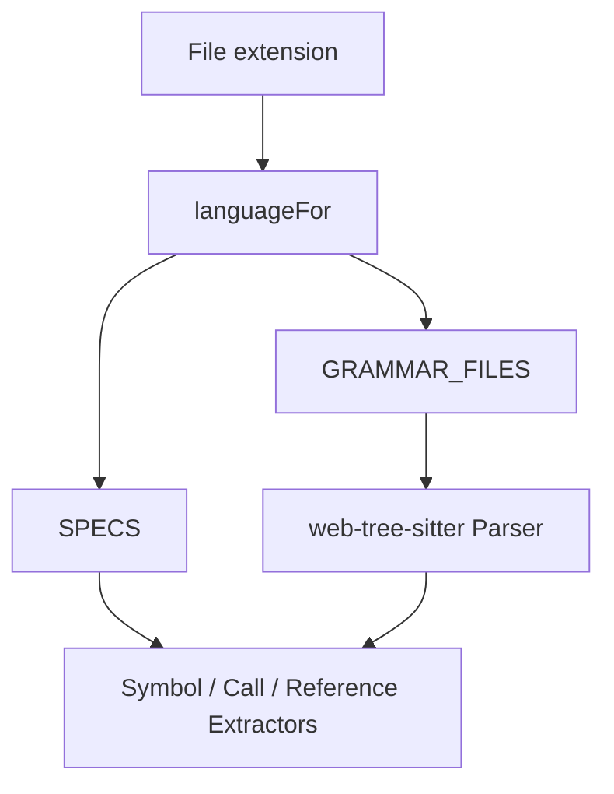
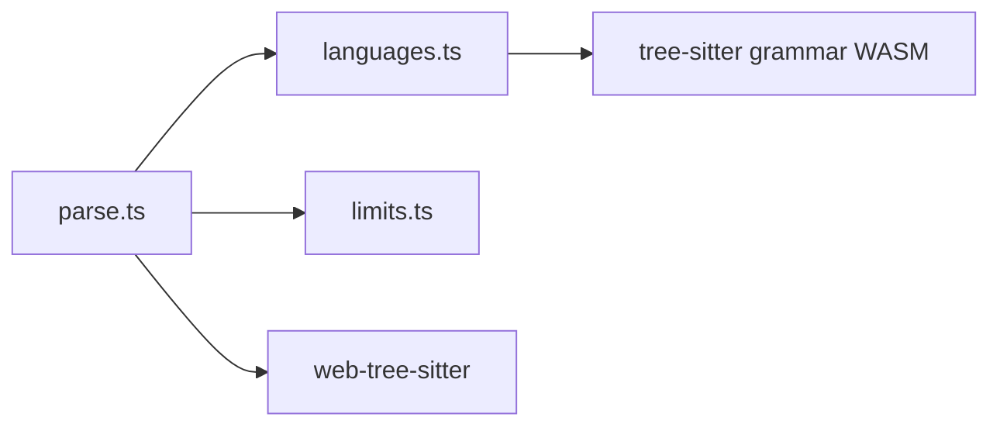

# Language Support Configuration

<cite>
**Referenced Files in This Document**
- [parse.ts](file://apps/desktop/src/main/core/code/parse.ts)
- [languages.ts](file://apps/desktop/src/main/core/code/languages.ts)
</cite>

## Table of Contents
1. [Introduction](#introduction)
2. [Project Structure](#project-structure)
3. [Core Components](#core-components)
4. [Architecture Overview](#architecture-overview)
5. [Detailed Component Analysis](#detailed-component-analysis)
6. [Dependency Analysis](#dependency-analysis)
7. [Performance Considerations](#performance-considerations)
8. [Troubleshooting Guide](#troubleshooting-guide)
9. [Conclusion](#conclusion)

## Introduction
This document explains the language support configuration system used to parse and analyze source code across multiple programming languages. The system is driven by a central `SPECS` object that maps each supported language to a grammar-aware specification. Each specification defines:

- Which tree-sitter node types represent symbols such as functions, classes, methods, and types.
- Which nodes are treated as class-like containers.
- Which nodes represent call sites.

The configuration works together with tree-sitter grammars so that source files can be parsed into structured symbols and edges representing calls, imports, and references. When no grammar or specification is available, the system falls back to plain-text section extraction.

## Project Structure
The language support configuration lives in two related modules under the desktop application’s main process code layer:

| File | Responsibility |
|---|---|
| `apps/desktop/src/main/core/code/parse.ts` | Defines the language specification schema, the `SPECS` registry, tree-sitter parsing orchestration, symbol extraction, import handling, call-site extraction, and reference extraction. |
| `apps/desktop/src/main/core/code/languages.ts` | Maps file extensions to language identifiers and maps language identifiers to bundled tree-sitter grammar WASM filenames. |

**Diagram sources**
- [parse.ts:1-10](file://apps/desktop/src/main/core/code/parse.ts#L1-L10)
- [languages.ts:1-59](file://apps/desktop/src/main/core/code/languages.ts#L1-L59)

**Section sources**
- [parse.ts:1-10](file://apps/desktop/src/main/core/code/parse.ts#L1-L10)
- [languages.ts:1-59](file://apps/desktop/src/main/core/code/languages.ts#L1-L59)

## Core Components
The core configuration model is defined by three key structures:

| Structure | Purpose |
|---|---|
| `LangSpec` | A per-language configuration containing `symbolNodes`, `classNodes`, and `callNodes`. |
| `SymbolRule` | Describes one tree-sitter node type that should be treated as a symbol, including its semantic kind and the field holding its name. |
| `CallRule` | Describes one tree-sitter node type that represents a call site and which child field contains the called identifier. |

The public data model for extracted results includes:

| Type | Meaning |
|---|---|
| `ExtractedSymbol` | A discovered definition such as a function, class, method, import, type, variable, or plaintext section. |
| `ExtractedEdge` | A relationship between symbols, such as a call, an import, or a reference. |
| `ParseResult` | The final output of parsing a source file: language, symbols, and edges. |

The central configuration object is:

| Object | Description |
|---|---|
| `SPECS` | A map from language identifier to `LangSpec`. It is the primary extension point for adding new language support. |

**Section sources**
- [parse.ts:14-49](file://apps/desktop/src/main/core/code/parse.ts#L14-L49)
- [parse.ts:67-132](file://apps/desktop/src/main/core/code/parse.ts#L67-L132)

## Architecture Overview
The language support pipeline has two major phases:

1. **Language detection**: File names and extensions are mapped to language identifiers.
2. **Parsing and extraction**: The appropriate tree-sitter grammar is loaded, the source is parsed, and symbols and edges are extracted using the language-specific `LangSpec`.

**Diagram sources**
- [parse.ts:138-160](file://apps/desktop/src/main/core/code/parse.ts#L138-L160)
- [parse.ts:502-528](file://apps/desktop/src/main/core/code/parse.ts#L502-L528)

## Detailed Component Analysis

### Language Specification Schema
A language specification is a `LangSpec` object with three arrays:

| Field | Type | Meaning |
|---|---|---|
| `symbolNodes` | `SymbolRule[]` | Node types that define named symbols. Each rule specifies the tree-sitter node type, the semantic kind, and the field containing the symbol’s name. |
| `classNodes` | `string[]` | Node types considered class-like containers. Used to compute qualified names and parent relationships. |
| `callNodes` | `CallRule[]` | Node types representing call sites. Each rule specifies the node type and the child field containing the called identifier. |

Example conceptual structure:

**Diagram sources**
- [parse.ts:43-49](file://apps/desktop/src/main/core/code/parse.ts#L43-L49)
- [parse.ts:67-132](file://apps/desktop/src/main/core/code/parse.ts#L67-L132)

**Section sources**
- [parse.ts:43-49](file://apps/desktop/src/main/core/code/parse.ts#L43-L49)

### SPECS Registry
The `SPECS` object registers supported languages. For some languages, shared behavior is reused through a reusable script specification.

| Language | Key Behavior |
|---|---|
| Python | Functions, classes, and Python-style imports; call nodes use the Python tree-sitter call node. |
| JavaScript | Uses the shared script specification for functions, classes, interfaces, enums, and call expressions. |
| TypeScript | Shares the same script specification as JavaScript. |
| TSX | Shares the same script specification as JavaScript. |
| Java | Class, interface, enum, method, constructor symbols; method invocations and object creation expressions as call sites. |
| Go | Function declarations, method declarations, and type specifications; special handling for receiver-based methods. |
| Rust | Functions, structs, enums, traits, and type items; struct, enum, trait, and impl blocks as class-like nodes. |
| C | Function definitions, struct specifiers, and enum specifiers; call expressions. |
| C++ | Function definitions, class specifiers, struct specifiers, and enum specifiers; call expressions. |

Shared script specification reuse means JavaScript, TypeScript, and TSX share the same symbol and call rules.

**Section sources**
- [parse.ts:53-65](file://apps/desktop/src/main/core/code/parse.ts#L53-L65)
- [parse.ts:67-132](file://apps/desktop/src/main/core/code/parse.ts#L67-L132)

### Language Detection and Grammar Mapping
File extension detection is separate from parsing configuration:

| Module | Role |
|---|---|
| `languageFor` | Converts a file path or basename into a language identifier or `plaintext`. |
| `GRAMMAR_FILES` | Maps language identifiers to bundled tree-sitter grammar WASM filenames. |

Supported extension mappings include Python, JavaScript, TypeScript, TSX, Java, Go, Rust, C, and C++. Text-oriented formats fall back to `plaintext`.

**Section sources**
- [languages.ts:3-23](file://apps/desktop/src/main/core/code/languages.ts#L3-L23)
- [languages.ts:25-34](file://apps/desktop/src/main/core/code/languages.ts#L25-L34)
- [languages.ts:36-46](file://apps/desktop/src/main/core/code/languages.ts#L36-L46)
- [languages.ts:48-58](file://apps/desktop/src/main/core/code/languages.ts#L48-L58)

### Parsing Flow
The main parsing entry point performs these steps:

1. If the language is `plaintext` or not present in `SPECS`, return plain-text sections.
2. Initialize the tree-sitter parser once.
3. Load the language grammar from the grammar directory.
4. Create or reuse a parser instance and set the language.
5. Parse the source into a syntax tree.
6. Use the language’s `LangSpec` to extract imports, symbols, calls, and references.
7. Return the resulting `ParseResult`.

**Diagram sources**
- [parse.ts:502-528](file://apps/desktop/src/main/core/code/parse.ts#L502-L528)

**Section sources**
- [parse.ts:502-528](file://apps/desktop/src/main/core/code/parse.ts#L502-L528)

### Symbol Extraction
Symbol extraction iterates over each `SymbolRule` in the active language specification and searches the syntax tree for matching node types. For each match:

- The name is resolved from the configured `nameField`.
- The semantic kind is derived from the rule or inferred when `auto` is used.
- Parent context is computed using `classNodes`.
- Special cases exist for Go receivers and Go type definitions.
- Variables assigned to function-like values are added as function symbols for JavaScript-family languages.

**Diagram sources**
- [parse.ts:395-434](file://apps/desktop/src/main/core/code/parse.ts#L395-L434)

**Section sources**
- [parse.ts:395-434](file://apps/desktop/src/main/core/code/parse.ts#L395-L434)

### Import Extraction
Import extraction is language-specific because different languages have different AST shapes for imports:

| Language | Import Nodes | Notes |
|---|---|---|
| Python | `import_statement`, `import_from_statement` | Handles aliases and module names. |
| JavaScript / TypeScript / TSX | `import_statement`, `require` calls | Supports default imports, named imports, namespace imports, and CommonJS `require`. |
| Java | `import_declaration` | Uses scoped identifiers. |
| Go | `import_spec` | Handles package aliases. |
| Rust | `use_declaration` | Handles paths and braces. |
| C / C++ | `preproc_include` | Treats included headers as imports. |

**Section sources**
- [parse.ts:304-393](file://apps/desktop/src/main/core/code/parse.ts#L304-L393)

### Call Site Extraction
Call extraction uses the `callNodes` array from the language specification. For each matching call node:

- The target identifier is read from the configured field.
- The enclosing qualified name is computed.
- A `calls` edge is added.

**Diagram sources**
- [parse.ts:436-447](file://apps/desktop/src/main/core/code/parse.ts#L436-L447)

**Section sources**
- [parse.ts:436-447](file://apps/desktop/src/main/core/code/parse.ts#L436-L447)

### Reference Extraction
Reference extraction scans identifiers and related identifier-like nodes and adds `references` edges unless they are:

- Already defined symbols.
- Too short.
- Reserved words like `self`, `this`, `cls`, or `super`.
- Inside a call target field.
- Part of import-related nodes.

**Diagram sources**
- [parse.ts:449-464](file://apps/desktop/src/main/core/code/parse.ts#L449-L464)

**Section sources**
- [parse.ts:449-464](file://apps/desktop/src/main/core/code/parse.ts#L449-L464)

### Relationship Between Tree-Sitter Grammars and Language Configuration Objects
The configuration system separates two concerns:

| Concern | Implementation |
|---|---|
| Grammar loading | `languages.ts` maps language identifiers to grammar WASM filenames; `parse.ts` loads them through `web-tree-sitter`. |
| Semantic interpretation | `SPECS` tells the extractor which tree-sitter node types mean “function”, “class”, “method”, “type”, or “call”. |

This separation allows:

- Adding a new language by providing a grammar file and a corresponding `LangSpec`.
- Reusing grammar-level parsing while customizing semantic extraction.
- Falling back to plain text when either the grammar or the specification is missing.

**Diagram sources**
- [languages.ts:36-58](file://apps/desktop/src/main/core/code/languages.ts#L36-L58)
- [parse.ts:67-132](file://apps/desktop/src/main/core/code/parse.ts#L67-L132)
- [parse.ts:152-160](file://apps/desktop/src/main/core/code/parse.ts#L152-L160)

**Section sources**
- [languages.ts:36-58](file://apps/desktop/src/main/core/code/languages.ts#L36-L58)
- [parse.ts:152-160](file://apps/desktop/src/main/core/code/parse.ts#L152-L160)
- [parse.ts:67-132](file://apps/desktop/src/main/core/code/parse.ts#L67-L132)

## Dependency Analysis
The following diagram shows how the configuration and parsing components depend on each other:

**Diagram sources**
- [parse.ts:5-10](file://apps/desktop/src/main/core/code/parse.ts#L5-L10)
- [languages.ts:48-58](file://apps/desktop/src/main/core/code/languages.ts#L48-L58)

**Section sources**
- [parse.ts:5-10](file://apps/desktop/src/main/core/code/parse.ts#L5-L10)
- [languages.ts:48-58](file://apps/desktop/src/main/core/code/languages.ts#L48-L58)

## Performance Considerations
The implementation includes several performance safeguards:

- Tree-sitter initialization is cached so it runs only once.
- Loaded language instances are cached per language.
- Call extraction stops after a configurable maximum number of calls per file.
- Reference extraction stops after a configurable maximum number of references per file.
- Symbol body text is truncated to a configured maximum size.
- Plain-text fallback avoids expensive parsing when no grammar or specification exists.

These limits help keep parsing predictable for large files and prevent excessive memory or CPU usage during indexing.

[No sources needed since this section provides general guidance]

## Troubleshooting Guide

### A Language Is Not Parsed
Possible causes:

- The file extension is not mapped to a language in `languages.ts`.
- The language identifier is not present in `GRAMMAR_FILES`.
- The language identifier is not present in `SPECS`.
- The grammar WASM file is missing from the grammar directory.
- The grammar fails to load or reject the source.

In all of these cases, the parser returns plain-text sections instead of failing loudly.

**Section sources**
- [languages.ts:36-46](file://apps/desktop/src/main/core/code/languages.ts#L36-L46)
- [languages.ts:48-58](file://apps/desktop/src/main/core/code/languages.ts#L48-L58)
- [parse.ts:502-528](file://apps/desktop/src/main/core/code/parse.ts#L502-L528)

### Symbols Are Missing
Possible causes:

- The tree-sitter node type does not match the `type` in `symbolNodes`.
- The name field does not match the configured `nameField`.
- The symbol kind is overridden by special-case logic.
- The symbol is inside a parameter or local scope and filtered out.
- For JavaScript-family languages, variables must be assigned to function-like values to become function symbols.

**Section sources**
- [parse.ts:395-434](file://apps/desktop/src/main/core/code/parse.ts#L395-L434)

### Calls Are Not Detected
Possible causes:

- The call node type is not listed in `callNodes`.
- The target identifier field is not correctly specified.
- The call count limit was reached.
- The identifier is inside the call target itself and therefore excluded from references.

**Section sources**
- [parse.ts:436-447](file://apps/desktop/src/main/core/code/parse.ts#L436-L447)
- [parse.ts:449-464](file://apps/desktop/src/main/core/code/parse.ts#L449-L464)

### Imports Are Incorrect
Possible causes:

- The language-specific import extraction branch does not recognize the import syntax.
- Aliases or module paths are not handled for that language.
- Include or import directives are not recognized by the relevant node type.

**Section sources**
- [parse.ts:304-393](file://apps/desktop/src/main/core/code/parse.ts#L304-L393)

## Conclusion
The language support configuration system is a small but powerful extension point. By defining a `LangSpec` with `symbolNodes`, `classNodes`, and `callNodes`, developers can add support for new programming languages without changing the core parsing engine. The design cleanly separates grammar loading from semantic interpretation, supports shared configurations for similar languages, and safely falls back to plain text when parsing is unavailable.

To add a new language:

1. Map file extensions to the language identifier in `languages.ts`.
2. Add the grammar WASM filename to `GRAMMAR_FILES`.
3. Add a `LangSpec` entry to `SPECS`.
4. Test symbol extraction, call extraction, and import extraction for representative source files.

**Section sources**
- [languages.ts:3-23](file://apps/desktop/src/main/core/code/languages.ts#L3-L23)
- [languages.ts:48-58](file://apps/desktop/src/main/core/code/languages.ts#L48-L58)
- [parse.ts:67-132](file://apps/desktop/src/main/core/code/parse.ts#L67-L132)