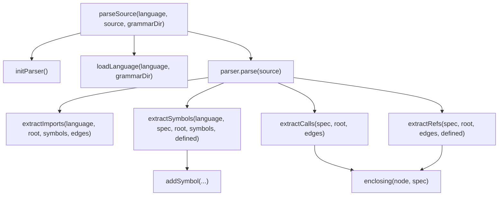
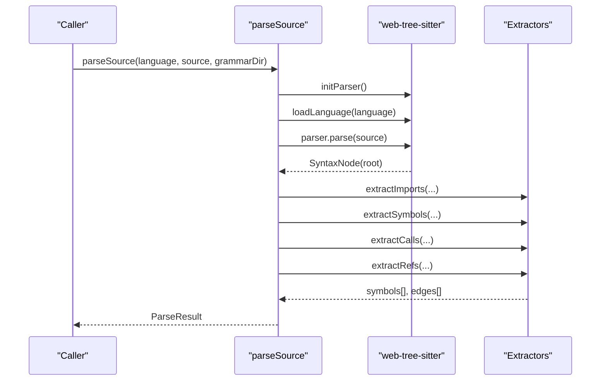
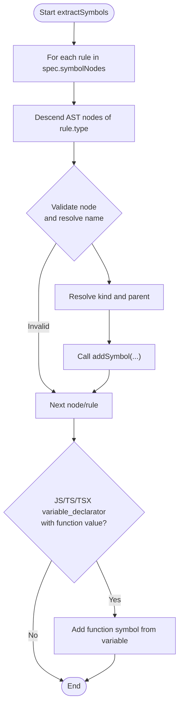
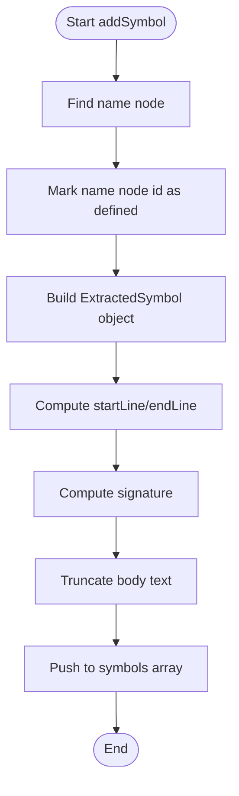
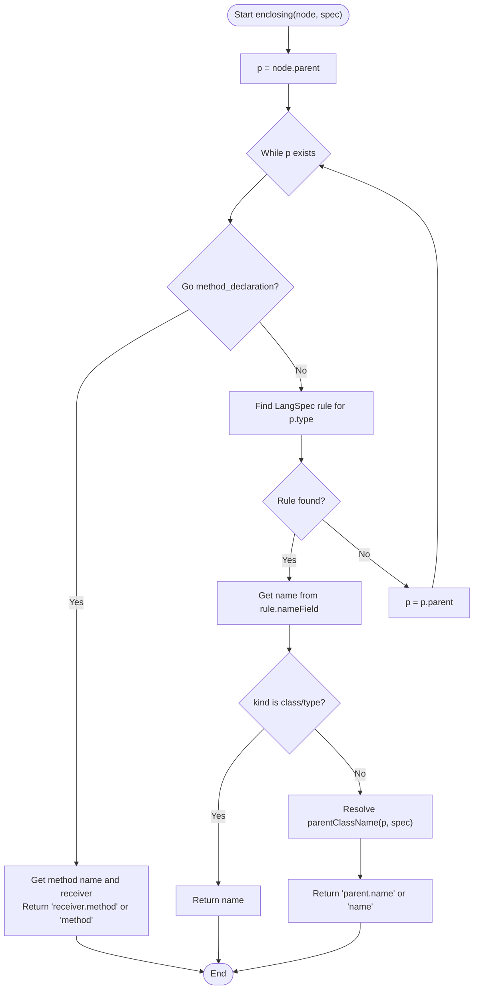
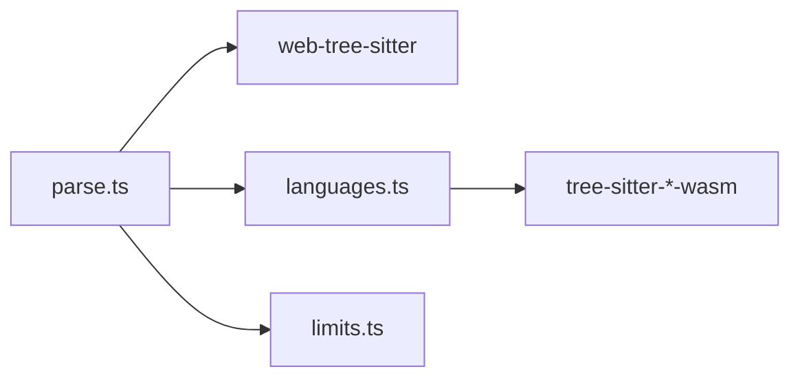

# Symbol Extraction Algorithms

<cite>
**Referenced Files in This Document**
- [parse.ts](file://apps/desktop/src/main/core/code/parse.ts)
- [languages.ts](file://apps/desktop/src/main/core/code/languages.ts)
- [code-parse.test.ts](file://apps/desktop/src/main/core/code-parse.test.ts)
</cite>

## Table of Contents
1. [Introduction](#introduction)
2. [Project Structure](#project-structure)
3. [Core Components](#core-components)
4. [Architecture Overview](#architecture-overview)
5. [Detailed Component Analysis](#detailed-component-analysis)
6. [Dependency Analysis](#dependency-analysis)
7. [Performance Considerations](#performance-considerations)
8. [Troubleshooting Guide](#troubleshooting-guide)
9. [Conclusion](#conclusion)

## Introduction
This document explains the symbol extraction algorithms used to analyze source code and produce a structured representation of symbols (functions, classes, methods, types), their relationships (calls, imports, references), and metadata (names, line numbers, signatures, parent context). The implementation is built on tree-sitter grammars loaded at runtime for multiple languages and includes robust fallbacks for unsupported syntax or parsing failures.

The core functions covered are:
- extractSymbols: traverses AST nodes to identify language-specific symbols
- addSymbol: constructs ExtractedSymbol objects with rich metadata
- enclosing: determines the enclosing context and hierarchy for each symbol

Special handling is documented for:
- Go receivers and method classification
- Python auto-detection of function kind
- JavaScript variable declarations that define functions

Examples of extracted symbols and fallback mechanisms are included.

## Project Structure
The symbol extraction logic lives in a single module responsible for:
- Language detection and grammar loading
- Parsing source into an AST via web-tree-sitter
- Extracting symbols, calls, and references
- Producing normalized results suitable for indexing and search

**Diagram sources**
- [parse.ts:138-160](file://apps/desktop/src/main/core/code/parse.ts#L138-L160)
- [parse.ts:304-393](file://apps/desktop/src/main/core/code/parse.ts#L304-L393)
- [parse.ts:395-434](file://apps/desktop/src/main/core/code/parse.ts#L395-L434)
- [parse.ts:436-464](file://apps/desktop/src/main/core/code/parse.ts#L436-L464)
- [parse.ts:502-528](file://apps/desktop/src/main/core/code/parse.ts#L502-L528)

**Section sources**
- [parse.ts:1-529](file://apps/desktop/src/main/core/code/parse.ts#L1-L529)
- [languages.ts:1-59](file://apps/desktop/src/main/core/code/languages.ts#L1-L59)

## Core Components
- ExtractedSymbol: represents a discovered symbol with name, qualified name, kind, line range, signature, parentName, text snippet, and optional module reference.
- ExtractedEdge: represents a relationship between symbols such as calls, imports, or references.
- LangSpec: defines per-language rules for which AST nodes count as symbols, class-like containers, and call sites.
- SPECS: maps language identifiers to LangSpec definitions.

Key responsibilities:
- parseSource orchestrates parsing and delegates to specialized extractors
- extractSymbols identifies symbols based on LangSpec
- addSymbol builds normalized ExtractedSymbol entries
- enclosing computes the hierarchical context for calls and references
- extractImports captures import edges and import symbols
- extractCalls and extractRefs build relationship edges

**Section sources**
- [parse.ts:14-49](file://apps/desktop/src/main/core/code/parse.ts#L14-L49)
- [parse.ts:67-132](file://apps/desktop/src/main/core/code/parse.ts#L67-L132)
- [parse.ts:502-528](file://apps/desktop/src/main/core/code/parse.ts#L502-L528)

## Architecture Overview
The system follows a pipeline architecture:
- Input: source code string and language identifier
- Parser initialization and grammar loading
- AST traversal to extract symbols, calls, and references
- Output: ParseResult containing symbols and edges

**Diagram sources**
- [parse.ts:138-160](file://apps/desktop/src/main/core/code/parse.ts#L138-L160)
- [parse.ts:502-528](file://apps/desktop/src/main/core/code/parse.ts#L502-L528)

## Detailed Component Analysis

### extractSymbols
Purpose:
- Iterates over language-specific symbol node types defined in LangSpec
- Resolves symbol names using field accessors and helper utilities
- Classifies symbols (function, class, method, type) with special cases per language
- Adds symbols via addSymbol

Algorithm highlights:
- For each rule in spec.symbolNodes, descends into matching AST nodes
- Skips incomplete struct_specifier nodes without body or name
- Handles Go method_declaration naming and receiver-based parent resolution
- Auto-detects kind for certain nodes (e.g., Python functions, Rust items)
- Overrides parent for class/type kinds to null when appropriate
- Adds JavaScript/TypeScript/TSX variable declarators whose values are functions as function symbols

Complexity:
- Time: O(N × R) where N is number of descendant nodes of each target type and R is number of rules; typically linear in AST size
- Space: proportional to number of symbols produced

**Diagram sources**
- [parse.ts:395-434](file://apps/desktop/src/main/core/code/parse.ts#L395-L434)

**Section sources**
- [parse.ts:395-434](file://apps/desktop/src/main/core/code/parse.ts#L395-L434)

### addSymbol
Purpose:
- Creates an ExtractedSymbol object with comprehensive metadata
- Tracks defined identifiers to avoid duplicate references
- Computes start/end lines, signature, parent context, and truncated body text

Key behaviors:
- Finds the primary identifier node to mark it as defined
- Builds qualified name by combining parentName and name
- Captures first-line signature up to a configured limit
- Truncates body text according to CODE_LIMITS.maxSymbolChars

**Diagram sources**
- [parse.ts:212-234](file://apps/desktop/src/main/core/code/parse.ts#L212-L234)

**Section sources**
- [parse.ts:212-234](file://apps/desktop/src/main/core/code/parse.ts#L212-L234)

### enclosing
Purpose:
- Determines the enclosing context (qualified name) for a given AST node
- Used to annotate calls and references with their lexical scope

Algorithm highlights:
- Walks up the parent chain
- Special handling for Go method_declaration: combines receiver type and method name
- Uses LangSpec symbol rules to find enclosing class/type/function boundaries
- Returns null if no enclosing context is found

**Diagram sources**
- [parse.ts:236-255](file://apps/desktop/src/main/core/code/parse.ts#L236-L255)
- [parse.ts:195-210](file://apps/desktop/src/main/core/code/parse.ts#L195-L210)

**Section sources**
- [parse.ts:236-255](file://apps/desktop/src/main/core/code/parse.ts#L236-L255)
- [parse.ts:195-210](file://apps/desktop/src/main/core/code/parse.ts#L195-L210)

### Language-Specific Handling

#### Go Receivers
- Method declarations use receiver types to determine the enclosing class context
- Type specifications can be classified as class or type depending on whether they contain struct_type or interface_type descendants
- Calls and references inside Go methods get qualified contexts like "Receiver.Method"

Relevant helpers:
- goReceiver extracts the receiver type identifier
- parentClassName resolves class-like containers

**Section sources**
- [parse.ts:195-210](file://apps/desktop/src/main/core/code/parse.ts#L195-L210)
- [parse.ts:395-434](file://apps/desktop/src/main/core/code/parse.ts#L395-L434)

#### Python Auto-Detection
- Function definitions are marked with kind "auto", resolved to "function" unless nested inside a class, in which case they become "method"
- Class definitions are explicitly recognized as "class"

**Section sources**
- [parse.ts:67-75](file://apps/desktop/src/main/core/code/parse.ts#L67-L75)
- [parse.ts:395-434](file://apps/desktop/src/main/core/code/parse.ts#L395-L434)

#### JavaScript Variable Declarations
- Variable declarators whose values are arrow functions, function expressions, or function declarations are treated as function symbols
- This ensures common patterns like const fn = () => {} are captured as functions

**Section sources**
- [parse.ts:425-433](file://apps/desktop/src/main/core/code/parse.ts#L425-L433)

### Import Extraction
- Supports Python import statements and from-imports, including aliases
- Supports JavaScript/TypeScript/TSX import clauses, namespace imports, and CommonJS require calls
- Supports Java import declarations, Go import specs, Rust use declarations, and C/C++ preprocessor includes
- Produces both import symbols and import edges linking local names to modules

**Section sources**
- [parse.ts:271-393](file://apps/desktop/src/main/core/code/parse.ts#L271-L393)

### Call and Reference Extraction
- Calls: iterates call expression nodes per language, records destination function/method names, and annotates source with enclosing context
- References: scans identifiers while excluding definitions, keywords, and import-related nodes; annotates source with enclosing context

**Section sources**
- [parse.ts:436-464](file://apps/desktop/src/main/core/code/parse.ts#L436-L464)

### Fallback Mechanisms
- If the language is not supported or parsing fails, the system falls back to plain-text section extraction
- Plain text mode splits content into sections based on blank lines and headings, producing section symbols with minimal metadata

**Section sources**
- [parse.ts:466-500](file://apps/desktop/src/main/core/code/parse.ts#L466-L500)
- [parse.ts:502-528](file://apps/desktop/src/main/core/code/parse.ts#L502-L528)

## Dependency Analysis
The symbol extraction module depends on:
- web-tree-sitter for AST parsing
- GRAMMAR_FILES mapping file extensions to grammar WASM files
- CODE_LIMITS for truncating symbol bodies and limiting call/reference counts

**Diagram sources**
- [parse.ts:5-10](file://apps/desktop/src/main/core/code/parse.ts#L5-L10)
- [languages.ts:48-58](file://apps/desktop/src/main/core/code/languages.ts#L48-L58)

**Section sources**
- [parse.ts:5-10](file://apps/desktop/src/main/core/code/parse.ts#L5-L10)
- [languages.ts:1-59](file://apps/desktop/src/main/core/code/languages.ts#L1-L59)

## Performance Considerations
- Grammar loading is cached per language to avoid repeated WASM loads
- Parser initialization is memoized to prevent redundant setup
- Call and reference extraction enforce limits (maxCallsPerFile, maxRefsPerFile) to cap processing time
- Body text is truncated to a maximum character count to control memory usage
- AST trees are deleted after processing to free resources

Recommendations:
- Keep grammar WASM files available and preloaded where possible
- Monitor file sizes and adjust limits based on project scale
- Avoid excessive nesting in large files to reduce AST traversal costs

[No sources needed since this section provides general guidance]

## Troubleshooting Guide
Common issues and resolutions:
- Unsupported language: ensure the extension maps to a known language in languages.ts; otherwise, plain-text fallback will apply
- Missing grammar WASM: verify GRAMMAR_FILES paths and that WASM files exist under the grammar directory
- No symbols detected: check that the source contains recognized constructs per LangSpec; verify AST node types match expectations
- Incorrect parent context: inspect enclosing behavior for Go receivers and class-like containers
- Excessive memory usage: reduce CODE_LIMITS or split large files

Validation examples:
- Tests assert presence of expected function and class symbols, correct line ranges, call edges, and import edges across multiple languages
- Plain text fallback produces section symbols with headings as names

**Section sources**
- [code-parse.test.ts:12-81](file://apps/desktop/src/main/core/code-parse.test.ts#L12-L81)
- [code-parse.test.ts:83-89](file://apps/desktop/src/main/core/code-parse.test.ts#L83-L89)

## Conclusion
The symbol extraction system provides a robust, multi-language approach to building code graphs. It leverages tree-sitter grammars to parse source code, applies language-specific rules to identify symbols and relationships, and offers reliable fallbacks for unsupported inputs. The design emphasizes clarity, performance, and extensibility through LangSpec configurations.