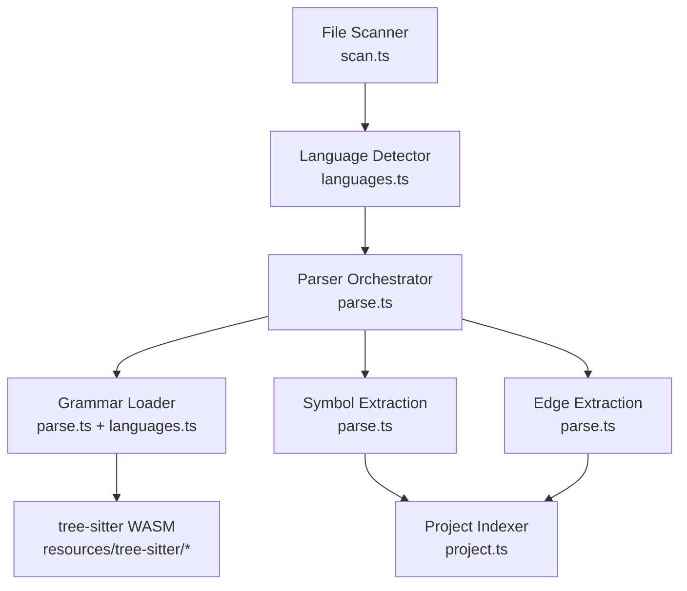
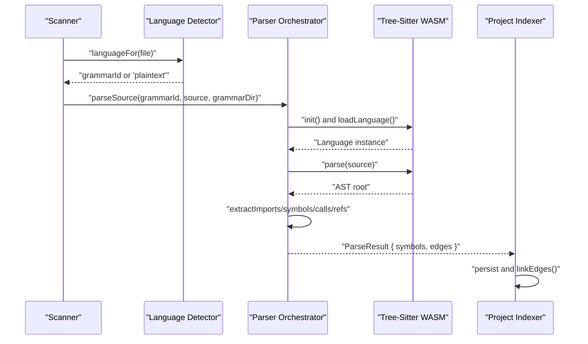
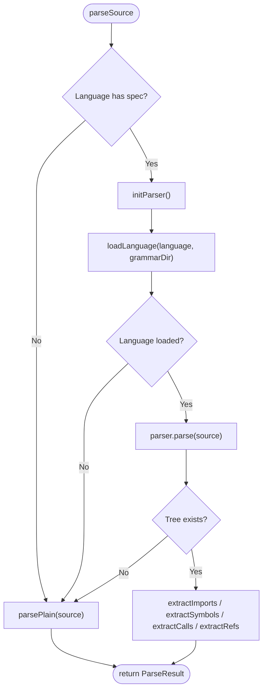
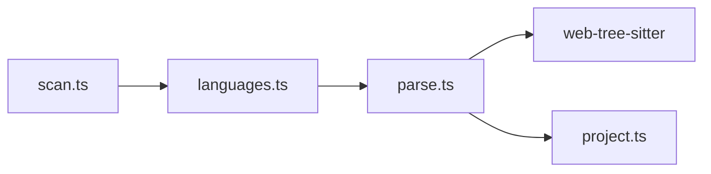

# Syntax Parsing

<cite>
**Referenced Files in This Document**
- [parse.ts](file://apps/desktop/src/main/core/code/parse.ts)
- [languages.ts](file://apps/desktop/src/main/core/code/languages.ts)
- [scan.ts](file://apps/desktop/src/main/core/code/scan.ts)
- [project.ts](file://apps/desktop/src/main/core/code/project.ts)
- [fetch-tree-sitter.mjs](file://apps/desktop/scripts/fetch-tree-sitter.mjs)
- [SOURCES.txt](file://apps/desktop/resources/tree-sitter/SOURCES.txt)
- [code-parse.test.ts](file://apps/desktop/src/main/core/code-parse.test.ts)
</cite>

## Table of Contents
1. [Introduction](#introduction)
2. [Project Structure](#project-structure)
3. [Core Components](#core-components)
4. [Architecture Overview](#architecture-overview)
5. [Detailed Component Analysis](#detailed-component-analysis)
6. [Dependency Analysis](#dependency-analysis)
7. [Performance Considerations](#performance-considerations)
8. [Troubleshooting Guide](#troubleshooting-guide)
9. [Conclusion](#conclusion)

## Introduction
This document explains the syntax parsing system that powers AST-based code analysis across multiple programming languages. It integrates tree-sitter grammars as WebAssembly modules to parse source files, extract symbols and relationships, and build a local code index. The system supports function declarations, class definitions, method signatures, type information, imports, calls, and references. It also includes a robust fallback mechanism for unsupported formats or failed parses, treating them as plain text sections.

## Project Structure
The parsing pipeline is implemented in the desktop application’s main process:

- Language detection maps file extensions to grammar identifiers.
- Grammar loading loads prebuilt tree-sitter WASM grammars on demand.
- Symbol extraction walks the AST according to language-specific rules.
- Edge extraction records import, call, and reference relationships.
- A project indexer orchestrates scanning, parsing, and persistence.

**Diagram sources**
- [scan.ts:71-123](file://apps/desktop/src/main/core/code/scan.ts#L71-L123)
- [languages.ts:36-58](file://apps/desktop/src/main/core/code/languages.ts#L36-L58)
- [parse.ts:138-160](file://apps/desktop/src/main/core/code/parse.ts#L138-L160)
- [parse.ts:502-528](file://apps/desktop/src/main/core/code/parse.ts#L502-L528)
- [project.ts:305-319](file://apps/desktop/src/main/core/code/project.ts#L305-L319)

**Section sources**
- [scan.ts:1-161](file://apps/desktop/src/main/core/code/scan.ts#L1-L161)
- [languages.ts:1-59](file://apps/desktop/src/main/core/code/languages.ts#L1-L59)
- [parse.ts:1-529](file://apps/desktop/src/main/core/code/parse.ts#L1-L529)
- [project.ts:1-200](file://apps/desktop/src/main/core/code/project.ts#L1-L200)

## Core Components
- Language detection and mapping:
  - Maps file extensions to grammar IDs and treats many non-code files as plaintext.
- Grammar management:
  - Maintains a registry of grammar filenames and fetches pinned versions into resources.
- Parser orchestration:
  - Initializes web-tree-sitter, loads grammars lazily, parses source, and falls back to plaintext when needed.
- Symbol extraction:
  - Uses per-language specifications to identify functions, classes, methods, types, and variables.
- Relationship extraction:
  - Records imports, calls, and references between symbols.
- Project indexing:
  - Scans projects, filters files, parses content, and persists symbols and edges.

**Section sources**
- [languages.ts:1-59](file://apps/desktop/src/main/core/code/languages.ts#L1-L59)
- [fetch-tree-sitter.mjs:1-53](file://apps/desktop/scripts/fetch-tree-sitter.mjs#L1-L53)
- [parse.ts:138-160](file://apps/desktop/src/main/core/code/parse.ts#L138-L160)
- [parse.ts:395-464](file://apps/desktop/src/main/core/code/parse.ts#L395-L464)
- [project.ts:305-319](file://apps/desktop/src/main/core/code/project.ts#L305-L319)

## Architecture Overview
The parsing architecture combines file scanning, language detection, grammar loading, AST traversal, and graph construction.

**Diagram sources**
- [scan.ts:71-123](file://apps/desktop/src/main/core/code/scan.ts#L71-L123)
- [languages.ts:36-58](file://apps/desktop/src/main/core/code/languages.ts#L36-L58)
- [parse.ts:138-160](file://apps/desktop/src/main/core/code/parse.ts#L138-L160)
- [parse.ts:502-528](file://apps/desktop/src/main/core/code/parse.ts#L502-L528)
- [project.ts:305-319](file://apps/desktop/src/main/core/code/project.ts#L305-L319)

## Detailed Component Analysis

### Language Detection and Mapping
- Extension-to-grammar mapping covers Python, JavaScript, TypeScript, TSX, Java, Go, Rust, C, and C++.
- Text-only extensions are treated as plaintext, enabling graceful handling of documentation and configuration files.
- Special base names like Dockerfile or Makefile are explicitly mapped to plaintext.

Key behaviors:
- Returns null for unknown extensions, causing scanner to skip the file.
- Returns plaintext for supported text-like formats.
- Provides GRAMMAR_FILES mapping used by the parser to locate WASM grammars.

**Section sources**
- [languages.ts:1-59](file://apps/desktop/src/main/core/code/languages.ts#L1-L59)

### Grammar Loading Mechanism
- Grammars are prebuilt WebAssembly modules stored under resources/tree-sitter.
- A script downloads pinned versions from npm and writes SOURCES.txt for traceability.
- At runtime, the parser initializes web-tree-sitter once and caches loaded Language instances.
- If initialization fails, it attempts to load the WASM binary directly.

Adding a new language:
1. Add extension mappings in languages.ts.
2. Add a grammar filename mapping in GRAMMAR_FILES.
3. Pin and fetch the grammar using fetch-tree-sitter.mjs.
4. Define symbol and call extraction rules in parse.ts SPECS.

**Section sources**
- [fetch-tree-sitter.mjs:1-53](file://apps/desktop/scripts/fetch-tree-sitter.mjs#L1-L53)
- [SOURCES.txt:1-10](file://apps/desktop/resources/tree-sitter/SOURCES.txt#L1-L10)
- [parse.ts:138-160](file://apps/desktop/src/main/core/code/parse.ts#L138-L160)

### Language Specification System
Each language has a specification defining:
- symbolNodes: AST node types to treat as symbols (functions, classes, methods, types).
- classNodes: Node types considered containers for methods.
- callNodes: AST node types representing calls, with field names indicating where the callee identifier lives.

Examples:
- Script languages (JavaScript/TypeScript/TSX): function_declaration, class_declaration, method_definition, interface_declaration, type_alias_declaration, enum_declaration, method_signature.
- Python: function_definition, class_definition; call via call nodes.
- Java: class_declaration, interface_declaration, enum_declaration, method_declaration, constructor_declaration; calls via method_invocation and object_creation_expression.
- Go: function_declaration, method_declaration, type_spec; special receiver handling for methods.
- Rust: function_item, struct_item, enum_item, trait_item, type_item; impl blocks handled as class containers.
- C/C++: function_definition, struct_specifier, enum_specifier, class_specifier; include directives parsed as imports.

Complexity considerations:
- Symbol extraction iterates descendants for each rule; performance depends on AST size and rule count.
- Call and reference extraction are bounded by limits to avoid excessive graph growth.

**Section sources**
- [parse.ts:43-132](file://apps/desktop/src/main/core/code/parse.ts#L43-L132)
- [parse.ts:195-255](file://apps/desktop/src/main/core/code/parse.ts#L195-L255)
- [parse.ts:395-464](file://apps/desktop/src/main/core/code/parse.ts#L395-L464)

### Symbol Extraction Process
The parser extracts:
- Imports: Per-language import statements produce import symbols and import edges.
- Symbols: Functions, classes, methods, types, and variables based on SPECS.
- Calls: Function/method invocations recorded as call edges.
- References: Identifier usages recorded as reference edges, excluding definitions and import contexts.

Flow:

**Diagram sources**
- [parse.ts:502-528](file://apps/desktop/src/main/core/code/parse.ts#L502-L528)
- [parse.ts:466-500](file://apps/desktop/src/main/core/code/parse.ts#L466-L500)

**Section sources**
- [parse.ts:304-393](file://apps/desktop/src/main/core/code/parse.ts#L304-L393)
- [parse.ts:395-464](file://apps/desktop/src/main/core/code/parse.ts#L395-L464)
- [parse.ts:466-500](file://apps/desktop/src/main/core/code/parse.ts#L466-L500)

### Fallback Mechanisms for Unsupported Formats
- Unknown language or missing grammar: returns plaintext sections.
- Failed parser initialization or parsing: returns plaintext sections.
- Plaintext parsing splits content into logical sections, extracting headings and trimming bodies to limits.

Benefits:
- Ensures all files contribute to search and context without failing the pipeline.
- Keeps memory usage predictable by limiting symbol body sizes and counts.

**Section sources**
- [parse.ts:502-528](file://apps/desktop/src/main/core/code/parse.ts#L502-L528)
- [parse.ts:466-500](file://apps/desktop/src/main/core/code/parse.ts#L466-L500)

### Examples of Parsing Different File Types
Tests demonstrate expected behavior across languages:
- Python: function, class, method, imports, calls.
- JavaScript: function, class, arrow functions, imports, calls.
- TypeScript: interfaces, classes, functions, type imports, calls.
- TSX: components and classes.
- Java: classes, methods, imports, method calls.
- Go: functions, structs, methods with receivers, imports.
- Rust: structs, impl methods, functions, use imports.
- C/C++: functions, structs/classes, include imports.

These tests validate:
- Symbol presence and line ranges.
- Call edge detection.
- Import symbol and edge creation.
- Method qualification with parent context.

**Section sources**
- [code-parse.test.ts:12-81](file://apps/desktop/src/main/core/code-parse.test.ts#L12-L81)
- [code-parse.test.ts:83-89](file://apps/desktop/src/main/core/code-parse.test.ts#L83-L89)

## Dependency Analysis
The parsing system depends on:
- File scanning and classification utilities.
- Language detection and grammar mapping.
- web-tree-sitter for AST parsing.
- Project indexer for persistence and graph linking.

**Diagram sources**
- [scan.ts:71-123](file://apps/desktop/src/main/core/code/scan.ts#L71-L123)
- [languages.ts:36-58](file://apps/desktop/src/main/core/code/languages.ts#L36-L58)
- [parse.ts:502-528](file://apps/desktop/src/main/core/code/parse.ts#L502-L528)
- [project.ts:305-319](file://apps/desktop/src/main/core/code/project.ts#L305-L319)

**Section sources**
- [scan.ts:1-161](file://apps/desktop/src/main/core/code/scan.ts#L1-L161)
- [languages.ts:1-59](file://apps/desktop/src/main/core/code/languages.ts#L1-L59)
- [parse.ts:1-529](file://apps/desktop/src/main/core/code/parse.ts#L1-L529)
- [project.ts:1-200](file://apps/desktop/src/main/core/code/project.ts#L1-L200)

## Performance Considerations
- Lazy grammar loading reduces startup cost; grammars are cached after first load.
- Parser initialization is performed once and reused.
- Call and reference extraction are capped to prevent excessive graph growth.
- Symbol body text is truncated to configured limits.
- Scanner enforces file size, total bytes, and line length limits.

Recommendations:
- Keep SPECS concise and targeted to reduce descendant traversal overhead.
- Monitor CODE_LIMITS settings for maxCallsPerFile and maxRefsPerFile.
- Use background indexing to avoid blocking UI operations.

[No sources needed since this section provides general guidance]

## Troubleshooting Guide
Common issues and resolutions:
- Missing grammar files:
  - Ensure resources/tree-sitter contains required WASM files.
  - Run fetch-tree-sitter.mjs to download pinned grammars.
- Parser initialization failures:
  - Verify web-tree-sitter WASM binary availability.
  - Check environment permissions for reading WASM files.
- No symbols extracted:
  - Confirm language detection returns the correct grammar ID.
  - Validate SPECS for the target language.
- Excessive memory usage:
  - Reduce CODE_LIMITS values for calls, references, and symbol body sizes.
  - Limit scanned files and total bytes.

Validation:
- Run unit tests covering multiple languages and plaintext fallback.
- Inspect ParseResult symbols and edges for correctness.

**Section sources**
- [fetch-tree-sitter.mjs:1-53](file://apps/desktop/scripts/fetch-tree-sitter.mjs#L1-L53)
- [parse.ts:138-160](file://apps/desktop/src/main/core/code/parse.ts#L138-L160)
- [code-parse.test.ts:60-89](file://apps/desktop/src/main/core/code-parse.test.ts#L60-L89)

## Conclusion
The syntax parsing system provides a robust, multi-language AST analysis pipeline built on tree-sitter. It defines clear language specifications, loads grammars efficiently, extracts meaningful symbols and relationships, and gracefully handles unsupported formats. Integrated with project scanning and indexing, it enables efficient local code search, definition/reference resolution, and impact analysis while maintaining performance and reliability.

[No sources needed since this section summarizes without analyzing specific files]