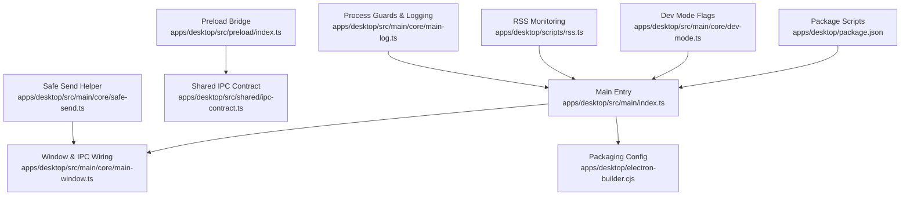
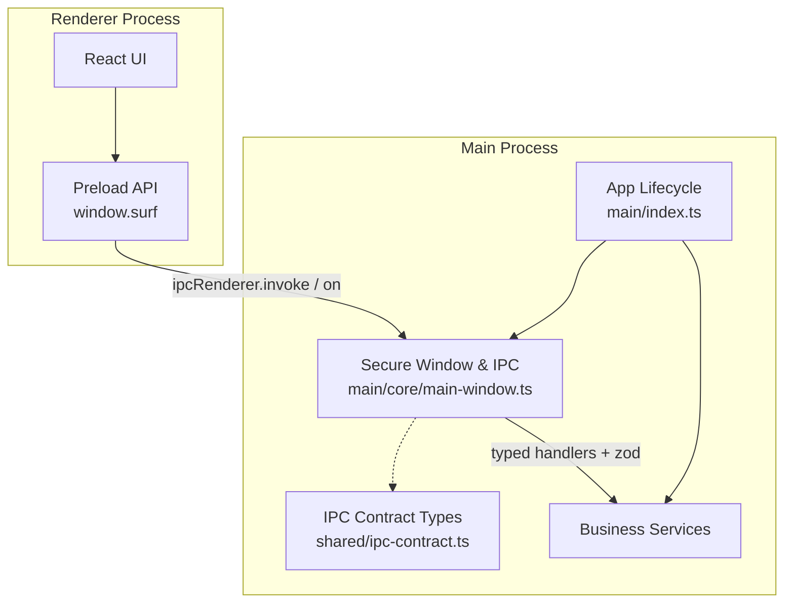
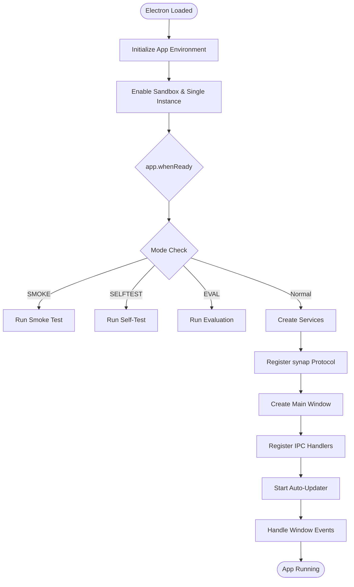
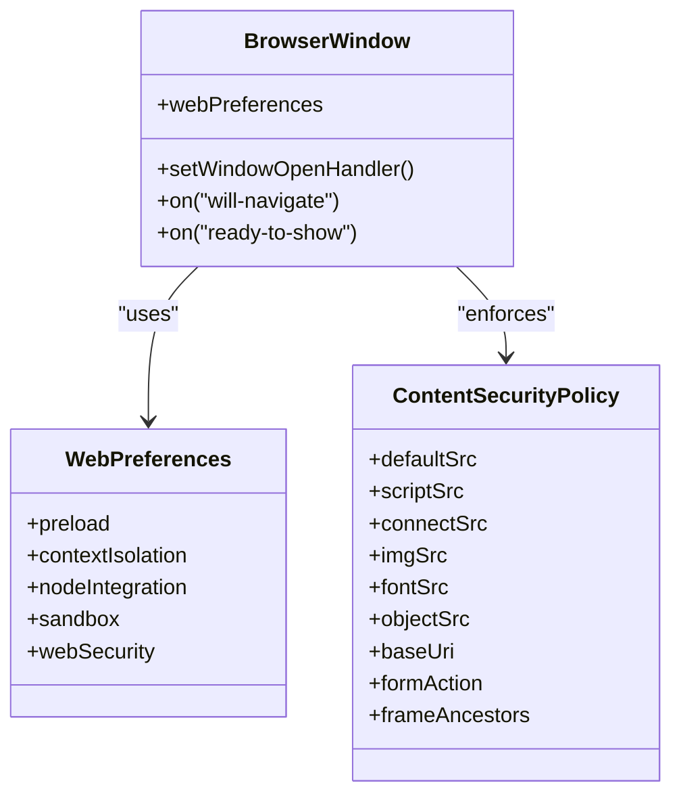
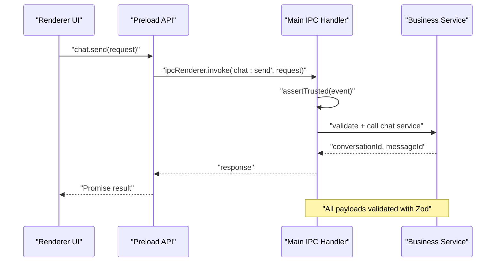
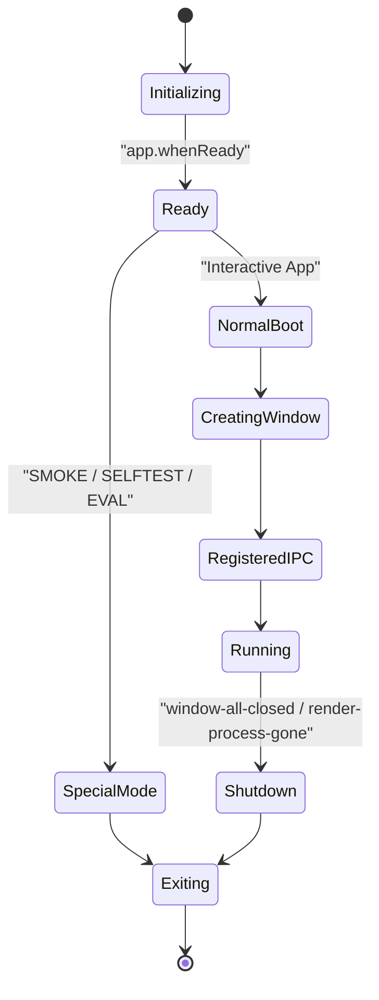
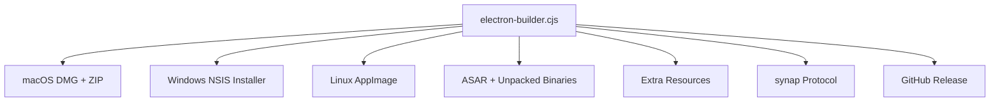
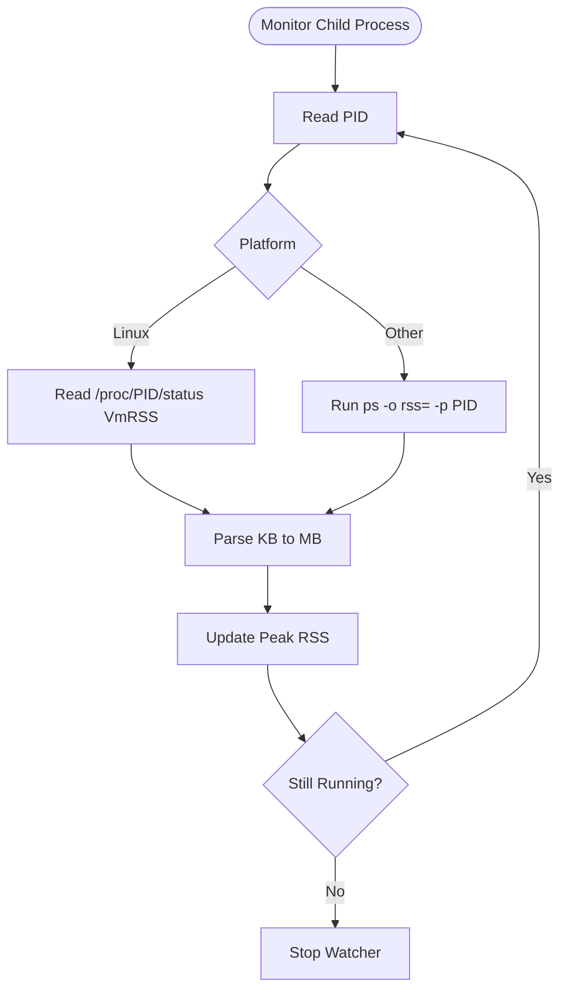
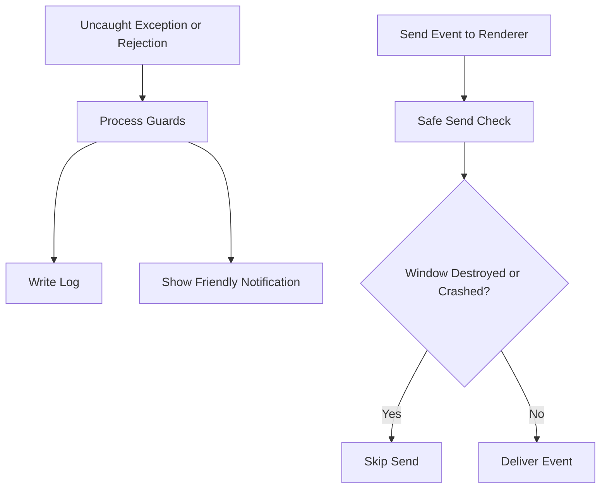
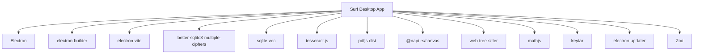

# Desktop Application

<cite>
**Referenced Files in This Document**   
- [apps/desktop/src/main/index.ts](file://apps/desktop/src/main/index.ts)
- [apps/desktop/src/main/core/main-window.ts](file://apps/desktop/src/main/core/main-window.ts)
- [apps/desktop/src/preload/index.ts](file://apps/desktop/src/preload/index.ts)
- [apps/desktop/src/shared/ipc-contract.ts](file://apps/desktop/src/shared/ipc-contract.ts)
- [apps/desktop/electron-builder.cjs](file://apps/desktop/electron-builder.cjs)
- [apps/desktop/package.json](file://apps/desktop/package.json)
- [apps/desktop/src/main/core/safe-send.ts](file://apps/desktop/src/main/core/safe-send.ts)
- [apps/desktop/src/main/core/dev-mode.ts](file://apps/desktop/src/main/core/dev-mode.ts)
- [apps/desktop/scripts/rss.ts](file://apps/desktop/scripts/rss.ts)
- [apps/desktop/src/main/core/main-log.ts](file://apps/desktop/src/main/core/main-log.ts)
</cite>

## Table of Contents
1. [Introduction](#introduction)
2. [Project Structure](#project-structure)
3. [Core Components](#core-components)
4. [Architecture Overview](#architecture-overview)
5. [Detailed Component Analysis](#detailed-component-analysis)
6. [Dependency Analysis](#dependency-analysis)
7. [Performance Considerations](#performance-considerations)
8. [Troubleshooting Guide](#troubleshooting-guide)
9. [Conclusion](#conclusion)

## Introduction
This document explains the Surf.ai desktop application built with Electron. It focuses on how the main process owns system resources and business logic, while the renderer process is isolated and communicates through a typed IPC bridge. It also covers the application lifecycle, cross-platform packaging with electron-builder, security model, native integrations, configuration modes, debugging strategies, performance monitoring, memory management, error handling, and graceful shutdown.

## Project Structure
The desktop application lives under `apps/desktop`. The most relevant parts for this documentation are:

- Main entry point and lifecycle: `apps/desktop/src/main/index.ts`
- Secure window creation and IPC registration: `apps/desktop/src/main/core/main-window.ts`
- Preload bridge exposing a typed API to the renderer: `apps/desktop/src/preload/index.ts`
- Shared IPC channel names and type contracts: `apps/desktop/src/shared/ipc-contract.ts`
- Packaging configuration for Windows, macOS, and Linux: `apps/desktop/electron-builder.cjs`
- Scripts, dependencies, and build commands: `apps/desktop/package.json`
- Safe renderer-to-main event sending helper: `apps/desktop/src/main/core/safe-send.ts`
- Development vs release mode flags: `apps/desktop/src/main/core/dev-mode.ts`
- Process RSS and available RAM helpers: `apps/desktop/scripts/rss.ts`
- Main-process logging and process guards: `apps/desktop/src/main/core/main-log.ts`

**Diagram sources**
- [apps/desktop/src/main/index.ts:1-37](file://apps/desktop/src/main/index.ts#L1-L37)
- [apps/desktop/src/main/core/main-window.ts:1-10](file://apps/desktop/src/main/core/main-window.ts#L1-L10)
- [apps/desktop/src/preload/index.ts:1-6](file://apps/desktop/src/preload/index.ts#L1-L6)
- [apps/desktop/src/shared/ipc-contract.ts:1-10](file://apps/desktop/src/shared/ipc-contract.ts#L1-L10)
- [apps/desktop/electron-builder.cjs:1-13](file://apps/desktop/electron-builder.cjs#L1-L13)
- [apps/desktop/package.json:1-24](file://apps/desktop/package.json#L1-L24)
- [apps/desktop/src/main/core/safe-send.ts:1-14](file://apps/desktop/src/main/core/safe-send.ts#L1-L14)
- [apps/desktop/src/main/core/dev-mode.ts:1-11](file://apps/desktop/src/main/core/dev-mode.ts#L1-L11)
- [apps/desktop/scripts/rss.ts:1-8](file://apps/desktop/scripts/rss.ts#L1-L8)
- [apps/desktop/src/main/core/main-log.ts:92-116](file://apps/desktop/src/main/core/main-log.ts#L92-L116)

**Section sources**
- [apps/desktop/src/main/index.ts:1-37](file://apps/desktop/src/main/index.ts#L1-L37)
- [apps/desktop/src/main/core/main-window.ts:1-10](file://apps/desktop/src/main/core/main-window.ts#L1-L10)
- [apps/desktop/src/preload/index.ts:1-6](file://apps/desktop/src/preload/index.ts#L1-L6)
- [apps/desktop/src/shared/ipc-contract.ts:1-10](file://apps/desktop/src/shared/ipc-contract.ts#L1-L10)
- [apps/desktop/electron-builder.cjs:1-13](file://apps/desktop/electron-builder.cjs#L1-L13)
- [apps/desktop/package.json:1-24](file://apps/desktop/package.json#L1-L24)

## Core Components
- Main process entry point initializes environment, single-instance lock, sandboxing, protocol handling, services, window creation, IPC wiring, update checks, and graceful shutdown hooks.
- Window module creates a secure BrowserWindow with context isolation, no Node integration, Chromium sandbox, strict CSP, navigation controls, and external link handling.
- Preload exposes a small typed API surface (`window.surf`) to the renderer without exposing raw IPC or Node APIs.
- Shared IPC contract defines channel names and TypeScript types used by both preload and main.
- Packaging config produces platform-specific installers and artifacts.
- Dev mode and package scripts control development, testing, self-test, and distribution workflows.

**Section sources**
- [apps/desktop/src/main/index.ts:38-65](file://apps/desktop/src/main/index.ts#L38-L65)
- [apps/desktop/src/main/core/main-window.ts:29-66](file://apps/desktop/src/main/core/main-window.ts#L29-L66)
- [apps/desktop/src/preload/index.ts:1-159](file://apps/desktop/src/preload/index.ts#L1-L159)
- [apps/desktop/src/shared/ipc-contract.ts:1-108](file://apps/desktop/src/shared/ipc-contract.ts#L1-L108)
- [apps/desktop/electron-builder.cjs:14-92](file://apps/desktop/electron-builder.cjs#L14-L92)
- [apps/desktop/package.json:9-24](file://apps/desktop/package.json#L9-L24)

## Architecture Overview
The application follows a classic Electron pattern:

- Main process owns app lifecycle, file system access, database operations, sidecar processes, settings, authentication, licensing, updates, and native features.
- Renderer process renders UI and user interactions but cannot directly access Node APIs.
- Preload acts as a trusted bridge that exposes only necessary methods via `contextBridge`.
- IPC uses typed channel constants and runtime validation in the main process.

**Diagram sources**
- [apps/desktop/src/main/index.ts:537-594](file://apps/desktop/src/main/index.ts#L537-L594)
- [apps/desktop/src/main/core/main-window.ts:232-394](file://apps/desktop/src/main/core/main-window.ts#L232-L394)
- [apps/desktop/src/preload/index.ts:13-159](file://apps/desktop/src/preload/index.ts#L13-L159)
- [apps/desktop/src/shared/ipc-contract.ts:8-108](file://apps/desktop/src/shared/ipc-contract.ts#L8-L108)

## Detailed Component Analysis

### Electron Main Process Responsibilities
The main entry point performs several responsibilities before creating the UI:

- Hardens unhandled promise rejections.
- Sets application name and user data directory based on evaluation, E2E, or normal mode.
- Installs main-process logging and process guards.
- Enables sandbox and single-instance lock outside development.
- Registers protocol handlers for setup links.
- Creates services, adopts local models, loads the main window, registers IPC, starts updater, and handles window events.
- Supports special modes: smoke test, self-test, evaluation, screenshot capture, and normal interactive use.

**Diagram sources**
- [apps/desktop/src/main/index.ts:43-65](file://apps/desktop/src/main/index.ts#L43-L65)
- [apps/desktop/src/main/index.ts:513-522](file://apps/desktop/src/main/index.ts#L513-L522)
- [apps/desktop/src/main/index.ts:537-594](file://apps/desktop/src/main/index.ts#L537-L594)

**Section sources**
- [apps/desktop/src/main/index.ts:38-65](file://apps/desktop/src/main/index.ts#L38-L65)
- [apps/desktop/src/main/index.ts:513-522](file://apps/desktop/src/main/index.ts#L513-L522)
- [apps/desktop/src/main/index.ts:537-594](file://apps/desktop/src/main/index.ts#L537-L594)

### Renderer Process Isolation and Security Model
The renderer is intentionally restricted:

- Context isolation is enabled.
- Node integration is disabled.
- Chromium sandbox is enabled at both window and app level.
- Web security is enabled.
- CSP restricts scripts, connections, objects, base URIs, forms, and frame ancestors.
- Navigation is controlled; external HTTPS links open in the OS browser.
- Permission requests allow only media permissions.
- Preload exposes only a narrow API surface.

**Diagram sources**
- [apps/desktop/src/main/core/main-window.ts:29-66](file://apps/desktop/src/main/core/main-window.ts#L29-L66)
- [apps/desktop/src/main/core/main-window.ts:14-25](file://apps/desktop/src/main/core/main-window.ts#L14-L25)

**Section sources**
- [apps/desktop/src/main/core/main-window.ts:29-66](file://apps/desktop/src/main/core/main-window.ts#L29-L66)
- [apps/desktop/src/main/core/main-window.ts:14-25](file://apps/desktop/src/main/core/main-window.ts#L14-L25)

### IPC Communication Patterns
IPC is the only bridge between renderer and main:

- Channel names and shared types live in the shared IPC contract.
- Preload wraps each channel into a method on `window.surf`.
- Main registers handlers using `ipcMain.handle`, validates payloads with Zod, and verifies sender trust.
- Event channels push progress and state from main to renderer.

**Diagram sources**
- [apps/desktop/src/preload/index.ts:13-18](file://apps/desktop/src/preload/index.ts#L13-L18)
- [apps/desktop/src/shared/ipc-contract.ts:8-108](file://apps/desktop/src/shared/ipc-contract.ts#L8-L108)
- [apps/desktop/src/main/core/main-window.ts:232-236](file://apps/desktop/src/main/core/main-window.ts#L232-L236)

**Section sources**
- [apps/desktop/src/preload/index.ts:1-159](file://apps/desktop/src/preload/index.ts#L1-L159)
- [apps/desktop/src/shared/ipc-contract.ts:1-108](file://apps/desktop/src/shared/ipc-contract.ts#L1-L108)
- [apps/desktop/src/main/core/main-window.ts:69-73](file://apps/desktop/src/main/core/main-window.ts#L69-L73)
- [apps/desktop/src/main/core/main-window.ts:232-394](file://apps/desktop/src/main/core/main-window.ts#L232-L394)

### Typed Message Contracts
The shared contract defines:

- Channel constants such as `chatSend`, `modelsStatus`, `settingsGet`, `filesPick`, `speechTranscribe`, and many others.
- Request and response types for chat, models, setup, packs, auth, licence, settings, updates, conversations, web cache, usage, storage, library, documents, code agent, code completion, code vision, dev web tools, files, and speech.
- Event shapes for streaming chat tokens, model download progress, setup snapshots, library changes, document processing, code project status, and file indexing.

This design ensures that the renderer and main share one source of truth for message shape, reducing drift and improving type safety.

**Section sources**
- [apps/desktop/src/shared/ipc-contract.ts:8-108](file://apps/desktop/src/shared/ipc-contract.ts#L8-L108)
- [apps/desktop/src/shared/ipc-contract.ts:112-170](file://apps/desktop/src/shared/ipc-contract.ts#L112-L170)
- [apps/desktop/src/shared/ipc-contract.ts:242-258](file://apps/desktop/src/shared/ipc-contract.ts#L242-L258)
- [apps/desktop/src/shared/ipc-contract.ts:408-460](file://apps/desktop/src/shared/ipc-contract.ts#L408-L460)
- [apps/desktop/src/shared/ipc-contract.ts:611-674](file://apps/desktop/src/shared/ipc-contract.ts#L611-L674)
- [apps/desktop/src/shared/ipc-contract.ts:774-800](file://apps/desktop/src/shared/ipc-contract.ts#L774-L800)

### Application Lifecycle
The lifecycle flows from initialization through window management to shutdown:

1. Initialize environment, logs, and process guards.
2. Enable sandbox and single-instance lock.
3. Wait for `app.whenReady`.
4. Handle protocol URLs and second-instance arguments.
5. Run special modes if requested.
6. Create services and adopt local models.
7. Register default protocol client.
8. Create main window with preload and HTML.
9. Register IPC handlers bound to services.
10. Start auto-updater.
11. Handle window focus, closed, and render-process-gone events.
12. Optionally capture screenshots or quit after startup metrics.

**Diagram sources**
- [apps/desktop/src/main/index.ts:513-522](file://apps/desktop/src/main/index.ts#L513-L522)
- [apps/desktop/src/main/index.ts:537-594](file://apps/desktop/src/main/index.ts#L537-L594)

**Section sources**
- [apps/desktop/src/main/index.ts:513-522](file://apps/desktop/src/main/index.ts#L513-L522)
- [apps/desktop/src/main/index.ts:537-594](file://apps/desktop/src/main/index.ts#L537-L594)

### Cross-Platform Build System
electron-builder configures:

- App ID, product name, executable name, artifact naming, and output directories.
- ASAR packaging with explicit unpack rules for native addons, SQLite vector extensions, Tesseract, PDF.js, canvas, tree-sitter WASM, and OCR runner.
- Extra resources for binaries, Whisper, tree-sitter, model registry, tessdata, pack keys, license public data, release mode, code system prompt, code-pack assets, and geo data.
- Platform targets:
  - macOS: DMG and ZIP for arm64 and x64, hardened runtime when signed, entitlements, microphone permission description, optional notarization.
  - Windows: per-user NSIS installer without elevation, icon conversion, and non-one-click installer.
  - Linux: AppImage.
- Custom protocol registration for `synap`.
- GitHub publish configuration.
- Optional after-pack hook when signing is not configured.

**Diagram sources**
- [apps/desktop/electron-builder.cjs:14-92](file://apps/desktop/electron-builder.cjs#L14-L92)

**Section sources**
- [apps/desktop/electron-builder.cjs:14-92](file://apps/desktop/electron-builder.cjs#L14-L92)

### Native System Integrations
The application integrates with native features through main-process services exposed via IPC:

- File system access: pick folders, grant/revoke access, list suggestions, open files, open OS settings, set limits, pause/resume indexing.
- Speech: prepare microphone permission, speak text, stop speaking, transcribe audio.
- External links: open URLs through the OS shell.
- Storage reporting and clearing across categories like models, packs, indexes, chats, web cache, logs, and screenshots.
- Library and document operations that may invoke native PDF, DOCX, image, and spreadsheet libraries.
- Tray functionality is not explicitly shown in the referenced files; tray behavior would be implemented in main-process services and exposed through IPC if added.

**Section sources**
- [apps/desktop/src/main/core/main-window.ts:197-214](file://apps/desktop/src/main/core/main-window.ts#L197-L214)
- [apps/desktop/src/main/core/main-window.ts:359-394](file://apps/desktop/src/main/core/main-window.ts#L359-L394)
- [apps/desktop/src/preload/index.ts:80-155](file://apps/desktop/src/preload/index.ts#L80-L155)

### Configuration Options and Deployment Modes
Configuration and deployment modes are controlled by environment variables, release flags, and package scripts:

- Development mode can skip license screens and background sync depending on release flag and environment variables.
- Package scripts support type checking, development server, production build, unit tests, E2E tests, coverage, benchmarking, self-test, and platform distributions.
- Electron-Vite provides development URL injection for hot reload.
- Self-test mode runs comprehensive checks including database, safe storage, calculator worker, sidecars, RAG, renderer sandbox verification, and more.
- Smoke mode validates packaged resources, native addons, and sidecar executables.

**Section sources**
- [apps/desktop/src/main/core/dev-mode.ts:1-39](file://apps/desktop/src/main/core/dev-mode.ts#L1-L39)
- [apps/desktop/package.json:9-24](file://apps/desktop/package.json#L9-L24)
- [apps/desktop/src/main/index.ts:554-566](file://apps/desktop/src/main/index.ts#L554-L566)
- [apps/desktop/src/main/index.ts:474-511](file://apps/desktop/src/main/index.ts#L474-L511)

### Debugging Strategies
Debugging and diagnostics include:

- Development URL injection for renderer hot reload.
- Dev web tools channel for running web search or page fetch during development.
- Self-test JSON output for automated verification.
- Screenshot capture for visual regression and marketing assets.
- Startup timing measurement for E2E.
- Process guards logging uncaught exceptions and unhandled rejections.
- Safe send helper preventing crashes when sending events to destroyed or crashed windows.

**Section sources**
- [apps/desktop/src/main/core/main-window.ts:27](file://apps/desktop/src/main/core/main-window.ts#L27)
- [apps/desktop/src/main/core/main-window.ts:355-358](file://apps/desktop/src/main/core/main-window.ts#L355-L358)
- [apps/desktop/src/main/index.ts:272-275](file://apps/desktop/src/main/index.ts#L272-L275)
- [apps/desktop/src/main/index.ts:585-593](file://apps/desktop/src/main/index.ts#L585-L593)
- [apps/desktop/src/main/core/main-log.ts:92-116](file://apps/desktop/src/main/core/main-log.ts#L92-L116)
- [apps/desktop/src/main/core/safe-send.ts:16-26](file://apps/desktop/src/main/core/safe-send.ts#L16-L26)

### Memory Management and Process Monitoring
Memory and process monitoring are handled through:

- RSS reading for child processes on Linux via `/proc` and on other platforms via `ps`.
- Available RAM detection on Linux.
- Periodic RSS sampling to track peak memory usage.
- Sidecar process management for llama-server instances.
- Model loading and unloading controlled by settings such as keep-warm and idle unload minutes.
- Code project storage usage reporting.

**Diagram sources**
- [apps/desktop/scripts/rss.ts:7-21](file://apps/desktop/scripts/rss.ts#L7-L21)
- [apps/desktop/scripts/rss.ts:34-51](file://apps/desktop/scripts/rss.ts#L34-L51)

**Section sources**
- [apps/desktop/scripts/rss.ts:1-52](file://apps/desktop/scripts/rss.ts#L1-L52)
- [apps/desktop/src/shared/ipc-contract.ts:755-772](file://apps/desktop/src/shared/ipc-contract.ts#L755-L772)
- [apps/desktop/src/shared/ipc-contract.ts:154-159](file://apps/desktop/src/shared/ipc-contract.ts#L154-L159)

### Error Handling Patterns
Error handling spans multiple layers:

- Main process guards log and optionally notify users about uncaught exceptions and unhandled rejections.
- Safe send prevents renderer event sends from crashing when the window is gone.
- IPC handlers validate inputs and reject untrusted senders.
- Special modes exit with non-zero codes on failure.
- Render-process-gone events trigger cleanup of streams and window-scoped resources.

**Diagram sources**
- [apps/desktop/src/main/core/main-log.ts:92-116](file://apps/desktop/src/main/core/main-log.ts#L92-L116)
- [apps/desktop/src/main/core/safe-send.ts:16-26](file://apps/desktop/src/main/core/safe-send.ts#L16-L26)
- [apps/desktop/src/main/index.ts:581-583](file://apps/desktop/src/main/index.ts#L581-L583)

**Section sources**
- [apps/desktop/src/main/core/main-log.ts:92-116](file://apps/desktop/src/main/core/main-log.ts#L92-L116)
- [apps/desktop/src/main/core/safe-send.ts:16-26](file://apps/desktop/src/main/core/safe-send.ts#L16-L26)
- [apps/desktop/src/main/index.ts:581-583](file://apps/desktop/src/main/index.ts#L581-L583)

## Dependency Analysis
The desktop application depends on:

- Electron for main and renderer processes.
- electron-builder for packaging.
- electron-vite for development and build tooling.
- better-sqlite3-multiple-ciphers for encrypted databases.
- sqlite-vec for vector search.
- tesseract.js for OCR.
- pdfjs-dist for PDF parsing.
- @napi-rs/canvas for image operations.
- web-tree-sitter for code parsing.
- mathjs for calculations.
- keytar for OS keychain access.
- electron-updater for automatic updates.
- Zod for runtime schema validation.

**Diagram sources**
- [apps/desktop/package.json:25-55](file://apps/desktop/package.json#L25-L55)
- [apps/desktop/package.json:57-77](file://apps/desktop/package.json#L57-L77)

**Section sources**
- [apps/desktop/package.json:25-55](file://apps/desktop/package.json#L25-L55)
- [apps/desktop/package.json:57-77](file://apps/desktop/package.json#L57-L77)

## Performance Considerations
Performance considerations derived from the codebase include:

- Use of a dedicated worker thread for calculator operations.
- Sidecar processes for embedding and chat models, allowing resource isolation.
- Settings for keeping models warm and unloading them after idle time.
- Speculative decoding options where supported.
- Vector search with sqlite-vec for fast similarity queries.
- RSS monitoring for sidecar processes.
- Strict CSP and sandboxing reduce attack surface but require careful bundling of preload dependencies.
- ASAR packaging with selective unpacking balances security and native addon requirements.

[No sources needed since this section provides general guidance]

## Troubleshooting Guide
Common troubleshooting areas:

- If the renderer cannot access Node APIs, verify that `nodeIntegration` is disabled and that the preload script is used.
- If IPC calls fail, check that the channel exists in the shared contract and that the main handler is registered.
- If the app crashes on startup in CI or eval environments, review process guards and environment variables controlling dialogs.
- If native addons or binaries are missing, inspect electron-builder unpack rules and extra resources.
- If voice features fail, check microphone permission handling and speech preparation.
- If memory usage grows unexpectedly, monitor RSS and consider model unload settings.

**Section sources**
- [apps/desktop/src/main/core/main-window.ts:41-48](file://apps/desktop/src/main/core/main-window.ts#L41-L48)
- [apps/desktop/src/main/core/main-window.ts:232-394](file://apps/desktop/src/main/core/main-window.ts#L232-L394)
- [apps/desktop/src/main/core/main-log.ts:92-116](file://apps/desktop/src/main/core/main-log.ts#L92-L116)
- [apps/desktop/electron-builder.cjs:23-47](file://apps/desktop/electron-builder.cjs#L23-L47)
- [apps/desktop/src/main/core/main-window.ts:375-393](file://apps/desktop/src/main/core/main-window.ts#L375-L393)
- [apps/desktop/scripts/rss.ts:34-51](file://apps/desktop/scripts/rss.ts#L34-L51)

## Conclusion
The Surf.ai desktop application implements a secure, typed, and modular Electron architecture. The main process owns system resources and business logic, while the renderer remains isolated and communicates through a carefully designed preload bridge. IPC contracts ensure type safety, and strict security settings protect against common web and Electron vulnerabilities. The build system supports Windows, macOS, and Linux with platform-specific packaging. Operational concerns such as memory monitoring, process guards, error handling, and graceful shutdown are addressed throughout the codebase. Developers should extend the application by adding new IPC channels through the shared contract, validating all payloads in main, and keeping renderer capabilities minimal.