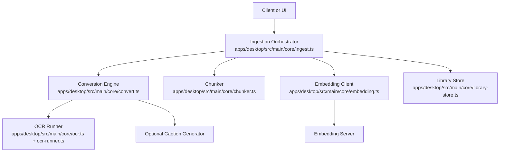
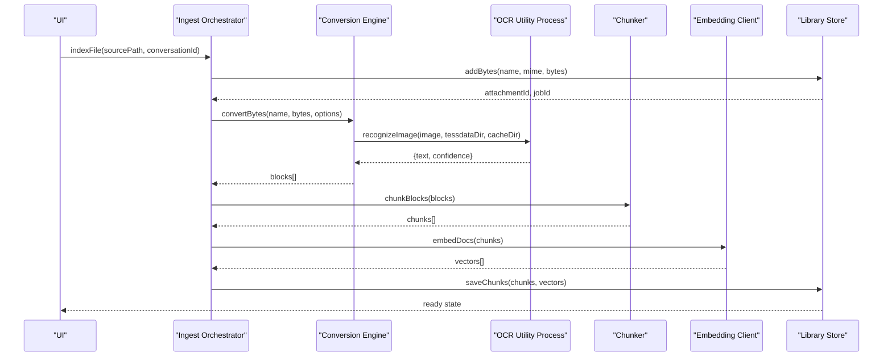
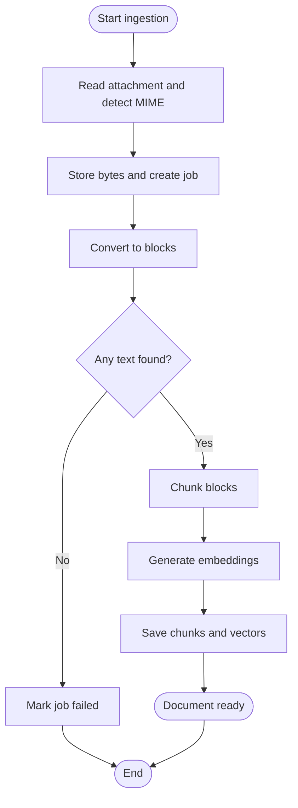
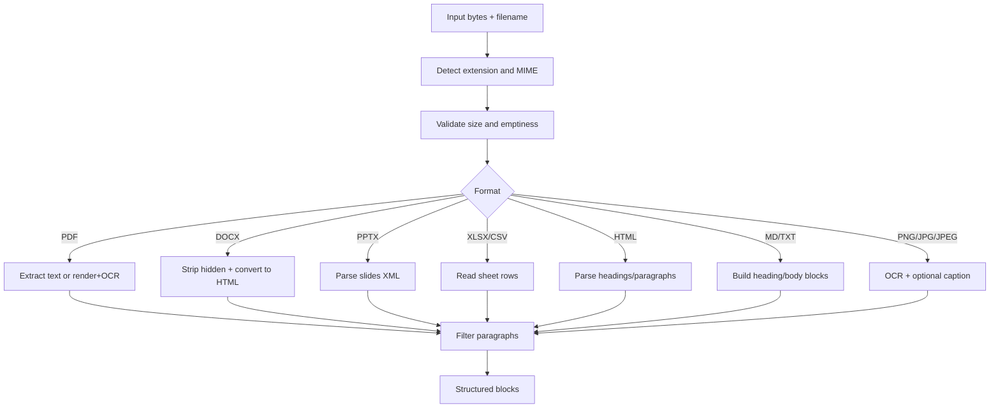
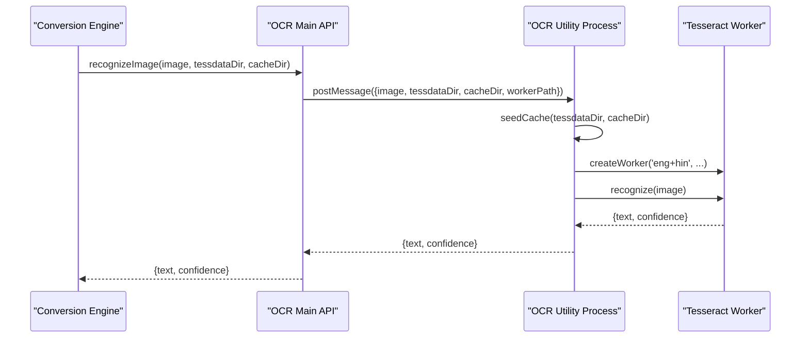
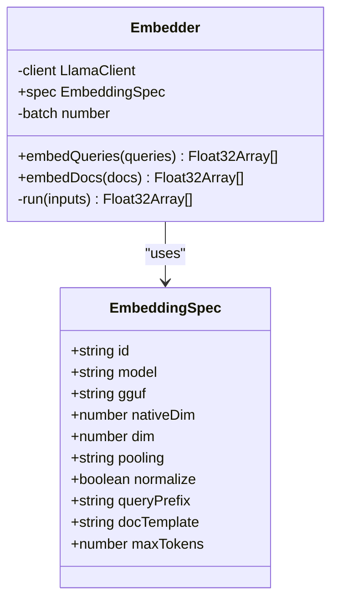
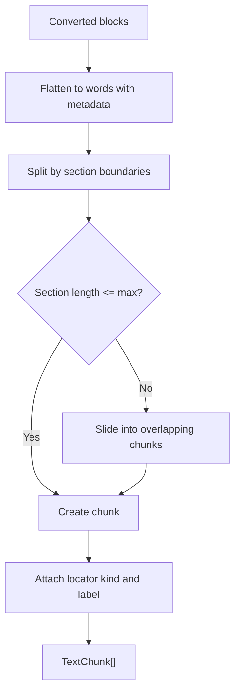
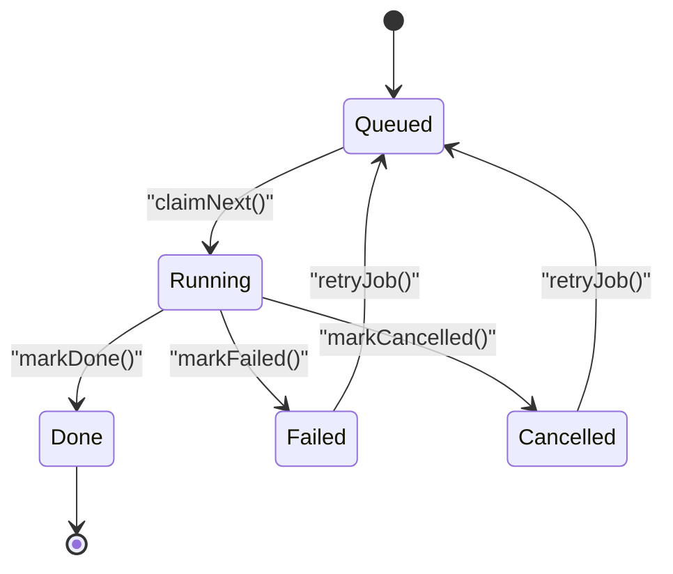
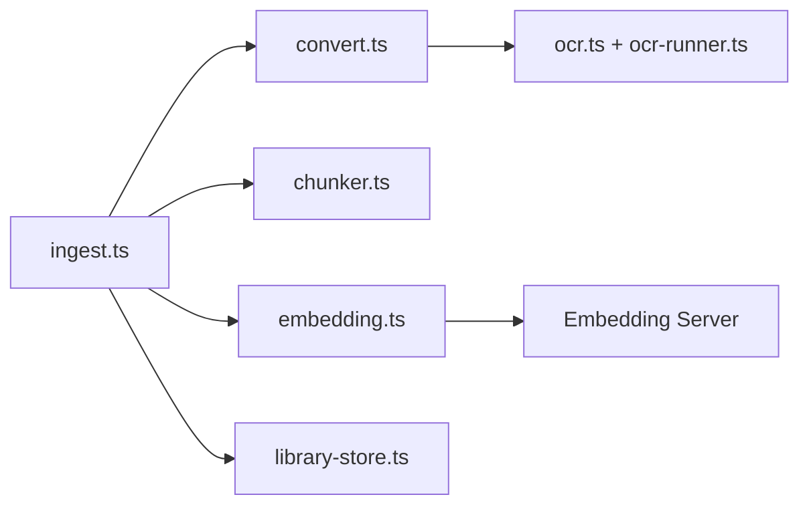

# Document Processing

<cite>
**Referenced Files in This Document**
- [ingest.ts](file://apps/desktop/src/main/core/ingest.ts)
- [convert.ts](file://apps/desktop/src/main/core/convert.ts)
- [ocr.ts](file://apps/desktop/src/main/core/ocr.ts)
- [ocr-runner.ts](file://apps/desktop/src/main/core/ocr-runner.ts)
- [embedding.ts](file://apps/desktop/src/main/core/embedding.ts)
- [chunker.ts](file://apps/desktop/src/main/core/chunker.ts)
- [library-store.ts](file://apps/desktop/src/main/core/library-store.ts)
- [ARCHITECTURE-FULL.md](file://docs/ARCHITECTURE-FULL.md)
</cite>

## Table of Contents
1. [Introduction](#introduction)
2. [Project Structure](#project-structure)
3. [Core Components](#core-components)
4. [Architecture Overview](#architecture-overview)
5. [Detailed Component Analysis](#detailed-component-analysis)
6. [Dependency Analysis](#dependency-analysis)
7. [Performance Considerations](#performance-considerations)
8. [Troubleshooting Guide](#troubleshooting-guide)
9. [Conclusion](#conclusion)

## Introduction
This document explains the end-to-end document processing pipeline used by the desktop application. It covers how files are ingested, detected, converted into structured text blocks, optionally processed with OCR and image captioning, chunked for retrieval, embedded as vectors, and persisted for semantic search. It also documents supported formats, processing limits, error handling strategies, and performance considerations.

## Project Structure
The document processing logic is implemented in the desktop main process under `apps/desktop/src/main/core`. The key modules are:

- Ingestion orchestrator: reads attachments, starts conversion, chunks results, generates embeddings, and persists data.
- Conversion engine: detects file types and routes them to format-specific processors.
- OCR subsystem: runs Tesseract.js in a separate utility process for image text extraction and optional caption generation.
- Chunker: splits normalized text into structure-aware chunks suitable for embedding and retrieval.
- Embedding client: formats inputs according to a shared embedding specification, truncates and normalizes vectors, and calls the embedding server.
- Library store: manages attachments, jobs, chunks, and vector storage in the encrypted local database.

**Diagram sources**
- [ingest.ts:35-90](file://apps/desktop/src/main/core/ingest.ts#L35-L90)
- [convert.ts:81-106](file://apps/desktop/src/main/core/convert.ts#L81-L106)
- [ocr.ts:88-105](file://apps/desktop/src/main/core/ocr.ts#L88-L105)
- [ocr-runner.ts:72-88](file://apps/desktop/src/main/core/ocr-runner.ts#L72-L88)
- [chunker.ts:45-70](file://apps/desktop/src/main/core/chunker.ts#L45-L70)
- [embedding.ts:66-83](file://apps/desktop/src/main/core/embedding.ts#L66-L83)
- [library-store.ts:159-191](file://apps/desktop/src/main/core/library-store.ts#L159-L191)

**Section sources**
- [ingest.ts:1-92](file://apps/desktop/src/main/core/ingest.ts#L1-L92)
- [convert.ts:1-394](file://apps/desktop/src/main/core/convert.ts#L1-L394)
- [ocr.ts:1-113](file://apps/desktop/src/main/core/ocr.ts#L1-L113)
- [ocr-runner.ts:1-89](file://apps/desktop/src/main/core/ocr-runner.ts#L1-L89)
- [embedding.ts:1-84](file://apps/desktop/src/main/core/embedding.ts#L1-L84)
- [chunker.ts:1-119](file://apps/desktop/src/main/core/chunker.ts#L1-L119)
- [library-store.ts:1-320](file://apps/desktop/src/main/core/library-store.ts#L1-L320)

## Core Components
- File ingestion: validates input, stores bytes, creates a job, converts content, chunks it, embeds it, and saves results.
- Format detection and routing: maps file extensions to MIME types and dispatches to PDF, DOCX, PPTX, XLSX/CSV, HTML, Markdown/text, or image handlers.
- OCR integration: uses Tesseract.js via an Electron utility process to extract text from images and scanned pages; supports optional image captioning.
- Chunking: produces structure-aware chunks with headings, page/slide/sheet locators, and controlled overlap.
- Embedding: formats queries and documents per a shared spec, truncates vectors using Matryoshka slicing, and L2-normalizes them.
- Persistence: deduplicates attachments, tracks jobs, stores chunks and vectors, and updates document status.

**Section sources**
- [ingest.ts:35-90](file://apps/desktop/src/main/core/ingest.ts#L35-L90)
- [convert.ts:22-43](file://apps/desktop/src/main/core/convert.ts#L22-L43)
- [chunker.ts:11-27](file://apps/desktop/src/main/core/chunker.ts#L11-L27)
- [embedding.ts:17-42](file://apps/desktop/src/main/core/embedding.ts#L17-L42)
- [library-store.ts:19-50](file://apps/desktop/src/main/core/library-store.ts#L19-L50)

## Architecture Overview
The ingestion workflow coordinates multiple stages with progress reporting and cancellation support.

**Diagram sources**
- [ingest.ts:75-90](file://apps/desktop/src/main/core/ingest.ts#L75-L90)
- [ingest.ts:35-73](file://apps/desktop/src/main/core/ingest.ts#L35-L73)
- [convert.ts:81-106](file://apps/desktop/src/main/core/convert.ts#L81-L106)
- [ocr.ts:88-105](file://apps/desktop/src/main/core/ocr.ts#L88-L105)
- [chunker.ts:45-70](file://apps/desktop/src/main/core/chunker.ts#L45-L70)
- [embedding.ts:66-83](file://apps/desktop/src/main/core/embedding.ts#L66-L83)
- [library-store.ts:159-191](file://apps/desktop/src/main/core/library-store.ts#L159-L191)

## Detailed Component Analysis

### File Ingestion System
The ingestion system performs the following steps:
- Reads the source file and determines its MIME type based on extension.
- Stores the file bytes in the encrypted library with SHA-256 deduplication.
- Creates an indexing job with priority (conversation-linked jobs run earlier).
- Converts the file into structured blocks.
- Chunks blocks into retrievable units.
- Generates embeddings for each chunk.
- Persists chunks and vectors and marks the document ready.

Key behaviors:
- Progress updates are published during conversion and embedding.
- Cancellation is respected at multiple checkpoints.
- Errors mark the job failed and update the document status when no chunks were produced.

**Diagram sources**
- [ingest.ts:75-90](file://apps/desktop/src/main/core/ingest.ts#L75-L90)
- [ingest.ts:35-73](file://apps/desktop/src/main/core/ingest.ts#L35-L73)
- [library-store.ts:19-50](file://apps/desktop/src/main/core/library-store.ts#L19-L50)

**Section sources**
- [ingest.ts:35-90](file://apps/desktop/src/main/core/ingest.ts#L35-L90)
- [library-store.ts:19-50](file://apps/desktop/src/main/core/library-store.ts#L19-L50)

### Conversion Pipeline and File Type Detection
The conversion engine:
- Maps file extensions to MIME types.
- Validates file size and emptiness.
- Routes to format-specific converters:
  - PDF: extracts visible text, falls back to rendering and OCR if needed.
  - DOCX: converts to HTML, strips hidden content, then parses blocks.
  - PPTX: extracts slide text and titles.
  - XLSX/CSV: reads sheets and rows into tabular text blocks.
  - HTML/HTM: parses headings and paragraphs, falls back to plain text.
  - Markdown/Text: preserves headings and body text.
  - Images: runs OCR and optional captioning.

Supported formats and behavior:
- PDF: text extraction plus operator-level filtering to avoid invisible or near-white text; rendered fallback for scanned pages.
- DOCX: removes hidden runs and white-colored text before conversion.
- PPTX: extracts slide titles and remaining text.
- XLSX/CSV: limits rows and columns to control memory usage.
- HTML: prefers heading/paragraph parsing; otherwise plain text.
- Markdown/Text: builds blocks with headings.
- PNG/JPEG/JPG: OCR and optional caption generation.

**Diagram sources**
- [convert.ts:22-43](file://apps/desktop/src/main/core/convert.ts#L22-L43)
- [convert.ts:71-79](file://apps/desktop/src/main/core/convert.ts#L71-L79)
- [convert.ts:81-106](file://apps/desktop/src/main/core/convert.ts#L81-L106)
- [convert.ts:108-143](file://apps/desktop/src/main/core/convert.ts#L108-L143)
- [convert.ts:247-313](file://apps/desktop/src/main/core/convert.ts#L247-L313)
- [convert.ts:315-367](file://apps/desktop/src/main/core/convert.ts#L315-L367)

**Section sources**
- [convert.ts:22-43](file://apps/desktop/src/main/core/convert.ts#L22-L43)
- [convert.ts:71-79](file://apps/desktop/src/main/core/convert.ts#L71-L79)
- [convert.ts:81-106](file://apps/desktop/src/main/core/convert.ts#L81-L106)
- [convert.ts:108-143](file://apps/desktop/src/main/core/convert.ts#L108-L143)
- [convert.ts:247-313](file://apps/desktop/src/main/core/convert.ts#L247-L313)
- [convert.ts:315-367](file://apps/desktop/src/main/core/convert.ts#L315-L367)

### OCR Integration Using Tesseract.js
OCR is isolated in a dedicated utility process to prevent WASM worker stalls from freezing the main process. The flow:
- Main process requests recognition with image bytes, Tesseract data directory, and cache directory.
- Utility process seeds language data into a cache, creates a Tesseract worker, and recognizes the image.
- Results include extracted text and confidence; errors propagate back to the main process.
- For PDFs with little text, pages are rendered to images and passed through OCR.
- Optional caption generation can append descriptive text for images and scanned pages.

**Diagram sources**
- [ocr.ts:88-105](file://apps/desktop/src/main/core/ocr.ts#L88-L105)
- [ocr-runner.ts:35-69](file://apps/desktop/src/main/core/ocr-runner.ts#L35-L69)
- [ocr-runner.ts:72-88](file://apps/desktop/src/main/core/ocr-runner.ts#L72-L88)

**Section sources**
- [ocr.ts:1-113](file://apps/desktop/src/main/core/ocr.ts#L1-L113)
- [ocr-runner.ts:1-89](file://apps/desktop/src/main/core/ocr-runner.ts#L1-L89)
- [convert.ts:108-143](file://apps/desktop/src/main/core/convert.ts#L108-L143)
- [convert.ts:357-367](file://apps/desktop/src/main/core/convert.ts#L357-L367)

### Embedding Generation System
Embeddings are generated using a shared specification compatible between the desktop and server pipelines:
- Queries use a task prefix; documents use a title and text template.
- Vectors are truncated to the configured dimension and L2-normalized.
- NaN or zero vectors are rejected to guard against float16 issues.
- Batching reduces overhead when calling the embedding server.

**Diagram sources**
- [embedding.ts:17-42](file://apps/desktop/src/main/core/embedding.ts#L17-L42)
- [embedding.ts:66-83](file://apps/desktop/src/main/core/embedding.ts#L66-L83)

**Section sources**
- [embedding.ts:1-84](file://apps/desktop/src/main/core/embedding.ts#L1-L84)

### Chunking and Structured Data
After conversion, blocks are flattened and split into chunks:
- Target chunk size is around 250 words, with a maximum of 300.
- Overlap of about 40 words maintains context across boundaries.
- Headings, page numbers, slide numbers, and sheet names define section boundaries.
- Locators help reconstruct citations and navigation.

**Diagram sources**
- [chunker.ts:45-70](file://apps/desktop/src/main/core/chunker.ts#L45-L70)
- [chunker.ts:72-118](file://apps/desktop/src/main/core/chunker.ts#L72-L118)

**Section sources**
- [chunker.ts:1-119](file://apps/desktop/src/main/core/chunker.ts#L1-L119)

### Storage and Job Management
The library store handles:
- Deduplicated attachment storage by SHA-256.
- Job lifecycle: queued, running, done, failed, cancelled.
- Progress tracking and stage updates.
- Saving chunks and vectors atomically within transactions.
- Deleting attachments and associated vectors.

**Diagram sources**
- [library-store.ts:93-149](file://apps/desktop/src/main/core/library-store.ts#L93-L149)
- [library-store.ts:159-191](file://apps/desktop/src/main/core/library-store.ts#L159-L191)

**Section sources**
- [library-store.ts:19-50](file://apps/desktop/src/main/core/library-store.ts#L19-L50)
- [library-store.ts:93-149](file://apps/desktop/src/main/core/library-store.ts#L93-L149)
- [library-store.ts:159-191](file://apps/desktop/src/main/core/library-store.ts#L159-L191)

## Dependency Analysis
The ingestion pipeline depends on conversion, OCR, chunking, embedding, and storage components. Conversion depends on OCR for images and scanned PDFs. Embedding depends on a shared spec and external embedding server. Storage depends on chunking output and embedding vectors.

**Diagram sources**
- [ingest.ts:35-90](file://apps/desktop/src/main/core/ingest.ts#L35-L90)
- [convert.ts:81-106](file://apps/desktop/src/main/core/convert.ts#L81-L106)
- [ocr.ts:88-105](file://apps/desktop/src/main/core/ocr.ts#L88-L105)
- [chunker.ts:45-70](file://apps/desktop/src/main/core/chunker.ts#L45-L70)
- [embedding.ts:66-83](file://apps/desktop/src/main/core/embedding.ts#L66-L83)
- [library-store.ts:159-191](file://apps/desktop/src/main/core/library-store.ts#L159-L191)

**Section sources**
- [ingest.ts:35-90](file://apps/desktop/src/main/core/ingest.ts#L35-L90)
- [convert.ts:81-106](file://apps/desktop/src/main/core/convert.ts#L81-L106)
- [ocr.ts:88-105](file://apps/desktop/src/main/core/ocr.ts#L88-L105)
- [chunker.ts:45-70](file://apps/desktop/src/main/core/chunker.ts#L45-L70)
- [embedding.ts:66-83](file://apps/desktop/src/main/core/embedding.ts#L66-L83)
- [library-store.ts:159-191](file://apps/desktop/src/main/core/library-store.ts#L159-L191)

## Performance Considerations
- File size limit: attachments over 40 MB are rejected early to avoid excessive memory usage.
- PDF processing:
  - Visible text extraction is preferred; OCR fallback only occurs when text is insufficient.
  - Page rendering scales down to fit within reasonable dimensions before OCR.
- Spreadsheet processing:
  - Rows and columns are limited to reduce memory consumption.
- Chunking:
  - Controlled target size and overlap balance retrieval quality and vector count.
- Embedding:
  - Batches of 32 documents reduce network and server overhead.
  - Matryoshka truncation and L2 normalization ensure consistent vector lengths and norms.
- OCR isolation:
  - Separate utility process prevents WASM workers from blocking the main thread.
  - Language data caching avoids repeated downloads.
- General guidance:
  - Prefer text-based PDFs to avoid OCR cost.
  - Avoid extremely large spreadsheets; export simplified tables when possible.
  - Use batch ingestion where feasible to amortize embedding costs.

[No sources needed since this section provides general guidance]

## Troubleshooting Guide
Common issues and resolutions:
- Unsupported file type:
  - Ensure the file extension matches one of the supported formats.
- Empty or corrupted files:
  - Verify the file is not empty and readable; re-upload if necessary.
- No text found:
  - For images and scanned PDFs, check OCR language packs and image clarity.
  - For PDFs, consider whether the document contains selectable text or only images.
- OCR timeouts or failures:
  - Check that the OCR runner and Tesseract data directories exist.
  - Ensure the utility process started successfully and language data was seeded.
- Embedding mismatches:
  - Confirm the embedding spec matches the server configuration.
  - Reject vectors containing NaN or zero norms; regenerate with correct weights.
- Job stuck or failed:
  - Inspect job status and stage; retry failed jobs if appropriate.
  - Requeue interrupted jobs after restart.

**Section sources**
- [convert.ts:71-79](file://apps/desktop/src/main/core/convert.ts#L71-L79)
- [convert.ts:108-143](file://apps/desktop/src/main/core/convert.ts#L108-L143)
- [convert.ts:357-367](file://apps/desktop/src/main/core/convert.ts#L357-L367)
- [ocr.ts:52-86](file://apps/desktop/src/main/core/ocr.ts#L52-L86)
- [ocr-runner.ts:35-69](file://apps/desktop/src/main/core/ocr-runner.ts#L35-L69)
- [embedding.ts:53-63](file://apps/desktop/src/main/core/embedding.ts#L53-L63)
- [library-store.ts:124-149](file://apps/desktop/src/main/core/library-store.ts#L124-L149)

## Conclusion
The document processing pipeline integrates robust file ingestion, format-aware conversion, isolated OCR, structure-preserving chunking, and standardized embedding generation. It enforces safety limits, provides clear progress and error states, and persists results for semantic search. By adhering to the shared embedding specification and leveraging batching and chunking strategies, the system balances accuracy, performance, and resource usage across diverse document types.

[No sources needed since this section summarizes without analyzing specific files]