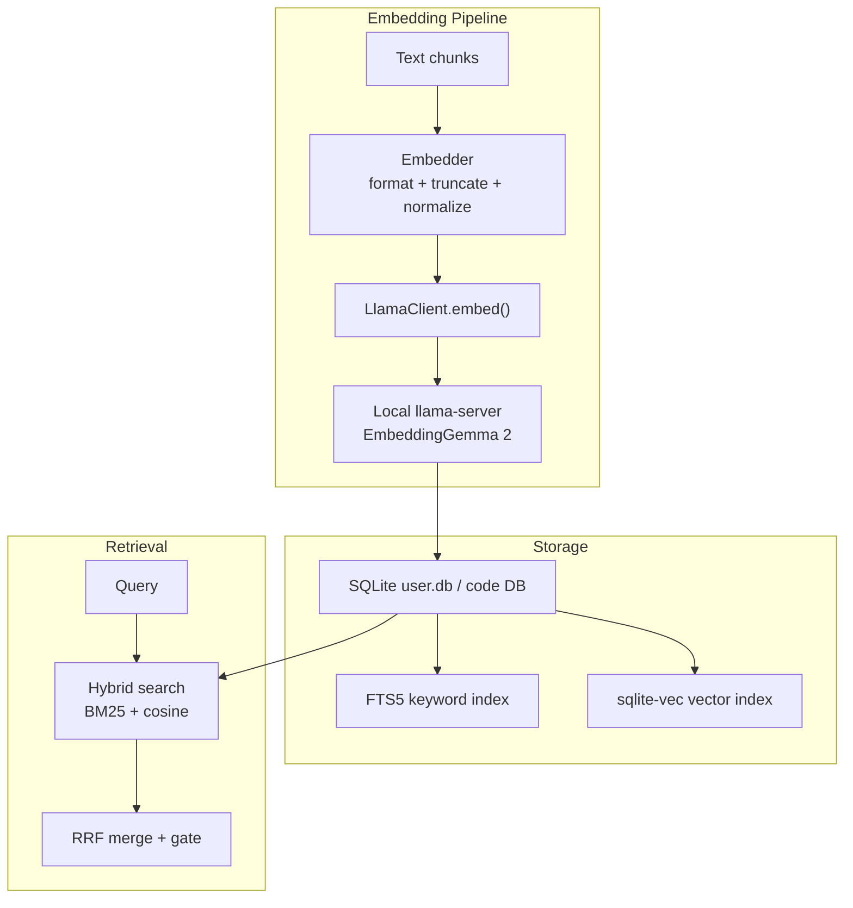
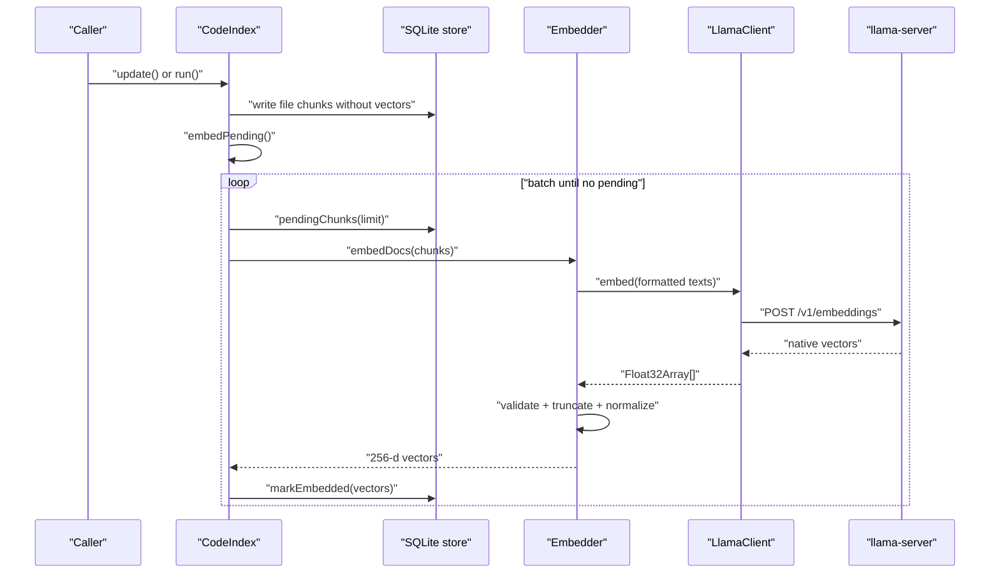
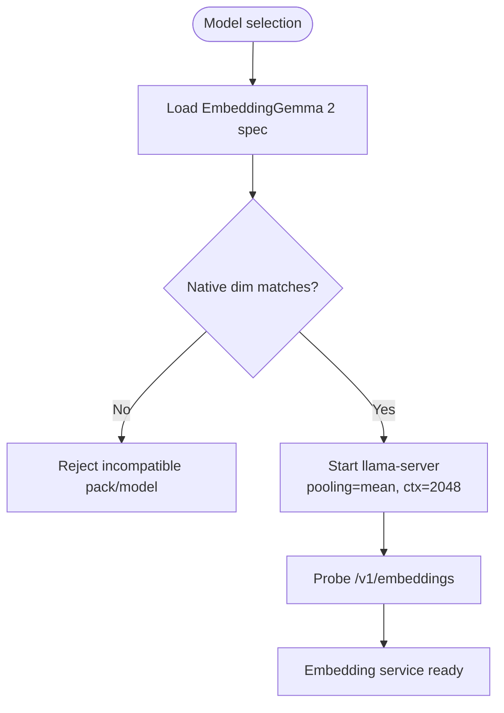
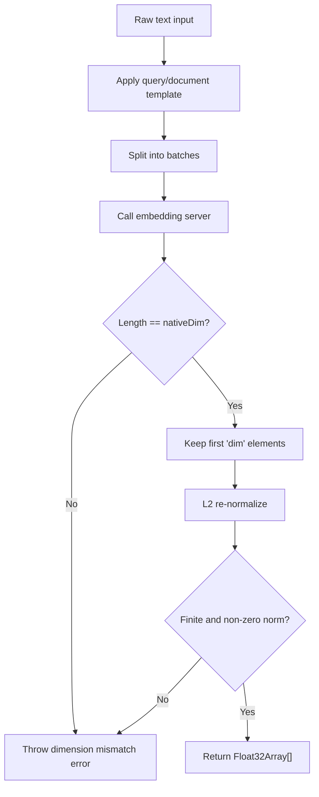
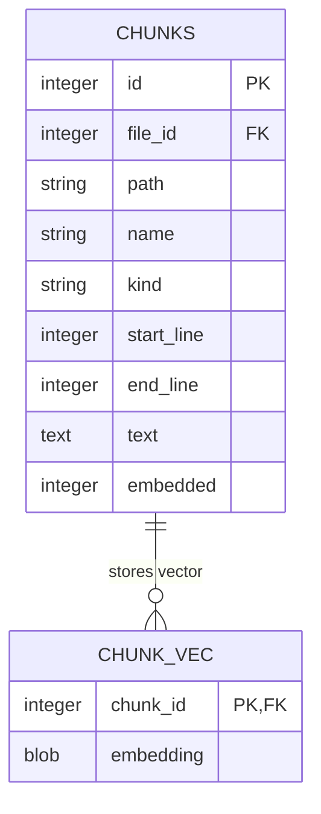
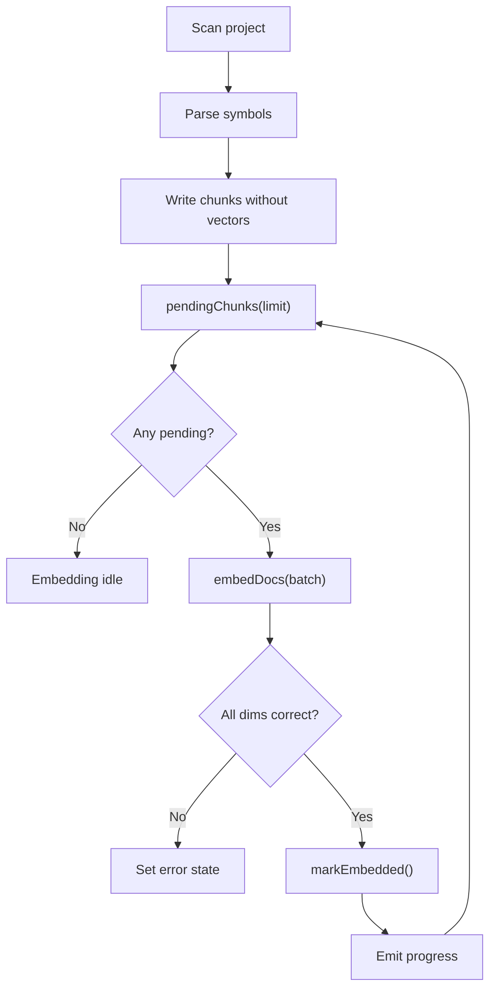
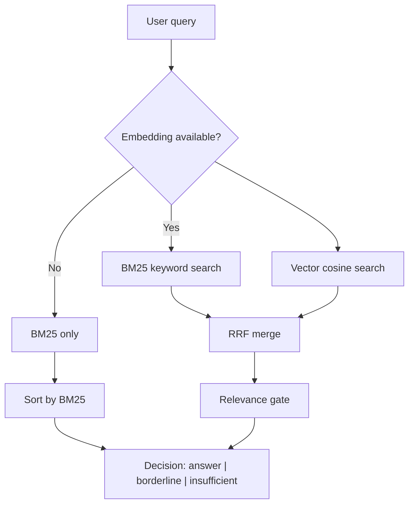
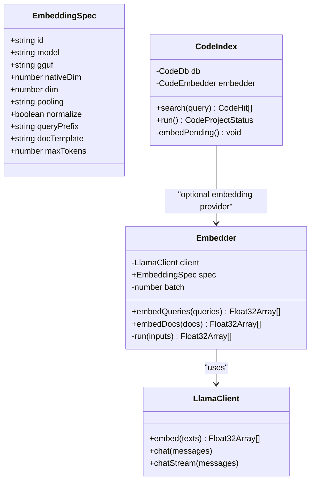
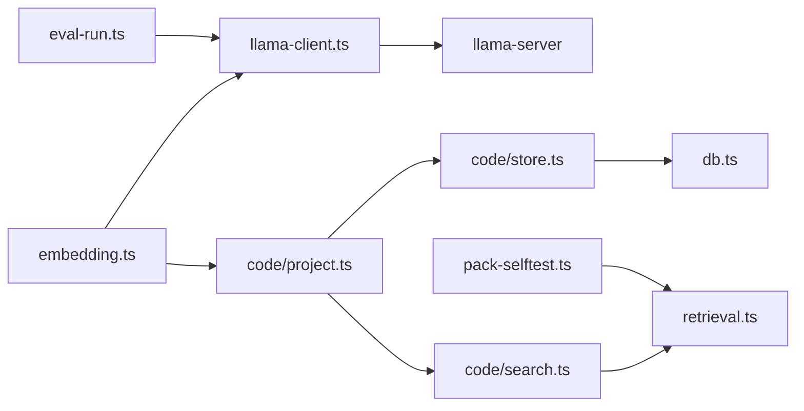

# Embedding Generation System

<cite>
**Referenced Files in This Document**
- [embedding.ts](file://apps/desktop/src/main/core/embedding.ts)
- [embed-dim.ts](file://apps/desktop/src/main/core/code/embed-dim.ts)
- [llama-client.ts](file://apps/desktop/src/main/core/llama-client.ts)
- [db.ts](file://apps/desktop/src/main/core/db.ts)
- [store.ts](file://apps/desktop/src/main/core/code/store.ts)
- [search.ts](file://apps/desktop/src/main/core/code/search.ts)
- [retrieval.ts](file://apps/desktop/src/main/core/retrieval.ts)
- [project.ts](file://apps/desktop/src/main/core/code/project.ts)
- [index-queue.ts](file://apps/desktop/src/main/live/index-queue.ts)
- [pack-selftest.ts](file://apps/desktop/src/main/core/pack-selftest.ts)
- [eval-run.ts](file://apps/desktop/src/main/eval-run.ts)
- [embedding_spec.py](file://docs/code-samples/embedding_spec.py)
</cite>

## Table of Contents
1. [Introduction](#introduction)
2. [Project Structure](#project-structure)
3. [Core Components](#core-components)
4. [Architecture Overview](#architecture-overview)
5. [Detailed Component Analysis](#detailed-component-analysis)
6. [Dependency Analysis](#dependency-analysis)
7. [Performance Considerations](#performance-considerations)
8. [Troubleshooting Guide](#troubleshooting-guide)
9. [Conclusion](#conclusion)

## Introduction
This document explains the embedding generation system that converts text chunks into vector embeddings for semantic search. It covers how text is formatted, how models are selected and served locally, how vectors are truncated and normalized, how they are stored in a local SQLite database with vector indexing, and how hybrid keyword-plus-vector retrieval produces fast, reliable results.

The system is designed for an Electron desktop application. Embeddings are produced by a local `llama-server` instance using the EmbeddingGemma 2 model, while the same embedding specification is also used by a Python server pipeline. Retrieval uses SQLite FTS5 for keywords and `sqlite-vec` for cosine similarity, merged through Reciprocal Rank Fusion.

## Project Structure
The embedding system spans several modules:

- Embedding specification and client wrapper: `embedding.ts`, `llama-client.ts`
- Code project indexing and batched embedding: `code/project.ts`, `code/store.ts`, `code/search.ts`
- Vector storage and extension loading: `db.ts`
- Hybrid retrieval and gating: `retrieval.ts`
- Server-side embedding spec reference: `docs/code-samples/embedding_spec.py`
- Evaluation and pack self-test usage: `eval-run.ts`, `pack-selftest.ts`

**Diagram sources**
- [embedding.ts:17-83](file://apps/desktop/src/main/core/embedding.ts#L17-L83)
- [llama-client.ts:73-78](file://apps/desktop/src/main/core/llama-client.ts#L73-L78)
- [db.ts:14-27](file://apps/desktop/src/main/core/db.ts#L14-L27)
- [search.ts:63-84](file://apps/desktop/src/main/core/code/search.ts#L63-L84)
- [retrieval.ts:49-112](file://apps/desktop/src/main/core/retrieval.ts#L49-L112)

**Section sources**
- [embedding.ts:1-83](file://apps/desktop/src/main/core/embedding.ts#L1-L83)
- [llama-client.ts:73-78](file://apps/desktop/src/main/core/llama-client.ts#L73-L78)
- [db.ts:1-78](file://apps/desktop/src/main/core/db.ts#L1-L78)
- [search.ts:1-85](file://apps/desktop/src/main/core/code/search.ts#L1-L85)
- [retrieval.ts:1-141](file://apps/desktop/src/main/core/retrieval.ts#L1-L141)

## Core Components
- Embedding specification: defines model identity, dimensions, pooling, normalization, query/document templates, and maximum token length.
- Embedder: applies prefixes, batches requests, validates native dimensionality, truncates to the configured Matryoshka dimension, and re-normalizes vectors.
- LlamaClient: HTTP client for the OpenAI-compatible `/v1/embeddings` endpoint exposed by `llama-server`.
- SQLite storage: loads `sqlite-vec`, stores raw vectors as binary blobs, and exposes `embedding MATCH` queries.
- Search and retrieval: combines BM25 keyword search with vector cosine search, merges ranks, and applies relevance gates.
- Code indexing pipeline: scans files, parses symbols, creates chunks, writes keyword rows first, then embeds pending chunks in batches.

**Section sources**
- [embedding.ts:17-83](file://apps/desktop/src/main/core/embedding.ts#L17-L83)
- [llama-client.ts:73-78](file://apps/desktop/src/main/core/llama-client.ts#L73-L78)
- [db.ts:14-27](file://apps/desktop/src/main/core/db.ts#L14-L27)
- [store.ts:73-105](file://apps/desktop/src/main/core/code/store.ts#L73-L105)
- [search.ts:63-84](file://apps/desktop/src/main/core/code/search.ts#L63-L84)
- [retrieval.ts:49-112](file://apps/desktop/src/main/core/retrieval.ts#L49-L112)

## Architecture Overview
The embedding architecture has three main phases:

1. **Indexing phase**: source files are parsed into symbol-aware chunks; keyword rows are written immediately.
2. **Embedding phase**: pending chunks are fetched in batches, sent to the local embedding server, validated, truncated, normalized, and stored alongside the chunk row.
3. **Search phase**: queries are embedded (when available), combined with keyword search, ranked via RRF, and gated into answer/borderline/insufficient decisions.

**Diagram sources**
- [project.ts:321-347](file://apps/desktop/src/main/core/code/project.ts#L321-L347)
- [store.ts:338-391](file://apps/desktop/src/main/core/code/store.ts#L338-L391)
- [embedding.ts:65-83](file://apps/desktop/src/main/core/embedding.ts#L65-L83)
- [llama-client.ts:73-78](file://apps/desktop/src/main/core/llama-client.ts#L73-L78)

**Section sources**
- [project.ts:125-135](file://apps/desktop/src/main/core/code/project.ts#L125-L135)
- [project.ts:321-347](file://apps/desktop/src/main/core/code/project.ts#L321-L347)
- [store.ts:338-391](file://apps/desktop/src/main/core/code/store.ts#L338-L391)
- [embedding.ts:65-83](file://apps/desktop/src/main/core/embedding.ts#L65-L83)
- [llama-client.ts:73-78](file://apps/desktop/src/main/core/llama-client.ts#L73-L78)

## Detailed Component Analysis

### Embedding Model Selection and Local Serving
The system uses EmbeddingGemma 2 with a fixed compatibility key, native dimensionality, and Matryoshka truncation. The embedding specification includes:

- Compatibility identifier and HF model name
- GGUF filename used by the desktop
- Native dimensionality and stored dimension
- Pooling mode and normalization flag
- Query prefix and document template
- Maximum token length

The embedding server is started locally through `llama-server`, configured with mean pooling and context size appropriate for embeddings. The evaluation script probes the server with an embedding request to validate startup and memory usage.

Trade-offs:
- Local serving avoids network latency and keeps data on-device.
- Mean pooling and bidirectional attention require sufficient context length.
- Float16 weights can produce NaN or degraded vectors; the implementation rejects invalid values.
- Changing the embedding spec requires full re-indexing because vectors from different models, dimensions, or templates are not comparable.

**Diagram sources**
- [embedding.ts:17-47](file://apps/desktop/src/main/core/embedding.ts#L17-L47)
- [eval-run.ts:136-166](file://apps/desktop/src/main/eval-run.ts#L136-L166)

**Section sources**
- [embedding.ts:1-47](file://apps/desktop/src/main/core/embedding.ts#L1-L47)
- [embedding_spec.py:85-112](file://docs/code-samples/embedding_spec.py#L85-L112)
- [eval-run.ts:136-166](file://apps/desktop/src/main/eval-run.ts#L136-L166)

### Text Chunk Formatting and Normalization
Text chunks are converted into embeddings through a consistent formatting and normalization pipeline:

- Queries receive a task-specific prefix.
- Documents receive a title-and-text template; missing titles become a placeholder.
- Each returned vector is validated against the expected native dimension.
- Vectors are truncated to the configured Matryoshka dimension.
- Truncated vectors are L2-normalized again so cosine similarity remains valid.
- Invalid values such as NaN, Inf, or zero-norm vectors cause errors rather than silently degrading search quality.

**Diagram sources**
- [embedding.ts:49-63](file://apps/desktop/src/main/core/embedding.ts#L49-L63)
- [embedding.ts:69-79](file://apps/desktop/src/main/core/embedding.ts#L69-L79)

**Section sources**
- [embedding.ts:49-83](file://apps/desktop/src/main/core/embedding.ts#L49-L83)

### Vector Storage and Indexing Strategy
Vectors are stored in SQLite using `sqlite-vec`:

- The vector extension is loaded at database open time.
- Raw `Float32Array` buffers are converted to binary blobs for storage.
- Chunks are indexed with FTS5 for keyword search.
- Vectors are stored in a separate table and queried with `embedding MATCH ? AND k = ?`.
- Pack databases are opened read-only with query-only enabled, while user databases support encryption and migrations.

**Diagram sources**
- [store.ts:93-102](file://apps/desktop/src/main/core/code/store.ts#L93-L102)
- [store.ts:380-391](file://apps/desktop/src/main/core/code/store.ts#L380-L391)
- [db.ts:14-27](file://apps/desktop/src/main/core/db.ts#L14-L27)

**Section sources**
- [db.ts:1-78](file://apps/desktop/src/main/core/db.ts#L1-L78)
- [store.ts:73-105](file://apps/desktop/src/main/core/code/store.ts#L73-L105)
- [store.ts:380-391](file://apps/desktop/src/main/core/code/store.ts#L380-L391)

### Embedding Pipeline and Batch Processing
The code indexing pipeline separates indexing from embedding:

1. Files are scanned and parsed into symbol-aware chunks.
2. Keyword rows are written immediately.
3. Pending chunks are fetched in a bounded batch.
4. Embeddings are computed in batches.
5. Results are validated for length and dimensionality.
6. Vectors are persisted and chunks are marked embedded.
7. Progress events are emitted between batches so search can proceed concurrently.

**Diagram sources**
- [project.ts:245-319](file://apps/desktop/src/main/core/code/project.ts#L245-L319)
- [project.ts:321-347](file://apps/desktop/src/main/core/code/project.ts#L321-L347)
- [store.ts:338-391](file://apps/desktop/src/main/core/code/store.ts#L338-L391)

**Section sources**
- [project.ts:125-135](file://apps/desktop/src/main/core/code/project.ts#L125-L135)
- [project.ts:245-319](file://apps/desktop/src/main/core/code/project.ts#L245-L319)
- [project.ts:321-347](file://apps/desktop/src/main/core/code/project.ts#L321-L347)

### Hybrid Retrieval and Relevance Gating
Retrieval combines two signals:

- BM25 keyword ranking from FTS5.
- Cosine similarity ranking from `sqlite-vec`.

Ranks are merged using Reciprocal Rank Fusion. A relevance gate decides whether the result is sufficient for an answer, borderline enough for a short verification step, or insufficient. Language-specific thresholds handle Devanagari differently because keyword coverage is less reliable.

**Diagram sources**
- [search.ts:63-84](file://apps/desktop/src/main/core/code/search.ts#L63-L84)
- [retrieval.ts:22-25](file://apps/desktop/src/main/core/retrieval.ts#L22-L25)
- [retrieval.ts:49-112](file://apps/desktop/src/main/core/retrieval.ts#L49-L112)

**Section sources**
- [search.ts:1-85](file://apps/desktop/src/main/core/code/search.ts#L1-L85)
- [retrieval.ts:1-141](file://apps/desktop/src/main/core/retrieval.ts#L1-L141)

### Class-Level View of Embedding Components

**Diagram sources**
- [embedding.ts:17-83](file://apps/desktop/src/main/core/embedding.ts#L17-L83)
- [llama-client.ts:59-78](file://apps/desktop/src/main/core/llama-client.ts#L59-L78)
- [project.ts:56-156](file://apps/desktop/src/main/core/code/project.ts#L56-L156)

**Section sources**
- [embedding.ts:17-83](file://apps/desktop/src/main/core/embedding.ts#L17-L83)
- [llama-client.ts:59-78](file://apps/desktop/src/main/core/llama-client.ts#L59-L78)
- [project.ts:56-156](file://apps/desktop/src/main/core/code/project.ts#L56-L156)

## Dependency Analysis
The embedding system depends on:

- Embedding specification and formatting logic.
- A local embedding server exposing an OpenAI-compatible embeddings endpoint.
- SQLite with FTS5 and `sqlite-vec`.
- Code parsing and chunking utilities.
- Background indexing queue for incremental updates.
- Evaluation and pack self-test scripts that exercise the same embedding and retrieval paths.

**Diagram sources**
- [embedding.ts:1-83](file://apps/desktop/src/main/core/embedding.ts#L1-L83)
- [llama-client.ts:73-78](file://apps/desktop/src/main/core/llama-client.ts#L73-L78)
- [project.ts:1-27](file://apps/desktop/src/main/core/code/project.ts#L1-L27)
- [store.ts:1-21](file://apps/desktop/src/main/core/code/store.ts#L1-L21)
- [db.ts:1-27](file://apps/desktop/src/main/core/db.ts#L1-L27)
- [search.ts:1-4](file://apps/desktop/src/main/core/code/search.ts#L1-L4)
- [retrieval.ts:1-8](file://apps/desktop/src/main/core/retrieval.ts#L1-L8)
- [eval-run.ts:136-166](file://apps/desktop/src/main/eval-run.ts#L136-L166)
- [pack-selftest.ts:93-113](file://apps/desktop/src/main/core/pack-selftest.ts#L93-L113)

**Section sources**
- [embedding.ts:1-83](file://apps/desktop/src/main/core/embedding.ts#L1-L83)
- [llama-client.ts:73-78](file://apps/desktop/src/main/core/llama-client.ts#L73-L78)
- [project.ts:1-27](file://apps/desktop/src/main/core/code/project.ts#L1-L27)
- [store.ts:1-21](file://apps/desktop/src/main/core/code/store.ts#L1-L21)
- [db.ts:1-27](file://apps/desktop/src/main/core/db.ts#L1-L27)
- [search.ts:1-4](file://apps/desktop/src/main/core/code/search.ts#L1-L4)
- [retrieval.ts:1-8](file://apps/desktop/src/main/core/retrieval.ts#L1-L8)
- [eval-run.ts:136-166](file://apps/desktop/src/main/eval-run.ts#L136-L166)
- [pack-selftest.ts:93-113](file://apps/desktop/src/main/core/pack-selftest.ts#L93-L113)

## Performance Considerations
- **Batching**: Embedding requests are split into batches to reduce per-request overhead and improve throughput. The default batch size is configurable through the Embedder constructor.
- **Dimensionality**: The system uses a 256-dimensional stored vector derived from a 768-dimensional native model through Matryoshka truncation. This reduces storage and search cost while preserving semantic quality.
- **Normalization**: L2 normalization after truncation ensures cosine similarity remains meaningful.
- **Indexing strategy**: Keyword rows are written before embeddings, allowing partial indexes to be useful even while embeddings are pending.
- **Concurrency**: The background indexing queue prioritizes reads over writes, enabling search to run while indexing continues.
- **Memory management**: Large embedding collections rely on SQLite persistence and binary vector storage. The process emits progress between batches so long-running indexing does not block interactive search.
- **Real-time search**: When an embedding provider is unavailable, search falls back to keyword-only results with a borderline decision. When available, hybrid search provides stronger relevance.

[No sources needed since this section provides general guidance]

## Troubleshooting Guide
Common issues and their likely causes:

- **NaN or invalid vectors**: Usually caused by unsupported float16 weights or corrupted model output. The embedding normalizer rejects NaN, Inf, and zero-norm vectors.
- **Dimension mismatch**: Occurs when the model returns a different native dimension than expected. The Embedder validates the returned length against the spec.
- **Pack incompatibility**: Packs built with a different embedding spec cannot be mixed with the current app spec because vectors are not comparable.
- **sqlite-vec loading failure**: Happens if the platform-native extension is not unpacked correctly or the version is unexpected.
- **Insufficient search results**: May indicate pending embeddings, low cosine scores, or low keyword coverage. The gate may return borderline or insufficient depending on thresholds.

Recommended checks:

- Verify the embedding spec ID, dimension, pooling, and templates match between the pack and the app.
- Confirm `llama-server` starts successfully and responds to `/v1/embeddings`.
- Ensure the SQLite database loads `sqlite-vec` and reports a compatible version.
- Inspect the code index status for pending or error states.
- Use the pack self-test and evaluation routines to validate embedding and retrieval behavior.

**Section sources**
- [embedding.ts:53-79](file://apps/desktop/src/main/core/embedding.ts#L53-L79)
- [db.ts:14-27](file://apps/desktop/src/main/core/db.ts#L14-L27)
- [project.ts:321-347](file://apps/desktop/src/main/core/code/project.ts#L321-L347)
- [pack-selftest.ts:93-113](file://apps/desktop/src/main/core/pack-selftest.ts#L93-L113)
- [eval-run.ts:136-166](file://apps/desktop/src/main/eval-run.ts#L136-L166)

## Conclusion
The embedding generation system integrates a well-defined embedding specification, a local embedding server, and SQLite-based hybrid retrieval. It emphasizes correctness through strict validation, performance through batching and efficient storage, and reliability through keyword-plus-vector fusion with calibrated relevance gates. For large collections, the design favors persistent vector storage, incremental indexing, and clear separation between indexing and search workloads.

[No sources needed since this section summarizes without analyzing specific files]