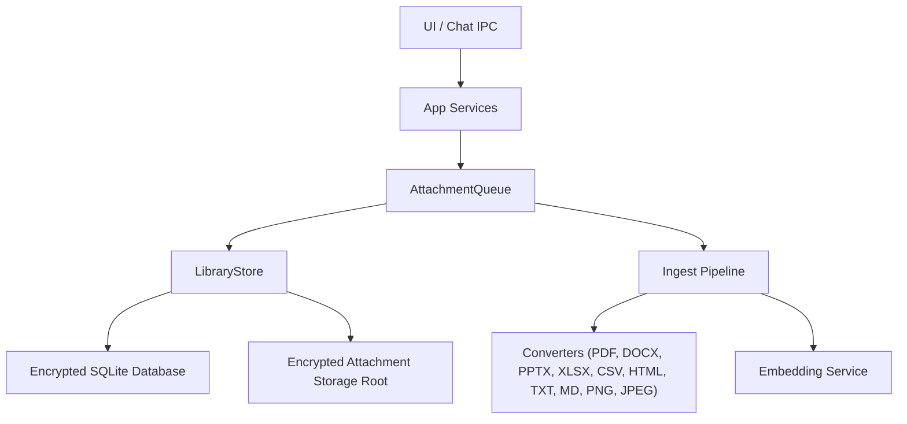
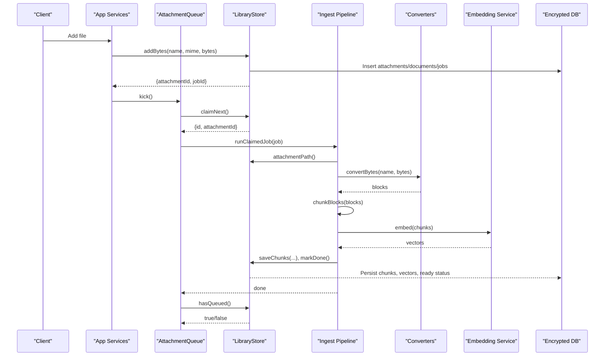
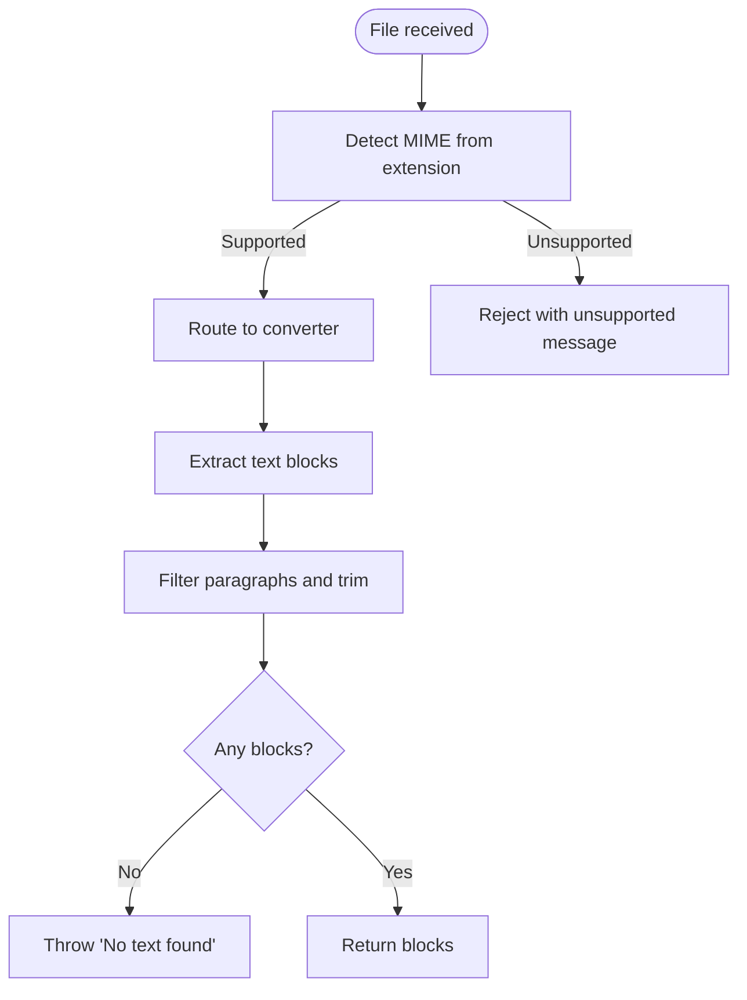
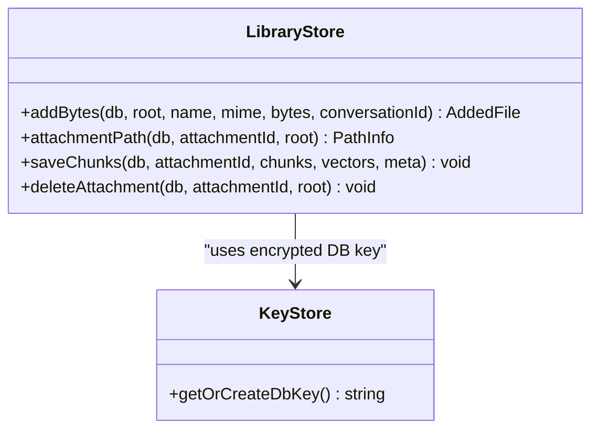
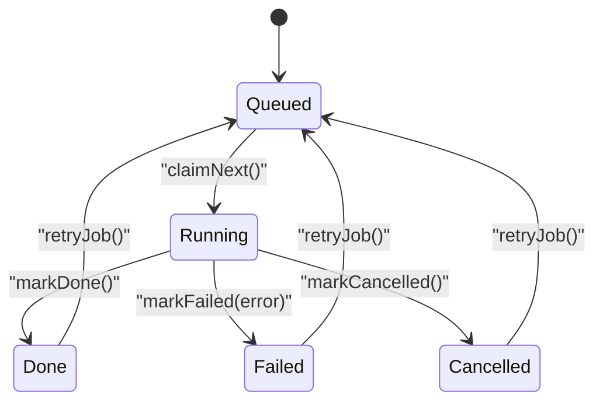
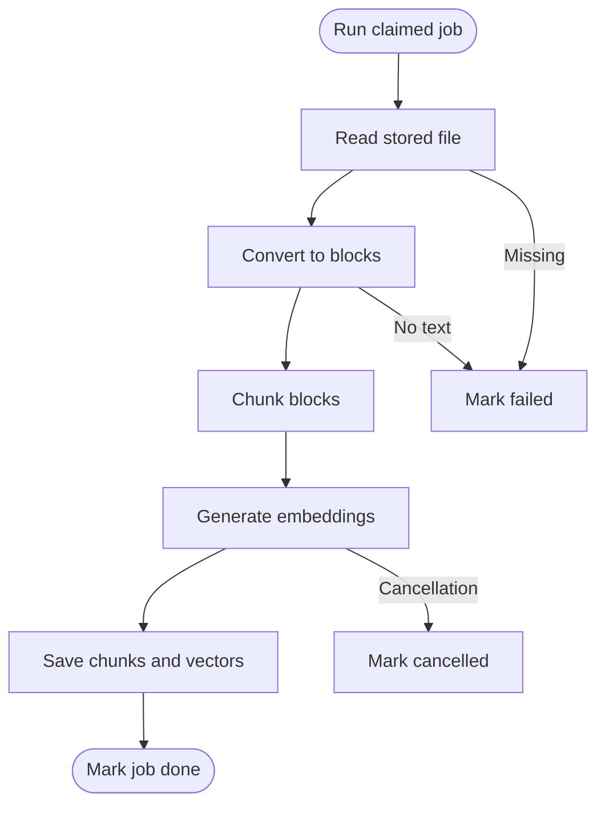
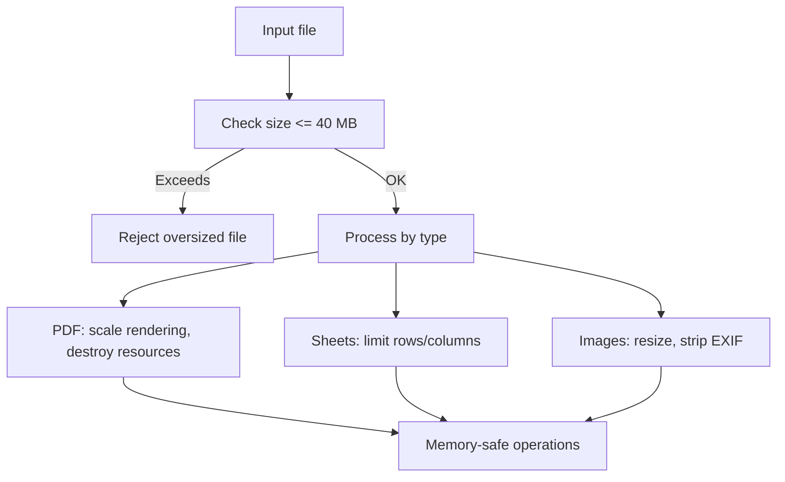
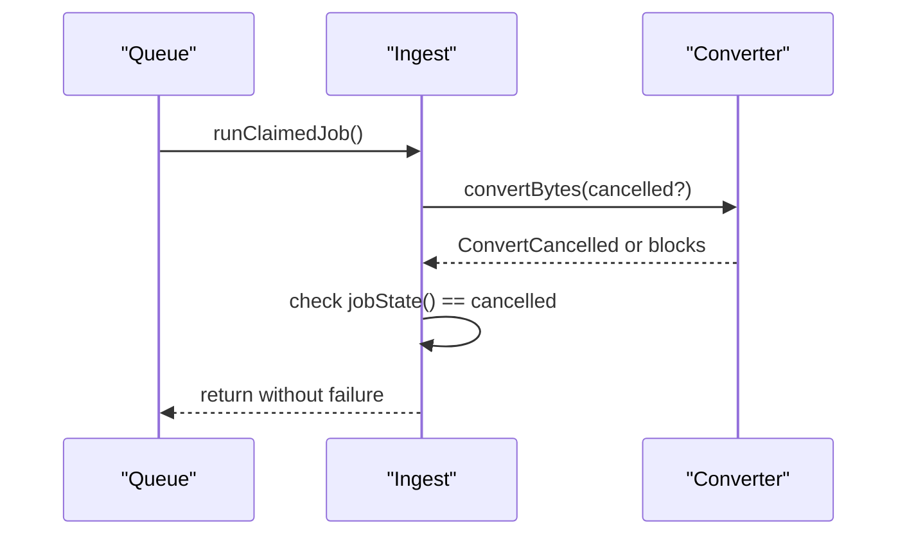
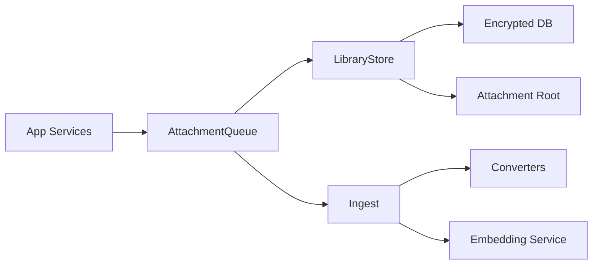

# File Ingestion System

<cite>
**Referenced Files in This Document**
- [ingest.ts](file://apps/desktop/src/main/core/ingest.ts)
- [library-store.ts](file://apps/desktop/src/main/core/library-store.ts)
- [attachment-queue.ts](file://apps/desktop/src/main/core/attachment-queue.ts)
- [convert.ts](file://apps/desktop/src/main/core/convert.ts)
- [document-service.ts](file://apps/desktop/src/main/core/document-service.ts)
- [app-services.ts](file://apps/desktop/src/main/core/app-services.ts)
- [key-store.ts](file://docs/code-samples/ts/key-store.ts)
</cite>

## Table of Contents
1. [Introduction](#introduction)
2. [Project Structure](#project-structure)
3. [Core Components](#core-components)
4. [Architecture Overview](#architecture-overview)
5. [Detailed Component Analysis](#detailed-component-analysis)
6. [Dependency Analysis](#dependency-analysis)
7. [Performance Considerations](#performance-considerations)
8. [Troubleshooting Guide](#troubleshooting-guide)
9. [Conclusion](#conclusion)

## Introduction
This document explains the file ingestion system that accepts user files, detects their types, stores them securely, processes them asynchronously, and tracks progress until they are indexed and searchable. It covers MIME-based routing, job queue state management, encrypted attachment storage, real-time progress updates, error handling for corrupted or unsupported files, size limits, memory considerations, and cancellation support.

## Project Structure
The ingestion pipeline is implemented in the desktop main process and consists of:
- Attachment acceptance and validation
- MIME-based routing to format-specific converters
- Secure on-disk storage under an encrypted database root
- A single-worker background queue with persistent job states
- Progress tracking via database fields and IPC events
- Chunking, embedding, and persistence of searchable content

**Diagram sources**
- [app-services.ts:802-809](file://apps/desktop/src/main/core/app-services.ts#L802-L809)
- [attachment-queue.ts:1-37](file://apps/desktop/src/main/core/attachment-queue.ts#L1-L37)
- [ingest.ts:1-92](file://apps/desktop/src/main/core/ingest.ts#L1-L92)
- [convert.ts:1-106](file://apps/desktop/src/main/core/convert.ts#L1-L106)
- [library-store.ts:1-50](file://apps/desktop/src/main/core/library-store.ts#L1-L50)

**Section sources**
- [app-services.ts:802-809](file://apps/desktop/src/main/core/app-services.ts#L802-L809)
- [attachment-queue.ts:1-37](file://apps/desktop/src/main/core/attachment-queue.ts#L1-L37)
- [ingest.ts:1-92](file://apps/desktop/src/main/core/ingest.ts#L1-L92)
- [convert.ts:1-106](file://apps/desktop/src/main/core/convert.ts#L1-L106)
- [library-store.ts:1-50](file://apps/desktop/src/main/core/library-store.ts#L1-L50)

## Core Components
- MIME detection and routing: Converts file names to MIME types and routes to appropriate parsers.
- Attachment storage: Deduplicates by SHA-256, writes bytes to a secure root, and records metadata.
- Job queue: Persistent queue with states queued, running, done, failed, cancelled; one worker at a time.
- Processing pipeline: Reads stored file, converts to text blocks, chunks, embeds, and persists results.
- Progress tracking: Updates stage and progress percentage; publishes file status changes to UI.
- Error handling: Validates inputs, handles unsupported formats, empty files, missing disk files, and conversion failures.

**Section sources**
- [convert.ts:22-43](file://apps/desktop/src/main/core/convert.ts#L22-L43)
- [library-store.ts:19-50](file://apps/desktop/src/main/core/library-store.ts#L19-L50)
- [attachment-queue.ts:1-37](file://apps/desktop/src/main/core/attachment-queue.ts#L1-L37)
- [ingest.ts:35-92](file://apps/desktop/src/main/core/ingest.ts#L35-L92)

## Architecture Overview
The ingestion flow starts when a file is added through the application services layer. The system validates and stores the file, creates a job, and enqueues it. The queue claims jobs, runs the ingest pipeline, and updates progress and final status.

**Diagram sources**
- [app-services.ts:802-809](file://apps/desktop/src/main/core/app-services.ts#L802-L809)
- [library-store.ts:19-50](file://apps/desktop/src/main/core/library-store.ts#L19-L50)
- [attachment-queue.ts:17-35](file://apps/desktop/src/main/core/attachment-queue.ts#L17-L35)
- [ingest.ts:35-92](file://apps/desktop/src/main/core/ingest.ts#L35-L92)
- [convert.ts:81-106](file://apps/desktop/src/main/core/convert.ts#L81-L106)

## Detailed Component Analysis

### MIME Type Detection and Routing
- MIME mapping is based on file extension. Supported types include PDF, DOCX, PPTX, XLSX, CSV, TXT, MD, HTML, PNG, and JPEG.
- Unsupported extensions are rejected early during read and conversion.
- Conversion dispatches to format-specific handlers that extract text blocks.

**Diagram sources**
- [convert.ts:22-43](file://apps/desktop/src/main/core/convert.ts#L22-L43)
- [convert.ts:81-106](file://apps/desktop/src/main/core/convert.ts#L81-L106)

**Section sources**
- [convert.ts:22-43](file://apps/desktop/src/main/core/convert.ts#L22-L43)
- [convert.ts:81-106](file://apps/desktop/src/main/core/convert.ts#L81-L106)

### Attachment Storage and Encryption
- Files are deduplicated by SHA-256. If identical bytes exist, no duplicate storage occurs.
- Bytes are written to a structured path under the attachment root using the hash prefix directories.
- Metadata including original name, MIME type, size, and stored path is recorded in the database.
- The database key is protected by Electron safeStorage, ensuring the underlying SQLite database remains encrypted at rest.

**Diagram sources**
- [library-store.ts:19-50](file://apps/desktop/src/main/core/library-store.ts#L19-L50)
- [key-store.ts:15-32](file://docs/code-samples/ts/key-store.ts#L15-L32)

**Section sources**
- [library-store.ts:19-50](file://apps/desktop/src/main/core/library-store.ts#L19-L50)
- [key-store.ts:15-32](file://docs/code-samples/ts/key-store.ts#L15-L32)

### Job Queue Mechanism and State Management
- Jobs persist in the database with states: queued, running, done, failed, cancelled.
- The queue ensures only one job runs at a time. On startup, interrupted running jobs are requeued.
- Claiming a job transitions it to running and initializes progress and stage.
- Completion marks the job done; errors mark it failed and update the document status if needed.
- Cancellation sets the job to cancelled and stops further processing.

**Diagram sources**
- [library-store.ts:64-149](file://apps/desktop/src/main/core/library-store.ts#L64-L149)
- [attachment-queue.ts:1-37](file://apps/desktop/src/main/core/attachment-queue.ts#L1-L37)

**Section sources**
- [library-store.ts:64-149](file://apps/desktop/src/main/core/library-store.ts#L64-L149)
- [attachment-queue.ts:1-37](file://apps/desktop/src/main/core/attachment-queue.ts#L1-L37)

### Processing Pipeline and Progress Tracking
- The pipeline reads the stored file, converts it to text blocks, chunks blocks, generates embeddings, and saves results.
- Progress is updated at multiple stages: reading, OCR/rendering, splitting into passages, embedding, and saving.
- Progress values are capped at 0.7 during conversion and then advanced to completion upon successful save.
- Real-time feedback is published to the UI whenever progress changes or the job state changes.

**Diagram sources**
- [ingest.ts:35-92](file://apps/desktop/src/main/core/ingest.ts#L35-L92)
- [library-store.ts:114-122](file://apps/desktop/src/main/core/library-store.ts#L114-L122)

**Section sources**
- [ingest.ts:35-92](file://apps/desktop/src/main/core/ingest.ts#L35-L92)
- [library-store.ts:114-122](file://apps/desktop/src/main/core/library-store.ts#L114-L122)

### File Size Limits and Memory Management
- Maximum attachment size is enforced at read time.
- Large PDF pages are rendered at scaled resolutions to balance quality and memory usage.
- Spreadsheet parsing limits rows and columns to prevent excessive memory consumption.
- Image processing uses canvas operations with controlled scaling and optional EXIF stripping.

**Diagram sources**
- [convert.ts:71-79](file://apps/desktop/src/main/core/convert.ts#L71-L79)
- [convert.ts:237-245](file://apps/desktop/src/main/core/convert.ts#L237-L245)
- [convert.ts:296-313](file://apps/desktop/src/main/core/convert.ts#L296-L313)

**Section sources**
- [convert.ts:71-79](file://apps/desktop/src/main/core/convert.ts#L71-L79)
- [convert.ts:237-245](file://apps/desktop/src/main/core/convert.ts#L237-L245)
- [convert.ts:296-313](file://apps/desktop/src/main/core/convert.ts#L296-L313)

### Cancellation Support
- The pipeline checks for cancellation at critical points and aborts processing gracefully.
- Cancellation transitions the job to cancelled and prevents further work.
- Converters propagate cancellation via a dedicated error type to avoid marking failures unnecessarily.

**Diagram sources**
- [ingest.ts:42-55](file://apps/desktop/src/main/core/ingest.ts#L42-L55)
- [convert.ts:45-50](file://apps/desktop/src/main/core/convert.ts#L45-L50)

**Section sources**
- [ingest.ts:42-55](file://apps/desktop/src/main/core/ingest.ts#L42-L55)
- [convert.ts:45-50](file://apps/desktop/src/main/core/convert.ts#L45-L50)

## Dependency Analysis
The ingestion components depend on each other as follows:
- App services provide the queue and dependencies to the UI layer.
- The queue depends on library store for claiming jobs and checking remaining work.
- The ingest pipeline depends on library store for attachment paths and persistence, and on converters for extraction.
- Converters depend on external libraries for PDF, Office, HTML, and image processing.

**Diagram sources**
- [app-services.ts:802-809](file://apps/desktop/src/main/core/app-services.ts#L802-L809)
- [attachment-queue.ts:1-37](file://apps/desktop/src/main/core/attachment-queue.ts#L1-L37)
- [ingest.ts:1-92](file://apps/desktop/src/main/core/ingest.ts#L1-L92)
- [convert.ts:1-106](file://apps/desktop/src/main/core/convert.ts#L1-L106)
- [library-store.ts:1-50](file://apps/desktop/src/main/core/library-store.ts#L1-L50)

**Section sources**
- [app-services.ts:802-809](file://apps/desktop/src/main/core/app-services.ts#L802-L809)
- [attachment-queue.ts:1-37](file://apps/desktop/src/main/core/attachment-queue.ts#L1-L37)
- [ingest.ts:1-92](file://apps/desktop/src/main/core/ingest.ts#L1-L92)
- [convert.ts:1-106](file://apps/desktop/src/main/core/convert.ts#L1-L106)
- [library-store.ts:1-50](file://apps/desktop/src/main/core/library-store.ts#L1-L50)

## Performance Considerations
- Single-worker queue avoids contention and simplifies resource management.
- PDF rendering scales page images to reduce memory pressure while preserving readability.
- Spreadsheet parsing caps rows and columns to control memory usage.
- Chunking and embedding are separated to allow incremental progress reporting and better batching.
- Deduplication reduces redundant storage and I/O.

[No sources needed since this section provides general guidance]

## Troubleshooting Guide
Common issues and their handling:
- Unsupported file type: Rejected during MIME detection or conversion dispatch.
- Empty or unreadable file: Detected during read and conversion; marked failed with a descriptive message.
- Missing stored file: Detected before processing; job marked failed.
- No text extracted: Conversion throws an error indicating no text was found; job marked failed.
- Disk space issues: Not directly handled in ingestion; ensure sufficient free space for attachments and index growth.
- Permission errors: OS-level access denials should be resolved via platform settings; ingestion will fail with permission-related errors.

Recommended actions:
- Verify file extension and content match supported types.
- Ensure the file is not empty and readable.
- Confirm the attachment root exists and is writable.
- Monitor job status and error messages in the UI.
- Retry failed jobs after addressing the underlying issue.

**Section sources**
- [convert.ts:71-79](file://apps/desktop/src/main/core/convert.ts#L71-L79)
- [convert.ts:81-106](file://apps/desktop/src/main/core/convert.ts#L81-L106)
- [ingest.ts:35-73](file://apps/desktop/src/main/core/ingest.ts#L35-L73)
- [library-store.ts:124-149](file://apps/desktop/src/main/core/library-store.ts#L124-L149)

## Conclusion
The file ingestion system provides a robust, secure, and observable pipeline for processing diverse file types. It leverages MIME-based routing, encrypted storage, a persistent single-worker queue, and detailed progress tracking. Error handling covers common failure modes, and performance measures ensure stable operation with large files. Users can monitor job states, retry failures, and rely on cancellation support for long-running tasks.

[No sources needed since this section summarizes without analyzing specific files]