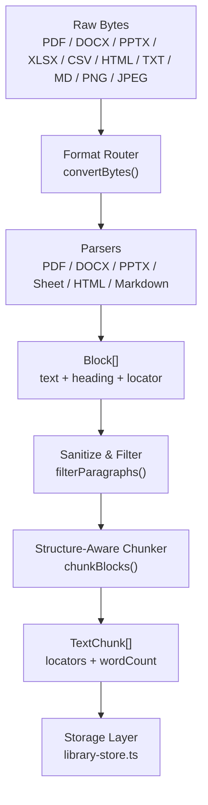
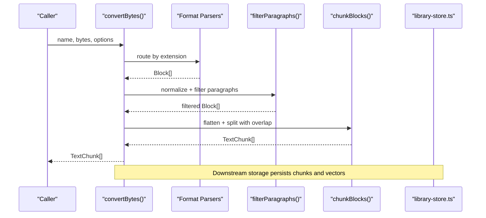
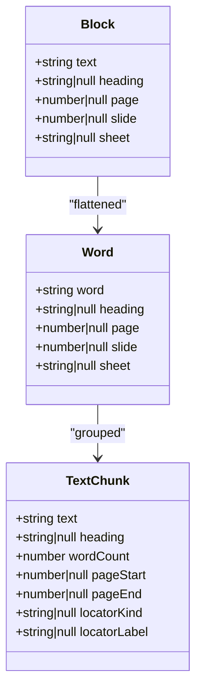
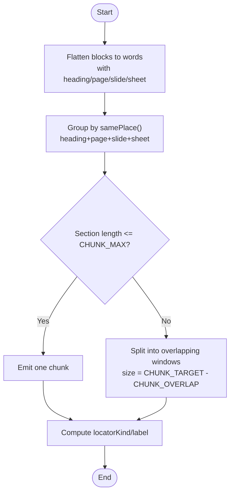
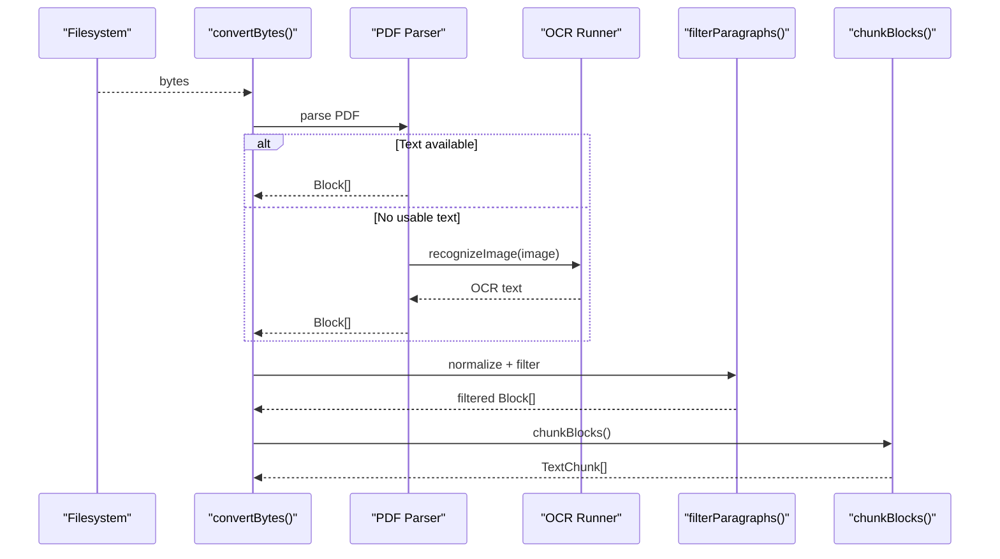
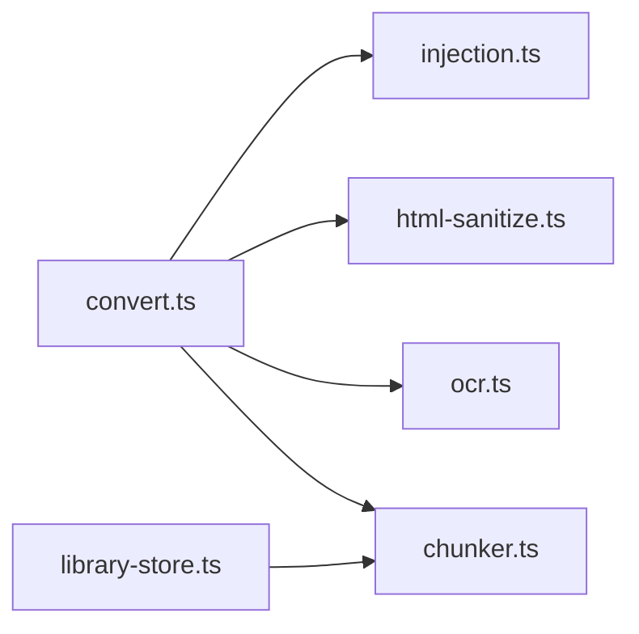

# Format Conversion Pipeline

<cite>
**Referenced Files in This Document**
- [convert.ts](file://apps/desktop/src/main/core/convert.ts)
- [chunker.ts](file://apps/desktop/src/main/core/chunker.ts)
- [ocr.ts](file://apps/desktop/src/main/core/ocr.ts)
- [injection.ts](file://apps/desktop/src/main/core/injection.ts)
- [html-sanitize.ts](file://apps/desktop/src/main/core/html-sanitize.ts)
- [document-export.ts](file://apps/desktop/src/main/core/document-export.ts)
- [library-store.ts](file://apps/desktop/src/main/core/library-store.ts)
</cite>

## Table of Contents
1. [Introduction](#introduction)
2. [Project Structure](#project-structure)
3. [Core Components](#core-components)
4. [Architecture Overview](#architecture-overview)
5. [Detailed Component Analysis](#detailed-component-analysis)
6. [Dependency Analysis](#dependency-analysis)
7. [Performance Considerations](#performance-considerations)
8. [Troubleshooting Guide](#troubleshooting-guide)
9. [Conclusion](#conclusion)

## Introduction
This document explains the format conversion pipeline that turns raw document bytes into normalized, structured text blocks suitable for downstream indexing and retrieval. It covers supported formats, the end-to-end workflow from ingestion to chunking, metadata preservation, OCR fallbacks, sanitization, and quality/performance considerations.

## Project Structure
The pipeline is implemented in the desktop application’s main process:
- Format-specific parsers produce a common Block representation with optional heading, page, slide, or sheet context.
- A structure-aware chunker groups words into TextChunk objects with stable locators.
- Sanitization and injection filtering remove hidden content and suspicious instructions.
- Optional OCR extracts text from images and scanned PDF pages.
- Export utilities convert documents between formats for user workflows.

**Diagram sources**
- [convert.ts:81-105](file://apps/desktop/src/main/core/convert.ts#L81-L105)
- [chunker.ts:45-70](file://apps/desktop/src/main/core/chunker.ts#L45-L70)
- [library-store.ts:159-179](file://apps/desktop/src/main/core/library-store.ts#L159-L179)

**Section sources**
- [convert.ts:1-105](file://apps/desktop/src/main/core/convert.ts#L1-L105)
- [chunker.ts:1-70](file://apps/desktop/src/main/core/chunker.ts#L1-L70)
- [library-store.ts:159-179](file://apps/desktop/src/main/core/library-store.ts#L159-L179)

## Core Components
- Format router and parsers: accept bytes, detect extension, parse each format, and emit Block objects.
- Sanitizer and injection filter: normalize text, drop invisible elements, and remove suspicious paragraphs.
- OCR runner: offloads image recognition to a utility process with timeouts and error handling.
- Chunker: splits long sections while preserving headings and locators; adds overlap to maintain context.
- Export utilities: convert between formats (e.g., PDF to images, images to PDF, tables to CSV/XLSX).

Key responsibilities:
- convertBytes(): dispatches by file extension and applies paragraph filtering.
- visiblePdfText(): prefers operator-level text extraction; falls back to standard text content.
- linesToBlocks(): groups lines into blocks and detects simple headings.
- htmlBlocks()/markdownBlocks(): extract headings and body text from markup.
- convertImage(): runs OCR and optionally attaches an image caption.
- chunkBlocks(): produces TextChunk with stable locators and controlled overlap.

**Section sources**
- [convert.ts:81-105](file://apps/desktop/src/main/core/convert.ts#L81-L105)
- [convert.ts:108-149](file://apps/desktop/src/main/core/convert.ts#L108-L149)
- [convert.ts:206-235](file://apps/desktop/src/main/core/convert.ts#L206-L235)
- [convert.ts:315-355](file://apps/desktop/src/main/core/convert.ts#L315-L355)
- [convert.ts:357-367](file://apps/desktop/src/main/core/convert.ts#L357-L367)
- [chunker.ts:45-70](file://apps/desktop/src/main/core/chunker.ts#L45-L70)

## Architecture Overview
The pipeline follows a linear flow with branching per format and optional OCR. All paths converge on a normalized Block list, which is sanitized and then chunked.

**Diagram sources**
- [convert.ts:81-105](file://apps/desktop/src/main/core/convert.ts#L81-L105)
- [chunker.ts:45-70](file://apps/desktop/src/main/core/chunker.ts#L45-L70)
- [library-store.ts:159-179](file://apps/desktop/src/main/core/library-store.ts#L159-L179)

## Detailed Component Analysis

### Supported Formats and Conversion Paths
Supported input formats and their processing paths:
- PDF: extract visible text via operator walk or text content; render page to image and run OCR if needed; attach optional image caption.
- DOCX: strip hidden runs, convert to HTML, extract headings and paragraphs.
- PPTX: read slide XML, treat first text as heading, join remaining text.
- XLSX/CSV: read sheets as rows; limit rows/columns; create one block per sheet with sheet name as heading.
- HTML/HTM: sanitize visible text, extract headings up to h3, then paragraphs and list items; fallback to plain text.
- Markdown/Text: group by headings (#–###), preserve line breaks within blocks.
- PNG/JPG/JPEG: OCR text; optionally add image description.

Quality notes:
- PDFs may require OCR when text layer is missing or invisible.
- DOCX hidden runs and near-white text are removed before parsing.
- HTML sanitization removes hidden nodes, scripts, styles, and near-invisible text.
- Spreadsheet export warns about merged/nested tables not being preserved.

**Section sources**
- [convert.ts:81-105](file://apps/desktop/src/main/core/convert.ts#L81-L105)
- [convert.ts:108-149](file://apps/desktop/src/main/core/convert.ts#L108-L149)
- [convert.ts:247-313](file://apps/desktop/src/main/core/convert.ts#L247-L313)
- [convert.ts:315-355](file://apps/desktop/src/main/core/convert.ts#L315-L355)
- [convert.ts:357-367](file://apps/desktop/src/main/core/convert.ts#L357-L367)
- [document-export.ts:42-62](file://apps/desktop/src/main/core/document-export.ts#L42-L62)

### Block Representation System
Blocks carry minimal but essential metadata:
- text: normalized passage text.
- heading: section title when available.
- page/slide/sheet: locator context for citations and navigation.

The chunker flattens blocks into words carrying the same locator metadata, then groups them into chunks while respecting structural boundaries.

**Diagram sources**
- [chunker.ts:11-35](file://apps/desktop/src/main/core/chunker.ts#L11-L35)
- [chunker.ts:72-88](file://apps/desktop/src/main/core/chunker.ts#L72-L88)
- [chunker.ts:90-118](file://apps/desktop/src/main/core/chunker.ts#L90-L118)

**Section sources**
- [chunker.ts:11-35](file://apps/desktop/src/main/core/chunker.ts#L11-L35)
- [chunker.ts:72-118](file://apps/desktop/src/main/core/chunker.ts#L72-L118)

### Chunking Algorithm
Goals:
- Keep chunks around a target size (~250 words), bounded by a maximum (~300 words).
- Preserve structural boundaries: new chunk starts on heading/page/slide/sheet changes.
- Maintain context via overlap between adjacent chunks.

Algorithm outline:
- Flatten blocks into words with inherited metadata.
- Group consecutive words sharing the same place (heading, page, slide, sheet).
- For sections longer than the maximum, split into overlapping windows of target size.
- Compute locator kind and label for each chunk (slide > sheet > page).
- Attach heading to chunk text if it is not already present.

**Diagram sources**
- [chunker.ts:45-70](file://apps/desktop/src/main/core/chunker.ts#L45-L70)
- [chunker.ts:72-88](file://apps/desktop/src/main/core/chunker.ts#L72-L88)
- [chunker.ts:90-118](file://apps/desktop/src/main/core/chunker.ts#L90-L118)

**Section sources**
- [chunker.ts:1-118](file://apps/desktop/src/main/core/chunker.ts#L1-L118)

### Conversion Workflow: Raw Bytes to Normalized Text
End-to-end steps:
1. Read attachment and validate size/format.
2. Route by extension to the appropriate parser.
3. Extract text and build Block[] with optional heading and locator.
4. Normalize and filter paragraphs to remove hidden/injected content.
5. Chunk blocks into TextChunk[] with stable locators.
6. Persist chunks and embeddings (downstream).

**Diagram sources**
- [convert.ts:81-105](file://apps/desktop/src/main/core/convert.ts#L81-L105)
- [convert.ts:108-149](file://apps/desktop/src/main/core/convert.ts#L108-L149)
- [ocr.ts:88-105](file://apps/desktop/src/main/core/ocr.ts#L88-L105)
- [injection.ts:57-82](file://apps/desktop/src/main/core/injection.ts#L57-L82)
- [chunker.ts:45-70](file://apps/desktop/src/main/core/chunker.ts#L45-L70)

**Section sources**
- [convert.ts:71-105](file://apps/desktop/src/main/core/convert.ts#L71-L105)
- [convert.ts:108-149](file://apps/desktop/src/main/core/convert.ts#L108-L149)
- [ocr.ts:88-105](file://apps/desktop/src/main/core/ocr.ts#L88-L105)
- [injection.ts:57-82](file://apps/desktop/src/main/core/injection.ts#L57-L82)
- [chunker.ts:45-70](file://apps/desktop/src/main/core/chunker.ts#L45-L70)

### Encoding Detection and Cleanup
- HTML sanitization parses DOM-like structures, applies CSS rules, and drops hidden nodes, scripts, templates, and near-invisible text.
- Unicode normalization and control character removal occur early to prevent injection tricks.
- Paragraph scoring flags suspicious patterns and can drop or downrank content.
- PDF invisible text detection uses operator lists to skip rendering mode 3 or near-white fills.

Practical effects:
- Mixed encodings in HTML are handled by decoding entities safely.
- Invisible styling (display:none, opacity, tiny fonts, far offsets) is detected and excluded.
- Suspicious instruction patterns are neutralized before chunking.

**Section sources**
- [html-sanitize.ts:37-68](file://apps/desktop/src/main/core/html-sanitize.ts#L37-L68)
- [html-sanitize.ts:95-171](file://apps/desktop/src/main/core/html-sanitize.ts#L95-L171)
- [html-sanitize.ts:227-297](file://apps/desktop/src/main/core/html-sanitize.ts#L227-L297)
- [html-sanitize.ts:299-323](file://apps/desktop/src/main/core/html-sanitize.ts#L299-L323)
- [injection.ts:31-55](file://apps/desktop/src/main/core/injection.ts#L31-L55)
- [injection.ts:57-82](file://apps/desktop/src/main/core/injection.ts#L57-L82)
- [convert.ts:145-179](file://apps/desktop/src/main/core/convert.ts#L145-L179)

### OCR Integration
- OCR runs in a separate Electron UtilityProcess to avoid blocking the main thread.
- The worker path and runner path are resolved at runtime; language data directories are passed explicitly.
- Timeouts protect against stuck workers; pending jobs are rejected on process exit.
- OCR results include confidence scores and text; captions can be appended for images.

Operational details:
- ensureChild() lazily starts the OCR process once and reuses it.
- recognizeImage() sends messages with image buffer and configuration, returning a promise resolved on success or timeout.

**Section sources**
- [ocr.ts:1-24](file://apps/desktop/src/main/core/ocr.ts#L1-L24)
- [ocr.ts:52-86](file://apps/desktop/src/main/core/ocr.ts#L52-L86)
- [ocr.ts:88-105](file://apps/desktop/src/main/core/ocr.ts#L88-L105)
- [ocr.ts:107-113](file://apps/desktop/src/main/core/ocr.ts#L107-L113)

### Export Utilities
- convertDocument() supports converting between formats:
  - PDF to PNG/JPEG (page images).
  - Images to PDF (image placed on page).
  - Tables to CSV/XLSX (simple grids only).
- Warnings indicate limitations such as non-text outputs or simplified table exports.

Use cases:
- User-driven conversions for editing or sharing.
- Validation fixtures for testing conversion fidelity.

**Section sources**
- [document-export.ts:42-62](file://apps/desktop/src/main/core/document-export.ts#L42-L62)

## Dependency Analysis
High-level dependencies among core modules:

- convert.ts depends on injection.ts for paragraph filtering and html-sanitize.ts for HTML preprocessing.
- convert.ts integrates ocr.ts for image-based text extraction.
- chunker.ts defines shared types used by library-store.ts for persistence.

**Diagram sources**
- [convert.ts:15-18](file://apps/desktop/src/main/core/convert.ts#L15-L18)
- [chunker.ts:11-35](file://apps/desktop/src/main/core/chunker.ts#L11-L35)
- [library-store.ts:159-179](file://apps/desktop/src/main/core/library-store.ts#L159-L179)

**Section sources**
- [convert.ts:15-18](file://apps/desktop/src/main/core/convert.ts#L15-L18)
- [chunker.ts:11-35](file://apps/desktop/src/main/core/chunker.ts#L11-L35)
- [library-store.ts:159-179](file://apps/desktop/src/main/core/library-store.ts#L159-L179)

## Performance Considerations
- Attachment size limit: files larger than 40 MB are rejected early to bound memory usage.
- PDF processing:
  - Uses operator-level text extraction to avoid invisible text and reduce noise.
  - Renders pages at a capped scale to balance OCR quality and memory.
  - Cleans up page resources after processing.
- Chunking:
  - Target ~250 words with max ~300 words and 40-word overlap to keep chunks manageable while preserving context.
- OCR:
  - Runs in a separate process with timeouts to prevent hangs.
  - Language data directories are provided to avoid repeated downloads.
- HTML sanitization:
  - Lightweight custom parser avoids heavy DOM libraries.
  - Early removal of hidden nodes reduces downstream work.

Optimization strategies:
- Prefer operator-level PDF text extraction before falling back to OCR.
- Limit spreadsheet rows/columns during parsing.
- Use progress callbacks and cancellation checks for long-running operations.

**Section sources**
- [convert.ts:20-21](file://apps/desktop/src/main/core/convert.ts#L20-L21)
- [convert.ts:71-79](file://apps/desktop/src/main/core/convert.ts#L71-L79)
- [convert.ts:108-149](file://apps/desktop/src/main/core/convert.ts#L108-L149)
- [convert.ts:237-245](file://apps/desktop/src/main/core/convert.ts#L237-L245)
- [chunker.ts:7-9](file://apps/desktop/src/main/core/chunker.ts#L7-L9)
- [ocr.ts:88-105](file://apps/desktop/src/main/core/ocr.ts#L88-L105)

## Troubleshooting Guide
Common issues and resolutions:
- “No text found” errors:
  - Occur when all parsers return empty blocks after filtering.
  - For PDFs, check whether the document has a text layer; consider enabling OCR.
  - For images, verify OCR language packs are installed and accessible.
- OCR timeouts or process exits:
  - Ensure the OCR runner exists and language data directories are valid.
  - Monitor child process lifecycle; pending jobs are rejected on failure.
- Hidden or injected content:
  - If expected text disappears, inspect sanitizer reports and injection flags.
  - Adjust expectations for near-invisible styling or suspicious patterns.
- Export warnings:
  - Converting to images means no layout reconstruction.
  - Simple table export does not support merged cells or nested tables.

Diagnostic tips:
- Inspect warnings returned by conversion functions.
- Validate magic bytes for exported formats to confirm correct output.
- Use progress callbacks to identify failing stages.

**Section sources**
- [convert.ts:100-105](file://apps/desktop/src/main/core/convert.ts#L100-L105)
- [convert.ts:141-142](file://apps/desktop/src/main/core/convert.ts#L141-L142)
- [convert.ts:357-367](file://apps/desktop/src/main/core/convert.ts#L357-L367)
- [ocr.ts:52-86](file://apps/desktop/src/main/core/ocr.ts#L52-L86)
- [document-export.ts:50-62](file://apps/desktop/src/main/core/document-export.ts#L50-L62)

## Conclusion
The pipeline provides a robust, extensible path from diverse document formats to normalized, structured chunks with stable locators. It balances accuracy and performance through careful parsing, sanitization, and chunking, with OCR as a reliable fallback for visual content. The design keeps memory and CPU usage bounded, supports cancellation and progress reporting, and preserves enough metadata to enable precise citation and retrieval.