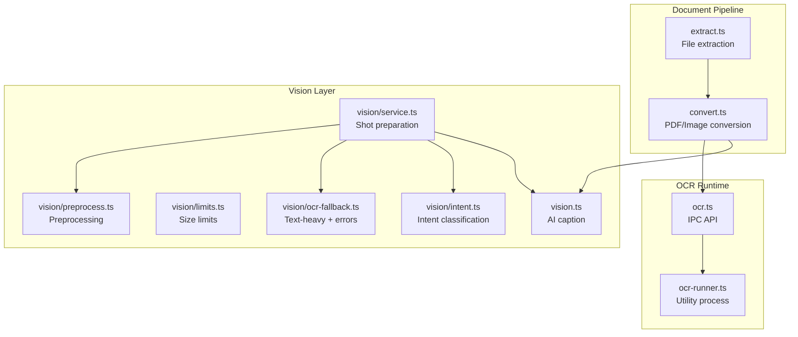
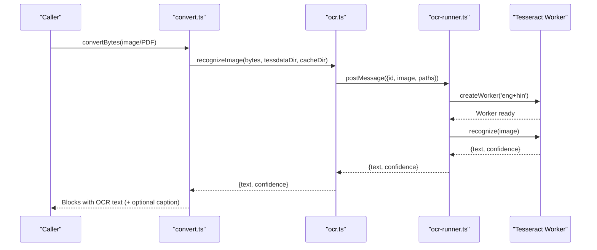
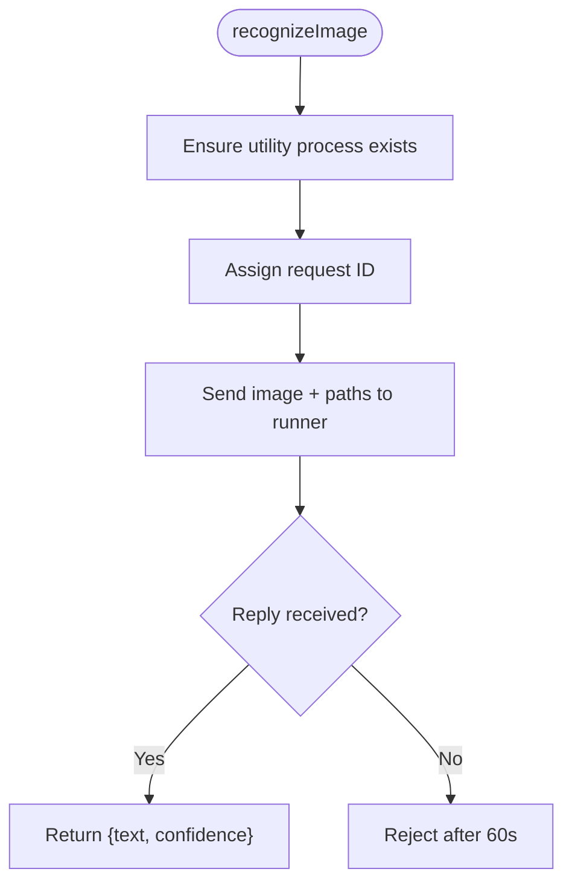
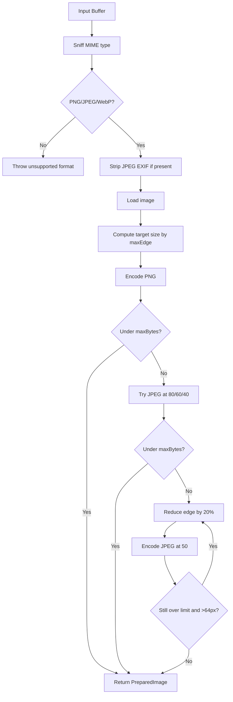
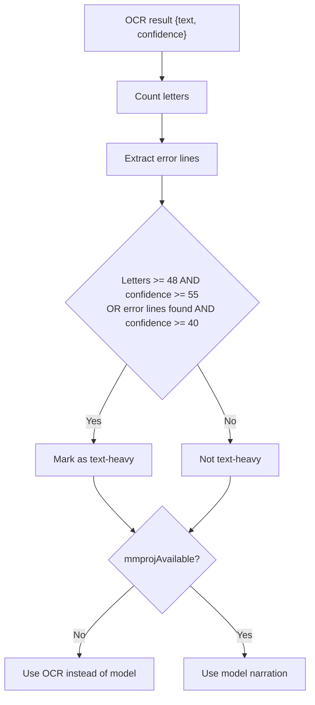
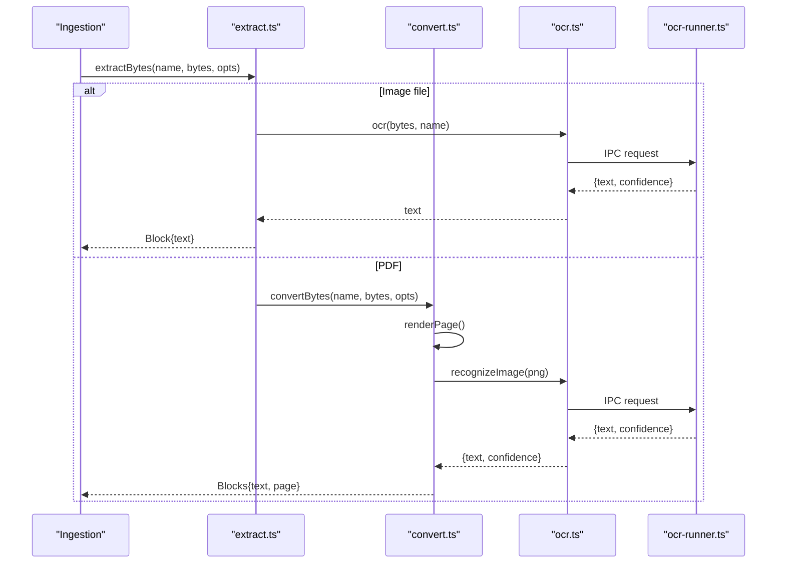
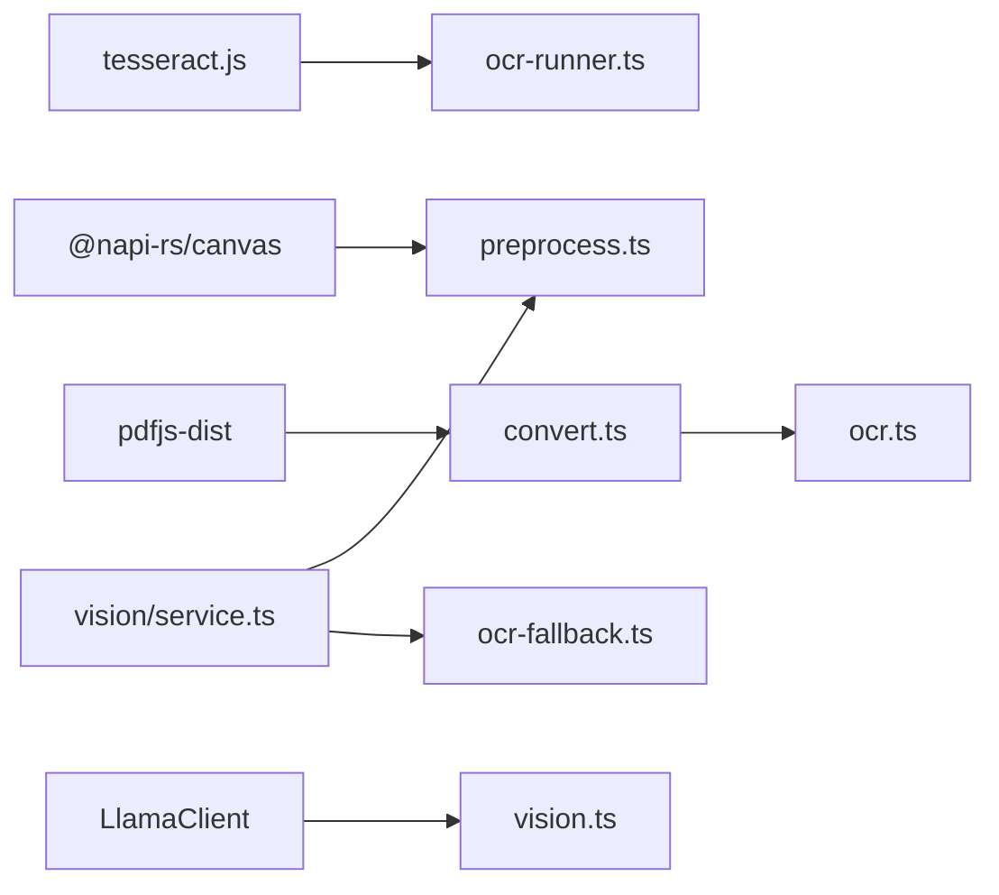

# OCR Processing Engine

<cite>
**Referenced Files in This Document**
- [ocr.ts](file://apps/desktop/src/main/core/ocr.ts)
- [ocr-runner.ts](file://apps/desktop/src/main/core/ocr-runner.ts)
- [preprocess.ts](file://apps/desktop/src/main/core/vision/preprocess.ts)
- [service.ts](file://apps/desktop/src/main/core/vision/service.ts)
- [ocr-fallback.ts](file://apps/desktop/src/main/core/vision/ocr-fallback.ts)
- [limits.ts](file://apps/desktop/src/main/core/vision/limits.ts)
- [intent.ts](file://apps/desktop/src/main/core/vision/intent.ts)
- [vision.ts](file://apps/desktop/src/main/core/vision.ts)
- [convert.ts](file://apps/desktop/src/main/core/convert.ts)
- [extract.ts](file://apps/desktop/src/main/core/files/extract.ts)
- [fetch-tessdata.mjs](file://apps/desktop/scripts/fetch-tessdata.mjs)
</cite>

## Table of Contents
1. [Introduction](#introduction)
2. [Project Structure](#project-structure)
3. [Core Components](#core-components)
4. [Architecture Overview](#architecture-overview)
5. [Detailed Component Analysis](#detailed-component-analysis)
6. [Dependency Analysis](#dependency-analysis)
7. [Performance Considerations](#performance-considerations)
8. [Troubleshooting Guide](#troubleshooting-guide)
9. [Conclusion](#conclusion)

## Introduction
This document explains the OCR processing engine used by the desktop application for optical character recognition of images and scanned documents. It covers Tesseract.js integration, image preprocessing, AI-based captioning, language support, confidence scoring, fallback behavior, performance considerations, and how OCR fits into the broader document processing pipeline.

The OCR path is designed to run offline after installation. Language data is bundled during build time, and OCR runs in a separate utility process so that a stuck Tesseract worker cannot freeze the main Electron process. The same OCR subsystem is reused across file ingestion, PDF scanning, and code-agent screenshot workflows.

## Project Structure
OCR-related functionality is split between:
- Core OCR runtime and IPC bridge
- Image preprocessing and limits
- Vision service that decides when to use OCR versus an AI model
- Fallback logic for text-heavy detection and error extraction
- Caption generation using a multimodal client
- Document conversion pipeline that integrates OCR with PDFs and images

**Diagram sources**
- [convert.ts:108-143](file://apps/desktop/src/main/core/convert.ts#L108-L143)
- [extract.ts:42-65](file://apps/desktop/src/main/core/files/extract.ts#L42-L65)
- [service.ts:28-97](file://apps/desktop/src/main/core/vision/service.ts#L28-L97)
- [preprocess.ts:87-120](file://apps/desktop/src/main/core/vision/preprocess.ts#L87-L120)
- [ocr.ts:88-112](file://apps/desktop/src/main/core/ocr.ts#L88-L112)
- [ocr-runner.ts:45-88](file://apps/desktop/src/main/core/ocr-runner.ts#L45-L88)

**Section sources**
- [convert.ts:1-106](file://apps/desktop/src/main/core/convert.ts#L1-L106)
- [extract.ts:14-65](file://apps/desktop/src/main/core/files/extract.ts#L14-L65)
- [service.ts:1-119](file://apps/desktop/src/main/core/vision/service.ts#L1-L119)
- [ocr.ts:1-112](file://apps/desktop/src/main/core/ocr.ts#L1-L112)
- [ocr-runner.ts:1-88](file://apps/desktop/src/main/core/ocr-runner.ts#L1-L88)

## Core Components
- OCR API and IPC bridge: `ocr.ts` exposes `recognizeImage`, which sends image bytes to a utility process via `postMessage`. It manages pending requests, timeouts, and shutdown.
- Utility process runner: `ocr-runner.ts` hosts a shared Tesseract worker, seeds language data into a cache directory, and returns recognized text and confidence.
- Image preprocessing: `preprocess.ts` sniffs MIME types, strips EXIF from JPEGs, resizes while preserving aspect ratio, and encodes to PNG or JPEG under size limits.
- Vision service: `service.ts` orchestrates preprocessing, OCR, intent classification, optional AI narration, and decision-making about whether to use OCR or a multimodal model.
- OCR fallback and text-heavy detection: `ocr-fallback.ts` extracts error lines and determines if OCR output should be preferred over a model.
- Limits: `limits.ts` defines maximum edge length and byte caps per model family.
- Captioning: `vision.ts` provides a simple multimodal prompt to describe images when a projector model is available.
- Document conversion: `convert.ts` integrates OCR for scanned PDF pages and standalone images, and optionally appends AI-generated captions.

**Section sources**
- [ocr.ts:12-112](file://apps/desktop/src/main/core/ocr.ts#L12-L112)
- [ocr-runner.ts:35-88](file://apps/desktop/src/main/core/ocr-runner.ts#L35-L88)
- [preprocess.ts:21-136](file://apps/desktop/src/main/core/vision/preprocess.ts#L21-L136)
- [service.ts:28-119](file://apps/desktop/src/main/core/vision/service.ts#L28-L119)
- [ocr-fallback.ts:1-38](file://apps/desktop/src/main/core/vision/ocr-fallback.ts#L1-L38)
- [limits.ts:1-21](file://apps/desktop/src/main/core/vision/limits.ts#L1-L21)
- [vision.ts:8-22](file://apps/desktop/src/main/core/vision.ts#L8-L22)
- [convert.ts:108-143](file://apps/desktop/src/main/core/convert.ts#L108-L143)

## Architecture Overview
The OCR engine uses a layered architecture:
- Conversion layer calls OCR for images and scanned PDF pages.
- Vision layer preprocesses screenshots, runs OCR, classifies intent, and optionally asks a multimodal model for narration.
- OCR runtime runs in a separate utility process to avoid blocking the main thread.

**Diagram sources**
- [convert.ts:108-143](file://apps/desktop/src/main/core/convert.ts#L108-L143)
- [ocr.ts:88-112](file://apps/desktop/src/main/core/ocr.ts#L88-L112)
- [ocr-runner.ts:45-88](file://apps/desktop/src/main/core/ocr-runner.ts#L45-L88)

## Detailed Component Analysis

### Tesseract.js Integration and IPC Bridge
- `ocr.ts` resolves the Tesseract worker script path and exposes `recognizeImage`. It creates a child utility process on demand, assigns sequential IDs, tracks pending jobs, and enforces a timeout.
- `ocr-runner.ts` receives messages, seeds the cache with bundled language files, and maintains a shared Tesseract worker keyed by configuration. It returns trimmed text and confidence.

Key behaviors:
- Offline operation: language data is copied into a cache directory before creating the worker.
- Shared worker lifecycle: replaces previous workers when configuration changes.
- Error propagation: errors are caught and returned through the IPC reply.

**Diagram sources**
- [ocr.ts:88-112](file://apps/desktop/src/main/core/ocr.ts#L88-L112)
- [ocr-runner.ts:45-88](file://apps/desktop/src/main/core/ocr-runner.ts#L45-L88)

**Section sources**
- [ocr.ts:12-112](file://apps/desktop/src/main/core/ocr.ts#L12-L112)
- [ocr-runner.ts:35-88](file://apps/desktop/src/main/core/ocr-runner.ts#L35-L88)

### Image Preprocessing Pipeline
The preprocessing module optimizes images for downstream consumers (vision models and OCR):
- MIME sniffing supports PNG, JPEG, and WebP.
- JPEG EXIF segments are stripped to reduce payload size.
- Aspect-preserving resizing targets a maximum edge length defined by model family limits.
- Encoding strategy prefers PNG first; if too large, it tries JPEG at decreasing quality levels until within the byte cap.
- If still too large, it iteratively reduces the longest edge until the byte limit is met.

**Diagram sources**
- [preprocess.ts:21-136](file://apps/desktop/src/main/core/vision/preprocess.ts#L21-L136)
- [limits.ts:6-21](file://apps/desktop/src/main/core/vision/limits.ts#L6-L21)

Notes:
- Noise reduction and orientation correction are not implemented in this preprocessing step. The current pipeline focuses on format handling, EXIF stripping, resizing, and encoding.
- For scanned documents, PDF rendering produces rasterized pages before OCR, which can mitigate some orientation issues depending on source content.

**Section sources**
- [preprocess.ts:21-136](file://apps/desktop/src/main/core/vision/preprocess.ts#L21-L136)
- [limits.ts:1-21](file://apps/desktop/src/main/core/vision/limits.ts#L1-L21)

### Caption Generation System
When a multimodal projector model is available, the system can generate descriptive captions beyond OCR text:
- `vision.ts` provides `captionImage`, which sends an image URL and a short prompt to a multimodal client.
- `convert.ts` optionally invokes the caption function for scanned PDF pages and standalone images, appending a block labeled “Image description”.
- In the vision service, narration may be generated for mockup, compare, or describe intents when OCR alone is insufficient.

Behavior:
- Captioning is optional and gated by availability of the projector file.
- Narration failures are swallowed to keep the pipeline robust.

**Section sources**
- [vision.ts:8-22](file://apps/desktop/src/main/core/vision.ts#L8-L22)
- [convert.ts:127-135](file://apps/desktop/src/main/core/convert.ts#L127-L135)
- [convert.ts:357-367](file://apps/desktop/src/main/core/convert.ts#L357-L367)
- [service.ts:99-109](file://apps/desktop/src/main/core/vision/service.ts#L99-L109)

### OCR Language Support, Confidence Scoring, and Fallback Mechanisms
Language support:
- Bundled languages are English (`eng`) and Hindi (`hin`).
- Language data is downloaded by `fetch-tessdata.mjs` and placed into `resources/tessdata`.
- The Tesseract worker is created with both languages enabled.

Confidence scoring:
- OCR results include a confidence value.
- The vision service uses confidence alongside text density to determine if OCR output is text-heavy.

Fallback mechanisms:
- `ocr-fallback.ts` detects error-like lines and applies thresholds to decide if OCR should be preferred over a model.
- `ocrInsteadOfModel` chooses OCR when no projector model is installed or when the image is text-heavy.
- If OCR fails or returns empty text, the pipeline falls back to model narration where applicable, or reports that no text could be read.

**Diagram sources**
- [ocr-fallback.ts:14-38](file://apps/desktop/src/main/core/vision/ocr-fallback.ts#L14-L38)
- [service.ts:41-58](file://apps/desktop/src/main/core/vision/service.ts#L41-L58)

**Section sources**
- [fetch-tessdata.mjs:1-41](file://apps/desktop/scripts/fetch-tessdata.mjs#L1-L41)
- [ocr-runner.ts:55-66](file://apps/desktop/src/main/core/ocr-runner.ts#L55-L66)
- [ocr-fallback.ts:14-38](file://apps/desktop/src/main/core/vision/ocr-fallback.ts#L14-L38)
- [service.ts:41-58](file://apps/desktop/src/main/core/vision/service.ts#L41-L58)

### Integration with the Document Processing Pipeline
The OCR engine is integrated into the document pipeline in two primary ways:
- File extraction: `extract.ts` routes images to OCR when an OCR function is provided, returning blocks with extracted text.
- PDF conversion: `convert.ts` renders scanned PDF pages to PNG and runs OCR; it also optionally adds AI-generated captions.

**Diagram sources**
- [extract.ts:42-65](file://apps/desktop/src/main/core/files/extract.ts#L42-L65)
- [convert.ts:108-143](file://apps/desktop/src/main/core/convert.ts#L108-L143)
- [ocr.ts:88-112](file://apps/desktop/src/main/core/ocr.ts#L88-L112)
- [ocr-runner.ts:45-88](file://apps/desktop/src/main/core/ocr-runner.ts#L45-L88)

**Section sources**
- [extract.ts:42-65](file://apps/desktop/src/main/core/files/extract.ts#L42-L65)
- [convert.ts:108-143](file://apps/desktop/src/main/core/convert.ts#L108-L143)

## Dependency Analysis
The OCR engine depends on:
- Tesseract.js for OCR computation.
- Canvas libraries for image loading and encoding.
- PDF.js for rendering scanned PDF pages.
- Optional multimodal client for captioning.

**Diagram sources**
- [ocr-runner.ts:7](file://apps/desktop/src/main/core/ocr-runner.ts#L7)
- [preprocess.ts:6-7](file://apps/desktop/src/main/core/vision/preprocess.ts#L6-L7)
- [convert.ts:8-18](file://apps/desktop/src/main/core/convert.ts#L8-L18)
- [vision.ts:6-22](file://apps/desktop/src/main/core/vision.ts#L6-L22)
- [service.ts:7-11](file://apps/desktop/src/main/core/vision/service.ts#L7-L11)

**Section sources**
- [ocr-runner.ts:1-88](file://apps/desktop/src/main/core/ocr-runner.ts#L1-L88)
- [preprocess.ts:1-136](file://apps/desktop/src/main/core/vision/preprocess.ts#L1-L136)
- [convert.ts:1-106](file://apps/desktop/src/main/core/convert.ts#L1-L106)
- [vision.ts:1-22](file://apps/desktop/src/main/core/vision.ts#L1-L22)
- [service.ts:1-119](file://apps/desktop/src/main/core/vision/service.ts#L1-L119)

## Performance Considerations
- Utility process isolation: OCR runs in a separate process to prevent WASM worker stalls from freezing the main thread.
- Shared worker lifecycle: The runner caches a single Tesseract worker keyed by configuration to avoid repeated initialization costs.
- Timeouts: OCR requests have a 60-second timeout to prevent hanging jobs.
- Image size control: Preprocessing enforces maximum edge length and byte caps, reducing memory pressure and network payloads.
- Batch operations: The vision service processes up to four images per call, limiting concurrency and memory usage.
- Attachment size limit: The conversion layer rejects attachments larger than 40 MB.
- Progress and cancellation: Conversion functions expose progress callbacks and cancellation checks to support long-running batch jobs.

Recommendations:
- For large batches, chunk images and process them sequentially or with bounded concurrency to avoid memory spikes.
- Prefer JPEG encoding when PNG exceeds limits to reduce memory footprint.
- Reuse the OCR API instance rather than recreating it frequently to benefit from the shared worker.
- Monitor confidence thresholds and consider re-processing low-confidence scans with higher-quality input when possible.

[No sources needed since this section provides general guidance]

## Troubleshooting Guide
Common issues and resolutions:
- Missing language data: Ensure `resources/tessdata` contains `eng.traineddata` and `hin.traineddata`. They are downloaded by `fetch-tessdata.mjs` and must exist for offline OCR.
- OCR runner missing: The utility process path must resolve to a built file; otherwise, rebuild the desktop app.
- No text found: Images without readable text will throw an error in extraction; verify image quality and ensure the OCR engine is initialized.
- Timed out OCR: Long-running OCR jobs may exceed the 60-second timeout; check image size and complexity.
- Model unavailable: When the projector file is not installed, OCR is automatically chosen for text-heavy images.

Debugging tips:
- Inspect OCR confidence values to determine if text is likely valid.
- Check error line extraction to see if OCR detected stack traces or error messages.
- Validate preprocessing outputs by checking encoded MIME types and dimensions.

**Section sources**
- [fetch-tessdata.mjs:13-41](file://apps/desktop/scripts/fetch-tessdata.mjs#L13-L41)
- [ocr.ts:20-24](file://apps/desktop/src/main/core/ocr.ts#L20-L24)
- [ocr.ts:88-112](file://apps/desktop/src/main/core/ocr.ts#L88-L112)
- [ocr-fallback.ts:14-38](file://apps/desktop/src/main/core/vision/ocr-fallback.ts#L14-L38)
- [convert.ts:71-79](file://apps/desktop/src/main/core/convert.ts#L71-L79)

## Conclusion
The OCR processing engine combines Tesseract.js with a robust preprocessing and decision pipeline. It supports offline operation with bundled English and Hindi language data, integrates seamlessly into the document conversion workflow, and offers optional AI-driven captions. Confidence scoring and fallback logic ensure reliable behavior even when OCR accuracy varies. With utility process isolation, shared worker caching, and strict size limits, the system balances accuracy and performance for both interactive and batch scenarios.

[No sources needed since this section summarizes without analyzing specific files]