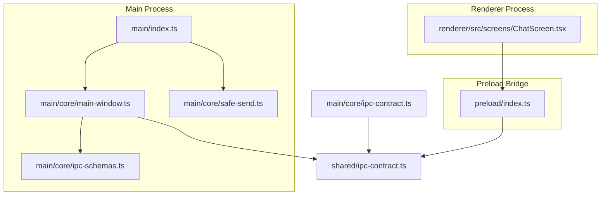
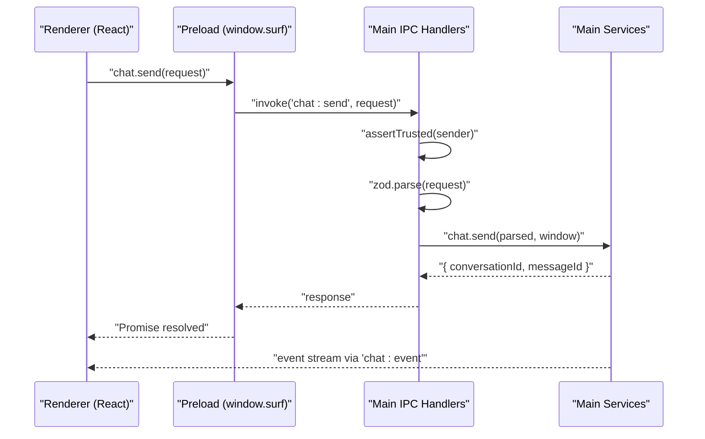
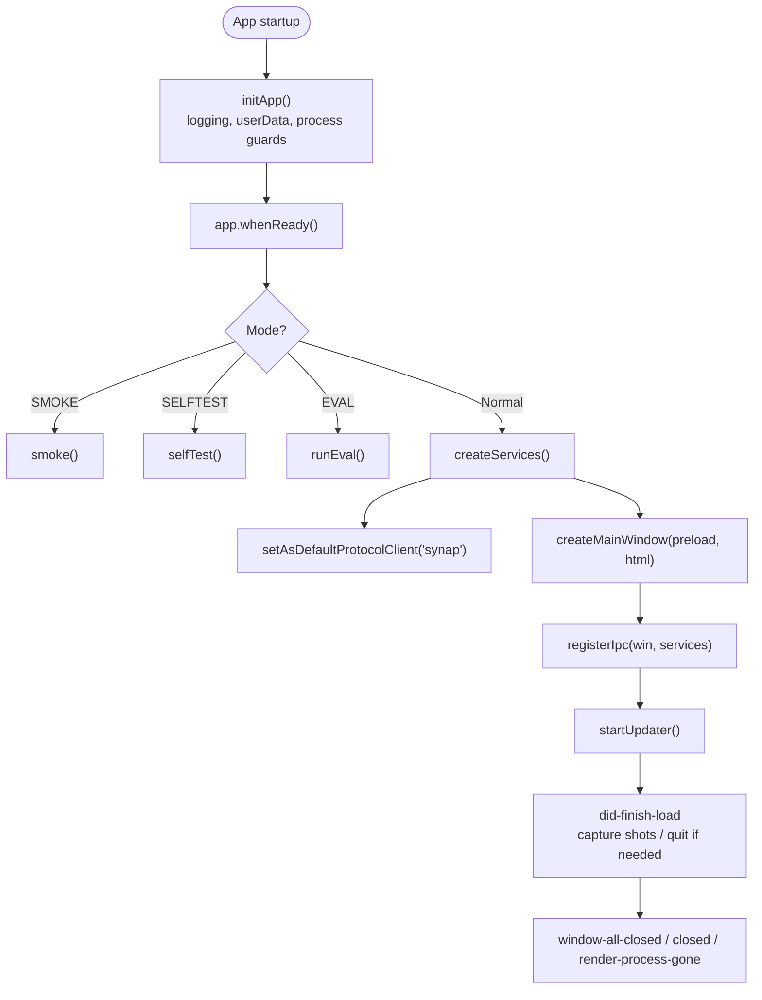
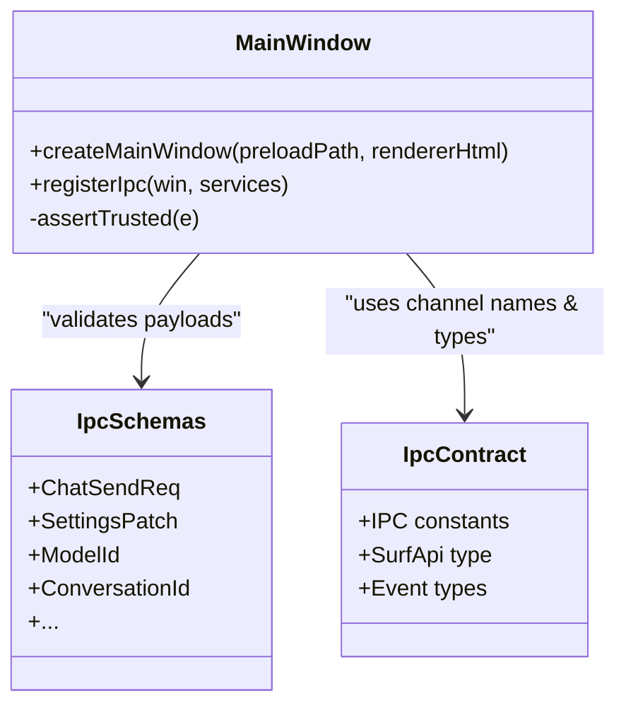
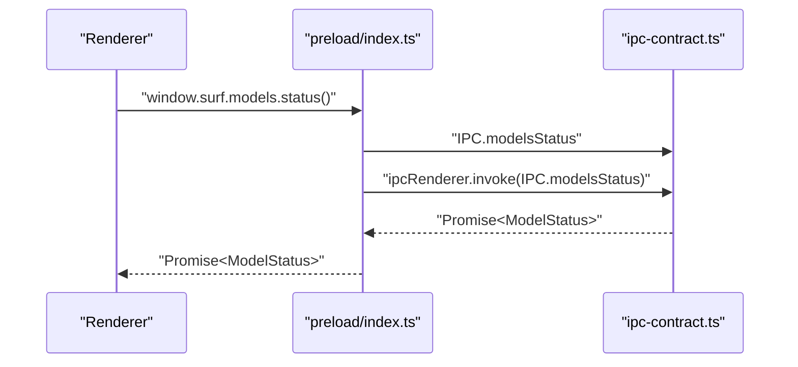
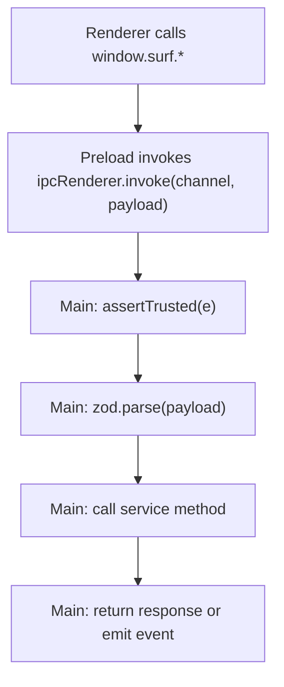
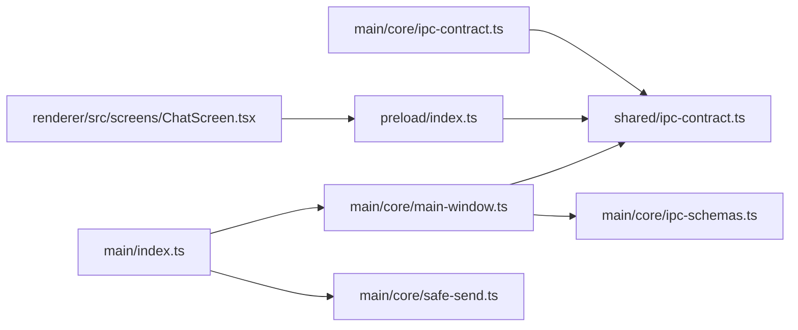

# Electron Architecture

<cite>
**Referenced Files in This Document**
- [apps/desktop/src/main/index.ts](file://apps/desktop/src/main/index.ts)
- [apps/desktop/src/main/core/main-window.ts](file://apps/desktop/src/main/core/main-window.ts)
- [apps/desktop/src/preload/index.ts](file://apps/desktop/src/preload/index.ts)
- [apps/desktop/src/shared/ipc-contract.ts](file://apps/desktop/src/shared/ipc-contract.ts)
- [apps/desktop/src/main/core/ipc-contract.ts](file://apps/desktop/src/main/core/ipc-contract.ts)
- [apps/desktop/src/main/core/ipc-schemas.ts](file://apps/desktop/src/main/core/ipc-schemas.ts)
- [apps/desktop/src/main/core/safe-send.ts](file://apps/desktop/src/main/core/safe-send.ts)
- [apps/desktop/src/renderer/src/screens/ChatScreen.tsx](file://apps/desktop/src/renderer/src/screens/ChatScreen.tsx)
</cite>

## Table of Contents
1. [Introduction](#introduction)
2. [Project Structure](#project-structure)
3. [Core Components](#core-components)
4. [Architecture Overview](#architecture-overview)
5. [Detailed Component Analysis](#detailed-component-analysis)
6. [Dependency Analysis](#dependency-analysis)
7. [Performance Considerations](#performance-considerations)
8. [Troubleshooting Guide](#troubleshooting-guide)
9. [Conclusion](#conclusion)

## Introduction
This document explains the Electron architecture used by Surf.ai’s desktop application. It focuses on how the main process owns system-level responsibilities while renderer processes render the user interface, and how they communicate securely through a typed IPC contract. It also covers the preload bridge, event-driven updates, security hardening, lifecycle management, error handling, and debugging practices for both development and production environments.

## Project Structure
The Electron app is organized into three primary layers:
- Main process: application bootstrap, window creation, IPC registration, services orchestration, and system integration.
- Preload script: secure API surface exposed to sandboxed renderers via `window.surf`.
- Renderer process: React-based UI that calls `window.surf` methods and subscribes to events.

**Diagram sources**
- [apps/desktop/src/main/index.ts:1-595](file://apps/desktop/src/main/index.ts#L1-L595)
- [apps/desktop/src/main/core/main-window.ts:1-403](file://apps/desktop/src/main/core/main-window.ts#L1-L403)
- [apps/desktop/src/preload/index.ts:1-159](file://apps/desktop/src/preload/index.ts#L1-L159)
- [apps/desktop/src/shared/ipc-contract.ts:1-1003](file://apps/desktop/src/shared/ipc-contract.ts#L1-L1003)
- [apps/desktop/src/main/core/ipc-contract.ts:1-2](file://apps/desktop/src/main/core/ipc-contract.ts#L1-L2)
- [apps/desktop/src/main/core/ipc-schemas.ts:1-199](file://apps/desktop/src/main/core/ipc-schemas.ts#L1-L199)
- [apps/desktop/src/main/core/safe-send.ts:1-27](file://apps/desktop/src/main/core/safe-send.ts#L1-L27)
- [apps/desktop/src/renderer/src/screens/ChatScreen.tsx:1-200](file://apps/desktop/src/renderer/src/screens/ChatScreen.tsx#L1-L200)

**Section sources**
- [apps/desktop/src/main/index.ts:1-595](file://apps/desktop/src/main/index.ts#L1-L595)
- [apps/desktop/src/main/core/main-window.ts:1-403](file://apps/desktop/src/main/core/main-window.ts#L1-L403)
- [apps/desktop/src/preload/index.ts:1-159](file://apps/desktop/src/preload/index.ts#L1-L159)
- [apps/desktop/src/shared/ipc-contract.ts:1-1003](file://apps/desktop/src/shared/ipc-contract.ts#L1-L1003)

## Core Components
- Main entry point: initializes environment, logging, single-instance behavior, optional self-test/smoke modes, service bootstrapping, window creation, IPC wiring, updater, and graceful shutdown hooks.
- Window manager: creates a hardened BrowserWindow with context isolation, sandboxing, strict CSP, link interception, and trusted sender checks.
- Preload bridge: exposes a minimal, typed `window.surf` API without exposing raw `ipcRenderer`.
- IPC contract: shared TypeScript types and channel names defining request/response/event shapes.
- Runtime validation: Zod schemas validate every IPC payload in the main process.
- Safe send helper: prevents crashes when sending events to destroyed or crashed renderers.

**Section sources**
- [apps/desktop/src/main/index.ts:38-65](file://apps/desktop/src/main/index.ts#L38-L65)
- [apps/desktop/src/main/index.ts:537-595](file://apps/desktop/src/main/index.ts#L537-L595)
- [apps/desktop/src/main/core/main-window.ts:29-67](file://apps/desktop/src/main/core/main-window.ts#L29-L67)
- [apps/desktop/src/main/core/main-window.ts:69-73](file://apps/desktop/src/main/core/main-window.ts#L69-L73)
- [apps/desktop/src/preload/index.ts:1-159](file://apps/desktop/src/preload/index.ts#L1-L159)
- [apps/desktop/src/shared/ipc-contract.ts:1-108](file://apps/desktop/src/shared/ipc-contract.ts#L1-L108)
- [apps/desktop/src/main/core/ipc-schemas.ts:1-199](file://apps/desktop/src/main/core/ipc-schemas.ts#L1-L199)
- [apps/desktop/src/main/core/safe-send.ts:1-27](file://apps/desktop/src/main/core/safe-send.ts#L1-L27)

## Architecture Overview
Surf.ai uses a classic Electron separation:
- Main process: owns OS resources, file access, native modules, model sidecars, database, settings, authentication, licensing, updates, and background tasks.
- Renderer process: renders UI components and user interactions; never accesses Node APIs directly.
- Preload bridge: provides a curated, typed API surface (`window.surf`) to the renderer.
- IPC channels: defined centrally in the shared contract and validated at runtime in the main process.

**Diagram sources**
- [apps/desktop/src/preload/index.ts:13-18](file://apps/desktop/src/preload/index.ts#L13-L18)
- [apps/desktop/src/main/core/main-window.ts:222-234](file://apps/desktop/src/main/core/main-window.ts#L222-L234)
- [apps/desktop/src/main/core/ipc-schemas.ts:5-14](file://apps/desktop/src/main/core/ipc-schemas.ts#L5-L14)
- [apps/desktop/src/shared/ipc-contract.ts:8-12](file://apps/desktop/src/shared/ipc-contract.ts#L8-L12)

## Detailed Component Analysis

### Main Process Lifecycle
Responsibilities:
- Environment setup, logging, single-instance lock, userData path configuration.
- Optional smoke/self-test/eval flows.
- Service initialization, protocol handler registration, local adoption.
- Window creation, IPC registration, update checker, and lifecycle cleanup.

Key behaviors:
- Graceful shutdown: handles platform-specific quit behavior and cleans up window-related streams.
- Development vs production: enables sandbox and single-instance outside development; supports dev URL loading.

**Diagram sources**
- [apps/desktop/src/main/index.ts:38-65](file://apps/desktop/src/main/index.ts#L38-L65)
- [apps/desktop/src/main/index.ts:513-522](file://apps/desktop/src/main/index.ts#L513-L522)
- [apps/desktop/src/main/index.ts:537-595](file://apps/desktop/src/main/index.ts#L537-L595)

**Section sources**
- [apps/desktop/src/main/index.ts:38-65](file://apps/desktop/src/main/index.ts#L38-L65)
- [apps/desktop/src/main/index.ts:513-522](file://apps/desktop/src/main/index.ts#L513-L522)
- [apps/desktop/src/main/index.ts:537-595](file://apps/desktop/src/main/index.ts#L537-L595)

### Secure Window and IPC Registration
Responsibilities:
- Hardened BrowserWindow options: context isolation, no node integration, sandbox, web security.
- Strict Content Security Policy headers.
- External link interception and navigation guard.
- Trusted sender assertion for all IPC handlers.
- Centralized IPC handler registration with Zod validation.

Security highlights:
- Only trusted frames from the app’s own URL are allowed to invoke IPC.
- All payloads are parsed and validated before reaching business logic.
- CSP restricts scripts, objects, forms, and frame ancestors.

**Diagram sources**
- [apps/desktop/src/main/core/main-window.ts:29-67](file://apps/desktop/src/main/core/main-window.ts#L29-L67)
- [apps/desktop/src/main/core/main-window.ts:69-73](file://apps/desktop/src/main/core/main-window.ts#L69-L73)
- [apps/desktop/src/main/core/main-window.ts:222-394](file://apps/desktop/src/main/core/main-window.ts#L222-L394)
- [apps/desktop/src/main/core/ipc-schemas.ts:1-199](file://apps/desktop/src/main/core/ipc-schemas.ts#L1-L199)
- [apps/desktop/src/shared/ipc-contract.ts:1-108](file://apps/desktop/src/shared/ipc-contract.ts#L1-L108)

**Section sources**
- [apps/desktop/src/main/core/main-window.ts:29-67](file://apps/desktop/src/main/core/main-window.ts#L29-L67)
- [apps/desktop/src/main/core/main-window.ts:69-73](file://apps/desktop/src/main/core/main-window.ts#L69-L73)
- [apps/desktop/src/main/core/main-window.ts:222-394](file://apps/desktop/src/main/core/main-window.ts#L222-L394)

### Preload Script and Secure API Surface
Responsibilities:
- Exposes `window.surf` with a strongly-typed API surface.
- Wraps `ipcRenderer.invoke` for request-response patterns.
- Provides subscription helpers for event streams.
- Does not expose raw `ipcRenderer` to the renderer.

Common patterns:
- Request-response: e.g., models status, settings get/set, auth start/verify.
- Event streaming: e.g., chat events, model download progress, library indexing progress.

**Diagram sources**
- [apps/desktop/src/preload/index.ts:13-25](file://apps/desktop/src/preload/index.ts#L13-L25)
- [apps/desktop/src/shared/ipc-contract.ts:8-17](file://apps/desktop/src/shared/ipc-contract.ts#L8-L17)

**Section sources**
- [apps/desktop/src/preload/index.ts:1-159](file://apps/desktop/src/preload/index.ts#L1-L159)
- [apps/desktop/src/shared/ipc-contract.ts:774-918](file://apps/desktop/src/shared/ipc-contract.ts#L774-L918)

### IPC Contract and Validation
Responsibilities:
- Shared contract defines channel names and TypeScript interfaces consumed by both preload and main.
- Main-side Zod schemas enforce runtime shape and constraints for every IPC payload.
- Compile-time checks ensure schema outputs match shared types.

Key elements:
- Channel constants under `IPC.*`.
- Request/response types such as `ChatSendReq`, `SettingsPatch`, `ModelStatus`.
- Event types such as `ChatEvent`, `ModelEvent`, `LibraryEvent`, `FileIndexEvent`.

**Diagram sources**
- [apps/desktop/src/shared/ipc-contract.ts:1-108](file://apps/desktop/src/shared/ipc-contract.ts#L1-L108)
- [apps/desktop/src/main/core/ipc-schemas.ts:1-199](file://apps/desktop/src/main/core/ipc-schemas.ts#L1-L199)
- [apps/desktop/src/main/core/main-window.ts:222-394](file://apps/desktop/src/main/core/main-window.ts#L222-L394)

**Section sources**
- [apps/desktop/src/shared/ipc-contract.ts:1-108](file://apps/desktop/src/shared/ipc-contract.ts#L1-L108)
- [apps/desktop/src/main/core/ipc-schemas.ts:1-199](file://apps/desktop/src/main/core/ipc-schemas.ts#L1-L199)

### Renderer Usage Patterns
The renderer consumes `window.surf` to:
- Send chat messages and handle streaming events.
- Manage models, settings, authentication, licenses, packs, and updates.
- Interact with files, libraries, code agent workflows, speech, and documents.
- Subscribe to progress and state change events.

Example usage paths:
- Chat screen sends messages and listens to chat events.
- File permissions UI requests folder grants and reacts to indexing events.
- Mic button triggers speech transcription and model downloads.

**Section sources**
- [apps/desktop/src/renderer/src/screens/ChatScreen.tsx:176-182](file://apps/desktop/src/renderer/src/screens/ChatScreen.tsx#L176-L182)
- [apps/desktop/src/renderer/src/screens/ChatScreen.tsx:534-541](file://apps/desktop/src/renderer/src/screens/ChatScreen.tsx#L534-L541)
- [apps/desktop/src/renderer/src/screens/ChatScreen.tsx:715-720](file://apps/desktop/src/renderer/src/screens/ChatScreen.tsx#L715-L720)
- [apps/desktop/src/renderer/src/screens/MicButton.tsx:67-160](file://apps/desktop/src/renderer/src/screens/MicButton.tsx#L67-L160)

## Dependency Analysis
The following diagram shows how the core modules depend on each other:

**Diagram sources**
- [apps/desktop/src/shared/ipc-contract.ts:1-108](file://apps/desktop/src/shared/ipc-contract.ts#L1-L108)
- [apps/desktop/src/main/core/ipc-contract.ts:1-2](file://apps/desktop/src/main/core/ipc-contract.ts#L1-L2)
- [apps/desktop/src/main/core/ipc-schemas.ts:1-199](file://apps/desktop/src/main/core/ipc-schemas.ts#L1-L199)
- [apps/desktop/src/main/core/main-window.ts:1-403](file://apps/desktop/src/main/core/main-window.ts#L1-L403)
- [apps/desktop/src/preload/index.ts:1-159](file://apps/desktop/src/preload/index.ts#L1-L159)
- [apps/desktop/src/renderer/src/screens/ChatScreen.tsx:1-200](file://apps/desktop/src/renderer/src/screens/ChatScreen.tsx#L1-L200)
- [apps/desktop/src/main/index.ts:1-595](file://apps/desktop/src/main/index.ts#L1-L595)
- [apps/desktop/src/main/core/safe-send.ts:1-27](file://apps/desktop/src/main/core/safe-send.ts#L1-L27)

**Section sources**
- [apps/desktop/src/shared/ipc-contract.ts:1-108](file://apps/desktop/src/shared/ipc-contract.ts#L1-L108)
- [apps/desktop/src/main/core/ipc-contract.ts:1-2](file://apps/desktop/src/main/core/ipc-contract.ts#L1-L2)
- [apps/desktop/src/main/core/ipc-schemas.ts:1-199](file://apps/desktop/src/main/core/ipc-schemas.ts#L1-L199)
- [apps/desktop/src/main/core/main-window.ts:1-403](file://apps/desktop/src/main/core/main-window.ts#L1-L403)
- [apps/desktop/src/preload/index.ts:1-159](file://apps/desktop/src/preload/index.ts#L1-L159)
- [apps/desktop/src/renderer/src/screens/ChatScreen.tsx:1-200](file://apps/desktop/src/renderer/src/screens/ChatScreen.tsx#L1-L200)
- [apps/desktop/src/main/index.ts:1-595](file://apps/desktop/src/main/index.ts#L1-L595)
- [apps/desktop/src/main/core/safe-send.ts:1-27](file://apps/desktop/src/main/core/safe-send.ts#L1-L27)

## Performance Considerations
- Keep IPC payloads small and structured; avoid sending large base64 blobs over frequent events.
- Use event streams for long-running operations (e.g., model downloads, file indexing) instead of polling.
- Validate early with Zod to fail fast and reduce unnecessary work in services.
- Avoid blocking the main thread; delegate heavy work to workers or sidecars where possible.
- Reuse IPC channel registrations per window and unregister on window close to prevent leaks.

[No sources needed since this section provides general guidance]

## Troubleshooting Guide
Common issues and strategies:
- Untrusted IPC sender errors: caused by unexpected URLs or cross-frame invocations. Ensure the renderer loads from the expected URL and does not navigate away.
- Payload validation failures: check Zod schemas for required fields, enums, and length limits.
- Renderer gone errors: use safe send helpers when emitting events to windows that may be closed or crashed.
- CSP violations: verify allowed script/styles/sources in development vs production builds.
- Debugging tips:
  - Enable development mode to load dev server URLs and allow inline scripts during development.
  - Use self-test and smoke modes to validate environment, databases, sidecars, and packaging.
  - Log main process errors and unhandled rejections; avoid blocking dialogs in automated runs.

**Section sources**
- [apps/desktop/src/main/core/main-window.ts:69-73](file://apps/desktop/src/main/core/main-window.ts#L69-L73)
- [apps/desktop/src/main/core/ipc-schemas.ts:1-199](file://apps/desktop/src/main/core/ipc-schemas.ts#L1-L199)
- [apps/desktop/src/main/core/safe-send.ts:1-27](file://apps/desktop/src/main/core/safe-send.ts#L1-L27)
- [apps/desktop/src/main/index.ts:43-65](file://apps/desktop/src/main/index.ts#L43-L65)
- [apps/desktop/src/main/index.ts:513-522](file://apps/desktop/src/main/index.ts#L513-L522)

## Conclusion
Surf.ai’s Electron architecture cleanly separates privileged main process logic from a sandboxed renderer UI. The shared IPC contract and Zod validation provide strong typing and safety across process boundaries. The preload script exposes only the necessary APIs to the renderer, minimizing attack surface. With careful lifecycle management, event-driven communication, and robust error handling, the application remains secure, maintainable, and performant across development and production environments.