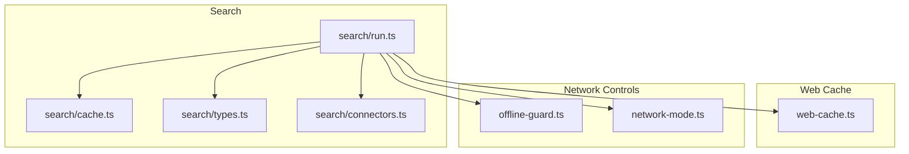
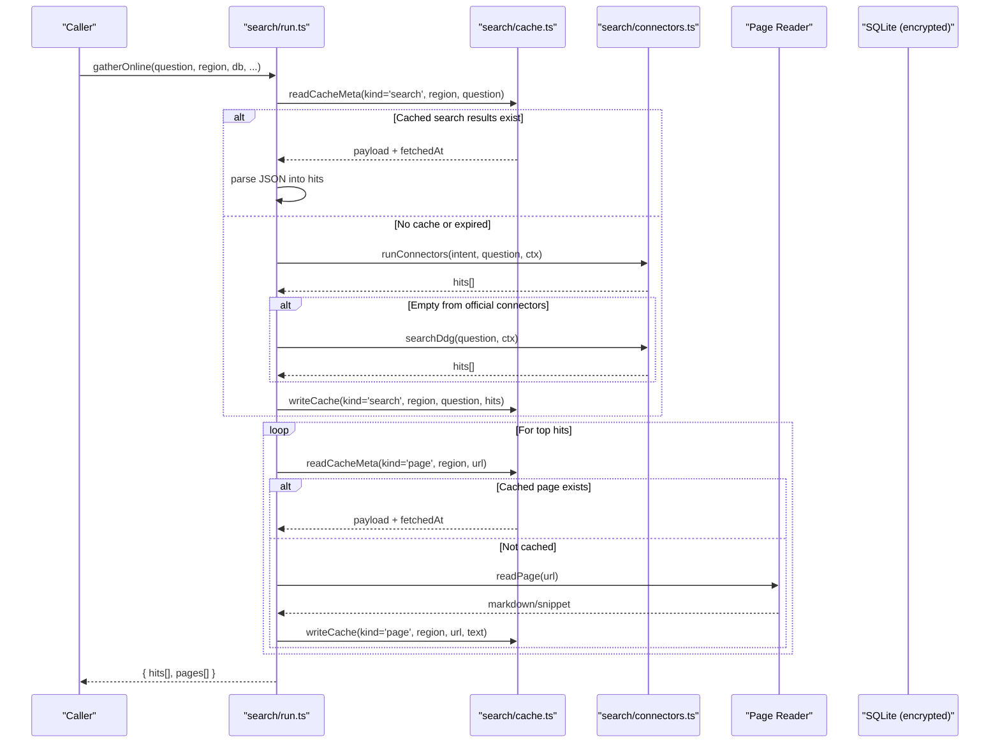
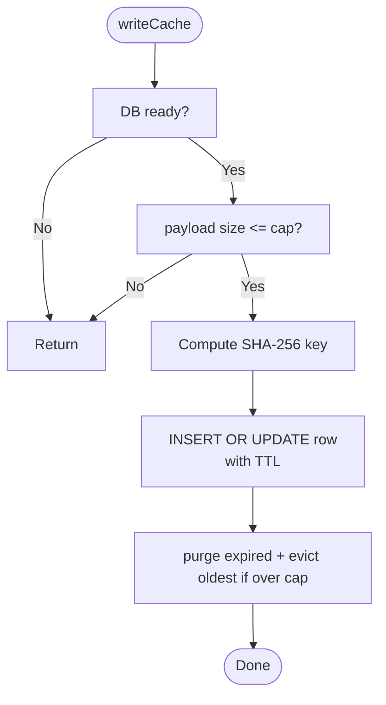
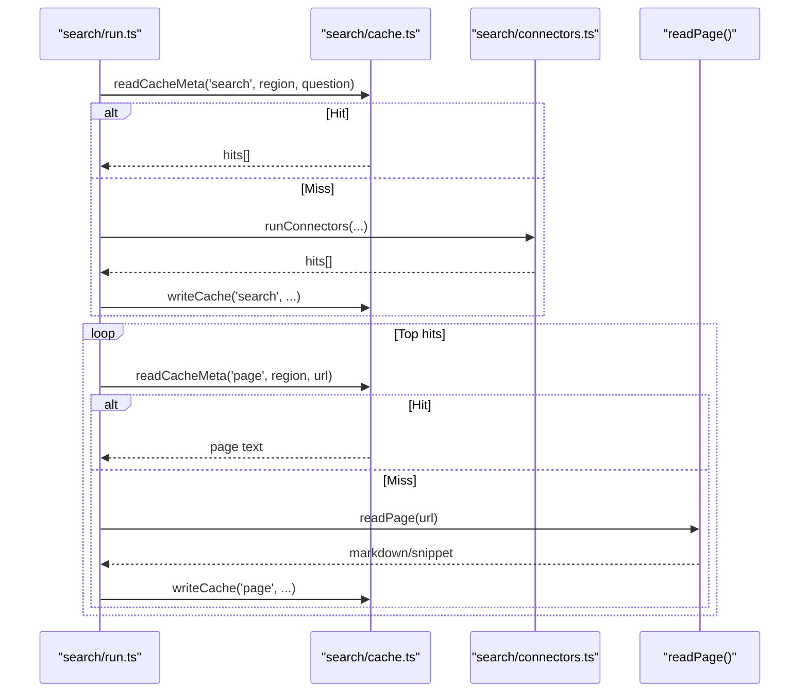
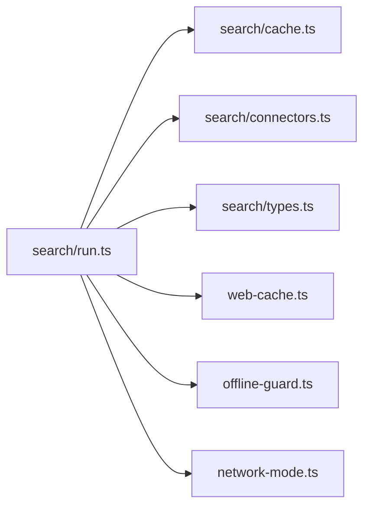

# Search Caching System

<cite>
**Referenced Files in This Document**
- [cache.ts](file://apps/desktop/src/main/core/search/cache.ts)
- [run.ts](file://apps/desktop/src/main/core/search/run.ts)
- [types.ts](file://apps/desktop/src/main/core/search/types.ts)
- [connectors.ts](file://apps/desktop/src/main/core/search/connectors.ts)
- [web-cache.ts](file://apps/desktop/src/main/core/web-cache.ts)
- [offline-guard.ts](file://apps/desktop/src/main/core/offline-guard.ts)
- [network-mode.ts](file://apps/desktop/src/main/core/network-mode.ts)
</cite>

## Table of Contents
1. [Introduction](#introduction)
2. [Project Structure](#project-structure)
3. [Core Components](#core-components)
4. [Architecture Overview](#architecture-overview)
5. [Detailed Component Analysis](#detailed-component-analysis)
6. [Dependency Analysis](#dependency-analysis)
7. [Performance Considerations](#performance-considerations)
8. [Troubleshooting Guide](#troubleshooting-guide)
9. [Conclusion](#conclusion)

## Introduction
This document explains the search caching system that stores web search results locally for offline access and improved performance. It covers:
- Cache storage mechanism using an encrypted SQLite database
- TTL management for search results and page content
- Cache invalidation and eviction policies
- Offline retrieval and online synchronization
- Size limits, cleanup strategies, and performance optimizations
- Integration with the search workflow and connectors

The system distinguishes between two cache layers:
- Search result cache: stores connector hits (titles, URLs, snippets) to avoid repeated network calls
- Page content cache: stores extracted page text to avoid re-fetching and parsing pages

A separate cited web passage cache stores only passages that were actually cited, including embeddings for local vector search.

## Project Structure
The search caching system is implemented under the desktop main process core modules:
- Search cache implementation and constants
- Search orchestration and integration with connectors
- Connector definitions for official APIs
- Types used across search components
- Web passage cache for cited content
- Offline guard and network mode utilities

**Diagram sources**
- [run.ts:1-320](file://apps/desktop/src/main/core/search/run.ts#L1-L320)
- [cache.ts:1-91](file://apps/desktop/src/main/core/search/cache.ts#L1-L91)
- [connectors.ts:1-148](file://apps/desktop/src/main/core/search/connectors.ts#L1-L148)
- [types.ts:1-39](file://apps/desktop/src/main/core/search/types.ts#L1-L39)
- [web-cache.ts:1-264](file://apps/desktop/src/main/core/web-cache.ts#L1-L264)
- [offline-guard.ts:1-15](file://apps/desktop/src/main/core/offline-guard.ts#L1-L15)
- [network-mode.ts:1-111](file://apps/desktop/src/main/core/network-mode.ts#L1-L111)

**Section sources**
- [run.ts:1-320](file://apps/desktop/src/main/core/search/run.ts#L1-L320)
- [cache.ts:1-91](file://apps/desktop/src/main/core/search/cache.ts#L1-L91)
- [connectors.ts:1-148](file://apps/desktop/src/main/core/search/connectors.ts#L1-L148)
- [types.ts:1-39](file://apps/desktop/src/main/core/search/types.ts#L1-L39)
- [web-cache.ts:1-264](file://apps/desktop/src/main/core/web-cache.ts#L1-L264)
- [offline-guard.ts:1-15](file://apps/desktop/src/main/core/offline-guard.ts#L1-L15)
- [network-mode.ts:1-111](file://apps/desktop/src/main/core/network-mode.ts#L1-L111)

## Core Components
- Search cache (search/cache.ts): Stores search results and page text with TTLs, size caps, and eviction.
- Search orchestrator (search/run.ts): Coordinates cached reads/writes, connector execution, and page fetching.
- Connectors (search/connectors.ts): Official public API integrations returning structured hits.
- Types (search/types.ts): Shared types for hits, intents, and region choices.
- Web passage cache (web-cache.ts): Stores cited web passages with FTS and vector indexes, plus citation helpers.
- Offline guard (offline-guard.ts): Enforces no-network behavior when required.
- Network mode (network-mode.ts): Manages offline/online/auto modes and user-facing status.

Key responsibilities:
- Cache keys are deterministic hashes over kind, region, and value.
- TTLs differ by kind: search results vs page content.
- Eviction removes oldest entries when total bytes exceed a cap.
- Offline mode prevents network calls; cached data is used instead.

**Section sources**
- [cache.ts:1-91](file://apps/desktop/src/main/core/search/cache.ts#L1-L91)
- [run.ts:1-320](file://apps/desktop/src/main/core/search/run.ts#L1-L320)
- [connectors.ts:1-148](file://apps/desktop/src/main/core/search/connectors.ts#L1-L148)
- [types.ts:1-39](file://apps/desktop/src/main/core/search/types.ts#L1-L39)
- [web-cache.ts:1-264](file://apps/desktop/src/main/core/web-cache.ts#L1-L264)
- [offline-guard.ts:1-15](file://apps/desktop/src/main/core/offline-guard.ts#L1-L15)
- [network-mode.ts:1-111](file://apps/desktop/src/main/core/network-mode.ts#L1-L111)

## Architecture Overview
The search flow integrates caching with connectors and page reading:

**Diagram sources**
- [run.ts:276-319](file://apps/desktop/src/main/core/search/run.ts#L276-L319)
- [cache.ts:52-79](file://apps/desktop/src/main/core/search/cache.ts#L52-L79)
- [connectors.ts:135-147](file://apps/desktop/src/main/core/search/connectors.ts#L135-L147)

## Detailed Component Analysis

### Search Cache Implementation
Responsibilities:
- Define TTLs and size caps
- Create deterministic cache keys
- Read/write with TTL checks
- Purge expired entries and evict oldest on capacity overflow
- Provide stats and clear operations

Storage schema:
- Table: search_disk_cache
- Columns: cache_key (PK), kind, payload, byte_size, fetched_at, expires_at

TTLs and limits:
- SEARCH_TTL_MS: 24 hours for search results
- PAGE_TTL_MS: 7 days for page content
- SEARCH_CACHE_CAP_BYTES: 32 MB total cache cap

Eviction strategy:
- After writes, purge expired rows
- If total bytes exceed cap, delete oldest fetched_at until under cap

Read path:
- Compute key from kind, region, value
- Return payload if not expired; otherwise delete and return null

Write path:
- Validate payload non-empty and within cap
- Insert or update row with TTL-based expires_at
- Trigger eviction

Cleanup and stats:
- purgeSearchCache deletes expired rows
- searchCacheStats returns current bytes/count/cap after purge
- clearSearchCache empties table

**Diagram sources**
- [cache.ts:68-90](file://apps/desktop/src/main/core/search/cache.ts#L68-L90)

**Section sources**
- [cache.ts:1-91](file://apps/desktop/src/main/core/search/cache.ts#L1-L91)

### Search Orchestration and Integration
Responsibilities:
- Compose answers for finance/legal/news
- Gather online results with caching
- Integrate connectors and page reader
- Mark cachedAt timestamps for UI

Caching integration:
- Before calling connectors, attempt to read cached search results
- On success, parse and use cached hits
- On miss or empty, call connectors, then optionally DuckDuckGo fallback
- Persist hits to cache with kind 'search'
- For each hit, try to read cached page content; if missing, fetch and cache with kind 'page'

Offline handling:
- When offlineOnly is true, skip network calls and rely on cache
- Connectors receive context indicating offlineOnly

**Diagram sources**
- [run.ts:276-319](file://apps/desktop/src/main/core/search/run.ts#L276-L319)
- [cache.ts:52-79](file://apps/desktop/src/main/core/search/cache.ts#L52-L79)
- [connectors.ts:135-147](file://apps/desktop/src/main/core/search/connectors.ts#L135-L147)

**Section sources**
- [run.ts:1-320](file://apps/desktop/src/main/core/search/run.ts#L1-L320)

### Connectors
Responsibilities:
- Query official public APIs (GitHub, Stack Exchange, npm, PyPI, crates.io, Wikipedia, arXiv, Hugging Face, Semantic Scholar, Hacker News)
- Normalize responses into ConnectorHit objects
- Respect rate limiting via politeFetch
- Aggregate up to a fixed number of hits per intent

Integration:
- Called by orchestrator when cache misses
- Results may be cached by orchestrator

**Section sources**
- [connectors.ts:1-148](file://apps/desktop/src/main/core/search/connectors.ts#L1-L148)
- [types.ts:1-39](file://apps/desktop/src/main/core/search/types.ts#L1-L39)

### Web Passage Cache (Cited Content)
Responsibilities:
- Store only cited web passages with embeddings
- Provide FTS and vector search over stored passages
- Link passages to conversations/messages
- Evict based on last_used_at and conversation references

Schema highlights:
- web_passages: URL, content hash, title, domain, text, byte_size, timestamps
- web_passage_links: conversation_id -> passage_id mapping
- web_fts: FTS index over title/text
- web_vec: vector index for cosine similarity

Operations:
- saveCitedPassages: insert/update passages, link to conversation, evict by size
- searchSavedWeb: combine BM25 and vector ranks (RRF) to rank passages
- forgetConversation: remove links and orphaned passages
- staleNote: mark old citations with staleness note

**Section sources**
- [web-cache.ts:1-264](file://apps/desktop/src/main/core/web-cache.ts#L1-L264)

### Offline Mode and Network Controls
Responsibilities:
- Enforce no-network behavior when offlineOnly is true
- Manage user-visible network mode states and warnings

Behavior:
- assertNetworkAllowed throws when offlineOnly is true
- blocksNetwork determines whether to block based on mode and OS state
- withLocalOnlyNote appends explanatory text when network is blocked

**Section sources**
- [offline-guard.ts:1-15](file://apps/desktop/src/main/core/offline-guard.ts#L1-L15)
- [network-mode.ts:1-111](file://apps/desktop/src/main/core/network-mode.ts#L1-L111)

## Dependency Analysis
High-level dependencies:
- search/run.ts depends on search/cache.ts for TTL-based storage and eviction
- search/run.ts depends on search/connectors.ts for live data
- search/run.ts uses search/types.ts for shared types
- web-cache.ts provides cited passage storage and search
- offline-guard.ts and network-mode.ts provide network policy enforcement

**Diagram sources**
- [run.ts:1-320](file://apps/desktop/src/main/core/search/run.ts#L1-L320)
- [cache.ts:1-91](file://apps/desktop/src/main/core/search/cache.ts#L1-L91)
- [connectors.ts:1-148](file://apps/desktop/src/main/core/search/connectors.ts#L1-L148)
- [types.ts:1-39](file://apps/desktop/src/main/core/search/types.ts#L1-L39)
- [web-cache.ts:1-264](file://apps/desktop/src/main/core/web-cache.ts#L1-L264)
- [offline-guard.ts:1-15](file://apps/desktop/src/main/core/offline-guard.ts#L1-L15)
- [network-mode.ts:1-111](file://apps/desktop/src/main/core/network-mode.ts#L1-L111)

**Section sources**
- [run.ts:1-320](file://apps/desktop/src/main/core/search/run.ts#L1-L320)
- [cache.ts:1-91](file://apps/desktop/src/main/core/search/cache.ts#L1-L91)
- [connectors.ts:1-148](file://apps/desktop/src/main/core/search/connectors.ts#L1-L148)
- [types.ts:1-39](file://apps/desktop/src/main/core/search/types.ts#L1-L39)
- [web-cache.ts:1-264](file://apps/desktop/src/main/core/web-cache.ts#L1-L264)
- [offline-guard.ts:1-15](file://apps/desktop/src/main/core/offline-guard.ts#L1-L15)
- [network-mode.ts:1-111](file://apps/desktop/src/main/core/network-mode.ts#L1-L111)

## Performance Considerations
- Deterministic cache keys reduce collisions and ensure consistent lookups
- TTLs prevent serving stale data while minimizing re-fetches
- Eviction by oldest fetched_at keeps frequently accessed data longer
- Separate caches for search results and page content optimize reuse patterns
- FTS and vector indexes accelerate local passage search
- Limiting connector results reduces payload sizes and memory usage
- PoliteFetch rate limiting protects external services and avoids throttling

[No sources needed since this section provides general guidance]

## Troubleshooting Guide
Common issues and resolutions:
- Cache not found: Ensure the database table exists and is ready before reads/writes
- Expired entries: TTLs automatically invalidate; expect re-fetch on next request
- Cache full: Eviction removes oldest entries; consider increasing cap or reducing payload sizes
- Offline mode errors: Network calls will throw when offlineOnly is true; rely on cached data
- Stale citations: Use staleness notes to inform users about outdated prices/news

Operational tips:
- Use stats functions to monitor cache size and count
- Clear cache when necessary to free space
- Verify connectivity mode and adjust settings to allow sync when needed

**Section sources**
- [cache.ts:29-50](file://apps/desktop/src/main/core/search/cache.ts#L29-L50)
- [web-cache.ts:110-117](file://apps/desktop/src/main/core/web-cache.ts#L110-L117)
- [offline-guard.ts:5-14](file://apps/desktop/src/main/core/offline-guard.ts#L5-L14)
- [network-mode.ts:24-37](file://apps/desktop/src/main/core/network-mode.ts#L24-L37)

## Conclusion
The search caching system provides robust local-first retrieval with TTL-based freshness, size-bounded storage, and automatic eviction. It seamlessly integrates with official connectors and page readers, supports offline operation, and maintains cited passage archives with powerful local search capabilities. Proper configuration of TTLs, caps, and network modes ensures reliable performance and user experience across online and offline scenarios.

[No sources needed since this section summarizes without analyzing specific files]