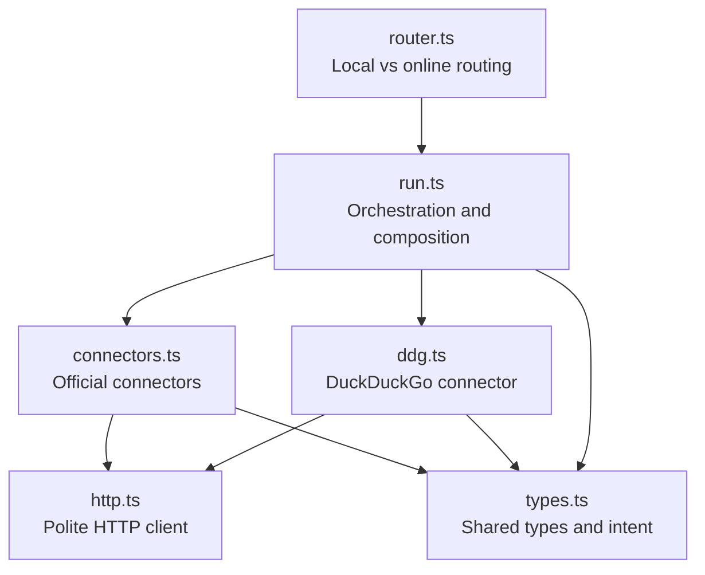
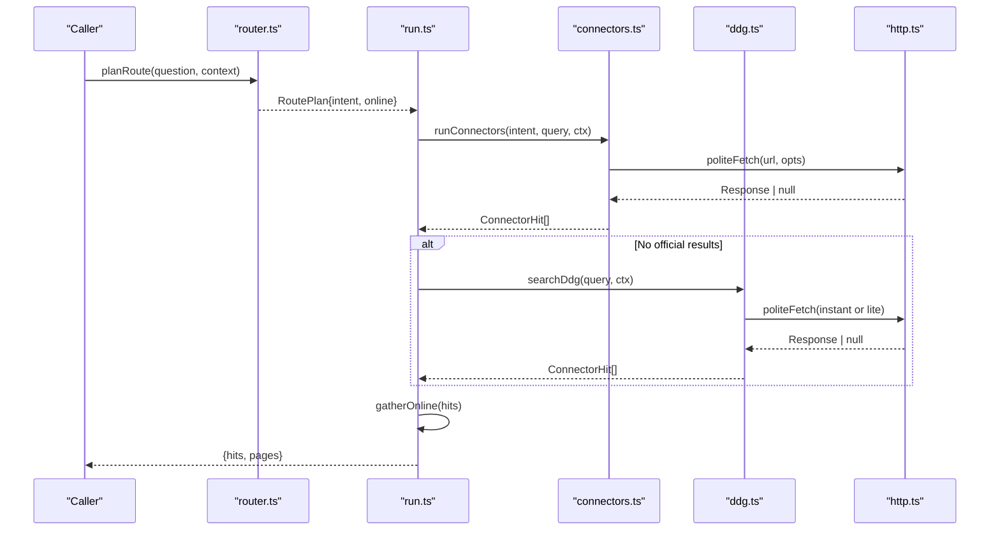
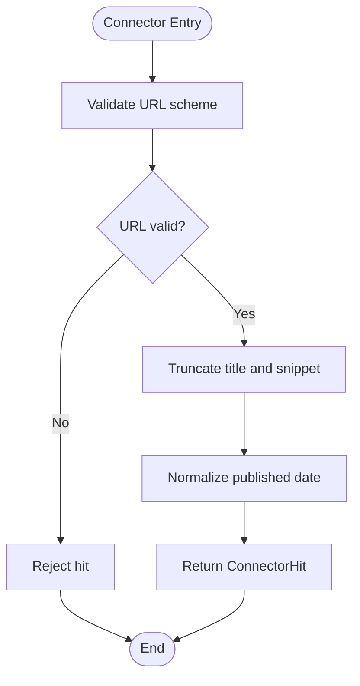
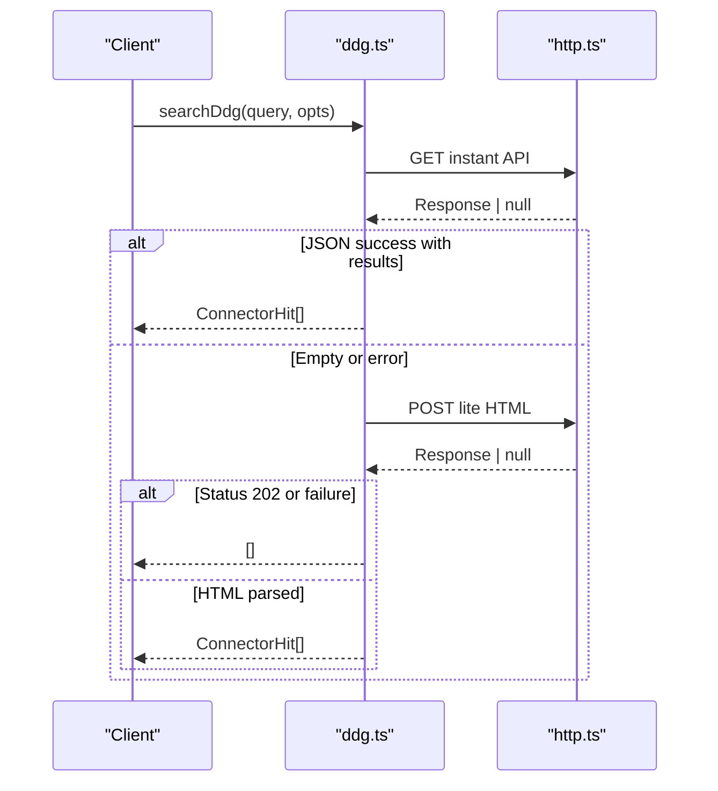
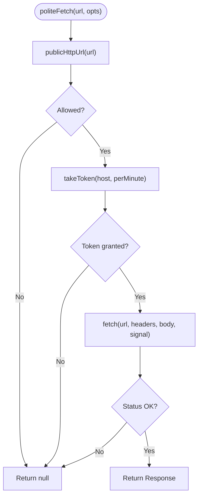
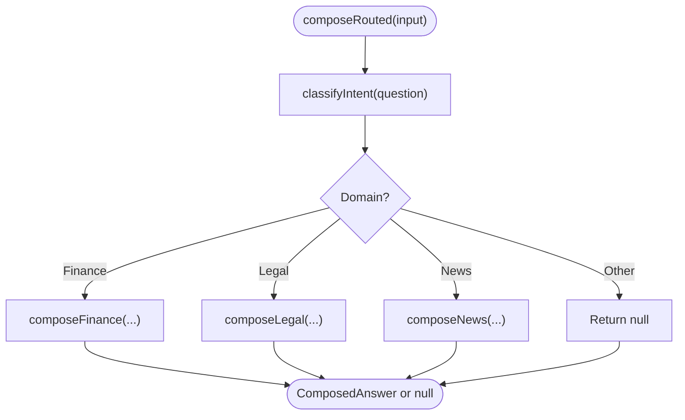
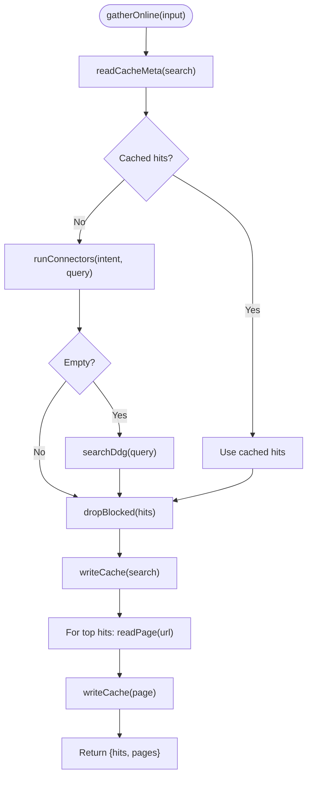
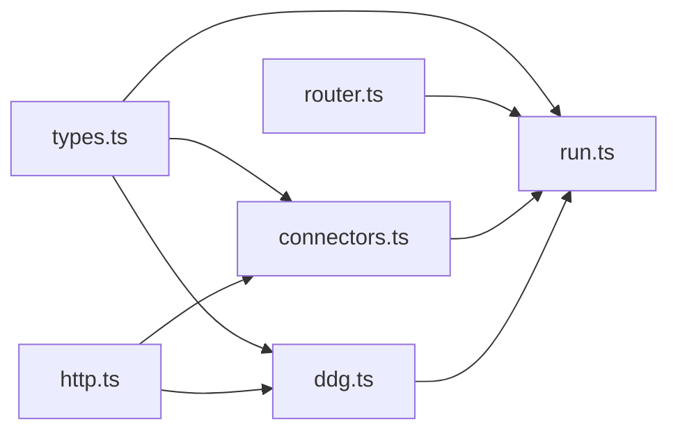

# Search Connectors

<cite>
**Referenced Files in This Document**
- [connectors.ts](file://apps/desktop/src/main/core/search/connectors.ts)
- [ddg.ts](file://apps/desktop/src/main/core/search/ddg.ts)
- [http.ts](file://apps/desktop/src/main/core/search/http.ts)
- [types.ts](file://apps/desktop/src/main/core/search/types.ts)
- [router.ts](file://apps/desktop/src/main/core/search/router.ts)
- [run.ts](file://apps/desktop/src/main/core/search/run.ts)
</cite>

## Table of Contents
1. [Introduction](#introduction)
2. [Project Structure](#project-structure)
3. [Core Components](#core-components)
4. [Architecture Overview](#architecture-overview)
5. [Detailed Component Analysis](#detailed-component-analysis)
6. [Dependency Analysis](#dependency-analysis)
7. [Performance Considerations](#performance-considerations)
8. [Troubleshooting Guide](#troubleshooting-guide)
9. [Conclusion](#conclusion)

## Introduction
This document explains the search connector framework used by the desktop application to integrate with multiple online search providers. The framework provides:

- A stable connector interface for official public APIs and DuckDuckGo.
- Result normalization into a common shape.
- Rate limiting, network safety, and error handling.
- Intent-driven selection of connectors.
- A fallback pipeline that uses DuckDuckGo when official connectors return no results.
- A result transformation pipeline that gathers top hits and fetches page content for downstream composition.

The design is local-first: queries stay on-device, and only safe HTTPS or HTTP endpoints are allowed. Public APIs do not require API keys in this implementation.

## Project Structure
The search connector logic lives under the desktop main process search module. The most relevant files are:

- `types.ts`: Shared types, intent model, user agent string, and local hit definitions.
- `http.ts`: Polite HTTP client with URL allowlisting, rate limiting, timeouts, and error normalization.
- `connectors.ts`: Official provider connectors and intent-to-connector mapping.
- `ddg.ts`: DuckDuckGo JSON instant-answer and HTML lite fallback parser.
- `router.ts`: Routing between local sources and online search based on intent and context.
- `run.ts`: Production orchestration, caching, page gathering, and domain-specific answer composition.

**Diagram sources**
- [types.ts:1-39](file://apps/desktop/src/main/core/search/types.ts#L1-L39)
- [http.ts:1-79](file://apps/desktop/src/main/core/search/http.ts#L1-L79)
- [connectors.ts:1-148](file://apps/desktop/src/main/core/search/connectors.ts#L1-L148)
- [ddg.ts:1-116](file://apps/desktop/src/main/core/search/ddg.ts#L1-L116)
- [router.ts:1-67](file://apps/desktop/src/main/core/search/router.ts#L1-L67)
- [run.ts:1-320](file://apps/desktop/src/main/core/search/run.ts#L1-L320)

**Section sources**
- [types.ts:1-39](file://apps/desktop/src/main/core/search/types.ts#L1-L39)
- [http.ts:1-79](file://apps/desktop/src/main/core/search/http.ts#L1-L79)
- [connectors.ts:1-148](file://apps/desktop/src/main/core/search/connectors.ts#L1-L148)
- [ddg.ts:1-116](file://apps/desktop/src/main/core/search/ddg.ts#L1-L116)
- [router.ts:1-67](file://apps/desktop/src/main/core/search/router.ts#L1-L67)
- [run.ts:1-320](file://apps/desktop/src/main/core/search/run.ts#L1-L320)

## Core Components
This section summarizes the core components and their responsibilities.

- Connector interface and result type
  - All connectors return an array of normalized `ConnectorHit` objects.
  - `ConnectorHit` includes source, title, url, snippet, published date, and optional cached timestamp.
  - The shared user agent identifies the application as on-device research traffic.

- Polite HTTP client
  - Validates URLs against a strict allowlist.
  - Enforces per-host rate limits using rolling minute buckets.
  - Applies default headers and timeouts.
  - Treats rate limits, server errors, and network failures as null responses so callers can degrade gracefully.

- Official connectors
  - GitHub, Stack Exchange, npm, PyPI, crates.io, Wikipedia, arXiv, Hugging Face, Semantic Scholar, Hacker News.
  - Each connector maps provider fields to `ConnectorHit`.
  - Connectors use politeFetch with provider-specific rate limits and headers.

- DuckDuckGo connector
  - Tries the JSON instant-answer API first.
  - Falls back to parsing the HTML lite search page if needed.
  - Filters out DuckDuckGo internal links and normalizes titles and snippets.

- Routing and orchestration
  - Route planning decides whether to use local sources or online search.
  - Orchestration runs official connectors first, then DuckDuckGo if needed.
  - Top hits are gathered and their pages fetched for downstream composition.

**Section sources**
- [types.ts:10-39](file://apps/desktop/src/main/core/search/types.ts#L10-L39)
- [http.ts:21-79](file://apps/desktop/src/main/core/search/http.ts#L21-L79)
- [connectors.ts:20-118](file://apps/desktop/src/main/core/search/connectors.ts#L20-L118)
- [ddg.ts:22-115](file://apps/desktop/src/main/core/search/ddg.ts#L22-L115)
- [router.ts:45-66](file://apps/desktop/src/main/core/search/router.ts#L45-L66)
- [run.ts:276-319](file://apps/desktop/src/main/core/search/run.ts#L276-L319)

## Architecture Overview
The search system follows a layered architecture:

1. Routing layer selects local versus online search based on intent, freshness, and policy.
2. Online search layer runs official connectors selected by intent.
3. Fallback layer uses DuckDuckGo when official connectors return no results.
4. Normalization layer converts provider responses into `ConnectorHit`.
5. Gathering layer fetches page content for top hits and caches results.
6. Composition layer builds domain-specific answers with citations and verification.

**Diagram sources**
- [router.ts:45-66](file://apps/desktop/src/main/core/search/router.ts#L45-L66)
- [run.ts:276-319](file://apps/desktop/src/main/core/search/run.ts#L276-L319)
- [connectors.ts:135-147](file://apps/desktop/src/main/core/search/connectors.ts#L135-L147)
- [ddg.ts:93-115](file://apps/desktop/src/main/core/search/ddg.ts#L93-L115)
- [http.ts:55-79](file://apps/desktop/src/main/core/search/http.ts#L55-L79)

## Detailed Component Analysis

### Connector Interface and Result Normalization
The connector interface is function-based: each connector accepts a query and a fetch context, and returns normalized hits.

Key aspects:

- Input
  - Query string.
  - Fetch context including offline mode, custom fetch implementation, timeout, and abort signal.

- Output
  - Array of `ConnectorHit`.
  - Title and snippet are truncated to safe lengths.
  - Invalid URLs are rejected.
  - Published dates are preserved when available.

Normalization helper:

- A shared helper validates and truncates fields before returning hits.
- It ensures URLs start with HTTP schemes and filters invalid entries.

**Diagram sources**
- [connectors.ts:20-23](file://apps/desktop/src/main/core/search/connectors.ts#L20-L23)
- [types.ts:23-30](file://apps/desktop/src/main/core/search/types.ts#L23-L30)

**Section sources**
- [connectors.ts:20-23](file://apps/desktop/src/main/core/search/connectors.ts#L20-L23)
- [types.ts:23-30](file://apps/desktop/src/main/core/search/types.ts#L23-L30)

### Official Provider Connectors
Official connectors implement a consistent pattern:

- Build provider URL from the query.
- Call politeFetch with provider-specific rate limits and headers.
- Parse JSON response safely.
- Map provider fields to `ConnectorHit`.
- Filter invalid hits.

Examples include:

- GitHub repositories search.
- Stack Exchange advanced search.
- npm registry search.
- PyPI package metadata lookup.
- crates.io crate search.
- Wikipedia search API.
- arXiv Atom feed parsing.
- Hugging Face models search.
- Semantic Scholar paper search.
- Hacker News Algolia search.

Intent-to-connector mapping:

- Code: GitHub, Stack Exchange, npm, PyPI, crates.io, Hacker News.
- Paper: arXiv, Semantic Scholar, Hugging Face, Wikipedia.
- News: Hacker News, Wikipedia.
- General: Wikipedia, Hacker News.
- Finance and legal have empty connector lists because they use specialized flows.

```mermaid
classDiagram
class ConnectorInterface {
+function(query, ctx) ConnectorHit[]
}
class GitHubConnector {
+searchGitHub(query, ctx) ConnectorHit[]
}
class StackExchangeConnector {
+searchStackExchange(query, ctx) ConnectorHit[]
}
class NpmConnector {
+searchNpm(query, ctx) ConnectorHit[]
}
class PypiConnector {
+searchPypi(query, ctx) ConnectorHit[]
}
class CratesConnector {
+searchCrates(query, ctx) ConnectorHit[]
}
class WikipediaConnector {
+searchWikipedia(query, ctx, lang) ConnectorHit[]
}
class ArxivConnector {
+searchArxiv(query, ctx) ConnectorHit[]
}
class HuggingFaceConnector {
+searchHuggingFace(query, ctx) ConnectorHit[]
}
class SemanticScholarConnector {
+searchSemanticScholar(query, ctx) ConnectorHit[]
}
class HackerNewsConnector {
+searchHn(query, ctx) ConnectorHit[]
}
ConnectorInterface <|.. GitHubConnector
ConnectorInterface <|.. StackExchangeConnector
ConnectorInterface <|.. NpmConnector
ConnectorInterface <|.. PypiConnector
ConnectorInterface <|.. CratesConnector
ConnectorInterface <|.. WikipediaConnector
ConnectorInterface <|.. ArxivConnector
ConnectorInterface <|.. HuggingFaceConnector
ConnectorInterface <|.. SemanticScholarConnector
ConnectorInterface <|.. HackerNewsConnector
```

**Diagram sources**
- [connectors.ts:25-105](file://apps/desktop/src/main/core/search/connectors.ts#L25-L105)

**Section sources**
- [connectors.ts:25-105](file://apps/desktop/src/main/core/search/connectors.ts#L25-L105)
- [connectors.ts:107-133](file://apps/desktop/src/main/core/search/connectors.ts#L107-L133)

### DuckDuckGo Connector
DuckDuckGo support has two paths:

1. Instant-answer JSON API
   - Preferred path.
   - Parses abstract and related topics.
   - Filters DuckDuckGo internal hosts.
   - Limits results to five items.

2. Lite HTML fallback
   - Used when JSON fails or returns no useful results.
   - Parses result links and snippets from HTML.
   - Uses a loose link matcher as a secondary fallback.
   - Treats HTTP 202 challenge responses as empty results rather than errors.

**Diagram sources**
- [ddg.ts:82-115](file://apps/desktop/src/main/core/search/ddg.ts#L82-L115)
- [http.ts:55-79](file://apps/desktop/src/main/core/search/http.ts#L55-L79)

**Section sources**
- [ddg.ts:22-115](file://apps/desktop/src/main/core/search/ddg.ts#L22-L115)

### Polite HTTP Client
The HTTP client enforces safety and politeness:

- Network policy
  - Blocks private, loopback, cloud metadata, and reserved IP ranges.
  - Allows only HTTP and HTTPS.
  - Rejects localhost and `.local` hosts.

- Rate limiting
  - Per-host rolling minute buckets.
  - Tokens are consumed per call.
  - Exceeded limits return null so callers skip the provider.

- Timeouts and signals
  - Default timeout applies unless overridden.
  - Supports external abort signals.

- Error normalization
  - HTTP 429 and server errors return null.
  - Non-OK status codes return null.
  - Network exceptions return null.

- Headers
  - Adds a default user agent.
  - Adds a default accept header unless provided.

**Diagram sources**
- [http.ts:21-79](file://apps/desktop/src/main/core/search/http.ts#L21-L79)

**Section sources**
- [http.ts:1-79](file://apps/desktop/src/main/core/search/http.ts#L1-L79)

### Routing and Orchestration
Routing determines whether online search is needed:

- Local layers are consulted in a fixed order.
- If local content is sufficient and not fresh, online search is skipped.
- Finance questions may require live data.
- Legal questions prefer local statutes when quoted; otherwise they may need online search.
- News and general queries fall back to online search when local sources are thin.

Orchestration:

- Official connectors run first.
- DuckDuckGo runs only if official connectors return no results.
- Results are dropped if blocked by policy.
- Top hits are cached and their pages are fetched for citation and grounding.

**Diagram sources**
- [run.ts:86-107](file://apps/desktop/src/main/core/search/run.ts#L86-L107)
- [router.ts:45-66](file://apps/desktop/src/main/core/search/router.ts#L45-L66)

**Section sources**
- [router.ts:1-67](file://apps/desktop/src/main/core/search/router.ts#L1-L67)
- [run.ts:86-107](file://apps/desktop/src/main/core/search/run.ts#L86-L107)

### Result Transformation Pipeline
The transformation pipeline performs these steps:

1. Select connectors by intent.
2. Run connectors sequentially until enough results are collected.
3. Drop blocked results.
4. Cache successful hits.
5. For top hits, fetch page content.
6. Prefer markdown content when available; otherwise use snippet.
7. Cache page content.
8. Return normalized hits and gathered pages for downstream composition.

**Diagram sources**
- [run.ts:276-319](file://apps/desktop/src/main/core/search/run.ts#L276-L319)
- [connectors.ts:135-147](file://apps/desktop/src/main/core/search/connectors.ts#L135-L147)
- [ddg.ts:93-115](file://apps/desktop/src/main/core/search/ddg.ts#L93-L115)

**Section sources**
- [run.ts:276-319](file://apps/desktop/src/main/core/search/run.ts#L276-L319)

## Dependency Analysis
The following diagram shows how modules depend on each other:

**Diagram sources**
- [types.ts:1-39](file://apps/desktop/src/main/core/search/types.ts#L1-L39)
- [http.ts:1-79](file://apps/desktop/src/main/core/search/http.ts#L1-L79)
- [connectors.ts:1-148](file://apps/desktop/src/main/core/search/connectors.ts#L1-L148)
- [ddg.ts:1-116](file://apps/desktop/src/main/core/search/ddg.ts#L1-L116)
- [router.ts:1-67](file://apps/desktop/src/main/core/search/router.ts#L1-L67)
- [run.ts:1-320](file://apps/desktop/src/main/core/search/run.ts#L1-L320)

**Section sources**
- [connectors.ts:1-148](file://apps/desktop/src/main/core/search/connectors.ts#L1-L148)
- [ddg.ts:1-116](file://apps/desktop/src/main/core/search/ddg.ts#L1-L116)
- [http.ts:1-79](file://apps/desktop/src/main/core/search/http.ts#L1-L79)
- [types.ts:1-39](file://apps/desktop/src/main/core/search/types.ts#L1-L39)
- [router.ts:1-67](file://apps/desktop/src/main/core/search/router.ts#L1-L67)
- [run.ts:1-320](file://apps/desktop/src/main/core/search/run.ts#L1-L320)

## Performance Considerations
- Rate limiting protects providers and reduces wasted work.
- Early termination stops connector execution once enough results are collected.
- Caching avoids repeated network calls for identical queries and pages.
- Lightweight parsers are used for XML and HTML where necessary.
- Timeout and abort signals prevent long-running requests.
- Offline-only mode short-circuits network access early.

[No sources needed since this section provides general guidance]

## Troubleshooting Guide
Common integration issues and resolutions:

- No results from official connectors
  - Check intent mapping to ensure the right connectors are selected.
  - Verify provider API availability and response structure.
  - Inspect rate limit state; excessive calls can cause null responses.

- DuckDuckGo returns empty results
  - Instant API may be unavailable or return no abstract.
  - Lite HTML may return HTTP 202 challenge; treat as empty.
  - Ensure HTML parsing tolerates changed markup.

- Blocked or unsafe URLs
  - Private IPs, localhost, `.local`, and cloud metadata hosts are blocked.
  - Only HTTP and HTTPS are allowed.
  - Review URL construction in connectors.

- Authentication requirements
  - This implementation does not add API keys.
  - If a provider requires authentication, extend politeFetch or connector options carefully while preserving safety checks.

- Timeouts and network errors
  - Adjust timeoutMs or provide a custom fetch implementation for testing.
  - Use AbortSignal to cancel long-running searches.

- Caching stale results
  - Clear cache or refresh region and question inputs.
  - Verify cache write/read paths for payload format.

**Section sources**
- [http.ts:21-79](file://apps/desktop/src/main/core/search/http.ts#L21-L79)
- [ddg.ts:82-115](file://apps/desktop/src/main/core/search/ddg.ts#L82-L115)
- [connectors.ts:135-147](file://apps/desktop/src/main/core/search/connectors.ts#L135-L147)
- [run.ts:276-319](file://apps/desktop/src/main/core/search/run.ts#L276-L319)

## Conclusion
The search connector framework provides a robust, extensible foundation for integrating multiple search providers. It emphasizes safety, politeness, and reliability through strict URL validation, rate limiting, and graceful error handling. Official connectors normalize results into a common shape, while DuckDuckGo serves as a dependable fallback. Intent-driven routing and a clear transformation pipeline make it straightforward to add new providers and adapt the system to domain-specific needs such as finance, legal, news, and general web search.

[No sources needed since this section summarizes without analyzing specific files]