# Search Router & Intent Detection

<cite>
**Referenced Files in This Document**
- [intent.ts](file://apps/desktop/src/main/core/search/intent.ts)
- [router.ts](file://apps/desktop/src/main/core/search/router.ts)
- [connectors.ts](file://apps/desktop/src/main/core/search/connectors.ts)
- [types.ts](file://apps/desktop/src/main/core/search/types.ts)
- [run.ts](file://apps/desktop/src/main/core/search/run.ts)
- [app-services.ts](file://apps/desktop/src/main/core/app-services.ts)
- [search.test.ts](file://apps/desktop/src/main/core/search/search.test.ts)
</cite>

## Table of Contents
1. [Introduction](#introduction)
2. [Project Structure](#project-structure)
3. [Core Components](#core-components)
4. [Architecture Overview](#architecture-overview)
5. [Detailed Component Analysis](#detailed-component-analysis)
6. [Dependency Analysis](#dependency-analysis)
7. [Performance Considerations](#performance-considerations)
8. [Troubleshooting Guide](#troubleshooting-guide)
9. [Conclusion](#conclusion)

## Introduction
This document explains the search routing and intent detection system used by the desktop application. It covers how user queries are classified, how local and online search strategies are selected, how connectors are chosen per intent, and how domain-specific answers for finance, legal, and news are composed. The goal is to make the decision-making logic transparent: it balances query type, available resources, freshness requirements, user preferences, and regional constraints before deciding whether to answer locally or call external sources.

## Project Structure
The search routing system lives under the desktop application’s main process core module. The relevant files are:

- `apps/desktop/src/main/core/search/intent.ts`: Intent classification and finance live-data gating.
- `apps/desktop/src/main/core/search/router.ts`: Local-first routing plan that decides whether online search is needed.
- `apps/desktop/src/main/core/search/connectors.ts`: External source connectors mapped by intent.
- `apps/desktop/src/main/core/search/types.ts`: Shared types, layer ordering, and constants.
- `apps/desktop/src/main/core/search/run.ts`: Domain-specific composition for finance, legal, and news; online gathering and fallbacks.
- `apps/desktop/src/main/core/app-services.ts`: Entry point wiring user input, settings, reachability, and routing into the search pipeline.
- `apps/desktop/src/main/core/search/search.test.ts`: Tests validating connector selection and routing behavior.

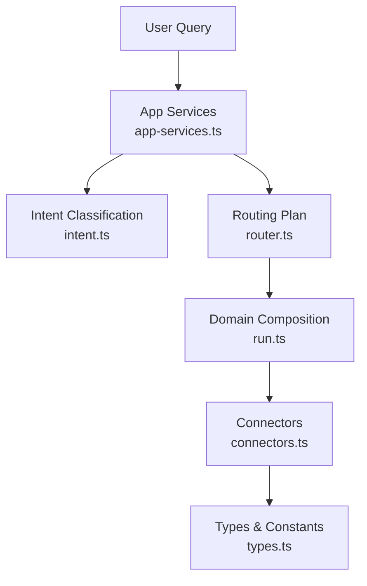

**Diagram sources**
- [app-services.ts:1685-1726](file://apps/desktop/src/main/core/app-services.ts#L1685-L1726)
- [intent.ts:13-20](file://apps/desktop/src/main/core/search/intent.ts#L13-L20)
- [router.ts:45-66](file://apps/desktop/src/main/core/search/router.ts#L45-L66)
- [run.ts:86-107](file://apps/desktop/src/main/core/search/run.ts#L86-L107)
- [connectors.ts:122-147](file://apps/desktop/src/main/core/search/connectors.ts#L122-L147)
- [types.ts:6-10](file://apps/desktop/src/main/core/search/types.ts#L6-L10)

**Section sources**
- [intent.ts:1-29](file://apps/desktop/src/main/core/search/intent.ts#L1-L29)
- [router.ts:1-67](file://apps/desktop/src/main/core/search/router.ts#L1-L67)
- [connectors.ts:1-148](file://apps/desktop/src/main/core/search/connectors.ts#L1-L148)
- [types.ts:1-39](file://apps/desktop/src/main/core/search/types.ts#L1-L39)
- [run.ts:1-320](file://apps/desktop/src/main/core/search/run.ts#L1-L320)
- [app-services.ts:1648-1726](file://apps/desktop/src/main/core/app-services.ts#L1648-L1726)
- [search.test.ts:70-81](file://apps/desktop/src/main/core/search/search.test.ts#L70-L81)

## Core Components
- Intent classifier: Determines the query’s domain using keyword patterns.
- Routing planner: Chooses between local-only, fresh local, and online search based on intent, local hits, freshness, connectivity, and policy flags.
- Connector registry: Maps intents to a fixed set of external sources.
- Domain composer: Handles finance, legal, and news with strict grounding and citation rules.
- Online gatherer: Runs connectors, falls back to DuckDuckGo lite, caches results, and reads top pages.

Key responsibilities:
- Keep sensitive domains (finance, legal, news) grounded and verifiable.
- Prefer local data when sufficient and not stale.
- Only go online when required by intent, freshness, or missing local content.
- Respect user settings and device reachability.

**Section sources**
- [intent.ts:13-28](file://apps/desktop/src/main/core/search/intent.ts#L13-L28)
- [router.ts:8-66](file://apps/desktop/src/main/core/search/router.ts#L8-L66)
- [connectors.ts:107-147](file://apps/desktop/src/main/core/search/connectors.ts#L107-L147)
- [run.ts:86-107](file://apps/desktop/src/main/core/search/run.ts#L86-L107)
- [run.ts:276-319](file://apps/desktop/src/main/core/search/run.ts#L276-L319)

## Architecture Overview
The end-to-end flow starts from the app service layer, which prepares context such as region, offline mode, web permissions, and local hits. It then classifies intent and plans a route. For domain-specific intents, the runner composes answers directly; otherwise, it gathers online results through connectors and optional DuckDuckGo fallback.

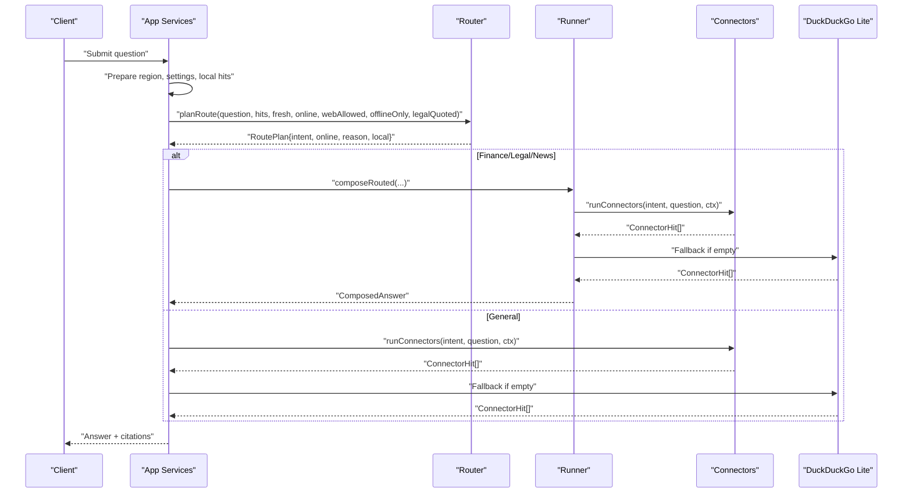

**Diagram sources**
- [app-services.ts:1685-1726](file://apps/desktop/src/main/core/app-services.ts#L1685-L1726)
- [router.ts:45-66](file://apps/desktop/src/main/core/search/router.ts#L45-L66)
- [run.ts:86-107](file://apps/desktop/src/main/core/search/run.ts#L86-L107)
- [run.ts:276-319](file://apps/desktop/src/main/core/search/run.ts#L276-L319)
- [connectors.ts:135-147](file://apps/desktop/src/main/core/search/connectors.ts#L135-L147)

## Detailed Component Analysis

### Intent Classification
The intent classifier uses simple regular expressions to detect domain signals. It prioritizes finance and legal over code and papers, then news, and finally general. A special helper determines whether a finance query requires live data.

Important behaviors:
- Finance keywords trigger finance intent, but some finance-related calculations do not require live data.
- Legal intent is triggered by statute references and related phrases.
- Code intent includes repository/package platform terms.
- Paper intent includes academic and preprint platforms.
- News intent includes headline and announcement terms.

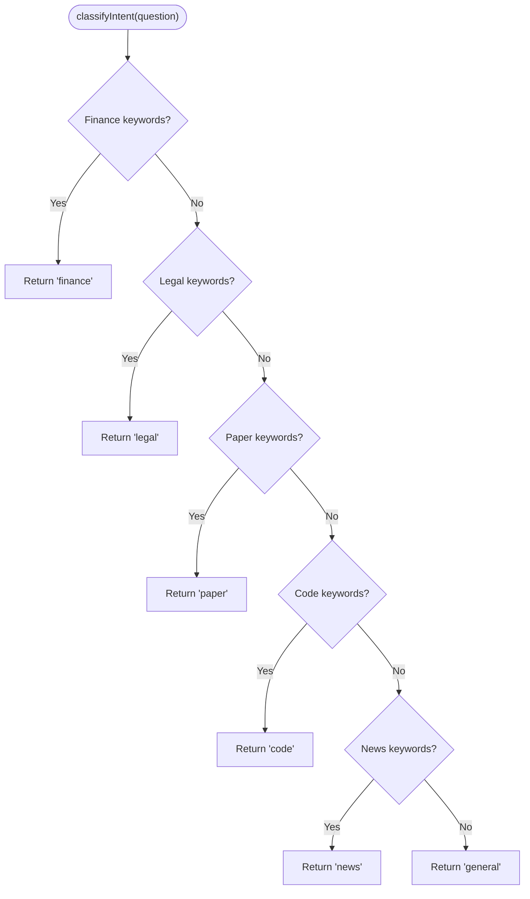

**Diagram sources**
- [intent.ts:7-20](file://apps/desktop/src/main/core/search/intent.ts#L7-L20)

**Section sources**
- [intent.ts:1-29](file://apps/desktop/src/main/core/search/intent.ts#L1-L29)

### Routing Planner
The router decides whether to rely on local data or perform an online search. It considers:
- Intent classification.
- Best local hit by layer priority.
- Freshness requirement.
- Connectivity and user policy flags.
- Whether legal text is already quoted locally.

Decision rules:
- Finance requiring live data forces online unless blocked by policy.
- Legal without local quotes prefers online when allowed.
- If a strong local hit exists and freshness is not required, stay local.
- Otherwise, use online if permitted.

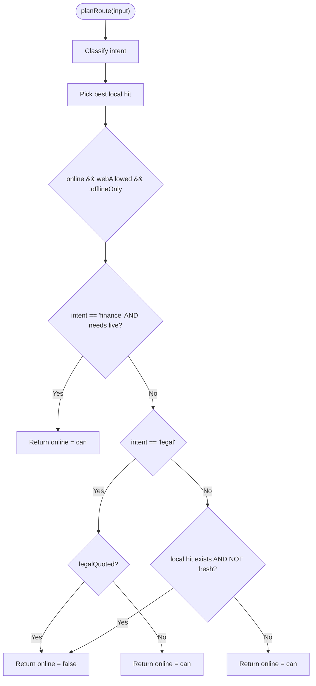

**Diagram sources**
- [router.ts:45-66](file://apps/desktop/src/main/core/search/router.ts#L45-L66)

**Section sources**
- [router.ts:1-67](file://apps/desktop/src/main/core/search/router.ts#L1-L67)
- [search.test.ts:70-81](file://apps/desktop/src/main/core/search/search.test.ts#L70-L81)

### Connector Selection
Each intent maps to a predefined list of connectors. The runner executes them in order until enough results are collected. Failures in one connector do not prevent others from running.

Mapping:
- Code: GitHub, Stack Exchange, npm, PyPI, crates.io, Hacker News.
- Paper: arXiv, Semantic Scholar, Hugging Face, Wikipedia.
- News: Hacker News, Wikipedia.
- General: Wikipedia, Hacker News.
- Finance and legal: No default connectors; they use specialized flows.

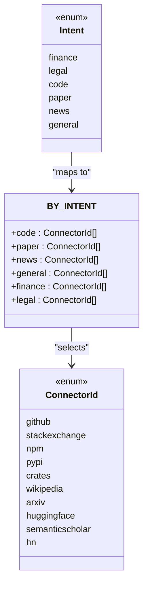

**Diagram sources**
- [connectors.ts:122-133](file://apps/desktop/src/main/core/search/connectors.ts#L122-L133)
- [types.ts:10](file://apps/desktop/src/main/core/search/types.ts#L10)

**Section sources**
- [connectors.ts:107-147](file://apps/desktop/src/main/core/search/connectors.ts#L107-L147)

### Domain-Specific Composition

#### Finance
Finance handling is strict: it avoids model-invented figures and enforces grounding. It supports:
- SIP and PnL math-based answers.
- Tax calculations.
- Crypto prices via live fetchers.
- Indian NAV lookups.
- RBI/SEBI RSS feeds.
- Stock price queries with regional checks.

It gates online access based on whether the question needs live data and respects offline-only and web-disabled modes.

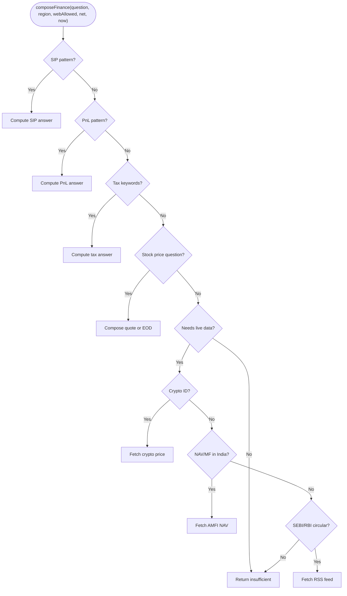

**Diagram sources**
- [run.ts:190-244](file://apps/desktop/src/main/core/search/run.ts#L190-L244)

**Section sources**
- [run.ts:190-244](file://apps/desktop/src/main/core/search/run.ts#L190-L244)

#### Legal
Legal answers must be grounded in quoted statutes. If local quotes exist, they are preferred. Otherwise, the system searches official legal sources when allowed.

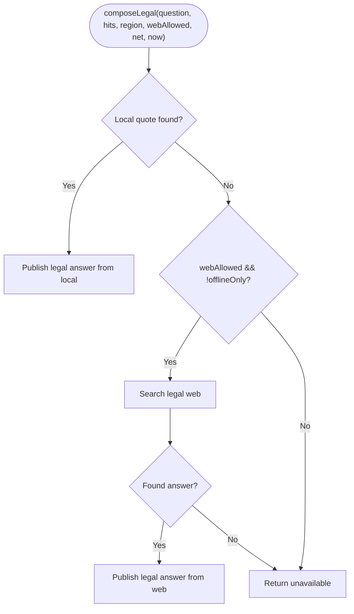

**Diagram sources**
- [run.ts:246-254](file://apps/desktop/src/main/core/search/run.ts#L246-L254)

**Section sources**
- [run.ts:246-254](file://apps/desktop/src/main/core/search/run.ts#L246-L254)

#### News
News answers are built from fetched rows. If local hits exist and pass grounding, they are used. Otherwise, online connectors are tried, followed by DuckDuckGo fallback.

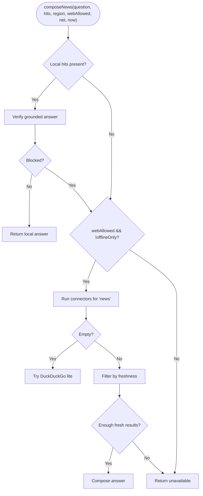

**Diagram sources**
- [run.ts:110-161](file://apps/desktop/src/main/core/search/run.ts#L110-L161)

**Section sources**
- [run.ts:110-161](file://apps/desktop/src/main/core/search/run.ts#L110-L161)

### Online Gathering and Fallbacks
When online search is allowed, the system:
- Uses intent-mapped connectors.
- Falls back to DuckDuckGo lite if connectors return nothing.
- Drops blocked sources.
- Caches connector results and page content.
- Reads up to three top pages for richer context.

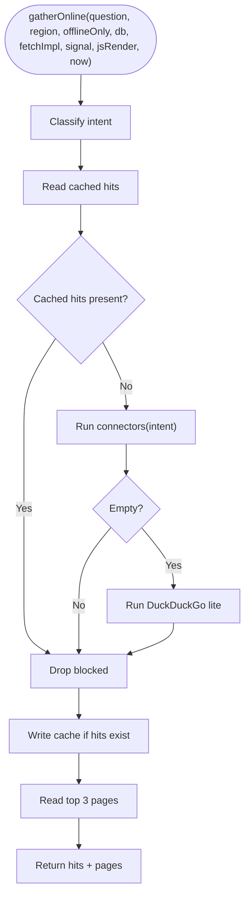

**Diagram sources**
- [run.ts:276-319](file://apps/desktop/src/main/core/search/run.ts#L276-L319)

**Section sources**
- [run.ts:276-319](file://apps/desktop/src/main/core/search/run.ts#L276-L319)

### Integration with App Services
The app service layer orchestrates the full flow:
- Adds legal section chunks when legal intent is detected.
- Attempts domain composition first for finance/legal/news.
- Computes freshness and reachability.
- Plans the route and optionally injects a synthetic local hit.
- Decides whether to run web search and rank passages.

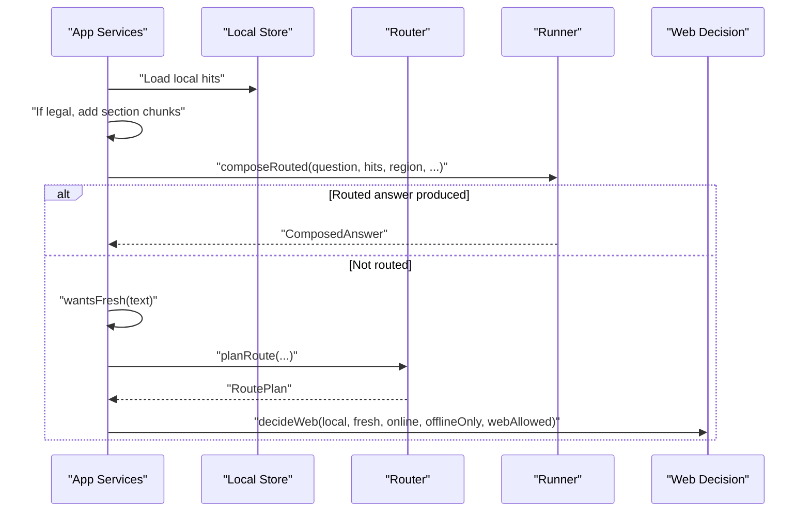

**Diagram sources**
- [app-services.ts:1648-1726](file://apps/desktop/src/main/core/app-services.ts#L1648-L1726)

**Section sources**
- [app-services.ts:1648-1726](file://apps/desktop/src/main/core/app-services.ts#L1648-L1726)

## Dependency Analysis
The following diagram shows how modules depend on each other during routing and execution.

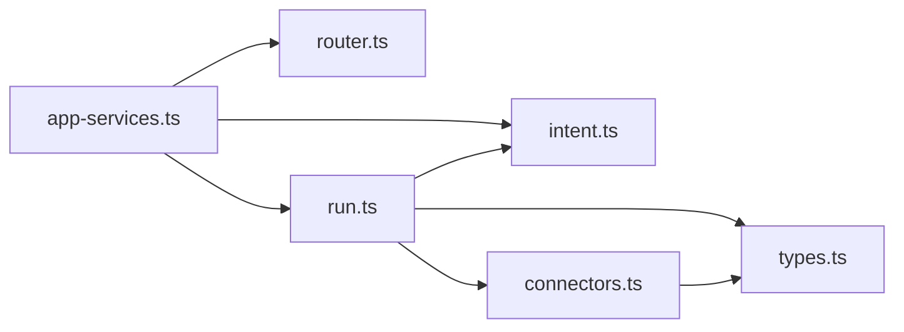

**Diagram sources**
- [app-services.ts:115-117](file://apps/desktop/src/main/core/app-services.ts#L115-L117)
- [run.ts:7-10](file://apps/desktop/src/main/core/search/run.ts#L7-L10)
- [connectors.ts:4-5](file://apps/desktop/src/main/core/search/connectors.ts#L4-L5)
- [types.ts:1-10](file://apps/desktop/src/main/core/search/types.ts#L1-L10)

**Section sources**
- [app-services.ts:115-117](file://apps/desktop/src/main/core/app-services.ts#L115-L117)
- [run.ts:7-10](file://apps/desktop/src/main/core/search/run.ts#L7-L10)
- [connectors.ts:4-5](file://apps/desktop/src/main/core/search/connectors.ts#L4-L5)
- [types.ts:1-10](file://apps/desktop/src/main/core/search/types.ts#L1-L10)

## Performance Considerations
- Local-first strategy reduces network calls and latency when sufficient local data exists.
- Freshness checks avoid unnecessary online queries for non-time-sensitive questions.
- Connector execution stops after collecting a small number of results to limit overhead.
- Caching of connector results and page content improves repeated query performance.
- Rate limiting is applied per connector to respect external API limits.
- Blocking lists and source usability checks reduce wasted work on invalid or outdated results.

[No sources needed since this section provides general guidance]

## Troubleshooting Guide
Common issues and diagnostics:
- Unexpectedly staying offline:
  - Check whether a strong local hit exists and freshness is not required.
  - Verify `webAllowed`, `offlineOnly`, and reachability flags.
- Finance answers marked insufficient:
  - Ensure the question requires live data and that connectivity is allowed.
  - Confirm region and data availability for stock/NAV/crypto flows.
- Legal answers unavailable:
  - Verify whether local statute quotes exist.
  - Ensure web access is enabled for legal web search.
- Connector failures:
  - Individual connector errors are swallowed; check whether other connectors returned results.
  - Use DuckDuckGo fallback only when all connectors return empty.

Relevant implementation areas:
- Routing decisions and reasons.
- Finance gating and live data checks.
- Legal quoting and web search.
- Connector error handling and result limits.

**Section sources**
- [router.ts:45-66](file://apps/desktop/src/main/core/search/router.ts#L45-L66)
- [run.ts:190-244](file://apps/desktop/src/main/core/search/run.ts#L190-L244)
- [run.ts:246-254](file://apps/desktop/src/main/core/search/run.ts#L246-L254)
- [connectors.ts:135-147](file://apps/desktop/src/main/core/search/connectors.ts#L135-L147)

## Conclusion
The search routing and intent detection system prioritizes safety, accuracy, and efficiency. It classifies queries into clear domains, selects appropriate connectors, and enforces strict grounding for sensitive topics like finance, legal, and news. The router favors local data when possible, goes online only when necessary, and respects user preferences and device state. This design ensures reliable, traceable answers while minimizing unnecessary network usage.

[No sources needed since this section summarizes without analyzing specific files]