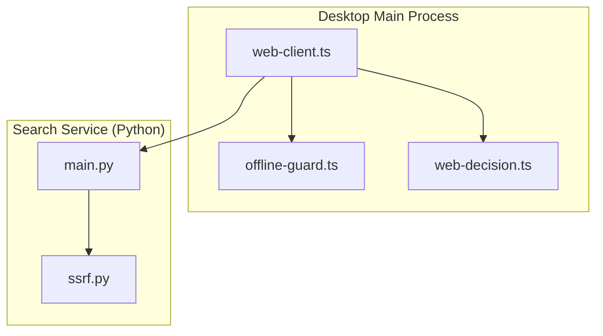
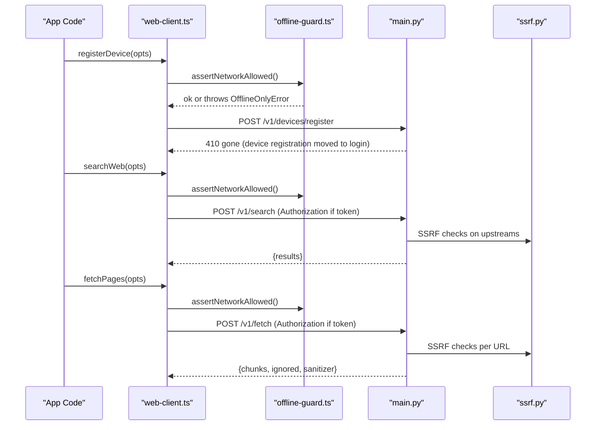
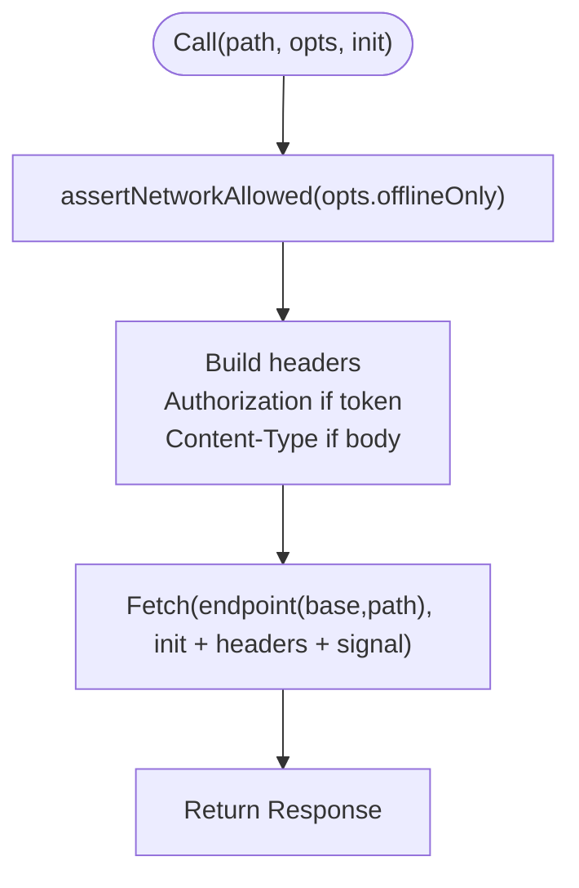
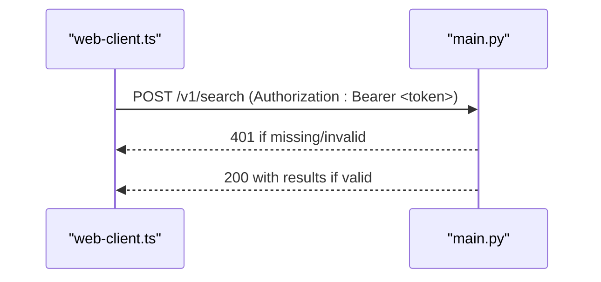
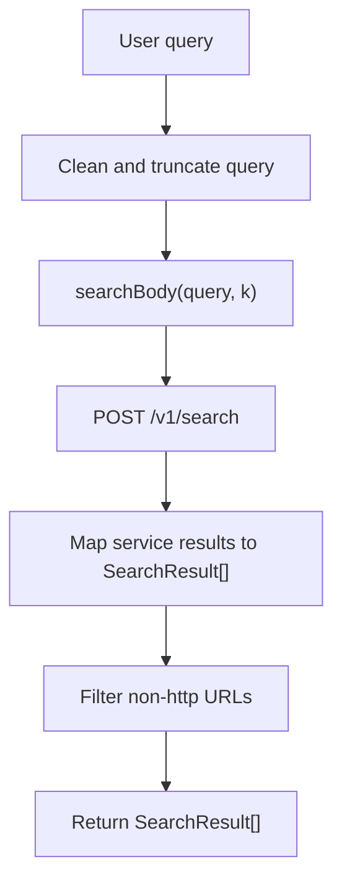
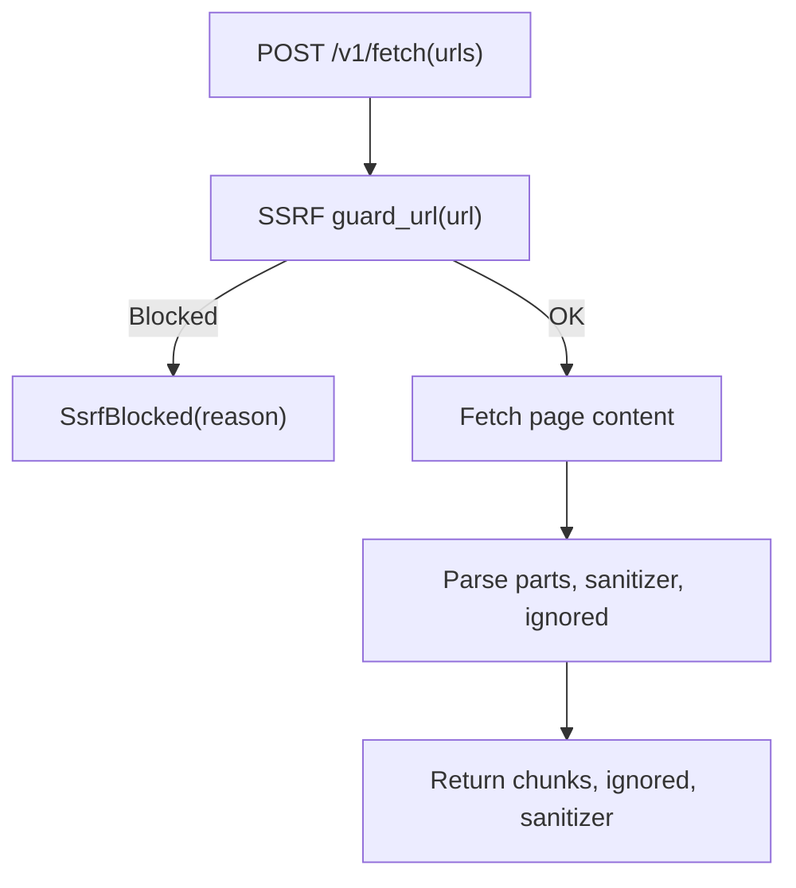
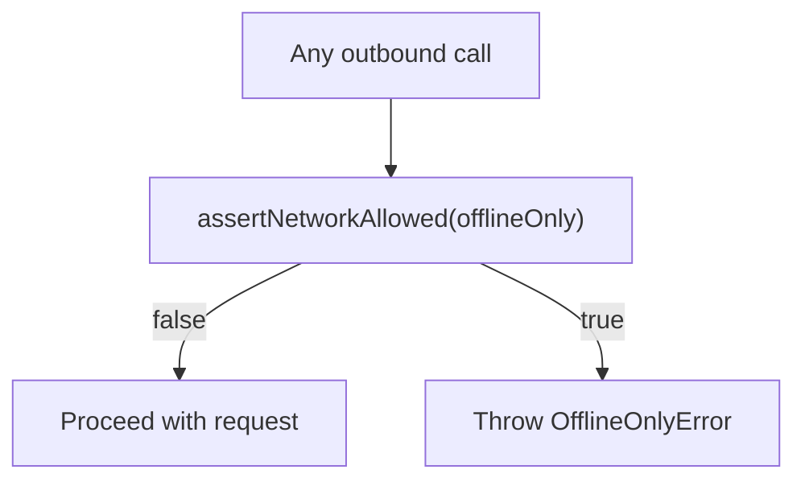
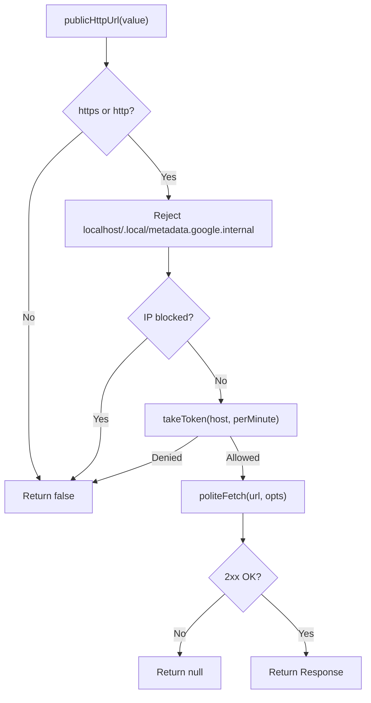
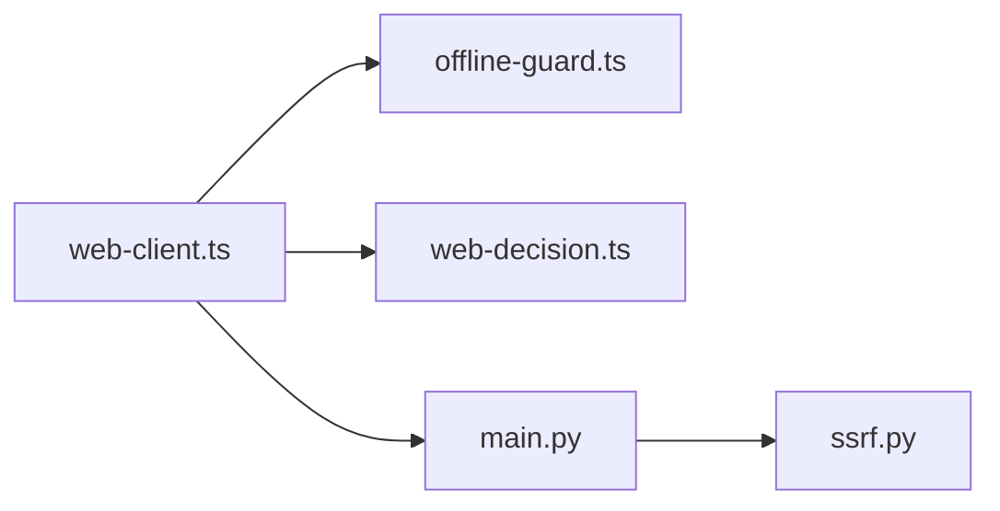

# Web Search Client

<cite>
**Referenced Files in This Document**
- [web-client.ts](file://apps/desktop/src/main/core/web-client.ts)
- [offline-guard.ts](file://apps/desktop/src/main/core/offline-guard.ts)
- [web-decision.ts](file://apps/desktop/src/main/core/web-decision.ts)
- [http.ts](file://apps/desktop/src/main/core/search/http.ts)
- [main.py](file://services/api/app/main.py)
- [ssrf.py](file://services/api/app/ssrf.py)
</cite>

## Table of Contents
1. [Introduction](#introduction)
2. [Project Structure](#project-structure)
3. [Core Components](#core-components)
4. [Architecture Overview](#architecture-overview)
5. [Detailed Component Analysis](#detailed-component-analysis)
6. [Dependency Analysis](#dependency-analysis)
7. [Performance Considerations](#performance-considerations)
8. [Troubleshooting Guide](#troubleshooting-guide)
9. [Conclusion](#conclusion)

## Introduction
This document explains the web search client component that lives in the desktop application’s main process. It covers how the WebClient module sends HTTP requests to the search service, including device registration, web search queries, and page fetching. It also documents error handling, offline-only enforcement via offline-guard integration, authentication token management, data structures used for API communication, and security considerations such as SSRF protection and URL validation.

## Project Structure
The web search client is implemented in a small TypeScript module that:
- Enforces network policy before making any request.
- Adds authentication tokens when present.
- Calls the search service endpoints for device registration, search, and page fetch.
- Normalizes responses into typed results.

**Diagram sources**
- [web-client.ts:1-123](file://apps/desktop/src/main/core/web-client.ts#L1-L123)
- [offline-guard.ts:1-15](file://apps/desktop/src/main/core/offline-guard.ts#L1-L15)
- [web-decision.ts:105-108](file://apps/desktop/src/main/core/web-decision.ts#L105-L108)
- [main.py:380-420](file://services/api/app/main.py#L380-L420)
- [main.py:646-678](file://services/api/app/main.py#L646-L678)
- [ssrf.py:1-102](file://services/api/app/ssrf.py#L1-L102)

**Section sources**
- [web-client.ts:1-123](file://apps/desktop/src/main/core/web-client.ts#L1-L123)
- [offline-guard.ts:1-15](file://apps/desktop/src/main/core/offline-guard.ts#L1-L15)
- [web-decision.ts:105-108](file://apps/desktop/src/main/core/web-decision.ts#L105-L108)
- [main.py:380-420](file://services/api/app/main.py#L380-L420)
- [main.py:646-678](file://services/api/app/main.py#L646-L678)
- [ssrf.py:1-102](file://services/api/app/ssrf.py#L1-L102)

## Core Components
- WebClientError: A custom error type carrying an HTTP status code for client-side failures.
- SearchResult: Represents a single search result returned by the service.
- FetchedChunk: Represents a chunk of text extracted from a fetched page, with optional injection metadata.
- IgnoredPassage: Represents content intentionally ignored during page processing.
- SanitizerReport: Reports sanitizer findings per URL.
- WebCall: Configuration for all outbound calls, including base URL, optional token, offline-only mode, fetch implementation override, and abort signal.

Key responsibilities:
- Enforce offline-only policy before any network call.
- Attach Authorization headers when a token is provided.
- Build safe endpoint URLs.
- Normalize service responses into typed structures.

**Section sources**
- [web-client.ts:9-50](file://apps/desktop/src/main/core/web-client.ts#L9-L50)

## Architecture Overview
The client performs three primary operations against the search service:
- Device registration: POST /v1/devices/register
- Web search: POST /v1/search
- Page fetching: POST /v1/fetch

All calls first assert that network access is allowed. The service enforces authentication and SSRF protections.

**Diagram sources**
- [web-client.ts:56-113](file://apps/desktop/src/main/core/web-client.ts#L56-L113)
- [offline-guard.ts:12-14](file://apps/desktop/src/main/core/offline-guard.ts#L12-L14)
- [main.py:308-310](file://services/api/app/main.py#L308-L310)
- [main.py:380-420](file://services/api/app/main.py#L380-L420)
- [main.py:646-678](file://services/api/app/main.py#L646-L678)
- [ssrf.py:61-89](file://services/api/app/ssrf.py#L61-L89)

## Detailed Component Analysis

### WebClient Module
Responsibilities:
- Endpoint construction: normalizes base URL and path.
- Call wrapper: asserts network permission, adds Authorization header when present, sets Content-Type for JSON bodies, forwards AbortSignal.
- Device registration: posts to /v1/devices/register and expects a token; otherwise throws WebClientError.
- Web search: posts a query body built by web-decision.searchBody, filters non-http URLs, and maps to SearchResult[].
- Page fetching: posts up to five URLs, returns normalized chunks, ignored passages, and sanitizer reports.
- Health probe: GET /v1/health with timeout.

**Diagram sources**
- [web-client.ts:52-63](file://apps/desktop/src/main/core/web-client.ts#L52-L63)
- [offline-guard.ts:12-14](file://apps/desktop/src/main/core/offline-guard.ts#L12-L14)

#### Data Structures
- SearchResult: title, url, snippet, published.
- FetchedChunk: url, title, published, text, injection(action, score, flags).
- IgnoredPassage: url, score, flags.
- SanitizerReport: url, report(map of string to number).
- WebCall: base, token?, offlineOnly, fetchImpl?, signal?.

These types are defined in the client and consumed by callers to normalize service responses.

**Section sources**
- [web-client.ts:16-50](file://apps/desktop/src/main/core/web-client.ts#L16-L50)

#### Authentication Token Management
- If opts.token is provided, the client adds an Authorization header with Bearer scheme.
- The service requires a valid token for /v1/search and /v1/fetch.
- Device registration currently returns 410 because device registration now happens at login.

**Diagram sources**
- [web-client.ts:56-62](file://apps/desktop/src/main/core/web-client.ts#L56-L62)
- [main.py:380-420](file://services/api/app/main.py#L380-L420)

**Section sources**
- [web-client.ts:56-71](file://apps/desktop/src/main/core/web-client.ts#L56-L71)
- [main.py:308-310](file://services/api/app/main.py#L308-L310)
- [main.py:380-420](file://services/api/app/main.py#L380-L420)

#### Query Construction and Processing
- The client uses web-decision.searchBody to build a minimal JSON payload containing only the short query and k value.
- The service validates the query, optionally applies niche filtering, calls the upstream search engine, and returns normalized results.

**Diagram sources**
- [web-decision.ts:105-108](file://apps/desktop/src/main/core/web-decision.ts#L105-L108)
- [web-client.ts:73-85](file://apps/desktop/src/main/core/web-client.ts#L73-L85)
- [main.py:380-420](file://services/api/app/main.py#L380-L420)

**Section sources**
- [web-decision.ts:105-108](file://apps/desktop/src/main/core/web-decision.ts#L105-L108)
- [web-client.ts:73-85](file://apps/desktop/src/main/core/web-client.ts#L73-L85)
- [main.py:380-420](file://services/api/app/main.py#L380-L420)

#### Page Fetching and SSRF Protection
- The client posts up to five URLs to /v1/fetch.
- The service enforces SSRF protections:
  - Allowed schemes: http, https.
  - No userinfo in URL.
  - Blocked hosts include localhost, .local, .internal, and cloud metadata hosts.
  - Only ports 80 and 443 are allowed unless explicitly whitelisted.
  - DNS resolution is performed and all resolved addresses must be public.
- The service returns chunks, ignored passages, and sanitizer reports.

**Diagram sources**
- [web-client.ts:87-113](file://apps/desktop/src/main/core/web-client.ts#L87-L113)
- [main.py:646-678](file://services/api/app/main.py#L646-L678)
- [ssrf.py:61-89](file://services/api/app/ssrf.py#L61-L89)

**Section sources**
- [web-client.ts:87-113](file://apps/desktop/src/main/core/web-client.ts#L87-L113)
- [main.py:646-678](file://services/api/app/main.py#L646-L678)
- [ssrf.py:1-102](file://services/api/app/ssrf.py#L1-L102)

### Offline-Only Enforcement
- All client calls invoke assertNetworkAllowed before any network activity.
- When offlineOnly is true, an OfflineOnlyError is thrown immediately.
- This protects device registration, search, fetch, and health probe.

**Diagram sources**
- [offline-guard.ts:12-14](file://apps/desktop/src/main/core/offline-guard.ts#L12-L14)
- [web-client.ts:56-62](file://apps/desktop/src/main/core/web-client.ts#L56-L62)

**Section sources**
- [offline-guard.ts:1-15](file://apps/desktop/src/main/core/offline-guard.ts#L1-L15)
- [web-client.ts:56-62](file://apps/desktop/src/main/core/web-client.ts#L56-L62)

### Polite Public HTTP Client
While not part of the WebClient class, the repository includes a polite public HTTP client used elsewhere for direct external API calls. It demonstrates additional safety patterns:
- Blocks private, loopback, link-local, multicast, reserved, and unspecified IPs.
- Rejects localhost and .local hosts.
- Applies per-host rate limiting using a rolling minute bucket.
- Returns null on transient errors or server errors to allow graceful degradation.

**Diagram sources**
- [http.ts:21-29](file://apps/desktop/src/main/core/search/http.ts#L21-L29)
- [http.ts:43-53](file://apps/desktop/src/main/core/search/http.ts#L43-L53)
- [http.ts:55-78](file://apps/desktop/src/main/core/search/http.ts#L55-L78)

**Section sources**
- [http.ts:1-79](file://apps/desktop/src/main/core/search/http.ts#L1-L79)

## Dependency Analysis
- web-client.ts depends on:
  - offline-guard.ts for network policy enforcement.
  - web-decision.ts for building the search payload.
- services/api/app/main.py implements:
  - /v1/devices/register (returns 410).
  - /v1/search (requires authentication, caches results, calls upstream search).
  - /v1/fetch (requires authentication, SSRF protection, sanitization).
- ssrf.py provides SSRF guards used by the fetch flow.

**Diagram sources**
- [web-client.ts:1-123](file://apps/desktop/src/main/core/web-client.ts#L1-L123)
- [offline-guard.ts:1-15](file://apps/desktop/src/main/core/offline-guard.ts#L1-L15)
- [web-decision.ts:105-108](file://apps/desktop/src/main/core/web-decision.ts#L105-L108)
- [main.py:308-310](file://services/api/app/main.py#L308-L310)
- [main.py:380-420](file://services/api/app/main.py#L380-L420)
- [main.py:646-678](file://services/api/app/main.py#L646-L678)
- [ssrf.py:1-102](file://services/api/app/ssrf.py#L1-L102)

**Section sources**
- [web-client.ts:1-123](file://apps/desktop/src/main/core/web-client.ts#L1-L123)
- [main.py:308-310](file://services/api/app/main.py#L308-L310)
- [main.py:380-420](file://services/api/app/main.py#L380-L420)
- [main.py:646-678](file://services/api/app/main.py#L646-L678)
- [ssrf.py:1-102](file://services/api/app/ssrf.py#L1-L102)

## Performance Considerations
- Query minimization: The client sends only a cleaned, truncated query and a bounded k value, reducing payload size.
- Result filtering: The client filters out non-http URLs early to avoid downstream issues.
- Service caching: The search endpoint caches successful results keyed by query parameters, improving latency for repeated queries.
- Abort signals: Both client and service support cancellation via AbortSignal to prevent resource leaks.

[No sources needed since this section provides general guidance]

## Troubleshooting Guide
Common scenarios and resolutions:
- Offline-only mode enabled:
  - Symptom: Any call throws OfflineOnlyError.
  - Resolution: Disable offline-only mode or ensure the app is online.
- Missing or invalid authentication token:
  - Symptom: /v1/search or /v1/fetch returns 401.
  - Resolution: Provide a valid Bearer token in WebCall.token.
- Device registration deprecated:
  - Symptom: /v1/devices/register returns 410.
  - Resolution: Use the login flow to activate a device; do not rely on device registration.
- SSRF blocked during fetch:
  - Symptom: /v1/fetch rejects certain URLs due to SSRF rules.
  - Resolution: Ensure URLs use http/https, no userinfo, public hosts, and ports 80/443 unless explicitly allowed.
- Upstream search failure:
  - Symptom: /v1/search returns a 502-like error indicating upstream failure.
  - Resolution: Retry after a short delay; the service may return cached results on subsequent identical requests.

**Section sources**
- [offline-guard.ts:5-14](file://apps/desktop/src/main/core/offline-guard.ts#L5-L14)
- [web-client.ts:65-71](file://apps/desktop/src/main/core/web-client.ts#L65-L71)
- [web-client.ts:73-85](file://apps/desktop/src/main/core/web-client.ts#L73-L85)
- [web-client.ts:87-113](file://apps/desktop/src/main/core/web-client.ts#L87-L113)
- [main.py:308-310](file://services/api/app/main.py#L308-L310)
- [main.py:380-420](file://services/api/app/main.py#L380-L420)
- [main.py:646-678](file://services/api/app/main.py#L646-L678)
- [ssrf.py:61-89](file://services/api/app/ssrf.py#L61-L89)

## Conclusion
The web search client provides a focused interface for calling the search service while enforcing offline-only policy, managing authentication tokens, and normalizing responses. The service layer adds robust authentication, caching, and SSRF protections. Together, they deliver secure, efficient web search and page fetching capabilities suitable for desktop applications.

[No sources needed since this section summarizes without analyzing specific files]