# Web Search Integration

<cite>
**Referenced Files in This Document**
- [router.ts](file://apps/desktop/src/main/core/search/router.ts)
- [connectors.ts](file://apps/desktop/src/main/core/search/connectors.ts)
- [http.ts](file://apps/desktop/src/main/core/search/http.ts)
- [types.ts](file://apps/desktop/src/main/core/search/types.ts)
- [intent.ts](file://apps/desktop/src/main/core/search/intent.ts)
- [run.ts](file://apps/desktop/src/main/core/search/run.ts)
- [ddg.ts](file://apps/desktop/src/main/core/search/ddg.ts)
- [blocked.ts](file://apps/desktop/src/main/core/search/blocked.ts)
- [reader.ts](file://apps/desktop/src/main/core/search/reader.ts)
- [cache.ts](file://apps/desktop/src/main/core/search/cache.ts)
- [main.py](file://services/api/app/main.py)
- [settings.yml](file://deploy/searxng/settings.yml)
- [docker-compose.dev.yml](file://deploy/docker-compose.dev.yml)
- [01_schema.sql](file://deploy/initdb/01_schema.sql)
</cite>

## Table of Contents
1. [Introduction](#introduction)
2. [Project Structure](#project-structure)
3. [Core Components](#core-components)
4. [Architecture Overview](#architecture-overview)
5. [Detailed Component Analysis](#detailed-component-analysis)
6. [Dependency Analysis](#dependency-analysis)
7. [Performance Considerations](#performance-considerations)
8. [Troubleshooting Guide](#troubleshooting-guide)
9. [Conclusion](#conclusion)

## Introduction
This document explains the privacy-focused web search integration used by the application. The system combines a local-first desktop search pipeline with an optional server-side proxy that forwards queries to a private SearXNG instance. It covers query routing, connector selection, caching, result filtering and sanitization, rate limiting, error handling, fallback behavior, and security controls for outbound requests and result processing.

## Project Structure
The web search integration spans two layers:

- Desktop layer (TypeScript): intent classification, router, connectors, HTTP client, DuckDuckGo fallback, blocked host filtering, page reading, and encrypted local cache.
- Server layer (Python FastAPI): authenticated SearXNG proxy, domain filtering, short-lived response cache, and privacy-preserving audit records.

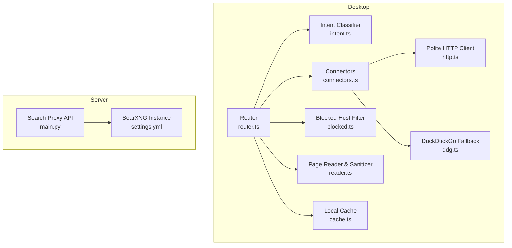

**Diagram sources**
- [router.ts:45-66](file://apps/desktop/src/main/core/search/router.ts#L45-L66)
- [connectors.ts:107-147](file://apps/desktop/src/main/core/search/connectors.ts#L107-L147)
- [http.ts:55-78](file://apps/desktop/src/main/core/search/http.ts#L55-L78)
- [ddg.ts:93-115](file://apps/desktop/src/main/core/search/ddg.ts#L93-L115)
- [blocked.ts:1-22](file://apps/desktop/src/main/core/search/blocked.ts#L1-L22)
- [reader.ts:45-89](file://apps/desktop/src/main/core/search/reader.ts#L45-L89)
- [cache.ts:52-90](file://apps/desktop/src/main/core/search/cache.ts#L52-L90)
- [main.py:380-420](file://services/api/app/main.py#L380-L420)
- [settings.yml:1-10](file://deploy/searxng/settings.yml#L1-L10)

**Section sources**
- [router.ts:1-66](file://apps/desktop/src/main/core/search/router.ts#L1-L66)
- [connectors.ts:1-147](file://apps/desktop/src/main/core/search/connectors.ts#L1-L147)
- [http.ts:1-79](file://apps/desktop/src/main/core/search/http.ts#L1-L79)
- [types.ts:1-39](file://apps/desktop/src/main/core/search/types.ts#L1-L39)
- [intent.ts:1-29](file://apps/desktop/src/main/core/search/intent.ts#L1-L29)
- [run.ts:86-319](file://apps/desktop/src/main/core/search/run.ts#L86-L319)
- [ddg.ts:1-116](file://apps/desktop/src/main/core/search/ddg.ts#L1-L116)
- [blocked.ts:1-23](file://apps/desktop/src/main/core/search/blocked.ts#L1-L23)
- [reader.ts:1-90](file://apps/desktop/src/main/core/search/reader.ts#L1-L90)
- [cache.ts:1-91](file://apps/desktop/src/main/core/search/cache.ts#L1-L91)
- [main.py:380-420](file://services/api/app/main.py#L380-L420)
- [settings.yml:1-10](file://deploy/searxng/settings.yml#L1-L10)
- [docker-compose.dev.yml:1-29](file://deploy/docker-compose.dev.yml#L1-L29)

## Core Components
- Intent classifier: Determines whether a question is finance, legal, code, paper, news, or general using keyword patterns. Finance-specific logic decides when live data is required.
- Router: Chooses between local-only answers and online search based on intent, freshness, user settings, and available local hits.
- Connectors: Official public APIs for GitHub, Stack Exchange, npm, PyPI, crates.io, Wikipedia, arXiv, Semantic Scholar, Hugging Face, and Hacker News. Results are normalized and limited per source.
- DuckDuckGo fallback: JSON instant-answer endpoint first; HTML lite endpoint as a fallback.
- Polite HTTP client: Enforces network allowlist, private IP blocking, per-host rate limiting, timeouts, safe headers, and graceful failure.
- Blocked hosts: Drops results from Reddit and X/Twitter domains.
- Page reader: Fetches and sanitizes pages, strips trackers, extracts readable content, converts to markdown, and optionally retries with JS rendering.
- Local cache: Encrypted SQLite stores search results and page text with TTLs and size-based eviction.
- Server proxy: Authenticates requests, proxies to SearXNG, filters domains, caches responses briefly, and writes privacy-preserving audit logs.

**Section sources**
- [intent.ts:7-28](file://apps/desktop/src/main/core/search/intent.ts#L7-L28)
- [router.ts:45-66](file://apps/desktop/src/main/core/search/router.ts#L45-L66)
- [connectors.ts:25-118](file://apps/desktop/src/main/core/search/connectors.ts#L25-L118)
- [ddg.ts:22-115](file://apps/desktop/src/main/core/search/ddg.ts#L22-L115)
- [http.ts:21-78](file://apps/desktop/src/main/core/search/http.ts#L21-L78)
- [blocked.ts:1-22](file://apps/desktop/src/main/core/search/blocked.ts#L1-L22)
- [reader.ts:30-89](file://apps/desktop/src/main/core/search/reader.ts#L30-L89)
- [cache.ts:8-90](file://apps/desktop/src/main/core/search/cache.ts#L8-L90)
- [main.py:380-420](file://services/api/app/main.py#L380-L420)

## Architecture Overview
The system supports two complementary paths:

- Desktop-first path: Classifies intent, consults local sources, and only goes online when necessary. Public connectors run locally with polite rate limiting and SSRF protections. DuckDuckGo is a fallback if official connectors return nothing.
- Server proxy path: When configured, the desktop can call the server’s `/v1/search` endpoint, which authenticates the request, forwards it to a private SearXNG instance, applies domain filtering, caches results briefly, and returns sanitized results without storing query text.

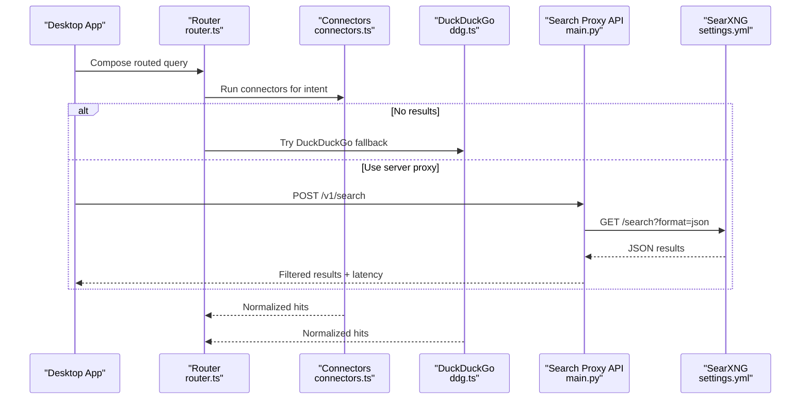

**Diagram sources**
- [router.ts:45-66](file://apps/desktop/src/main/core/search/router.ts#L45-L66)
- [connectors.ts:135-147](file://apps/desktop/src/main/core/search/connectors.ts#L135-L147)
- [ddg.ts:93-115](file://apps/desktop/src/main/core/search/ddg.ts#L93-L115)
- [main.py:380-420](file://services/api/app/main.py#L380-L420)
- [settings.yml:6-8](file://deploy/searxng/settings.yml#L6-L8)

## Detailed Component Analysis

### Privacy-Focused Search Proxy (Server Layer)
The server proxy enforces authentication, forwards queries to SearXNG, and ensures privacy by never persisting query text. It also applies safe search, language/time-range parameters, domain filtering, and a short-lived response cache. Audit records track device usage and status without exposing query content.

Key behaviors:
- Authentication via bearer token; device-scoped limits.
- SearXNG JSON endpoint with safe search enabled.
- Domain filter applied before returning results.
- In-memory or KV-backed cache keyed by a hash of the request.
- Audit table records status, latency, and result count; query_text remains null.

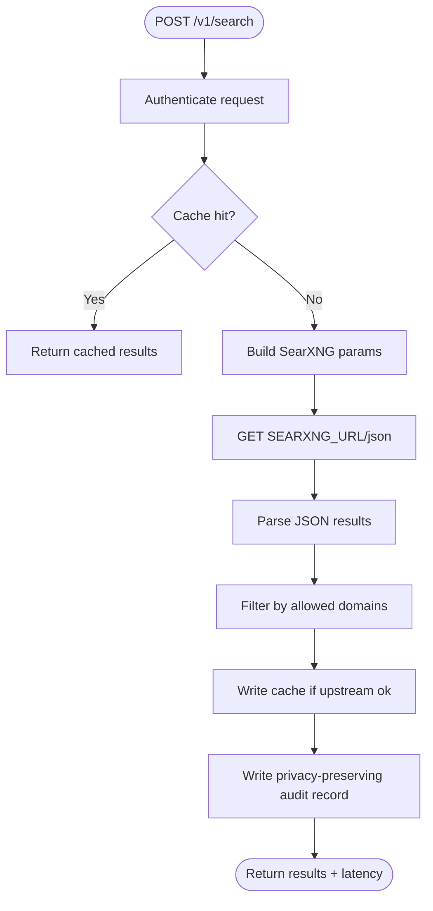

**Diagram sources**
- [main.py:380-420](file://services/api/app/main.py#L380-L420)
- [main.py:423-451](file://services/api/app/main.py#L423-L451)
- [main.py:454-464](file://services/api/app/main.py#L454-L464)
- [01_schema.sql:365-389](file://deploy/initdb/01_schema.sql#L365-L389)

**Section sources**
- [main.py:380-420](file://services/api/app/main.py#L380-L420)
- [main.py:423-451](file://services/api/app/main.py#L423-L451)
- [main.py:454-464](file://services/api/app/main.py#L454-L464)
- [01_schema.sql:365-389](file://deploy/initdb/01_schema.sql#L365-L389)
- [settings.yml:1-10](file://deploy/searxng/settings.yml#L1-L10)

### Query Router and Intent Classification
The router classifies intent and decides whether to use local sources only or to perform online search. It considers freshness, user preferences, and special cases like finance needing live figures or legal requiring statutes.

Decision flow:
- If finance needs live data and connection is allowed, go online.
- Legal questions prefer local quotes; otherwise go online if allowed.
- If strong local hits exist and the question is not fresh, stay offline.
- Otherwise, go online if permitted.

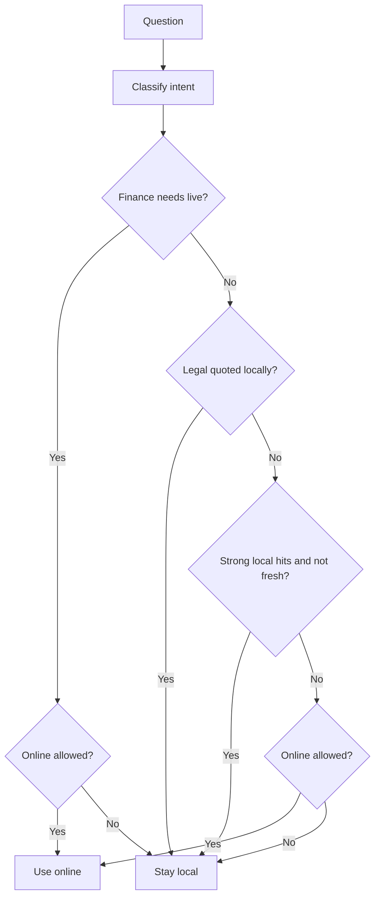

**Diagram sources**
- [intent.ts:7-28](file://apps/desktop/src/main/core/search/intent.ts#L7-L28)
- [router.ts:45-66](file://apps/desktop/src/main/core/search/router.ts#L45-L66)

**Section sources**
- [intent.ts:7-28](file://apps/desktop/src/main/core/search/intent.ts#L7-L28)
- [router.ts:45-66](file://apps/desktop/src/main/core/search/router.ts#L45-L66)

### Connector Selection and Execution
Connectors map intents to specific sources. For example, code queries target GitHub, Stack Exchange, npm, PyPI, crates.io, and Hacker News; paper queries target arXiv, Semantic Scholar, Hugging Face, and Wikipedia. Each connector uses the polite HTTP client with per-host rate limits and normalizes results.

Execution rules:
- Run connectors sequentially until at least six results are collected.
- Failures in one connector do not stop others.
- All URLs must be valid HTTP(S).
- Titles and snippets are truncated safely.

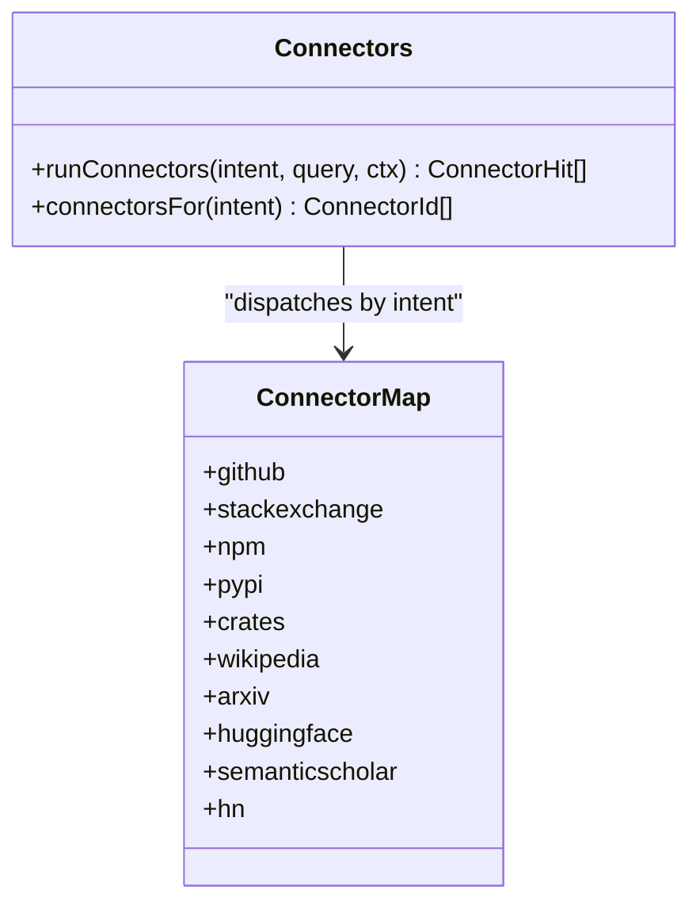

**Diagram sources**
- [connectors.ts:107-147](file://apps/desktop/src/main/core/search/connectors.ts#L107-L147)

**Section sources**
- [connectors.ts:25-118](file://apps/desktop/src/main/core/search/connectors.ts#L25-L118)
- [connectors.ts:135-147](file://apps/desktop/src/main/core/search/connectors.ts#L135-L147)

### DuckDuckGo Fallback
When official connectors return no results, DuckDuckGo is attempted:
- First, the JSON instant-answer endpoint.
- If empty or failing, the HTML lite endpoint is tried.
- Results are cleaned and filtered to exclude DuckDuckGo-owned links.

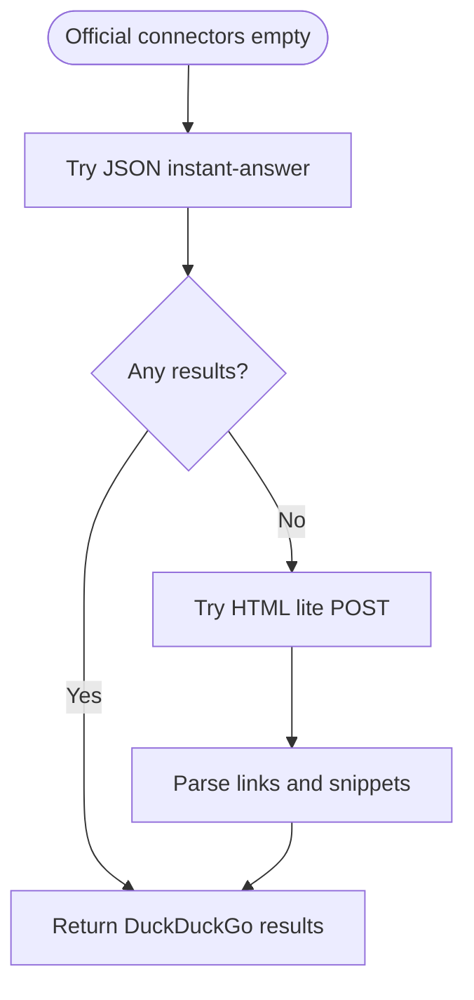

**Diagram sources**
- [ddg.ts:22-115](file://apps/desktop/src/main/core/search/ddg.ts#L22-L115)

**Section sources**
- [ddg.ts:22-115](file://apps/desktop/src/main/core/search/ddg.ts#L22-L115)

### Result Filtering, Sanitization, and Presentation
- Blocked hosts: Results from Reddit and X/Twitter domains are dropped.
- URL validation: Only http/https URLs are accepted.
- Snippet/title truncation: Prevent oversized fields.
- Page sanitization: Scripts, iframes, and tracker resources are stripped; readable content is extracted and converted to markdown; text length is capped.

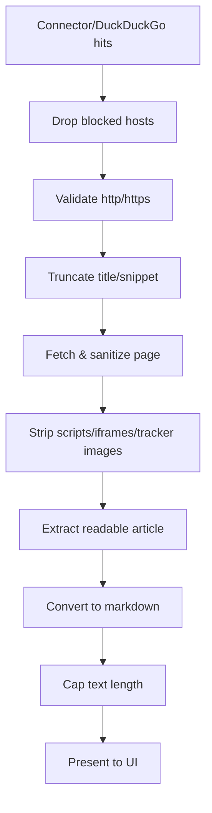

**Diagram sources**
- [blocked.ts:1-22](file://apps/desktop/src/main/core/search/blocked.ts#L1-L22)
- [connectors.ts:20-23](file://apps/desktop/src/main/core/search/connectors.ts#L20-L23)
- [reader.ts:30-59](file://apps/desktop/src/main/core/search/reader.ts#L30-L59)

**Section sources**
- [blocked.ts:1-22](file://apps/desktop/src/main/core/search/blocked.ts#L1-L22)
- [connectors.ts:20-23](file://apps/desktop/src/main/core/search/connectors.ts#L20-L23)
- [reader.ts:30-59](file://apps/desktop/src/main/core/search/reader.ts#L30-L59)

### Local Caching System
The desktop cache stores search results and page text in an encrypted SQLite database:
- Search results expire after 24 hours.
- Page text expires after 7 days.
- Size cap triggers eviction of oldest entries.
- Keys are hashed combinations of kind, region, and value.

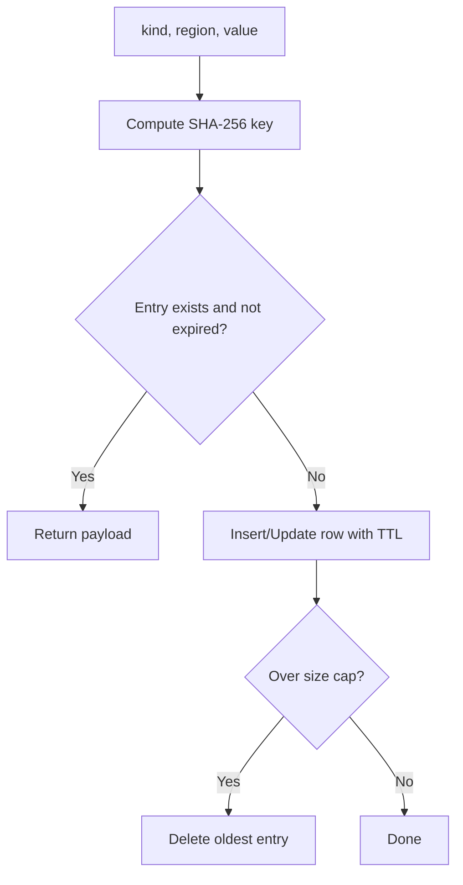

**Diagram sources**
- [cache.ts:8-90](file://apps/desktop/src/main/core/search/cache.ts#L8-L90)

**Section sources**
- [cache.ts:8-90](file://apps/desktop/src/main/core/search/cache.ts#L8-L90)

### Rate Limiting Strategies
- Per-host rolling minute limiter in the polite HTTP client prevents exceeding configured rates for each destination.
- Server-side search proxy uses short-lived response cache and per-device rate limiting through its limiter infrastructure.
- SearXNG instance disables its own limiter because the API handles throttling.

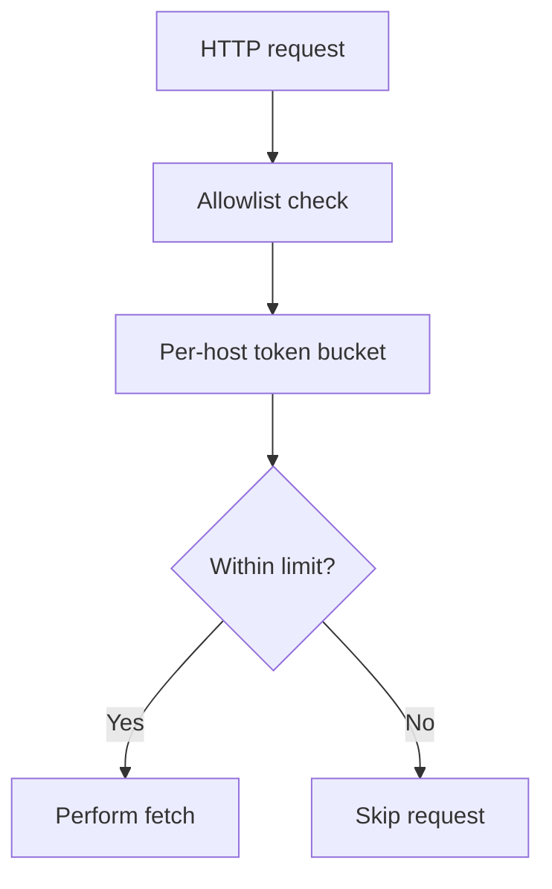

**Diagram sources**
- [http.ts:42-53](file://apps/desktop/src/main/core/search/http.ts#L42-L53)
- [settings.yml:2-5](file://deploy/searxng/settings.yml#L2-L5)

**Section sources**
- [http.ts:42-53](file://apps/desktop/src/main/core/search/http.ts#L42-L53)
- [settings.yml:2-5](file://deploy/searxng/settings.yml#L2-L5)

### Error Handling and Fallback Mechanisms
- Network failures, timeouts, and non-OK statuses return null from the polite client; callers treat this as “no results” and try the next source.
- DuckDuckGo tries JSON first, then HTML lite.
- Server proxy treats upstream errors gracefully, returns empty results, and marks status as upstream_error.
- Finance/news/legal composition functions return structured “insufficient” answers when data is unavailable.

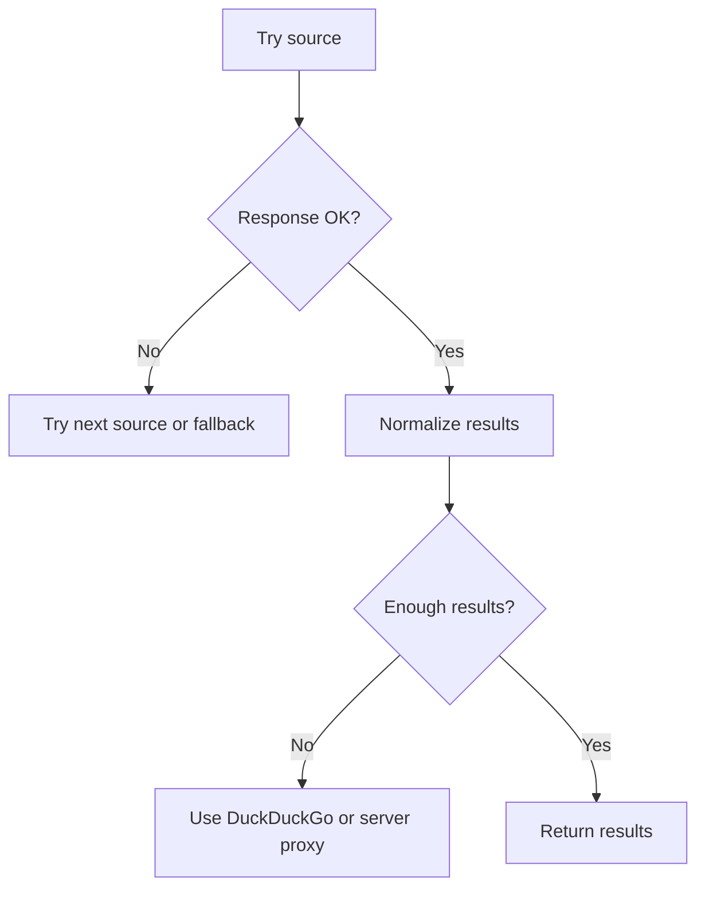

**Diagram sources**
- [http.ts:55-78](file://apps/desktop/src/main/core/search/http.ts#L55-L78)
- [ddg.ts:93-115](file://apps/desktop/src/main/core/search/ddg.ts#L93-L115)
- [main.py:395-420](file://services/api/app/main.py#L395-L420)

**Section sources**
- [http.ts:55-78](file://apps/desktop/src/main/core/search/http.ts#L55-L78)
- [ddg.ts:93-115](file://apps/desktop/src/main/core/search/ddg.ts#L93-L115)
- [main.py:395-420](file://services/api/app/main.py#L395-L420)

### Security Considerations
- Outbound URL allowlist: Only http/https protocols are allowed.
- Private and link-local addresses, loopback, cloud metadata endpoints, and reserved ranges are blocked.
- Redirects follow policy but SSRF protections remain active.
- User-agent and accept headers are set explicitly.
- Tracker stripping removes analytics and tracking resources from fetched pages.
- Server proxy validates URLs and honors safe search; query text is never persisted.

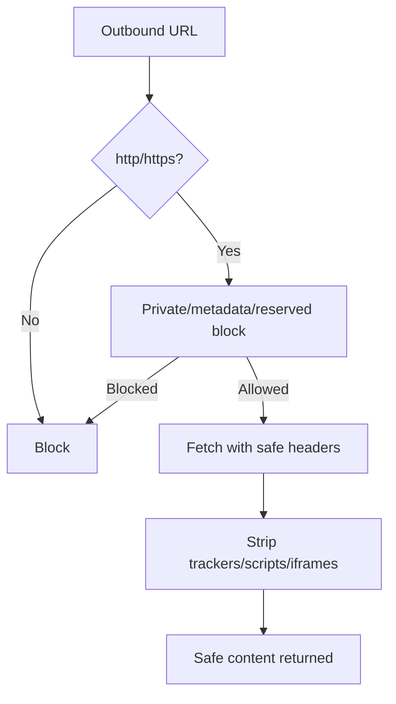

**Diagram sources**
- [http.ts:21-29](file://apps/desktop/src/main/core/search/http.ts#L21-L29)
- [reader.ts:30-43](file://apps/desktop/src/main/core/search/reader.ts#L30-L43)
- [main.py:403-412](file://services/api/app/main.py#L403-L412)

**Section sources**
- [http.ts:21-29](file://apps/desktop/src/main/core/search/http.ts#L21-L29)
- [reader.ts:30-43](file://apps/desktop/src/main/core/search/reader.ts#L30-L43)
- [main.py:403-412](file://services/api/app/main.py#L403-L412)

## Dependency Analysis
The following diagram shows how components depend on each other during a typical search operation.

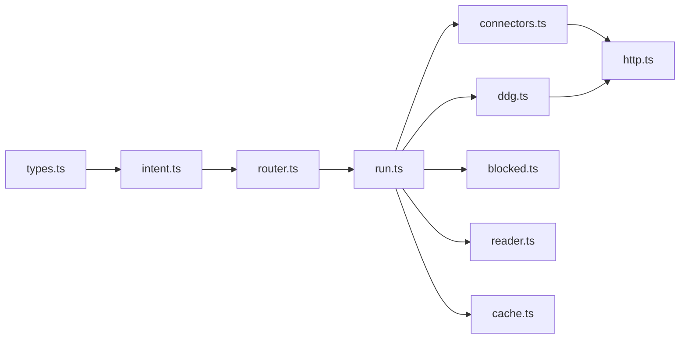

**Diagram sources**
- [types.ts:1-39](file://apps/desktop/src/main/core/search/types.ts#L1-L39)
- [intent.ts:1-29](file://apps/desktop/src/main/core/search/intent.ts#L1-L29)
- [router.ts:1-66](file://apps/desktop/src/main/core/search/router.ts#L1-L66)
- [run.ts:1-319](file://apps/desktop/src/main/core/search/run.ts#L1-L319)
- [connectors.ts:1-147](file://apps/desktop/src/main/core/search/connectors.ts#L1-L147)
- [ddg.ts:1-116](file://apps/desktop/src/main/core/search/ddg.ts#L1-L116)
- [http.ts:1-79](file://apps/desktop/src/main/core/search/http.ts#L1-L79)
- [blocked.ts:1-23](file://apps/desktop/src/main/core/search/blocked.ts#L1-L23)
- [reader.ts:1-90](file://apps/desktop/src/main/core/search/reader.ts#L1-L90)
- [cache.ts:1-91](file://apps/desktop/src/main/core/search/cache.ts#L1-L91)

**Section sources**
- [run.ts:86-319](file://apps/desktop/src/main/core/search/run.ts#L86-L319)
- [connectors.ts:107-147](file://apps/desktop/src/main/core/search/connectors.ts#L107-L147)
- [ddg.ts:93-115](file://apps/desktop/src/main/core/search/ddg.ts#L93-L115)
- [http.ts:55-78](file://apps/desktop/src/main/core/search/http.ts#L55-L78)

## Performance Considerations
- Prefer local sources when sufficient; online search is only triggered when needed.
- Official connectors are limited per host to avoid throttling and reduce load.
- DuckDuckGo fallback avoids unnecessary full-page fetching unless needed.
- Local cache reduces repeated network calls and speeds up offline access.
- Page extraction caps sizes and avoids heavy JS rendering unless static content is too short.
- Server proxy caches responses briefly to reduce upstream load.

[No sources needed since this section provides general guidance]

## Troubleshooting Guide
Common issues and resolutions:
- No results from official connectors: DuckDuckGo fallback may still provide results; verify connectivity and rate limits.
- Upstream SearXNG unavailable: Server proxy returns empty results with status upstream_error; retry after delay.
- Blocked domains: Reddit/X domains are intentionally excluded; adjust expectations or use alternative connectors.
- Cache not populated: Ensure the encrypted user database is initialized and writable; check TTL and size cap behavior.
- SSRF blocks: Requests to private IPs, loopback, or metadata endpoints are blocked; confirm target URLs are public.

**Section sources**
- [ddg.ts:93-115](file://apps/desktop/src/main/core/search/ddg.ts#L93-L115)
- [main.py:395-420](file://services/api/app/main.py#L395-L420)
- [blocked.ts:1-22](file://apps/desktop/src/main/core/search/blocked.ts#L1-L22)
- [cache.ts:35-90](file://apps/desktop/src/main/core/search/cache.ts#L35-L90)
- [http.ts:21-29](file://apps/desktop/src/main/core/search/http.ts#L21-L29)

## Conclusion
The web search integration balances privacy, performance, and reliability. It prioritizes local data, uses polite and secure outbound requests, and falls back gracefully when online services are unavailable. The server proxy adds authenticated, privacy-preserving access to SearXNG while enforcing safe search and domain filtering. Together, these components deliver robust, secure, and efficient web search capabilities across both online and offline scenarios.

[No sources needed since this section summarizes without analyzing specific files]