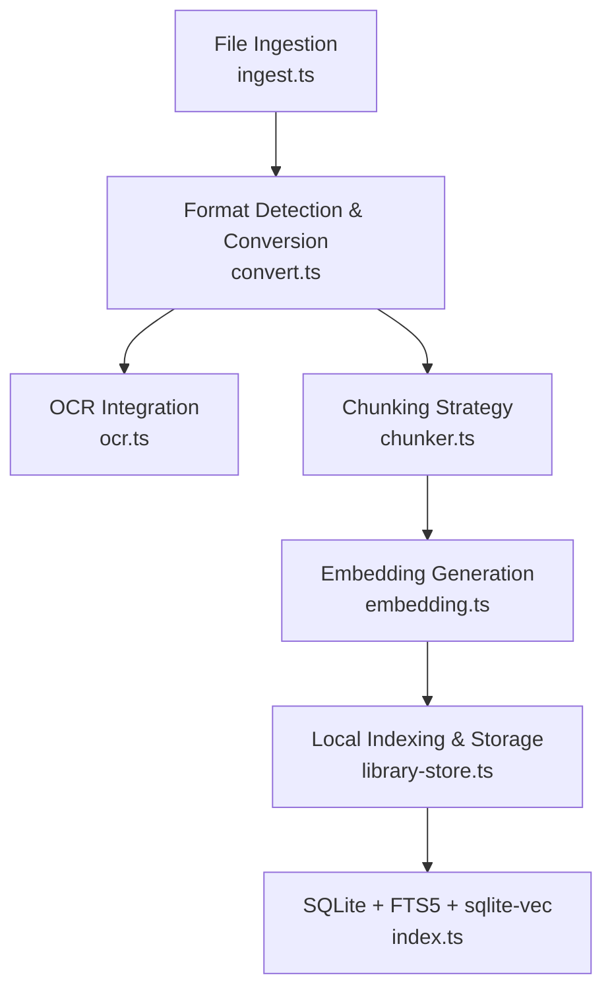
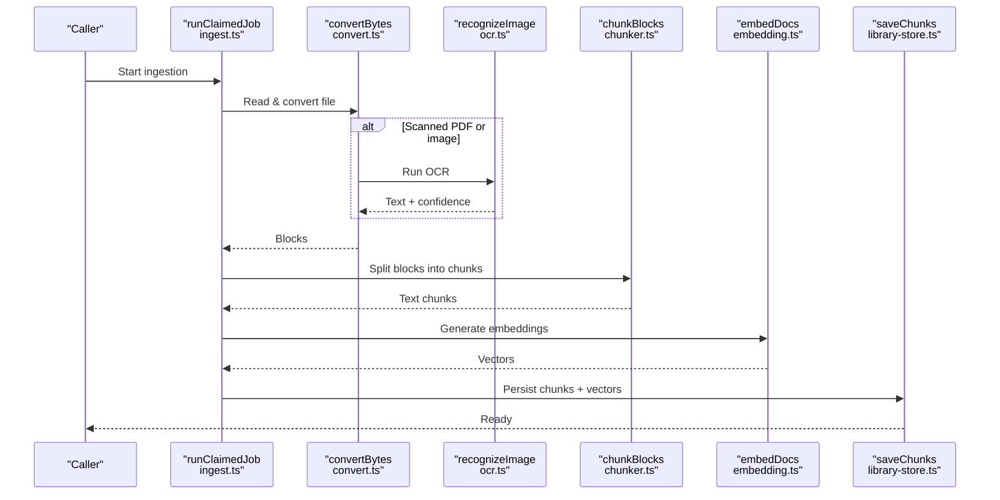
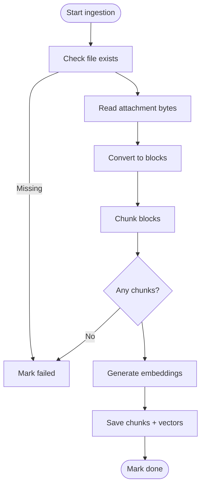
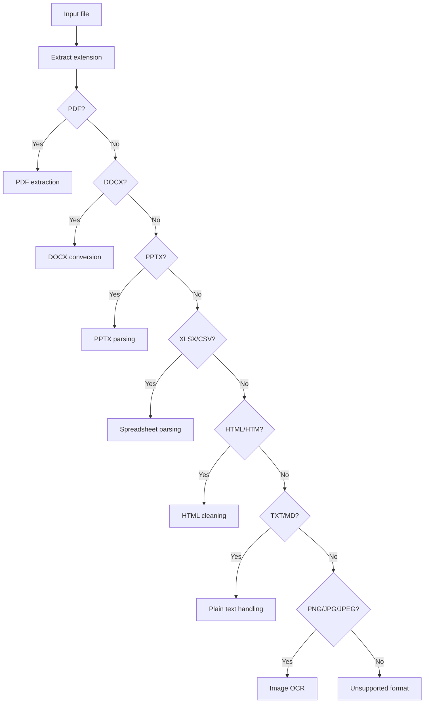
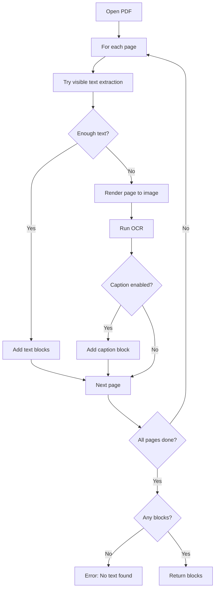
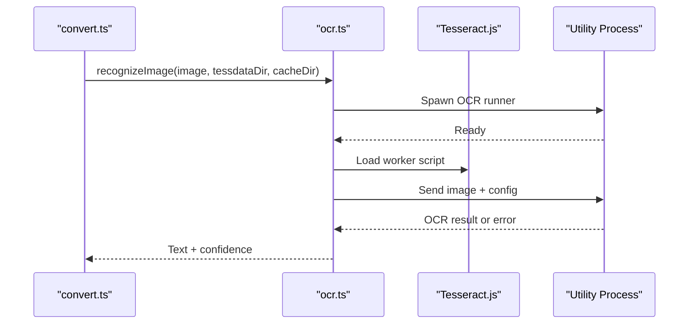
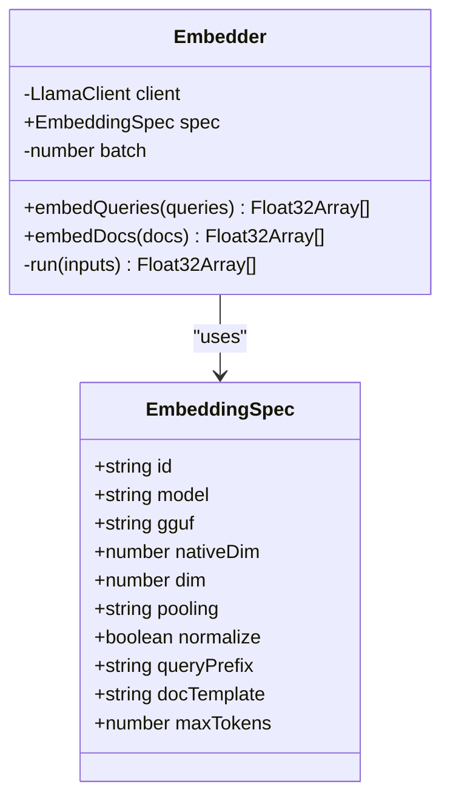
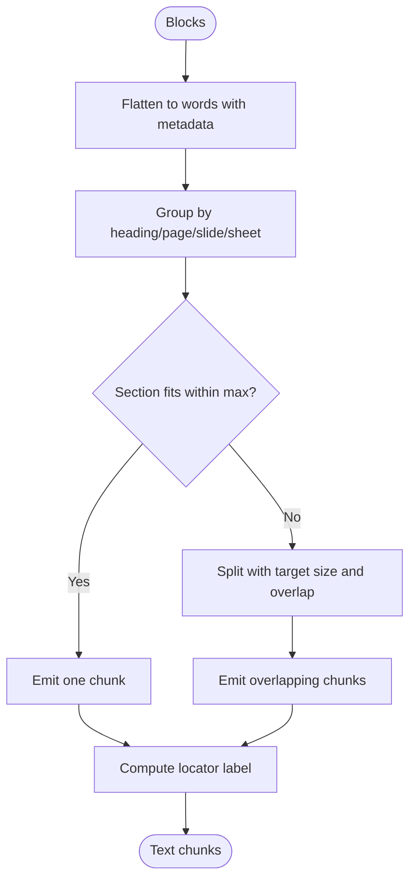
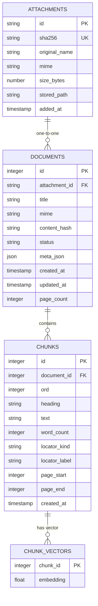
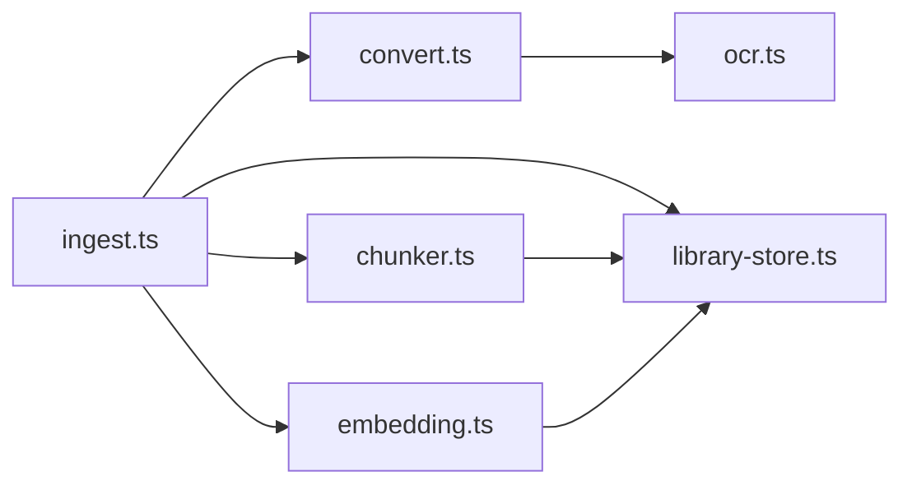

# Document Processing

<cite>
**Referenced Files in This Document**
- [ingest.ts](file://apps/desktop/src/main/core/ingest.ts)
- [convert.ts](file://apps/desktop/src/main/core/convert.ts)
- [ocr.ts](file://apps/desktop/src/main/core/ocr.ts)
- [chunker.ts](file://apps/desktop/src/main/core/chunker.ts)
- [embedding.ts](file://apps/desktop/src/main/core/embedding.ts)
- [library-store.ts](file://apps/desktop/src/main/core/library-store.ts)
- [extract.ts](file://apps/desktop/src/main/core/files/extract.ts)
- [index.ts](file://apps/desktop/src/main/index.ts)
- [ARCHITECTURE-FULL.md](file://docs/ARCHITECTURE-FULL.md)
- [privacy page](file://apps/web/src/pages.tsx)
</cite>

## Table of Contents
1. [Introduction](#introduction)
2. [Project Structure](#project-structure)
3. [Core Components](#core-components)
4. [Architecture Overview](#architecture-overview)
5. [Detailed Component Analysis](#detailed-component-analysis)
6. [Dependency Analysis](#dependency-analysis)
7. [Performance Considerations](#performance-considerations)
8. [Troubleshooting Guide](#troubleshooting-guide)
9. [Privacy and Data Handling](#privacy-and-data-handling)
10. [Conclusion](#conclusion)

## Introduction
This document explains the Surf.ai document processing pipeline that turns local files into searchable, semantically indexed content. The system detects supported formats, extracts text or runs OCR, splits documents into context-aware chunks, generates vector embeddings, and stores everything in a local encrypted SQLite database with full-text search and vector similarity support. It is designed to keep user documents on-device by default and only use external services when explicitly configured.

## Project Structure
The document pipeline lives primarily in the desktop main process under `apps/desktop/src/main/core`. The key modules are:

- File ingestion and job orchestration
- Format detection and conversion
- OCR integration
- Chunking strategy
- Embedding generation
- Local indexing and storage

**Diagram sources**
- [ingest.ts:35-90](file://apps/desktop/src/main/core/ingest.ts#L35-L90)
- [convert.ts:81-106](file://apps/desktop/src/main/core/convert.ts#L81-L106)
- [ocr.ts:88-105](file://apps/desktop/src/main/core/ocr.ts#L88-L105)
- [chunker.ts:45-70](file://apps/desktop/src/main/core/chunker.ts#L45-L70)
- [embedding.ts:66-83](file://apps/desktop/src/main/core/embedding.ts#L66-L83)
- [library-store.ts:159-191](file://apps/desktop/src/main/core/library-store.ts#L159-L191)
- [index.ts:82-98](file://apps/desktop/src/main/index.ts#L82-L98)

**Section sources**
- [ingest.ts:1-92](file://apps/desktop/src/main/core/ingest.ts#L1-L92)
- [convert.ts:1-394](file://apps/desktop/src/main/core/convert.ts#L1-L394)
- [ocr.ts:1-113](file://apps/desktop/src/main/core/ocr.ts#L1-L113)
- [chunker.ts:1-119](file://apps/desktop/src/main/core/chunker.ts#L1-L119)
- [embedding.ts:1-84](file://apps/desktop/src/main/core/embedding.ts#L1-L84)
- [library-store.ts:1-320](file://apps/desktop/src/main/core/library-store.ts#L1-L320)
- [index.ts:82-98](file://apps/desktop/src/main/index.ts#L82-L98)

## Core Components
- **Ingestion**: Reads an attachment, validates it, converts it to structured blocks, chunks them, embeds them, and persists results.
- **Conversion**: Detects file format and routes to PDF extraction, DOCX/PPTX/XLSX/CSV parsing, HTML/text/markdown handling, or image OCR.
- **OCR**: Uses Tesseract.js in a separate utility process for scanned pages and images.
- **Chunking**: Splits text into ~250-word segments with overlap while preserving headings, pages, slides, and sheets.
- **Embeddings**: Formats inputs according to a shared embedding spec, batches requests, truncates vectors, and normalizes them.
- **Indexing**: Stores attachments, documents, chunks, and vectors in a local SQLite database with FTS5 and sqlite-vec.

**Section sources**
- [ingest.ts:35-90](file://apps/desktop/src/main/core/ingest.ts#L35-L90)
- [convert.ts:22-43](file://apps/desktop/src/main/core/convert.ts#L22-L43)
- [ocr.ts:88-105](file://apps/desktop/src/main/core/ocr.ts#L88-L105)
- [chunker.ts:45-70](file://apps/desktop/src/main/core/chunker.ts#L45-L70)
- [embedding.ts:31-51](file://apps/desktop/src/main/core/embedding.ts#L31-L51)
- [library-store.ts:159-191](file://apps/desktop/src/main/core/library-store.ts#L159-L191)

## Architecture Overview
The ingestion flow coordinates multiple stages with progress tracking and cancellation support.

**Diagram sources**
- [ingest.ts:35-90](file://apps/desktop/src/main/core/ingest.ts#L35-L90)
- [convert.ts:81-106](file://apps/desktop/src/main/core/convert.ts#L81-L106)
- [ocr.ts:88-105](file://apps/desktop/src/main/core/ocr.ts#L88-L105)
- [chunker.ts:45-70](file://apps/desktop/src/main/core/chunker.ts#L45-L70)
- [embedding.ts:66-83](file://apps/desktop/src/main/core/embedding.ts#L66-L83)
- [library-store.ts:159-191](file://apps/desktop/src/main/core/library-store.ts#L159-L191)

## Detailed Component Analysis

### File Ingestion System
The ingestion module orchestrates the entire pipeline:

- Validates that the attachment still exists on disk.
- Reads the file bytes.
- Converts the file into structured blocks.
- Chunks the blocks.
- Generates embeddings for each chunk.
- Persists chunks and vectors atomically.
- Updates job status and emits progress events.

It also provides a synchronous entry point for adding a file directly, which checks MIME support, stores the file, and either returns immediately or waits for background indexing.

**Diagram sources**
- [ingest.ts:35-90](file://apps/desktop/src/main/core/ingest.ts#L35-L90)

**Section sources**
- [ingest.ts:35-90](file://apps/desktop/src/main/core/ingest.ts#L35-L90)
- [ingest.ts:75-90](file://apps/desktop/src/main/core/ingest.ts#L75-L90)

### Format Detection and Routing
The converter maps file extensions to MIME types and routes to specialized handlers:

- PDF: Extract visible text; if insufficient, render the page and run OCR.
- DOCX: Convert to HTML, strip hidden content, then extract text.
- PPTX: Parse slide XML and extract titles and body text.
- XLSX/CSV: Read spreadsheets and serialize rows into tabular text.
- HTML/HTM: Clean and extract headings and paragraphs.
- Markdown/Text: Preserve structure where possible.
- PNG/JPG/JPEG: Run OCR and optionally generate captions.

Supported formats are explicitly validated, and unsupported files raise clear errors.

**Diagram sources**
- [convert.ts:22-43](file://apps/desktop/src/main/core/convert.ts#L22-L43)
- [convert.ts:81-106](file://apps/desktop/src/main/core/convert.ts#L81-L106)

**Section sources**
- [convert.ts:22-43](file://apps/desktop/src/main/core/convert.ts#L22-L43)
- [convert.ts:81-106](file://apps/desktop/src/main/core/convert.ts#L81-L106)

### PDF Extraction Capabilities
PDF processing uses a two-stage approach:

1. **Visible text extraction**: First tries operator-level text to avoid invisible or near-white text, then falls back to standard text content.
2. **Fallback OCR**: If extracted text is too short, renders the page to an image and runs OCR via Tesseract.js.
3. **Optional captioning**: An optional model-based caption can be added for image-heavy pages.

Pages are processed sequentially with progress updates and cleanup. If no usable text is found across all pages, an error is raised.

**Diagram sources**
- [convert.ts:108-143](file://apps/desktop/src/main/core/convert.ts#L108-L143)
- [convert.ts:145-179](file://apps/desktop/src/main/core/convert.ts#L145-L179)
- [convert.ts:237-245](file://apps/desktop/src/main/core/convert.ts#L237-L245)

**Section sources**
- [convert.ts:108-143](file://apps/desktop/src/main/core/convert.ts#L108-L143)
- [convert.ts:145-179](file://apps/desktop/src/main/core/convert.ts#L145-L179)
- [convert.ts:237-245](file://apps/desktop/src/main/core/convert.ts#L237-L245)

### DOCX Conversion Pipeline
DOCX conversion:

- Converts DOCX to HTML using a dedicated library.
- Strips hidden Word elements such as invisible runs and white-colored text.
- Extracts meaningful text from the resulting HTML.
- Raises an error if no text is found.

This avoids relying on Python toolchains and keeps the desktop install lightweight.

**Section sources**
- [convert.ts:247-267](file://apps/desktop/src/main/core/convert.ts#L247-L267)
- [convert.ts:315-332](file://apps/desktop/src/main/core/convert.ts#L315-L332)

### Image Processing with OCR Integration
Images and scanned PDF pages are handled through Tesseract.js:

- OCR runs in a separate Electron utility process so a stuck WASM worker cannot freeze the main UI.
- Language data directories and cache directories are passed explicitly.
- Each OCR request has a timeout.
- Errors include missing runner, process startup failures, timeouts, and unexpected exits.

**Diagram sources**
- [ocr.ts:52-86](file://apps/desktop/src/main/core/ocr.ts#L52-L86)
- [ocr.ts:88-105](file://apps/desktop/src/main/core/ocr.ts#L88-L105)

**Section sources**
- [ocr.ts:1-113](file://apps/desktop/src/main/core/ocr.ts#L1-L113)
- [convert.ts:357-367](file://apps/desktop/src/main/core/convert.ts#L357-L367)

### Vector Embedding Generation
Embeddings are generated using a shared specification for compatibility between the desktop and server pipelines:

- Queries use a task prefix.
- Documents use a title and text template.
- Vectors are truncated to the configured dimension and L2-normalized.
- Invalid dimensions, NaN values, or zero vectors are rejected.
- Requests are batched to reduce overhead.

The embedding client communicates with a local embedding service (for example, served by llama-server), keeping computation local unless explicitly configured otherwise.

**Diagram sources**
- [embedding.ts:17-42](file://apps/desktop/src/main/core/embedding.ts#L17-L42)
- [embedding.ts:66-83](file://apps/desktop/src/main/core/embedding.ts#L66-L83)

**Section sources**
- [embedding.ts:1-84](file://apps/desktop/src/main/core/embedding.ts#L1-L84)

### Document Chunking Strategy
The chunker creates structure-aware segments:

- Target size is about 250 words.
- Maximum segment size is around 300 words.
- Overlap preserves context across boundaries.
- Headings, pages, slides, and sheet names are preserved.
- New sections start at structural boundaries rather than arbitrary word cuts.

This helps citations stay accurate and makes retrieval more useful.

**Diagram sources**
- [chunker.ts:45-70](file://apps/desktop/src/main/core/chunker.ts#L45-L70)
- [chunker.ts:90-118](file://apps/desktop/src/main/core/chunker.ts#L90-L118)

**Section sources**
- [chunker.ts:1-119](file://apps/desktop/src/main/core/chunker.ts#L1-L119)

### Indexing System with SQLite, Full-Text Search, and Vector Similarity
Indexed data is stored locally:

- Attachments are deduplicated by SHA-256 and stored on disk under a hashed path.
- Documents track metadata, MIME type, hash, and status.
- Chunks store text, word count, locators, and ordering.
- Vectors are stored in a `sqlite-vec` table with cosine distance.
- FTS5 indexes enable fast keyword search.
- Deletion removes both chunks and vectors and cleans up stored files.

The desktop self-test demonstrates creating an encrypted SQLite database, inserting FTS and vector data, and running both full-text and vector similarity queries.

**Diagram sources**
- [library-store.ts:19-50](file://apps/desktop/src/main/core/library-store.ts#L19-L50)
- [library-store.ts:159-191](file://apps/desktop/src/main/core/library-store.ts#L159-L191)
- [index.ts:82-98](file://apps/desktop/src/main/index.ts#L82-L98)

**Section sources**
- [library-store.ts:1-320](file://apps/desktop/src/main/core/library-store.ts#L1-L320)
- [index.ts:82-98](file://apps/desktop/src/main/index.ts#L82-L98)

### Supported File Formats and Processing Limitations
Supported formats:

- PDF
- DOCX
- PPTX
- XLSX
- CSV
- TXT
- MD
- HTML / HTM
- PNG
- JPG / JPEG

Limitations and constraints:

- Attachment size limit is enforced during reading.
- Some PDFs may require OCR if they contain scanned images.
- Spreadsheet parsing limits rows and columns to keep processing predictable.
- PowerPoint parsing extracts text from slide XML and may not preserve complex layouts.
- Code files can be parsed with tree-sitter when grammars are available; otherwise plain text fallback is used.
- Archives and zipped bundles are not expanded in the MVP ingestion path due to security risks.

**Section sources**
- [convert.ts:22-43](file://apps/desktop/src/main/core/convert.ts#L22-L43)
- [convert.ts:71-79](file://apps/desktop/src/main/core/convert.ts#L71-L79)
- [convert.ts:296-313](file://apps/desktop/src/main/core/convert.ts#L296-L313)
- [ARCHITECTURE-FULL.md:2358-2364](file://docs/ARCHITECTURE-FULL.md#L2358-L2364)

## Dependency Analysis
The pipeline has clear layering:

- Ingestion depends on conversion, chunking, embedding, and storage.
- Conversion depends on OCR for images and scanned PDFs.
- Chunking produces locators used by embedding titles and persistence.
- Embedding depends on a local embedding client and shared spec.
- Storage depends on chunk metadata and vector buffers.

**Diagram sources**
- [ingest.ts:35-90](file://apps/desktop/src/main/core/ingest.ts#L35-L90)
- [convert.ts:81-106](file://apps/desktop/src/main/core/convert.ts#L81-L106)
- [ocr.ts:88-105](file://apps/desktop/src/main/core/ocr.ts#L88-L105)
- [chunker.ts:45-70](file://apps/desktop/src/main/core/chunker.ts#L45-L70)
- [embedding.ts:66-83](file://apps/desktop/src/main/core/embedding.ts#L66-L83)
- [library-store.ts:159-191](file://apps/desktop/src/main/core/library-store.ts#L159-L191)

**Section sources**
- [ingest.ts:1-92](file://apps/desktop/src/main/core/ingest.ts#L1-L92)
- [convert.ts:1-394](file://apps/desktop/src/main/core/convert.ts#L1-L394)
- [ocr.ts:1-113](file://apps/desktop/src/main/core/ocr.ts#L1-L113)
- [chunker.ts:1-119](file://apps/desktop/src/main/core/chunker.ts#L1-L119)
- [embedding.ts:1-84](file://apps/desktop/src/main/core/embedding.ts#L1-L84)
- [library-store.ts:1-320](file://apps/desktop/src/main/core/library-store.ts#L1-L320)

## Performance Considerations
- **Batched embeddings**: Embedding requests are grouped to reduce client/server round trips.
- **Progressive indexing**: Conversion, chunking, and embedding update progress so the UI remains responsive.
- **OCR isolation**: OCR runs in a separate utility process to prevent long-running WASM work from blocking the main thread.
- **Structured chunking**: Preserving headings and locators reduces redundant reprocessing and improves retrieval quality.
- **Deduplication**: Identical files are stored once by SHA-256, reducing disk usage and repeated work.
- **Size limits**: Large files are rejected early to avoid excessive memory or CPU usage.
- **Vector normalization**: Matryoshka truncation plus L2 normalization ensures stable cosine similarity.

[No sources needed since this section provides general guidance]

## Troubleshooting Guide
Common issues and their likely causes:

- **Unsupported file**: The extension is not recognized or the MIME lookup fails.
- **Empty file**: The file has zero bytes.
- **File too large**: The file exceeds the configured maximum attachment size.
- **No text found**: The file contains no readable text after conversion or OCR.
- **PDF has no text**: The PDF may be scanned; ensure OCR language data is available and OCR is enabled.
- **OCR timeout**: OCR did not complete within the expected time.
- **OCR process missing**: The OCR runner or Tesseract worker is not installed correctly.
- **Embedding dimension mismatch**: The embedding model returned a different dimension than expected.
- **Invalid embedding**: NaN, Inf, or zero vectors were detected.
- **Chunk/vector count mismatch**: Persistence was called with inconsistent arrays.
- **Missing document row**: The document record could not be found before saving chunks.

Recovery options:

- Retry failed jobs through the job retry function.
- Requeue interrupted jobs after restart.
- Delete and re-add corrupted attachments.
- Verify OCR language packs and cache directories.
- Confirm the embedding model and spec match the expected configuration.

**Section sources**
- [convert.ts:71-79](file://apps/desktop/src/main/core/convert.ts#L71-L79)
- [convert.ts:100-106](file://apps/desktop/src/main/core/convert.ts#L100-L106)
- [convert.ts:141-142](file://apps/desktop/src/main/core/convert.ts#L141-L142)
- [ocr.ts:92-105](file://apps/desktop/src/main/core/ocr.ts#L92-L105)
- [embedding.ts:54-63](file://apps/desktop/src/main/core/embedding.ts#L54-L63)
- [embedding.ts:69-78](file://apps/desktop/src/main/core/embedding.ts#L69-L78)
- [library-store.ts:159-191](file://apps/desktop/src/main/core/library-store.ts#L159-L191)
- [library-store.ts:124-149](file://apps/desktop/src/main/core/library-store.ts#L124-L149)

## Privacy and Data Handling
Surf.ai’s design emphasizes local-first privacy:

- Chats and documents are intended to remain on the device in an encrypted database.
- The model runs locally by default.
- Web search is optional; when enabled, only the short query is sent, not the documents themselves.
- There are no ads and no sale of user data.
- Crash reporting is off by default.
- To delete app data, users remove the application’s data folder.

These statements describe the product’s design and are not legal compliance certifications.

**Section sources**
- [privacy page:107-149](file://apps/web/src/pages.tsx#L107-L149)

## Conclusion
The Surf.ai document processing pipeline provides a local-first, multi-format ingestion system. It detects supported files, extracts text or runs OCR, splits content into context-preserving chunks, generates semantic embeddings, and indexes everything in a local SQLite database with full-text and vector search. The architecture prioritizes privacy, performance, and resilience, while offering clear error handling and recovery paths for common processing failures.